# Détection d'anomalies (Z-score, clustering) — Intermédiaire

> **Mise en contexte :** ce cours étudie le problème suivant : des interfaces très différentes utilisent un seuil unique ; les alertes sont bruyantes et n'aident pas à prioriser les comportements réellement inhabituels. L'objectif est d'améliorer les opérations de manière mesurable, vérifiable et proportionnée au risque. Les exemples doivent être adaptés et testés en laboratoire avant toute utilisation sur une infrastructure réelle.

## Sommaire

1. Introduction et objectifs
2. Concepts clés
3. Architecture de référence
4. Pipeline et algorithmes
5. Étude de cas
6. Implémentation guidée et laboratoire
7. Sécurité et gouvernance
8. Pièges à éviter
9. Diagnostic et dépannage
10. Exercices corrigés
11. Checklist et à retenir
12. Références

## 1. Introduction et objectifs

L'AIOps applique l'analyse de données et l'automatisation aux opérations informatiques afin de rendre la détection, le diagnostic et la résolution plus cohérents. Pour **Détection d'anomalies (Z-score, clustering)**, l'enjeu est de comparer seuils statistiques, statistiques robustes, clustering et isolation forest.. Le besoin est concret : les équipes doivent agir rapidement, mais les observations peuvent être contradictoires, les horloges décalées et les interventions porteuses de risques. La solution doit ainsi distinguer un signal, une hypothèse, une décision et une preuve de résultat.

Le scénario de départ est : des interfaces très différentes utilisent un seuil unique ; les alertes sont bruyantes et n'aident pas à prioriser les comportements réellement inhabituels. Il illustre que des outils techniquement capables ne suffisent pas. La qualité dépend de données fiables, d'une question mesurable, d'une référence de comparaison et d'une procédure de reprise. Le système doit savoir reconnaître une donnée absente, exposer ses limites et demander de l'aide. L'automatisation n'est pas un objectif en soi : elle est justifiée uniquement si elle améliore un résultat opérationnel sans déplacer le risque vers les utilisateurs ou l'équipe d'astreinte.

Les outils possibles comprennent Z-score, MAD, DBSCAN, Isolation Forest, séries temporelles. Ils ne doivent pas tous être déployés dans le même projet. Chaque composant doit répondre à un besoin identifié et avoir un propriétaire. Une architecture réduite, testée et bien observée est préférable à un assemblage complexe dont personne ne peut expliquer les erreurs. La première version peut rester en lecture seule ; l'autorité d'agir se développe seulement après des essais reproductibles, une mesure des erreurs et une validation de la procédure de retour arrière.

### Objectifs pédagogiques
- Décrire les concepts principaux et leurs limites.
- Définir les sources de données, la qualité attendue et les propriétaires.
- Décrire le chemin entre observation, analyse, décision, action et vérification.
- Mesurer les erreurs et comparer la solution à une baseline.
- Protéger les accès et documenter une stratégie d'escalade et de reprise.

### Vocabulaire opérationnel
Une **observation** est une mesure ou un événement provenant d'une source identifiée. Un **signal** est une interprétation d'observations dans un contexte. Une **hypothèse** est une explication testable. Une **décision** sélectionne une action ou une abstention. Une **postcondition** est un état vérifiable qui doit être vrai après une intervention. Ces mots ne sont pas interchangeables. Une alerte n'est pas automatiquement un incident confirmé, un score ne constitue pas une preuve de cause racine et l'exécution d'une commande ne prouve pas que le service est rétabli.

## 2. Concepts clés

### 1. Anomalie

Une anomalie est atypique dans un contexte ; elle peut être une panne, un changement planifié ou un défaut de mesure.

Sur le terrain, Anomalie doit être relié à une question opérationnelle et à une décision possible. Une anomalie est atypique dans un contexte ; elle peut être une panne, un changement planifié ou un défaut de mesure. Il faut nommer la source de vérité, le propriétaire, la fréquence de mise à jour et le périmètre d'utilisation avant d'automatiser. Pour le scénario « des interfaces très différentes utilisent un seuil unique ; les alertes sont bruyantes et n'aident pas à prioriser les comportements réellement inhabituels », cette précision empêche de transformer une intuition en commande. Elle permet aussi de définir quand il faut s'abstenir, demander davantage de données ou transmettre le dossier à une personne responsable.

La mise en œuvre de Anomalie gagne à être découpée en contrôles testables. Vérifier d'abord le format et la provenance des entrées, puis les hypothèses, les valeurs manquantes et les versions. L'outil Z-score peut contribuer à cette étape, mais sa présence ne garantit pas la qualité. Les erreurs doivent rester explicites au lieu d'être converties silencieusement en valeurs par défaut. Une exécution fiable sait différencier une réussite, un échec, un résultat partiel et un état impossible à déterminer.

L'évaluation de Anomalie doit inclure les cas courants, les cas limites et les exemples difficiles. La mesure doit inclure précision et rappel si labels, tout en examinant les différences selon la criticité et le type de cible. Un score moyen peut masquer une défaillance rare mais coûteuse ; il faut donc conserver des exemples concrets, mesurer faux positifs et faux négatifs et expliquer le coût de chaque erreur. Après une évolution de données, de code ou de modèle, les mêmes tests doivent être rejoués pour vérifier que le comportement attendu persiste.

Aucune technique associée à Anomalie n'est universellement préférable. Une règle peut être plus explicable, un modèle peut capter davantage de variables, et un système génératif peut accélérer la synthèse sans garantir la vérité. Le choix doit tenir compte des données, de la latence, du coût d'erreur, de l'explicabilité et de la maintenance. La baseline et le mode manuel doivent rester disponibles pour les périodes où les observations sont incomplètes ou que le système n'a plus la qualité attendue.

### 2. Z-score

Le Z-score exprime l'écart à la moyenne en unités d'écart-type et dépend d'une référence adaptée.

Sur le terrain, Z-score doit être relié à une question opérationnelle et à une décision possible. Le Z-score exprime l'écart à la moyenne en unités d'écart-type et dépend d'une référence adaptée. Il faut nommer la source de vérité, le propriétaire, la fréquence de mise à jour et le périmètre d'utilisation avant d'automatiser. Pour le scénario « des interfaces très différentes utilisent un seuil unique ; les alertes sont bruyantes et n'aident pas à prioriser les comportements réellement inhabituels », cette précision empêche de transformer une intuition en commande. Elle permet aussi de définir quand il faut s'abstenir, demander davantage de données ou transmettre le dossier à une personne responsable.

La mise en œuvre de Z-score gagne à être découpée en contrôles testables. Vérifier d'abord le format et la provenance des entrées, puis les hypothèses, les valeurs manquantes et les versions. L'outil MAD peut contribuer à cette étape, mais sa présence ne garantit pas la qualité. Les erreurs doivent rester explicites au lieu d'être converties silencieusement en valeurs par défaut. Une exécution fiable sait différencier une réussite, un échec, un résultat partiel et un état impossible à déterminer.

L'évaluation de Z-score doit inclure les cas courants, les cas limites et les exemples difficiles. La mesure doit inclure alertes par heure ou par actif, tout en examinant les différences selon la criticité et le type de cible. Un score moyen peut masquer une défaillance rare mais coûteuse ; il faut donc conserver des exemples concrets, mesurer faux positifs et faux négatifs et expliquer le coût de chaque erreur. Après une évolution de données, de code ou de modèle, les mêmes tests doivent être rejoués pour vérifier que le comportement attendu persiste.

### 3. Statistiques robustes

Médiane et MAD réduisent l'influence de valeurs extrêmes qui déforment la moyenne.

Sur le terrain, Statistiques robustes doit être relié à une question opérationnelle et à une décision possible. Médiane et MAD réduisent l'influence de valeurs extrêmes qui déforment la moyenne. Il faut nommer la source de vérité, le propriétaire, la fréquence de mise à jour et le périmètre d'utilisation avant d'automatiser. Pour le scénario « des interfaces très différentes utilisent un seuil unique ; les alertes sont bruyantes et n'aident pas à prioriser les comportements réellement inhabituels », cette précision empêche de transformer une intuition en commande. Elle permet aussi de définir quand il faut s'abstenir, demander davantage de données ou transmettre le dossier à une personne responsable.

La mise en œuvre de Statistiques robustes gagne à être découpée en contrôles testables. Vérifier d'abord le format et la provenance des entrées, puis les hypothèses, les valeurs manquantes et les versions. L'outil DBSCAN peut contribuer à cette étape, mais sa présence ne garantit pas la qualité. Les erreurs doivent rester explicites au lieu d'être converties silencieusement en valeurs par défaut. Une exécution fiable sait différencier une réussite, un échec, un résultat partiel et un état impossible à déterminer.

L'évaluation de Statistiques robustes doit inclure les cas courants, les cas limites et les exemples difficiles. La mesure doit inclure délai de détection, tout en examinant les différences selon la criticité et le type de cible. Un score moyen peut masquer une défaillance rare mais coûteuse ; il faut donc conserver des exemples concrets, mesurer faux positifs et faux négatifs et expliquer le coût de chaque erreur. Après une évolution de données, de code ou de modèle, les mêmes tests doivent être rejoués pour vérifier que le comportement attendu persiste.

### 4. Clustering

Le clustering groupe des observations selon distance ou densité ; la normalisation influence le résultat.

Sur le terrain, Clustering doit être relié à une question opérationnelle et à une décision possible. Le clustering groupe des observations selon distance ou densité ; la normalisation influence le résultat. Il faut nommer la source de vérité, le propriétaire, la fréquence de mise à jour et le périmètre d'utilisation avant d'automatiser. Pour le scénario « des interfaces très différentes utilisent un seuil unique ; les alertes sont bruyantes et n'aident pas à prioriser les comportements réellement inhabituels », cette précision empêche de transformer une intuition en commande. Elle permet aussi de définir quand il faut s'abstenir, demander davantage de données ou transmettre le dossier à une personne responsable.

La mise en œuvre de Clustering gagne à être découpée en contrôles testables. Vérifier d'abord le format et la provenance des entrées, puis les hypothèses, les valeurs manquantes et les versions. L'outil Isolation Forest peut contribuer à cette étape, mais sa présence ne garantit pas la qualité. Les erreurs doivent rester explicites au lieu d'être converties silencieusement en valeurs par défaut. Une exécution fiable sait différencier une réussite, un échec, un résultat partiel et un état impossible à déterminer.

L'évaluation de Clustering doit inclure les cas courants, les cas limites et les exemples difficiles. La mesure doit inclure stabilité des seuils, tout en examinant les différences selon la criticité et le type de cible. Un score moyen peut masquer une défaillance rare mais coûteuse ; il faut donc conserver des exemples concrets, mesurer faux positifs et faux négatifs et expliquer le coût de chaque erreur. Après une évolution de données, de code ou de modèle, les mêmes tests doivent être rejoués pour vérifier que le comportement attendu persiste.

Aucune technique associée à Clustering n'est universellement préférable. Une règle peut être plus explicable, un modèle peut capter davantage de variables, et un système génératif peut accélérer la synthèse sans garantir la vérité. Le choix doit tenir compte des données, de la latence, du coût d'erreur, de l'explicabilité et de la maintenance. La baseline et le mode manuel doivent rester disponibles pour les périodes où les observations sont incomplètes ou que le système n'a plus la qualité attendue.

### 5. Isolation Forest

Isolation Forest isole des observations par partitions aléatoires ; scores et seuils doivent être calibrés.

Sur le terrain, Isolation Forest doit être relié à une question opérationnelle et à une décision possible. Isolation Forest isole des observations par partitions aléatoires ; scores et seuils doivent être calibrés. Il faut nommer la source de vérité, le propriétaire, la fréquence de mise à jour et le périmètre d'utilisation avant d'automatiser. Pour le scénario « des interfaces très différentes utilisent un seuil unique ; les alertes sont bruyantes et n'aident pas à prioriser les comportements réellement inhabituels », cette précision empêche de transformer une intuition en commande. Elle permet aussi de définir quand il faut s'abstenir, demander davantage de données ou transmettre le dossier à une personne responsable.

La mise en œuvre de Isolation Forest gagne à être découpée en contrôles testables. Vérifier d'abord le format et la provenance des entrées, puis les hypothèses, les valeurs manquantes et les versions. L'outil séries temporelles peut contribuer à cette étape, mais sa présence ne garantit pas la qualité. Les erreurs doivent rester explicites au lieu d'être converties silencieusement en valeurs par défaut. Une exécution fiable sait différencier une réussite, un échec, un résultat partiel et un état impossible à déterminer.

L'évaluation de Isolation Forest doit inclure les cas courants, les cas limites et les exemples difficiles. La mesure doit inclure charge de triage des équipes, tout en examinant les différences selon la criticité et le type de cible. Un score moyen peut masquer une défaillance rare mais coûteuse ; il faut donc conserver des exemples concrets, mesurer faux positifs et faux négatifs et expliquer le coût de chaque erreur. Après une évolution de données, de code ou de modèle, les mêmes tests doivent être rejoués pour vérifier que le comportement attendu persiste.

### 6. Saisonnalité

Une même valeur peut être normale à midi et anormale la nuit, selon le lien et le service.

Sur le terrain, Saisonnalité doit être relié à une question opérationnelle et à une décision possible. Une même valeur peut être normale à midi et anormale la nuit, selon le lien et le service. Il faut nommer la source de vérité, le propriétaire, la fréquence de mise à jour et le périmètre d'utilisation avant d'automatiser. Pour le scénario « des interfaces très différentes utilisent un seuil unique ; les alertes sont bruyantes et n'aident pas à prioriser les comportements réellement inhabituels », cette précision empêche de transformer une intuition en commande. Elle permet aussi de définir quand il faut s'abstenir, demander davantage de données ou transmettre le dossier à une personne responsable.

La mise en œuvre de Saisonnalité gagne à être découpée en contrôles testables. Vérifier d'abord le format et la provenance des entrées, puis les hypothèses, les valeurs manquantes et les versions. L'outil Z-score peut contribuer à cette étape, mais sa présence ne garantit pas la qualité. Les erreurs doivent rester explicites au lieu d'être converties silencieusement en valeurs par défaut. Une exécution fiable sait différencier une réussite, un échec, un résultat partiel et un état impossible à déterminer.

L'évaluation de Saisonnalité doit inclure les cas courants, les cas limites et les exemples difficiles. La mesure doit inclure précision et rappel si labels, tout en examinant les différences selon la criticité et le type de cible. Un score moyen peut masquer une défaillance rare mais coûteuse ; il faut donc conserver des exemples concrets, mesurer faux positifs et faux négatifs et expliquer le coût de chaque erreur. Après une évolution de données, de code ou de modèle, les mêmes tests doivent être rejoués pour vérifier que le comportement attendu persiste.

### 7. Seuil et feedback

Un seuil transforme un score en décision ; les revues humaines aident à le calibrer.

Sur le terrain, Seuil et feedback doit être relié à une question opérationnelle et à une décision possible. Un seuil transforme un score en décision ; les revues humaines aident à le calibrer. Il faut nommer la source de vérité, le propriétaire, la fréquence de mise à jour et le périmètre d'utilisation avant d'automatiser. Pour le scénario « des interfaces très différentes utilisent un seuil unique ; les alertes sont bruyantes et n'aident pas à prioriser les comportements réellement inhabituels », cette précision empêche de transformer une intuition en commande. Elle permet aussi de définir quand il faut s'abstenir, demander davantage de données ou transmettre le dossier à une personne responsable.

La mise en œuvre de Seuil et feedback gagne à être découpée en contrôles testables. Vérifier d'abord le format et la provenance des entrées, puis les hypothèses, les valeurs manquantes et les versions. L'outil MAD peut contribuer à cette étape, mais sa présence ne garantit pas la qualité. Les erreurs doivent rester explicites au lieu d'être converties silencieusement en valeurs par défaut. Une exécution fiable sait différencier une réussite, un échec, un résultat partiel et un état impossible à déterminer.

L'évaluation de Seuil et feedback doit inclure les cas courants, les cas limites et les exemples difficiles. La mesure doit inclure alertes par heure ou par actif, tout en examinant les différences selon la criticité et le type de cible. Un score moyen peut masquer une défaillance rare mais coûteuse ; il faut donc conserver des exemples concrets, mesurer faux positifs et faux négatifs et expliquer le coût de chaque erreur. Après une évolution de données, de code ou de modèle, les mêmes tests doivent être rejoués pour vérifier que le comportement attendu persiste.

Aucune technique associée à Seuil et feedback n'est universellement préférable. Une règle peut être plus explicable, un modèle peut capter davantage de variables, et un système génératif peut accélérer la synthèse sans garantir la vérité. Le choix doit tenir compte des données, de la latence, du coût d'erreur, de l'explicabilité et de la maintenance. La baseline et le mode manuel doivent rester disponibles pour les périodes où les observations sont incomplètes ou que le système n'a plus la qualité attendue.

## 3. Architecture de référence

Une architecture exploitable sépare au minimum la production des données, leur normalisation, le calcul analytique, la politique d'autorisation et la vérification. Il est risqué de relier directement un détecteur à une commande privilégiée : une fausse alerte devient alors une action potentiellement dommageable. Entre la proposition et l'exécution, il faut un point de décision explicite qui examine la qualité de données, la confiance, la criticité, le périmètre autorisé, le plan de reprise et la nécessité d'une approbation humaine. La boucle se ferme uniquement quand l'état du service est observé après l'intervention.

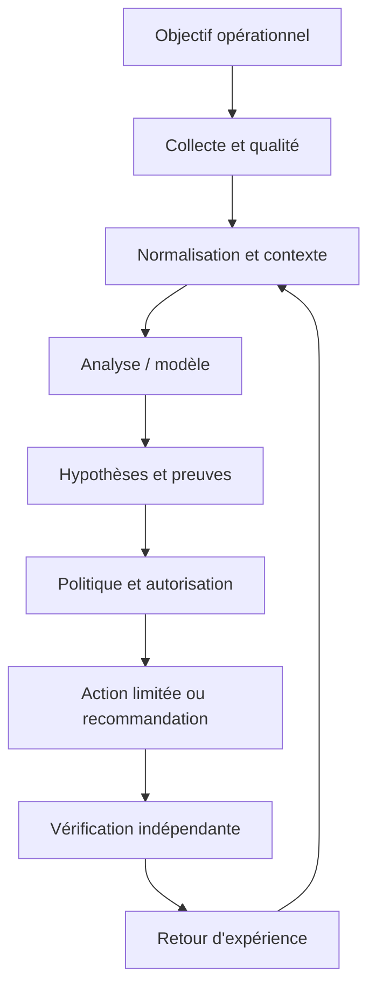

Le premier contrat concerne la donnée : source, horodatage, unité, cible, fraîcheur et état de qualité sont conservés. Le contrat du modèle ou de la règle précise la version, les entrées attendues, les métriques de validation et les limites. Le contrat de décision énumère les actions permises, les préconditions, les approbations, les quotas et les conditions d'arrêt. Le contrat de sortie indique enfin la preuve requise pour déclarer un rétablissement. Ces frontières permettent de tester chaque partie indépendamment, de corriger un composant sans dissimuler l'origine de l'erreur et d'auditer une action plusieurs semaines plus tard.

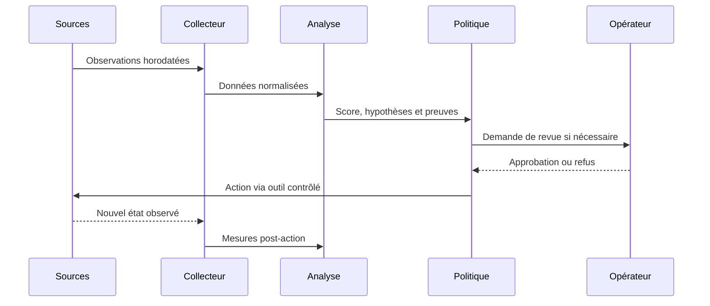

### Frontières de sécurité et mode dégradé

Le contrôle de sécurité lié à Séparation analyse/exécution doit être conçu dès le départ. Appliquer le moindre privilège, protéger les secrets, tracer les décisions et séparer analyse et exécution. Le piège à surveiller est : un seuil unique pour tous les actifs. Lorsque des données externes entrent dans le pipeline, elles ne doivent pas modifier les règles d'accès ni fournir des instructions privilégiées. Toute action à fort impact exige des préconditions compréhensibles, une approbation adaptée et une façon testée de revenir vers un état sûr.

Si Données manquantes produit un résultat incohérent, commencer par vérifier horloge, source, unité, cible, fraîcheur, version et erreur d'accès. Comparer une observation brute avec sa valeur transformée, puis rechercher les modifications récentes. Pour le scénario étudié, un contrôle utile consiste à tester une seule hypothèse à la fois et à conserver la preuve du résultat. Ne pas recopier de secrets dans le ticket. Une fois le défaut confirmé, ajouter un test de régression afin que la même anomalie ne revienne pas avec une mise à jour.

À l'échelle, Résilience du pipeline doit gérer des volumes, équipements et versions hétérogènes sans perdre de traçabilité. Borner la concurrence, isoler les erreurs par cible, limiter le buffering et mesurer les files protège le système aval. La reprise d'une panne peut elle-même provoquer une surcharge si toutes les cibles se reconnectent simultanément. Une architecture robuste sait réduire la fréquence ou revenir à une méthode plus simple, tout en signalant explicitement cette dégradation au lieu d'afficher une apparence de fonctionnement normal.

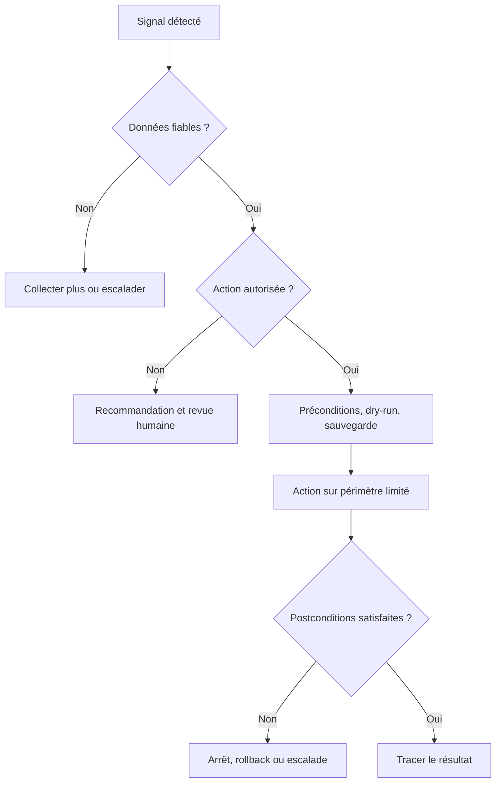

## 4. Pipeline et algorithmes

Le pipeline présenté ici est une chaîne de responsabilités, pas nécessairement un ensemble de microservices séparés. Une petite mise en œuvre peut héberger plusieurs étapes dans un seul processus, à condition de conserver des contrats clairs, des tests et des journaux. L'ordre importe : la qualité est vérifiée avant le calcul, le contexte avant l'interprétation et l'autorisation avant l'exécution. Cette discipline rend possible le fonctionnement en mode observation au départ puis, si les critères le justifient, une automatisation graduée.

### Étape 1 — Qualifier
Déterminer type de mesure, fenêtre et contexte.

La mise en œuvre de Qualifier gagne à être découpée en contrôles testables. Vérifier d'abord le format et la provenance des entrées, puis les hypothèses, les valeurs manquantes et les versions. L'outil Z-score peut contribuer à cette étape, mais sa présence ne garantit pas la qualité. Les erreurs doivent rester explicites au lieu d'être converties silencieusement en valeurs par défaut. Une exécution fiable sait différencier une réussite, un échec, un résultat partiel et un état impossible à déterminer.

Si Qualifier produit un résultat incohérent, commencer par vérifier horloge, source, unité, cible, fraîcheur, version et erreur d'accès. Comparer une observation brute avec sa valeur transformée, puis rechercher les modifications récentes. Pour le scénario étudié, un contrôle utile consiste à tester une seule hypothèse à la fois et à conserver la preuve du résultat. Ne pas recopier de secrets dans le ticket. Une fois le défaut confirmé, ajouter un test de régression afin que la même anomalie ne revienne pas avec une mise à jour.

### Étape 2 — Construire la référence
Traiter valeurs invalides et segmenter par équipement ou période.

La mise en œuvre de Construire la référence gagne à être découpée en contrôles testables. Vérifier d'abord le format et la provenance des entrées, puis les hypothèses, les valeurs manquantes et les versions. L'outil MAD peut contribuer à cette étape, mais sa présence ne garantit pas la qualité. Les erreurs doivent rester explicites au lieu d'être converties silencieusement en valeurs par défaut. Une exécution fiable sait différencier une réussite, un échec, un résultat partiel et un état impossible à déterminer.

Si Construire la référence produit un résultat incohérent, commencer par vérifier horloge, source, unité, cible, fraîcheur, version et erreur d'accès. Comparer une observation brute avec sa valeur transformée, puis rechercher les modifications récentes. Pour le scénario étudié, un contrôle utile consiste à tester une seule hypothèse à la fois et à conserver la preuve du résultat. Ne pas recopier de secrets dans le ticket. Une fois le défaut confirmé, ajouter un test de régression afin que la même anomalie ne revienne pas avec une mise à jour.

### Étape 3 — Choisir le score
Tester Z-score, statistique robuste, densité ou isolation.

La mise en œuvre de Choisir le score gagne à être découpée en contrôles testables. Vérifier d'abord le format et la provenance des entrées, puis les hypothèses, les valeurs manquantes et les versions. L'outil DBSCAN peut contribuer à cette étape, mais sa présence ne garantit pas la qualité. Les erreurs doivent rester explicites au lieu d'être converties silencieusement en valeurs par défaut. Une exécution fiable sait différencier une réussite, un échec, un résultat partiel et un état impossible à déterminer.

Si Choisir le score produit un résultat incohérent, commencer par vérifier horloge, source, unité, cible, fraîcheur, version et erreur d'accès. Comparer une observation brute avec sa valeur transformée, puis rechercher les modifications récentes. Pour le scénario étudié, un contrôle utile consiste à tester une seule hypothèse à la fois et à conserver la preuve du résultat. Ne pas recopier de secrets dans le ticket. Une fois le défaut confirmé, ajouter un test de régression afin que la même anomalie ne revienne pas avec une mise à jour.

### Étape 4 — Calibrer le seuil
Mesurer volume et pertinence des alertes historiques.

La mise en œuvre de Calibrer le seuil gagne à être découpée en contrôles testables. Vérifier d'abord le format et la provenance des entrées, puis les hypothèses, les valeurs manquantes et les versions. L'outil Isolation Forest peut contribuer à cette étape, mais sa présence ne garantit pas la qualité. Les erreurs doivent rester explicites au lieu d'être converties silencieusement en valeurs par défaut. Une exécution fiable sait différencier une réussite, un échec, un résultat partiel et un état impossible à déterminer.

Si Calibrer le seuil produit un résultat incohérent, commencer par vérifier horloge, source, unité, cible, fraîcheur, version et erreur d'accès. Comparer une observation brute avec sa valeur transformée, puis rechercher les modifications récentes. Pour le scénario étudié, un contrôle utile consiste à tester une seule hypothèse à la fois et à conserver la preuve du résultat. Ne pas recopier de secrets dans le ticket. Une fois le défaut confirmé, ajouter un test de régression afin que la même anomalie ne revienne pas avec une mise à jour.

### Étape 5 — Enrichir
Associer l'anomalie à l'actif, l'impact et les changements.

La mise en œuvre de Enrichir gagne à être découpée en contrôles testables. Vérifier d'abord le format et la provenance des entrées, puis les hypothèses, les valeurs manquantes et les versions. L'outil séries temporelles peut contribuer à cette étape, mais sa présence ne garantit pas la qualité. Les erreurs doivent rester explicites au lieu d'être converties silencieusement en valeurs par défaut. Une exécution fiable sait différencier une réussite, un échec, un résultat partiel et un état impossible à déterminer.

Si Enrichir produit un résultat incohérent, commencer par vérifier horloge, source, unité, cible, fraîcheur, version et erreur d'accès. Comparer une observation brute avec sa valeur transformée, puis rechercher les modifications récentes. Pour le scénario étudié, un contrôle utile consiste à tester une seule hypothèse à la fois et à conserver la preuve du résultat. Ne pas recopier de secrets dans le ticket. Une fois le défaut confirmé, ajouter un test de régression afin que la même anomalie ne revienne pas avec une mise à jour.

### Étape 6 — Réviser
Mesurer erreurs et dérive sans effacer les incidents.

La mise en œuvre de Réviser gagne à être découpée en contrôles testables. Vérifier d'abord le format et la provenance des entrées, puis les hypothèses, les valeurs manquantes et les versions. L'outil Z-score peut contribuer à cette étape, mais sa présence ne garantit pas la qualité. Les erreurs doivent rester explicites au lieu d'être converties silencieusement en valeurs par défaut. Une exécution fiable sait différencier une réussite, un échec, un résultat partiel et un état impossible à déterminer.

Si Réviser produit un résultat incohérent, commencer par vérifier horloge, source, unité, cible, fraîcheur, version et erreur d'accès. Comparer une observation brute avec sa valeur transformée, puis rechercher les modifications récentes. Pour le scénario étudié, un contrôle utile consiste à tester une seule hypothèse à la fois et à conserver la preuve du résultat. Ne pas recopier de secrets dans le ticket. Une fois le défaut confirmé, ajouter un test de régression afin que la même anomalie ne revienne pas avec une mise à jour.

### Pseudocode de décision défensive
```text
observations = collecter()
si qualite(observations) insuffisante:
    journaliser("données insuffisantes")
    demander_verification_humaine()
sinon:
    contexte = enrichir(observations, inventaire, changements, dépendances)
    hypotheses = analyser(contexte)
    preuves = verifier_provenance(hypotheses)
    si preuves insuffisantes ou action hors politique:
        recommander_sans_executer()
    sinon:
        plan = preparer_diff_preconditions_et_rollback()
        si validation(plan) et approbations(plan):
            appliquer_sur_perimetre_limite(plan)
            resultat = mesurer_postconditions()
            si resultat non conforme: rollback_ou_escalade()
            tracer(version, preuves, action, resultat)
```

Ce pseudocode sert à expliquer le flux de décision ; il ne constitue pas une bibliothèque prête pour la production. Chaque fonction doit être implémentée, testée et protégée. Le comportement doit être prévisible lorsque les données manquent, qu'un service externe ne répond pas ou que le résultat demeure ambigu. Une bonne conception ne remplace pas l'incertitude par une valeur par défaut. Elle la rend visible, limite l'impact et garde une voie de reprise.

## 5. Étude de cas détaillée

### Situation et impact
des interfaces très différentes utilisent un seuil unique ; les alertes sont bruyantes et n'aident pas à prioriser les comportements réellement inhabituels. L'équipe réunit responsable de service, ingénieur réseau, administrateur système et propriétaire de l'automatisation. Avant d'agir, elle définit l'impact observé, la fenêtre de temps, les actifs concernés et les services prioritaires. La première question n'est pas « quel modèle utiliser ? », mais « quelle décision doit être améliorée et quelle preuve montrera que le changement a servi son objectif ? ». Cette formulation fixe le périmètre et donne un critère d'arrêt si la solution n'apporte pas de valeur démontrable.

### Phase 1 — Établir les faits
Les observations doivent garder les heures originales et les identifiants de source. L'équipe vérifie la qualité de collecte, les changements récents, les dépendances et l'expérience utilisateur. Les valeurs manquantes sont identifiées explicitement plutôt que remplacées silencieusement par zéro. Les symptômes sont séparés des causes supposées, et les sources qui se contredisent sont enregistrées dans le dossier. La preuve de départ sert de référence pour vérifier si une intervention améliore réellement la situation et permet à un autre opérateur de reproduire l'analyse.

### Phase 2 — Poser plusieurs hypothèses
Quand plusieurs causes sont possibles, l'équipe note au minimum deux hypothèses, les observations qui les soutiennent, les éléments qui les contredisent et les tests qui peuvent les différencier. La priorité combine probabilité, impact et coût d'un test. Une hypothèse populaire n'est pas nécessairement correcte : un cas qui ressemble à un incident passé peut différer par la capacité, le routage, la version de logiciel ou la période de charge. Les hypothèses restent des hypothèses jusqu'à ce qu'une preuve suffisante permette de les confirmer.

### Phase 3 — Choisir une réponse proportionnée
Commencer par les vérifications non destructives : comparer l'état, consulter les changements, tester la connectivité ou inspecter une dépendance. Si une modification est nécessaire, définir précisément la cible, la commande ou le changement attendu, les préconditions, les critères d'arrêt et le rollback. Une revue indépendante s'impose lorsque le rayon d'impact est élevé. Le plan doit permettre à l'opérateur de comprendre pourquoi l'action est proposée et dans quelles circonstances il doit la refuser.

### Phase 4 — Vérifier les postconditions
La validation repose sur des mesures indépendantes du simple statut de commande : latence, erreurs, connectivité, état de configuration ou indicateur du service. La fenêtre d'observation doit éviter de confondre un échantillon favorable avec un rétablissement durable. Si les conditions ne sont pas satisfaites, appliquer la règle d'arrêt prévue et lancer un rollback ou une escalade. Le compte rendu distingue l'action exécutée, l'effet mesuré, les effets secondaires et les informations qui restent inconnues.

### Phase 5 — Capitaliser avec prudence
Le post-mortem compare les hypothèses initiales avec les preuves finales, relève les signaux manquants et ajoute des tests de régression. Une règle ou un modèle amélioré passe en revue et en essai contrôlé avant généralisation. Il faut éviter de réentraîner automatiquement sur des conclusions incertaines ou des tickets contenant uniquement des suppositions. Le retour d'expérience doit décrire les situations où la méthode a échoué autant que les cas où elle a réussi.

### Critères de clôture
La clôture exige une preuve de rétablissement, ou une déclaration explicite que le service reste dégradé. Le dossier réunit sources, versions, changement exact, approbation, résultats et suivi. La cause racine n'est marquée comme confirmée que si les observations la soutiennent suffisamment. En l'absence de preuve, une conclusion partielle est plus utile qu'un récit catégorique. La qualité se mesure au diagnostic reproductible, au risque contrôlé et à la possibilité d'améliorer le système à partir des erreurs observées.

## 6. Implémentation guidée et laboratoire

Le laboratoire doit être exécuté dans un environnement isolé ou sur des systèmes explicitement autorisés. Avant de commencer, noter les versions, dépendances, données d'entrée et condition de réussite. Ne pas copier les exemples sur un réseau de production sans adapter les identifiants, certificats, permissions et tests de restauration. Le livrable final doit être compréhensible par une autre personne, ré-exécutable et accompagné d'une liste claire de ses limites.

### TP 1 — Choisir des métriques de différentes échelles.
**Procédure.** Choisir des métriques de différentes échelles. Commencer par une cible de laboratoire minimale et capturer l'état de départ. Relier ce travail au concept « Anomalie » : Une anomalie est atypique dans un contexte ; elle peut être une panne, un changement planifié ou un défaut de mesure. Conserver la commande, les entrées, le résultat et la version des outils. Ne changer qu'une variable à la fois pour pouvoir attribuer un écart à sa cause.

**Critère de réussite.** Un autre opérateur doit pouvoir reproduire le résultat et identifier la preuve attendue. Tester aussi un échec contrôlé, une valeur manquante ou une dépendance indisponible. Si le résultat n'est pas déterminable, garder cet état explicite ; ne pas le convertir en succès. Vérifier les postconditions réelles, les effets secondaires et la procédure de reprise. Documenter ce qui a été démontré, ce qui reste une hypothèse et quelle amélioration serait nécessaire avant un usage à plus grande échelle.

### TP 2 — Calculer Z-score puis médiane et MAD.
**Procédure.** Calculer Z-score puis médiane et MAD. Commencer par une cible de laboratoire minimale et capturer l'état de départ. Relier ce travail au concept « Z-score » : Le Z-score exprime l'écart à la moyenne en unités d'écart-type et dépend d'une référence adaptée. Conserver la commande, les entrées, le résultat et la version des outils. Ne changer qu'une variable à la fois pour pouvoir attribuer un écart à sa cause.

**Critère de réussite.** Un autre opérateur doit pouvoir reproduire le résultat et identifier la preuve attendue. Tester aussi un échec contrôlé, une valeur manquante ou une dépendance indisponible. Si le résultat n'est pas déterminable, garder cet état explicite ; ne pas le convertir en succès. Vérifier les postconditions réelles, les effets secondaires et la procédure de reprise. Documenter ce qui a été démontré, ce qui reste une hypothèse et quelle amélioration serait nécessaire avant un usage à plus grande échelle.

### TP 3 — Visualiser les valeurs par période et classe d'équipement.
**Procédure.** Visualiser les valeurs par période et classe d'équipement. Commencer par une cible de laboratoire minimale et capturer l'état de départ. Relier ce travail au concept « Statistiques robustes » : Médiane et MAD réduisent l'influence de valeurs extrêmes qui déforment la moyenne. Conserver la commande, les entrées, le résultat et la version des outils. Ne changer qu'une variable à la fois pour pouvoir attribuer un écart à sa cause.

**Critère de réussite.** Un autre opérateur doit pouvoir reproduire le résultat et identifier la preuve attendue. Tester aussi un échec contrôlé, une valeur manquante ou une dépendance indisponible. Si le résultat n'est pas déterminable, garder cet état explicite ; ne pas le convertir en succès. Vérifier les postconditions réelles, les effets secondaires et la procédure de reprise. Documenter ce qui a été démontré, ce qui reste une hypothèse et quelle amélioration serait nécessaire avant un usage à plus grande échelle.

### TP 4 — Tester DBSCAN ou Isolation Forest sur des variables standardisées.
**Procédure.** Tester DBSCAN ou Isolation Forest sur des variables standardisées. Commencer par une cible de laboratoire minimale et capturer l'état de départ. Relier ce travail au concept « Clustering » : Le clustering groupe des observations selon distance ou densité ; la normalisation influence le résultat. Conserver la commande, les entrées, le résultat et la version des outils. Ne changer qu'une variable à la fois pour pouvoir attribuer un écart à sa cause.

**Critère de réussite.** Un autre opérateur doit pouvoir reproduire le résultat et identifier la preuve attendue. Tester aussi un échec contrôlé, une valeur manquante ou une dépendance indisponible. Si le résultat n'est pas déterminable, garder cet état explicite ; ne pas le convertir en succès. Vérifier les postconditions réelles, les effets secondaires et la procédure de reprise. Documenter ce qui a été démontré, ce qui reste une hypothèse et quelle amélioration serait nécessaire avant un usage à plus grande échelle.

### TP 5 — Mesurer le nombre d'alertes selon plusieurs seuils.
**Procédure.** Mesurer le nombre d'alertes selon plusieurs seuils. Commencer par une cible de laboratoire minimale et capturer l'état de départ. Relier ce travail au concept « Isolation Forest » : Isolation Forest isole des observations par partitions aléatoires ; scores et seuils doivent être calibrés. Conserver la commande, les entrées, le résultat et la version des outils. Ne changer qu'une variable à la fois pour pouvoir attribuer un écart à sa cause.

**Critère de réussite.** Un autre opérateur doit pouvoir reproduire le résultat et identifier la preuve attendue. Tester aussi un échec contrôlé, une valeur manquante ou une dépendance indisponible. Si le résultat n'est pas déterminable, garder cet état explicite ; ne pas le convertir en succès. Vérifier les postconditions réelles, les effets secondaires et la procédure de reprise. Documenter ce qui a été démontré, ce qui reste une hypothèse et quelle amélioration serait nécessaire avant un usage à plus grande échelle.

### TP 6 — Faire annoter les anomalies les plus prioritaires.
**Procédure.** Faire annoter les anomalies les plus prioritaires. Commencer par une cible de laboratoire minimale et capturer l'état de départ. Relier ce travail au concept « Saisonnalité » : Une même valeur peut être normale à midi et anormale la nuit, selon le lien et le service. Conserver la commande, les entrées, le résultat et la version des outils. Ne changer qu'une variable à la fois pour pouvoir attribuer un écart à sa cause.

**Critère de réussite.** Un autre opérateur doit pouvoir reproduire le résultat et identifier la preuve attendue. Tester aussi un échec contrôlé, une valeur manquante ou une dépendance indisponible. Si le résultat n'est pas déterminable, garder cet état explicite ; ne pas le convertir en succès. Vérifier les postconditions réelles, les effets secondaires et la procédure de reprise. Documenter ce qui a été démontré, ce qui reste une hypothèse et quelle amélioration serait nécessaire avant un usage à plus grande échelle.

### TP 7 — Définir la procédure de révision de baseline.
**Procédure.** Définir la procédure de révision de baseline. Commencer par une cible de laboratoire minimale et capturer l'état de départ. Relier ce travail au concept « Seuil et feedback » : Un seuil transforme un score en décision ; les revues humaines aident à le calibrer. Conserver la commande, les entrées, le résultat et la version des outils. Ne changer qu'une variable à la fois pour pouvoir attribuer un écart à sa cause.

**Critère de réussite.** Un autre opérateur doit pouvoir reproduire le résultat et identifier la preuve attendue. Tester aussi un échec contrôlé, une valeur manquante ou une dépendance indisponible. Si le résultat n'est pas déterminable, garder cet état explicite ; ne pas le convertir en succès. Vérifier les postconditions réelles, les effets secondaires et la procédure de reprise. Documenter ce qui a été démontré, ce qui reste une hypothèse et quelle amélioration serait nécessaire avant un usage à plus grande échelle.

### Exemple de code ou de configuration

```python
from sklearn.ensemble import IsolationForest
from sklearn.preprocessing import StandardScaler

scaler = StandardScaler().fit(X_train)  # ajusté uniquement sur la référence d'entraînement
model = IsolationForest(contamination=0.01, random_state=42).fit(scaler.transform(X_train))
scores = model.decision_function(scaler.transform(X_eval))
predictions = model.predict(scaler.transform(X_eval))  # -1 : candidat anomalie
# Calibrer le seuil selon l'impact ; ne pas interpréter tout -1 comme une panne.
```

Ce fragment est un point de départ pédagogique. Les versions, options CLI, capacités matérielles et schémas changent ; vérifier la documentation liée et tester dans un laboratoire. Le fragment n'inclut pas toute la configuration nécessaire à un déploiement réel. Les secrets ne doivent pas être ajoutés au code, et les exemples qui peuvent modifier un système doivent recevoir approbations, limites de portée et vérification post-action. Un parseur qui accepte la syntaxe ne certifie ni la conformité ni la disponibilité.

### Livrables attendus
- Un fichier versionné qui décrit entrées, sorties et dépendances.
- Un journal lié à la cible et à la version, sans secret.
- Des tests positifs, négatifs et de panne de dépendance.
- Des critères d'arrêt et une procédure de reprise testée.
- Une note décrivant les résultats et les limites.

## 7. Sécurité et gouvernance

### 1. Qualité et provenance
Chaque observation garde source, heure, unité et état de fraîcheur. Pour le contexte étudié, ce principe doit être traduit en contrôle observable, propriétaire, fréquence de revue et preuve de passage. Une politique sans test dépend de la mémoire des personnes ; un test sans propriétaire cesse d'être maintenu lorsque l'équipe change. La revue doit donc être planifiée et relancée après un changement majeur de données, de matériel, de finalité ou de modèle.

La gouvernance de Qualité et provenance définit qui peut créer, modifier, approuver, consulter et retirer la logique associée. Le propriétaire doit connaître l'objectif, les limites, les dépendances, le budget d'erreur et les critères de suspension. Les décisions doivent être retraçables jusqu'aux données et versions utilisées. Une règle sans propriétaire finit par dépendre de la mémoire de l'équipe ; un propriétaire sans mesure ne peut pas démontrer qu'elle fonctionne. La revue doit être planifiée et relancée à chaque changement majeur de données, d'équipement ou de finalité.

### 2. Identités et permissions
Les comptes d'automatisation reçoivent uniquement les privilèges nécessaires. Pour le contexte étudié, ce principe doit être traduit en contrôle observable, propriétaire, fréquence de revue et preuve de passage. Une politique sans test dépend de la mémoire des personnes ; un test sans propriétaire cesse d'être maintenu lorsque l'équipe change. La revue doit donc être planifiée et relancée après un changement majeur de données, de matériel, de finalité ou de modèle.

La gouvernance de Identités et permissions définit qui peut créer, modifier, approuver, consulter et retirer la logique associée. Le propriétaire doit connaître l'objectif, les limites, les dépendances, le budget d'erreur et les critères de suspension. Les décisions doivent être retraçables jusqu'aux données et versions utilisées. Une règle sans propriétaire finit par dépendre de la mémoire de l'équipe ; un propriétaire sans mesure ne peut pas démontrer qu'elle fonctionne. La revue doit être planifiée et relancée à chaque changement majeur de données, d'équipement ou de finalité.

### 3. Traçabilité
La version, les preuves, la décision, l'approbateur et le résultat sont corrélés. Pour le contexte étudié, ce principe doit être traduit en contrôle observable, propriétaire, fréquence de revue et preuve de passage. Une politique sans test dépend de la mémoire des personnes ; un test sans propriétaire cesse d'être maintenu lorsque l'équipe change. La revue doit donc être planifiée et relancée après un changement majeur de données, de matériel, de finalité ou de modèle.

La gouvernance de Traçabilité définit qui peut créer, modifier, approuver, consulter et retirer la logique associée. Le propriétaire doit connaître l'objectif, les limites, les dépendances, le budget d'erreur et les critères de suspension. Les décisions doivent être retraçables jusqu'aux données et versions utilisées. Une règle sans propriétaire finit par dépendre de la mémoire de l'équipe ; un propriétaire sans mesure ne peut pas démontrer qu'elle fonctionne. La revue doit être planifiée et relancée à chaque changement majeur de données, d'équipement ou de finalité.

### 4. Revue humaine
Le réviseur doit posséder preuves, temps et autorité pour refuser. Pour le contexte étudié, ce principe doit être traduit en contrôle observable, propriétaire, fréquence de revue et preuve de passage. Une politique sans test dépend de la mémoire des personnes ; un test sans propriétaire cesse d'être maintenu lorsque l'équipe change. La revue doit donc être planifiée et relancée après un changement majeur de données, de matériel, de finalité ou de modèle.

La gouvernance de Revue humaine définit qui peut créer, modifier, approuver, consulter et retirer la logique associée. Le propriétaire doit connaître l'objectif, les limites, les dépendances, le budget d'erreur et les critères de suspension. Les décisions doivent être retraçables jusqu'aux données et versions utilisées. Une règle sans propriétaire finit par dépendre de la mémoire de l'équipe ; un propriétaire sans mesure ne peut pas démontrer qu'elle fonctionne. La revue doit être planifiée et relancée à chaque changement majeur de données, d'équipement ou de finalité.

### 5. Mesure du risque
Chaque mode d'échec doit avoir prévention, détection, réponse et responsable. Pour le contexte étudié, ce principe doit être traduit en contrôle observable, propriétaire, fréquence de revue et preuve de passage. Une politique sans test dépend de la mémoire des personnes ; un test sans propriétaire cesse d'être maintenu lorsque l'équipe change. La revue doit donc être planifiée et relancée après un changement majeur de données, de matériel, de finalité ou de modèle.

La gouvernance de Mesure du risque définit qui peut créer, modifier, approuver, consulter et retirer la logique associée. Le propriétaire doit connaître l'objectif, les limites, les dépendances, le budget d'erreur et les critères de suspension. Les décisions doivent être retraçables jusqu'aux données et versions utilisées. Une règle sans propriétaire finit par dépendre de la mémoire de l'équipe ; un propriétaire sans mesure ne peut pas démontrer qu'elle fonctionne. La revue doit être planifiée et relancée à chaque changement majeur de données, d'équipement ou de finalité.

### 6. Réversibilité
La suspension du modèle et le retour à une version saine sont testés. Pour le contexte étudié, ce principe doit être traduit en contrôle observable, propriétaire, fréquence de revue et preuve de passage. Une politique sans test dépend de la mémoire des personnes ; un test sans propriétaire cesse d'être maintenu lorsque l'équipe change. La revue doit donc être planifiée et relancée après un changement majeur de données, de matériel, de finalité ou de modèle.

La gouvernance de Réversibilité définit qui peut créer, modifier, approuver, consulter et retirer la logique associée. Le propriétaire doit connaître l'objectif, les limites, les dépendances, le budget d'erreur et les critères de suspension. Les décisions doivent être retraçables jusqu'aux données et versions utilisées. Une règle sans propriétaire finit par dépendre de la mémoire de l'équipe ; un propriétaire sans mesure ne peut pas démontrer qu'elle fonctionne. La revue doit être planifiée et relancée à chaque changement majeur de données, d'équipement ou de finalité.

## 8. Pièges à éviter

### Piège 1 — Un seuil unique pour tous les actifs

Ce piège peut produire un faux diagnostic, une action superflue ou une perte de confiance. Le signal précurseur est parfois subtil : incohérence entre sources, hausse d'erreurs, impossibilité d'expliquer la sortie ou comportement différent selon les sites. L'équipe doit rendre le signal mesurable, désigner qui réagit et préciser si l'action automatique se bloque ou si le traitement continue en mode dégradé.

La prévention doit être reliée à « Anomalie ». Une anomalie est atypique dans un contexte ; elle peut être une panne, un changement planifié ou un défaut de mesure. Définir un test négatif qui fait apparaître le défaut et vérifier que la réponse attendue réduit le risque. Un garde-fou ne doit pas être un simple avertissement que les opérateurs apprennent à ignorer. En revue, demander quelle preuve montre que le contrôle fonctionne, quelle défaillance il couvre et quelle autre défaillance demeure possible.

### Piège 2 — Normaliser avec des données de test ou futures

Ce piège peut produire un faux diagnostic, une action superflue ou une perte de confiance. Le signal précurseur est parfois subtil : incohérence entre sources, hausse d'erreurs, impossibilité d'expliquer la sortie ou comportement différent selon les sites. L'équipe doit rendre le signal mesurable, désigner qui réagit et préciser si l'action automatique se bloque ou si le traitement continue en mode dégradé.

La prévention doit être reliée à « Z-score ». Le Z-score exprime l'écart à la moyenne en unités d'écart-type et dépend d'une référence adaptée. Définir un test négatif qui fait apparaître le défaut et vérifier que la réponse attendue réduit le risque. Un garde-fou ne doit pas être un simple avertissement que les opérateurs apprennent à ignorer. En revue, demander quelle preuve montre que le contrôle fonctionne, quelle défaillance il couvre et quelle autre défaillance demeure possible.

### Piège 3 — Traiter chaque anomalie comme incident

Ce piège peut produire un faux diagnostic, une action superflue ou une perte de confiance. Le signal précurseur est parfois subtil : incohérence entre sources, hausse d'erreurs, impossibilité d'expliquer la sortie ou comportement différent selon les sites. L'équipe doit rendre le signal mesurable, désigner qui réagit et préciser si l'action automatique se bloque ou si le traitement continue en mode dégradé.

La prévention doit être reliée à « Statistiques robustes ». Médiane et MAD réduisent l'influence de valeurs extrêmes qui déforment la moyenne. Définir un test négatif qui fait apparaître le défaut et vérifier que la réponse attendue réduit le risque. Un garde-fou ne doit pas être un simple avertissement que les opérateurs apprennent à ignorer. En revue, demander quelle preuve montre que le contrôle fonctionne, quelle défaillance il couvre et quelle autre défaillance demeure possible.

### Piège 4 — Utiliser une distance sans standardisation

Ce piège peut produire un faux diagnostic, une action superflue ou une perte de confiance. Le signal précurseur est parfois subtil : incohérence entre sources, hausse d'erreurs, impossibilité d'expliquer la sortie ou comportement différent selon les sites. L'équipe doit rendre le signal mesurable, désigner qui réagit et préciser si l'action automatique se bloque ou si le traitement continue en mode dégradé.

La prévention doit être reliée à « Clustering ». Le clustering groupe des observations selon distance ou densité ; la normalisation influence le résultat. Définir un test négatif qui fait apparaître le défaut et vérifier que la réponse attendue réduit le risque. Un garde-fou ne doit pas être un simple avertissement que les opérateurs apprennent à ignorer. En revue, demander quelle preuve montre que le contrôle fonctionne, quelle défaillance il couvre et quelle autre défaillance demeure possible.

### Piège 5 — Ignorer saisonnalité et changements planifiés

Ce piège peut produire un faux diagnostic, une action superflue ou une perte de confiance. Le signal précurseur est parfois subtil : incohérence entre sources, hausse d'erreurs, impossibilité d'expliquer la sortie ou comportement différent selon les sites. L'équipe doit rendre le signal mesurable, désigner qui réagit et préciser si l'action automatique se bloque ou si le traitement continue en mode dégradé.

La prévention doit être reliée à « Isolation Forest ». Isolation Forest isole des observations par partitions aléatoires ; scores et seuils doivent être calibrés. Définir un test négatif qui fait apparaître le défaut et vérifier que la réponse attendue réduit le risque. Un garde-fou ne doit pas être un simple avertissement que les opérateurs apprennent à ignorer. En revue, demander quelle preuve montre que le contrôle fonctionne, quelle défaillance il couvre et quelle autre défaillance demeure possible.

### Piège 6 — Optimiser score sans mesurer le triage

Ce piège peut produire un faux diagnostic, une action superflue ou une perte de confiance. Le signal précurseur est parfois subtil : incohérence entre sources, hausse d'erreurs, impossibilité d'expliquer la sortie ou comportement différent selon les sites. L'équipe doit rendre le signal mesurable, désigner qui réagit et préciser si l'action automatique se bloque ou si le traitement continue en mode dégradé.

La prévention doit être reliée à « Saisonnalité ». Une même valeur peut être normale à midi et anormale la nuit, selon le lien et le service. Définir un test négatif qui fait apparaître le défaut et vérifier que la réponse attendue réduit le risque. Un garde-fou ne doit pas être un simple avertissement que les opérateurs apprennent à ignorer. En revue, demander quelle preuve montre que le contrôle fonctionne, quelle défaillance il couvre et quelle autre défaillance demeure possible.

### Piège 7 — Apprendre de labels humains incohérents

Ce piège peut produire un faux diagnostic, une action superflue ou une perte de confiance. Le signal précurseur est parfois subtil : incohérence entre sources, hausse d'erreurs, impossibilité d'expliquer la sortie ou comportement différent selon les sites. L'équipe doit rendre le signal mesurable, désigner qui réagit et préciser si l'action automatique se bloque ou si le traitement continue en mode dégradé.

La prévention doit être reliée à « Seuil et feedback ». Un seuil transforme un score en décision ; les revues humaines aident à le calibrer. Définir un test négatif qui fait apparaître le défaut et vérifier que la réponse attendue réduit le risque. Un garde-fou ne doit pas être un simple avertissement que les opérateurs apprennent à ignorer. En revue, demander quelle preuve montre que le contrôle fonctionne, quelle défaillance il couvre et quelle autre défaillance demeure possible.

## 9. Diagnostic et dépannage

### Aucun résultat n'est produit
Vérifier accès source, période de sélection, identité, filtres et version du schéma. Dans le cadre de Détection d'anomalies (Z-score, clustering), vérifier en particulier ce risque : un seuil unique pour tous les actifs. Comparer les observations brutes à leur représentation transformée, retrouver la version du pipeline et noter si une modification récente correspond au début du problème. Formuler au moins deux explications alternatives et choisir un test à faible risque qui permet de les distinguer. Ne pas effectuer plusieurs changements simultanément, car cela rendrait l'analyse ambiguë. Si les preuves restent insuffisantes, rendre cette incertitude visible et utiliser le mode sûr.

### Les résultats varient
Comparer données, code, versions, transformations et paramètres sur un cas fixe. Dans le cadre de Détection d'anomalies (Z-score, clustering), vérifier en particulier ce risque : normaliser avec des données de test ou futures. Comparer les observations brutes à leur représentation transformée, retrouver la version du pipeline et noter si une modification récente correspond au début du problème. Formuler au moins deux explications alternatives et choisir un test à faible risque qui permet de les distinguer. Ne pas effectuer plusieurs changements simultanément, car cela rendrait l'analyse ambiguë. Si les preuves restent insuffisantes, rendre cette incertitude visible et utiliser le mode sûr.

### Trop d'alertes
Inspecter doublons, saisonnalité, baseline, seuil et qualité du contexte avant de supprimer des alertes. Dans le cadre de Détection d'anomalies (Z-score, clustering), vérifier en particulier ce risque : traiter chaque anomalie comme incident. Comparer les observations brutes à leur représentation transformée, retrouver la version du pipeline et noter si une modification récente correspond au début du problème. Formuler au moins deux explications alternatives et choisir un test à faible risque qui permet de les distinguer. Ne pas effectuer plusieurs changements simultanément, car cela rendrait l'analyse ambiguë. Si les preuves restent insuffisantes, rendre cette incertitude visible et utiliser le mode sûr.

### Un incident passe inaperçu
Reconstituer les informations disponibles au moment de décider et rechercher un seuil trop permissif ou une source absente. Dans le cadre de Détection d'anomalies (Z-score, clustering), vérifier en particulier ce risque : utiliser une distance sans standardisation. Comparer les observations brutes à leur représentation transformée, retrouver la version du pipeline et noter si une modification récente correspond au début du problème. Formuler au moins deux explications alternatives et choisir un test à faible risque qui permet de les distinguer. Ne pas effectuer plusieurs changements simultanément, car cela rendrait l'analyse ambiguë. Si les preuves restent insuffisantes, rendre cette incertitude visible et utiliser le mode sûr.

### L'action n'améliore pas le service
Vérifier postconditions indépendantes et effets secondaires, puis appliquer arrêt ou rollback selon le plan. Dans le cadre de Détection d'anomalies (Z-score, clustering), vérifier en particulier ce risque : ignorer saisonnalité et changements planifiés. Comparer les observations brutes à leur représentation transformée, retrouver la version du pipeline et noter si une modification récente correspond au début du problème. Formuler au moins deux explications alternatives et choisir un test à faible risque qui permet de les distinguer. Ne pas effectuer plusieurs changements simultanément, car cela rendrait l'analyse ambiguë. Si les preuves restent insuffisantes, rendre cette incertitude visible et utiliser le mode sûr.

### La qualité diminue avec le temps
Rechercher dérive, changement de capacité, topologie, population ou version et réévaluer. Dans le cadre de Détection d'anomalies (Z-score, clustering), vérifier en particulier ce risque : optimiser score sans mesurer le triage. Comparer les observations brutes à leur représentation transformée, retrouver la version du pipeline et noter si une modification récente correspond au début du problème. Formuler au moins deux explications alternatives et choisir un test à faible risque qui permet de les distinguer. Ne pas effectuer plusieurs changements simultanément, car cela rendrait l'analyse ambiguë. Si les preuves restent insuffisantes, rendre cette incertitude visible et utiliser le mode sûr.

## 10. Exercices corrigés

### Exercice 1 — Anomalie
**Énoncé.** Dans un environnement inspiré du scénario « des interfaces très différentes utilisent un seuil unique ; les alertes sont bruyantes et n'aident pas à prioriser les comportements réellement inhabituels », l'équipe veut généraliser une approche qui utilise « Anomalie ». Quelle preuve recueillir avant l'étape « Qualifier », et comment réduire le risque suivant : un seuil unique pour tous les actifs ?

**Correction détaillée.** Définir d'abord le résultat attendu et le coût d'une erreur. Vérifier que les entrées proviennent d'une source autorisée et qu'elles sont fraîches, cohérentes et disponibles au moment de la décision. Construire un essai reproductible, comparer à une baseline et analyser les erreurs par classe d'actif ou criticité. Déterminer type de mesure, fenêtre et contexte. L'extension du périmètre exige des seuils écrits, une revue adaptée au risque, un déploiement progressif et un retour arrière. Si la preuve ne permet pas de trancher, demander une vérification complémentaire ou garder la solution en observation plutôt que d'inventer une certitude.

**Pourquoi les raccourcis échouent.** Un résultat favorable sur un exemple ne démontre pas une performance durable. Un score moyen peut masquer les catégories vulnérables ; une absence d'erreur visible peut provenir d'une télémétrie incomplète. Conserver les cas difficiles, les conditions de test et les versions utilisées rend possible une revue indépendante. L'exercice est réussi lorsque le choix, ses limites et le mécanisme de retrait sont compris par une autre personne.

### Exercice 2 — Z-score
**Énoncé.** Dans un environnement inspiré du scénario « des interfaces très différentes utilisent un seuil unique ; les alertes sont bruyantes et n'aident pas à prioriser les comportements réellement inhabituels », l'équipe veut généraliser une approche qui utilise « Z-score ». Quelle preuve recueillir avant l'étape « Construire la référence », et comment réduire le risque suivant : normaliser avec des données de test ou futures ?

**Correction détaillée.** Définir d'abord le résultat attendu et le coût d'une erreur. Vérifier que les entrées proviennent d'une source autorisée et qu'elles sont fraîches, cohérentes et disponibles au moment de la décision. Construire un essai reproductible, comparer à une baseline et analyser les erreurs par classe d'actif ou criticité. Traiter valeurs invalides et segmenter par équipement ou période. L'extension du périmètre exige des seuils écrits, une revue adaptée au risque, un déploiement progressif et un retour arrière. Si la preuve ne permet pas de trancher, demander une vérification complémentaire ou garder la solution en observation plutôt que d'inventer une certitude.

**Pourquoi les raccourcis échouent.** Un résultat favorable sur un exemple ne démontre pas une performance durable. Un score moyen peut masquer les catégories vulnérables ; une absence d'erreur visible peut provenir d'une télémétrie incomplète. Conserver les cas difficiles, les conditions de test et les versions utilisées rend possible une revue indépendante. L'exercice est réussi lorsque le choix, ses limites et le mécanisme de retrait sont compris par une autre personne.

### Exercice 3 — Statistiques robustes
**Énoncé.** Dans un environnement inspiré du scénario « des interfaces très différentes utilisent un seuil unique ; les alertes sont bruyantes et n'aident pas à prioriser les comportements réellement inhabituels », l'équipe veut généraliser une approche qui utilise « Statistiques robustes ». Quelle preuve recueillir avant l'étape « Choisir le score », et comment réduire le risque suivant : traiter chaque anomalie comme incident ?

**Correction détaillée.** Définir d'abord le résultat attendu et le coût d'une erreur. Vérifier que les entrées proviennent d'une source autorisée et qu'elles sont fraîches, cohérentes et disponibles au moment de la décision. Construire un essai reproductible, comparer à une baseline et analyser les erreurs par classe d'actif ou criticité. Tester Z-score, statistique robuste, densité ou isolation. L'extension du périmètre exige des seuils écrits, une revue adaptée au risque, un déploiement progressif et un retour arrière. Si la preuve ne permet pas de trancher, demander une vérification complémentaire ou garder la solution en observation plutôt que d'inventer une certitude.

**Pourquoi les raccourcis échouent.** Un résultat favorable sur un exemple ne démontre pas une performance durable. Un score moyen peut masquer les catégories vulnérables ; une absence d'erreur visible peut provenir d'une télémétrie incomplète. Conserver les cas difficiles, les conditions de test et les versions utilisées rend possible une revue indépendante. L'exercice est réussi lorsque le choix, ses limites et le mécanisme de retrait sont compris par une autre personne.

### Exercice 4 — Clustering
**Énoncé.** Dans un environnement inspiré du scénario « des interfaces très différentes utilisent un seuil unique ; les alertes sont bruyantes et n'aident pas à prioriser les comportements réellement inhabituels », l'équipe veut généraliser une approche qui utilise « Clustering ». Quelle preuve recueillir avant l'étape « Calibrer le seuil », et comment réduire le risque suivant : utiliser une distance sans standardisation ?

**Correction détaillée.** Définir d'abord le résultat attendu et le coût d'une erreur. Vérifier que les entrées proviennent d'une source autorisée et qu'elles sont fraîches, cohérentes et disponibles au moment de la décision. Construire un essai reproductible, comparer à une baseline et analyser les erreurs par classe d'actif ou criticité. Mesurer volume et pertinence des alertes historiques. L'extension du périmètre exige des seuils écrits, une revue adaptée au risque, un déploiement progressif et un retour arrière. Si la preuve ne permet pas de trancher, demander une vérification complémentaire ou garder la solution en observation plutôt que d'inventer une certitude.

**Pourquoi les raccourcis échouent.** Un résultat favorable sur un exemple ne démontre pas une performance durable. Un score moyen peut masquer les catégories vulnérables ; une absence d'erreur visible peut provenir d'une télémétrie incomplète. Conserver les cas difficiles, les conditions de test et les versions utilisées rend possible une revue indépendante. L'exercice est réussi lorsque le choix, ses limites et le mécanisme de retrait sont compris par une autre personne.

### Exercice 5 — Isolation Forest
**Énoncé.** Dans un environnement inspiré du scénario « des interfaces très différentes utilisent un seuil unique ; les alertes sont bruyantes et n'aident pas à prioriser les comportements réellement inhabituels », l'équipe veut généraliser une approche qui utilise « Isolation Forest ». Quelle preuve recueillir avant l'étape « Enrichir », et comment réduire le risque suivant : ignorer saisonnalité et changements planifiés ?

**Correction détaillée.** Définir d'abord le résultat attendu et le coût d'une erreur. Vérifier que les entrées proviennent d'une source autorisée et qu'elles sont fraîches, cohérentes et disponibles au moment de la décision. Construire un essai reproductible, comparer à une baseline et analyser les erreurs par classe d'actif ou criticité. Associer l'anomalie à l'actif, l'impact et les changements. L'extension du périmètre exige des seuils écrits, une revue adaptée au risque, un déploiement progressif et un retour arrière. Si la preuve ne permet pas de trancher, demander une vérification complémentaire ou garder la solution en observation plutôt que d'inventer une certitude.

**Pourquoi les raccourcis échouent.** Un résultat favorable sur un exemple ne démontre pas une performance durable. Un score moyen peut masquer les catégories vulnérables ; une absence d'erreur visible peut provenir d'une télémétrie incomplète. Conserver les cas difficiles, les conditions de test et les versions utilisées rend possible une revue indépendante. L'exercice est réussi lorsque le choix, ses limites et le mécanisme de retrait sont compris par une autre personne.

## Atelier approfondi — concevoir, calibrer et exploiter un détecteur d'anomalies

Cet atelier complète le parcours principal par une démarche de conception de bout en bout. Le but n'est pas d'empiler des algorithmes, mais de produire un détecteur dont les résultats sont compréhensibles, mesurables et utiles à une équipe d'exploitation. Le fil rouge est un réseau d'entreprise qui collecte des taux d'utilisation, de la latence, des pertes, des erreurs d'interface et des changements de configuration. Les mêmes raisonnements s'appliquent à des services applicatifs, des files de messages, des bases de données ou des plateformes cloud, en adaptant les variables et les conséquences métier.

Les valeurs ci-dessous illustrent une méthode et ne constituent pas une recommandation universelle. Les exemples synthétiques doivent être remplacés et validés sur les données pertinentes avant toute exploitation réelle.

### 1. Commencer par formuler le problème opérationnel

Une anomalie n'est pas une panne. Elle désigne une observation, un groupe d'observations ou une relation entre signaux qui s'écarte d'un comportement de référence. Une panne est un état opérationnel qui doit être confirmé selon des critères métiers ou techniques. Une variation statistiquement rare peut être légitime : sauvegarde nocturne, campagne de déploiement, exercice de reprise, changement de routage ou pic saisonnier. À l'inverse, un incident peut être progressif et rester dans les limites d'un seuil fixe : une perte qui augmente lentement, une capacité qui se réduit ou une latence qui dérive sans dépasser immédiatement une valeur absolue.

Formulez une question précise avant de choisir la technique : « Détecter une hausse persistante de la latence sur les liens WAN, dans les quinze minutes suivant son apparition, sans générer plus de cinq alertes non pertinentes par équipe et par jour. » Cette phrase propose déjà une population, une fenêtre, un objectif de délai et une contrainte de bruit. Elle doit ensuite être négociée avec les utilisateurs. « Détecter les anomalies du réseau » n'est pas suffisamment opérationnel, car elle ne précise ni le comportement à repérer ni la qualité attendue.

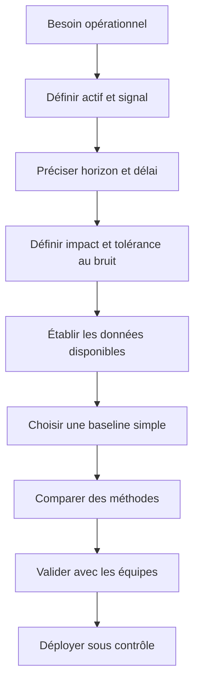

Définissez au minimum les éléments suivants. La population décrit quels actifs sont comparables. La mesure indique ce qui est collecté, son unité et son sens. L'horizon détermine la période d'observation et le temps dans lequel une alerte conserve de la valeur. La décision attendue dit ce que l'équipe fera après réception de l'alerte. Le coût d'une alerte inutile doit être comparé au coût d'un incident manqué. Enfin, la condition d'arrêt précise quand le détecteur doit s'abstenir, par exemple lorsque trop de données sont manquantes ou que la référence n'est plus représentative.

Un objectif utile est vérifiable avant la mise en production. Il peut s'agir d'un rappel minimal sur des incidents annotés, d'une limite de volume d'alertes, d'un délai médian de détection et d'une proportion d'alertes disposant d'éléments explicatifs. Les objectifs doivent être évalués ensemble. Améliorer le rappel tout en multipliant les alertes par vingt peut déplacer le problème de la détection vers le triage. De même, un faible volume d'alertes n'est pas une réussite si les incidents importants ne sont plus détectés.

### 2. Distinguer les formes d'anomalies

Une anomalie ponctuelle est une observation isolée qui surprend par rapport à son contexte. Un lien dont le taux d'erreurs passe brièvement de presque zéro à une valeur élevée peut en être un exemple. Une anomalie contextuelle dépend d'une condition telle que l'heure, le jour de la semaine, le rôle de l'équipement ou la charge habituelle. Un trafic de 70 % peut être normal sur un cœur de réseau à l'heure de pointe, mais inhabituel sur un lien de secours pendant la nuit. Une anomalie collective apparaît lorsque plusieurs observations prises ensemble sont inhabituelles, même si chacune reste plausible individuellement : latence qui augmente, débit qui chute et erreurs qui montent pendant une fenêtre commune.

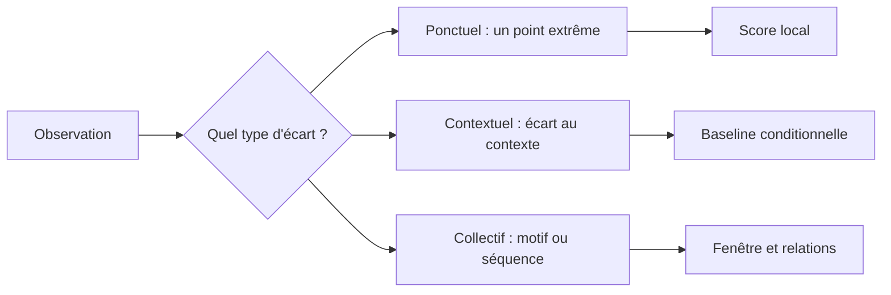

Cette distinction influence l'algorithme et l'explication. Un seuil ponctuel répond à « cette valeur est-elle rare ? ». Une baseline contextuelle répond à « cette valeur est-elle inhabituelle pour cet actif à cette heure et dans ce mode de fonctionnement ? ». Une analyse collective répond à « ces signaux forment-ils une séquence ou une combinaison incompatible avec les situations normales ? ». Un modèle conçu pour des points indépendants ne détectera pas automatiquement des séquences temporelles ou des dépendances entre variables.

Le contexte ne doit pas devenir une excuse pour masquer une dégradation. Si une anomalie apparaît après un changement planifié, enregistrez le lien avec ce changement et vérifiez l'effet réel au lieu de retirer aveuglément la fenêtre des évaluations. Une suppression permanente des périodes atypiques apprendrait au système que les effets des déploiements n'ont aucune importance. On peut filtrer une fenêtre pour une analyse donnée, mais la raison, le propriétaire, la date d'expiration et la méthode de validation doivent rester traçables.

### 3. Auditer la qualité avant de calculer le score

Un modèle sophistiqué ne compense pas une collecte défectueuse. Les problèmes courants sont les horodatages en fuseaux différents, les retards d'ingestion, les valeurs dupliquées, les compteurs remis à zéro, les changements d'unité, les équipements renommés, les périodes de collecte interrompues et les valeurs qui représentent en réalité « inconnu ». Une série vide ne signifie pas zéro perte de paquets. Une valeur manquante n'est pas interchangeable avec une valeur nulle.

Pour chaque observation, conservez au minimum l'identifiant stable de l'actif, l'horodatage de l'événement, l'horodatage de collecte, la mesure, l'unité, la source et un indicateur de qualité. Lorsque la télémétrie vient de plusieurs systèmes, documentez la précision des horloges et la politique d'alignement des fenêtres. Les jointures sur le seul nom d'un appareil sont fragiles si les noms peuvent être réutilisés ou modifiés. Une clé stable et une chronologie des changements simplifient le diagnostic.

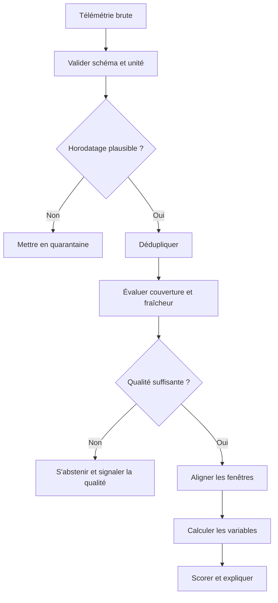

L'indicateur de couverture est essentiel. Une moyenne calculée sur 10 % des échantillons attendus peut sembler stable alors que les données ont disparu pendant la période la plus chargée. Calculez le ratio entre échantillons présents et attendus, la plus longue interruption, le retard d'arrivée et la part de valeurs invalides. Les seuils de qualité dépendent du système, mais ils doivent être explicites et testés. Quand la qualité est insuffisante, le résultat devrait être « indéterminé » plutôt qu'« aucune anomalie ».

Sur les compteurs cumulatifs, soustrayez des relevés successifs avec prudence. Un delta négatif peut signaler une remise à zéro, un redémarrage ou une correction de collecte, et non un trafic négatif. Un delta très grand peut résulter d'une longue interruption entre deux collectes. Dans ces situations, marquez la fenêtre comme non comparable ou reconstruisez-la à l'aide d'une règle documentée. Évitez d'inventer des mesures pour remplir des trous sans enregistrer les imputations et sans tester leur effet sur le détecteur.

Les contrôles de données doivent être observés comme un système à part entière. Si l'exporteur arrête de publier, le détecteur peut sembler silencieux précisément au moment où l'équipe a besoin de lui. Une alerte de fraîcheur ou de couverture doit donc avoir une voie de traitement différente d'une anomalie de performance. Cette séparation évite d'accuser le réseau alors que le problème réside dans la chaîne d'observabilité.

### 4. Construire une baseline qui ressemble au fonctionnement normal

La baseline est une référence, pas une vérité définitive. Une moyenne globale est un point de départ utile mais rarement un modèle suffisant pour une infrastructure hétérogène. Un équipement de cœur, un lien d'accès et un lien de secours n'ont ni la même capacité ni les mêmes rythmes. Segmenter par actif peut être pertinent lorsque l'historique est abondant ; segmenter par rôle, capacité, plage temporelle ou famille de service peut être plus robuste quand les actifs sont nouveaux ou ont peu de données.

La segmentation comporte toutefois un risque : trop de sous-groupes produisent des baselines fragiles. Un groupe de trois observations ne donne pas une estimation fiable de la variabilité. Utilisez un niveau hiérarchique : baseline par famille, ajustement par actif si l'historique le permet, puis règle de repli explicitement définie. L'interface doit présenter la source de la référence et son niveau de confiance. Ne rendez pas l'incertitude invisible en affichant un score avec beaucoup de décimales.

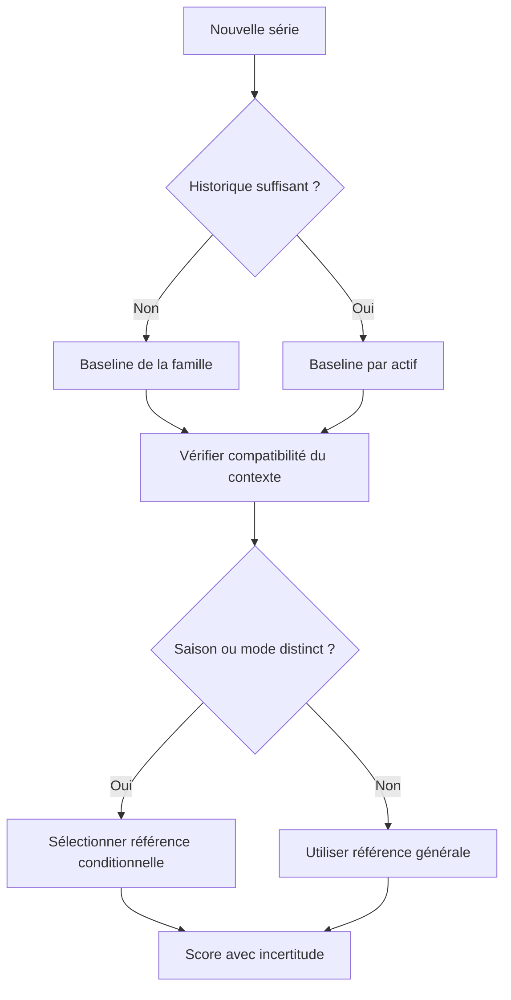

La saisonnalité peut être quotidienne, hebdomadaire, mensuelle ou liée à des cycles métiers. Une décomposition temporelle peut isoler une tendance et une saisonnalité, mais il faut disposer d'un historique couvrant plusieurs cycles représentatifs. Si le système a changé récemment, les cycles anciens peuvent ne plus être comparables. Une baseline glissante s'adapte plus vite, mais peut absorber lentement une dégradation persistante et finir par la considérer comme normale. Une baseline fixe préserve le point de comparaison, mais devient obsolète après une évolution légitime de capacité ou de trafic. Une politique hybride permet de comparer le comportement courant à une référence stable et à une référence adaptative.

La mise à jour d'une baseline doit être contrôlée. Évitez d'entraîner automatiquement sur des fenêtres récemment signalées comme anomalies ou sur des fenêtres d'incident connu sans analyse. La contamination peut déplacer la référence et réduire progressivement la capacité de détection. Le pipeline peut mettre les observations en attente, appliquer un filtrage documenté et publier une nouvelle version après revue. L'ancienne version doit rester récupérable pour expliquer les alertes passées et reproduire les décisions.

### 5. Choisir les statistiques robustes et comprendre leurs limites

Le z-score classique calcule l'écart à la moyenne en nombre d'écarts-types. Il est facile à expliquer et à utiliser lorsque la distribution est approximativement adaptée à cette hypothèse. Mais la moyenne et l'écart-type sont sensibles aux valeurs extrêmes. Un incident massif peut augmenter fortement la moyenne et l'écart-type ; les observations suivantes paraîtront alors moins surprenantes, alors qu'elles peuvent encore être problématiques.

Le score robuste basé sur la médiane et l'écart absolu médian (MAD) résiste mieux à certaines valeurs extrêmes. La médiane décrit une position centrale robuste ; le MAD mesure la dispersion des distances à la médiane. On peut utiliser un facteur de normalisation pour rapprocher l'échelle du score de celle d'une distribution normale, mais son interprétation n'est fiable que si les hypothèses sont raisonnables. Si le MAD vaut zéro, il ne faut pas diviser par zéro, ni remplacer silencieusement le résultat par zéro. Ce cas doit déclencher une règle de repli, une fenêtre plus grande ou un signal de référence insuffisante.

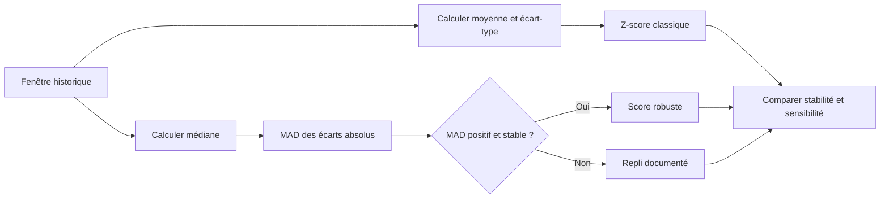

Une autre option consiste à définir des quantiles conditionnels. Par exemple, l'équipe peut examiner si une latence dépasse le quantile 99 de la référence correspondant à la même classe de service et à la même période. Un quantile ne garantit pas qu'un incident se produit au-delà de la limite, et un quantile extrême exige assez de données. La valeur obtenue dépend aussi de la méthode d'estimation. Les percentiles doivent être évalués sur une période séparée, et les seuils suivis lorsque la distribution évolue.

L'IQR, différence entre le troisième et le premier quartile, fournit un autre résumé robuste. Une règle telle qu'une valeur sous le premier quartile moins 1,5 IQR ou au-dessus du troisième quartile plus 1,5 IQR est couramment utilisée pour visualiser des points atypiques. Elle ne doit pas devenir une loi opérationnelle universelle. Les distributions de latence, de charge et d'erreurs peuvent être asymétriques, multimodales ou limitées par des valeurs physiques. Une règle bilatérale peut être inadaptée : une baisse soudaine de débit peut être problématique alors qu'un débit élevé est attendu.

EWMA (moyenne mobile exponentiellement pondérée) donne davantage de poids aux valeurs récentes et peut aider à repérer une dérive graduelle. CUSUM accumule les écarts par rapport à une référence et peut révéler un changement persistant de faible amplitude. Ces méthodes dépendent du réglage de leurs paramètres et de la stabilité de la référence. Elles ne doivent pas être évaluées uniquement sur un pic artificiel ; testez des scénarios lents, temporaires, cycliques et interrompus. Une courte pointe et une dérive progressive appellent des règles différentes.

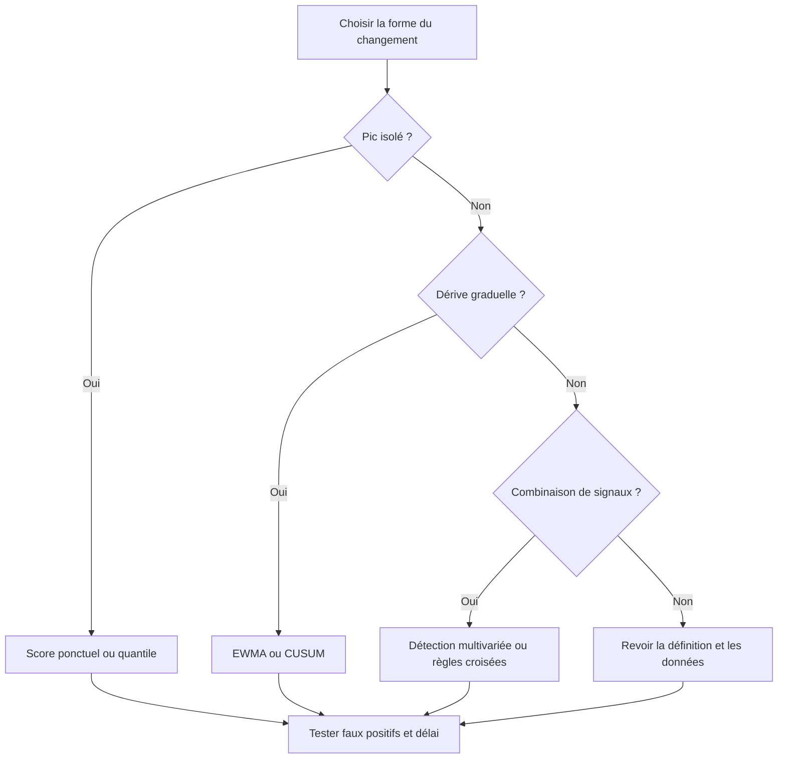

Aucun score ne doit cacher les unités. Affichez la valeur observée, la valeur de référence, l'écart, la fenêtre, la qualité des données et les limites de l'algorithme. Le score permet un classement, mais l'opérateur doit pouvoir revenir à la mesure source. Une explication utile indique par exemple que la latence a dépassé son percentile habituel pendant quatre fenêtres consécutives, que la couverture est de 98 %, qu'une hausse des pertes est concomitante et qu'un changement de configuration a été détecté huit minutes auparavant. Seuls les éléments réellement calculés doivent être affichés ; ne fabriquez pas de cause probable si le système ne dispose pas de preuves suffisantes.

### 6. Passer à plusieurs variables sans perdre l'interprétabilité

La détection multivariée prend en compte les relations entre variables. Un débit élevé peut être normal si la capacité et la demande augmentent ensemble. Une charge CPU élevée peut être normale pendant une opération intensive, alors que la même charge accompagnée d'une file qui croît, d'un taux d'erreur en hausse et d'une latence croissante est plus préoccupante. L'objectif consiste à détecter des combinaisons atypiques, pas seulement à additionner des seuils indépendants.

Avant de calculer une distance, standardisez les caractéristiques quand leurs échelles sont différentes. Sans cela, une variable exprimée en milliers peut dominer une variable comprise entre zéro et un. La standardisation doit être ajustée seulement sur l'ensemble d'entraînement, puis appliquée aux données ultérieures avec les paramètres enregistrés. Sinon, des informations du futur contaminent la référence et donnent une évaluation trop optimiste. La standardisation ne rend pas toutes les distributions normales et ne corrige pas les dépendances temporelles.

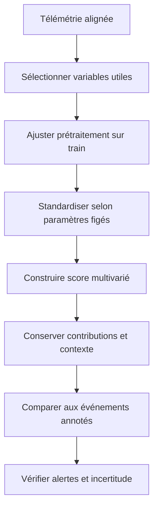

Le clustering, par exemple K-means, DBSCAN ou HDBSCAN selon la bibliothèque retenue, peut aider à identifier des groupes de comportement et des observations éloignées des groupes. Cependant, un algorithme de clustering n'est pas automatiquement un détecteur d'incidents. K-means cherche des groupes compacts autour de centres et doit connaître le nombre de groupes ; il peut mal représenter des formes ou densités très différentes. DBSCAN identifie des régions denses et marque certains points comme bruit, mais les paramètres et les densités hétérogènes influencent fortement ses résultats. Un code de statut correspondant à un point non affecté à un groupe signifie que l'algorithme ne le rattache pas à un cluster selon ses paramètres, pas qu'une panne est confirmée.

Isolation Forest utilise le principe d'isoler plus vite les observations inhabituelles au moyen de partitions aléatoires. Elle peut être efficace avec plusieurs variables, mais sa performance dépend des caractéristiques, du taux supposé d'anomalies, de la contamination des données et de la représentativité des échantillons. Les scores ne sont pas des probabilités de panne. Il faut comparer les méthodes à une baseline simple, regarder leurs alertes concrètes et garder une version de prétraitement cohérente au moment du scoring.

PCA et d'autres méthodes de réduction de dimension peuvent exposer des combinaisons qui s'écartent d'un espace de référence, mais une variance globale ne garantit pas que l'anomalie la plus risquée sera détectée. Les autoencodeurs peuvent repérer des observations dont la reconstruction est mauvaise, mais une reconstruction difficile peut refléter une donnée nouvelle légitime, une erreur de mesure ou un comportement mal représenté pendant l'apprentissage. Les modèles plus complexes augmentent aussi la charge d'explication et de maintenance. Ils ne sont justifiés que si l'amélioration est démontrée et si l'équipe sait investiguer leurs erreurs.

### 7. Traiter le temps comme une contrainte du modèle

Une série temporelle n'est pas une liste aléatoire de lignes indépendantes. Les points voisins se ressemblent souvent et les événements ont une durée. Le jeu d'évaluation doit respecter l'ordre chronologique : entraîner sur le passé et tester sur une période ultérieure, éventuellement avec plusieurs fenêtres successives. Un découpage aléatoire peut placer presque les mêmes événements dans l'entraînement et le test, ou permettre au modèle de voir des motifs issus d'un incident avant de les « prédire ». Cette fuite temporelle donne des résultats artificiellement favorables.

Définissez exactement ce qui est connu au moment du score. Une caractéristique calculée à partir des quinze prochaines minutes ne peut pas être utilisée pour une alerte prétendument émise maintenant. Les agrégats doivent être fermés au bon instant, les délais d'ingestion pris en compte et les labels associés à la période correcte. Si les incidents sont annotés après enquête, les délais et les incertitudes de ces annotations doivent être documentés.

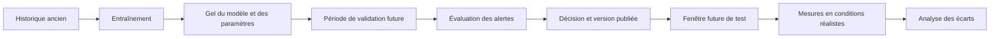

Utilisez une validation temporelle glissante lorsqu'il existe assez d'historique. Dans chaque itération, le modèle est entraîné uniquement sur des observations antérieures, puis évalué sur le segment qui suit. Cela montre si un bon résultat dépend d'un mois particulier, d'une classe d'actifs ou d'une seule panne majeure. Les hyperparamètres ne doivent pas être ajustés à répétition sur le jeu de test final ; celui-ci doit rester une estimation du comportement sur des périodes non utilisées pour les choix.

Une évaluation sur un jeu historique annoté reste imparfaite. Les incidents rares peuvent ne pas apparaître, les équipes peuvent avoir corrigé certains défauts avant qu'ils deviennent visibles et les labels peuvent refléter des habitudes d'investigation plutôt que la vérité absolue. Combinez l'évaluation hors ligne et une phase en mode observation, dans laquelle le détecteur produit des événements sans déclencher d'action opérationnelle. Un échantillon des alertes et des périodes silencieuses doit être relu, afin de rechercher à la fois les faux positifs et les anomalies manquées.

### 8. Évaluer les résultats dans le langage de l'exploitation

La précision indique quelle proportion des alertes considérées positives est réellement pertinente selon les labels disponibles. Le rappel indique quelle proportion des événements positifs identifiés a été détectée. Ils ne répondent pas au même besoin. Une équipe de garde submergée peut demander une meilleure précision ; une détection de défaillance critique peut privilégier un rappel élevé, quitte à organiser une investigation secondaire. La décision doit reconnaître explicitement le coût d'un faux positif et d'un faux négatif.

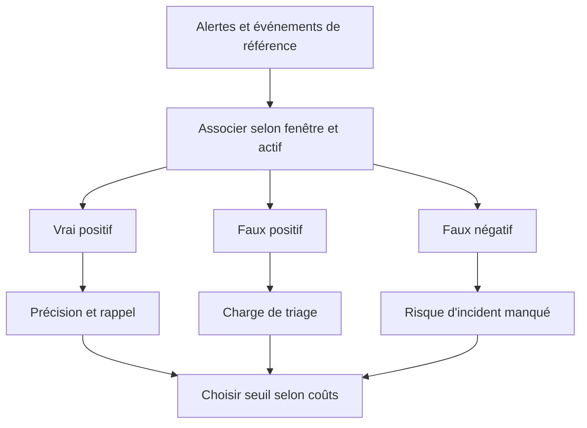

La précision seule peut être trompeuse lorsque les incidents sont rares. Supposons qu'un service n'ait connu que cinq incidents sur cent mille fenêtres. Un système qui affirme presque toujours « normal » peut obtenir une exactitude apparente élevée tout en ne détectant aucun incident. L'exactitude globale doit donc être accompagnée de mesures adaptées au déséquilibre : précision, rappel, courbe précision-rappel, matrice de confusion et mesures par type d'actif. La ROC peut offrir un aperçu complémentaire, mais lorsque la classe positive est très rare, la courbe précision-rappel expose plus directement le compromis sur les alertes positives.

La fenêtre d'association entre une alerte et un incident doit être définie à l'avance. Une alerte trois heures après la résolution ne compte pas nécessairement comme une détection utile, même si elle correspond au même actif. Définissez une tolérance temporelle, une règle de déduplication et la manière de traiter plusieurs alertes sur le même incident. Mesurez le délai de première détection, le délai d'escalade, les alertes répétées par incident, la proportion d'événements enrichis et le temps de triage. Ces mesures relient le modèle au flux réel de travail.

Le seuil ne doit pas être sélectionné uniquement pour maximiser un score statistique. Construisez plusieurs scénarios de seuils et calculez, lorsque les données le permettent, le nombre d'alertes, les événements confirmés, les événements manqués et le coût estimé. Le coût est une approximation, pas une donnée objective universelle. Les hypothèses et les pondérations doivent être approuvées par les responsables opérationnels. Une fonction de coût facilite la comparaison, mais ne remplace pas le jugement lorsqu'une classe d'incident est critique.

### 9. Transformer un score en événement exploitable

Envoyer une notification à chaque échantillon au-dessus d'un seuil est généralement une mauvaise stratégie. Si une anomalie persiste pendant cinquante minutes avec un relevé chaque minute, l'équipe risque de recevoir cinquante messages qui décrivent le même phénomène. Une politique d'événement regroupe les signaux voisins, exige éventuellement une durée ou un nombre minimal de dépassements, ajoute une période de refroidissement et permet une nouvelle alerte lorsque la sévérité change. Ces règles doivent être assez prudentes pour ne pas retarder une situation réellement critique.

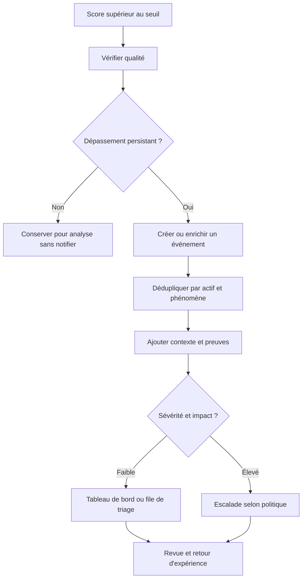

L'événement doit exposer les informations qui permettent de vérifier son origine : actif et service, début et durée, variable et unité, valeur courante, référence, score, version du détecteur, qualité des données, signaux associés, changement récent et identifiant de l'observation source. L'équipe doit pouvoir comprendre quelle règle ou quel modèle a déclenché l'événement. Lorsque le modèle ne permet pas d'expliquer la cause, indiquez explicitement que la cause est inconnue. Les corrélations et coïncidences doivent être présentées comme des indices à examiner, pas comme une causalité démontrée.

La déduplication ne doit pas supprimer les informations nouvelles. Une alerte existante peut être enrichie avec le retour d'un autre capteur, un changement de sévérité ou la confirmation d'un incident. Il peut alors être préférable de mettre à jour le même événement plutôt que de créer un nouveau ticket. À l'inverse, deux phénomènes qui touchent le même actif peuvent avoir des causes distinctes et nécessiter des événements séparés. Utilisez une clé de regroupement documentée, une fenêtre adaptée et un mécanisme pour détecter les changements qui imposent de rouvrir l'investigation.

Le refroidissement limite les répétitions mais peut aussi masquer une aggravation. Autorisez la réémission quand la sévérité augmente, quand une nouvelle preuve indépendante apparaît ou quand l'événement a été fermé puis réapparaît après une période définie. Ne considérez pas une absence de nouvelle notification comme une preuve de retour à la normale : surveillez explicitement l'état de récupération, avec les mêmes contrôles de fraîcheur et de qualité que pour l'état d'alerte.

### 10. Gérer les labels et les retours humains

Les retours de l'équipe peuvent améliorer le détecteur à condition d'être structurés. Une étiquette « faux positif » sans motif ne permet guère de différencier une bascule légitime, une mesure défectueuse, une référence trop étroite ou un seuil trop sensible. Proposez un ensemble contrôlé de décisions : incident confirmé, variation attendue, problème de collecte, doublon, changement planifié, cas indéterminé ou données insuffisantes. Une zone de commentaire libre reste utile pour le contexte, mais ne remplace pas la catégorie.

Le label doit conserver le rôle ayant procédé à la revue, la date, l'événement concerné, la version de la règle et les éléments consultés. Les opinions peuvent diverger ; un statut « contesté » ou « à revoir » est préférable à une vérité imposée. Il faut aussi séparer les labels créés avant l'investigation de ceux construits après connaissance du résultat. Sinon, on pourrait entraîner un modèle qui exploite indirectement une information disponible seulement après l'incident.

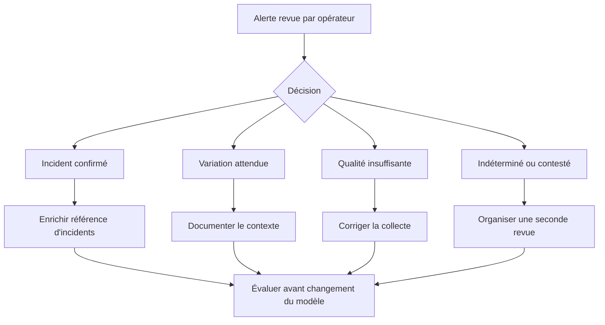

Ne réentraînez pas automatiquement le modèle à chaque clic sur une interface. Une décision humaine peut être incorrecte, incohérente ou affectée par la fatigue opérationnelle. Un pipeline de préparation des labels doit détecter les doublons, les contradictions et les catégories sous-représentées, puis produire un rapport de qualité. Avant de réutiliser ces données, révisez un échantillon et comparez les labels au contexte de l'incident. Le but est de créer une boucle d'apprentissage gouvernée, pas de convertir chaque réaction en vérité machine.

La rétroaction doit aussi inclure les périodes sans alertes. Si l'équipe ne révise que ce que le détecteur remonte, les incidents manqués peuvent rester invisibles. Des revues par échantillonnage de fenêtres normales, des rapprochements avec les incidents et des analyses après incident permettent de repérer les angles morts. La fréquence de cette revue dépend de la criticité, de la quantité de données et du changement du système, mais le mécanisme doit être défini avant la mise en service.

### 11. Détecter une dérive et garder une référence reproductible

La dérive peut toucher les données d'entrée, la distribution des comportements, les relations entre variables ou la qualité des labels. Un nouvel équipement peut avoir une échelle différente ; un changement d'application peut modifier le profil de trafic ; une nouvelle politique de routage peut rendre une ancienne référence obsolète. Il faut distinguer la dérive légitime d'une dégradation indésirable. Un changement de distribution ne suffit donc pas à justifier une mise à jour automatique de référence.

Surveillez la fraîcheur, la couverture, la distribution des variables, la proportion de scores élevés, le volume d'événements et, si des labels arrivent, la qualité mesurée après coup. Une montée soudaine des anomalies sur tous les équipements peut être un changement global, une erreur d'unité ou une panne du système de collecte. Un changement limité à une catégorie peut indiquer une évolution spécifique ou une segmentation défectueuse. Les tableaux de bord doivent comparer ces tendances entre groupes et versions de détecteur.

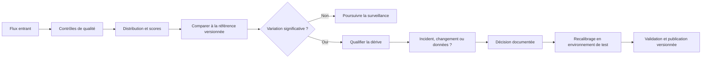

Chaque version devrait inclure la période d'apprentissage, les sources, les transformations, les variables, les hyperparamètres, le seuil, les métriques, les limites connues, l'approbation et le moyen de revenir à la version précédente. Dans une approche purement statistique, versionnez aussi la formule de calcul, la longueur des fenêtres, les règles de déduplication et la référence elle-même. Le résultat dépend autant de ces éléments que du nom de l'algorithme.

Un déploiement progressif peut commencer par le mode observation, puis par un groupe pilote, puis par une plus grande proportion d'actifs. Comparez l'ancienne version et la nouvelle sur la même période quand c'est possible, mais ne laissez pas deux versions déclencher sans coordination des actions concurrentes. Définissez les critères d'arrêt avant le test : hausse excessive du bruit, retard, calcul instable, incident manqué connu ou absence d'explication. Le retour à la version précédente doit être testé, documenté et réalisable sans supprimer les traces de décision.

### 12. Un pipeline de référence et des tests reproductibles

Une implémentation robuste sépare les opérations : collecte, validation, construction des caractéristiques, ajustement de référence, calcul du score, agrégation en événements, revue puis action éventuelle. Cette séparation évite qu'une seule fonction mélange des transformations de données, une décision métier et un appel qui modifie le réseau. Elle facilite les tests unitaires et permet de comparer des méthodes en gardant la collecte identique.

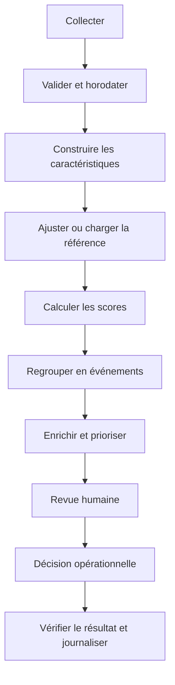

Le code suivant illustre un score robuste simple. Il ne charge aucun réseau, ne contacte aucun service externe et n'effectue aucune action. Avant de l'utiliser, adaptez les contrôles de longueur, de fraîcheur, d'unité et de contexte à vos données. En particulier, les valeurs historiques doivent provenir uniquement de fenêtres réputées comparables, et cette fonction ne remplace pas une politique de référence versionnée.

```python
from dataclasses import dataclass
from statistics import median
from typing import Optional, Sequence
import math


@dataclass(frozen=True)
class AnomalyResult:
    status: str
    score: Optional[float]
    baseline_median: Optional[float]
    baseline_mad: Optional[float]
    explanation: str


def robust_score(
    history: Sequence[float],
    current: float,
    minimum_samples: int = 12,
    threshold: float = 3.5,
) -> AnomalyResult:
    """Calcule un score robuste sur une fenêtre déjà validée."""
    if not math.isfinite(current):
        return AnomalyResult(
            "indeterminate", None, None, None,
            "Observation non finie ou invalide."
        )

    values = [float(value) for value in history]
    if any(not math.isfinite(value) for value in values):
        return AnomalyResult(
            "indeterminate", None, None, None,
            "La référence contient une valeur invalide."
        )
    if len(values) < minimum_samples:
        return AnomalyResult(
            "insufficient_history", None, None, None,
            "Historique insuffisant pour calculer le score."
        )

    center = median(values)
    deviations = [abs(value - center) for value in values]
    mad = median(deviations)

    if mad <= 0:
        return AnomalyResult(
            "degenerate_baseline", None, center, mad,
            "Dispersion nulle : appliquer une politique de repli."
        )

    score = 0.6745 * (current - center) / mad
    status = "review" if abs(score) >= threshold else "within_baseline"
    explanation = (
        f"Écart robuste {score:.2f}; seuil configuré {threshold:.2f}. "
        "Ce résultat signale un écart, pas une panne confirmée."
    )
    return AnomalyResult(status, score, center, mad, explanation)


history = [48, 50, 49, 51, 50, 49, 52, 50, 51, 48, 50, 49, 51, 50]
print(robust_score(history, current=68))
```

Plusieurs garde-fous manquent volontairement à cette petite fonction : elle ne sait pas si les valeurs correspondent au même actif, si l'historique est saisonnier, si les données sont récentes, ni si une maintenance était planifiée. Ces responsabilités doivent être prises en charge en amont, et testées séparément. Une fonction courte et testable vaut mieux qu'une fonction très longue dont les résultats changent en fonction de données implicites. Le seuil devrait provenir d'une configuration traçable, pas d'une constante enfouie dans le code de production.

Les tests doivent couvrir au minimum une valeur typique, une valeur extrême, une historique trop courte, une référence constante, une observation non finie, une référence contenant une valeur invalide et un cas où le score est exactement proche du seuil. Ajoutez des tests de propriétés : un décalage constant appliqué à toutes les observations et à la valeur courante ne devrait pas modifier le score, dans les limites des règles et des précisions numériques. Les tests devraient vérifier la sortie et le message d'explication, pas seulement l'absence d'exception.

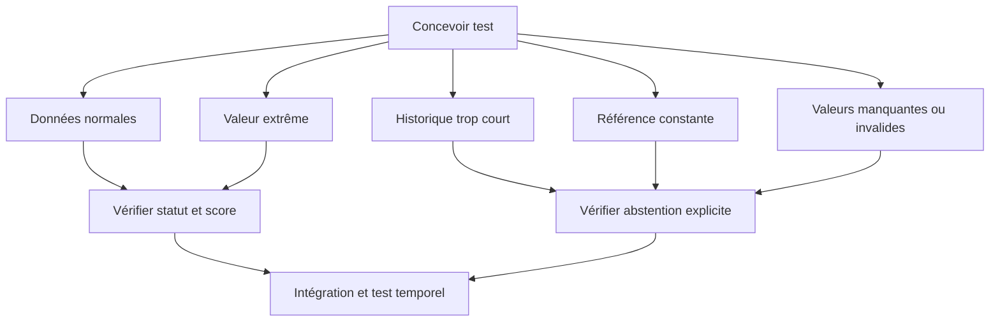

Pour comparer deux détecteurs, alimentez-les avec le même jeu d'entrée figé et le même protocole de labellisation. Conservez les scores bruts, les événements agrégés et la version de l'ensemble des règles. Une comparaison qui change à la fois l'algorithme, le seuil, la période et la règle de regroupement ne permet pas de savoir ce qui a amélioré le résultat. Les expériences doivent garder une trace de la configuration et éviter de modifier silencieusement les données après le calcul des métriques.

### 13. Atelier pratique : construire un jeu de test synthétique

Créez une série régulière qui contient quatre situations : comportement stable, pic ponctuel, dérive graduelle et problème de collecte. Les anomalies sont injectées dans des fenêtres choisies et documentées pour disposer d'une référence de test. Gardez les étiquettes séparées des caractéristiques que le détecteur reçoit. Les labels servent à mesurer le résultat, mais ne doivent pas être injectés par inadvertance dans les entrées du modèle.

```mermaid
timeline
    title Scénarios synthétiques de télémétrie
    00:00 : Charge habituelle
    00:20 : Pic ponctuel de latence
    00:40 : Retour à la normale
    01:00 : Dérive lente des pertes
    01:30 : Échantillons manquants
    01:45 : Collecte rétablie
```

Procédez ensuite de manière contrôlée. Premièrement, établissez une référence avec une plage normale suffisante. Deuxièmement, calculez les alertes d'un seuil absolu simple. Troisièmement, ajoutez le score robuste. Quatrièmement, comparez une règle persistante ou un score multivarié. Cinquièmement, évaluez sur une autre portion temporelle. Enfin, lisez chaque alerte à la lumière des données source, des labels et du contexte. N'ajoutez pas de complexité avant d'avoir compris quels cas la méthode simple rate.

Le jeu synthétique doit inclure des cas difficiles. Un pic prévu dans une fenêtre de maintenance doit être marqué comme changement planifié, mais reste intéressant pour vérifier que le détecteur sait expliquer pourquoi il signale un écart. Une perte qui augmente de manière progressive peut rester sous un seuil absolu longtemps ; elle met à l'épreuve les méthodes de dérive. Une baisse de débit pendant une forte demande peut être pertinente si les erreurs et la latence augmentent ensemble. Une série interrompue teste la capacité de l'outil à distinguer absence de signal et signal normal.

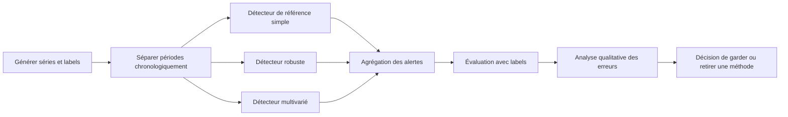

Un journal d'expérience peut contenir l'identifiant du jeu, la plage temporelle, le nom et la version de la méthode, les paramètres, le seuil, les métriques, le volume d'alertes, les erreurs principales et une décision. Ce journal facilite la reproduction et empêche de retenir un modèle seulement parce que les alertes d'une démonstration semblent convaincantes. La méthode retenue doit produire des résultats meilleurs sur le besoin convenu, et non simplement un score plus complexe.

### 14. Triage et explication des erreurs

Lorsqu'une alerte est fausse, cherchez l'origine plutôt que d'augmenter immédiatement le seuil. La cause peut être une unité incorrecte, un groupe d'actifs non comparable, une saisonnalité ignorée, une référence contaminée, une courte interruption, un changement planifié ou un regroupement insuffisant. Chaque cause appelle une correction différente. Augmenter le seuil réduit parfois les faux positifs, mais peut simultanément faire manquer un incident. Un diagnostic efficace associe le type d'erreur au test qui aurait permis de la repérer.

Pour un faux négatif, examinez si le phénomène était représenté dans la définition cible, si la qualité était suffisante, si la fenêtre était bien alignée, si la bonne population de référence a été sélectionnée et si le score était calculé avant ou après le début de l'incident. Une mauvaise définition d'incident ne se corrige pas par la technique. Si la perte réseau n'a été observée que parce que la télémétrie a disparu, le problème initial peut être un mécanisme de collecte qui a été confondu avec l'absence de panne.

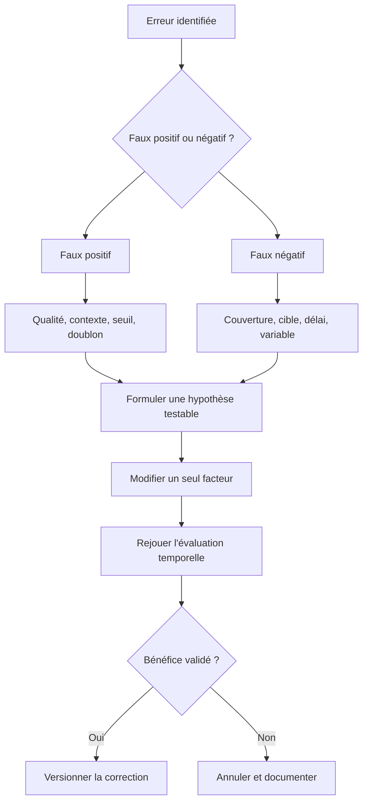

Ne considérez pas toutes les alertes comme équivalentes. Une anomalie à faible impact peut rester dans un tableau de bord, tandis qu'un événement qui touche plusieurs services critiques mérite une escalade. La priorité doit combiner des critères explicites tels que l'importance du service, la durée, le nombre d'actifs touchés, la présence de signaux indépendants et l'existence d'un changement récent. Évitez de laisser une valeur statistique unique déterminer seule la gravité métier.

Les règles de triage doivent aussi s'accommoder de l'incertitude. Le statut peut être « signal faible », « à investiguer », « incident probable » ou « qualité insuffisante », tant que chaque libellé a une définition et une action associée. Évitez d'afficher « panne confirmée » pour un score non supervisé. Une gradation explicite aide les opérateurs à interpréter le résultat sans lui attribuer plus de certitude qu'il n'en possède.

### 15. Sécurité, gouvernance et limite de l'automatisation

Le détecteur doit utiliser une identité technique aux permissions nécessaires uniquement. La collecte ne devrait pas disposer d'un droit d'administration réseau si elle se contente de lire des métriques. Les journaux doivent conserver les informations utiles sans exposer les jetons, mots de passe ou données personnelles inutiles. Si le modèle est exécuté dans un service partagé, les données et les événements doivent rester isolés par périmètre et les accès administratifs doivent être audités.

La détection d'anomalies peut être utilisée dans une chaîne d'automatisation, mais le score ne doit pas déclencher seul une action destructive. Une réinitialisation d'équipement, une modification de routage ou un blocage de trafic exige une politique distincte, une validation des préconditions, une protection du périmètre et un contrôle du résultat. Préférez commencer par la collecte et la création d'un dossier d'investigation. Des actions à faible risque peuvent être automatisées après validation, mais les changements susceptibles d'interrompre le service doivent conserver une approbation adaptée à leur criticité.

```mermaid
flowchart TD
    A["Anomalie signalée"] --> B["Évaluer qualité et impact"]
    B --> C["Créer dossier de preuve"]
    C --> D{"Action proposée ?"}
    D -- "Observation" --> E["Continuer la collecte"]
    D -- "Faible risque" --> F["Contrôler préconditions et approbation"]
    D -- "Risque élevé" --> G["Validation humaine obligatoire"]
    F --> H["Exécuter dans un périmètre limité"]
    G --> H
    H --> I["Vérifier l'état après action"]
    I --> J{"Résultat conforme ?"}
    J -- "Oui" --> K["Clore avec preuves"]
    J -- "Non" --> L["Rollback ou escalade"]
```

Les journaux de décision doivent enregistrer la règle ou le modèle, la version de référence, les mesures sources, l'heure, la qualité, le score, la politique de seuil, l'identité du service, la revue humaine et la décision finale. Il doit être possible de reconstruire pourquoi un événement a été créé et pourquoi une action a été autorisée. Cette traçabilité est essentielle lorsqu'un incident survient après une alerte mal interprétée ou lorsqu'un changement de modèle modifie les comportements.

Définissez également des critères de suspension. Le détecteur peut être désactivé ou placé en mode observation si la fraîcheur des données tombe sous un seuil, si la quantité d'alertes devient incontrôlable, si la distribution change brutalement, si les explications disparaissent ou si un incident grave expose une faiblesse importante. Suspendez l'action automatique sans forcément supprimer la collecte : conserver une observation non interventionniste peut aider à comprendre le défaut tout en réduisant le risque opérationnel.

### 16. Mini-projet d'évaluation de bout en bout

Le livrable final de l'atelier est un dossier lisible par un ingénieur réseau et par son responsable. Il présente le problème visé, les actifs inclus, les sources, les contrôles de qualité, les références comparées, les paramètres, le protocole de séparation temporelle, les métriques, les cas d'erreurs, les limites et la décision de déploiement. Il doit séparer les résultats observés des hypothèses et décrire ce qui reste inconnu.

Organisez le dossier autour de questions concrètes : quels signaux sont utilisés et pourquoi ? Quels événements le système doit-il repérer ? Quelle est la période minimale d'historique ? Comment le détecteur répond-il quand une donnée manque ? Qui révise une alerte ? Quel volume la garde peut-elle traiter ? Comment une nouvelle référence sera-t-elle approuvée ? Comment revient-on à la version antérieure ? Quelle donnée démontre que le système a amélioré le service plutôt que simplement généré plus de messages ?

```mermaid
flowchart TD
    A["Définir besoin et populations"] --> B["Auditer la qualité"]
    B --> C["Créer données et labels"]
    C --> D["Construire référence simple"]
    D --> E["Comparer les méthodes"]
    E --> F["Évaluer temporellement"]
    F --> G["Revue des faux positifs et négatifs"]
    G --> H["Mode observation"]
    H --> I{"Objectifs opérationnels atteints ?"}
    I -- "Non" --> J["Revoir données ou définition"]
    J --> B
    I -- "Oui" --> K["Pilote limité et surveillé"]
    K --> L["Décision de généralisation"]
```

Pour conclure, la qualité d'un détecteur vient de l'ensemble du dispositif. Les statistiques apportent des signaux, mais le contexte établit leur sens ; les tests mesurent la performance, mais la revue opérationnelle révèle des erreurs cachées ; le déploiement apporte une utilité, mais la surveillance et le retrait protègent contre la dérive. La maturité consiste à savoir quand émettre une alerte, quand demander une vérification et quand ne pas conclure faute d'informations.

### Grille d'autoévaluation de l'atelier

- [ ] Le besoin définit les actifs, le phénomène, le délai et le coût des erreurs.
- [ ] Les anomalies ponctuelles, contextuelles et collectives sont distinguées.
- [ ] Les unités, horodatages, doublons, trous et remises à zéro sont contrôlés.
- [ ] La référence est représentative, versionnée et adaptée au contexte.
- [ ] Le z-score classique est comparé à des méthodes robustes.
- [ ] Les approches multivariées sont standardisées sur l'entraînement seulement.
- [ ] Les tests respectent l'ordre temporel et évitent la fuite de données.
- [ ] Précision, rappel, délai et volume d'alertes sont mesurés.
- [ ] Les alertes sont enrichies, regroupées et dédupliquées.
- [ ] Les retours humains sont structurés et révisés.
- [ ] La dérive et la qualité des données font l'objet d'une surveillance.
- [ ] Le déploiement est progressif et le retour arrière a été testé.
- [ ] Aucune action à risque ne dépend d'un score brut sans garde-fou.
- [ ] Les limites et les cas indéterminés sont documentés.

## Défi final corrigé — détecter des anomalies sans confondre atypique et panne

### Énoncé

Trois interfaces produisent les séries suivantes : une liaison utilise normalement 85 % de capacité à l'heure de pointe ; un lien de secours reste sous 5 % ; une interface de stockage présente de petits écarts autour de 50 %. Un seuil unique est appliqué à tous les liens et génère trop d'alertes. Propose un système qui combine seuils métier, scores statistiques et contexte, puis explique comment éviter qu'un point isolé déclenche automatiquement un changement.

### Chaîne de détection

```mermaid
flowchart TD
  A["Métriques et contexte"] --> B["Qualité, unités et saisonnalité"]
  B --> C["Baseline par famille de lien"]
  C --> D["Seuils métier et score robuste"]
  D --> E["Persistance et contexte topologique"]
  E --> F["Événement d'anomalie enrichi"]
  F --> G{"Impact confirmé ?"}
  G -- "Non" --> H["Surveiller et réduire le bruit"]
  G -- "Oui" --> I["Créer une investigation"]
  I --> J["Confirmer avec preuves indépendantes"]
```

### Exemple de score robuste

```python
import numpy as np

def robust_z_score(values, current):
    values = np.asarray(values, dtype=float)
    median = np.median(values)
    mad = np.median(np.abs(values - median))
    if mad == 0:
        return None  # La baseline ne permet pas ce score robuste.
    return 0.6745 * (current - median) / mad

baseline = [48, 50, 49, 51, 50, 49, 52, 50]
score = robust_z_score(baseline, current=68)
if score is None:
    print("Baseline à revoir : dispersion nulle")
elif abs(score) >= 3.5:
    print("Point atypique à examiner :", round(score, 2))
else:
    print("Pas d'écart robuste élevé :", round(score, 2))
```

Le seuil de 3,5 est un exemple courant de départ, pas un réglage universel. Il faut mesurer le comportement du détecteur sur l'historique de chaque population de liens et examiner les cas limites.

### Proposition de correction

Ne déploie pas le même seuil partout. Les baselines doivent être séparées par contexte pertinent : famille de lien, plage horaire, capacité, rôle et éventuellement jour ouvré ou non. Une anomalie statistique est un écart, pas la preuve d'un incident. Ajoute une règle métier, une durée minimale, une comparaison avec des signaux indépendants et la topologie pour estimer l'impact.

Le score robuste utilisant médiane et écart absolu médian résiste mieux à certains points extrêmes que le z-score classique basé sur moyenne et écart-type. Il échoue toutefois si la baseline est trop petite, constante, contaminée par des incidents ou non représentative de la saison en cours. Dans ces cas, le détecteur doit signaler la qualité insuffisante de sa référence et utiliser une solution de repli.

Mesure les faux positifs par équipement et par semaine, la part des événements confirmés, les incidents manqués et le délai de détection. Avant toute réponse automatique, exécute le détecteur en mode observation, fais relire un échantillon d'alertes à l'équipe et ajuste la politique selon le coût métier.

### Barème d'autoévaluation

- Les baselines sont adaptées aux populations et à la saisonnalité.
- Les limites statistiques sont documentées.
- L'anomalie n'est pas assimilée automatiquement à une panne.
- Les alertes sont enrichies et dédupliquées.
- Le comportement est mesuré avant toute automatisation.

## 11. Checklist et à retenir

- [ ] L'objectif métier et le service concerné sont explicites et mesurables.
- [ ] Chaque observation conserve provenance, horodatage, unité et qualité.
- [ ] La méthode a été comparée à une baseline simple.
- [ ] Les tests couvrent cas normaux, données manquantes et échecs.
- [ ] Les résultats sont ventilés par criticité et catégorie pertinente.
- [ ] Les permissions sont minimales et les secrets absents des journaux.
- [ ] Les décisions relient preuves, version, approbation et résultat.
- [ ] Chaque action risquée a préconditions, périmètre limité et rollback.
- [ ] Les mesures évaluent le service et les erreurs opérationnelles.
- [ ] Une procédure décrit abstention, escalade, suspension et revue.

### À retenir
Le but d'une démarche AIOps n'est pas d'automatiser chaque décision, mais de rendre les opérations plus rapides, cohérentes et vérifiables. Pour Détection d'anomalies (Z-score, clustering), la qualité dépend des données, de l'adéquation de la technique, d'une évaluation honnête et de la vérification du résultat. Un système capable de reconnaître ses limites, de bloquer une action risquée et de transmettre un dossier de preuve peut être plus utile qu'un système qui agit toujours sans expliquer ses erreurs.

précision et rappel si labels, alertes par heure ou par actif, délai de détection, stabilité des seuils, charge de triage des équipes sont des mesures candidates, mais chacune doit être associée à un objectif, un propriétaire et une action lorsqu'elle franchit une limite. Le nombre de modèles ou d'alertes traitées n'est pas en soi une mesure de valeur. La boucle d'amélioration est complète quand les résultats confirment ou réfutent les hypothèses, les incidents sont documentés et les contrôles évoluent selon les erreurs observées. Comparer seuils statistiques, statistiques robustes, clustering et Isolation Forest. Le maintien dans le temps implique de réviser les sources, tester la reprise et retirer une méthode quand ses limites dépassent son bénéfice.

## 12. Références

- https://scikit-learn.org/stable/modules/outlier_detection.html
- https://scikit-learn.org/stable/modules/clustering.html
- https://opentelemetry.io/docs/ — documentation sur l'observabilité et la télémétrie.
- https://www.nist.gov/itl/ai-risk-management-framework — cadre de gestion des risques de l'IA.
