# Pipelines CI/CD pour le réseau — Intermédiaire

> **Mise en contexte :** ce cours étudie le problème suivant : une modification d'ACL corrige un problème mais coupe un flux applicatif essentiel ; les tests, revues et procédures de retour arrière ne sont pas versionnés. L'objectif est d'améliorer les opérations de manière mesurable, vérifiable et proportionnée au risque. Les exemples doivent être adaptés et testés en laboratoire avant toute utilisation sur une infrastructure réelle.

## Sommaire

1. Introduction et objectifs
2. Concepts clés
3. Architecture de référence
4. Pipeline et algorithmes
5. Étude de cas
6. Implémentation guidée et laboratoire
7. Sécurité et gouvernance
8. Pièges à éviter
9. Diagnostic et dépannage
10. Exercices corrigés
11. Checklist et à retenir
12. Références

## 1. Introduction et objectifs

L'AIOps applique l'analyse de données et l'automatisation aux opérations informatiques afin de rendre la détection, le diagnostic et la résolution plus cohérents. Pour **Pipelines CI/CD pour le réseau**, l'enjeu est de valider, tester, déployer et restaurer les changements réseau par des pipelines contrôlés.. Le besoin est concret : les équipes doivent agir rapidement, mais les observations peuvent être contradictoires, les horloges décalées et les interventions porteuses de risques. La solution doit ainsi distinguer un signal, une hypothèse, une décision et une preuve de résultat.

Le scénario de départ est : une modification d'ACL corrige un problème mais coupe un flux applicatif essentiel ; les tests, revues et procédures de retour arrière ne sont pas versionnés. Il illustre que des outils techniquement capables ne suffisent pas. La qualité dépend de données fiables, d'une question mesurable, d'une référence de comparaison et d'une procédure de reprise. Le système doit savoir reconnaître une donnée absente, exposer ses limites et demander de l'aide. L'automatisation n'est pas un objectif en soi : elle est justifiée uniquement si elle améliore un résultat opérationnel sans déplacer le risque vers les utilisateurs ou l'équipe d'astreinte.

Les outils possibles comprennent Git, GitHub Actions, Ansible, tests, canary, rollback. Ils ne doivent pas tous être déployés dans le même projet. Chaque composant doit répondre à un besoin identifié et avoir un propriétaire. Une architecture réduite, testée et bien observée est préférable à un assemblage complexe dont personne ne peut expliquer les erreurs. La première version peut rester en lecture seule ; l'autorité d'agir se développe seulement après des essais reproductibles, une mesure des erreurs et une validation de la procédure de retour arrière.

### Objectifs pédagogiques
- Décrire les concepts principaux et leurs limites.
- Définir les sources de données, la qualité attendue et les propriétaires.
- Décrire le chemin entre observation, analyse, décision, action et vérification.
- Mesurer les erreurs et comparer la solution à une baseline.
- Protéger les accès et documenter une stratégie d'escalade et de reprise.

### Vocabulaire opérationnel
Une **observation** est une mesure ou un événement provenant d'une source identifiée. Un **signal** est une interprétation d'observations dans un contexte. Une **hypothèse** est une explication testable. Une **décision** sélectionne une action ou une abstention. Une **postcondition** est un état vérifiable qui doit être vrai après une intervention. Ces mots ne sont pas interchangeables. Une alerte n'est pas automatiquement un incident confirmé, un score ne constitue pas une preuve de cause racine et l'exécution d'une commande ne prouve pas que le service est rétabli.

## 2. Concepts clés

### 1. Infrastructure as Code

L'IaC versionne l'état souhaité tout en exigeant revues, gestion des secrets et validation du comportement réel.

Sur le terrain, Infrastructure as Code doit être relié à une question opérationnelle et à une décision possible. L'IaC versionne l'état souhaité tout en exigeant revues, gestion des secrets et validation du comportement réel. Il faut nommer la source de vérité, le propriétaire, la fréquence de mise à jour et le périmètre d'utilisation avant d'automatiser. Pour le scénario « une modification d'ACL corrige un problème mais coupe un flux applicatif essentiel ; les tests, revues et procédures de retour arrière ne sont pas versionnés », cette précision empêche de transformer une intuition en commande. Elle permet aussi de définir quand il faut s'abstenir, demander davantage de données ou transmettre le dossier à une personne responsable.

La mise en œuvre de Infrastructure as Code gagne à être découpée en contrôles testables. Vérifier d'abord le format et la provenance des entrées, puis les hypothèses, les valeurs manquantes et les versions. L'outil Git peut contribuer à cette étape, mais sa présence ne garantit pas la qualité. Les erreurs doivent rester explicites au lieu d'être converties silencieusement en valeurs par défaut. Une exécution fiable sait différencier une réussite, un échec, un résultat partiel et un état impossible à déterminer.

L'évaluation de Infrastructure as Code doit inclure les cas courants, les cas limites et les exemples difficiles. La mesure doit inclure taux de réussite des changements, tout en examinant les différences selon la criticité et le type de cible. Un score moyen peut masquer une défaillance rare mais coûteuse ; il faut donc conserver des exemples concrets, mesurer faux positifs et faux négatifs et expliquer le coût de chaque erreur. Après une évolution de données, de code ou de modèle, les mêmes tests doivent être rejoués pour vérifier que le comportement attendu persiste.

Aucune technique associée à Infrastructure as Code n'est universellement préférable. Une règle peut être plus explicable, un modèle peut capter davantage de variables, et un système génératif peut accélérer la synthèse sans garantir la vérité. Le choix doit tenir compte des données, de la latence, du coût d'erreur, de l'explicabilité et de la maintenance. La baseline et le mode manuel doivent rester disponibles pour les périodes où les observations sont incomplètes ou que le système n'a plus la qualité attendue.

### 2. CI/CD

La CI vérifie un changement proposé ; la livraison ou le déploiement applique après les contrôles requis.

Sur le terrain, CI/CD doit être relié à une question opérationnelle et à une décision possible. La CI vérifie un changement proposé ; la livraison ou le déploiement applique après les contrôles requis. Il faut nommer la source de vérité, le propriétaire, la fréquence de mise à jour et le périmètre d'utilisation avant d'automatiser. Pour le scénario « une modification d'ACL corrige un problème mais coupe un flux applicatif essentiel ; les tests, revues et procédures de retour arrière ne sont pas versionnés », cette précision empêche de transformer une intuition en commande. Elle permet aussi de définir quand il faut s'abstenir, demander davantage de données ou transmettre le dossier à une personne responsable.

La mise en œuvre de CI/CD gagne à être découpée en contrôles testables. Vérifier d'abord le format et la provenance des entrées, puis les hypothèses, les valeurs manquantes et les versions. L'outil GitHub Actions peut contribuer à cette étape, mais sa présence ne garantit pas la qualité. Les erreurs doivent rester explicites au lieu d'être converties silencieusement en valeurs par défaut. Une exécution fiable sait différencier une réussite, un échec, un résultat partiel et un état impossible à déterminer.

L'évaluation de CI/CD doit inclure les cas courants, les cas limites et les exemples difficiles. La mesure doit inclure échecs en production, tout en examinant les différences selon la criticité et le type de cible. Un score moyen peut masquer une défaillance rare mais coûteuse ; il faut donc conserver des exemples concrets, mesurer faux positifs et faux négatifs et expliquer le coût de chaque erreur. Après une évolution de données, de code ou de modèle, les mêmes tests doivent être rejoués pour vérifier que le comportement attendu persiste.

### 3. Tests statiques et fonctionnels

Syntaxe, schémas et secrets sont des contrôles statiques ; connectivité et invariants exigent des essais fonctionnels.

Sur le terrain, Tests statiques et fonctionnels doit être relié à une question opérationnelle et à une décision possible. Syntaxe, schémas et secrets sont des contrôles statiques ; connectivité et invariants exigent des essais fonctionnels. Il faut nommer la source de vérité, le propriétaire, la fréquence de mise à jour et le périmètre d'utilisation avant d'automatiser. Pour le scénario « une modification d'ACL corrige un problème mais coupe un flux applicatif essentiel ; les tests, revues et procédures de retour arrière ne sont pas versionnés », cette précision empêche de transformer une intuition en commande. Elle permet aussi de définir quand il faut s'abstenir, demander davantage de données ou transmettre le dossier à une personne responsable.

La mise en œuvre de Tests statiques et fonctionnels gagne à être découpée en contrôles testables. Vérifier d'abord le format et la provenance des entrées, puis les hypothèses, les valeurs manquantes et les versions. L'outil Ansible peut contribuer à cette étape, mais sa présence ne garantit pas la qualité. Les erreurs doivent rester explicites au lieu d'être converties silencieusement en valeurs par défaut. Une exécution fiable sait différencier une réussite, un échec, un résultat partiel et un état impossible à déterminer.

L'évaluation de Tests statiques et fonctionnels doit inclure les cas courants, les cas limites et les exemples difficiles. La mesure doit inclure fréquence de rollback, tout en examinant les différences selon la criticité et le type de cible. Un score moyen peut masquer une défaillance rare mais coûteuse ; il faut donc conserver des exemples concrets, mesurer faux positifs et faux négatifs et expliquer le coût de chaque erreur. Après une évolution de données, de code ou de modèle, les mêmes tests doivent être rejoués pour vérifier que le comportement attendu persiste.

### 4. Plan de changement

Le plan inclut cible, dépendances, diff, impact, critères d'arrêt et procédure de reprise.

Sur le terrain, Plan de changement doit être relié à une question opérationnelle et à une décision possible. Le plan inclut cible, dépendances, diff, impact, critères d'arrêt et procédure de reprise. Il faut nommer la source de vérité, le propriétaire, la fréquence de mise à jour et le périmètre d'utilisation avant d'automatiser. Pour le scénario « une modification d'ACL corrige un problème mais coupe un flux applicatif essentiel ; les tests, revues et procédures de retour arrière ne sont pas versionnés », cette précision empêche de transformer une intuition en commande. Elle permet aussi de définir quand il faut s'abstenir, demander davantage de données ou transmettre le dossier à une personne responsable.

La mise en œuvre de Plan de changement gagne à être découpée en contrôles testables. Vérifier d'abord le format et la provenance des entrées, puis les hypothèses, les valeurs manquantes et les versions. L'outil tests peut contribuer à cette étape, mais sa présence ne garantit pas la qualité. Les erreurs doivent rester explicites au lieu d'être converties silencieusement en valeurs par défaut. Une exécution fiable sait différencier une réussite, un échec, un résultat partiel et un état impossible à déterminer.

L'évaluation de Plan de changement doit inclure les cas courants, les cas limites et les exemples difficiles. La mesure doit inclure délai de livraison, tout en examinant les différences selon la criticité et le type de cible. Un score moyen peut masquer une défaillance rare mais coûteuse ; il faut donc conserver des exemples concrets, mesurer faux positifs et faux négatifs et expliquer le coût de chaque erreur. Après une évolution de données, de code ou de modèle, les mêmes tests doivent être rejoués pour vérifier que le comportement attendu persiste.

Aucune technique associée à Plan de changement n'est universellement préférable. Une règle peut être plus explicable, un modèle peut capter davantage de variables, et un système génératif peut accélérer la synthèse sans garantir la vérité. Le choix doit tenir compte des données, de la latence, du coût d'erreur, de l'explicabilité et de la maintenance. La baseline et le mode manuel doivent rester disponibles pour les périodes où les observations sont incomplètes ou que le système n'a plus la qualité attendue.

### 5. Canary

Le déploiement progressif applique d'abord sur un périmètre réduit et conditionne la suite à des critères mesurés.

Sur le terrain, Canary doit être relié à une question opérationnelle et à une décision possible. Le déploiement progressif applique d'abord sur un périmètre réduit et conditionne la suite à des critères mesurés. Il faut nommer la source de vérité, le propriétaire, la fréquence de mise à jour et le périmètre d'utilisation avant d'automatiser. Pour le scénario « une modification d'ACL corrige un problème mais coupe un flux applicatif essentiel ; les tests, revues et procédures de retour arrière ne sont pas versionnés », cette précision empêche de transformer une intuition en commande. Elle permet aussi de définir quand il faut s'abstenir, demander davantage de données ou transmettre le dossier à une personne responsable.

La mise en œuvre de Canary gagne à être découpée en contrôles testables. Vérifier d'abord le format et la provenance des entrées, puis les hypothèses, les valeurs manquantes et les versions. L'outil canary peut contribuer à cette étape, mais sa présence ne garantit pas la qualité. Les erreurs doivent rester explicites au lieu d'être converties silencieusement en valeurs par défaut. Une exécution fiable sait différencier une réussite, un échec, un résultat partiel et un état impossible à déterminer.

L'évaluation de Canary doit inclure les cas courants, les cas limites et les exemples difficiles. La mesure doit inclure temps de récupération, tout en examinant les différences selon la criticité et le type de cible. Un score moyen peut masquer une défaillance rare mais coûteuse ; il faut donc conserver des exemples concrets, mesurer faux positifs et faux négatifs et expliquer le coût de chaque erreur. Après une évolution de données, de code ou de modèle, les mêmes tests doivent être rejoués pour vérifier que le comportement attendu persiste.

### 6. Rollback

Le retour arrière doit être testé et vérifier le résultat, pas seulement restaurer un ancien fichier.

Sur le terrain, Rollback doit être relié à une question opérationnelle et à une décision possible. Le retour arrière doit être testé et vérifier le résultat, pas seulement restaurer un ancien fichier. Il faut nommer la source de vérité, le propriétaire, la fréquence de mise à jour et le périmètre d'utilisation avant d'automatiser. Pour le scénario « une modification d'ACL corrige un problème mais coupe un flux applicatif essentiel ; les tests, revues et procédures de retour arrière ne sont pas versionnés », cette précision empêche de transformer une intuition en commande. Elle permet aussi de définir quand il faut s'abstenir, demander davantage de données ou transmettre le dossier à une personne responsable.

La mise en œuvre de Rollback gagne à être découpée en contrôles testables. Vérifier d'abord le format et la provenance des entrées, puis les hypothèses, les valeurs manquantes et les versions. L'outil rollback peut contribuer à cette étape, mais sa présence ne garantit pas la qualité. Les erreurs doivent rester explicites au lieu d'être converties silencieusement en valeurs par défaut. Une exécution fiable sait différencier une réussite, un échec, un résultat partiel et un état impossible à déterminer.

L'évaluation de Rollback doit inclure les cas courants, les cas limites et les exemples difficiles. La mesure doit inclure taux de réussite des changements, tout en examinant les différences selon la criticité et le type de cible. Un score moyen peut masquer une défaillance rare mais coûteuse ; il faut donc conserver des exemples concrets, mesurer faux positifs et faux négatifs et expliquer le coût de chaque erreur. Après une évolution de données, de code ou de modèle, les mêmes tests doivent être rejoués pour vérifier que le comportement attendu persiste.

### 7. Traçabilité

Le commit, les versions d'outils, approbations, cibles et postconditions doivent être reliés.

Sur le terrain, Traçabilité doit être relié à une question opérationnelle et à une décision possible. Le commit, les versions d'outils, approbations, cibles et postconditions doivent être reliés. Il faut nommer la source de vérité, le propriétaire, la fréquence de mise à jour et le périmètre d'utilisation avant d'automatiser. Pour le scénario « une modification d'ACL corrige un problème mais coupe un flux applicatif essentiel ; les tests, revues et procédures de retour arrière ne sont pas versionnés », cette précision empêche de transformer une intuition en commande. Elle permet aussi de définir quand il faut s'abstenir, demander davantage de données ou transmettre le dossier à une personne responsable.

La mise en œuvre de Traçabilité gagne à être découpée en contrôles testables. Vérifier d'abord le format et la provenance des entrées, puis les hypothèses, les valeurs manquantes et les versions. L'outil Git peut contribuer à cette étape, mais sa présence ne garantit pas la qualité. Les erreurs doivent rester explicites au lieu d'être converties silencieusement en valeurs par défaut. Une exécution fiable sait différencier une réussite, un échec, un résultat partiel et un état impossible à déterminer.

L'évaluation de Traçabilité doit inclure les cas courants, les cas limites et les exemples difficiles. La mesure doit inclure échecs en production, tout en examinant les différences selon la criticité et le type de cible. Un score moyen peut masquer une défaillance rare mais coûteuse ; il faut donc conserver des exemples concrets, mesurer faux positifs et faux négatifs et expliquer le coût de chaque erreur. Après une évolution de données, de code ou de modèle, les mêmes tests doivent être rejoués pour vérifier que le comportement attendu persiste.

Aucune technique associée à Traçabilité n'est universellement préférable. Une règle peut être plus explicable, un modèle peut capter davantage de variables, et un système génératif peut accélérer la synthèse sans garantir la vérité. Le choix doit tenir compte des données, de la latence, du coût d'erreur, de l'explicabilité et de la maintenance. La baseline et le mode manuel doivent rester disponibles pour les périodes où les observations sont incomplètes ou que le système n'a plus la qualité attendue.

## 3. Architecture de référence

Une architecture exploitable sépare au minimum la production des données, leur normalisation, le calcul analytique, la politique d'autorisation et la vérification. Il est risqué de relier directement un détecteur à une commande privilégiée : une fausse alerte devient alors une action potentiellement dommageable. Entre la proposition et l'exécution, il faut un point de décision explicite qui examine la qualité de données, la confiance, la criticité, le périmètre autorisé, le plan de reprise et la nécessité d'une approbation humaine. La boucle se ferme uniquement quand l'état du service est observé après l'intervention.

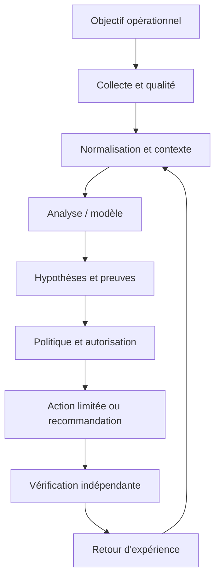

Le premier contrat concerne la donnée : source, horodatage, unité, cible, fraîcheur et état de qualité sont conservés. Le contrat du modèle ou de la règle précise la version, les entrées attendues, les métriques de validation et les limites. Le contrat de décision énumère les actions permises, les préconditions, les approbations, les quotas et les conditions d'arrêt. Le contrat de sortie indique enfin la preuve requise pour déclarer un rétablissement. Ces frontières permettent de tester chaque partie indépendamment, de corriger un composant sans dissimuler l'origine de l'erreur et d'auditer une action plusieurs semaines plus tard.

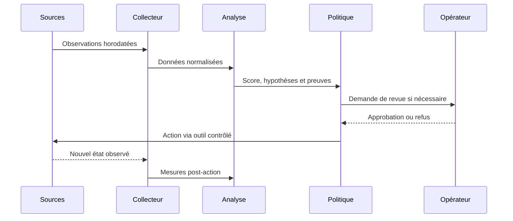

### Frontières de sécurité et mode dégradé

Le contrôle de sécurité lié à Séparation analyse/exécution doit être conçu dès le départ. Appliquer le moindre privilège, protéger les secrets, tracer les décisions et séparer analyse et exécution. Le piège à surveiller est : fusionner des changements à fort impact sans revue. Lorsque des données externes entrent dans le pipeline, elles ne doivent pas modifier les règles d'accès ni fournir des instructions privilégiées. Toute action à fort impact exige des préconditions compréhensibles, une approbation adaptée et une façon testée de revenir vers un état sûr.

Si Données manquantes produit un résultat incohérent, commencer par vérifier horloge, source, unité, cible, fraîcheur, version et erreur d'accès. Comparer une observation brute avec sa valeur transformée, puis rechercher les modifications récentes. Pour le scénario étudié, un contrôle utile consiste à tester une seule hypothèse à la fois et à conserver la preuve du résultat. Ne pas recopier de secrets dans le ticket. Une fois le défaut confirmé, ajouter un test de régression afin que la même anomalie ne revienne pas avec une mise à jour.

À l'échelle, Résilience du pipeline doit gérer des volumes, équipements et versions hétérogènes sans perdre de traçabilité. Borner la concurrence, isoler les erreurs par cible, limiter le buffering et mesurer les files protège le système aval. La reprise d'une panne peut elle-même provoquer une surcharge si toutes les cibles se reconnectent simultanément. Une architecture robuste sait réduire la fréquence ou revenir à une méthode plus simple, tout en signalant explicitement cette dégradation au lieu d'afficher une apparence de fonctionnement normal.

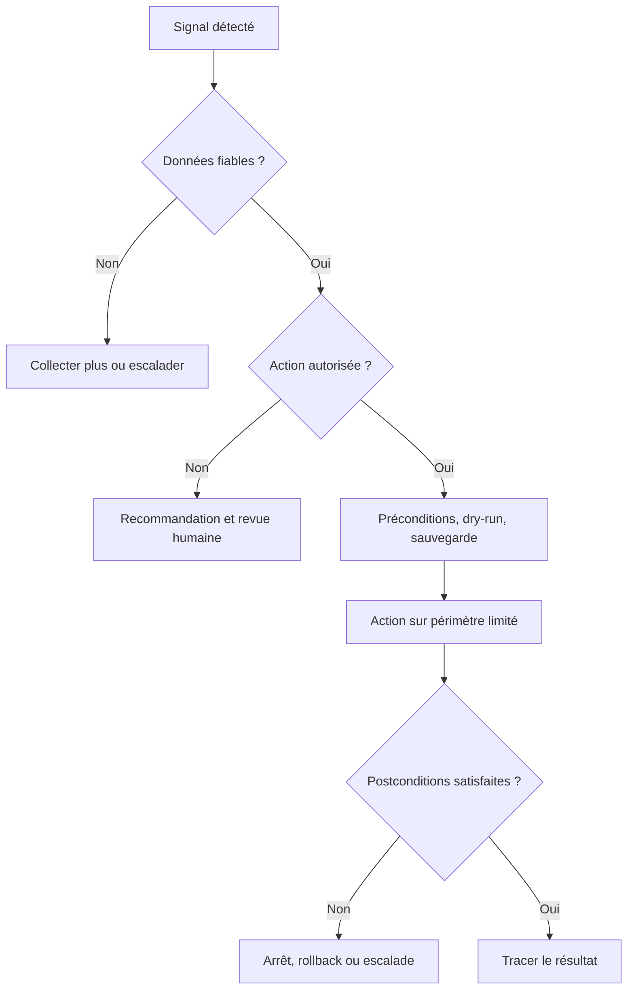

## 4. Pipeline et algorithmes

Le pipeline présenté ici est une chaîne de responsabilités, pas nécessairement un ensemble de microservices séparés. Une petite mise en œuvre peut héberger plusieurs étapes dans un seul processus, à condition de conserver des contrats clairs, des tests et des journaux. L'ordre importe : la qualité est vérifiée avant le calcul, le contexte avant l'interprétation et l'autorisation avant l'exécution. Cette discipline rend possible le fonctionnement en mode observation au départ puis, si les critères le justifient, une automatisation graduée.

### Étape 1 — Revoir
Versionner l'intention et demander une revue.

La mise en œuvre de Revoir gagne à être découpée en contrôles testables. Vérifier d'abord le format et la provenance des entrées, puis les hypothèses, les valeurs manquantes et les versions. L'outil Git peut contribuer à cette étape, mais sa présence ne garantit pas la qualité. Les erreurs doivent rester explicites au lieu d'être converties silencieusement en valeurs par défaut. Une exécution fiable sait différencier une réussite, un échec, un résultat partiel et un état impossible à déterminer.

Si Revoir produit un résultat incohérent, commencer par vérifier horloge, source, unité, cible, fraîcheur, version et erreur d'accès. Comparer une observation brute avec sa valeur transformée, puis rechercher les modifications récentes. Pour le scénario étudié, un contrôle utile consiste à tester une seule hypothèse à la fois et à conserver la preuve du résultat. Ne pas recopier de secrets dans le ticket. Une fois le défaut confirmé, ajouter un test de régression afin que la même anomalie ne revienne pas avec une mise à jour.

### Étape 2 — Valider
Exécuter lint, schéma, contrôle de secrets et politiques.

La mise en œuvre de Valider gagne à être découpée en contrôles testables. Vérifier d'abord le format et la provenance des entrées, puis les hypothèses, les valeurs manquantes et les versions. L'outil GitHub Actions peut contribuer à cette étape, mais sa présence ne garantit pas la qualité. Les erreurs doivent rester explicites au lieu d'être converties silencieusement en valeurs par défaut. Une exécution fiable sait différencier une réussite, un échec, un résultat partiel et un état impossible à déterminer.

Si Valider produit un résultat incohérent, commencer par vérifier horloge, source, unité, cible, fraîcheur, version et erreur d'accès. Comparer une observation brute avec sa valeur transformée, puis rechercher les modifications récentes. Pour le scénario étudié, un contrôle utile consiste à tester une seule hypothèse à la fois et à conserver la preuve du résultat. Ne pas recopier de secrets dans le ticket. Une fois le défaut confirmé, ajouter un test de régression afin que la même anomalie ne revienne pas avec une mise à jour.

### Étape 3 — Tester
Vérifier comportement en lab ou simulation.

La mise en œuvre de Tester gagne à être découpée en contrôles testables. Vérifier d'abord le format et la provenance des entrées, puis les hypothèses, les valeurs manquantes et les versions. L'outil Ansible peut contribuer à cette étape, mais sa présence ne garantit pas la qualité. Les erreurs doivent rester explicites au lieu d'être converties silencieusement en valeurs par défaut. Une exécution fiable sait différencier une réussite, un échec, un résultat partiel et un état impossible à déterminer.

Si Tester produit un résultat incohérent, commencer par vérifier horloge, source, unité, cible, fraîcheur, version et erreur d'accès. Comparer une observation brute avec sa valeur transformée, puis rechercher les modifications récentes. Pour le scénario étudié, un contrôle utile consiste à tester une seule hypothèse à la fois et à conserver la preuve du résultat. Ne pas recopier de secrets dans le ticket. Une fois le défaut confirmé, ajouter un test de régression afin que la même anomalie ne revienne pas avec une mise à jour.

### Étape 4 — Préparer
Produire diff, impact, critères d'arrêt et rollback.

La mise en œuvre de Préparer gagne à être découpée en contrôles testables. Vérifier d'abord le format et la provenance des entrées, puis les hypothèses, les valeurs manquantes et les versions. L'outil tests peut contribuer à cette étape, mais sa présence ne garantit pas la qualité. Les erreurs doivent rester explicites au lieu d'être converties silencieusement en valeurs par défaut. Une exécution fiable sait différencier une réussite, un échec, un résultat partiel et un état impossible à déterminer.

Si Préparer produit un résultat incohérent, commencer par vérifier horloge, source, unité, cible, fraîcheur, version et erreur d'accès. Comparer une observation brute avec sa valeur transformée, puis rechercher les modifications récentes. Pour le scénario étudié, un contrôle utile consiste à tester une seule hypothèse à la fois et à conserver la preuve du résultat. Ne pas recopier de secrets dans le ticket. Une fois le défaut confirmé, ajouter un test de régression afin que la même anomalie ne revienne pas avec une mise à jour.

### Étape 5 — Canary
Appliquer sur un petit groupe et suivre les SLO.

La mise en œuvre de Canary gagne à être découpée en contrôles testables. Vérifier d'abord le format et la provenance des entrées, puis les hypothèses, les valeurs manquantes et les versions. L'outil canary peut contribuer à cette étape, mais sa présence ne garantit pas la qualité. Les erreurs doivent rester explicites au lieu d'être converties silencieusement en valeurs par défaut. Une exécution fiable sait différencier une réussite, un échec, un résultat partiel et un état impossible à déterminer.

Si Canary produit un résultat incohérent, commencer par vérifier horloge, source, unité, cible, fraîcheur, version et erreur d'accès. Comparer une observation brute avec sa valeur transformée, puis rechercher les modifications récentes. Pour le scénario étudié, un contrôle utile consiste à tester une seule hypothèse à la fois et à conserver la preuve du résultat. Ne pas recopier de secrets dans le ticket. Une fois le défaut confirmé, ajouter un test de régression afin que la même anomalie ne revienne pas avec une mise à jour.

### Étape 6 — Promouvoir
Étendre seulement si les postconditions passent.

La mise en œuvre de Promouvoir gagne à être découpée en contrôles testables. Vérifier d'abord le format et la provenance des entrées, puis les hypothèses, les valeurs manquantes et les versions. L'outil rollback peut contribuer à cette étape, mais sa présence ne garantit pas la qualité. Les erreurs doivent rester explicites au lieu d'être converties silencieusement en valeurs par défaut. Une exécution fiable sait différencier une réussite, un échec, un résultat partiel et un état impossible à déterminer.

Si Promouvoir produit un résultat incohérent, commencer par vérifier horloge, source, unité, cible, fraîcheur, version et erreur d'accès. Comparer une observation brute avec sa valeur transformée, puis rechercher les modifications récentes. Pour le scénario étudié, un contrôle utile consiste à tester une seule hypothèse à la fois et à conserver la preuve du résultat. Ne pas recopier de secrets dans le ticket. Une fois le défaut confirmé, ajouter un test de régression afin que la même anomalie ne revienne pas avec une mise à jour.

### Pseudocode de décision défensive
```text
observations = collecter()
si qualite(observations) insuffisante:
    journaliser("données insuffisantes")
    demander_verification_humaine()
sinon:
    contexte = enrichir(observations, inventaire, changements, dépendances)
    hypotheses = analyser(contexte)
    preuves = verifier_provenance(hypotheses)
    si preuves insuffisantes ou action hors politique:
        recommander_sans_executer()
    sinon:
        plan = preparer_diff_preconditions_et_rollback()
        si validation(plan) et approbations(plan):
            appliquer_sur_perimetre_limite(plan)
            resultat = mesurer_postconditions()
            si resultat non conforme: rollback_ou_escalade()
            tracer(version, preuves, action, resultat)
```

Ce pseudocode sert à expliquer le flux de décision ; il ne constitue pas une bibliothèque prête pour la production. Chaque fonction doit être implémentée, testée et protégée. Le comportement doit être prévisible lorsque les données manquent, qu'un service externe ne répond pas ou que le résultat demeure ambigu. Une bonne conception ne remplace pas l'incertitude par une valeur par défaut. Elle la rend visible, limite l'impact et garde une voie de reprise.

## 5. Étude de cas détaillée

### Situation et impact
une modification d'ACL corrige un problème mais coupe un flux applicatif essentiel ; les tests, revues et procédures de retour arrière ne sont pas versionnés. L'équipe réunit responsable de service, ingénieur réseau, administrateur système et propriétaire de l'automatisation. Avant d'agir, elle définit l'impact observé, la fenêtre de temps, les actifs concernés et les services prioritaires. La première question n'est pas « quel modèle utiliser ? », mais « quelle décision doit être améliorée et quelle preuve montrera que le changement a servi son objectif ? ». Cette formulation fixe le périmètre et donne un critère d'arrêt si la solution n'apporte pas de valeur démontrable.

### Phase 1 — Établir les faits
Les observations doivent garder les heures originales et les identifiants de source. L'équipe vérifie la qualité de collecte, les changements récents, les dépendances et l'expérience utilisateur. Les valeurs manquantes sont identifiées explicitement plutôt que remplacées silencieusement par zéro. Les symptômes sont séparés des causes supposées, et les sources qui se contredisent sont enregistrées dans le dossier. La preuve de départ sert de référence pour vérifier si une intervention améliore réellement la situation et permet à un autre opérateur de reproduire l'analyse.

### Phase 2 — Poser plusieurs hypothèses
Quand plusieurs causes sont possibles, l'équipe note au minimum deux hypothèses, les observations qui les soutiennent, les éléments qui les contredisent et les tests qui peuvent les différencier. La priorité combine probabilité, impact et coût d'un test. Une hypothèse populaire n'est pas nécessairement correcte : un cas qui ressemble à un incident passé peut différer par la capacité, le routage, la version de logiciel ou la période de charge. Les hypothèses restent des hypothèses jusqu'à ce qu'une preuve suffisante permette de les confirmer.

### Phase 3 — Choisir une réponse proportionnée
Commencer par les vérifications non destructives : comparer l'état, consulter les changements, tester la connectivité ou inspecter une dépendance. Si une modification est nécessaire, définir précisément la cible, la commande ou le changement attendu, les préconditions, les critères d'arrêt et le rollback. Une revue indépendante s'impose lorsque le rayon d'impact est élevé. Le plan doit permettre à l'opérateur de comprendre pourquoi l'action est proposée et dans quelles circonstances il doit la refuser.

### Phase 4 — Vérifier les postconditions
La validation repose sur des mesures indépendantes du simple statut de commande : latence, erreurs, connectivité, état de configuration ou indicateur du service. La fenêtre d'observation doit éviter de confondre un échantillon favorable avec un rétablissement durable. Si les conditions ne sont pas satisfaites, appliquer la règle d'arrêt prévue et lancer un rollback ou une escalade. Le compte rendu distingue l'action exécutée, l'effet mesuré, les effets secondaires et les informations qui restent inconnues.

### Phase 5 — Capitaliser avec prudence
Le post-mortem compare les hypothèses initiales avec les preuves finales, relève les signaux manquants et ajoute des tests de régression. Une règle ou un modèle amélioré passe en revue et en essai contrôlé avant généralisation. Il faut éviter de réentraîner automatiquement sur des conclusions incertaines ou des tickets contenant uniquement des suppositions. Le retour d'expérience doit décrire les situations où la méthode a échoué autant que les cas où elle a réussi.

### Critères de clôture
La clôture exige une preuve de rétablissement, ou une déclaration explicite que le service reste dégradé. Le dossier réunit sources, versions, changement exact, approbation, résultats et suivi. La cause racine n'est marquée comme confirmée que si les observations la soutiennent suffisamment. En l'absence de preuve, une conclusion partielle est plus utile qu'un récit catégorique. La qualité se mesure au diagnostic reproductible, au risque contrôlé et à la possibilité d'améliorer le système à partir des erreurs observées.

## 6. Implémentation guidée et laboratoire

Le laboratoire doit être exécuté dans un environnement isolé ou sur des systèmes explicitement autorisés. Avant de commencer, noter les versions, dépendances, données d'entrée et condition de réussite. Ne pas copier les exemples sur un réseau de production sans adapter les identifiants, certificats, permissions et tests de restauration. Le livrable final doit être compréhensible par une autre personne, ré-exécutable et accompagné d'une liste claire de ses limites.

### TP 1 — Versionner un changement minimal.
**Procédure.** Versionner un changement minimal. Commencer par une cible de laboratoire minimale et capturer l'état de départ. Relier ce travail au concept « Infrastructure as Code » : L'IaC versionne l'état souhaité tout en exigeant revues, gestion des secrets et validation du comportement réel. Conserver la commande, les entrées, le résultat et la version des outils. Ne changer qu'une variable à la fois pour pouvoir attribuer un écart à sa cause.

**Critère de réussite.** Un autre opérateur doit pouvoir reproduire le résultat et identifier la preuve attendue. Tester aussi un échec contrôlé, une valeur manquante ou une dépendance indisponible. Si le résultat n'est pas déterminable, garder cet état explicite ; ne pas le convertir en succès. Vérifier les postconditions réelles, les effets secondaires et la procédure de reprise. Documenter ce qui a été démontré, ce qui reste une hypothèse et quelle amélioration serait nécessaire avant un usage à plus grande échelle.

### TP 2 — Valider YAML, syntaxe, secrets et politique en CI.
**Procédure.** Valider YAML, syntaxe, secrets et politique en CI. Commencer par une cible de laboratoire minimale et capturer l'état de départ. Relier ce travail au concept « CI/CD » : La CI vérifie un changement proposé ; la livraison ou le déploiement applique après les contrôles requis. Conserver la commande, les entrées, le résultat et la version des outils. Ne changer qu'une variable à la fois pour pouvoir attribuer un écart à sa cause.

**Critère de réussite.** Un autre opérateur doit pouvoir reproduire le résultat et identifier la preuve attendue. Tester aussi un échec contrôlé, une valeur manquante ou une dépendance indisponible. Si le résultat n'est pas déterminable, garder cet état explicite ; ne pas le convertir en succès. Vérifier les postconditions réelles, les effets secondaires et la procédure de reprise. Documenter ce qui a été démontré, ce qui reste une hypothèse et quelle amélioration serait nécessaire avant un usage à plus grande échelle.

### TP 3 — Tester les invariants de connectivité.
**Procédure.** Tester les invariants de connectivité. Commencer par une cible de laboratoire minimale et capturer l'état de départ. Relier ce travail au concept « Tests statiques et fonctionnels » : Syntaxe, schémas et secrets sont des contrôles statiques ; connectivité et invariants exigent des essais fonctionnels. Conserver la commande, les entrées, le résultat et la version des outils. Ne changer qu'une variable à la fois pour pouvoir attribuer un écart à sa cause.

**Critère de réussite.** Un autre opérateur doit pouvoir reproduire le résultat et identifier la preuve attendue. Tester aussi un échec contrôlé, une valeur manquante ou une dépendance indisponible. Si le résultat n'est pas déterminable, garder cet état explicite ; ne pas le convertir en succès. Vérifier les postconditions réelles, les effets secondaires et la procédure de reprise. Documenter ce qui a été démontré, ce qui reste une hypothèse et quelle amélioration serait nécessaire avant un usage à plus grande échelle.

### TP 4 — Générer un diff lisible et lister les cibles.
**Procédure.** Générer un diff lisible et lister les cibles. Commencer par une cible de laboratoire minimale et capturer l'état de départ. Relier ce travail au concept « Plan de changement » : Le plan inclut cible, dépendances, diff, impact, critères d'arrêt et procédure de reprise. Conserver la commande, les entrées, le résultat et la version des outils. Ne changer qu'une variable à la fois pour pouvoir attribuer un écart à sa cause.

**Critère de réussite.** Un autre opérateur doit pouvoir reproduire le résultat et identifier la preuve attendue. Tester aussi un échec contrôlé, une valeur manquante ou une dépendance indisponible. Si le résultat n'est pas déterminable, garder cet état explicite ; ne pas le convertir en succès. Vérifier les postconditions réelles, les effets secondaires et la procédure de reprise. Documenter ce qui a été démontré, ce qui reste une hypothèse et quelle amélioration serait nécessaire avant un usage à plus grande échelle.

### TP 5 — Séparer validation et déploiement protégé.
**Procédure.** Séparer validation et déploiement protégé. Commencer par une cible de laboratoire minimale et capturer l'état de départ. Relier ce travail au concept « Canary » : Le déploiement progressif applique d'abord sur un périmètre réduit et conditionne la suite à des critères mesurés. Conserver la commande, les entrées, le résultat et la version des outils. Ne changer qu'une variable à la fois pour pouvoir attribuer un écart à sa cause.

**Critère de réussite.** Un autre opérateur doit pouvoir reproduire le résultat et identifier la preuve attendue. Tester aussi un échec contrôlé, une valeur manquante ou une dépendance indisponible. Si le résultat n'est pas déterminable, garder cet état explicite ; ne pas le convertir en succès. Vérifier les postconditions réelles, les effets secondaires et la procédure de reprise. Documenter ce qui a été démontré, ce qui reste une hypothèse et quelle amélioration serait nécessaire avant un usage à plus grande échelle.

### TP 6 — Déployer sur un canary avec seuils d'arrêt.
**Procédure.** Déployer sur un canary avec seuils d'arrêt. Commencer par une cible de laboratoire minimale et capturer l'état de départ. Relier ce travail au concept « Rollback » : Le retour arrière doit être testé et vérifier le résultat, pas seulement restaurer un ancien fichier. Conserver la commande, les entrées, le résultat et la version des outils. Ne changer qu'une variable à la fois pour pouvoir attribuer un écart à sa cause.

**Critère de réussite.** Un autre opérateur doit pouvoir reproduire le résultat et identifier la preuve attendue. Tester aussi un échec contrôlé, une valeur manquante ou une dépendance indisponible. Si le résultat n'est pas déterminable, garder cet état explicite ; ne pas le convertir en succès. Vérifier les postconditions réelles, les effets secondaires et la procédure de reprise. Documenter ce qui a été démontré, ce qui reste une hypothèse et quelle amélioration serait nécessaire avant un usage à plus grande échelle.

### TP 7 — Vérifier postconditions et tester le rollback.
**Procédure.** Vérifier postconditions et tester le rollback. Commencer par une cible de laboratoire minimale et capturer l'état de départ. Relier ce travail au concept « Traçabilité » : Le commit, les versions d'outils, approbations, cibles et postconditions doivent être reliés. Conserver la commande, les entrées, le résultat et la version des outils. Ne changer qu'une variable à la fois pour pouvoir attribuer un écart à sa cause.

**Critère de réussite.** Un autre opérateur doit pouvoir reproduire le résultat et identifier la preuve attendue. Tester aussi un échec contrôlé, une valeur manquante ou une dépendance indisponible. Si le résultat n'est pas déterminable, garder cet état explicite ; ne pas le convertir en succès. Vérifier les postconditions réelles, les effets secondaires et la procédure de reprise. Documenter ce qui a été démontré, ce qui reste une hypothèse et quelle amélioration serait nécessaire avant un usage à plus grande échelle.

### Exemple de code ou de configuration

```yaml
name: Validate network change
on:
  pull_request:
    paths: ["network/**"]
jobs:
  validate:
    runs-on: ubuntu-latest
    steps:
      - uses: actions/checkout@v4
      - run: python scripts/validate_network_intent.py network/
      - run: python -m unittest discover -s tests
# Déploiement distinct : approbation, environnement protégé, secrets adaptés
# et contrôle de l'état réel après application.
```

Ce fragment est un point de départ pédagogique. Les versions, options CLI, capacités matérielles et schémas changent ; vérifier la documentation liée et tester dans un laboratoire. Le fragment n'inclut pas toute la configuration nécessaire à un déploiement réel. Les secrets ne doivent pas être ajoutés au code, et les exemples qui peuvent modifier un système doivent recevoir approbations, limites de portée et vérification post-action. Un parseur qui accepte la syntaxe ne certifie ni la conformité ni la disponibilité.

### Livrables attendus
- Un fichier versionné qui décrit entrées, sorties et dépendances.
- Un journal lié à la cible et à la version, sans secret.
- Des tests positifs, négatifs et de panne de dépendance.
- Des critères d'arrêt et une procédure de reprise testée.
- Une note décrivant les résultats et les limites.

## 7. Sécurité et gouvernance

### 1. Qualité et provenance
Chaque observation garde source, heure, unité et état de fraîcheur. Pour le contexte étudié, ce principe doit être traduit en contrôle observable, propriétaire, fréquence de revue et preuve de passage. Une politique sans test dépend de la mémoire des personnes ; un test sans propriétaire cesse d'être maintenu lorsque l'équipe change. La revue doit donc être planifiée et relancée après un changement majeur de données, de matériel, de finalité ou de modèle.

La gouvernance de Qualité et provenance définit qui peut créer, modifier, approuver, consulter et retirer la logique associée. Le propriétaire doit connaître l'objectif, les limites, les dépendances, le budget d'erreur et les critères de suspension. Les décisions doivent être retraçables jusqu'aux données et versions utilisées. Une règle sans propriétaire finit par dépendre de la mémoire de l'équipe ; un propriétaire sans mesure ne peut pas démontrer qu'elle fonctionne. La revue doit être planifiée et relancée à chaque changement majeur de données, d'équipement ou de finalité.

### 2. Identités et permissions
Les comptes d'automatisation reçoivent uniquement les privilèges nécessaires. Pour le contexte étudié, ce principe doit être traduit en contrôle observable, propriétaire, fréquence de revue et preuve de passage. Une politique sans test dépend de la mémoire des personnes ; un test sans propriétaire cesse d'être maintenu lorsque l'équipe change. La revue doit donc être planifiée et relancée après un changement majeur de données, de matériel, de finalité ou de modèle.

La gouvernance de Identités et permissions définit qui peut créer, modifier, approuver, consulter et retirer la logique associée. Le propriétaire doit connaître l'objectif, les limites, les dépendances, le budget d'erreur et les critères de suspension. Les décisions doivent être retraçables jusqu'aux données et versions utilisées. Une règle sans propriétaire finit par dépendre de la mémoire de l'équipe ; un propriétaire sans mesure ne peut pas démontrer qu'elle fonctionne. La revue doit être planifiée et relancée à chaque changement majeur de données, d'équipement ou de finalité.

### 3. Traçabilité
La version, les preuves, la décision, l'approbateur et le résultat sont corrélés. Pour le contexte étudié, ce principe doit être traduit en contrôle observable, propriétaire, fréquence de revue et preuve de passage. Une politique sans test dépend de la mémoire des personnes ; un test sans propriétaire cesse d'être maintenu lorsque l'équipe change. La revue doit donc être planifiée et relancée après un changement majeur de données, de matériel, de finalité ou de modèle.

La gouvernance de Traçabilité définit qui peut créer, modifier, approuver, consulter et retirer la logique associée. Le propriétaire doit connaître l'objectif, les limites, les dépendances, le budget d'erreur et les critères de suspension. Les décisions doivent être retraçables jusqu'aux données et versions utilisées. Une règle sans propriétaire finit par dépendre de la mémoire de l'équipe ; un propriétaire sans mesure ne peut pas démontrer qu'elle fonctionne. La revue doit être planifiée et relancée à chaque changement majeur de données, d'équipement ou de finalité.

### 4. Revue humaine
Le réviseur doit posséder preuves, temps et autorité pour refuser. Pour le contexte étudié, ce principe doit être traduit en contrôle observable, propriétaire, fréquence de revue et preuve de passage. Une politique sans test dépend de la mémoire des personnes ; un test sans propriétaire cesse d'être maintenu lorsque l'équipe change. La revue doit donc être planifiée et relancée après un changement majeur de données, de matériel, de finalité ou de modèle.

La gouvernance de Revue humaine définit qui peut créer, modifier, approuver, consulter et retirer la logique associée. Le propriétaire doit connaître l'objectif, les limites, les dépendances, le budget d'erreur et les critères de suspension. Les décisions doivent être retraçables jusqu'aux données et versions utilisées. Une règle sans propriétaire finit par dépendre de la mémoire de l'équipe ; un propriétaire sans mesure ne peut pas démontrer qu'elle fonctionne. La revue doit être planifiée et relancée à chaque changement majeur de données, d'équipement ou de finalité.

### 5. Mesure du risque
Chaque mode d'échec doit avoir prévention, détection, réponse et responsable. Pour le contexte étudié, ce principe doit être traduit en contrôle observable, propriétaire, fréquence de revue et preuve de passage. Une politique sans test dépend de la mémoire des personnes ; un test sans propriétaire cesse d'être maintenu lorsque l'équipe change. La revue doit donc être planifiée et relancée après un changement majeur de données, de matériel, de finalité ou de modèle.

La gouvernance de Mesure du risque définit qui peut créer, modifier, approuver, consulter et retirer la logique associée. Le propriétaire doit connaître l'objectif, les limites, les dépendances, le budget d'erreur et les critères de suspension. Les décisions doivent être retraçables jusqu'aux données et versions utilisées. Une règle sans propriétaire finit par dépendre de la mémoire de l'équipe ; un propriétaire sans mesure ne peut pas démontrer qu'elle fonctionne. La revue doit être planifiée et relancée à chaque changement majeur de données, d'équipement ou de finalité.

### 6. Réversibilité
La suspension du modèle et le retour à une version saine sont testés. Pour le contexte étudié, ce principe doit être traduit en contrôle observable, propriétaire, fréquence de revue et preuve de passage. Une politique sans test dépend de la mémoire des personnes ; un test sans propriétaire cesse d'être maintenu lorsque l'équipe change. La revue doit donc être planifiée et relancée après un changement majeur de données, de matériel, de finalité ou de modèle.

La gouvernance de Réversibilité définit qui peut créer, modifier, approuver, consulter et retirer la logique associée. Le propriétaire doit connaître l'objectif, les limites, les dépendances, le budget d'erreur et les critères de suspension. Les décisions doivent être retraçables jusqu'aux données et versions utilisées. Une règle sans propriétaire finit par dépendre de la mémoire de l'équipe ; un propriétaire sans mesure ne peut pas démontrer qu'elle fonctionne. La revue doit être planifiée et relancée à chaque changement majeur de données, d'équipement ou de finalité.

## 8. Pièges à éviter

### Piège 1 — Fusionner des changements à fort impact sans revue

Ce piège peut produire un faux diagnostic, une action superflue ou une perte de confiance. Le signal précurseur est parfois subtil : incohérence entre sources, hausse d'erreurs, impossibilité d'expliquer la sortie ou comportement différent selon les sites. L'équipe doit rendre le signal mesurable, désigner qui réagit et préciser si l'action automatique se bloque ou si le traitement continue en mode dégradé.

La prévention doit être reliée à « Infrastructure as Code ». L'IaC versionne l'état souhaité tout en exigeant revues, gestion des secrets et validation du comportement réel. Définir un test négatif qui fait apparaître le défaut et vérifier que la réponse attendue réduit le risque. Un garde-fou ne doit pas être un simple avertissement que les opérateurs apprennent à ignorer. En revue, demander quelle preuve montre que le contrôle fonctionne, quelle défaillance il couvre et quelle autre défaillance demeure possible.

### Piège 2 — Confondre syntaxe et comportement réseau

Ce piège peut produire un faux diagnostic, une action superflue ou une perte de confiance. Le signal précurseur est parfois subtil : incohérence entre sources, hausse d'erreurs, impossibilité d'expliquer la sortie ou comportement différent selon les sites. L'équipe doit rendre le signal mesurable, désigner qui réagit et préciser si l'action automatique se bloque ou si le traitement continue en mode dégradé.

La prévention doit être reliée à « CI/CD ». La CI vérifie un changement proposé ; la livraison ou le déploiement applique après les contrôles requis. Définir un test négatif qui fait apparaître le défaut et vérifier que la réponse attendue réduit le risque. Un garde-fou ne doit pas être un simple avertissement que les opérateurs apprennent à ignorer. En revue, demander quelle preuve montre que le contrôle fonctionne, quelle défaillance il couvre et quelle autre défaillance demeure possible.

### Piège 3 — Déployer sur tout le parc en une vague

Ce piège peut produire un faux diagnostic, une action superflue ou une perte de confiance. Le signal précurseur est parfois subtil : incohérence entre sources, hausse d'erreurs, impossibilité d'expliquer la sortie ou comportement différent selon les sites. L'équipe doit rendre le signal mesurable, désigner qui réagit et préciser si l'action automatique se bloque ou si le traitement continue en mode dégradé.

La prévention doit être reliée à « Tests statiques et fonctionnels ». Syntaxe, schémas et secrets sont des contrôles statiques ; connectivité et invariants exigent des essais fonctionnels. Définir un test négatif qui fait apparaître le défaut et vérifier que la réponse attendue réduit le risque. Un garde-fou ne doit pas être un simple avertissement que les opérateurs apprennent à ignorer. En revue, demander quelle preuve montre que le contrôle fonctionne, quelle défaillance il couvre et quelle autre défaillance demeure possible.

### Piège 4 — Avoir un rollback non testé

Ce piège peut produire un faux diagnostic, une action superflue ou une perte de confiance. Le signal précurseur est parfois subtil : incohérence entre sources, hausse d'erreurs, impossibilité d'expliquer la sortie ou comportement différent selon les sites. L'équipe doit rendre le signal mesurable, désigner qui réagit et préciser si l'action automatique se bloque ou si le traitement continue en mode dégradé.

La prévention doit être reliée à « Plan de changement ». Le plan inclut cible, dépendances, diff, impact, critères d'arrêt et procédure de reprise. Définir un test négatif qui fait apparaître le défaut et vérifier que la réponse attendue réduit le risque. Un garde-fou ne doit pas être un simple avertissement que les opérateurs apprennent à ignorer. En revue, demander quelle preuve montre que le contrôle fonctionne, quelle défaillance il couvre et quelle autre défaillance demeure possible.

### Piège 5 — Exposer secrets dans logs CI

Ce piège peut produire un faux diagnostic, une action superflue ou une perte de confiance. Le signal précurseur est parfois subtil : incohérence entre sources, hausse d'erreurs, impossibilité d'expliquer la sortie ou comportement différent selon les sites. L'équipe doit rendre le signal mesurable, désigner qui réagit et préciser si l'action automatique se bloque ou si le traitement continue en mode dégradé.

La prévention doit être reliée à « Canary ». Le déploiement progressif applique d'abord sur un périmètre réduit et conditionne la suite à des critères mesurés. Définir un test négatif qui fait apparaître le défaut et vérifier que la réponse attendue réduit le risque. Un garde-fou ne doit pas être un simple avertissement que les opérateurs apprennent à ignorer. En revue, demander quelle preuve montre que le contrôle fonctionne, quelle défaillance il couvre et quelle autre défaillance demeure possible.

### Piège 6 — Utiliser des versions flottantes non reproductibles

Ce piège peut produire un faux diagnostic, une action superflue ou une perte de confiance. Le signal précurseur est parfois subtil : incohérence entre sources, hausse d'erreurs, impossibilité d'expliquer la sortie ou comportement différent selon les sites. L'équipe doit rendre le signal mesurable, désigner qui réagit et préciser si l'action automatique se bloque ou si le traitement continue en mode dégradé.

La prévention doit être reliée à « Rollback ». Le retour arrière doit être testé et vérifier le résultat, pas seulement restaurer un ancien fichier. Définir un test négatif qui fait apparaître le défaut et vérifier que la réponse attendue réduit le risque. Un garde-fou ne doit pas être un simple avertissement que les opérateurs apprennent à ignorer. En revue, demander quelle preuve montre que le contrôle fonctionne, quelle défaillance il couvre et quelle autre défaillance demeure possible.

### Piège 7 — Se contenter d'un job vert sans mesurer l'état réseau

Ce piège peut produire un faux diagnostic, une action superflue ou une perte de confiance. Le signal précurseur est parfois subtil : incohérence entre sources, hausse d'erreurs, impossibilité d'expliquer la sortie ou comportement différent selon les sites. L'équipe doit rendre le signal mesurable, désigner qui réagit et préciser si l'action automatique se bloque ou si le traitement continue en mode dégradé.

La prévention doit être reliée à « Traçabilité ». Le commit, les versions d'outils, approbations, cibles et postconditions doivent être reliés. Définir un test négatif qui fait apparaître le défaut et vérifier que la réponse attendue réduit le risque. Un garde-fou ne doit pas être un simple avertissement que les opérateurs apprennent à ignorer. En revue, demander quelle preuve montre que le contrôle fonctionne, quelle défaillance il couvre et quelle autre défaillance demeure possible.

## 9. Diagnostic et dépannage

### Aucun résultat n'est produit
Vérifier accès source, période de sélection, identité, filtres et version du schéma. Dans le cadre de Pipelines CI/CD pour le réseau, vérifier en particulier ce risque : fusionner des changements à fort impact sans revue. Comparer les observations brutes à leur représentation transformée, retrouver la version du pipeline et noter si une modification récente correspond au début du problème. Formuler au moins deux explications alternatives et choisir un test à faible risque qui permet de les distinguer. Ne pas effectuer plusieurs changements simultanément, car cela rendrait l'analyse ambiguë. Si les preuves restent insuffisantes, rendre cette incertitude visible et utiliser le mode sûr.

### Les résultats varient
Comparer données, code, versions, transformations et paramètres sur un cas fixe. Dans le cadre de Pipelines CI/CD pour le réseau, vérifier en particulier ce risque : confondre syntaxe et comportement réseau. Comparer les observations brutes à leur représentation transformée, retrouver la version du pipeline et noter si une modification récente correspond au début du problème. Formuler au moins deux explications alternatives et choisir un test à faible risque qui permet de les distinguer. Ne pas effectuer plusieurs changements simultanément, car cela rendrait l'analyse ambiguë. Si les preuves restent insuffisantes, rendre cette incertitude visible et utiliser le mode sûr.

### Trop d'alertes
Inspecter doublons, saisonnalité, baseline, seuil et qualité du contexte avant de supprimer des alertes. Dans le cadre de Pipelines CI/CD pour le réseau, vérifier en particulier ce risque : déployer sur tout le parc en une vague. Comparer les observations brutes à leur représentation transformée, retrouver la version du pipeline et noter si une modification récente correspond au début du problème. Formuler au moins deux explications alternatives et choisir un test à faible risque qui permet de les distinguer. Ne pas effectuer plusieurs changements simultanément, car cela rendrait l'analyse ambiguë. Si les preuves restent insuffisantes, rendre cette incertitude visible et utiliser le mode sûr.

### Un incident passe inaperçu
Reconstituer les informations disponibles au moment de décider et rechercher un seuil trop permissif ou une source absente. Dans le cadre de Pipelines CI/CD pour le réseau, vérifier en particulier ce risque : avoir un rollback non testé. Comparer les observations brutes à leur représentation transformée, retrouver la version du pipeline et noter si une modification récente correspond au début du problème. Formuler au moins deux explications alternatives et choisir un test à faible risque qui permet de les distinguer. Ne pas effectuer plusieurs changements simultanément, car cela rendrait l'analyse ambiguë. Si les preuves restent insuffisantes, rendre cette incertitude visible et utiliser le mode sûr.

### L'action n'améliore pas le service
Vérifier postconditions indépendantes et effets secondaires, puis appliquer arrêt ou rollback selon le plan. Dans le cadre de Pipelines CI/CD pour le réseau, vérifier en particulier ce risque : exposer secrets dans logs CI. Comparer les observations brutes à leur représentation transformée, retrouver la version du pipeline et noter si une modification récente correspond au début du problème. Formuler au moins deux explications alternatives et choisir un test à faible risque qui permet de les distinguer. Ne pas effectuer plusieurs changements simultanément, car cela rendrait l'analyse ambiguë. Si les preuves restent insuffisantes, rendre cette incertitude visible et utiliser le mode sûr.

### La qualité diminue avec le temps
Rechercher dérive, changement de capacité, topologie, population ou version et réévaluer. Dans le cadre de Pipelines CI/CD pour le réseau, vérifier en particulier ce risque : utiliser des versions flottantes non reproductibles. Comparer les observations brutes à leur représentation transformée, retrouver la version du pipeline et noter si une modification récente correspond au début du problème. Formuler au moins deux explications alternatives et choisir un test à faible risque qui permet de les distinguer. Ne pas effectuer plusieurs changements simultanément, car cela rendrait l'analyse ambiguë. Si les preuves restent insuffisantes, rendre cette incertitude visible et utiliser le mode sûr.

## 10. Exercices corrigés

### Exercice 1 — Infrastructure as Code
**Énoncé.** Dans un environnement inspiré du scénario « une modification d'ACL corrige un problème mais coupe un flux applicatif essentiel ; les tests, revues et procédures de retour arrière ne sont pas versionnés », l'équipe veut généraliser une approche qui utilise « Infrastructure as Code ». Quelle preuve recueillir avant l'étape « Revoir », et comment réduire le risque suivant : fusionner des changements à fort impact sans revue ?

**Correction détaillée.** Définir d'abord le résultat attendu et le coût d'une erreur. Vérifier que les entrées proviennent d'une source autorisée et qu'elles sont fraîches, cohérentes et disponibles au moment de la décision. Construire un essai reproductible, comparer à une baseline et analyser les erreurs par classe d'actif ou criticité. Versionner l'intention et demander une revue. L'extension du périmètre exige des seuils écrits, une revue adaptée au risque, un déploiement progressif et un retour arrière. Si la preuve ne permet pas de trancher, demander une vérification complémentaire ou garder la solution en observation plutôt que d'inventer une certitude.

**Pourquoi les raccourcis échouent.** Un résultat favorable sur un exemple ne démontre pas une performance durable. Un score moyen peut masquer les catégories vulnérables ; une absence d'erreur visible peut provenir d'une télémétrie incomplète. Conserver les cas difficiles, les conditions de test et les versions utilisées rend possible une revue indépendante. L'exercice est réussi lorsque le choix, ses limites et le mécanisme de retrait sont compris par une autre personne.

### Exercice 2 — CI/CD
**Énoncé.** Dans un environnement inspiré du scénario « une modification d'ACL corrige un problème mais coupe un flux applicatif essentiel ; les tests, revues et procédures de retour arrière ne sont pas versionnés », l'équipe veut généraliser une approche qui utilise « CI/CD ». Quelle preuve recueillir avant l'étape « Valider », et comment réduire le risque suivant : confondre syntaxe et comportement réseau ?

**Correction détaillée.** Définir d'abord le résultat attendu et le coût d'une erreur. Vérifier que les entrées proviennent d'une source autorisée et qu'elles sont fraîches, cohérentes et disponibles au moment de la décision. Construire un essai reproductible, comparer à une baseline et analyser les erreurs par classe d'actif ou criticité. Exécuter lint, schéma, contrôle de secrets et politiques. L'extension du périmètre exige des seuils écrits, une revue adaptée au risque, un déploiement progressif et un retour arrière. Si la preuve ne permet pas de trancher, demander une vérification complémentaire ou garder la solution en observation plutôt que d'inventer une certitude.

**Pourquoi les raccourcis échouent.** Un résultat favorable sur un exemple ne démontre pas une performance durable. Un score moyen peut masquer les catégories vulnérables ; une absence d'erreur visible peut provenir d'une télémétrie incomplète. Conserver les cas difficiles, les conditions de test et les versions utilisées rend possible une revue indépendante. L'exercice est réussi lorsque le choix, ses limites et le mécanisme de retrait sont compris par une autre personne.

### Exercice 3 — Tests statiques et fonctionnels
**Énoncé.** Dans un environnement inspiré du scénario « une modification d'ACL corrige un problème mais coupe un flux applicatif essentiel ; les tests, revues et procédures de retour arrière ne sont pas versionnés », l'équipe veut généraliser une approche qui utilise « Tests statiques et fonctionnels ». Quelle preuve recueillir avant l'étape « Tester », et comment réduire le risque suivant : déployer sur tout le parc en une vague ?

**Correction détaillée.** Définir d'abord le résultat attendu et le coût d'une erreur. Vérifier que les entrées proviennent d'une source autorisée et qu'elles sont fraîches, cohérentes et disponibles au moment de la décision. Construire un essai reproductible, comparer à une baseline et analyser les erreurs par classe d'actif ou criticité. Vérifier comportement en lab ou simulation. L'extension du périmètre exige des seuils écrits, une revue adaptée au risque, un déploiement progressif et un retour arrière. Si la preuve ne permet pas de trancher, demander une vérification complémentaire ou garder la solution en observation plutôt que d'inventer une certitude.

**Pourquoi les raccourcis échouent.** Un résultat favorable sur un exemple ne démontre pas une performance durable. Un score moyen peut masquer les catégories vulnérables ; une absence d'erreur visible peut provenir d'une télémétrie incomplète. Conserver les cas difficiles, les conditions de test et les versions utilisées rend possible une revue indépendante. L'exercice est réussi lorsque le choix, ses limites et le mécanisme de retrait sont compris par une autre personne.

### Exercice 4 — Plan de changement
**Énoncé.** Dans un environnement inspiré du scénario « une modification d'ACL corrige un problème mais coupe un flux applicatif essentiel ; les tests, revues et procédures de retour arrière ne sont pas versionnés », l'équipe veut généraliser une approche qui utilise « Plan de changement ». Quelle preuve recueillir avant l'étape « Préparer », et comment réduire le risque suivant : avoir un rollback non testé ?

**Correction détaillée.** Définir d'abord le résultat attendu et le coût d'une erreur. Vérifier que les entrées proviennent d'une source autorisée et qu'elles sont fraîches, cohérentes et disponibles au moment de la décision. Construire un essai reproductible, comparer à une baseline et analyser les erreurs par classe d'actif ou criticité. Produire diff, impact, critères d'arrêt et rollback. L'extension du périmètre exige des seuils écrits, une revue adaptée au risque, un déploiement progressif et un retour arrière. Si la preuve ne permet pas de trancher, demander une vérification complémentaire ou garder la solution en observation plutôt que d'inventer une certitude.

**Pourquoi les raccourcis échouent.** Un résultat favorable sur un exemple ne démontre pas une performance durable. Un score moyen peut masquer les catégories vulnérables ; une absence d'erreur visible peut provenir d'une télémétrie incomplète. Conserver les cas difficiles, les conditions de test et les versions utilisées rend possible une revue indépendante. L'exercice est réussi lorsque le choix, ses limites et le mécanisme de retrait sont compris par une autre personne.

### Exercice 5 — Canary
**Énoncé.** Dans un environnement inspiré du scénario « une modification d'ACL corrige un problème mais coupe un flux applicatif essentiel ; les tests, revues et procédures de retour arrière ne sont pas versionnés », l'équipe veut généraliser une approche qui utilise « Canary ». Quelle preuve recueillir avant l'étape « Canary », et comment réduire le risque suivant : exposer secrets dans logs CI ?

**Correction détaillée.** Définir d'abord le résultat attendu et le coût d'une erreur. Vérifier que les entrées proviennent d'une source autorisée et qu'elles sont fraîches, cohérentes et disponibles au moment de la décision. Construire un essai reproductible, comparer à une baseline et analyser les erreurs par classe d'actif ou criticité. Appliquer sur un petit groupe et suivre les SLO. L'extension du périmètre exige des seuils écrits, une revue adaptée au risque, un déploiement progressif et un retour arrière. Si la preuve ne permet pas de trancher, demander une vérification complémentaire ou garder la solution en observation plutôt que d'inventer une certitude.

**Pourquoi les raccourcis échouent.** Un résultat favorable sur un exemple ne démontre pas une performance durable. Un score moyen peut masquer les catégories vulnérables ; une absence d'erreur visible peut provenir d'une télémétrie incomplète. Conserver les cas difficiles, les conditions de test et les versions utilisées rend possible une revue indépendante. L'exercice est réussi lorsque le choix, ses limites et le mécanisme de retrait sont compris par une autre personne.

## Atelier approfondi — concevoir une automatisation AIOps sûre

L'automatisation AIOps ne se limite pas à exécuter un script lorsqu'une alerte apparaît. Une chaîne fiable transforme une observation en décision encadrée, prépare une action limitée, vérifie ses préconditions, l'exécute dans un périmètre autorisé, puis mesure si le service est réellement revenu à l'état attendu. À chacune de ces étapes, elle doit pouvoir s'arrêter proprement. Le but n'est pas de rendre chaque opération automatique, mais de retirer les tâches répétitives lorsque la décision est suffisamment sûre et de préserver la capacité humaine pour les situations ambiguës.

Le fil rouge de cet atelier est un changement réseau déclenché après la détection d'une dégradation sur un groupe de liens. Le système peut proposer un rééquilibrage, un ajustement limité ou une collecte supplémentaire, mais il ne doit pas modifier l'infrastructure sur la base d'un score seul. Les exemples sont pédagogiques : toute commande, API, règle de changement et procédure doivent être adaptées au matériel, à l'environnement de laboratoire et aux politiques en vigueur.

### 1. Transformer le signal en intention opérationnelle

Une alerte constitue une observation, pas une instruction exécutable. Elle peut être tardive, incomplète, dupliquée, mal classée ou fondée sur une donnée erronée. L'automatisation doit d'abord réunir le contexte utile : cible, service affecté, durée, gravité, fraîcheur des mesures, changements récents, historique des actions et état de maintenance. Si les signaux sont contradictoires, elle doit demander une vérification ou s'abstenir plutôt que choisir arbitrairement celui qui lui semble le plus convaincant.

Séparez quatre objets. Le signal décrit ce qui est observé. L'intention exprime un objectif opérationnel, comme rétablir un chemin de secours ou réduire le temps de triage. La politique détermine les conditions autorisées et les restrictions. Le plan détaille les changements nécessaires pour satisfaire l'intention. Cette séparation empêche une alerte brute de devenir directement une commande.

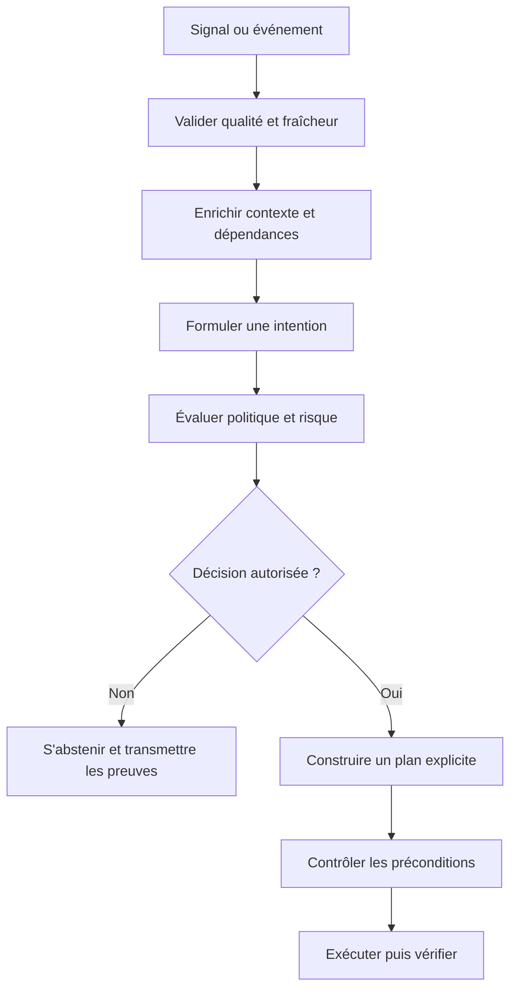

Une intention devrait être assez précise pour être évaluée. « Améliorer le réseau » n'est pas testable. « Rétablir la connectivité du segment de test en conservant l'accès d'administration et sans toucher aux sites hors périmètre » définit un objectif et des limites. Ajoutez les conditions de réussite, le délai, le périmètre, la criticité et les cas où l'opération doit être interrompue. Les actions ne doivent jamais élargir silencieusement le périmètre pour compenser un inventaire incomplet.

La décision peut avoir plusieurs résultats : ignorer un signal non pertinent, collecter des données supplémentaires, ouvrir une investigation, proposer un plan, exécuter une action de faible risque ou demander une approbation. Cette palette est plus robuste qu'un simple booléen « agir/ne pas agir ». Le statut « indéterminé » est utile lorsque le système ne dispose pas de données assez fraîches ou lorsque deux politiques se contredisent. Il évite de convertir artificiellement l'incertitude en autorisation.

### 2. Construire une politique explicite et vérifiable

Une politique décrit ce que le système peut faire, sur quelles cibles, sous quelles conditions et avec quels seuils d'arrêt. Elle peut inclure des règles comme « ne jamais modifier la configuration pendant une fenêtre de gel », « ne traiter que les équipements du groupe pilote », « exiger une approbation pour une modification de routage » ou « interdire le déploiement si la télémétrie est trop ancienne ». Les règles doivent être versionnées et testées avec la même rigueur que le code.

Distinguez la politique générale de la configuration par environnement. Les limites d'un laboratoire peuvent autoriser des opérations interdites en production. Une simple valeur de configuration indiquant l'environnement ne doit pas suffire à ouvrir toutes les permissions ; le contexte d'exécution, les identités, les approbations et les protections du système de déploiement doivent aussi le confirmer. Les environnements ne doivent pas partager par défaut les mêmes secrets ou comptes techniques.

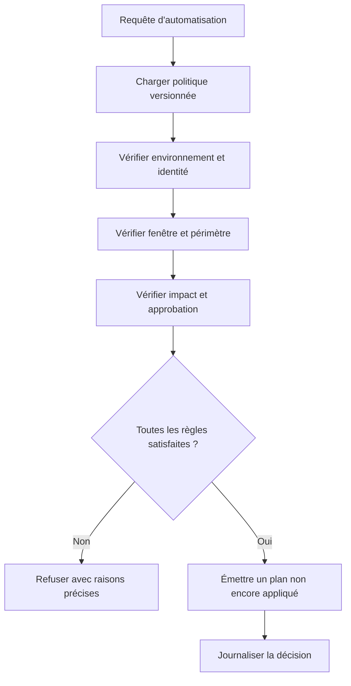

Les décisions doivent être expliquées sans révéler les secrets. Un refus peut indiquer qu'une cible est hors périmètre, que l'approbation manque, que la fraîcheur dépasse le délai admis ou que le risque est trop élevé. Un message générique comme « échec de l'automatisation » oblige l'opérateur à chercher à l'aveugle. À l'inverse, un diagnostic ne doit pas contenir un jeton, un mot de passe ou un extrait complet de configuration sensible.

Testez les politiques sur des cas positifs et négatifs : utilisateur autorisé et non autorisé, cible connue et inconnue, fenêtre normale et fenêtre de gel, données fraîches et périmées, approbation valide et expirée, plan de faible risque et plan dépassant la limite. Une politique testée seulement sur les cas acceptés peut sembler correcte tout en laissant passer les actions qu'elle devait interdire.

### 3. Rendre les actions idempotentes

Une action est idempotente lorsque sa répétition, dans les conditions définies, ne crée pas des effets supplémentaires indésirables. Les systèmes distribués peuvent réessayer une requête après une expiration de délai alors que l'opération a déjà été appliquée. Le client ne sait pas toujours si le serveur n'a jamais reçu la demande, l'a appliquée puis a perdu la réponse, ou est encore en train de la traiter. Répéter aveuglément une opération peut alors ajouter des objets en double, inverser une modification ou lancer plusieurs redémarrages.

Privilégiez des opérations déclaratives : définir l'état cible plutôt que rejouer une commande impérative à chaque passage. Comparez l'état actuel à l'état désiré, calculez le changement minimal, puis vérifiez ce qui a réellement été appliqué. Pour une action qui crée un objet, utilisez une clé de déduplication si l'API la prend en charge, ou recherchez l'objet par une identité stable avant de le créer. Une clé ne remplace pas la vérification du résultat, mais elle aide à dédupliquer les requêtes.

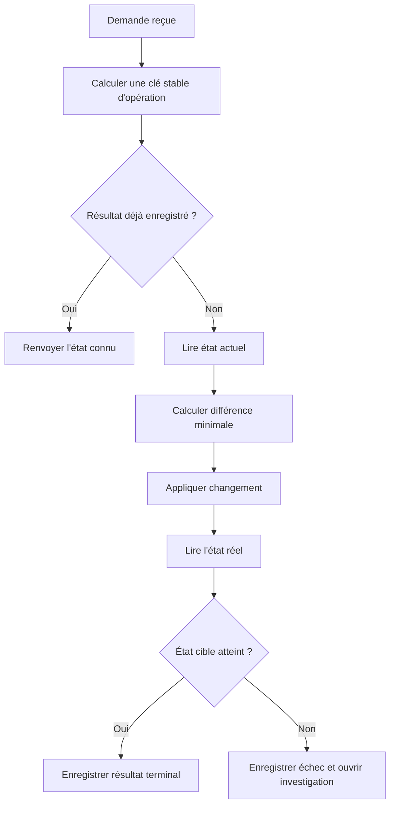

L'idempotence nécessite une définition de l'identité. Si l'identifiant de tâche change à chaque tentative, le système ne peut pas reconnaître deux tentatives de la même intention. Construisez une clé à partir d'éléments stables, comme l'identifiant de demande, l'objet cible et la version du plan. Évitez d'inclure l'heure courante si celle-ci crée une identité nouvelle à chaque tentative. Déterminez aussi combien de temps l'historique de déduplication doit être conservé selon les délais de reprise possibles.

Ne confondez pas idempotence et absence de risque. « Définir le port à l'état désactivé » peut être idempotent, mais reste une opération dangereuse si la cible est mal identifiée. Le plan doit avoir un périmètre, des préconditions et une autorisation. Une action peut également être idempotente au niveau d'une API mais pas au niveau opérationnel si elle déclenche des effets secondaires tels qu'une coupure, une notification ou une facturation répétée.

### 4. Utiliser préconditions, invariants et postconditions

Les préconditions précisent ce qui doit être vrai avant l'exécution : cible identifiée, état observé récent, sauvegarde disponible, chemin d'administration intact, approbation valide et fenêtre de changement ouverte. Les invariants sont des propriétés qui doivent rester vraies pendant l'opération ou au terme du changement : le réseau de gestion reste accessible, les autres sites ne sont pas touchés, les routes essentielles restent présentes et les droits ne sont pas élargis. Les postconditions décrivent ce que l'on doit observer après l'action pour la considérer réussie.

Cette séparation transforme un script en opération vérifiable. « La commande est retournée sans erreur » n'est pas une postcondition suffisante. L'API peut accepter une demande sans que le plan de données converge comme attendu. Il faut lire l'état réel après le changement et, lorsque c'est approprié, tester le service depuis un point de vue indépendant.

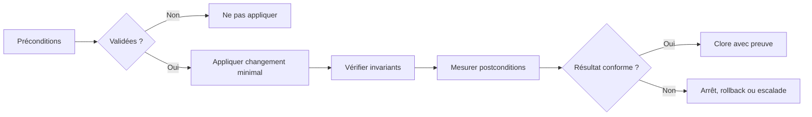

Écrivez les invariants comme des tests que l'on peut exécuter. Par exemple, une opération de test sur une interface ne doit pas modifier les interfaces hors du groupe autorisé ; l'accès d'administration doit continuer à répondre ; le nombre de routes indispensables doit rester au-dessus d'une limite définie. Ces tests doivent être adaptés au service et non copiés d'un exemple générique. Un invariant peut également imposer que l'identité du collecteur reste en lecture seule même lorsqu'un autre service propose un changement.

Les postconditions peuvent combiner plusieurs niveaux. Au niveau de l'API, la modification est acceptée. Au niveau de l'équipement, la configuration ou l'état opérationnel correspond à la cible. Au niveau du service, la connectivité, le délai ou le taux d'erreur revient dans une plage acceptable. Ces niveaux sont complémentaires : une configuration appliquée ne garantit pas que le service a retrouvé son fonctionnement. Définissez également une période d'observation, car le retour immédiat à la normale peut être temporaire.

### 5. Traiter le workflow comme une machine à états

Un workflow d'automatisation doit représenter explicitement son état : reçu, qualifié, préparé, en attente d'approbation, en cours, vérifié, terminé, échoué, compensé ou suspendu. Sans états explicites, un redémarrage du worker peut rendre impossible de savoir si l'action a été appliquée. Évitez de garder la totalité de la progression uniquement dans la mémoire d'un processus.

Chaque transition doit avoir une condition, une limite temporelle, une trace et une stratégie si elle échoue. Une tâche bloquée en attente d'approbation ne doit pas conserver indéfiniment une ressource ou une réservation. Une opération commencée avant une panne peut être reprise, mais elle doit d'abord relire l'état actuel et rechercher un résultat déjà appliqué. Ne repartez pas automatiquement de la première commande sans reconstruire le contexte.

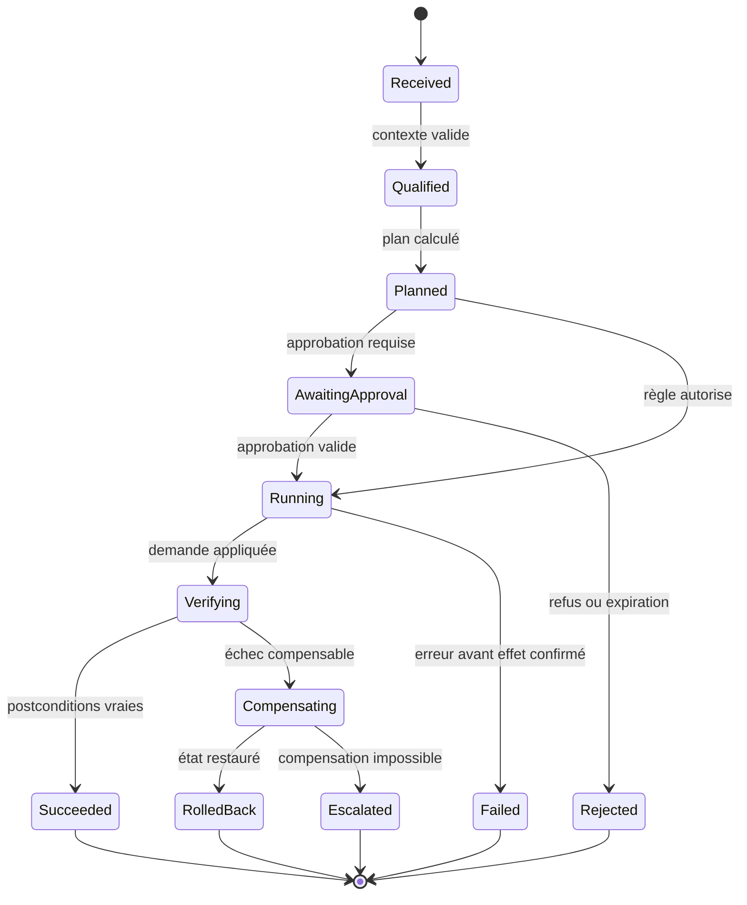

Les transitions doivent être idempotentes elles aussi. Si un événement de file arrive deux fois, la deuxième livraison ne doit pas créer un nouveau workflow qui modifie le même équipement. Si un job est relancé après un crash, il doit retrouver son identifiant, relire le journal et reprendre au bon état. Une version du schéma de workflow aide à traiter les tâches historiques lorsque la logique change. Les transitions impossibles doivent être refusées et signalées, pas réparées silencieusement.

Prévoyez des états « suspendu » et « escaladé ». Une opération peut être impossible à terminer automatiquement parce qu'une vérification est indisponible, qu'une action compensatoire n'est pas sûre ou qu'une donnée essentielle manque. L'équipe doit voir ce blocage, les étapes déjà réalisées et les opérations restantes. Un workflow ne doit pas rester « en cours » pendant des heures sans propriétaire ni expiration.

### 6. Comprendre compensation et rollback

Un rollback n'est pas toujours l'inverse exact d'une action. Une modification réseau peut avoir déclenché des sessions, propagé des routes, changé des états ou provoqué des effets externes. Restaurer un fichier de configuration ne garantit donc pas de restaurer exactement le service. Pour les opérations composées, la compensation consiste à exécuter des actions de correction qui ramènent le système vers un état acceptable. Elle doit elle-même être autorisée, testée et vérifiée.

Avant un changement, capturez un état de référence et identifiez les éléments qui pourront être restaurés. Le snapshot doit être associé à l'équipement, à l'heure, à la version de configuration et à l'opération qui l'utilise. Il doit être protégé contre les accès non autorisés et conserver les informations nécessaires sans exposer inutilement des secrets. Une sauvegarde non testée ou impossible à restaurer n'est pas une garantie de réversibilité.

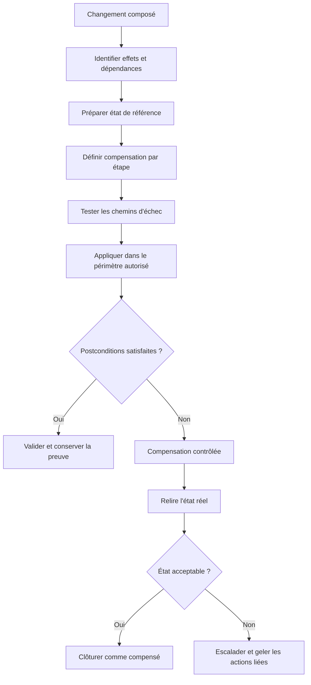

Il existe des cas où une compensation automatique est plus dangereuse que l'escalade. Si l'état actuel est inconnu, si une modification concurrente a eu lieu ou si le retour arrière peut interrompre un service critique, arrêtez et demandez une décision humaine. La procédure doit connaître ses limites. Ne réappliquez pas aveuglément un snapshot historique si un autre opérateur a modifié l'équipement depuis.

Testez au moins les scénarios suivants : échec avant application, délai expiré après application, réponse perdue, postcondition non satisfaite, rollback partiel, dépendance indisponible pendant la compensation et intervention concurrente. Pour chacun, indiquez l'état final attendu, les preuves à conserver, l'action permise et le point d'escalade. Le rollback devient fiable lorsqu'il est un scénario testé, pas simplement un bouton dans l'interface.

### 7. Déployer progressivement et limiter le rayon d'impact

Une action qui fonctionne sur un équipement de laboratoire peut avoir un effet différent sur un parc réel. Le déploiement progressif réduit le rayon d'impact : un canary ou petit groupe est traité en premier, les résultats sont évalués, puis la vague suivante est autorisée. Le groupe pilote doit représenter les différences pertinentes, sans inclure tous les actifs critiques dès le premier essai. Définissez une taille maximale de vague, une pause d'observation et les critères de passage.

Le choix du canary doit être explicite. Un équipement atypique peut être utile pour tester les cas limites, mais un équipement essentiel n'est pas nécessairement un bon candidat pour le premier essai. Sélectionnez selon la représentativité, le risque, la redondance, la couverture de surveillance et la capacité à restaurer le service. Documentez les équipements exclus et la raison de l'exclusion.

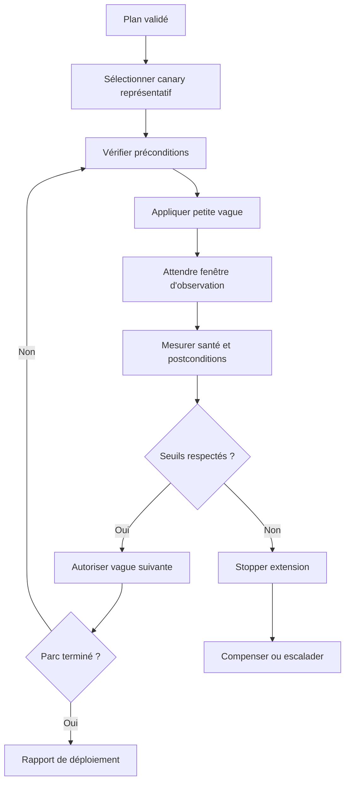

Les seuils d'arrêt doivent être définis avant l'exécution, et non choisis après avoir vu le résultat. Ils peuvent inclure l'augmentation du taux d'erreur, la perte de connectivité, la hausse de latence, la proportion de cibles non conformes, les erreurs d'API ou le dépassement d'un délai. Les seuils doivent être adaptés à chaque type de changement ; un ajustement de collecte et une modification de routage n'ont pas la même criticité.

La progression ne doit pas dépendre du seul taux global. Une moyenne acceptable peut cacher l'échec d'un site ou d'une catégorie de service. Ventilez les mesures selon les populations critiques, gardez un minimum de réussite par groupe et bloquez l'extension si un sous-ensemble dépasse les limites. Une opération peut aussi être suspendue automatiquement si les données nécessaires à la décision cessent d'arriver, parce que l'équipe ne peut plus vérifier son impact.

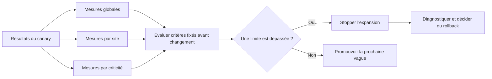

Un mécanisme de verrouillage ou de réservation peut empêcher plusieurs workflows de modifier la même cible simultanément. Le verrou doit avoir une durée d'expiration et un moyen de gérer la perte du worker qui le détenait. Un verrou permanent bloquerait le système après un crash ; un verrou trop court autoriserait des actions concurrentes encore en cours. À la reprise, la tâche doit vérifier l'identité du propriétaire, la version de l'état et les modifications réalisées depuis l'acquisition.

### 8. Contrôler concurrence, files et limites de débit

Un événement AIOps peut être dupliqué par le système de transport, réémis à la reconnexion ou généré simultanément par plusieurs détecteurs. Si chaque événement lance une opération, un incident important peut provoquer une avalanche d'actions concurrentes. Les mécanismes de déduplication, de regroupement et de verrouillage réduisent ce risque, mais doivent préserver les événements réellement différents.

La déduplication devrait utiliser des informations sémantiques : actif, type de phénomène, fenêtre temporelle et version de politique. Le simple texte d'une alerte est une clé fragile, car sa formulation peut changer. Une fenêtre trop large peut fusionner deux incidents distincts ; une fenêtre trop courte peut traiter plusieurs symptômes du même incident comme des événements indépendants. Les règles doivent être testées sur des scénarios historiques et les opérations de sévérité supérieure doivent rester visibles.

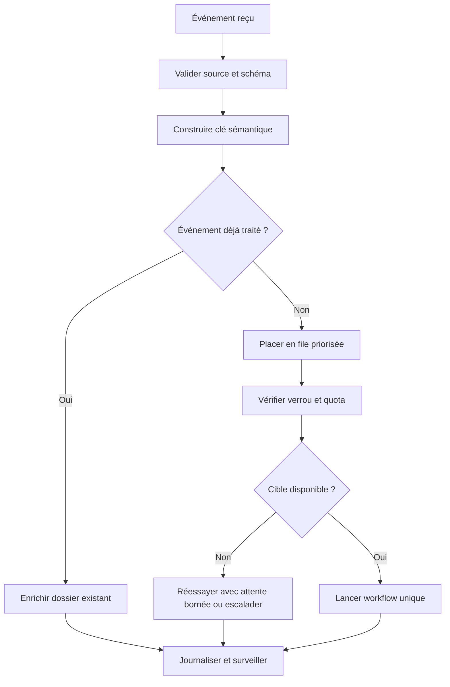

Appliquez un quota global et, si nécessaire, des limites par équipement, par site et par type d'action. La limitation doit protéger l'infrastructure et le service d'automatisation. Un système qui exécute des opérations plus vite que la capacité de vérification ne peut pas confirmer leur résultat. Réservez de la capacité pour les événements critiques, et évitez que des tâches de faible priorité occupent tous les workers ou toutes les connexions.

Les tentatives doivent être classées en erreurs transitoires et permanentes. Un délai dépassé ou une indisponibilité courte peut justifier une nouvelle tentative ; une autorisation refusée, un schéma invalide ou une cible hors périmètre requiert une correction plutôt qu'une répétition sans fin. Utilisez un nombre maximal de tentatives, un délai progressif, de l'aléa pour répartir les reprises et une file d'échec pour les tâches qui nécessitent une intervention.

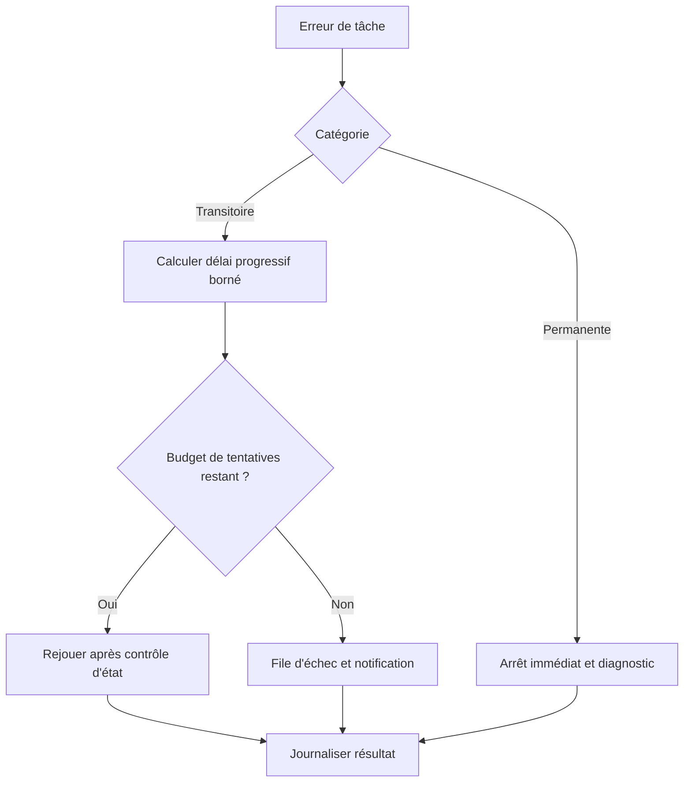

### 9. Séparer planification, simulation et exécution

Un plan de changement lisible est un résultat à part entière. Il indique les cibles, les opérations, l'état avant, l'état voulu, les différences attendues, les risques, les préconditions et les contrôles postérieurs. La simulation ou le mode de vérification permet d'identifier certains problèmes avant l'exécution, mais ne garantit ni que l'équipement acceptera le changement ni que le service convergera correctement.

La phase de planification ne devrait pas disposer des mêmes droits que l'exécution. Le moteur de plan peut lire les configurations et calculer les différences ; un agent d'exécution séparé peut recevoir un plan approuvé et appliquer uniquement les opérations permises. Cette séparation réduit l'impact d'un défaut dans l'analyse du signal ou la construction du plan. Le plan doit être immuable une fois approuvé ; si la cible ou le contenu change, l'approbation doit être reconsidérée.

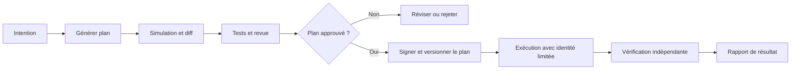

Un diff doit être interprétable. Il présente ce qui sera ajouté, supprimé ou modifié, avec les cibles et les risques. Évitez les changements massifs difficiles à examiner et découpez les opérations lorsque cela réduit le rayon d'impact. Les changements de configuration et les modifications de secrets devraient être distingués pour que le rapport de validation n'expose pas de valeurs confidentielles.

Les plans doivent être liés à un inventaire qui reste valable au moment de l'application. Si un nom DNS est réaffecté, un équipement a été remplacé ou la topologie a changé depuis l'approbation, le plan peut viser la mauvaise cible. Enregistrez une identité stable et une version de l'état qui a servi à construire le plan. Juste avant l'exécution, vérifiez les conditions sensibles et refusez l'application si l'écart est devenu trop important.

### 10. Concevoir l'audit et la preuve d'exécution

Un workflow doit laisser une histoire cohérente : déclencheur, données utilisées, version de politique, plan, approbation, identité d'exécution, opérations demandées, réponses, mesures postérieures et résultat. Chaque entrée devrait être horodatée et liée à l'identifiant stable de l'opération. Les journaux ne doivent pas être l'unique source de vérité si leur rotation ou leur indisponibilité peut effacer l'état nécessaire à la reprise.

La preuve doit permettre de répondre à des questions simples : pourquoi l'action a-t-elle été proposée ? Quelles données étaient disponibles à ce moment-là ? Qui ou quelle règle l'a autorisée ? Sur quelles cibles l'action a-t-elle été appliquée ? Les postconditions ont-elles été vérifiées ? Le service est-il resté sain pendant la période d'observation ? Si la réponse n'est pas reconstructible, l'automatisation n'est pas suffisamment contrôlable pour un changement risqué.

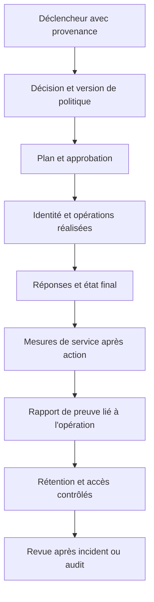

Conservez les secrets en dehors des journaux. Les commandes d'exécution peuvent contenir des variables sensibles ou révéler une configuration complète. Les logs doivent privilégier un identifiant de secret ou une référence au coffre, pas sa valeur. Le masquage doit être testé : un message d'exception ou une sortie brute de commande peut contenir le secret même si le code applicatif ne l'imprime jamais volontairement.

La traçabilité doit également rester proportionnée. Ne collectez pas tout le contenu de chaque événement si seules quelques données sont utiles à la justification. Utilisez des références vers des données protégées lorsque nécessaire, définissez les durées de rétention et restreignez les accès. L'objectif est d'être capable d'expliquer une opération, pas de créer un nouvel entrepôt de données sensibles sans finalité claire.

### 11. Tester les workflows au-delà du chemin heureux

Les tests unitaires valident les fonctions de décision, les règles de seuil, les calculs de plan et les conditions de transition. Les tests de contrat vérifient les interfaces avec les API ou équipements. Les tests d'intégration valident le parcours entre la file, l'orchestrateur, l'exécuteur et le système de suivi. Les tests de bout en bout mesurent l'effet réel dans un environnement autorisé. Aucun de ces niveaux ne remplace entièrement les autres.

Un cas réussi avec une API disponible ne couvre pas une réponse perdue après application, une seconde livraison du même événement, une intervention concurrente ou une vérification postérieure indisponible. Injectez des défauts contrôlés : délais, limitations de débit, réponses mal formées, perte de connexion, manque de données, saturation simulée ou worker interrompu. Vérifiez que le système garde un état cohérent, n'exécute pas deux fois une action et sait signaler une opération dont le résultat est incertain.

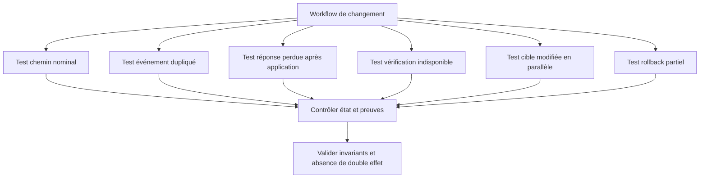

Les tests doivent distinguer l'état de l'opération de l'état du service. Une tâche peut être en échec alors que le changement a finalement été appliqué ; inversement, l'API peut annoncer un succès alors que le service reste dégradé. Introduisez un état « résultat inconnu » lorsque le système ne peut pas déterminer ce qui s'est passé. Dans ce cas, la reprise doit relire l'état et reconstruire les faits avant toute nouvelle action.

Les tests de non-régression devraient enregistrer des cas historiques représentatifs. Lorsqu'une règle est modifiée pour résoudre un faux positif, réévaluez les incidents que l'ancienne version détectait. Une amélioration ciblée peut dégrader d'autres catégories. Conservez la version, les paramètres, le jeu de cas, les résultats et la décision d'acceptation. Les changements de politique doivent être revus comme du code critique.

### 12. Mettre l'automatisation en mode observation

Le mode observation exécute la collecte, l'enrichissement, l'évaluation de la politique et la génération d'un plan, mais ne modifie pas l'infrastructure. Il permet de comparer les propositions automatiques aux décisions humaines et de détecter les cas où le contexte est incomplet. Il faut toutefois s'assurer qu'aucun chemin indirect ne peut déclencher un changement : désactiver un bouton côté interface ne suffit pas si l'identité d'exécution conserve des droits et qu'un autre composant peut appeler l'API directement.

Comparez les propositions aux incidents, aux actions réellement effectuées et aux décisions de l'équipe. Combien de fois le système aurait-il proposé une action inutile ? Combien de fois aurait-il omis une action importante ? Combien de propositions reposaient sur des données trop anciennes ? Combien exigeaient un contexte qui n'était pas présent ? Ces résultats doivent être documentés avant l'autorisation d'une exécution automatique.

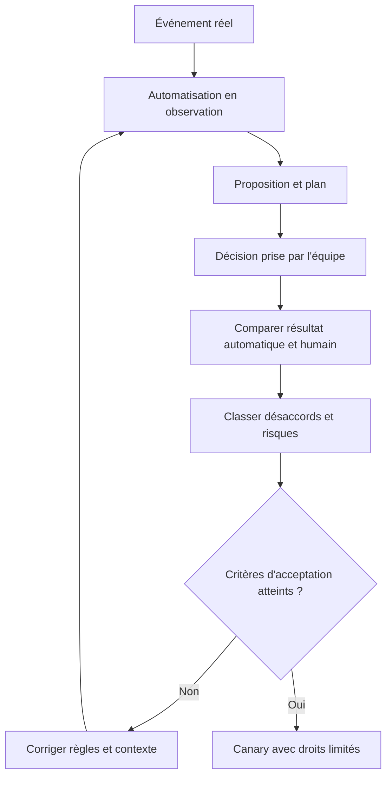

L'observation doit durer assez longtemps pour couvrir les profils de charge, les changements planifiés, les incidents et les périodes moins fréquentes qui peuvent être importantes. Quelques heures sans événement ne valident pas un workflow censé agir sur des pannes rares. Lorsque l'historique ne contient pas certains cas, utilisez des scénarios synthétiques en environnement de test et indiquez clairement la limite de cette preuve.

Le passage du mode observation à l'exécution devrait être un changement explicite, revu et traçable. Les droits, les règles, les seuils et la possibilité de revenir en observation doivent être testés. Une commande de suspension doit empêcher de nouvelles opérations, mais aussi définir quoi faire avec celles qui sont déjà en cours. Certaines peuvent être arrêtées en sécurité, d'autres nécessitent une vérification d'état avant d'être interrompues.

### 13. Mesurer la valeur au niveau du service

Mesurer le nombre d'actions exécutées ne prouve pas que l'automatisation a apporté une amélioration. Une action rapide mais sans effet, une action qui crée un incident secondaire ou un workflow qui traite énormément de petits cas tout en manquant les plus critiques n'apportent pas nécessairement de valeur. Reliez les mesures de l'automatisation aux résultats opérationnels : temps de rétablissement, répétition des incidents, heures de triage, actions réversibles, taux de postconditions atteintes et effets indésirables.

Définissez un indicateur principal et des garde-fous. Par exemple, une baisse du temps moyen de traitement doit être accompagnée d'une mesure du taux de réouverture et des changements ayant dû être compensés. Une augmentation du nombre de workflows terminés ne doit pas dissimuler une hausse des cas escaladés sans contexte. Les mesures doivent être ventilées par type d'action, service, environnement et niveau de risque.

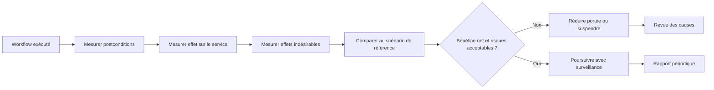

Les comparaisons doivent tenir compte des changements de contexte. Une période avec peu d'incidents peut faire croire qu'une automatisation est efficace simplement parce qu'elle a été peu sollicitée. Un déploiement parallèle, une modification d'infrastructure ou un changement de politique peut aussi expliquer l'évolution des métriques. Utilisez une période de référence, documentez les variables de contexte et évitez d'attribuer automatiquement toute amélioration au workflow.

Le rapport doit montrer les bénéfices mais aussi les abstentions et les échecs. Une augmentation des abstentions peut refléter une meilleure prudence si les données étaient insuffisantes ; une hausse des échecs peut signaler un défaut de dépendance ou un plan trop ambitieux. L'enjeu est de rendre ces situations visibles pour permettre un réglage justifié, pas de viser artificiellement un taux de réussite proche de 100 % en refusant toutes les tâches difficiles.

### 14. Sécuriser les identités et limiter les permissions

Les identités d'observation, de planification, d'approbation et d'exécution devraient être séparées lorsque le risque le justifie. Un collecteur en lecture ne doit pas disposer automatiquement d'un accès en écriture. Le moteur de planification n'a pas besoin de secrets d'exécution si un service contrôlé se charge d'appliquer le plan. L'approbateur doit voir le changement proposé, son périmètre, ses risques et les preuves, mais ne pas être obligé d'exposer les identifiants techniques pour donner son accord.

Utilisez une identité technique limitée à la cible et à l'action nécessaires. Les secrets doivent être lus depuis un coffre au moment de l'exécution, soumis à une politique de rotation, et absents des commits et des sorties CI. Préparez une procédure de révocation : si un secret est compromis ou si un service est retiré, l'accès doit pouvoir être bloqué sans attendre un nouveau déploiement complet du code.

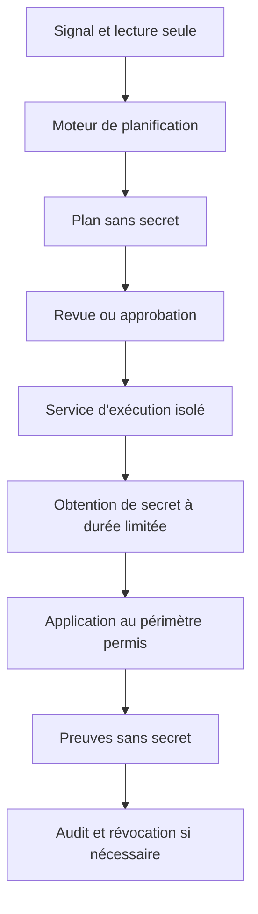

L'approbation n'est pas un substitut à une politique correcte. Une personne peut se tromper ou accepter un changement sur la base d'une information manquante. L'interface doit afficher les cibles exactes, le diff, les préconditions, les risques connus, les tests et le rollback. Les approbations doivent expirer et être liées à une version précise du plan. Si le plan est recalculé après approbation, il doit être soumis à nouveau au contrôle.

La sécurité inclut la capacité d'arrêter l'automatisation. Préservez un mécanisme de suspension qui ne dépend pas uniquement du même orchestrateur en difficulté. Les actions à haut risque doivent avoir une autorité clairement définie pour la reprise. Les journaux devraient enregistrer la suspension, son auteur ou déclencheur, les tâches actives et leur état, tout en limitant l'accès aux informations sensibles.

### 15. Gérer les dépendances et les contrats d'API

Une automatisation dépend généralement de plusieurs contrats : inventaire, système de télémétrie, contrôleur réseau, système de ticketing, approbation et stockage d'état. Chacune de ces dépendances peut évoluer séparément. Validez les versions, les schémas et les conditions d'erreur. Le fait qu'un endpoint réponde avec un code HTTP de succès ne prouve pas que son contenu correspond au contrat attendu, ni que l'état a été appliqué sur le système final.

Les erreurs doivent être interprétées avec discernement. Une erreur de validation du client, une autorisation refusée, un conflit de version, une limitation de débit et une panne temporaire n'appellent pas le même comportement. Certaines réponses peuvent justifier une nouvelle tentative avec délai ; d'autres indiquent qu'une donnée ou une permission doit être corrigée. La classification doit être documentée et validée avec les réponses réellement émises par les interfaces utilisées.

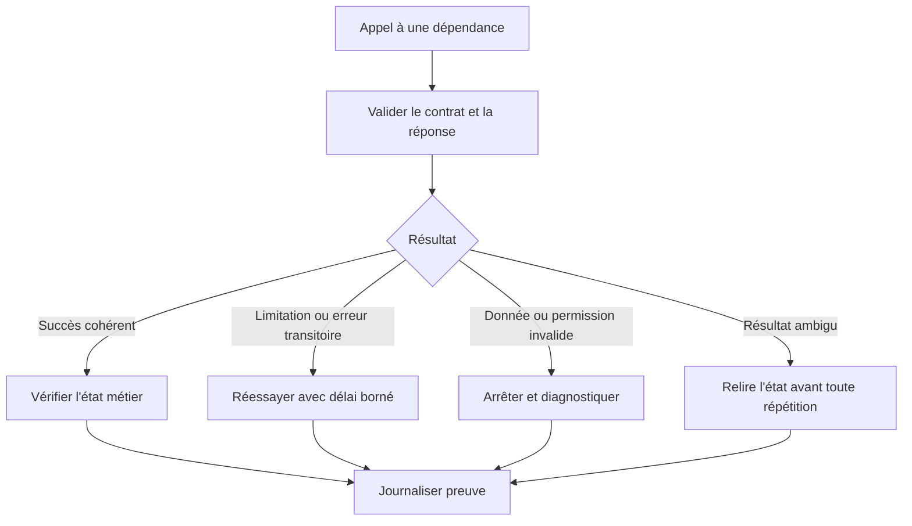

Un délai dépassé est une absence de réponse dans le délai, pas une preuve que l'opération n'a pas été appliquée. Cette nuance est particulièrement importante pour les requêtes qui modifient un état. Avant de réessayer, utilisez un identifiant de demande, une clé d'idempotence ou une lecture de l'état actuel afin de déterminer si l'opération a produit son effet. Si l'état reste impossible à connaître, suspendez l'opération et ouvrez une investigation au lieu d'empiler des tentatives.

Les changements de contrat doivent être testés avec des jeux représentatifs de réponses. Conservez des exemples non sensibles de succès, de validation échouée, de conflit et d'indisponibilité. Les tests de contrat détectent des modifications qui ne sont pas visibles dans les tests unitaires, comme un champ devenu facultatif, une unité changée ou une nouvelle condition de pagination.

### 16. Laboratoire : automatisation contrôlée d'un incident simulé

Construisez un scénario de laboratoire dans lequel une télémétrie synthétique indique une latence croissante sur un lien redondé. L'automatisation ne doit pas lancer immédiatement un changement. Elle vérifie la fraîcheur, recherche les changements récents, examine la topologie, calcule un plan limité et affiche ses préconditions. Les premières exécutions restent en observation. L'équipe compare ensuite le plan avec un scénario de référence et valide les conditions de passage au mode canary.

Le laboratoire doit contenir au moins un cas positif, un cas négatif et un cas ambigu. Le cas positif satisfait les préconditions et les postconditions. Le cas négatif est bloqué parce que la cible est hors périmètre ou que l'approbation manque. Le cas ambigu comporte une télémétrie trop ancienne ou un état qui change pendant la planification. Dans ce troisième cas, le système doit s'abstenir, actualiser les preuves ou demander une intervention.

```mermaid
sequenceDiagram
    participant T as Télémétrie
    participant O as Orchestrateur
    participant P as Politique
    participant H as Humain
    participant E as Exécuteur
    participant V as Vérification
    T->>O: Signal avec qualité et horodatage
    O->>P: Contexte, intention et périmètre
    P-->>O: Refus, approbation ou plan autorisé
    O->>H: Plan lisible et preuves
    H-->>O: Approbation liée à la version
    O->>E: Demande d'exécution bornée
    E-->>V: Résultat et identifiant d'opération
    V-->>O: Postconditions et effet de service
```

Réalisez ensuite une panne contrôlée. Simulez une perte de réponse après que l'agent a reçu la demande, puis relancez la tâche. Vérifiez qu'elle ne répète pas aveuglément l'action, qu'elle recherche l'état réel et que le journal conserve une seule identité logique d'opération. Simulez également une vérification postérieure qui échoue : le workflow doit rester ouvert, produire un dossier d'investigation et appliquer la stratégie de compensation autorisée ou escalader.

Préparez enfin un rapport qui explique le signal, la décision, les préconditions, le plan, la version de politique, l'approbation, l'action simulée, les postconditions et les limites. Ajoutez les résultats des cas négatifs : le système doit démontrer non seulement qu'il sait agir dans un cas simple, mais aussi qu'il sait refuser ou s'arrêter dans une situation dangereuse.

```mermaid
flowchart TD
    A["Créer scénario synthétique"] --> B["Exécuter en observation"]
    B --> C["Valider décision et plan"]
    C --> D["Tester cas autorisé"]
    C --> E["Tester cible interdite"]
    C --> F["Tester données périmées"]
    D --> G["Vérifier idempotence et postconditions"]
    E --> H["Vérifier refus et audit"]
    F --> I["Vérifier abstention"]
    G --> J["Assembler les preuves"]
    H --> J
    I --> J
```

### 17. Critères d'acceptation et mise en service

Avant la production, le système doit démontrer que les intentions sont bornées, les politiques versionnées, les plans examinables, les tâches dédupliquées, les préconditions vérifiées et les postconditions mesurées. Les reprises doivent être sûres ; l'état doit rester reconstructible après un redémarrage ; les secrets doivent être protégés ; les opérations risquées doivent avoir une procédure d'approbation et une stratégie de récupération. Chaque exigence doit être associée à un test et à une preuve.

Le déploiement devrait commencer sur un périmètre limité, puis être étendu seulement si les résultats satisfont les objectifs préalablement définis. Les indicateurs comprennent les taux de réussite et d'échec, la durée des workflows, la fréquence des abstentions, les actions compensées, les réouvertures, les effets indésirables et le temps gagné au niveau du service. Ne mesurez pas uniquement le nombre de tâches exécutées, car ce chiffre pourrait augmenter même si l'automatisation aggrave la situation.

```mermaid
flowchart TD
    A["Revue architecture et risque"] --> B["Tests unitaires et contrats"]
    B --> C["Tests de panne et de reprise"]
    C --> D["Mode observation"]
    D --> E["Pilote à droits limités"]
    E --> F["Mesures et revue"]
    F --> G{"Objectifs et garde-fous respectés ?"}
    G -- "Non" --> H["Suspendre et corriger"]
    H --> B
    G -- "Oui" --> I["Extension progressive"]
    I --> J["Revue périodique et versionnement"]
```

Les responsabilités doivent être explicites : propriétaire du workflow, propriétaire de la politique, équipe d'exécution, approbateur selon la criticité, responsable des secrets et personne capable de suspendre l'automatisation. La procédure d'exploitation décrit comment reprendre une tâche bloquée, comment déterminer si une action a été appliquée, comment restaurer un état acceptable et comment documenter l'incident. Une automatisation mature ne supprime pas la responsabilité humaine ; elle rend l'action répétable, contrôlée et vérifiable.

### Grille d'autoévaluation de l'atelier

- [ ] L'intention et le périmètre sont explicites.
- [ ] Les politiques sont versionnées et testées avec des cas négatifs.
- [ ] Les actions sont idempotentes ou possèdent une stratégie de déduplication.
- [ ] Les préconditions, invariants et postconditions sont vérifiables.
- [ ] Le workflow est une machine à états persistante.
- [ ] La compensation est documentée et testée.
- [ ] Les déploiements sont progressifs avec des seuils d'arrêt.
- [ ] Les files, quotas, verrous et reprises sont bornés.
- [ ] La simulation est séparée des droits d'exécution.
- [ ] Les preuves d'audit protègent les secrets.
- [ ] Les scénarios d'échec incluent résultat ambigu et panne de vérification.
- [ ] Le mode observation confirme les décisions avant l'exécution.
- [ ] Les mesures évaluent la santé du service et les effets indésirables.
- [ ] Les identités respectent le moindre privilège.
- [ ] Les contrats de dépendances et de données sont testés.
- [ ] Le rapport du laboratoire prouve refus, arrêt et reprise contrôlée.

## Défi final corrigé — pipeline de changement réseau avec arrêt sûr

### Énoncé

Une modification d'ACL doit corriger un flux applicatif sans couper les autres applications. Construis un pipeline qui valide la syntaxe, teste la politique sur un jeu de cas, produit un diff, demande une approbation et déploie progressivement. Le pipeline ne doit pas considérer une réponse HTTP réussie ou une commande terminée comme une preuve suffisante de santé.

### Pipeline de référence

```mermaid
flowchart TD
  A["Pull request et version de configuration"] --> B["Lint, schéma et secrets"]
  B --> C["Tests de politique et simulation"]
  C --> D{"Tests verts ?"}
  D -- "Non" --> E["Bloquer le merge et publier les diagnostics"]
  D -- "Oui" --> F["Diff et estimation du risque"]
  F --> G["Approbation du propriétaire"]
  G --> H["Déploiement canari"]
  H --> I["Mesurer disponibilité, erreurs et flux"]
  I --> J{"Garde-fous respectés ?"}
  J -- "Non" --> K["Arrêt et rollback contrôlé"]
  J -- "Oui" --> L["Étendre par lots et vérifier"]
```

### Exemple de pipeline déclaratif

```yaml
name: network-change-checks
on:
  pull_request:
    paths:
      - "network/**"
jobs:
  validate:
    runs-on: ubuntu-latest
    steps:
      - name: Checkout
        uses: actions/checkout@v4
      - name: Valider la syntaxe et le schéma
        run: python tools/validate_config.py network/
      - name: Tester la politique
        run: python -m pytest tests/network_policy/
      - name: Générer le diff de changement
        run: python tools/render_plan.py network/
```

Cet exemple n'effectue aucun changement sur les équipements. Dans un vrai dépôt, épingle les actions tierces selon la politique de sécurité de l'organisation, protège l'environnement de production et place la promotion de production dans un job séparé soumis à approbation.

### Proposition de correction

Le pipeline doit échouer rapidement si une configuration est invalide, si un secret apparaît dans un fichier ou si un cas de test interdit devient autorisé. Le test modélise la politique attendue et comporte des cas positifs et négatifs. Le plan expose les équipements ciblés, les lignes modifiées, les dépendances et les étapes de retour arrière avant l'approbation.

Après le canari, mesure des critères de service : taux d'échec des sessions concernées, disponibilité, latence, pertes et état des équipements. Définis les limites et la durée d'observation avant le déploiement. Une mesure absente ou trop tardive n'est pas assimilée à une mesure saine. Le rollback doit être préparé et testé ; s'il échoue, le pipeline arrête l'extension et appelle une procédure de reprise.

### Cas de test minimum

- L'ACL permet le flux attendu.
- L'ACL interdit toujours un flux explicitement interdit.
- Une cible hors inventaire bloque le plan.
- Un changement sans approbation ne peut pas atteindre la production.
- Un canari qui dégrade le service déclenche l'arrêt et conserve les preuves.

### Barème d'autoévaluation

La solution sépare validation, approbation, exécution et vérification. Elle limite le rayon d'impact, consigne la version déployée et sait interrompre le rollout lorsque les données de santé sont absentes.

## 11. Checklist et à retenir

- [ ] L'objectif métier et le service concerné sont explicites et mesurables.
- [ ] Chaque observation conserve provenance, horodatage, unité et qualité.
- [ ] La méthode a été comparée à une baseline simple.
- [ ] Les tests couvrent cas normaux, données manquantes et échecs.
- [ ] Les résultats sont ventilés par criticité et catégorie pertinente.
- [ ] Les permissions sont minimales et les secrets absents des journaux.
- [ ] Les décisions relient preuves, version, approbation et résultat.
- [ ] Chaque action risquée a préconditions, périmètre limité et rollback.
- [ ] Les mesures évaluent le service et les erreurs opérationnelles.
- [ ] Une procédure décrit abstention, escalade, suspension et revue.

### À retenir
Le but d'une démarche AIOps n'est pas d'automatiser chaque décision, mais de rendre les opérations plus rapides, cohérentes et vérifiables. Pour Pipelines CI/CD pour le réseau, la qualité dépend des données, de l'adéquation de la technique, d'une évaluation honnête et de la vérification du résultat. Un système capable de reconnaître ses limites, de bloquer une action risquée et de transmettre un dossier de preuve peut être plus utile qu'un système qui agit toujours sans expliquer ses erreurs.

taux de réussite des changements, échecs en production, fréquence de rollback, délai de livraison, temps de récupération sont des mesures candidates, mais chacune doit être associée à un objectif, un propriétaire et une action lorsqu'elle franchit une limite. Le nombre de modèles ou d'alertes traitées n'est pas en soi une mesure de valeur. La boucle d'amélioration est complète quand les résultats confirment ou réfutent les hypothèses, les incidents sont documentés et les contrôles évoluent selon les erreurs observées. Valider, tester, déployer et restaurer les changements réseau par des pipelines contrôlés. Le maintien dans le temps implique de réviser les sources, tester la reprise et retirer une méthode quand ses limites dépassent son bénéfice.

## 12. Références

- https://docs.github.com/en/actions/reference/workflows-and-actions/workflow-syntax
- https://docs.ansible.com/projects/ansible/latest/network/getting_started/
- https://opentelemetry.io/docs/ — documentation sur l'observabilité et la télémétrie.
- https://www.nist.gov/itl/ai-risk-management-framework — cadre de gestion des risques de l'IA.
