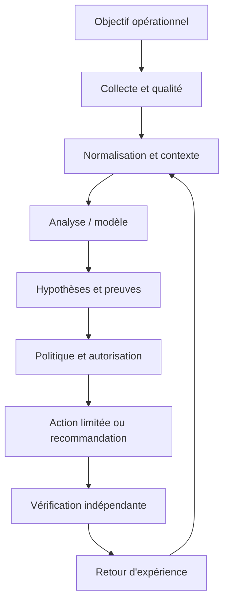
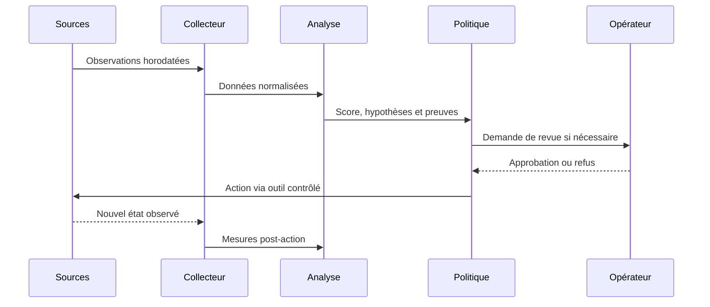
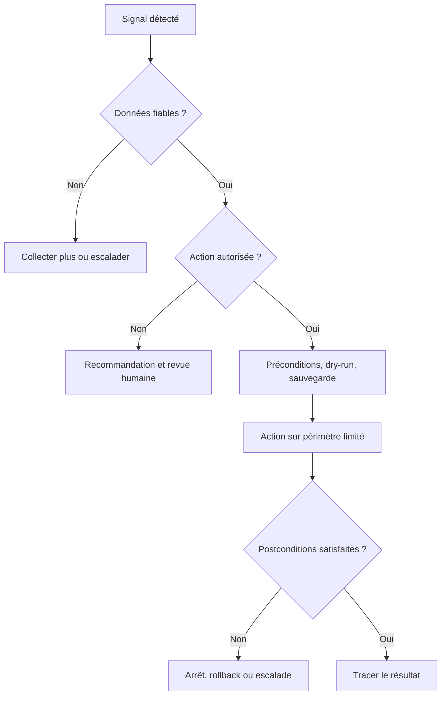
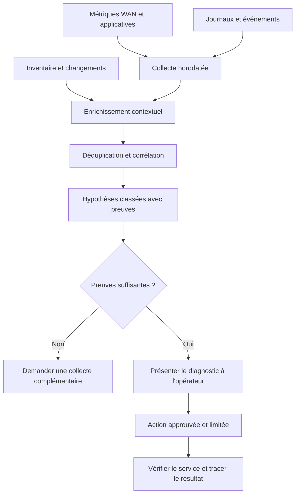

# Qu'est-ce que l'AIOps ? — Débutant

> **Mise en contexte :** ce cours étudie le problème suivant : une entreprise multisite subit des lenteurs récurrentes au début de journée ; les alertes de plusieurs outils se contredisent et les équipes peinent à identifier l'impact utilisateur. L'objectif est d'améliorer les opérations de manière mesurable, vérifiable et proportionnée au risque. Les exemples doivent être adaptés et testés en laboratoire avant toute utilisation sur une infrastructure réelle.

## Sommaire

1. Introduction et objectifs
2. Concepts clés
3. Architecture de référence
4. Pipeline et algorithmes
5. Étude de cas
6. Implémentation guidée et laboratoire
7. Sécurité et gouvernance
8. Pièges à éviter
9. Diagnostic et dépannage
10. Exercices corrigés
11. Checklist et à retenir
12. Références

## 1. Introduction et objectifs

L'AIOps applique l'analyse de données et l'automatisation aux opérations informatiques afin de rendre la détection, le diagnostic et la résolution plus cohérents. Pour **Qu'est-ce que l'AIOps ?**, l'enjeu est de comprendre les objectifs, données, limites et boucles de décision de l'aiops.. Le besoin est concret : les équipes doivent agir rapidement, mais les observations peuvent être contradictoires, les horloges décalées et les interventions porteuses de risques. La solution doit ainsi distinguer un signal, une hypothèse, une décision et une preuve de résultat.

Le scénario de départ est : une entreprise multisite subit des lenteurs récurrentes au début de journée ; les alertes de plusieurs outils se contredisent et les équipes peinent à identifier l'impact utilisateur. Il illustre que des outils techniquement capables ne suffisent pas. La qualité dépend de données fiables, d'une question mesurable, d'une référence de comparaison et d'une procédure de reprise. Le système doit savoir reconnaître une donnée absente, exposer ses limites et demander de l'aide. L'automatisation n'est pas un objectif en soi : elle est justifiée uniquement si elle améliore un résultat opérationnel sans déplacer le risque vers les utilisateurs ou l'équipe d'astreinte.

Les outils possibles comprennent métriques, journaux, traces, inventaire, gestion des incidents. Ils ne doivent pas tous être déployés dans le même projet. Chaque composant doit répondre à un besoin identifié et avoir un propriétaire. Une architecture réduite, testée et bien observée est préférable à un assemblage complexe dont personne ne peut expliquer les erreurs. La première version peut rester en lecture seule ; l'autorité d'agir se développe seulement après des essais reproductibles, une mesure des erreurs et une validation de la procédure de retour arrière.

### Objectifs pédagogiques
- Décrire les concepts principaux et leurs limites.
- Définir les sources de données, la qualité attendue et les propriétaires.
- Décrire le chemin entre observation, analyse, décision, action et vérification.
- Mesurer les erreurs et comparer la solution à une baseline.
- Protéger les accès et documenter une stratégie d'escalade et de reprise.

### Vocabulaire opérationnel
Une **observation** est une mesure ou un événement provenant d'une source identifiée. Un **signal** est une interprétation d'observations dans un contexte. Une **hypothèse** est une explication testable. Une **décision** sélectionne une action ou une abstention. Une **postcondition** est un état vérifiable qui doit être vrai après une intervention. Ces mots ne sont pas interchangeables. Une alerte n'est pas automatiquement un incident confirmé, un score ne constitue pas une preuve de cause racine et l'exécution d'une commande ne prouve pas que le service est rétabli.

## 2. Concepts clés

### 1. AIOps

L'AIOps applique l'analyse de données et l'automatisation aux opérations IT pour mieux détecter, diagnostiquer, prioriser et résoudre les incidents.

Sur le terrain, AIOps doit être relié à une question opérationnelle et à une décision possible. L'AIOps applique l'analyse de données et l'automatisation aux opérations IT pour mieux détecter, diagnostiquer, prioriser et résoudre les incidents. Il faut nommer la source de vérité, le propriétaire, la fréquence de mise à jour et le périmètre d'utilisation avant d'automatiser. Pour le scénario « une entreprise multisite subit des lenteurs récurrentes au début de journée ; les alertes de plusieurs outils se contredisent et les équipes peinent à identifier l'impact utilisateur », cette précision empêche de transformer une intuition en commande. Elle permet aussi de définir quand il faut s'abstenir, demander davantage de données ou transmettre le dossier à une personne responsable.

La mise en œuvre de AIOps gagne à être découpée en contrôles testables. Vérifier d'abord le format et la provenance des entrées, puis les hypothèses, les valeurs manquantes et les versions. L'outil métriques peut contribuer à cette étape, mais sa présence ne garantit pas la qualité. Les erreurs doivent rester explicites au lieu d'être converties silencieusement en valeurs par défaut. Une exécution fiable sait différencier une réussite, un échec, un résultat partiel et un état impossible à déterminer.

L'évaluation de AIOps doit inclure les cas courants, les cas limites et les exemples difficiles. La mesure doit inclure MTTD, tout en examinant les différences selon la criticité et le type de cible. Un score moyen peut masquer une défaillance rare mais coûteuse ; il faut donc conserver des exemples concrets, mesurer faux positifs et faux négatifs et expliquer le coût de chaque erreur. Après une évolution de données, de code ou de modèle, les mêmes tests doivent être rejoués pour vérifier que le comportement attendu persiste.

Aucune technique associée à AIOps n'est universellement préférable. Une règle peut être plus explicable, un modèle peut capter davantage de variables, et un système génératif peut accélérer la synthèse sans garantir la vérité. Le choix doit tenir compte des données, de la latence, du coût d'erreur, de l'explicabilité et de la maintenance. La baseline et le mode manuel doivent rester disponibles pour les périodes où les observations sont incomplètes ou que le système n'a plus la qualité attendue.

### 2. Observabilité

Les métriques quantifient un phénomène, les journaux décrivent des événements et les traces suivent une transaction entre composants.

Sur le terrain, Observabilité doit être relié à une question opérationnelle et à une décision possible. Les métriques quantifient un phénomène, les journaux décrivent des événements et les traces suivent une transaction entre composants. Il faut nommer la source de vérité, le propriétaire, la fréquence de mise à jour et le périmètre d'utilisation avant d'automatiser. Pour le scénario « une entreprise multisite subit des lenteurs récurrentes au début de journée ; les alertes de plusieurs outils se contredisent et les équipes peinent à identifier l'impact utilisateur », cette précision empêche de transformer une intuition en commande. Elle permet aussi de définir quand il faut s'abstenir, demander davantage de données ou transmettre le dossier à une personne responsable.

La mise en œuvre de Observabilité gagne à être découpée en contrôles testables. Vérifier d'abord le format et la provenance des entrées, puis les hypothèses, les valeurs manquantes et les versions. L'outil journaux peut contribuer à cette étape, mais sa présence ne garantit pas la qualité. Les erreurs doivent rester explicites au lieu d'être converties silencieusement en valeurs par défaut. Une exécution fiable sait différencier une réussite, un échec, un résultat partiel et un état impossible à déterminer.

L'évaluation de Observabilité doit inclure les cas courants, les cas limites et les exemples difficiles. La mesure doit inclure MTTR, tout en examinant les différences selon la criticité et le type de cible. Un score moyen peut masquer une défaillance rare mais coûteuse ; il faut donc conserver des exemples concrets, mesurer faux positifs et faux négatifs et expliquer le coût de chaque erreur. Après une évolution de données, de code ou de modèle, les mêmes tests doivent être rejoués pour vérifier que le comportement attendu persiste.

### 3. Télémétrie

Les observations doivent conserver source, horodatage, unité, identifiant de cible et état de qualité.

Sur le terrain, Télémétrie doit être relié à une question opérationnelle et à une décision possible. Les observations doivent conserver source, horodatage, unité, identifiant de cible et état de qualité. Il faut nommer la source de vérité, le propriétaire, la fréquence de mise à jour et le périmètre d'utilisation avant d'automatiser. Pour le scénario « une entreprise multisite subit des lenteurs récurrentes au début de journée ; les alertes de plusieurs outils se contredisent et les équipes peinent à identifier l'impact utilisateur », cette précision empêche de transformer une intuition en commande. Elle permet aussi de définir quand il faut s'abstenir, demander davantage de données ou transmettre le dossier à une personne responsable.

La mise en œuvre de Télémétrie gagne à être découpée en contrôles testables. Vérifier d'abord le format et la provenance des entrées, puis les hypothèses, les valeurs manquantes et les versions. L'outil traces peut contribuer à cette étape, mais sa présence ne garantit pas la qualité. Les erreurs doivent rester explicites au lieu d'être converties silencieusement en valeurs par défaut. Une exécution fiable sait différencier une réussite, un échec, un résultat partiel et un état impossible à déterminer.

L'évaluation de Télémétrie doit inclure les cas courants, les cas limites et les exemples difficiles. La mesure doit inclure faux positifs et faux négatifs, tout en examinant les différences selon la criticité et le type de cible. Un score moyen peut masquer une défaillance rare mais coûteuse ; il faut donc conserver des exemples concrets, mesurer faux positifs et faux négatifs et expliquer le coût de chaque erreur. Après une évolution de données, de code ou de modèle, les mêmes tests doivent être rejoués pour vérifier que le comportement attendu persiste.

### 4. Événement et alerte

Un événement signale un changement ; une alerte traduit une règle ou un score en demande d'attention, sans prouver qu'un incident existe.

Sur le terrain, Événement et alerte doit être relié à une question opérationnelle et à une décision possible. Un événement signale un changement ; une alerte traduit une règle ou un score en demande d'attention, sans prouver qu'un incident existe. Il faut nommer la source de vérité, le propriétaire, la fréquence de mise à jour et le périmètre d'utilisation avant d'automatiser. Pour le scénario « une entreprise multisite subit des lenteurs récurrentes au début de journée ; les alertes de plusieurs outils se contredisent et les équipes peinent à identifier l'impact utilisateur », cette précision empêche de transformer une intuition en commande. Elle permet aussi de définir quand il faut s'abstenir, demander davantage de données ou transmettre le dossier à une personne responsable.

La mise en œuvre de Événement et alerte gagne à être découpée en contrôles testables. Vérifier d'abord le format et la provenance des entrées, puis les hypothèses, les valeurs manquantes et les versions. L'outil inventaire peut contribuer à cette étape, mais sa présence ne garantit pas la qualité. Les erreurs doivent rester explicites au lieu d'être converties silencieusement en valeurs par défaut. Une exécution fiable sait différencier une réussite, un échec, un résultat partiel et un état impossible à déterminer.

L'évaluation de Événement et alerte doit inclure les cas courants, les cas limites et les exemples difficiles. La mesure doit inclure part des incidents correctement regroupés, tout en examinant les différences selon la criticité et le type de cible. Un score moyen peut masquer une défaillance rare mais coûteuse ; il faut donc conserver des exemples concrets, mesurer faux positifs et faux négatifs et expliquer le coût de chaque erreur. Après une évolution de données, de code ou de modèle, les mêmes tests doivent être rejoués pour vérifier que le comportement attendu persiste.

Aucune technique associée à Événement et alerte n'est universellement préférable. Une règle peut être plus explicable, un modèle peut capter davantage de variables, et un système génératif peut accélérer la synthèse sans garantir la vérité. Le choix doit tenir compte des données, de la latence, du coût d'erreur, de l'explicabilité et de la maintenance. La baseline et le mode manuel doivent rester disponibles pour les périodes où les observations sont incomplètes ou que le système n'a plus la qualité attendue.

### 5. Corrélation

La corrélation rapproche événements selon le temps, la topologie et les dépendances, mais ne prouve pas une causalité.

Sur le terrain, Corrélation doit être relié à une question opérationnelle et à une décision possible. La corrélation rapproche événements selon le temps, la topologie et les dépendances, mais ne prouve pas une causalité. Il faut nommer la source de vérité, le propriétaire, la fréquence de mise à jour et le périmètre d'utilisation avant d'automatiser. Pour le scénario « une entreprise multisite subit des lenteurs récurrentes au début de journée ; les alertes de plusieurs outils se contredisent et les équipes peinent à identifier l'impact utilisateur », cette précision empêche de transformer une intuition en commande. Elle permet aussi de définir quand il faut s'abstenir, demander davantage de données ou transmettre le dossier à une personne responsable.

La mise en œuvre de Corrélation gagne à être découpée en contrôles testables. Vérifier d'abord le format et la provenance des entrées, puis les hypothèses, les valeurs manquantes et les versions. L'outil gestion des incidents peut contribuer à cette étape, mais sa présence ne garantit pas la qualité. Les erreurs doivent rester explicites au lieu d'être converties silencieusement en valeurs par défaut. Une exécution fiable sait différencier une réussite, un échec, un résultat partiel et un état impossible à déterminer.

L'évaluation de Corrélation doit inclure les cas courants, les cas limites et les exemples difficiles. La mesure doit inclure taux de réussite vérifiée des actions, tout en examinant les différences selon la criticité et le type de cible. Un score moyen peut masquer une défaillance rare mais coûteuse ; il faut donc conserver des exemples concrets, mesurer faux positifs et faux négatifs et expliquer le coût de chaque erreur. Après une évolution de données, de code ou de modèle, les mêmes tests doivent être rejoués pour vérifier que le comportement attendu persiste.

### 6. Automatisation contrôlée

Une action doit avoir préconditions, permissions, postconditions, journalisation et retour arrière.

Sur le terrain, Automatisation contrôlée doit être relié à une question opérationnelle et à une décision possible. Une action doit avoir préconditions, permissions, postconditions, journalisation et retour arrière. Il faut nommer la source de vérité, le propriétaire, la fréquence de mise à jour et le périmètre d'utilisation avant d'automatiser. Pour le scénario « une entreprise multisite subit des lenteurs récurrentes au début de journée ; les alertes de plusieurs outils se contredisent et les équipes peinent à identifier l'impact utilisateur », cette précision empêche de transformer une intuition en commande. Elle permet aussi de définir quand il faut s'abstenir, demander davantage de données ou transmettre le dossier à une personne responsable.

La mise en œuvre de Automatisation contrôlée gagne à être découpée en contrôles testables. Vérifier d'abord le format et la provenance des entrées, puis les hypothèses, les valeurs manquantes et les versions. L'outil métriques peut contribuer à cette étape, mais sa présence ne garantit pas la qualité. Les erreurs doivent rester explicites au lieu d'être converties silencieusement en valeurs par défaut. Une exécution fiable sait différencier une réussite, un échec, un résultat partiel et un état impossible à déterminer.

L'évaluation de Automatisation contrôlée doit inclure les cas courants, les cas limites et les exemples difficiles. La mesure doit inclure MTTD, tout en examinant les différences selon la criticité et le type de cible. Un score moyen peut masquer une défaillance rare mais coûteuse ; il faut donc conserver des exemples concrets, mesurer faux positifs et faux négatifs et expliquer le coût de chaque erreur. Après une évolution de données, de code ou de modèle, les mêmes tests doivent être rejoués pour vérifier que le comportement attendu persiste.

### 7. Contrôle humain

Une revue humaine est nécessaire lorsque les preuves sont ambiguës, les impacts élevés ou les actions difficiles à inverser.

Sur le terrain, Contrôle humain doit être relié à une question opérationnelle et à une décision possible. Une revue humaine est nécessaire lorsque les preuves sont ambiguës, les impacts élevés ou les actions difficiles à inverser. Il faut nommer la source de vérité, le propriétaire, la fréquence de mise à jour et le périmètre d'utilisation avant d'automatiser. Pour le scénario « une entreprise multisite subit des lenteurs récurrentes au début de journée ; les alertes de plusieurs outils se contredisent et les équipes peinent à identifier l'impact utilisateur », cette précision empêche de transformer une intuition en commande. Elle permet aussi de définir quand il faut s'abstenir, demander davantage de données ou transmettre le dossier à une personne responsable.

La mise en œuvre de Contrôle humain gagne à être découpée en contrôles testables. Vérifier d'abord le format et la provenance des entrées, puis les hypothèses, les valeurs manquantes et les versions. L'outil journaux peut contribuer à cette étape, mais sa présence ne garantit pas la qualité. Les erreurs doivent rester explicites au lieu d'être converties silencieusement en valeurs par défaut. Une exécution fiable sait différencier une réussite, un échec, un résultat partiel et un état impossible à déterminer.

L'évaluation de Contrôle humain doit inclure les cas courants, les cas limites et les exemples difficiles. La mesure doit inclure MTTR, tout en examinant les différences selon la criticité et le type de cible. Un score moyen peut masquer une défaillance rare mais coûteuse ; il faut donc conserver des exemples concrets, mesurer faux positifs et faux négatifs et expliquer le coût de chaque erreur. Après une évolution de données, de code ou de modèle, les mêmes tests doivent être rejoués pour vérifier que le comportement attendu persiste.

Aucune technique associée à Contrôle humain n'est universellement préférable. Une règle peut être plus explicable, un modèle peut capter davantage de variables, et un système génératif peut accélérer la synthèse sans garantir la vérité. Le choix doit tenir compte des données, de la latence, du coût d'erreur, de l'explicabilité et de la maintenance. La baseline et le mode manuel doivent rester disponibles pour les périodes où les observations sont incomplètes ou que le système n'a plus la qualité attendue.

## 3. Architecture de référence

Une architecture exploitable sépare au minimum la production des données, leur normalisation, le calcul analytique, la politique d'autorisation et la vérification. Il est risqué de relier directement un détecteur à une commande privilégiée : une fausse alerte devient alors une action potentiellement dommageable. Entre la proposition et l'exécution, il faut un point de décision explicite qui examine la qualité de données, la confiance, la criticité, le périmètre autorisé, le plan de reprise et la nécessité d'une approbation humaine. La boucle se ferme uniquement quand l'état du service est observé après l'intervention.



Le premier contrat concerne la donnée : source, horodatage, unité, cible, fraîcheur et état de qualité sont conservés. Le contrat du modèle ou de la règle précise la version, les entrées attendues, les métriques de validation et les limites. Le contrat de décision énumère les actions permises, les préconditions, les approbations, les quotas et les conditions d'arrêt. Le contrat de sortie indique enfin la preuve requise pour déclarer un rétablissement. Ces frontières permettent de tester chaque partie indépendamment, de corriger un composant sans dissimuler l'origine de l'erreur et d'auditer une action plusieurs semaines plus tard.



### Frontières de sécurité et mode dégradé

Le contrôle de sécurité lié à Séparation analyse/exécution doit être conçu dès le départ. Appliquer le moindre privilège, protéger les secrets, tracer les décisions et séparer analyse et exécution. Le piège à surveiller est : collecter les données sans question opérationnelle. Lorsque des données externes entrent dans le pipeline, elles ne doivent pas modifier les règles d'accès ni fournir des instructions privilégiées. Toute action à fort impact exige des préconditions compréhensibles, une approbation adaptée et une façon testée de revenir vers un état sûr.

Si Données manquantes produit un résultat incohérent, commencer par vérifier horloge, source, unité, cible, fraîcheur, version et erreur d'accès. Comparer une observation brute avec sa valeur transformée, puis rechercher les modifications récentes. Pour le scénario étudié, un contrôle utile consiste à tester une seule hypothèse à la fois et à conserver la preuve du résultat. Ne pas recopier de secrets dans le ticket. Une fois le défaut confirmé, ajouter un test de régression afin que la même anomalie ne revienne pas avec une mise à jour.

À l'échelle, Résilience du pipeline doit gérer des volumes, équipements et versions hétérogènes sans perdre de traçabilité. Borner la concurrence, isoler les erreurs par cible, limiter le buffering et mesurer les files protège le système aval. La reprise d'une panne peut elle-même provoquer une surcharge si toutes les cibles se reconnectent simultanément. Une architecture robuste sait réduire la fréquence ou revenir à une méthode plus simple, tout en signalant explicitement cette dégradation au lieu d'afficher une apparence de fonctionnement normal.



## 4. Pipeline et algorithmes

Le pipeline présenté ici est une chaîne de responsabilités, pas nécessairement un ensemble de microservices séparés. Une petite mise en œuvre peut héberger plusieurs étapes dans un seul processus, à condition de conserver des contrats clairs, des tests et des journaux. L'ordre importe : la qualité est vérifiée avant le calcul, le contexte avant l'interprétation et l'autorisation avant l'exécution. Cette discipline rend possible le fonctionnement en mode observation au départ puis, si les critères le justifient, une automatisation graduée.

### Étape 1 — Cadrer le service
Définir service, utilisateurs, dépendances et symptômes à améliorer.

La mise en œuvre de Cadrer le service gagne à être découpée en contrôles testables. Vérifier d'abord le format et la provenance des entrées, puis les hypothèses, les valeurs manquantes et les versions. L'outil métriques peut contribuer à cette étape, mais sa présence ne garantit pas la qualité. Les erreurs doivent rester explicites au lieu d'être converties silencieusement en valeurs par défaut. Une exécution fiable sait différencier une réussite, un échec, un résultat partiel et un état impossible à déterminer.

Si Cadrer le service produit un résultat incohérent, commencer par vérifier horloge, source, unité, cible, fraîcheur, version et erreur d'accès. Comparer une observation brute avec sa valeur transformée, puis rechercher les modifications récentes. Pour le scénario étudié, un contrôle utile consiste à tester une seule hypothèse à la fois et à conserver la preuve du résultat. Ne pas recopier de secrets dans le ticket. Une fois le défaut confirmé, ajouter un test de régression afin que la même anomalie ne revienne pas avec une mise à jour.

### Étape 2 — Collecter
Rassembler métriques, logs, changements, inventaire et incidents avec leur provenance.

La mise en œuvre de Collecter gagne à être découpée en contrôles testables. Vérifier d'abord le format et la provenance des entrées, puis les hypothèses, les valeurs manquantes et les versions. L'outil journaux peut contribuer à cette étape, mais sa présence ne garantit pas la qualité. Les erreurs doivent rester explicites au lieu d'être converties silencieusement en valeurs par défaut. Une exécution fiable sait différencier une réussite, un échec, un résultat partiel et un état impossible à déterminer.

Si Collecter produit un résultat incohérent, commencer par vérifier horloge, source, unité, cible, fraîcheur, version et erreur d'accès. Comparer une observation brute avec sa valeur transformée, puis rechercher les modifications récentes. Pour le scénario étudié, un contrôle utile consiste à tester une seule hypothèse à la fois et à conserver la preuve du résultat. Ne pas recopier de secrets dans le ticket. Une fois le défaut confirmé, ajouter un test de régression afin que la même anomalie ne revienne pas avec une mise à jour.

### Étape 3 — Normaliser
Harmoniser noms, horloges, unités, identifiants et gravité.

La mise en œuvre de Normaliser gagne à être découpée en contrôles testables. Vérifier d'abord le format et la provenance des entrées, puis les hypothèses, les valeurs manquantes et les versions. L'outil traces peut contribuer à cette étape, mais sa présence ne garantit pas la qualité. Les erreurs doivent rester explicites au lieu d'être converties silencieusement en valeurs par défaut. Une exécution fiable sait différencier une réussite, un échec, un résultat partiel et un état impossible à déterminer.

Si Normaliser produit un résultat incohérent, commencer par vérifier horloge, source, unité, cible, fraîcheur, version et erreur d'accès. Comparer une observation brute avec sa valeur transformée, puis rechercher les modifications récentes. Pour le scénario étudié, un contrôle utile consiste à tester une seule hypothèse à la fois et à conserver la preuve du résultat. Ne pas recopier de secrets dans le ticket. Une fois le défaut confirmé, ajouter un test de régression afin que la même anomalie ne revienne pas avec une mise à jour.

### Étape 4 — Analyser
Comparer aux références, regrouper les signaux et distinguer symptômes et impacts.

La mise en œuvre de Analyser gagne à être découpée en contrôles testables. Vérifier d'abord le format et la provenance des entrées, puis les hypothèses, les valeurs manquantes et les versions. L'outil inventaire peut contribuer à cette étape, mais sa présence ne garantit pas la qualité. Les erreurs doivent rester explicites au lieu d'être converties silencieusement en valeurs par défaut. Une exécution fiable sait différencier une réussite, un échec, un résultat partiel et un état impossible à déterminer.

Si Analyser produit un résultat incohérent, commencer par vérifier horloge, source, unité, cible, fraîcheur, version et erreur d'accès. Comparer une observation brute avec sa valeur transformée, puis rechercher les modifications récentes. Pour le scénario étudié, un contrôle utile consiste à tester une seule hypothèse à la fois et à conserver la preuve du résultat. Ne pas recopier de secrets dans le ticket. Une fois le défaut confirmé, ajouter un test de régression afin que la même anomalie ne revienne pas avec une mise à jour.

### Étape 5 — Recommander
Présenter preuves, hypothèses, actions candidates et risques.

La mise en œuvre de Recommander gagne à être découpée en contrôles testables. Vérifier d'abord le format et la provenance des entrées, puis les hypothèses, les valeurs manquantes et les versions. L'outil gestion des incidents peut contribuer à cette étape, mais sa présence ne garantit pas la qualité. Les erreurs doivent rester explicites au lieu d'être converties silencieusement en valeurs par défaut. Une exécution fiable sait différencier une réussite, un échec, un résultat partiel et un état impossible à déterminer.

Si Recommander produit un résultat incohérent, commencer par vérifier horloge, source, unité, cible, fraîcheur, version et erreur d'accès. Comparer une observation brute avec sa valeur transformée, puis rechercher les modifications récentes. Pour le scénario étudié, un contrôle utile consiste à tester une seule hypothèse à la fois et à conserver la preuve du résultat. Ne pas recopier de secrets dans le ticket. Une fois le défaut confirmé, ajouter un test de régression afin que la même anomalie ne revienne pas avec une mise à jour.

### Étape 6 — Vérifier
Mesurer l'effet réel, documenter les écarts et améliorer les règles.

La mise en œuvre de Vérifier gagne à être découpée en contrôles testables. Vérifier d'abord le format et la provenance des entrées, puis les hypothèses, les valeurs manquantes et les versions. L'outil métriques peut contribuer à cette étape, mais sa présence ne garantit pas la qualité. Les erreurs doivent rester explicites au lieu d'être converties silencieusement en valeurs par défaut. Une exécution fiable sait différencier une réussite, un échec, un résultat partiel et un état impossible à déterminer.

Si Vérifier produit un résultat incohérent, commencer par vérifier horloge, source, unité, cible, fraîcheur, version et erreur d'accès. Comparer une observation brute avec sa valeur transformée, puis rechercher les modifications récentes. Pour le scénario étudié, un contrôle utile consiste à tester une seule hypothèse à la fois et à conserver la preuve du résultat. Ne pas recopier de secrets dans le ticket. Une fois le défaut confirmé, ajouter un test de régression afin que la même anomalie ne revienne pas avec une mise à jour.

### Pseudocode de décision défensive
```text
observations = collecter()
si qualite(observations) insuffisante:
    journaliser("données insuffisantes")
    demander_verification_humaine()
sinon:
    contexte = enrichir(observations, inventaire, changements, dépendances)
    hypotheses = analyser(contexte)
    preuves = verifier_provenance(hypotheses)
    si preuves insuffisantes ou action hors politique:
        recommander_sans_executer()
    sinon:
        plan = preparer_diff_preconditions_et_rollback()
        si validation(plan) et approbations(plan):
            appliquer_sur_perimetre_limite(plan)
            resultat = mesurer_postconditions()
            si resultat non conforme: rollback_ou_escalade()
            tracer(version, preuves, action, resultat)
```

Ce pseudocode sert à expliquer le flux de décision ; il ne constitue pas une bibliothèque prête pour la production. Chaque fonction doit être implémentée, testée et protégée. Le comportement doit être prévisible lorsque les données manquent, qu'un service externe ne répond pas ou que le résultat demeure ambigu. Une bonne conception ne remplace pas l'incertitude par une valeur par défaut. Elle la rend visible, limite l'impact et garde une voie de reprise.

## 5. Étude de cas détaillée

### Situation et impact
une entreprise multisite subit des lenteurs récurrentes au début de journée ; les alertes de plusieurs outils se contredisent et les équipes peinent à identifier l'impact utilisateur. L'équipe réunit responsable de service, ingénieur réseau, administrateur système et propriétaire de l'automatisation. Avant d'agir, elle définit l'impact observé, la fenêtre de temps, les actifs concernés et les services prioritaires. La première question n'est pas « quel modèle utiliser ? », mais « quelle décision doit être améliorée et quelle preuve montrera que le changement a servi son objectif ? ». Cette formulation fixe le périmètre et donne un critère d'arrêt si la solution n'apporte pas de valeur démontrable.

### Phase 1 — Établir les faits
Les observations doivent garder les heures originales et les identifiants de source. L'équipe vérifie la qualité de collecte, les changements récents, les dépendances et l'expérience utilisateur. Les valeurs manquantes sont identifiées explicitement plutôt que remplacées silencieusement par zéro. Les symptômes sont séparés des causes supposées, et les sources qui se contredisent sont enregistrées dans le dossier. La preuve de départ sert de référence pour vérifier si une intervention améliore réellement la situation et permet à un autre opérateur de reproduire l'analyse.

### Phase 2 — Poser plusieurs hypothèses
Quand plusieurs causes sont possibles, l'équipe note au minimum deux hypothèses, les observations qui les soutiennent, les éléments qui les contredisent et les tests qui peuvent les différencier. La priorité combine probabilité, impact et coût d'un test. Une hypothèse populaire n'est pas nécessairement correcte : un cas qui ressemble à un incident passé peut différer par la capacité, le routage, la version de logiciel ou la période de charge. Les hypothèses restent des hypothèses jusqu'à ce qu'une preuve suffisante permette de les confirmer.

### Phase 3 — Choisir une réponse proportionnée
Commencer par les vérifications non destructives : comparer l'état, consulter les changements, tester la connectivité ou inspecter une dépendance. Si une modification est nécessaire, définir précisément la cible, la commande ou le changement attendu, les préconditions, les critères d'arrêt et le rollback. Une revue indépendante s'impose lorsque le rayon d'impact est élevé. Le plan doit permettre à l'opérateur de comprendre pourquoi l'action est proposée et dans quelles circonstances il doit la refuser.

### Phase 4 — Vérifier les postconditions
La validation repose sur des mesures indépendantes du simple statut de commande : latence, erreurs, connectivité, état de configuration ou indicateur du service. La fenêtre d'observation doit éviter de confondre un échantillon favorable avec un rétablissement durable. Si les conditions ne sont pas satisfaites, appliquer la règle d'arrêt prévue et lancer un rollback ou une escalade. Le compte rendu distingue l'action exécutée, l'effet mesuré, les effets secondaires et les informations qui restent inconnues.

### Phase 5 — Capitaliser avec prudence
Le post-mortem compare les hypothèses initiales avec les preuves finales, relève les signaux manquants et ajoute des tests de régression. Une règle ou un modèle amélioré passe en revue et en essai contrôlé avant généralisation. Il faut éviter de réentraîner automatiquement sur des conclusions incertaines ou des tickets contenant uniquement des suppositions. Le retour d'expérience doit décrire les situations où la méthode a échoué autant que les cas où elle a réussi.

### Critères de clôture
La clôture exige une preuve de rétablissement, ou une déclaration explicite que le service reste dégradé. Le dossier réunit sources, versions, changement exact, approbation, résultats et suivi. La cause racine n'est marquée comme confirmée que si les observations la soutiennent suffisamment. En l'absence de preuve, une conclusion partielle est plus utile qu'un récit catégorique. La qualité se mesure au diagnostic reproductible, au risque contrôlé et à la possibilité d'améliorer le système à partir des erreurs observées.

## 6. Implémentation guidée et laboratoire

Le laboratoire doit être exécuté dans un environnement isolé ou sur des systèmes explicitement autorisés. Avant de commencer, noter les versions, dépendances, données d'entrée et condition de réussite. Ne pas copier les exemples sur un réseau de production sans adapter les identifiants, certificats, permissions et tests de restauration. Le livrable final doit être compréhensible par une autre personne, ré-exécutable et accompagné d'une liste claire de ses limites.

### TP 1 — Définir un service pilote et son objectif de disponibilité.
**Procédure.** Définir un service pilote et son objectif de disponibilité. Commencer par une cible de laboratoire minimale et capturer l'état de départ. Relier ce travail au concept « AIOps » : L'AIOps applique l'analyse de données et l'automatisation aux opérations IT pour mieux détecter, diagnostiquer, prioriser et résoudre les incidents. Conserver la commande, les entrées, le résultat et la version des outils. Ne changer qu'une variable à la fois pour pouvoir attribuer un écart à sa cause.

**Critère de réussite.** Un autre opérateur doit pouvoir reproduire le résultat et identifier la preuve attendue. Tester aussi un échec contrôlé, une valeur manquante ou une dépendance indisponible. Si le résultat n'est pas déterminable, garder cet état explicite ; ne pas le convertir en succès. Vérifier les postconditions réelles, les effets secondaires et la procédure de reprise. Documenter ce qui a été démontré, ce qui reste une hypothèse et quelle amélioration serait nécessaire avant un usage à plus grande échelle.

### TP 2 — Lister les signaux et leurs propriétaires.
**Procédure.** Lister les signaux et leurs propriétaires. Commencer par une cible de laboratoire minimale et capturer l'état de départ. Relier ce travail au concept « Observabilité » : Les métriques quantifient un phénomène, les journaux décrivent des événements et les traces suivent une transaction entre composants. Conserver la commande, les entrées, le résultat et la version des outils. Ne changer qu'une variable à la fois pour pouvoir attribuer un écart à sa cause.

**Critère de réussite.** Un autre opérateur doit pouvoir reproduire le résultat et identifier la preuve attendue. Tester aussi un échec contrôlé, une valeur manquante ou une dépendance indisponible. Si le résultat n'est pas déterminable, garder cet état explicite ; ne pas le convertir en succès. Vérifier les postconditions réelles, les effets secondaires et la procédure de reprise. Documenter ce qui a été démontré, ce qui reste une hypothèse et quelle amélioration serait nécessaire avant un usage à plus grande échelle.

### TP 3 — Importer un échantillon horodaté de métriques et de journaux.
**Procédure.** Importer un échantillon horodaté de métriques et de journaux. Commencer par une cible de laboratoire minimale et capturer l'état de départ. Relier ce travail au concept « Télémétrie » : Les observations doivent conserver source, horodatage, unité, identifiant de cible et état de qualité. Conserver la commande, les entrées, le résultat et la version des outils. Ne changer qu'une variable à la fois pour pouvoir attribuer un écart à sa cause.

**Critère de réussite.** Un autre opérateur doit pouvoir reproduire le résultat et identifier la preuve attendue. Tester aussi un échec contrôlé, une valeur manquante ou une dépendance indisponible. Si le résultat n'est pas déterminable, garder cet état explicite ; ne pas le convertir en succès. Vérifier les postconditions réelles, les effets secondaires et la procédure de reprise. Documenter ce qui a été démontré, ce qui reste une hypothèse et quelle amélioration serait nécessaire avant un usage à plus grande échelle.

### TP 4 — Uniformiser noms, unités et fuseaux horaires.
**Procédure.** Uniformiser noms, unités et fuseaux horaires. Commencer par une cible de laboratoire minimale et capturer l'état de départ. Relier ce travail au concept « Événement et alerte » : Un événement signale un changement ; une alerte traduit une règle ou un score en demande d'attention, sans prouver qu'un incident existe. Conserver la commande, les entrées, le résultat et la version des outils. Ne changer qu'une variable à la fois pour pouvoir attribuer un écart à sa cause.

**Critère de réussite.** Un autre opérateur doit pouvoir reproduire le résultat et identifier la preuve attendue. Tester aussi un échec contrôlé, une valeur manquante ou une dépendance indisponible. Si le résultat n'est pas déterminable, garder cet état explicite ; ne pas le convertir en succès. Vérifier les postconditions réelles, les effets secondaires et la procédure de reprise. Documenter ce qui a été démontré, ce qui reste une hypothèse et quelle amélioration serait nécessaire avant un usage à plus grande échelle.

### TP 5 — Définir une baseline et deux règles explicables.
**Procédure.** Définir une baseline et deux règles explicables. Commencer par une cible de laboratoire minimale et capturer l'état de départ. Relier ce travail au concept « Corrélation » : La corrélation rapproche événements selon le temps, la topologie et les dépendances, mais ne prouve pas une causalité. Conserver la commande, les entrées, le résultat et la version des outils. Ne changer qu'une variable à la fois pour pouvoir attribuer un écart à sa cause.

**Critère de réussite.** Un autre opérateur doit pouvoir reproduire le résultat et identifier la preuve attendue. Tester aussi un échec contrôlé, une valeur manquante ou une dépendance indisponible. Si le résultat n'est pas déterminable, garder cet état explicite ; ne pas le convertir en succès. Vérifier les postconditions réelles, les effets secondaires et la procédure de reprise. Documenter ce qui a été démontré, ce qui reste une hypothèse et quelle amélioration serait nécessaire avant un usage à plus grande échelle.

### TP 6 — Relier chaque signal à un impact potentiel et à une hypothèse.
**Procédure.** Relier chaque signal à un impact potentiel et à une hypothèse. Commencer par une cible de laboratoire minimale et capturer l'état de départ. Relier ce travail au concept « Automatisation contrôlée » : Une action doit avoir préconditions, permissions, postconditions, journalisation et retour arrière. Conserver la commande, les entrées, le résultat et la version des outils. Ne changer qu'une variable à la fois pour pouvoir attribuer un écart à sa cause.

**Critère de réussite.** Un autre opérateur doit pouvoir reproduire le résultat et identifier la preuve attendue. Tester aussi un échec contrôlé, une valeur manquante ou une dépendance indisponible. Si le résultat n'est pas déterminable, garder cet état explicite ; ne pas le convertir en succès. Vérifier les postconditions réelles, les effets secondaires et la procédure de reprise. Documenter ce qui a été démontré, ce qui reste une hypothèse et quelle amélioration serait nécessaire avant un usage à plus grande échelle.

### TP 7 — Écrire un runbook avec préconditions, validation et rollback.
**Procédure.** Écrire un runbook avec préconditions, validation et rollback. Commencer par une cible de laboratoire minimale et capturer l'état de départ. Relier ce travail au concept « Contrôle humain » : Une revue humaine est nécessaire lorsque les preuves sont ambiguës, les impacts élevés ou les actions difficiles à inverser. Conserver la commande, les entrées, le résultat et la version des outils. Ne changer qu'une variable à la fois pour pouvoir attribuer un écart à sa cause.

**Critère de réussite.** Un autre opérateur doit pouvoir reproduire le résultat et identifier la preuve attendue. Tester aussi un échec contrôlé, une valeur manquante ou une dépendance indisponible. Si le résultat n'est pas déterminable, garder cet état explicite ; ne pas le convertir en succès. Vérifier les postconditions réelles, les effets secondaires et la procédure de reprise. Documenter ce qui a été démontré, ce qui reste une hypothèse et quelle amélioration serait nécessaire avant un usage à plus grande échelle.

### Exemple de code ou de configuration

```python
from datetime import datetime, timezone

def normalize_event(raw):
    required = ("source", "timestamp", "severity", "message")
    missing = [k for k in required if k not in raw]
    if missing:
        raise ValueError(f"Champs manquants : {missing}")
    stamp = datetime.fromisoformat(raw["timestamp"]).astimezone(timezone.utc)
    return {"source": str(raw["source"]).strip().lower(), "timestamp": stamp.isoformat(), "severity": str(raw["severity"]).upper(), "message": str(raw["message"]).strip()}

sample = {"source":"RTR-01", "timestamp":"2026-10-28T09:15:00+01:00", "severity":"warning", "message":"CPU élevée"}
print(normalize_event(sample))
```

Ce fragment est un point de départ pédagogique. Les versions, options CLI, capacités matérielles et schémas changent ; vérifier la documentation liée et tester dans un laboratoire. Le fragment n'inclut pas toute la configuration nécessaire à un déploiement réel. Les secrets ne doivent pas être ajoutés au code, et les exemples qui peuvent modifier un système doivent recevoir approbations, limites de portée et vérification post-action. Un parseur qui accepte la syntaxe ne certifie ni la conformité ni la disponibilité.

### Livrables attendus
- Un fichier versionné qui décrit entrées, sorties et dépendances.
- Un journal lié à la cible et à la version, sans secret.
- Des tests positifs, négatifs et de panne de dépendance.
- Des critères d'arrêt et une procédure de reprise testée.
- Une note décrivant les résultats et les limites.

## 7. Sécurité et gouvernance

### 1. Qualité et provenance
Chaque observation garde source, heure, unité et état de fraîcheur. Pour le contexte étudié, ce principe doit être traduit en contrôle observable, propriétaire, fréquence de revue et preuve de passage. Une politique sans test dépend de la mémoire des personnes ; un test sans propriétaire cesse d'être maintenu lorsque l'équipe change. La revue doit donc être planifiée et relancée après un changement majeur de données, de matériel, de finalité ou de modèle.

La gouvernance de Qualité et provenance définit qui peut créer, modifier, approuver, consulter et retirer la logique associée. Le propriétaire doit connaître l'objectif, les limites, les dépendances, le budget d'erreur et les critères de suspension. Les décisions doivent être retraçables jusqu'aux données et versions utilisées. Une règle sans propriétaire finit par dépendre de la mémoire de l'équipe ; un propriétaire sans mesure ne peut pas démontrer qu'elle fonctionne. La revue doit être planifiée et relancée à chaque changement majeur de données, d'équipement ou de finalité.

### 2. Identités et permissions
Les comptes d'automatisation reçoivent uniquement les privilèges nécessaires. Pour le contexte étudié, ce principe doit être traduit en contrôle observable, propriétaire, fréquence de revue et preuve de passage. Une politique sans test dépend de la mémoire des personnes ; un test sans propriétaire cesse d'être maintenu lorsque l'équipe change. La revue doit donc être planifiée et relancée après un changement majeur de données, de matériel, de finalité ou de modèle.

La gouvernance de Identités et permissions définit qui peut créer, modifier, approuver, consulter et retirer la logique associée. Le propriétaire doit connaître l'objectif, les limites, les dépendances, le budget d'erreur et les critères de suspension. Les décisions doivent être retraçables jusqu'aux données et versions utilisées. Une règle sans propriétaire finit par dépendre de la mémoire de l'équipe ; un propriétaire sans mesure ne peut pas démontrer qu'elle fonctionne. La revue doit être planifiée et relancée à chaque changement majeur de données, d'équipement ou de finalité.

### 3. Traçabilité
La version, les preuves, la décision, l'approbateur et le résultat sont corrélés. Pour le contexte étudié, ce principe doit être traduit en contrôle observable, propriétaire, fréquence de revue et preuve de passage. Une politique sans test dépend de la mémoire des personnes ; un test sans propriétaire cesse d'être maintenu lorsque l'équipe change. La revue doit donc être planifiée et relancée après un changement majeur de données, de matériel, de finalité ou de modèle.

La gouvernance de Traçabilité définit qui peut créer, modifier, approuver, consulter et retirer la logique associée. Le propriétaire doit connaître l'objectif, les limites, les dépendances, le budget d'erreur et les critères de suspension. Les décisions doivent être retraçables jusqu'aux données et versions utilisées. Une règle sans propriétaire finit par dépendre de la mémoire de l'équipe ; un propriétaire sans mesure ne peut pas démontrer qu'elle fonctionne. La revue doit être planifiée et relancée à chaque changement majeur de données, d'équipement ou de finalité.

### 4. Revue humaine
Le réviseur doit posséder preuves, temps et autorité pour refuser. Pour le contexte étudié, ce principe doit être traduit en contrôle observable, propriétaire, fréquence de revue et preuve de passage. Une politique sans test dépend de la mémoire des personnes ; un test sans propriétaire cesse d'être maintenu lorsque l'équipe change. La revue doit donc être planifiée et relancée après un changement majeur de données, de matériel, de finalité ou de modèle.

La gouvernance de Revue humaine définit qui peut créer, modifier, approuver, consulter et retirer la logique associée. Le propriétaire doit connaître l'objectif, les limites, les dépendances, le budget d'erreur et les critères de suspension. Les décisions doivent être retraçables jusqu'aux données et versions utilisées. Une règle sans propriétaire finit par dépendre de la mémoire de l'équipe ; un propriétaire sans mesure ne peut pas démontrer qu'elle fonctionne. La revue doit être planifiée et relancée à chaque changement majeur de données, d'équipement ou de finalité.

### 5. Mesure du risque
Chaque mode d'échec doit avoir prévention, détection, réponse et responsable. Pour le contexte étudié, ce principe doit être traduit en contrôle observable, propriétaire, fréquence de revue et preuve de passage. Une politique sans test dépend de la mémoire des personnes ; un test sans propriétaire cesse d'être maintenu lorsque l'équipe change. La revue doit donc être planifiée et relancée après un changement majeur de données, de matériel, de finalité ou de modèle.

La gouvernance de Mesure du risque définit qui peut créer, modifier, approuver, consulter et retirer la logique associée. Le propriétaire doit connaître l'objectif, les limites, les dépendances, le budget d'erreur et les critères de suspension. Les décisions doivent être retraçables jusqu'aux données et versions utilisées. Une règle sans propriétaire finit par dépendre de la mémoire de l'équipe ; un propriétaire sans mesure ne peut pas démontrer qu'elle fonctionne. La revue doit être planifiée et relancée à chaque changement majeur de données, d'équipement ou de finalité.

### 6. Réversibilité
La suspension du modèle et le retour à une version saine sont testés. Pour le contexte étudié, ce principe doit être traduit en contrôle observable, propriétaire, fréquence de revue et preuve de passage. Une politique sans test dépend de la mémoire des personnes ; un test sans propriétaire cesse d'être maintenu lorsque l'équipe change. La revue doit donc être planifiée et relancée après un changement majeur de données, de matériel, de finalité ou de modèle.

La gouvernance de Réversibilité définit qui peut créer, modifier, approuver, consulter et retirer la logique associée. Le propriétaire doit connaître l'objectif, les limites, les dépendances, le budget d'erreur et les critères de suspension. Les décisions doivent être retraçables jusqu'aux données et versions utilisées. Une règle sans propriétaire finit par dépendre de la mémoire de l'équipe ; un propriétaire sans mesure ne peut pas démontrer qu'elle fonctionne. La revue doit être planifiée et relancée à chaque changement majeur de données, d'équipement ou de finalité.

## 8. Pièges à éviter

### Piège 1 — Collecter les données sans question opérationnelle

Ce piège peut produire un faux diagnostic, une action superflue ou une perte de confiance. Le signal précurseur est parfois subtil : incohérence entre sources, hausse d'erreurs, impossibilité d'expliquer la sortie ou comportement différent selon les sites. L'équipe doit rendre le signal mesurable, désigner qui réagit et préciser si l'action automatique se bloque ou si le traitement continue en mode dégradé.

La prévention doit être reliée à « AIOps ». L'AIOps applique l'analyse de données et l'automatisation aux opérations IT pour mieux détecter, diagnostiquer, prioriser et résoudre les incidents. Définir un test négatif qui fait apparaître le défaut et vérifier que la réponse attendue réduit le risque. Un garde-fou ne doit pas être un simple avertissement que les opérateurs apprennent à ignorer. En revue, demander quelle preuve montre que le contrôle fonctionne, quelle défaillance il couvre et quelle autre défaillance demeure possible.

### Piège 2 — Confondre corrélation et cause réelle

Ce piège peut produire un faux diagnostic, une action superflue ou une perte de confiance. Le signal précurseur est parfois subtil : incohérence entre sources, hausse d'erreurs, impossibilité d'expliquer la sortie ou comportement différent selon les sites. L'équipe doit rendre le signal mesurable, désigner qui réagit et préciser si l'action automatique se bloque ou si le traitement continue en mode dégradé.

La prévention doit être reliée à « Observabilité ». Les métriques quantifient un phénomène, les journaux décrivent des événements et les traces suivent une transaction entre composants. Définir un test négatif qui fait apparaître le défaut et vérifier que la réponse attendue réduit le risque. Un garde-fou ne doit pas être un simple avertissement que les opérateurs apprennent à ignorer. En revue, demander quelle preuve montre que le contrôle fonctionne, quelle défaillance il couvre et quelle autre défaillance demeure possible.

### Piège 3 — Utiliser des seuils fixes qui ignorent la saisonnalité

Ce piège peut produire un faux diagnostic, une action superflue ou une perte de confiance. Le signal précurseur est parfois subtil : incohérence entre sources, hausse d'erreurs, impossibilité d'expliquer la sortie ou comportement différent selon les sites. L'équipe doit rendre le signal mesurable, désigner qui réagit et préciser si l'action automatique se bloque ou si le traitement continue en mode dégradé.

La prévention doit être reliée à « Télémétrie ». Les observations doivent conserver source, horodatage, unité, identifiant de cible et état de qualité. Définir un test négatif qui fait apparaître le défaut et vérifier que la réponse attendue réduit le risque. Un garde-fou ne doit pas être un simple avertissement que les opérateurs apprennent à ignorer. En revue, demander quelle preuve montre que le contrôle fonctionne, quelle défaillance il couvre et quelle autre défaillance demeure possible.

### Piège 4 — Automatiser une action destructive sans garde-fou

Ce piège peut produire un faux diagnostic, une action superflue ou une perte de confiance. Le signal précurseur est parfois subtil : incohérence entre sources, hausse d'erreurs, impossibilité d'expliquer la sortie ou comportement différent selon les sites. L'équipe doit rendre le signal mesurable, désigner qui réagit et préciser si l'action automatique se bloque ou si le traitement continue en mode dégradé.

La prévention doit être reliée à « Événement et alerte ». Un événement signale un changement ; une alerte traduit une règle ou un score en demande d'attention, sans prouver qu'un incident existe. Définir un test négatif qui fait apparaître le défaut et vérifier que la réponse attendue réduit le risque. Un garde-fou ne doit pas être un simple avertissement que les opérateurs apprennent à ignorer. En revue, demander quelle preuve montre que le contrôle fonctionne, quelle défaillance il couvre et quelle autre défaillance demeure possible.

### Piège 5 — Ignorer la qualité des horodatages

Ce piège peut produire un faux diagnostic, une action superflue ou une perte de confiance. Le signal précurseur est parfois subtil : incohérence entre sources, hausse d'erreurs, impossibilité d'expliquer la sortie ou comportement différent selon les sites. L'équipe doit rendre le signal mesurable, désigner qui réagit et préciser si l'action automatique se bloque ou si le traitement continue en mode dégradé.

La prévention doit être reliée à « Corrélation ». La corrélation rapproche événements selon le temps, la topologie et les dépendances, mais ne prouve pas une causalité. Définir un test négatif qui fait apparaître le défaut et vérifier que la réponse attendue réduit le risque. Un garde-fou ne doit pas être un simple avertissement que les opérateurs apprennent à ignorer. En revue, demander quelle preuve montre que le contrôle fonctionne, quelle défaillance il couvre et quelle autre défaillance demeure possible.

### Piège 6 — Optimiser le nombre d'alertes au détriment des utilisateurs

Ce piège peut produire un faux diagnostic, une action superflue ou une perte de confiance. Le signal précurseur est parfois subtil : incohérence entre sources, hausse d'erreurs, impossibilité d'expliquer la sortie ou comportement différent selon les sites. L'équipe doit rendre le signal mesurable, désigner qui réagit et préciser si l'action automatique se bloque ou si le traitement continue en mode dégradé.

La prévention doit être reliée à « Automatisation contrôlée ». Une action doit avoir préconditions, permissions, postconditions, journalisation et retour arrière. Définir un test négatif qui fait apparaître le défaut et vérifier que la réponse attendue réduit le risque. Un garde-fou ne doit pas être un simple avertissement que les opérateurs apprennent à ignorer. En revue, demander quelle preuve montre que le contrôle fonctionne, quelle défaillance il couvre et quelle autre défaillance demeure possible.

### Piège 7 — Déployer un modèle sans propriétaire ni plan de retrait

Ce piège peut produire un faux diagnostic, une action superflue ou une perte de confiance. Le signal précurseur est parfois subtil : incohérence entre sources, hausse d'erreurs, impossibilité d'expliquer la sortie ou comportement différent selon les sites. L'équipe doit rendre le signal mesurable, désigner qui réagit et préciser si l'action automatique se bloque ou si le traitement continue en mode dégradé.

La prévention doit être reliée à « Contrôle humain ». Une revue humaine est nécessaire lorsque les preuves sont ambiguës, les impacts élevés ou les actions difficiles à inverser. Définir un test négatif qui fait apparaître le défaut et vérifier que la réponse attendue réduit le risque. Un garde-fou ne doit pas être un simple avertissement que les opérateurs apprennent à ignorer. En revue, demander quelle preuve montre que le contrôle fonctionne, quelle défaillance il couvre et quelle autre défaillance demeure possible.

## 9. Diagnostic et dépannage

### Aucun résultat n'est produit
Vérifier accès source, période de sélection, identité, filtres et version du schéma. Dans le cadre de Qu'est-ce que l'AIOps ?, vérifier en particulier ce risque : collecter les données sans question opérationnelle. Comparer les observations brutes à leur représentation transformée, retrouver la version du pipeline et noter si une modification récente correspond au début du problème. Formuler au moins deux explications alternatives et choisir un test à faible risque qui permet de les distinguer. Ne pas effectuer plusieurs changements simultanément, car cela rendrait l'analyse ambiguë. Si les preuves restent insuffisantes, rendre cette incertitude visible et utiliser le mode sûr.

### Les résultats varient
Comparer données, code, versions, transformations et paramètres sur un cas fixe. Dans le cadre de Qu'est-ce que l'AIOps ?, vérifier en particulier ce risque : confondre corrélation et cause réelle. Comparer les observations brutes à leur représentation transformée, retrouver la version du pipeline et noter si une modification récente correspond au début du problème. Formuler au moins deux explications alternatives et choisir un test à faible risque qui permet de les distinguer. Ne pas effectuer plusieurs changements simultanément, car cela rendrait l'analyse ambiguë. Si les preuves restent insuffisantes, rendre cette incertitude visible et utiliser le mode sûr.

### Trop d'alertes
Inspecter doublons, saisonnalité, baseline, seuil et qualité du contexte avant de supprimer des alertes. Dans le cadre de Qu'est-ce que l'AIOps ?, vérifier en particulier ce risque : utiliser des seuils fixes qui ignorent la saisonnalité. Comparer les observations brutes à leur représentation transformée, retrouver la version du pipeline et noter si une modification récente correspond au début du problème. Formuler au moins deux explications alternatives et choisir un test à faible risque qui permet de les distinguer. Ne pas effectuer plusieurs changements simultanément, car cela rendrait l'analyse ambiguë. Si les preuves restent insuffisantes, rendre cette incertitude visible et utiliser le mode sûr.

### Un incident passe inaperçu
Reconstituer les informations disponibles au moment de décider et rechercher un seuil trop permissif ou une source absente. Dans le cadre de Qu'est-ce que l'AIOps ?, vérifier en particulier ce risque : automatiser une action destructive sans garde-fou. Comparer les observations brutes à leur représentation transformée, retrouver la version du pipeline et noter si une modification récente correspond au début du problème. Formuler au moins deux explications alternatives et choisir un test à faible risque qui permet de les distinguer. Ne pas effectuer plusieurs changements simultanément, car cela rendrait l'analyse ambiguë. Si les preuves restent insuffisantes, rendre cette incertitude visible et utiliser le mode sûr.

### L'action n'améliore pas le service
Vérifier postconditions indépendantes et effets secondaires, puis appliquer arrêt ou rollback selon le plan. Dans le cadre de Qu'est-ce que l'AIOps ?, vérifier en particulier ce risque : ignorer la qualité des horodatages. Comparer les observations brutes à leur représentation transformée, retrouver la version du pipeline et noter si une modification récente correspond au début du problème. Formuler au moins deux explications alternatives et choisir un test à faible risque qui permet de les distinguer. Ne pas effectuer plusieurs changements simultanément, car cela rendrait l'analyse ambiguë. Si les preuves restent insuffisantes, rendre cette incertitude visible et utiliser le mode sûr.

### La qualité diminue avec le temps
Rechercher dérive, changement de capacité, topologie, population ou version et réévaluer. Dans le cadre de Qu'est-ce que l'AIOps ?, vérifier en particulier ce risque : optimiser le nombre d'alertes au détriment des utilisateurs. Comparer les observations brutes à leur représentation transformée, retrouver la version du pipeline et noter si une modification récente correspond au début du problème. Formuler au moins deux explications alternatives et choisir un test à faible risque qui permet de les distinguer. Ne pas effectuer plusieurs changements simultanément, car cela rendrait l'analyse ambiguë. Si les preuves restent insuffisantes, rendre cette incertitude visible et utiliser le mode sûr.

## 10. Exercices corrigés

### Exercice 1 — AIOps
**Énoncé.** Dans un environnement inspiré du scénario « une entreprise multisite subit des lenteurs récurrentes au début de journée ; les alertes de plusieurs outils se contredisent et les équipes peinent à identifier l'impact utilisateur », l'équipe veut généraliser une approche qui utilise « AIOps ». Quelle preuve recueillir avant l'étape « Cadrer le service », et comment réduire le risque suivant : collecter les données sans question opérationnelle ?

**Correction détaillée.** Définir d'abord le résultat attendu et le coût d'une erreur. Vérifier que les entrées proviennent d'une source autorisée et qu'elles sont fraîches, cohérentes et disponibles au moment de la décision. Construire un essai reproductible, comparer à une baseline et analyser les erreurs par classe d'actif ou criticité. Définir service, utilisateurs, dépendances et symptômes à améliorer. L'extension du périmètre exige des seuils écrits, une revue adaptée au risque, un déploiement progressif et un retour arrière. Si la preuve ne permet pas de trancher, demander une vérification complémentaire ou garder la solution en observation plutôt que d'inventer une certitude.

**Pourquoi les raccourcis échouent.** Un résultat favorable sur un exemple ne démontre pas une performance durable. Un score moyen peut masquer les catégories vulnérables ; une absence d'erreur visible peut provenir d'une télémétrie incomplète. Conserver les cas difficiles, les conditions de test et les versions utilisées rend possible une revue indépendante. L'exercice est réussi lorsque le choix, ses limites et le mécanisme de retrait sont compris par une autre personne.

### Exercice 2 — Observabilité
**Énoncé.** Dans un environnement inspiré du scénario « une entreprise multisite subit des lenteurs récurrentes au début de journée ; les alertes de plusieurs outils se contredisent et les équipes peinent à identifier l'impact utilisateur », l'équipe veut généraliser une approche qui utilise « Observabilité ». Quelle preuve recueillir avant l'étape « Collecter », et comment réduire le risque suivant : confondre corrélation et cause réelle ?

**Correction détaillée.** Définir d'abord le résultat attendu et le coût d'une erreur. Vérifier que les entrées proviennent d'une source autorisée et qu'elles sont fraîches, cohérentes et disponibles au moment de la décision. Construire un essai reproductible, comparer à une baseline et analyser les erreurs par classe d'actif ou criticité. Rassembler métriques, logs, changements, inventaire et incidents avec leur provenance. L'extension du périmètre exige des seuils écrits, une revue adaptée au risque, un déploiement progressif et un retour arrière. Si la preuve ne permet pas de trancher, demander une vérification complémentaire ou garder la solution en observation plutôt que d'inventer une certitude.

**Pourquoi les raccourcis échouent.** Un résultat favorable sur un exemple ne démontre pas une performance durable. Un score moyen peut masquer les catégories vulnérables ; une absence d'erreur visible peut provenir d'une télémétrie incomplète. Conserver les cas difficiles, les conditions de test et les versions utilisées rend possible une revue indépendante. L'exercice est réussi lorsque le choix, ses limites et le mécanisme de retrait sont compris par une autre personne.

### Exercice 3 — Télémétrie
**Énoncé.** Dans un environnement inspiré du scénario « une entreprise multisite subit des lenteurs récurrentes au début de journée ; les alertes de plusieurs outils se contredisent et les équipes peinent à identifier l'impact utilisateur », l'équipe veut généraliser une approche qui utilise « Télémétrie ». Quelle preuve recueillir avant l'étape « Normaliser », et comment réduire le risque suivant : utiliser des seuils fixes qui ignorent la saisonnalité ?

**Correction détaillée.** Définir d'abord le résultat attendu et le coût d'une erreur. Vérifier que les entrées proviennent d'une source autorisée et qu'elles sont fraîches, cohérentes et disponibles au moment de la décision. Construire un essai reproductible, comparer à une baseline et analyser les erreurs par classe d'actif ou criticité. Harmoniser noms, horloges, unités, identifiants et gravité. L'extension du périmètre exige des seuils écrits, une revue adaptée au risque, un déploiement progressif et un retour arrière. Si la preuve ne permet pas de trancher, demander une vérification complémentaire ou garder la solution en observation plutôt que d'inventer une certitude.

**Pourquoi les raccourcis échouent.** Un résultat favorable sur un exemple ne démontre pas une performance durable. Un score moyen peut masquer les catégories vulnérables ; une absence d'erreur visible peut provenir d'une télémétrie incomplète. Conserver les cas difficiles, les conditions de test et les versions utilisées rend possible une revue indépendante. L'exercice est réussi lorsque le choix, ses limites et le mécanisme de retrait sont compris par une autre personne.

### Exercice 4 — Événement et alerte
**Énoncé.** Dans un environnement inspiré du scénario « une entreprise multisite subit des lenteurs récurrentes au début de journée ; les alertes de plusieurs outils se contredisent et les équipes peinent à identifier l'impact utilisateur », l'équipe veut généraliser une approche qui utilise « Événement et alerte ». Quelle preuve recueillir avant l'étape « Analyser », et comment réduire le risque suivant : automatiser une action destructive sans garde-fou ?

**Correction détaillée.** Définir d'abord le résultat attendu et le coût d'une erreur. Vérifier que les entrées proviennent d'une source autorisée et qu'elles sont fraîches, cohérentes et disponibles au moment de la décision. Construire un essai reproductible, comparer à une baseline et analyser les erreurs par classe d'actif ou criticité. Comparer aux références, regrouper les signaux et distinguer symptômes et impacts. L'extension du périmètre exige des seuils écrits, une revue adaptée au risque, un déploiement progressif et un retour arrière. Si la preuve ne permet pas de trancher, demander une vérification complémentaire ou garder la solution en observation plutôt que d'inventer une certitude.

**Pourquoi les raccourcis échouent.** Un résultat favorable sur un exemple ne démontre pas une performance durable. Un score moyen peut masquer les catégories vulnérables ; une absence d'erreur visible peut provenir d'une télémétrie incomplète. Conserver les cas difficiles, les conditions de test et les versions utilisées rend possible une revue indépendante. L'exercice est réussi lorsque le choix, ses limites et le mécanisme de retrait sont compris par une autre personne.

### Exercice 5 — Corrélation
**Énoncé.** Dans un environnement inspiré du scénario « une entreprise multisite subit des lenteurs récurrentes au début de journée ; les alertes de plusieurs outils se contredisent et les équipes peinent à identifier l'impact utilisateur », l'équipe veut généraliser une approche qui utilise « Corrélation ». Quelle preuve recueillir avant l'étape « Recommander », et comment réduire le risque suivant : ignorer la qualité des horodatages ?

**Correction détaillée.** Définir d'abord le résultat attendu et le coût d'une erreur. Vérifier que les entrées proviennent d'une source autorisée et qu'elles sont fraîches, cohérentes et disponibles au moment de la décision. Construire un essai reproductible, comparer à une baseline et analyser les erreurs par classe d'actif ou criticité. Présenter preuves, hypothèses, actions candidates et risques. L'extension du périmètre exige des seuils écrits, une revue adaptée au risque, un déploiement progressif et un retour arrière. Si la preuve ne permet pas de trancher, demander une vérification complémentaire ou garder la solution en observation plutôt que d'inventer une certitude.

**Pourquoi les raccourcis échouent.** Un résultat favorable sur un exemple ne démontre pas une performance durable. Un score moyen peut masquer les catégories vulnérables ; une absence d'erreur visible peut provenir d'une télémétrie incomplète. Conserver les cas difficiles, les conditions de test et les versions utilisées rend possible une revue indépendante. L'exercice est réussi lorsque le choix, ses limites et le mécanisme de retrait sont compris par une autre personne.


## Atelier complémentaire — Construire un premier système AIOps mesurable

Cette partie complète les premières notions par une démarche de conception progressive. Elle n'exige pas de connaître le Machine Learning. L'objectif est de savoir construire un premier système de surveillance assistée qui expose ses sources, explique ses recommandations et refuse d'agir lorsque les données sont trop faibles. Les éléments proposés sont des modèles pédagogiques à adapter : les noms d'hôtes, les seuils et les identités utilisés en laboratoire ne doivent jamais être copiés tels quels dans une production.

### A. Partir du service rendu, et non de l'outil

Avant de choisir une plateforme, décris ce que l'utilisateur essaie de faire. Pour un portail de formation, par exemple, le résultat utile n'est pas simplement « le serveur répond au ping » : l'apprenant doit pouvoir ouvrir une leçon, charger son contenu et enregistrer sa progression. Un serveur peut répondre au ping alors que la base de données est saturée, que l'authentification échoue ou que les réponses HTTP prennent plusieurs secondes. Une bonne démarche AIOps commence donc par une question opérationnelle testable.

Définis quatre éléments : le parcours utilisateur, le niveau de service attendu, les dépendances qui rendent ce parcours possible et les conséquences d'une indisponibilité. Un service à faible criticité peut tolérer une analyse différée. Une plateforme de paiement, une chaîne industrielle ou un service de santé demandent des seuils et des procédures bien plus prudents. Le niveau de risque détermine aussi si une recommandation peut être exécutée automatiquement ou si elle doit toujours être approuvée par une personne.

~~~mermaid
flowchart TD
    U["Besoin utilisateur"] --> P["Parcours métier"]
    P --> S["Service à surveiller"]
    S --> D["Dépendances techniques"]
    S --> I["Impact mesurable"]
    D --> T["Sources de télémétrie"]
    I --> O["Objectif de service"]
    T --> Q["Qualité et couverture des données"]
    O --> E["Règles d'évaluation"]
    Q --> E
    E --> R["Recommandation justifiable"]
~~~

Ce schéma rappelle qu'un projet ne commence pas par l'installation d'un outil de collecte. Si l'objectif n'est pas connu, il est impossible de dire si une alerte est utile, si le délai de détection s'améliore ou si une action a un effet réel. En atelier, choisis un seul parcours, comme l'ouverture d'une page, puis formule une phrase mesurable : « 95 % des ouvertures de la page de cours doivent aboutir en moins de deux secondes sur une fenêtre de quinze minutes ». Ce chiffre n'est qu'un exemple de travail ; l'objectif réel doit être négocié avec le propriétaire du service.

La première fiche du service doit préciser son nom, son propriétaire technique, son propriétaire métier, son niveau de criticité, les heures d'utilisation habituelles, les dépendances connues, les sources de télémétrie, la procédure de contact et les conditions de retour à un mode manuel. Ce document paraît simple, mais il permet d'éviter qu'une équipe reçoive des milliers de métriques sans savoir lesquelles aident à protéger le service.

### B. Définir un contrat de télémétrie

La télémétrie désigne les données qui rendent observable le fonctionnement d'un système. On distingue couramment les métriques, les journaux et les traces. Une métrique résume un phénomène sur une période ou à un instant, comme le taux d'erreurs HTTP. Un journal décrit un événement précis, comme un refus d'authentification. Une trace relie plusieurs opérations ayant participé à une même requête, par exemple le navigateur, l'API et la base de données. Ces trois signaux sont complémentaires : un pic de latence indique qu'il existe un problème possible, un journal peut préciser le contexte, et une trace peut aider à localiser l'étape lente.

~~~mermaid
flowchart LR
    APP["Application"] --> MET["Métriques"]
    APP --> LOG["Journaux structurés"]
    APP --> TR["Traces distribuées"]
    MET --> COL["Collecte et contrôle"]
    LOG --> COL
    TR --> COL
    COL --> NOR["Normalisation"]
    NOR --> COR["Contexte commun"]
    COR --> ANA["Analyse et corrélation"]
    ANA --> VIZ["Tableau de bord"]
    ANA --> INC["Dossier d'incident"]
~~~

Le contrat de télémétrie doit être explicite. Pour chaque source, indique le propriétaire, la fréquence d'émission, la rétention, l'unité, la zone temporelle, les identifiants utiles, le niveau de sensibilité et le comportement en cas d'absence. Par exemple, si la métrique de latence disparaît, le système ne doit surtout pas interpréter l'absence de points comme une latence nulle. L'état doit devenir « donnée inconnue » ou « couverture insuffisante ».

Les étiquettes facilitent les rapprochements, mais elles peuvent devenir coûteuses si leur cardinalité explose. Une étiquette par service ou par région est souvent utile ; une étiquette contenant une valeur unique pour chaque requête peut créer des millions de séries. Les identifiants personnels, jetons de session, mots de passe et fragments sensibles de requêtes ne doivent pas être ajoutés aux labels. Préfère un identifiant de trace aléatoire et une politique de rétention limitée aux besoins d'investigation.

Le contrat peut être représenté sous forme d'un tableau :

| Source | Exemple de signal | Fréquence de collecte | Contrôle minimal | Utilisation |
|---|---|---:|---|---|
| Métrique applicative | Latence p95 des requêtes | 30 secondes | Valeur numérique, unité en ms | Détecter une dégradation |
| Métrique système | CPU et mémoire | 30 secondes | Hôte et intervalle cohérents | Situer la pression sur une machine |
| Journal applicatif | Erreur de base de données | À l'événement | Horodatage, niveau, service | Contextualiser l'erreur |
| Trace | Appel API vers base | À la requête échantillonnée | Identifiant de trace cohérent | Localiser la durée passée |
| Inventaire | API dépend de PostgreSQL | À chaque changement | Source et date de mise à jour | Comprendre les causes communes |

Un signal doit avoir une finalité. Ne collecte pas des données sensibles « au cas où ». Avant d'ajouter une source, demande quelle hypothèse elle permet de vérifier, qui peut accéder aux données et quand elles seront supprimées. Cette discipline facilite aussi la conformité et réduit les coûts de stockage.

### C. Transporter les événements sans perdre leur signification

Les systèmes hétérogènes emploient des champs différents. Un produit appelle parfois son champ temporel timestamp, un autre time, et un troisième observed_at. Les unités varient également : une latence en secondes peut être confondue avec une latence en millisecondes si le contrat n'est pas appliqué. La normalisation consiste à convertir les champs dans un format commun tout en conservant la provenance d'origine.

~~~mermaid
sequenceDiagram
    participant A as Application
    participant C as Collecteur
    participant V as Validateur
    participant N as Normaliseur
    participant S as Stockage
    A->>C: Événement natif
    C->>V: Événement brut + source
    V->>V: Vérifier champs, unités, heure
    alt Données acceptables
        V->>N: Enregistrement valide
        N->>N: Convertir vers le schéma commun
        N->>S: Événement normalisé
    else Données incohérentes
        V-->>S: Quarantaine avec motif
    end
~~~

Chaque événement normalisé doit, au minimum, posséder un horodatage, un nom de service, une source, un type de signal, une valeur ou un contenu, une unité lorsqu'elle s'applique, un statut de qualité et une version de schéma. Selon le cas, on ajoutera la région, la zone, l'hôte, le composant ou un identifiant de trace. Si la conversion ne peut pas être effectuée sans supposition, le système doit mettre l'enregistrement en quarantaine au lieu de fabriquer une valeur.

Voici un exemple JSON pédagogique d'événement valide :

```json
{
  "schema_version": 1,
  "observed_at": "2026-10-28T08:15:30Z",
  "received_at": "2026-10-28T08:15:31Z",
  "service": "portail-cours",
  "environment": "lab",
  "region": "centre",
  "signal_type": "metric",
  "name": "http_request_duration_ms",
  "value": 840,
  "unit": "ms",
  "quality": "valid",
  "source": "synthetic-check"
}
```

Les horodatages observed_at et received_at remplissent des rôles distincts. Le premier indique quand la mesure a été observée ; le second indique quand elle est arrivée dans la plateforme. Leur différence renseigne sur le retard de transport. Utiliser l'heure d'arrivée à la place de l'heure d'observation peut créer une fausse séquence et faire croire qu'une cause s'est produite après son effet.

Un validateur minimal doit tester que l'horodatage est interprétable, que la valeur est finie, que l'unité correspond au nom de mesure, que le service appartient à un inventaire connu et que le retard reste dans une borne acceptable. La borne choisie doit être documentée et adaptée à la source. Les données rejetées restent consultables pour diagnostiquer une erreur de collecte, mais elles ne doivent pas contribuer silencieusement au calcul d'une alerte.

~~~python
from datetime import datetime, timezone
import math

REQUIRED = {"observed_at", "service", "signal_type", "name", "source"}

def validate_metric(event):
    missing = REQUIRED - event.keys()
    if missing:
        return False, f"Champs absents : {sorted(missing)}"

    if event["signal_type"] != "metric":
        return False, "Ce validateur attend une métrique"

    try:
        observed = datetime.fromisoformat(
            event["observed_at"].replace("Z", "+00:00")
        )
    except (TypeError, ValueError):
        return False, "Horodatage illisible"

    if observed.tzinfo is None:
        return False, "Le fuseau horaire doit être explicite"

    value = event.get("value")
    if not isinstance(value, (int, float)) or not math.isfinite(value):
        return False, "Valeur numérique absente ou non finie"

    if not event.get("unit"):
        return False, "Unité absente"

    return True, "Événement accepté"
```

Ce code est un exercice de validation, pas un collecteur prêt à être exposé sur Internet. Un service réel devra aussi vérifier la taille des messages, les limites de débit, la provenance de la source, les schémas autorisés, les valeurs extrêmes et la gestion des erreurs. Il devra enregistrer une raison de rejet exploitable sans conserver des données sensibles.

### D. Comprendre les fenêtres de temps et les données manquantes

Toute analyse temporelle doit préciser sa fenêtre : les dernières cinq minutes, une heure, une journée ou une période comparable de la semaine précédente. Une moyenne sur une minute peut masquer un pic de deux secondes. Une moyenne sur une journée peut masquer une saturation à huit heures du matin. Le choix dépend du service et de la question. Les données doivent être alignées sur des intervalles comparables avant de calculer un taux ou de relier deux signaux.

~~~mermaid
flowchart TD
    R["Mesures reçues"] --> H["Vérifier la cohérence des horloges"]
    H --> D{"Écart temporel acceptable ?"}
    D -- Oui --> W["Agréger dans une fenêtre définie"]
    D -- Non --> Q["Marquer la qualité comme dégradée"]
    W --> C{"Couverture suffisante ?"}
    C -- Oui --> A["Autoriser l'analyse"]
    C -- Non --> U["Résultat inconnu / investigation"]
    Q --> U
~~~

Imaginons une collecte attendue toutes les trente secondes. Sur une fenêtre de cinq minutes, dix mesures devraient être reçues si la source est régulière. Si seulement trois mesures existent, la moyenne calculée sur ces trois valeurs peut être trompeuse : les sept mesures absentes pourraient correspondre aux moments les plus dégradés. Le système doit présenter le taux de couverture avec le résultat. Dans certaines situations, une absence de télémétrie est elle-même une alerte distincte, mais elle ne prouve pas que le service est en panne.

Le décalage des horloges est également important. Si le routeur indique une perte de paquets à 10:02:05 et l'application une erreur à 10:01:55, un écart d'horloge de quinze secondes peut changer l'ordre apparent des événements. La corrélation doit tenir compte d'une tolérance et exposer l'incertitude. Lorsque la synchronisation temporelle est inconnue, un classement strict « A a causé B » n'est pas fiable.

Dans le laboratoire, crée trois tests spécifiques : un flux normal, un flux avec plusieurs points absents, et un flux dont un producteur envoie une date située dans le futur. Le flux normal doit être traité ; les autres doivent déclencher un statut qualité et une explication. Les événements de test doivent être synthétiques, clairement étiquetés comme tels et séparés des données de production.

### E. Établir une référence avant de détecter une anomalie

Une anomalie est une observation suffisamment inhabituelle par rapport à un comportement de référence, mais une valeur inhabituelle n'est pas automatiquement un incident. Le CPU peut augmenter durant une sauvegarde planifiée. La latence peut augmenter lorsqu'une campagne légitime attire davantage d'utilisateurs. À l'inverse, une valeur qui reste dans un seuil statique peut dégrader le service si le volume d'erreurs double.

Une baseline est une référence calculée ou définie à partir de périodes où le service fonctionne comme attendu. La première baseline peut être très simple : comparer une mesure à une borne validée par le propriétaire du service. Une deuxième étape peut comparer l'heure courante à la même heure de jours précédents. Des techniques plus sophistiquées n'ont de valeur que si elles améliorent les résultats par rapport à ces méthodes simples, sur des périodes de test représentatives.

~~~mermaid
flowchart TD
    M["Mesure et contexte"] --> Q{"Qualité suffisante ?"}
    Q -- Non --> HOLD["Ne pas conclure : vérifier la collecte"]
    Q -- Oui --> B["Choisir la baseline documentée"]
    B --> C["Calculer écart et contexte"]
    C --> X{"Impact potentiel confirmé ?"}
    X -- Non --> OBS["Observer et enregistrer"]
    X -- Oui --> F{"Répétition ou preuves croisées ?"}
    F -- Oui --> ALERT["Créer une alerte contextualisée"]
    F -- Non --> WATCH["Surveiller pendant une fenêtre adaptée"]
~~~

Pour un débutant, il est utile de distinguer trois familles de méthodes :

- **Seuil opérationnel** : une valeur dépasse une limite décidée à partir du besoin du service. C'est compréhensible et facile à auditer, mais un seuil fixe ignore parfois la saisonnalité.
- **Comparaison à une baseline** : la mesure est comparée à une période comparable ou à un niveau habituel. Cette approche capte mieux certaines variations, mais elle suppose que l'historique soit fiable et représentatif.
- **Méthode statistique ou modèle appris** : le système estime un comportement ou une probabilité. La sophistication ne dispense pas d'évaluer les faux positifs, faux négatifs, biais et dérives. Le modèle doit être comparé à une référence simple.

Un indicateur robuste est la médiane. À la différence de la moyenne, elle est moins influencée par une mesure extrême. On peut étudier l'écart absolu médian (MAD) pour repérer des observations éloignées d'une distribution habituelle. Il ne faut toutefois pas appliquer une méthode statistique sans vérifier les hypothèses : une distribution très asymétrique, une saisonnalité forte ou un faible nombre de points peuvent rendre les résultats difficiles à interpréter.

~~~python
from statistics import median

def baseline_robuste(history, current_value, factor=3.0):
    """Exemple pédagogique : comparaison par médiane et MAD."""
    if len(history) < 8:
        return {
            "status": "insufficient_history",
            "reason": "Pas assez de points pour une baseline pédagogique"
        }

    center = median(history)
    absolute_deviations = [abs(x - center) for x in history]
    mad = median(absolute_deviations)

    # MAD nul signifie que cette règle ne permet pas de distinguer
    # les variations : il faut une règle spécifique, pas une division par zéro.
    if mad == 0:
        return {
            "status": "manual_review",
            "reason": "Dispersion nulle dans l'historique",
            "baseline": center
        }

    score = abs(current_value - center) / (1.4826 * mad)
    return {
        "status": "candidate_anomaly" if score >= factor else "normal",
        "baseline": center,
        "robust_score": round(score, 2)
    }
```

Le résultat candidate_anomaly signifie seulement « à examiner ». Il ne dit ni quelle est la cause ni quelle action entreprendre. Ce code est volontairement simplifié : il ne tient compte ni de la tendance ni des horaires, ni des changements de version, ni des dépendances. Un système opérationnel doit évaluer les règles sur un jeu d'essai étiqueté, documenter les paramètres et préserver la possibilité de revenir à la règle précédente.

Un jeu de test utile comprend au moins : une période stable, une augmentation brève mais attendue, une panne prolongée, une montée progressive de la latence, un trou de télémétrie, une valeur impossible et un changement planifié. Le score ne doit pas être évalué uniquement par le nombre d'anomalies détectées. Il faut compter les détections correctes, les fausses alertes et les incidents manqués, puis juger leur importance opérationnelle.

### F. Passer de l'événement à l'alerte sans saturer l'équipe

Un événement est un fait observé. Une anomalie est un écart qui mérite un examen. Une alerte est une notification adressée à une personne ou à un système selon des critères connus. Un incident est une situation ayant un impact ou un risque concret sur le service. Ces termes ne sont pas interchangeables : si chaque événement déclenche un incident, l'équipe finit par ignorer la plupart des messages.

~~~mermaid
stateDiagram-v2
    [*] --> Observe: mesure reçue
    Observe --> Invalid: qualité insuffisante
    Invalid --> Observe: nouvelle mesure valide
    Observe --> Suspect: règle ou baseline dépassée
    Suspect --> Observe: signal isolé sans confirmation
    Suspect --> Alert: impact ou répétition confirmés
    Alert --> Acknowledge: prise en charge
    Acknowledge --> Investigate: diagnostic
    Investigate --> Mitigated: risque réduit
    Mitigated --> Verify: contrôle du service
    Verify --> Closed: postconditions validées
    Verify --> Investigate: symptôme persistant
    Closed --> [*]
~~~

Ce cycle permet de distinguer la notification de la résolution. Une alerte peut être acquittée sans que le problème soit résolu. Une action peut être exécutée sans que le service soit revenu à l'état attendu. La clôture exige donc un contrôle indépendant, par exemple une sonde synthétique qui vérifie que la page fonctionne de nouveau, plutôt que la simple confirmation d'un script terminé.

Les politiques de regroupement doivent être explicites. Des erreurs de même type provenant du même service, dans une fenêtre courte, peuvent être rassemblées si elles partagent une cause plausible. En revanche, deux symptômes similaires dans des services indépendants ne doivent pas être fusionnés uniquement pour diminuer le volume d'alertes. Il faut garder le détail des événements d'origine, la règle de regroupement et les critères qui ont déclenché la notification.

Le regroupement peut utiliser une clé composée d'un service, d'un type de symptôme et d'un intervalle de temps. Évite d'utiliser des champs très variables dans la clé, car cela peut empêcher le regroupement. Évite également les regroupements trop larges : la même alerte agrégée peut masquer un incident critique derrière des dizaines de symptômes moins graves. La présentation doit montrer le nombre de sources concernées, l'impact estimé, la durée, la confiance et les preuves qui justifient le regroupement.

### G. Corréler avec la topologie et les dépendances

La corrélation temporelle est un début, pas une preuve causale. Plusieurs services peuvent se dégrader à la même heure parce qu'ils partagent un réseau, une identité, une base de données, un fournisseur DNS ou une chaîne de déploiement. Une carte de dépendances permet de formuler de meilleures hypothèses. Elle doit préciser d'où vient la relation : configuration déclarée, découverte technique, trace observée, ou hypothèse encore à vérifier.

~~~mermaid
flowchart TD
    USER["Parcours utilisateur"] --> WEB["Interface web"]
    WEB --> API["API applicative"]
    API --> DB["Base de données"]
    API --> IDP["Service d'identité"]
    WEB --> CDN["Distribution de contenu"]
    DB --> ST["Stockage persistant"]
    subgraph Shared["Dépendance partagée possible"]
      DNS["Résolution DNS"]
    end
    WEB -. "résout" .-> DNS
    API -. "résout" .-> DNS
    IDP -. "résout" .-> DNS
~~~

Dans cet exemple, une dégradation simultanée de l'interface, de l'API et de l'identité peut suggérer un composant partagé, mais ce n'est encore qu'une hypothèse. Il faut rechercher des preuves : échecs de résolution DNS, délais de connexion, changements récents, traces d'appels, erreurs côté client et comparaison avec un site non affecté. Une dépendance cartographiée n'implique pas que chaque panne de son voisin soit sa conséquence.

Une méthode pratique consiste à générer une liste de causes candidates. Pour chacune, indique les observations favorables, les éléments contradictoires, les données manquantes, le coût d'un test et le risque d'une action. Une hypothèse qui explique un symptôme mais contredit plusieurs observations devrait baisser dans le classement. Les explications doivent rester lisibles par l'équipe, avec les liens vers les sources et les intervalles de temps exacts.

~~~mermaid
flowchart LR
    E["Événements rapprochés"] --> T["Vérifier les temps"]
    T --> D["Consulter les dépendances"]
    D --> H["Proposer plusieurs hypothèses"]
    H --> P["Lister preuves et contre-preuves"]
    P --> X{"Une cause est-elle démontrée ?"}
    X -- Non --> M["Collecter un signal discriminant"]
    M --> H
    X -- Oui --> R["Préparer une action proportionnée"]
    R --> V["Vérifier le résultat"]
~~~

Pour éviter un raisonnement circulaire, le signal qui a généré l'alerte ne devrait pas être la seule preuve de sa propre cause. Par exemple, si un seuil de latence est franchi, il ne suffit pas d'utiliser ce même seuil comme preuve qu'un redémarrage est nécessaire. Une autre observation, telle qu'un état de dépendance, une erreur de connexion ou une vérification synthétique, devrait soutenir la recommandation.

### H. Donner un niveau de confiance qui veut dire quelque chose

Un score de confiance n'est pas une vérité universelle. Il peut combiner la qualité des données, le nombre de sources indépendantes, la fraîcheur, la pertinence du contexte et la validation historique. Les poids doivent être documentés. Si l'équipe ne sait pas comment un score a été calculé, ce nombre peut créer une fausse impression de précision.

Une proposition peut être classée dans des catégories compréhensibles : preuve insuffisante, piste à examiner, hypothèse soutenue, ou cause confirmée par une vérification indépendante. Les seuils numériques éventuels doivent être calibrés sur des cas historiques représentatifs, et non choisis simplement parce qu'ils donnent une belle courbe. La confiance technique doit aussi être séparée du risque métier : une cause peut être très probable, mais l'action proposée peut rester trop dangereuse.

~~~mermaid
flowchart TD
    C["Cause candidate"] --> Q["Évaluer la qualité des sources"]
    Q --> I["Mesurer l'indépendance des preuves"]
    I --> K["Consulter les contre-indices"]
    K --> R{"Preuves convergentes ?"}
    R -- Non --> N["Présenter comme hypothèse"]
    R -- Oui --> V["Valider par un contrôle indépendant"]
    V --> F{"Résultat reproduit ?"}
    F -- Non --> N
    F -- Oui --> D["Cause fortement étayée"]
    N --> H["Escalade humaine si impact important"]
~~~

La sortie idéale explique non seulement ce que le système recommande, mais également pourquoi : « La latence de l'API augmente depuis 6 minutes ; les appels à la base représentent 78 % de la durée des traces échantillonnées ; le taux de connexions échouées augmente ; aucun déploiement n'a été enregistré sur la période. Hypothèse à vérifier : saturation du pool de connexions. Les métriques du serveur de base de données manquent, donc aucune action automatique ne sera exécutée. » Cette formulation est plus utile qu'un simple « anomalie à 92 % ».

### I. Concevoir des actions sûres et réversibles

La première version d'un système AIOps devrait fonctionner en lecture seule et produire des recommandations. Une fois sa qualité mesurée, certaines actions à faible risque peuvent être autorisées dans un environnement contrôlé. Les actions destructrices, globales, irréversibles ou touchant un service critique doivent exiger des contrôles plus stricts. Le niveau d'autonomie doit être accordé action par action, jamais à tout le système de manière indistincte.

~~~mermaid
flowchart TD
    REC["Recommandation"] --> PRE["Vérifier préconditions"]
    PRE --> RISK{"Risque autorisé ?"}
    RISK -- Non --> HUMAN["Validation humaine obligatoire"]
    RISK -- Oui --> SCOPE["Limiter le périmètre"]
    SCOPE --> SIM["Mode simulation si disponible"]
    SIM --> APP["Approbation selon la politique"]
    APP --> ACT["Exécuter une action bornée"]
    ACT --> POST["Vérifier les postconditions"]
    POST --> OK{"Service amélioré ?"}
    OK -- Oui --> AUD["Journaliser résultat et clôturer"]
    OK -- Non --> RB["Rollback ou escalade"]
    HUMAN --> AUD
    RB --> AUD
~~~

Une action automatisée doit posséder au minimum un identifiant, un but, un périmètre, un propriétaire, des préconditions, un délai maximal, une limite de répétition, une procédure de retour arrière et des critères de réussite. Le système doit aussi empêcher qu'une même boucle relance sans fin une action qui échoue. Un délai de refroidissement, une limite quotidienne et un verrou par ressource peuvent éviter plusieurs interventions concurrentes.

Voici un exemple de runbook descriptif. Il sert à illustrer la structure et ne s'exécute pas tel quel :

```yaml
name: inspecter-pool-connexions
mode: recommendation_only
scope:
  service: portail-cours-api
preconditions:
  - telemetry_quality == "valid"
  - error_rate_above_baseline == true
  - recent_deployment == false
checks:
  - name: connection_pool_usage
    expected: "below 85 percent"
  - name: database_connect_errors
    expected: "not increasing"
forbidden_actions:
  - restart_all_instances
  - delete_data
  - change_firewall_policy
approval:
  required_for_execution: true
success_criteria:
  - api_latency_returns_to_target
  - synthetic_check_passes
rollback:
  strategy: restore_previous_configuration
  owner: service_on_call
audit:
  store_evidence: true
  redact_secrets: true
```

Le runbook ne doit pas être jugé sur sa capacité à lancer une commande. Il doit être jugé sur sa capacité à améliorer le service sans créer de dommage. Un script exécuté avec succès peut avoir modifié la mauvaise instance, amplifié le problème ou masqué l'erreur initiale. C'est pourquoi la validation après action doit se baser sur l'état du service, avec une source de vérification distincte lorsque c'est possible.

Les identités utilisées par le système doivent avoir des permissions minimales. Sépare les droits de lecture des droits d'action. Les secrets doivent être fournis par un gestionnaire adapté, ne jamais apparaître dans les journaux et être renouvelables. Il faut savoir couper immédiatement la voie d'automatisation sans empêcher la surveillance de continuer à fonctionner.

### J. Vérifier le cycle d'incident de bout en bout

Un cycle de diagnostic n'est pas achevé au moment où une personne reconnaît une cause probable. Il faut également limiter l'impact, confirmer le retour du service, documenter la décision et vérifier que l'incident ne se répète pas. Les événements, recommandations, approbations, actions et résultats devraient être corrélables par un identifiant d'incident unique.

~~~mermaid
sequenceDiagram
    participant O as Observabilité
    participant A as AIOps
    participant P as Astreinte
    participant S as Service
    O->>A: Signaux et métadonnées
    A->>A: Qualité, baseline, corrélation
    A->>P: Dossier de preuves et hypothèses
    P->>P: Choisir la réponse selon le risque
    P->>S: Action autorisée ou vérification
    S-->>O: Nouveaux signaux
    O-->>A: État après action
    A->>P: Résultat mesuré, succès ou échec
    P->>A: Validation et retour d'expérience
~~~

Le dossier d'incident devrait contenir : les symptômes observés, la période, l'impact, les sources utilisées, leur qualité, les hypothèses classées, les contre-indices, les changements récents, la décision prise, l'identité qui a approuvé l'action, les commandes exécutées, les postconditions et la méthode de retour arrière. Une telle structure rend l'analyse plus reproductible et aide à améliorer les règles.

Il faut préserver la distinction entre donnée brute, transformation et interprétation. Si un seuil est modifié, note qui l'a changé, quand et pourquoi. Si le modèle est mis à jour, conserve sa version et les résultats de validation correspondants. En cas d'incident, la possibilité de reconstruire ce que le système savait au moment de la décision est importante pour comprendre une erreur et éviter de lui attribuer rétrospectivement des informations qu'il ne possédait pas.

### K. Mesurer la valeur avec les bons indicateurs

Les métriques techniques de la plateforme AIOps ne suffisent pas. Une plateforme peut ingérer des millions d'événements par seconde tout en étant incapable d'identifier une cause utile. Il faut relier les indicateurs de la solution aux résultats du service et au travail de l'équipe.

~~~mermaid
flowchart TD
    TECH["Indicateurs techniques"] --> QUAL["Qualité de l'analyse"]
    TECH --> COST["Coût et latence du pipeline"]
    QUAL --> OPS["Résultats opérationnels"]
    OPS --> SVC["Expérience utilisateur"]
    SVC --> REV["Revue de valeur"]
    COST --> REV
    REV --> IMP["Adapter les objectifs et les contrôles"]
    IMP --> TECH
~~~

Les indicateurs possibles comprennent :

- **MTTD** : délai moyen ou médian entre le début d'un incident et sa détection. Il faut préciser comment le début est estimé.
- **MTTR** : le sens varie selon les organisations ; indique toujours si l'on mesure le temps de réponse, de réparation, de mitigation ou de rétablissement.
- **Précision des alertes** : proportion des alertes qui correspondent à un problème confirmé, sur une période et avec une méthode d'étiquetage définies.
- **Taux de couverture** : proportion des périodes ou des composants pour lesquels les signaux attendus sont effectivement disponibles.
- **Taux de succès vérifié** : proportion d'actions dont les postconditions indépendantes confirment une amélioration.
- **Taux de retour arrière** : part des actions qui ont nécessité une restauration ou une intervention corrective.
- **Temps de triage** : temps entre la notification et une première hypothèse étayée.
- **Impact utilisateur** : proportion de parcours dégradés, durée d'indisponibilité et volume d'usagers touchés.

Il ne faut pas améliorer un indicateur en détériorant les autres. Diminuer le volume d'alertes en supprimant des règles trop sensibles peut diminuer les faux positifs, mais aussi cacher les incidents. Réduire le MTTR en fermant les incidents avant vérification améliore artificiellement le chiffre sans améliorer le service. Chaque mesure doit donc être accompagnée d'une définition, d'une source, d'un propriétaire, d'une segmentation appropriée et d'un contrôle contre les effets pervers.

~~~mermaid
flowchart LR
    SLA["Objectif de service"] --> SLI["Indicateur mesuré"]
    SLI --> BUD["Budget d'erreur"]
    BUD --> DEC{"Risque acceptable ?"}
    DEC -- Oui --> CHANGE["Autoriser une évolution contrôlée"]
    DEC -- Non --> STAB["Prioriser la fiabilité"]
    CHANGE --> VERIFY["Vérifier l'impact"]
    STAB --> VERIFY
    VERIFY --> SLI
~~~

Le budget d'erreur est une manière de rendre explicite la quantité de dégradation tolérée par rapport à un objectif de service sur une fenêtre déterminée. Il peut guider la priorité entre nouvelles fonctionnalités et fiabilité, mais la définition exacte dépend du contrat et du contexte. Ce concept ne signifie pas qu'une panne est acceptable pour chaque utilisateur, et ne remplace ni les obligations réglementaires ni une analyse de sécurité.

### L. Déployer progressivement plutôt que basculer en une seule fois

Les projets AIOps doivent pouvoir démontrer leur valeur avant de recevoir davantage de permissions. Une progression classique commence par la collecte et l'observation, continue par des recommandations évaluées hors ligne ou par des simulations, et ne permet ensuite que quelques actions bien délimitées. Chaque étape nécessite des critères de passage et des conditions d'arrêt.

~~~mermaid
flowchart TD
    A["Étape 1 : collecte et qualité"] --> B{"Données suffisamment fiables ?"}
    B -- Non --> FIX["Corriger la collecte"]
    FIX --> A
    B -- Oui --> C["Étape 2 : analyse en lecture seule"]
    C --> D["Comparer aux règles de référence"]
    D --> E{"Résultats acceptables sur cas connus ?"}
    E -- Non --> TUNE["Corriger et rejouer les tests"]
    TUNE --> C
    E -- Oui --> F["Étape 3 : recommandations aux opérateurs"]
    F --> G["Mesurer décisions acceptées et rejetées"]
    G --> H{"Bénéfice et risque validés ?"}
    H -- Non --> F
    H -- Oui --> I["Étape 4 : automatisation bornée"]
    I --> J["Suivi renforcé, rollback et arrêt d'urgence"]
~~~

Un déploiement prudent prévoit une fenêtre pilote, un groupe de services restreint, une comparaison avec la méthode antérieure, des tests de charge, des essais sur données manquantes et une procédure claire pour désactiver les recommandations. Le comportement de secours doit être connu avant la mise en service. Si le composant AIOps tombe en panne, le service métier doit continuer autant que possible à être surveillé et exploité par les procédures habituelles.

Les critères de passage sont mesurables. Exemple : la collecte conserve les unités et les heures correctes ; les données manquantes sont détectées ; les tests historiques atteignent les objectifs convenus ; les recommandations exposent leurs preuves ; les refus humains sont enregistrés ; le retour arrière a été testé. Un pourcentage unique de précision ne suffit pas, surtout lorsque les événements critiques sont rares. Il faut inspecter les catégories d'erreurs et les cas les plus graves.

### M. Laboratoire intégral : des signaux à une recommandation justifiée

**Objectif :** produire un dossier d'incident simple à partir d'un jeu de données synthétiques, sans exécuter d'action sur un environnement réel. Le laboratoire peut être effectué à la main, dans un tableur ou avec un script Python. L'important est que chaque étape reste vérifiable.

Prépare cinq types de fichiers ou de tableaux :
1. un inventaire des services et dépendances ;
2. des métriques horodatées ;
3. des journaux d'erreur synthétiques ;
4. un historique de changements ;
5. un tableau des incidents précédents et de leur diagnostic confirmé.

Crée au moins trois scénarios. Dans le premier, la latence augmente avec une hausse des erreurs de connexion à la base de données. Dans le deuxième, la latence augmente parce qu'une charge planifiée se produit, mais les erreurs restent stables et le parcours utilisateur satisfait toujours l'objectif. Dans le troisième, plusieurs mesures disparaissent en même temps. Le premier scénario demande une investigation de la base, le deuxième ne justifie pas nécessairement un incident, et le troisième doit marquer l'analyse comme incertaine.

~~~mermaid
flowchart TD
    START["Charger les données synthétiques"] --> VALID["Contrôler schéma et horodatages"]
    VALID --> COVER["Calculer la couverture"]
    COVER --> BASE["Comparer à la baseline"]
    BASE --> CORR["Comparer métriques, logs et changements"]
    CORR --> HYP["Écrire au moins deux hypothèses"]
    HYP --> EVD["Lister preuves et contre-preuves"]
    EVD --> DEC{"Données et impact suffisamment clairs ?"}
    DEC -- Non --> ABST["S'abstenir et demander un signal supplémentaire"]
    DEC -- Oui --> REC["Rédiger une recommandation limitée"]
    ABST --> REPORT["Générer le compte rendu d'incident"]
    REC --> REPORT
~~~

#### Étape 1 — Contrôler la qualité

Vérifie que chaque ligne a une date interprétable, un service connu, une source et une unité cohérente. Identifie les doublons, les valeurs impossibles, les horodatages futurs et les périodes sans mesure. Calcule la couverture attendue et la couverture reçue. N'efface pas les éléments rejetés : place-les dans une liste séparée avec leur motif.

#### Étape 2 — Comparer les périodes pertinentes

Calcule une médiane pour une période de référence sans incident, puis compare la période suspecte. Segmente si nécessaire par service, région et heure de la journée. Ne mélange pas deux environnements qui n'ont pas les mêmes volumes ou responsabilités. Si l'historique ne contient pas assez de points, indique que la baseline est faible au lieu d'inventer une certitude.

#### Étape 3 — Rapprocher les indices

Pour les événements retenus, crée une chronologie. Ajoute les changements intervenus, les symptômes utilisateur et les dépendances connues. Chaque lien causal doit rester une hypothèse tant qu'un contrôle distinct ne l'a pas étayé. Si deux causes expliquent les mêmes observations, propose une vérification qui les distingue, par exemple un contrôle de connectivité ou une mesure de saturation.

#### Étape 4 — Choisir la prochaine action, pas la plus spectaculaire

La première action utile peut être de collecter une mesure manquante ou d'inspecter le pool de connexions, et non de redémarrer tous les serveurs. Évalue le coût, la réversibilité, le périmètre, l'approbation requise et la preuve attendue. Dans un laboratoire débutant, la sortie autorisée est une recommandation écrite, jamais une modification de production.

#### Étape 5 — Évaluer la réponse

Une bonne conclusion doit indiquer ce que l'on sait, ce que l'on soupçonne, ce qui manque, pourquoi la prochaine action est adaptée et comment son résultat sera vérifié. La réponse « le modèle dit que c'est probablement la base » n'est pas suffisante. Une réponse satisfaisante identifie les observations, la période, les limites et un test permettant de valider ou de rejeter l'hypothèse.

#### Exemple de compte rendu attendu

```text
Incident : INC-LAB-004
Service : portail-cours-api
Impact observé : latence p95 supérieure à la cible pendant 7 minutes
Qualité des données : métriques API et traces disponibles ; métrique DB absente
Constats :
- la latence augmente sur trois fenêtres successives ;
- les échecs de connexion DB augmentent pendant la même période ;
- aucune modification applicative n'apparaît dans le journal de changements ;
- la métrique de saturation du serveur DB n'est pas disponible.
Hypothèse principale : contention possible du pool de connexions.
Hypothèse alternative : latence réseau vers la base.
Décision : ne pas redémarrer automatiquement ; demander une mesure
de saturation et un test de connectivité, puis réévaluer.
Critère de clôture : parcours synthétique réussi et latence revenue
dans la cible sur trois fenêtres consécutives.
```

Cet exemple ne confirme pas la cause ; il montre comment exprimer les limites. Les trois fenêtres sont un critère pédagogique de test, non une recommandation universelle. Dans un service réel, le propriétaire doit définir une durée adaptée au trafic, au risque et au type de mesure.

### N. Cas limites à tester systématiquement

Une démonstration réussie sur les données normales est insuffisante. Le comportement des cas limites révèle souvent si une solution est robuste ou seulement impressionnante pendant une démonstration.

| Cas de test | Résultat attendu | Pourquoi |
|---|---|---|
| Valeur normale | Observation conservée | Contrôler le chemin nominal |
| Valeur extrême isolée | Candidat à examiner, sans action automatique | Éviter la réaction excessive à un point atypique |
| Série de latence élevée avec erreurs | Alerte contextualisée si impact confirmé | Relier l'observation au résultat du service |
| Points absents | Statut qualité dégradée | Ne pas confondre absence de mesure et valeur saine |
| Horodatage sans fuseau | Rejet ou quarantaine explicite | Éviter la fausse chronologie |
| Changement planifié documenté | Contexte ajouté à l'analyse | Réduire les interprétations erronées |
| Événements similaires sans dépendance | Hypothèses séparées | Éviter un regroupement artificiel |
| Action simulée en échec | Pas de clôture positive | Vérifier le résultat réel |
| Accès à une source refusé | Échec explicite et journalisé | Éviter un état de succès trompeur |
| Secrets détectés dans un journal | Masquage et procédure de sécurité | Réduire le risque de fuite |

Les tests doivent être reproductibles. Enregistre les données d'entrée, la version de la règle, la configuration, le résultat attendu et le résultat observé. Un jeu de test peut être rejoué après une mise à jour pour comparer les sorties. Ce mécanisme évite qu'une amélioration sur un scénario fasse régresser un autre scénario qui était auparavant correctement traité.

### O. Modèle de compte rendu pour une revue opérationnelle

Après un incident ou une campagne de test, organise la revue autour de questions concrètes : l'impact a-t-il été correctement estimé ? Les sources étaient-elles disponibles et fiables ? Les alertes étaient-elles compréhensibles ? Les hypothèses concurrentes étaient-elles visibles ? L'équipe avait-elle les permissions nécessaires sans droits excessifs ? Le système a-t-il su s'abstenir ? La vérification a-t-elle démontré le retour à l'état attendu ? Un contrôle ou un test doit-il être ajouté ?

La revue doit séparer les erreurs de données, les erreurs de règles, les erreurs de présentation, les décisions humaines et les erreurs d'exécution. Si tout est regroupé sous « l'IA a eu tort », l'organisation perd la possibilité de corriger la partie réellement défaillante. Un résultat erroné peut venir d'un horodatage incohérent, d'un inventaire ancien, d'une règle trop large, d'une dépendance inconnue, d'une hypothèse biaisée ou d'une action qui n'a pas été vérifiée.

Le compte rendu devrait également indiquer les conséquences de la décision : délai d'investigation, temps de service dégradé, actions rejetées, retours arrière, coût d'exploitation et retours des opérateurs. Les éléments de comparaison doivent employer la même période et les mêmes définitions. Si un essai est trop petit pour conclure, indique explicitement que les résultats restent provisoires.

### P. Synthèse de l'atelier

Une démarche AIOps fiable possède une chaîne complète : une question opérationnelle, des données dont la provenance est connue, un schéma normalisé, une baseline de référence, une analyse contextualisée, des hypothèses réfutables, une décision proportionnée, une validation après action et une revue qui améliore la prochaine itération. Chaque étape doit pouvoir expliquer ses entrées, ses sorties et son mode d'échec.

Au niveau débutant, il n'est pas nécessaire de créer immédiatement un modèle d'apprentissage automatique. Une pipeline de données cohérente, quelques règles explicables et une procédure d'escalade bien testée peuvent apporter plus de valeur qu'un modèle complexe sans gouvernance. La progression se fait par la qualité des preuves, la mesure du bénéfice et la maîtrise du risque. Le système doit toujours pouvoir répondre à trois questions : que sait-il, que ne sait-il pas, et pourquoi propose-t-il cette prochaine étape ?

## Défi final corrigé — diagnostiquer un incident multisite

### Énoncé

Une entreprise exploite un siège et douze agences. À 08 h 45, plusieurs utilisateurs signalent une lenteur du logiciel métier. La supervision produit simultanément des alertes de latence WAN, des pertes de paquets sur deux agences et une hausse du temps de réponse applicatif. L'équipe ne veut pas automatiser des changements réseau dès le premier jour : elle veut construire une chaîne AIOps utile, explicable et sûre.

Conçois un flux qui collecte les signaux, les enrichit avec le contexte, rapproche les événements, propose une hypothèse et laisse l'humain décider. Définis aussi trois critères de réussite et deux conditions qui doivent conduire à l'abstention.

### Architecture attendue



### Proposition de correction

Commence par définir le service affecté et l'impact métier, plutôt que de compter les alertes. Normalise les horodatages dans une même zone de référence, conserve la source d'origine et associe chaque signal à un site, une interface ou une application. Ajoute la topologie et les changements récents : une alerte simultanée sur deux sites qui partagent un concentrateur WAN est plus informative que deux alertes sans relation connue.

La corrélation doit produire une hypothèse, pas une certitude artificielle. Pour chaque hypothèse, affiche les faits favorables, les faits qui la contredisent, l'intervalle temporel et la donnée qui permettrait de la tester. Si les collectes sont incomplètes ou les horloges incohérentes, la réponse correcte est de demander davantage de preuves.

Critères de réussite : réduire le délai de triage, augmenter la proportion d'incidents avec une cause confirmée et maintenir un faible taux de fausses escalades. Les conditions d'abstention incluent une perte de télémétrie importante et l'absence de preuve reliant les agences à une dépendance commune. La première version doit rester en mode recommandation ; toute automatisation ultérieure nécessite des politiques, une approbation adaptée au risque et une vérification après action.

### Barème d'autoévaluation

- 2 points : les signaux ont une source, un horodatage et un contexte.
- 2 points : le rapprochement des événements tient compte de la topologie.
- 2 points : l'hypothèse est accompagnée de preuves et de contre-indices.
- 2 points : les conditions d'abstention sont explicites.
- 2 points : les mesures de succès portent sur le résultat opérationnel et non sur le volume d'alertes.

## 11. Checklist et à retenir

- [ ] L'objectif métier et le service concerné sont explicites et mesurables.
- [ ] Chaque observation conserve provenance, horodatage, unité et qualité.
- [ ] La méthode a été comparée à une baseline simple.
- [ ] Les tests couvrent cas normaux, données manquantes et échecs.
- [ ] Les résultats sont ventilés par criticité et catégorie pertinente.
- [ ] Les permissions sont minimales et les secrets absents des journaux.
- [ ] Les décisions relient preuves, version, approbation et résultat.
- [ ] Chaque action risquée a préconditions, périmètre limité et rollback.
- [ ] Les mesures évaluent le service et les erreurs opérationnelles.
- [ ] Une procédure décrit abstention, escalade, suspension et revue.

### À retenir
Le but d'une démarche AIOps n'est pas d'automatiser chaque décision, mais de rendre les opérations plus rapides, cohérentes et vérifiables. Pour Qu'est-ce que l'AIOps ?, la qualité dépend des données, de l'adéquation de la technique, d'une évaluation honnête et de la vérification du résultat. Un système capable de reconnaître ses limites, de bloquer une action risquée et de transmettre un dossier de preuve peut être plus utile qu'un système qui agit toujours sans expliquer ses erreurs.

MTTD, MTTR, faux positifs et faux négatifs, part des incidents correctement regroupés, taux de réussite vérifiée des actions sont des mesures candidates, mais chacune doit être associée à un objectif, un propriétaire et une action lorsqu'elle franchit une limite. Le nombre de modèles ou d'alertes traitées n'est pas en soi une mesure de valeur. La boucle d'amélioration est complète quand les résultats confirment ou réfutent les hypothèses, les incidents sont documentés et les contrôles évoluent selon les erreurs observées. Comprendre les objectifs, données, limites et boucles de décision de l'AIOps. Le maintien dans le temps implique de réviser les sources, tester la reprise et retirer une méthode quand ses limites dépassent son bénéfice.

## 12. Références

- https://opentelemetry.io/docs/
- https://www.nist.gov/itl/ai-risk-management-framework
- https://opentelemetry.io/docs/ — documentation sur l'observabilité et la télémétrie.
- https://www.nist.gov/itl/ai-risk-management-framework — cadre de gestion des risques de l'IA.
