# Automatiser via Slack/Teams (ChatOps) — Débutant

> **Mise en contexte :** ce cours étudie le problème suivant : les alertes et demandes d'intervention arrivent dans plusieurs canaux ; des commandes libres et des permissions mal définies risquent de viser le mauvais équipement. L'objectif est d'améliorer les opérations de manière mesurable, vérifiable et proportionnée au risque. Les exemples doivent être adaptés et testés en laboratoire avant toute utilisation sur une infrastructure réelle.

## Sommaire

1. Introduction et objectifs
2. Concepts clés
3. Architecture de référence
4. Pipeline et algorithmes
5. Étude de cas
6. Implémentation guidée et laboratoire
7. Sécurité et gouvernance
8. Pièges à éviter
9. Diagnostic et dépannage
10. Exercices corrigés
11. Checklist et à retenir
12. Références

## 1. Introduction et objectifs

L'AIOps applique l'analyse de données et l'automatisation aux opérations informatiques afin de rendre la détection, le diagnostic et la résolution plus cohérents. Pour **Automatiser via Slack/Teams (ChatOps)**, l'enjeu est de concevoir une interface de chat opérationnelle sécurisée, observable et traçable.. Le besoin est concret : les équipes doivent agir rapidement, mais les observations peuvent être contradictoires, les horloges décalées et les interventions porteuses de risques. La solution doit ainsi distinguer un signal, une hypothèse, une décision et une preuve de résultat.

Le scénario de départ est : les alertes et demandes d'intervention arrivent dans plusieurs canaux ; des commandes libres et des permissions mal définies risquent de viser le mauvais équipement. Il illustre que des outils techniquement capables ne suffisent pas. La qualité dépend de données fiables, d'une question mesurable, d'une référence de comparaison et d'une procédure de reprise. Le système doit savoir reconnaître une donnée absente, exposer ses limites et demander de l'aide. L'automatisation n'est pas un objectif en soi : elle est justifiée uniquement si elle améliore un résultat opérationnel sans déplacer le risque vers les utilisateurs ou l'équipe d'astreinte.

Les outils possibles comprennent webhooks, commandes structurées, APIs de messagerie, RBAC, runbooks. Ils ne doivent pas tous être déployés dans le même projet. Chaque composant doit répondre à un besoin identifié et avoir un propriétaire. Une architecture réduite, testée et bien observée est préférable à un assemblage complexe dont personne ne peut expliquer les erreurs. La première version peut rester en lecture seule ; l'autorité d'agir se développe seulement après des essais reproductibles, une mesure des erreurs et une validation de la procédure de retour arrière.

### Objectifs pédagogiques
- Décrire les concepts principaux et leurs limites.
- Définir les sources de données, la qualité attendue et les propriétaires.
- Décrire le chemin entre observation, analyse, décision, action et vérification.
- Mesurer les erreurs et comparer la solution à une baseline.
- Protéger les accès et documenter une stratégie d'escalade et de reprise.

### Vocabulaire opérationnel
Une **observation** est une mesure ou un événement provenant d'une source identifiée. Un **signal** est une interprétation d'observations dans un contexte. Une **hypothèse** est une explication testable. Une **décision** sélectionne une action ou une abstention. Une **postcondition** est un état vérifiable qui doit être vrai après une intervention. Ces mots ne sont pas interchangeables. Une alerte n'est pas automatiquement un incident confirmé, un score ne constitue pas une preuve de cause racine et l'exécution d'une commande ne prouve pas que le service est rétabli.

## 2. Concepts clés

### 1. ChatOps

ChatOps rapproche conversation, événements et outils opérationnels ; la demande, l'approbation et le résultat doivent rester visibles.

Sur le terrain, ChatOps doit être relié à une question opérationnelle et à une décision possible. ChatOps rapproche conversation, événements et outils opérationnels ; la demande, l'approbation et le résultat doivent rester visibles. Il faut nommer la source de vérité, le propriétaire, la fréquence de mise à jour et le périmètre d'utilisation avant d'automatiser. Pour le scénario « les alertes et demandes d'intervention arrivent dans plusieurs canaux ; des commandes libres et des permissions mal définies risquent de viser le mauvais équipement », cette précision empêche de transformer une intuition en commande. Elle permet aussi de définir quand il faut s'abstenir, demander davantage de données ou transmettre le dossier à une personne responsable.

La mise en œuvre de ChatOps gagne à être découpée en contrôles testables. Vérifier d'abord le format et la provenance des entrées, puis les hypothèses, les valeurs manquantes et les versions. L'outil webhooks peut contribuer à cette étape, mais sa présence ne garantit pas la qualité. Les erreurs doivent rester explicites au lieu d'être converties silencieusement en valeurs par défaut. Une exécution fiable sait différencier une réussite, un échec, un résultat partiel et un état impossible à déterminer.

L'évaluation de ChatOps doit inclure les cas courants, les cas limites et les exemples difficiles. La mesure doit inclure latence de réponse, tout en examinant les différences selon la criticité et le type de cible. Un score moyen peut masquer une défaillance rare mais coûteuse ; il faut donc conserver des exemples concrets, mesurer faux positifs et faux négatifs et expliquer le coût de chaque erreur. Après une évolution de données, de code ou de modèle, les mêmes tests doivent être rejoués pour vérifier que le comportement attendu persiste.

Aucune technique associée à ChatOps n'est universellement préférable. Une règle peut être plus explicable, un modèle peut capter davantage de variables, et un système génératif peut accélérer la synthèse sans garantir la vérité. Le choix doit tenir compte des données, de la latence, du coût d'erreur, de l'explicabilité et de la maintenance. La baseline et le mode manuel doivent rester disponibles pour les périodes où les observations sont incomplètes ou que le système n'a plus la qualité attendue.

### 2. Webhook

Un webhook transmet un événement à une URL ; origine, signature, horodatage et anti-rejeu doivent être vérifiés.

Sur le terrain, Webhook doit être relié à une question opérationnelle et à une décision possible. Un webhook transmet un événement à une URL ; origine, signature, horodatage et anti-rejeu doivent être vérifiés. Il faut nommer la source de vérité, le propriétaire, la fréquence de mise à jour et le périmètre d'utilisation avant d'automatiser. Pour le scénario « les alertes et demandes d'intervention arrivent dans plusieurs canaux ; des commandes libres et des permissions mal définies risquent de viser le mauvais équipement », cette précision empêche de transformer une intuition en commande. Elle permet aussi de définir quand il faut s'abstenir, demander davantage de données ou transmettre le dossier à une personne responsable.

La mise en œuvre de Webhook gagne à être découpée en contrôles testables. Vérifier d'abord le format et la provenance des entrées, puis les hypothèses, les valeurs manquantes et les versions. L'outil commandes structurées peut contribuer à cette étape, mais sa présence ne garantit pas la qualité. Les erreurs doivent rester explicites au lieu d'être converties silencieusement en valeurs par défaut. Une exécution fiable sait différencier une réussite, un échec, un résultat partiel et un état impossible à déterminer.

L'évaluation de Webhook doit inclure les cas courants, les cas limites et les exemples difficiles. La mesure doit inclure erreurs de validation, tout en examinant les différences selon la criticité et le type de cible. Un score moyen peut masquer une défaillance rare mais coûteuse ; il faut donc conserver des exemples concrets, mesurer faux positifs et faux négatifs et expliquer le coût de chaque erreur. Après une évolution de données, de code ou de modèle, les mêmes tests doivent être rejoués pour vérifier que le comportement attendu persiste.

### 3. Commande structurée

Une commande typée et bornée est plus sûre qu'un texte libre transformé directement en shell.

Sur le terrain, Commande structurée doit être relié à une question opérationnelle et à une décision possible. Une commande typée et bornée est plus sûre qu'un texte libre transformé directement en shell. Il faut nommer la source de vérité, le propriétaire, la fréquence de mise à jour et le périmètre d'utilisation avant d'automatiser. Pour le scénario « les alertes et demandes d'intervention arrivent dans plusieurs canaux ; des commandes libres et des permissions mal définies risquent de viser le mauvais équipement », cette précision empêche de transformer une intuition en commande. Elle permet aussi de définir quand il faut s'abstenir, demander davantage de données ou transmettre le dossier à une personne responsable.

La mise en œuvre de Commande structurée gagne à être découpée en contrôles testables. Vérifier d'abord le format et la provenance des entrées, puis les hypothèses, les valeurs manquantes et les versions. L'outil APIs de messagerie peut contribuer à cette étape, mais sa présence ne garantit pas la qualité. Les erreurs doivent rester explicites au lieu d'être converties silencieusement en valeurs par défaut. Une exécution fiable sait différencier une réussite, un échec, un résultat partiel et un état impossible à déterminer.

L'évaluation de Commande structurée doit inclure les cas courants, les cas limites et les exemples difficiles. La mesure doit inclure doubles exécutions évitées, tout en examinant les différences selon la criticité et le type de cible. Un score moyen peut masquer une défaillance rare mais coûteuse ; il faut donc conserver des exemples concrets, mesurer faux positifs et faux négatifs et expliquer le coût de chaque erreur. Après une évolution de données, de code ou de modèle, les mêmes tests doivent être rejoués pour vérifier que le comportement attendu persiste.

### 4. Identité et RBAC

L'identité vérifiée doit être associée à des rôles et des cibles ; la présence dans un canal ne donne pas une autorisation.

Sur le terrain, Identité et RBAC doit être relié à une question opérationnelle et à une décision possible. L'identité vérifiée doit être associée à des rôles et des cibles ; la présence dans un canal ne donne pas une autorisation. Il faut nommer la source de vérité, le propriétaire, la fréquence de mise à jour et le périmètre d'utilisation avant d'automatiser. Pour le scénario « les alertes et demandes d'intervention arrivent dans plusieurs canaux ; des commandes libres et des permissions mal définies risquent de viser le mauvais équipement », cette précision empêche de transformer une intuition en commande. Elle permet aussi de définir quand il faut s'abstenir, demander davantage de données ou transmettre le dossier à une personne responsable.

La mise en œuvre de Identité et RBAC gagne à être découpée en contrôles testables. Vérifier d'abord le format et la provenance des entrées, puis les hypothèses, les valeurs manquantes et les versions. L'outil RBAC peut contribuer à cette étape, mais sa présence ne garantit pas la qualité. Les erreurs doivent rester explicites au lieu d'être converties silencieusement en valeurs par défaut. Une exécution fiable sait différencier une réussite, un échec, un résultat partiel et un état impossible à déterminer.

L'évaluation de Identité et RBAC doit inclure les cas courants, les cas limites et les exemples difficiles. La mesure doit inclure actions réussies et vérifiées, tout en examinant les différences selon la criticité et le type de cible. Un score moyen peut masquer une défaillance rare mais coûteuse ; il faut donc conserver des exemples concrets, mesurer faux positifs et faux négatifs et expliquer le coût de chaque erreur. Après une évolution de données, de code ou de modèle, les mêmes tests doivent être rejoués pour vérifier que le comportement attendu persiste.

Aucune technique associée à Identité et RBAC n'est universellement préférable. Une règle peut être plus explicable, un modèle peut capter davantage de variables, et un système génératif peut accélérer la synthèse sans garantir la vérité. Le choix doit tenir compte des données, de la latence, du coût d'erreur, de l'explicabilité et de la maintenance. La baseline et le mode manuel doivent rester disponibles pour les périodes où les observations sont incomplètes ou que le système n'a plus la qualité attendue.

### 5. Approbation

Une décision d'approbation expose cible, impact, justification, preuve et rollback, avec séparation des tâches pour les opérations risquées.

Sur le terrain, Approbation doit être relié à une question opérationnelle et à une décision possible. Une décision d'approbation expose cible, impact, justification, preuve et rollback, avec séparation des tâches pour les opérations risquées. Il faut nommer la source de vérité, le propriétaire, la fréquence de mise à jour et le périmètre d'utilisation avant d'automatiser. Pour le scénario « les alertes et demandes d'intervention arrivent dans plusieurs canaux ; des commandes libres et des permissions mal définies risquent de viser le mauvais équipement », cette précision empêche de transformer une intuition en commande. Elle permet aussi de définir quand il faut s'abstenir, demander davantage de données ou transmettre le dossier à une personne responsable.

La mise en œuvre de Approbation gagne à être découpée en contrôles testables. Vérifier d'abord le format et la provenance des entrées, puis les hypothèses, les valeurs manquantes et les versions. L'outil runbooks peut contribuer à cette étape, mais sa présence ne garantit pas la qualité. Les erreurs doivent rester explicites au lieu d'être converties silencieusement en valeurs par défaut. Une exécution fiable sait différencier une réussite, un échec, un résultat partiel et un état impossible à déterminer.

L'évaluation de Approbation doit inclure les cas courants, les cas limites et les exemples difficiles. La mesure doit inclure tentatives non autorisées rejetées, tout en examinant les différences selon la criticité et le type de cible. Un score moyen peut masquer une défaillance rare mais coûteuse ; il faut donc conserver des exemples concrets, mesurer faux positifs et faux négatifs et expliquer le coût de chaque erreur. Après une évolution de données, de code ou de modèle, les mêmes tests doivent être rejoués pour vérifier que le comportement attendu persiste.

### 6. Traitement asynchrone

Un job asynchrone et une clé d'idempotence gèrent les retransmissions et délais de réponse de la plateforme.

Sur le terrain, Traitement asynchrone doit être relié à une question opérationnelle et à une décision possible. Un job asynchrone et une clé d'idempotence gèrent les retransmissions et délais de réponse de la plateforme. Il faut nommer la source de vérité, le propriétaire, la fréquence de mise à jour et le périmètre d'utilisation avant d'automatiser. Pour le scénario « les alertes et demandes d'intervention arrivent dans plusieurs canaux ; des commandes libres et des permissions mal définies risquent de viser le mauvais équipement », cette précision empêche de transformer une intuition en commande. Elle permet aussi de définir quand il faut s'abstenir, demander davantage de données ou transmettre le dossier à une personne responsable.

La mise en œuvre de Traitement asynchrone gagne à être découpée en contrôles testables. Vérifier d'abord le format et la provenance des entrées, puis les hypothèses, les valeurs manquantes et les versions. L'outil webhooks peut contribuer à cette étape, mais sa présence ne garantit pas la qualité. Les erreurs doivent rester explicites au lieu d'être converties silencieusement en valeurs par défaut. Une exécution fiable sait différencier une réussite, un échec, un résultat partiel et un état impossible à déterminer.

L'évaluation de Traitement asynchrone doit inclure les cas courants, les cas limites et les exemples difficiles. La mesure doit inclure latence de réponse, tout en examinant les différences selon la criticité et le type de cible. Un score moyen peut masquer une défaillance rare mais coûteuse ; il faut donc conserver des exemples concrets, mesurer faux positifs et faux négatifs et expliquer le coût de chaque erreur. Après une évolution de données, de code ou de modèle, les mêmes tests doivent être rejoués pour vérifier que le comportement attendu persiste.

### 7. Audit du bot

L'audit conserve auteur, commande, cible, approbation et résultat, tout en évitant secrets et données privées inutiles.

Sur le terrain, Audit du bot doit être relié à une question opérationnelle et à une décision possible. L'audit conserve auteur, commande, cible, approbation et résultat, tout en évitant secrets et données privées inutiles. Il faut nommer la source de vérité, le propriétaire, la fréquence de mise à jour et le périmètre d'utilisation avant d'automatiser. Pour le scénario « les alertes et demandes d'intervention arrivent dans plusieurs canaux ; des commandes libres et des permissions mal définies risquent de viser le mauvais équipement », cette précision empêche de transformer une intuition en commande. Elle permet aussi de définir quand il faut s'abstenir, demander davantage de données ou transmettre le dossier à une personne responsable.

La mise en œuvre de Audit du bot gagne à être découpée en contrôles testables. Vérifier d'abord le format et la provenance des entrées, puis les hypothèses, les valeurs manquantes et les versions. L'outil commandes structurées peut contribuer à cette étape, mais sa présence ne garantit pas la qualité. Les erreurs doivent rester explicites au lieu d'être converties silencieusement en valeurs par défaut. Une exécution fiable sait différencier une réussite, un échec, un résultat partiel et un état impossible à déterminer.

L'évaluation de Audit du bot doit inclure les cas courants, les cas limites et les exemples difficiles. La mesure doit inclure erreurs de validation, tout en examinant les différences selon la criticité et le type de cible. Un score moyen peut masquer une défaillance rare mais coûteuse ; il faut donc conserver des exemples concrets, mesurer faux positifs et faux négatifs et expliquer le coût de chaque erreur. Après une évolution de données, de code ou de modèle, les mêmes tests doivent être rejoués pour vérifier que le comportement attendu persiste.

Aucune technique associée à Audit du bot n'est universellement préférable. Une règle peut être plus explicable, un modèle peut capter davantage de variables, et un système génératif peut accélérer la synthèse sans garantir la vérité. Le choix doit tenir compte des données, de la latence, du coût d'erreur, de l'explicabilité et de la maintenance. La baseline et le mode manuel doivent rester disponibles pour les périodes où les observations sont incomplètes ou que le système n'a plus la qualité attendue.

## 3. Architecture de référence

Une architecture exploitable sépare au minimum la production des données, leur normalisation, le calcul analytique, la politique d'autorisation et la vérification. Il est risqué de relier directement un détecteur à une commande privilégiée : une fausse alerte devient alors une action potentiellement dommageable. Entre la proposition et l'exécution, il faut un point de décision explicite qui examine la qualité de données, la confiance, la criticité, le périmètre autorisé, le plan de reprise et la nécessité d'une approbation humaine. La boucle se ferme uniquement quand l'état du service est observé après l'intervention.

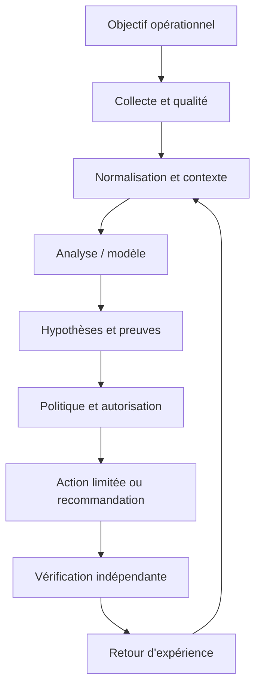

Le premier contrat concerne la donnée : source, horodatage, unité, cible, fraîcheur et état de qualité sont conservés. Le contrat du modèle ou de la règle précise la version, les entrées attendues, les métriques de validation et les limites. Le contrat de décision énumère les actions permises, les préconditions, les approbations, les quotas et les conditions d'arrêt. Le contrat de sortie indique enfin la preuve requise pour déclarer un rétablissement. Ces frontières permettent de tester chaque partie indépendamment, de corriger un composant sans dissimuler l'origine de l'erreur et d'auditer une action plusieurs semaines plus tard.

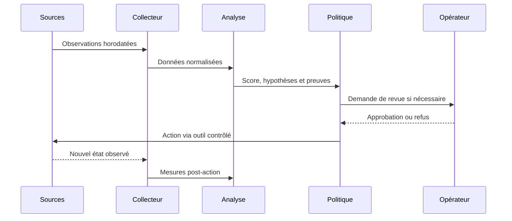

### Frontières de sécurité et mode dégradé

Le contrôle de sécurité lié à Séparation analyse/exécution doit être conçu dès le départ. Appliquer le moindre privilège, protéger les secrets, tracer les décisions et séparer analyse et exécution. Le piège à surveiller est : interpréter un texte libre comme du shell. Lorsque des données externes entrent dans le pipeline, elles ne doivent pas modifier les règles d'accès ni fournir des instructions privilégiées. Toute action à fort impact exige des préconditions compréhensibles, une approbation adaptée et une façon testée de revenir vers un état sûr.

Si Données manquantes produit un résultat incohérent, commencer par vérifier horloge, source, unité, cible, fraîcheur, version et erreur d'accès. Comparer une observation brute avec sa valeur transformée, puis rechercher les modifications récentes. Pour le scénario étudié, un contrôle utile consiste à tester une seule hypothèse à la fois et à conserver la preuve du résultat. Ne pas recopier de secrets dans le ticket. Une fois le défaut confirmé, ajouter un test de régression afin que la même anomalie ne revienne pas avec une mise à jour.

À l'échelle, Résilience du pipeline doit gérer des volumes, équipements et versions hétérogènes sans perdre de traçabilité. Borner la concurrence, isoler les erreurs par cible, limiter le buffering et mesurer les files protège le système aval. La reprise d'une panne peut elle-même provoquer une surcharge si toutes les cibles se reconnectent simultanément. Une architecture robuste sait réduire la fréquence ou revenir à une méthode plus simple, tout en signalant explicitement cette dégradation au lieu d'afficher une apparence de fonctionnement normal.

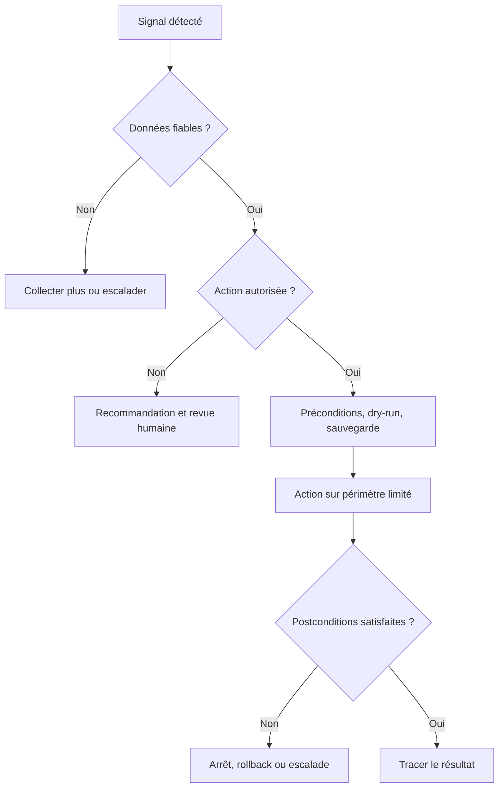

## 4. Pipeline et algorithmes

Le pipeline présenté ici est une chaîne de responsabilités, pas nécessairement un ensemble de microservices séparés. Une petite mise en œuvre peut héberger plusieurs étapes dans un seul processus, à condition de conserver des contrats clairs, des tests et des journaux. L'ordre importe : la qualité est vérifiée avant le calcul, le contexte avant l'interprétation et l'autorisation avant l'exécution. Cette discipline rend possible le fonctionnement en mode observation au départ puis, si les critères le justifient, une automatisation graduée.

### Étape 1 — Recevoir
Vérifier signature, horodatage, type et répétition de l'événement.

La mise en œuvre de Recevoir gagne à être découpée en contrôles testables. Vérifier d'abord le format et la provenance des entrées, puis les hypothèses, les valeurs manquantes et les versions. L'outil webhooks peut contribuer à cette étape, mais sa présence ne garantit pas la qualité. Les erreurs doivent rester explicites au lieu d'être converties silencieusement en valeurs par défaut. Une exécution fiable sait différencier une réussite, un échec, un résultat partiel et un état impossible à déterminer.

Si Recevoir produit un résultat incohérent, commencer par vérifier horloge, source, unité, cible, fraîcheur, version et erreur d'accès. Comparer une observation brute avec sa valeur transformée, puis rechercher les modifications récentes. Pour le scénario étudié, un contrôle utile consiste à tester une seule hypothèse à la fois et à conserver la preuve du résultat. Ne pas recopier de secrets dans le ticket. Une fois le défaut confirmé, ajouter un test de régression afin que la même anomalie ne revienne pas avec une mise à jour.

### Étape 2 — Authentifier
Confirmer l'identité et le contexte de l'espace de travail.

La mise en œuvre de Authentifier gagne à être découpée en contrôles testables. Vérifier d'abord le format et la provenance des entrées, puis les hypothèses, les valeurs manquantes et les versions. L'outil commandes structurées peut contribuer à cette étape, mais sa présence ne garantit pas la qualité. Les erreurs doivent rester explicites au lieu d'être converties silencieusement en valeurs par défaut. Une exécution fiable sait différencier une réussite, un échec, un résultat partiel et un état impossible à déterminer.

Si Authentifier produit un résultat incohérent, commencer par vérifier horloge, source, unité, cible, fraîcheur, version et erreur d'accès. Comparer une observation brute avec sa valeur transformée, puis rechercher les modifications récentes. Pour le scénario étudié, un contrôle utile consiste à tester une seule hypothèse à la fois et à conserver la preuve du résultat. Ne pas recopier de secrets dans le ticket. Une fois le défaut confirmé, ajouter un test de régression afin que la même anomalie ne revienne pas avec une mise à jour.

### Étape 3 — Valider
Parser arguments et bloquer les commandes non définies.

La mise en œuvre de Valider gagne à être découpée en contrôles testables. Vérifier d'abord le format et la provenance des entrées, puis les hypothèses, les valeurs manquantes et les versions. L'outil APIs de messagerie peut contribuer à cette étape, mais sa présence ne garantit pas la qualité. Les erreurs doivent rester explicites au lieu d'être converties silencieusement en valeurs par défaut. Une exécution fiable sait différencier une réussite, un échec, un résultat partiel et un état impossible à déterminer.

Si Valider produit un résultat incohérent, commencer par vérifier horloge, source, unité, cible, fraîcheur, version et erreur d'accès. Comparer une observation brute avec sa valeur transformée, puis rechercher les modifications récentes. Pour le scénario étudié, un contrôle utile consiste à tester une seule hypothèse à la fois et à conserver la preuve du résultat. Ne pas recopier de secrets dans le ticket. Une fois le défaut confirmé, ajouter un test de régression afin que la même anomalie ne revienne pas avec une mise à jour.

### Étape 4 — Autoriser
Vérifier rôles, périmètre et approbation.

La mise en œuvre de Autoriser gagne à être découpée en contrôles testables. Vérifier d'abord le format et la provenance des entrées, puis les hypothèses, les valeurs manquantes et les versions. L'outil RBAC peut contribuer à cette étape, mais sa présence ne garantit pas la qualité. Les erreurs doivent rester explicites au lieu d'être converties silencieusement en valeurs par défaut. Une exécution fiable sait différencier une réussite, un échec, un résultat partiel et un état impossible à déterminer.

Si Autoriser produit un résultat incohérent, commencer par vérifier horloge, source, unité, cible, fraîcheur, version et erreur d'accès. Comparer une observation brute avec sa valeur transformée, puis rechercher les modifications récentes. Pour le scénario étudié, un contrôle utile consiste à tester une seule hypothèse à la fois et à conserver la preuve du résultat. Ne pas recopier de secrets dans le ticket. Une fois le défaut confirmé, ajouter un test de régression afin que la même anomalie ne revienne pas avec une mise à jour.

### Étape 5 — Exécuter
Créer un job traçable au moyen d'un outil d'automatisation contrôlé.

La mise en œuvre de Exécuter gagne à être découpée en contrôles testables. Vérifier d'abord le format et la provenance des entrées, puis les hypothèses, les valeurs manquantes et les versions. L'outil runbooks peut contribuer à cette étape, mais sa présence ne garantit pas la qualité. Les erreurs doivent rester explicites au lieu d'être converties silencieusement en valeurs par défaut. Une exécution fiable sait différencier une réussite, un échec, un résultat partiel et un état impossible à déterminer.

Si Exécuter produit un résultat incohérent, commencer par vérifier horloge, source, unité, cible, fraîcheur, version et erreur d'accès. Comparer une observation brute avec sa valeur transformée, puis rechercher les modifications récentes. Pour le scénario étudié, un contrôle utile consiste à tester une seule hypothèse à la fois et à conserver la preuve du résultat. Ne pas recopier de secrets dans le ticket. Une fois le défaut confirmé, ajouter un test de régression afin que la même anomalie ne revienne pas avec une mise à jour.

### Étape 6 — Répondre
Retourner statut, identifiant et lien d'audit sans exposer de secret.

La mise en œuvre de Répondre gagne à être découpée en contrôles testables. Vérifier d'abord le format et la provenance des entrées, puis les hypothèses, les valeurs manquantes et les versions. L'outil webhooks peut contribuer à cette étape, mais sa présence ne garantit pas la qualité. Les erreurs doivent rester explicites au lieu d'être converties silencieusement en valeurs par défaut. Une exécution fiable sait différencier une réussite, un échec, un résultat partiel et un état impossible à déterminer.

Si Répondre produit un résultat incohérent, commencer par vérifier horloge, source, unité, cible, fraîcheur, version et erreur d'accès. Comparer une observation brute avec sa valeur transformée, puis rechercher les modifications récentes. Pour le scénario étudié, un contrôle utile consiste à tester une seule hypothèse à la fois et à conserver la preuve du résultat. Ne pas recopier de secrets dans le ticket. Une fois le défaut confirmé, ajouter un test de régression afin que la même anomalie ne revienne pas avec une mise à jour.

### Pseudocode de décision défensive
```text
observations = collecter()
si qualite(observations) insuffisante:
    journaliser("données insuffisantes")
    demander_verification_humaine()
sinon:
    contexte = enrichir(observations, inventaire, changements, dépendances)
    hypotheses = analyser(contexte)
    preuves = verifier_provenance(hypotheses)
    si preuves insuffisantes ou action hors politique:
        recommander_sans_executer()
    sinon:
        plan = preparer_diff_preconditions_et_rollback()
        si validation(plan) et approbations(plan):
            appliquer_sur_perimetre_limite(plan)
            resultat = mesurer_postconditions()
            si resultat non conforme: rollback_ou_escalade()
            tracer(version, preuves, action, resultat)
```

Ce pseudocode sert à expliquer le flux de décision ; il ne constitue pas une bibliothèque prête pour la production. Chaque fonction doit être implémentée, testée et protégée. Le comportement doit être prévisible lorsque les données manquent, qu'un service externe ne répond pas ou que le résultat demeure ambigu. Une bonne conception ne remplace pas l'incertitude par une valeur par défaut. Elle la rend visible, limite l'impact et garde une voie de reprise.

## 5. Étude de cas détaillée

### Situation et impact
les alertes et demandes d'intervention arrivent dans plusieurs canaux ; des commandes libres et des permissions mal définies risquent de viser le mauvais équipement. L'équipe réunit responsable de service, ingénieur réseau, administrateur système et propriétaire de l'automatisation. Avant d'agir, elle définit l'impact observé, la fenêtre de temps, les actifs concernés et les services prioritaires. La première question n'est pas « quel modèle utiliser ? », mais « quelle décision doit être améliorée et quelle preuve montrera que le changement a servi son objectif ? ». Cette formulation fixe le périmètre et donne un critère d'arrêt si la solution n'apporte pas de valeur démontrable.

### Phase 1 — Établir les faits
Les observations doivent garder les heures originales et les identifiants de source. L'équipe vérifie la qualité de collecte, les changements récents, les dépendances et l'expérience utilisateur. Les valeurs manquantes sont identifiées explicitement plutôt que remplacées silencieusement par zéro. Les symptômes sont séparés des causes supposées, et les sources qui se contredisent sont enregistrées dans le dossier. La preuve de départ sert de référence pour vérifier si une intervention améliore réellement la situation et permet à un autre opérateur de reproduire l'analyse.

### Phase 2 — Poser plusieurs hypothèses
Quand plusieurs causes sont possibles, l'équipe note au minimum deux hypothèses, les observations qui les soutiennent, les éléments qui les contredisent et les tests qui peuvent les différencier. La priorité combine probabilité, impact et coût d'un test. Une hypothèse populaire n'est pas nécessairement correcte : un cas qui ressemble à un incident passé peut différer par la capacité, le routage, la version de logiciel ou la période de charge. Les hypothèses restent des hypothèses jusqu'à ce qu'une preuve suffisante permette de les confirmer.

### Phase 3 — Choisir une réponse proportionnée
Commencer par les vérifications non destructives : comparer l'état, consulter les changements, tester la connectivité ou inspecter une dépendance. Si une modification est nécessaire, définir précisément la cible, la commande ou le changement attendu, les préconditions, les critères d'arrêt et le rollback. Une revue indépendante s'impose lorsque le rayon d'impact est élevé. Le plan doit permettre à l'opérateur de comprendre pourquoi l'action est proposée et dans quelles circonstances il doit la refuser.

### Phase 4 — Vérifier les postconditions
La validation repose sur des mesures indépendantes du simple statut de commande : latence, erreurs, connectivité, état de configuration ou indicateur du service. La fenêtre d'observation doit éviter de confondre un échantillon favorable avec un rétablissement durable. Si les conditions ne sont pas satisfaites, appliquer la règle d'arrêt prévue et lancer un rollback ou une escalade. Le compte rendu distingue l'action exécutée, l'effet mesuré, les effets secondaires et les informations qui restent inconnues.

### Phase 5 — Capitaliser avec prudence
Le post-mortem compare les hypothèses initiales avec les preuves finales, relève les signaux manquants et ajoute des tests de régression. Une règle ou un modèle amélioré passe en revue et en essai contrôlé avant généralisation. Il faut éviter de réentraîner automatiquement sur des conclusions incertaines ou des tickets contenant uniquement des suppositions. Le retour d'expérience doit décrire les situations où la méthode a échoué autant que les cas où elle a réussi.

### Critères de clôture
La clôture exige une preuve de rétablissement, ou une déclaration explicite que le service reste dégradé. Le dossier réunit sources, versions, changement exact, approbation, résultats et suivi. La cause racine n'est marquée comme confirmée que si les observations la soutiennent suffisamment. En l'absence de preuve, une conclusion partielle est plus utile qu'un récit catégorique. La qualité se mesure au diagnostic reproductible, au risque contrôlé et à la possibilité d'améliorer le système à partir des erreurs observées.

## 6. Implémentation guidée et laboratoire

Le laboratoire doit être exécuté dans un environnement isolé ou sur des systèmes explicitement autorisés. Avant de commencer, noter les versions, dépendances, données d'entrée et condition de réussite. Ne pas copier les exemples sur un réseau de production sans adapter les identifiants, certificats, permissions et tests de restauration. Le livrable final doit être compréhensible par une autre personne, ré-exécutable et accompagné d'une liste claire de ses limites.

### TP 1 — Définir trois commandes en lecture seule.
**Procédure.** Définir trois commandes en lecture seule. Commencer par une cible de laboratoire minimale et capturer l'état de départ. Relier ce travail au concept « ChatOps » : ChatOps rapproche conversation, événements et outils opérationnels ; la demande, l'approbation et le résultat doivent rester visibles. Conserver la commande, les entrées, le résultat et la version des outils. Ne changer qu'une variable à la fois pour pouvoir attribuer un écart à sa cause.

**Critère de réussite.** Un autre opérateur doit pouvoir reproduire le résultat et identifier la preuve attendue. Tester aussi un échec contrôlé, une valeur manquante ou une dépendance indisponible. Si le résultat n'est pas déterminable, garder cet état explicite ; ne pas le convertir en succès. Vérifier les postconditions réelles, les effets secondaires et la procédure de reprise. Documenter ce qui a été démontré, ce qui reste une hypothèse et quelle amélioration serait nécessaire avant un usage à plus grande échelle.

### TP 2 — Valider les paramètres avec un schéma JSON.
**Procédure.** Valider les paramètres avec un schéma JSON. Commencer par une cible de laboratoire minimale et capturer l'état de départ. Relier ce travail au concept « Webhook » : Un webhook transmet un événement à une URL ; origine, signature, horodatage et anti-rejeu doivent être vérifiés. Conserver la commande, les entrées, le résultat et la version des outils. Ne changer qu'une variable à la fois pour pouvoir attribuer un écart à sa cause.

**Critère de réussite.** Un autre opérateur doit pouvoir reproduire le résultat et identifier la preuve attendue. Tester aussi un échec contrôlé, une valeur manquante ou une dépendance indisponible. Si le résultat n'est pas déterminable, garder cet état explicite ; ne pas le convertir en succès. Vérifier les postconditions réelles, les effets secondaires et la procédure de reprise. Documenter ce qui a été démontré, ce qui reste une hypothèse et quelle amélioration serait nécessaire avant un usage à plus grande échelle.

### TP 3 — Rejeter un événement avec une signature incorrecte.
**Procédure.** Rejeter un événement avec une signature incorrecte. Commencer par une cible de laboratoire minimale et capturer l'état de départ. Relier ce travail au concept « Commande structurée » : Une commande typée et bornée est plus sûre qu'un texte libre transformé directement en shell. Conserver la commande, les entrées, le résultat et la version des outils. Ne changer qu'une variable à la fois pour pouvoir attribuer un écart à sa cause.

**Critère de réussite.** Un autre opérateur doit pouvoir reproduire le résultat et identifier la preuve attendue. Tester aussi un échec contrôlé, une valeur manquante ou une dépendance indisponible. Si le résultat n'est pas déterminable, garder cet état explicite ; ne pas le convertir en succès. Vérifier les postconditions réelles, les effets secondaires et la procédure de reprise. Documenter ce qui a été démontré, ce qui reste une hypothèse et quelle amélioration serait nécessaire avant un usage à plus grande échelle.

### TP 4 — Associer les commandes à des rôles et périmètres.
**Procédure.** Associer les commandes à des rôles et périmètres. Commencer par une cible de laboratoire minimale et capturer l'état de départ. Relier ce travail au concept « Identité et RBAC » : L'identité vérifiée doit être associée à des rôles et des cibles ; la présence dans un canal ne donne pas une autorisation. Conserver la commande, les entrées, le résultat et la version des outils. Ne changer qu'une variable à la fois pour pouvoir attribuer un écart à sa cause.

**Critère de réussite.** Un autre opérateur doit pouvoir reproduire le résultat et identifier la preuve attendue. Tester aussi un échec contrôlé, une valeur manquante ou une dépendance indisponible. Si le résultat n'est pas déterminable, garder cet état explicite ; ne pas le convertir en succès. Vérifier les postconditions réelles, les effets secondaires et la procédure de reprise. Documenter ce qui a été démontré, ce qui reste une hypothèse et quelle amélioration serait nécessaire avant un usage à plus grande échelle.

### TP 5 — Simuler une demande avec approbation par une seconde personne.
**Procédure.** Simuler une demande avec approbation par une seconde personne. Commencer par une cible de laboratoire minimale et capturer l'état de départ. Relier ce travail au concept « Approbation » : Une décision d'approbation expose cible, impact, justification, preuve et rollback, avec séparation des tâches pour les opérations risquées. Conserver la commande, les entrées, le résultat et la version des outils. Ne changer qu'une variable à la fois pour pouvoir attribuer un écart à sa cause.

**Critère de réussite.** Un autre opérateur doit pouvoir reproduire le résultat et identifier la preuve attendue. Tester aussi un échec contrôlé, une valeur manquante ou une dépendance indisponible. Si le résultat n'est pas déterminable, garder cet état explicite ; ne pas le convertir en succès. Vérifier les postconditions réelles, les effets secondaires et la procédure de reprise. Documenter ce qui a été démontré, ce qui reste une hypothèse et quelle amélioration serait nécessaire avant un usage à plus grande échelle.

### TP 6 — Exécuter via une file de jobs et retourner un identifiant.
**Procédure.** Exécuter via une file de jobs et retourner un identifiant. Commencer par une cible de laboratoire minimale et capturer l'état de départ. Relier ce travail au concept « Traitement asynchrone » : Un job asynchrone et une clé d'idempotence gèrent les retransmissions et délais de réponse de la plateforme. Conserver la commande, les entrées, le résultat et la version des outils. Ne changer qu'une variable à la fois pour pouvoir attribuer un écart à sa cause.

**Critère de réussite.** Un autre opérateur doit pouvoir reproduire le résultat et identifier la preuve attendue. Tester aussi un échec contrôlé, une valeur manquante ou une dépendance indisponible. Si le résultat n'est pas déterminable, garder cet état explicite ; ne pas le convertir en succès. Vérifier les postconditions réelles, les effets secondaires et la procédure de reprise. Documenter ce qui a été démontré, ce qui reste une hypothèse et quelle amélioration serait nécessaire avant un usage à plus grande échelle.

### TP 7 — Tester duplication, utilisateur non autorisé et timeout.
**Procédure.** Tester duplication, utilisateur non autorisé et timeout. Commencer par une cible de laboratoire minimale et capturer l'état de départ. Relier ce travail au concept « Audit du bot » : L'audit conserve auteur, commande, cible, approbation et résultat, tout en évitant secrets et données privées inutiles. Conserver la commande, les entrées, le résultat et la version des outils. Ne changer qu'une variable à la fois pour pouvoir attribuer un écart à sa cause.

**Critère de réussite.** Un autre opérateur doit pouvoir reproduire le résultat et identifier la preuve attendue. Tester aussi un échec contrôlé, une valeur manquante ou une dépendance indisponible. Si le résultat n'est pas déterminable, garder cet état explicite ; ne pas le convertir en succès. Vérifier les postconditions réelles, les effets secondaires et la procédure de reprise. Documenter ce qui a été démontré, ce qui reste une hypothèse et quelle amélioration serait nécessaire avant un usage à plus grande échelle.

### Exemple de code ou de configuration

```python
import hmac, hashlib

def verify_signature(secret: bytes, body: bytes, supplied: str) -> bool:
    expected = hmac.new(secret, body, hashlib.sha256).hexdigest()
    return hmac.compare_digest(expected, supplied)

# Ajouter une vérification de l'horodatage, un anti-rejeu et le format officiel
# de la plateforme. Cette vérification ne remplace ni RBAC ni approbation.
```

Ce fragment est un point de départ pédagogique. Les versions, options CLI, capacités matérielles et schémas changent ; vérifier la documentation liée et tester dans un laboratoire. Le fragment n'inclut pas toute la configuration nécessaire à un déploiement réel. Les secrets ne doivent pas être ajoutés au code, et les exemples qui peuvent modifier un système doivent recevoir approbations, limites de portée et vérification post-action. Un parseur qui accepte la syntaxe ne certifie ni la conformité ni la disponibilité.

### Livrables attendus
- Un fichier versionné qui décrit entrées, sorties et dépendances.
- Un journal lié à la cible et à la version, sans secret.
- Des tests positifs, négatifs et de panne de dépendance.
- Des critères d'arrêt et une procédure de reprise testée.
- Une note décrivant les résultats et les limites.

## 7. Sécurité et gouvernance

### 1. Qualité et provenance
Chaque observation garde source, heure, unité et état de fraîcheur. Pour le contexte étudié, ce principe doit être traduit en contrôle observable, propriétaire, fréquence de revue et preuve de passage. Une politique sans test dépend de la mémoire des personnes ; un test sans propriétaire cesse d'être maintenu lorsque l'équipe change. La revue doit donc être planifiée et relancée après un changement majeur de données, de matériel, de finalité ou de modèle.

La gouvernance de Qualité et provenance définit qui peut créer, modifier, approuver, consulter et retirer la logique associée. Le propriétaire doit connaître l'objectif, les limites, les dépendances, le budget d'erreur et les critères de suspension. Les décisions doivent être retraçables jusqu'aux données et versions utilisées. Une règle sans propriétaire finit par dépendre de la mémoire de l'équipe ; un propriétaire sans mesure ne peut pas démontrer qu'elle fonctionne. La revue doit être planifiée et relancée à chaque changement majeur de données, d'équipement ou de finalité.

### 2. Identités et permissions
Les comptes d'automatisation reçoivent uniquement les privilèges nécessaires. Pour le contexte étudié, ce principe doit être traduit en contrôle observable, propriétaire, fréquence de revue et preuve de passage. Une politique sans test dépend de la mémoire des personnes ; un test sans propriétaire cesse d'être maintenu lorsque l'équipe change. La revue doit donc être planifiée et relancée après un changement majeur de données, de matériel, de finalité ou de modèle.

La gouvernance de Identités et permissions définit qui peut créer, modifier, approuver, consulter et retirer la logique associée. Le propriétaire doit connaître l'objectif, les limites, les dépendances, le budget d'erreur et les critères de suspension. Les décisions doivent être retraçables jusqu'aux données et versions utilisées. Une règle sans propriétaire finit par dépendre de la mémoire de l'équipe ; un propriétaire sans mesure ne peut pas démontrer qu'elle fonctionne. La revue doit être planifiée et relancée à chaque changement majeur de données, d'équipement ou de finalité.

### 3. Traçabilité
La version, les preuves, la décision, l'approbateur et le résultat sont corrélés. Pour le contexte étudié, ce principe doit être traduit en contrôle observable, propriétaire, fréquence de revue et preuve de passage. Une politique sans test dépend de la mémoire des personnes ; un test sans propriétaire cesse d'être maintenu lorsque l'équipe change. La revue doit donc être planifiée et relancée après un changement majeur de données, de matériel, de finalité ou de modèle.

La gouvernance de Traçabilité définit qui peut créer, modifier, approuver, consulter et retirer la logique associée. Le propriétaire doit connaître l'objectif, les limites, les dépendances, le budget d'erreur et les critères de suspension. Les décisions doivent être retraçables jusqu'aux données et versions utilisées. Une règle sans propriétaire finit par dépendre de la mémoire de l'équipe ; un propriétaire sans mesure ne peut pas démontrer qu'elle fonctionne. La revue doit être planifiée et relancée à chaque changement majeur de données, d'équipement ou de finalité.

### 4. Revue humaine
Le réviseur doit posséder preuves, temps et autorité pour refuser. Pour le contexte étudié, ce principe doit être traduit en contrôle observable, propriétaire, fréquence de revue et preuve de passage. Une politique sans test dépend de la mémoire des personnes ; un test sans propriétaire cesse d'être maintenu lorsque l'équipe change. La revue doit donc être planifiée et relancée après un changement majeur de données, de matériel, de finalité ou de modèle.

La gouvernance de Revue humaine définit qui peut créer, modifier, approuver, consulter et retirer la logique associée. Le propriétaire doit connaître l'objectif, les limites, les dépendances, le budget d'erreur et les critères de suspension. Les décisions doivent être retraçables jusqu'aux données et versions utilisées. Une règle sans propriétaire finit par dépendre de la mémoire de l'équipe ; un propriétaire sans mesure ne peut pas démontrer qu'elle fonctionne. La revue doit être planifiée et relancée à chaque changement majeur de données, d'équipement ou de finalité.

### 5. Mesure du risque
Chaque mode d'échec doit avoir prévention, détection, réponse et responsable. Pour le contexte étudié, ce principe doit être traduit en contrôle observable, propriétaire, fréquence de revue et preuve de passage. Une politique sans test dépend de la mémoire des personnes ; un test sans propriétaire cesse d'être maintenu lorsque l'équipe change. La revue doit donc être planifiée et relancée après un changement majeur de données, de matériel, de finalité ou de modèle.

La gouvernance de Mesure du risque définit qui peut créer, modifier, approuver, consulter et retirer la logique associée. Le propriétaire doit connaître l'objectif, les limites, les dépendances, le budget d'erreur et les critères de suspension. Les décisions doivent être retraçables jusqu'aux données et versions utilisées. Une règle sans propriétaire finit par dépendre de la mémoire de l'équipe ; un propriétaire sans mesure ne peut pas démontrer qu'elle fonctionne. La revue doit être planifiée et relancée à chaque changement majeur de données, d'équipement ou de finalité.

### 6. Réversibilité
La suspension du modèle et le retour à une version saine sont testés. Pour le contexte étudié, ce principe doit être traduit en contrôle observable, propriétaire, fréquence de revue et preuve de passage. Une politique sans test dépend de la mémoire des personnes ; un test sans propriétaire cesse d'être maintenu lorsque l'équipe change. La revue doit donc être planifiée et relancée après un changement majeur de données, de matériel, de finalité ou de modèle.

La gouvernance de Réversibilité définit qui peut créer, modifier, approuver, consulter et retirer la logique associée. Le propriétaire doit connaître l'objectif, les limites, les dépendances, le budget d'erreur et les critères de suspension. Les décisions doivent être retraçables jusqu'aux données et versions utilisées. Une règle sans propriétaire finit par dépendre de la mémoire de l'équipe ; un propriétaire sans mesure ne peut pas démontrer qu'elle fonctionne. La revue doit être planifiée et relancée à chaque changement majeur de données, d'équipement ou de finalité.

## 8. Pièges à éviter

### Piège 1 — Interpréter un texte libre comme du shell

Ce piège peut produire un faux diagnostic, une action superflue ou une perte de confiance. Le signal précurseur est parfois subtil : incohérence entre sources, hausse d'erreurs, impossibilité d'expliquer la sortie ou comportement différent selon les sites. L'équipe doit rendre le signal mesurable, désigner qui réagit et préciser si l'action automatique se bloque ou si le traitement continue en mode dégradé.

La prévention doit être reliée à « ChatOps ». ChatOps rapproche conversation, événements et outils opérationnels ; la demande, l'approbation et le résultat doivent rester visibles. Définir un test négatif qui fait apparaître le défaut et vérifier que la réponse attendue réduit le risque. Un garde-fou ne doit pas être un simple avertissement que les opérateurs apprennent à ignorer. En revue, demander quelle preuve montre que le contrôle fonctionne, quelle défaillance il couvre et quelle autre défaillance demeure possible.

### Piège 2 — Accepter un webhook sans validation d'origine

Ce piège peut produire un faux diagnostic, une action superflue ou une perte de confiance. Le signal précurseur est parfois subtil : incohérence entre sources, hausse d'erreurs, impossibilité d'expliquer la sortie ou comportement différent selon les sites. L'équipe doit rendre le signal mesurable, désigner qui réagit et préciser si l'action automatique se bloque ou si le traitement continue en mode dégradé.

La prévention doit être reliée à « Webhook ». Un webhook transmet un événement à une URL ; origine, signature, horodatage et anti-rejeu doivent être vérifiés. Définir un test négatif qui fait apparaître le défaut et vérifier que la réponse attendue réduit le risque. Un garde-fou ne doit pas être un simple avertissement que les opérateurs apprennent à ignorer. En revue, demander quelle preuve montre que le contrôle fonctionne, quelle défaillance il couvre et quelle autre défaillance demeure possible.

### Piège 3 — Donner les droits administrateur à tous les membres

Ce piège peut produire un faux diagnostic, une action superflue ou une perte de confiance. Le signal précurseur est parfois subtil : incohérence entre sources, hausse d'erreurs, impossibilité d'expliquer la sortie ou comportement différent selon les sites. L'équipe doit rendre le signal mesurable, désigner qui réagit et préciser si l'action automatique se bloque ou si le traitement continue en mode dégradé.

La prévention doit être reliée à « Commande structurée ». Une commande typée et bornée est plus sûre qu'un texte libre transformé directement en shell. Définir un test négatif qui fait apparaître le défaut et vérifier que la réponse attendue réduit le risque. Un garde-fou ne doit pas être un simple avertissement que les opérateurs apprennent à ignorer. En revue, demander quelle preuve montre que le contrôle fonctionne, quelle défaillance il couvre et quelle autre défaillance demeure possible.

### Piège 4 — Publier secrets ou sorties sensibles dans le canal

Ce piège peut produire un faux diagnostic, une action superflue ou une perte de confiance. Le signal précurseur est parfois subtil : incohérence entre sources, hausse d'erreurs, impossibilité d'expliquer la sortie ou comportement différent selon les sites. L'équipe doit rendre le signal mesurable, désigner qui réagit et préciser si l'action automatique se bloque ou si le traitement continue en mode dégradé.

La prévention doit être reliée à « Identité et RBAC ». L'identité vérifiée doit être associée à des rôles et des cibles ; la présence dans un canal ne donne pas une autorisation. Définir un test négatif qui fait apparaître le défaut et vérifier que la réponse attendue réduit le risque. Un garde-fou ne doit pas être un simple avertissement que les opérateurs apprennent à ignorer. En revue, demander quelle preuve montre que le contrôle fonctionne, quelle défaillance il couvre et quelle autre défaillance demeure possible.

### Piège 5 — Exécuter deux fois un événement retransmis

Ce piège peut produire un faux diagnostic, une action superflue ou une perte de confiance. Le signal précurseur est parfois subtil : incohérence entre sources, hausse d'erreurs, impossibilité d'expliquer la sortie ou comportement différent selon les sites. L'équipe doit rendre le signal mesurable, désigner qui réagit et préciser si l'action automatique se bloque ou si le traitement continue en mode dégradé.

La prévention doit être reliée à « Approbation ». Une décision d'approbation expose cible, impact, justification, preuve et rollback, avec séparation des tâches pour les opérations risquées. Définir un test négatif qui fait apparaître le défaut et vérifier que la réponse attendue réduit le risque. Un garde-fou ne doit pas être un simple avertissement que les opérateurs apprennent à ignorer. En revue, demander quelle preuve montre que le contrôle fonctionne, quelle défaillance il couvre et quelle autre défaillance demeure possible.

### Piège 6 — Ne pas afficher la cible avant approbation

Ce piège peut produire un faux diagnostic, une action superflue ou une perte de confiance. Le signal précurseur est parfois subtil : incohérence entre sources, hausse d'erreurs, impossibilité d'expliquer la sortie ou comportement différent selon les sites. L'équipe doit rendre le signal mesurable, désigner qui réagit et préciser si l'action automatique se bloque ou si le traitement continue en mode dégradé.

La prévention doit être reliée à « Traitement asynchrone ». Un job asynchrone et une clé d'idempotence gèrent les retransmissions et délais de réponse de la plateforme. Définir un test négatif qui fait apparaître le défaut et vérifier que la réponse attendue réduit le risque. Un garde-fou ne doit pas être un simple avertissement que les opérateurs apprennent à ignorer. En revue, demander quelle preuve montre que le contrôle fonctionne, quelle défaillance il couvre et quelle autre défaillance demeure possible.

### Piège 7 — Confondre un emoji avec une approbation formelle

Ce piège peut produire un faux diagnostic, une action superflue ou une perte de confiance. Le signal précurseur est parfois subtil : incohérence entre sources, hausse d'erreurs, impossibilité d'expliquer la sortie ou comportement différent selon les sites. L'équipe doit rendre le signal mesurable, désigner qui réagit et préciser si l'action automatique se bloque ou si le traitement continue en mode dégradé.

La prévention doit être reliée à « Audit du bot ». L'audit conserve auteur, commande, cible, approbation et résultat, tout en évitant secrets et données privées inutiles. Définir un test négatif qui fait apparaître le défaut et vérifier que la réponse attendue réduit le risque. Un garde-fou ne doit pas être un simple avertissement que les opérateurs apprennent à ignorer. En revue, demander quelle preuve montre que le contrôle fonctionne, quelle défaillance il couvre et quelle autre défaillance demeure possible.

## 9. Diagnostic et dépannage

### Aucun résultat n'est produit
Vérifier accès source, période de sélection, identité, filtres et version du schéma. Dans le cadre de Automatiser via Slack/Teams (ChatOps), vérifier en particulier ce risque : interpréter un texte libre comme du shell. Comparer les observations brutes à leur représentation transformée, retrouver la version du pipeline et noter si une modification récente correspond au début du problème. Formuler au moins deux explications alternatives et choisir un test à faible risque qui permet de les distinguer. Ne pas effectuer plusieurs changements simultanément, car cela rendrait l'analyse ambiguë. Si les preuves restent insuffisantes, rendre cette incertitude visible et utiliser le mode sûr.

### Les résultats varient
Comparer données, code, versions, transformations et paramètres sur un cas fixe. Dans le cadre de Automatiser via Slack/Teams (ChatOps), vérifier en particulier ce risque : accepter un webhook sans validation d'origine. Comparer les observations brutes à leur représentation transformée, retrouver la version du pipeline et noter si une modification récente correspond au début du problème. Formuler au moins deux explications alternatives et choisir un test à faible risque qui permet de les distinguer. Ne pas effectuer plusieurs changements simultanément, car cela rendrait l'analyse ambiguë. Si les preuves restent insuffisantes, rendre cette incertitude visible et utiliser le mode sûr.

### Trop d'alertes
Inspecter doublons, saisonnalité, baseline, seuil et qualité du contexte avant de supprimer des alertes. Dans le cadre de Automatiser via Slack/Teams (ChatOps), vérifier en particulier ce risque : donner les droits administrateur à tous les membres. Comparer les observations brutes à leur représentation transformée, retrouver la version du pipeline et noter si une modification récente correspond au début du problème. Formuler au moins deux explications alternatives et choisir un test à faible risque qui permet de les distinguer. Ne pas effectuer plusieurs changements simultanément, car cela rendrait l'analyse ambiguë. Si les preuves restent insuffisantes, rendre cette incertitude visible et utiliser le mode sûr.

### Un incident passe inaperçu
Reconstituer les informations disponibles au moment de décider et rechercher un seuil trop permissif ou une source absente. Dans le cadre de Automatiser via Slack/Teams (ChatOps), vérifier en particulier ce risque : publier secrets ou sorties sensibles dans le canal. Comparer les observations brutes à leur représentation transformée, retrouver la version du pipeline et noter si une modification récente correspond au début du problème. Formuler au moins deux explications alternatives et choisir un test à faible risque qui permet de les distinguer. Ne pas effectuer plusieurs changements simultanément, car cela rendrait l'analyse ambiguë. Si les preuves restent insuffisantes, rendre cette incertitude visible et utiliser le mode sûr.

### L'action n'améliore pas le service
Vérifier postconditions indépendantes et effets secondaires, puis appliquer arrêt ou rollback selon le plan. Dans le cadre de Automatiser via Slack/Teams (ChatOps), vérifier en particulier ce risque : exécuter deux fois un événement retransmis. Comparer les observations brutes à leur représentation transformée, retrouver la version du pipeline et noter si une modification récente correspond au début du problème. Formuler au moins deux explications alternatives et choisir un test à faible risque qui permet de les distinguer. Ne pas effectuer plusieurs changements simultanément, car cela rendrait l'analyse ambiguë. Si les preuves restent insuffisantes, rendre cette incertitude visible et utiliser le mode sûr.

### La qualité diminue avec le temps
Rechercher dérive, changement de capacité, topologie, population ou version et réévaluer. Dans le cadre de Automatiser via Slack/Teams (ChatOps), vérifier en particulier ce risque : ne pas afficher la cible avant approbation. Comparer les observations brutes à leur représentation transformée, retrouver la version du pipeline et noter si une modification récente correspond au début du problème. Formuler au moins deux explications alternatives et choisir un test à faible risque qui permet de les distinguer. Ne pas effectuer plusieurs changements simultanément, car cela rendrait l'analyse ambiguë. Si les preuves restent insuffisantes, rendre cette incertitude visible et utiliser le mode sûr.

## 10. Exercices corrigés

### Exercice 1 — ChatOps
**Énoncé.** Dans un environnement inspiré du scénario « les alertes et demandes d'intervention arrivent dans plusieurs canaux ; des commandes libres et des permissions mal définies risquent de viser le mauvais équipement », l'équipe veut généraliser une approche qui utilise « ChatOps ». Quelle preuve recueillir avant l'étape « Recevoir », et comment réduire le risque suivant : interpréter un texte libre comme du shell ?

**Correction détaillée.** Définir d'abord le résultat attendu et le coût d'une erreur. Vérifier que les entrées proviennent d'une source autorisée et qu'elles sont fraîches, cohérentes et disponibles au moment de la décision. Construire un essai reproductible, comparer à une baseline et analyser les erreurs par classe d'actif ou criticité. Vérifier signature, horodatage, type et répétition de l'événement. L'extension du périmètre exige des seuils écrits, une revue adaptée au risque, un déploiement progressif et un retour arrière. Si la preuve ne permet pas de trancher, demander une vérification complémentaire ou garder la solution en observation plutôt que d'inventer une certitude.

**Pourquoi les raccourcis échouent.** Un résultat favorable sur un exemple ne démontre pas une performance durable. Un score moyen peut masquer les catégories vulnérables ; une absence d'erreur visible peut provenir d'une télémétrie incomplète. Conserver les cas difficiles, les conditions de test et les versions utilisées rend possible une revue indépendante. L'exercice est réussi lorsque le choix, ses limites et le mécanisme de retrait sont compris par une autre personne.

### Exercice 2 — Webhook
**Énoncé.** Dans un environnement inspiré du scénario « les alertes et demandes d'intervention arrivent dans plusieurs canaux ; des commandes libres et des permissions mal définies risquent de viser le mauvais équipement », l'équipe veut généraliser une approche qui utilise « Webhook ». Quelle preuve recueillir avant l'étape « Authentifier », et comment réduire le risque suivant : accepter un webhook sans validation d'origine ?

**Correction détaillée.** Définir d'abord le résultat attendu et le coût d'une erreur. Vérifier que les entrées proviennent d'une source autorisée et qu'elles sont fraîches, cohérentes et disponibles au moment de la décision. Construire un essai reproductible, comparer à une baseline et analyser les erreurs par classe d'actif ou criticité. Confirmer l'identité et le contexte de l'espace de travail. L'extension du périmètre exige des seuils écrits, une revue adaptée au risque, un déploiement progressif et un retour arrière. Si la preuve ne permet pas de trancher, demander une vérification complémentaire ou garder la solution en observation plutôt que d'inventer une certitude.

**Pourquoi les raccourcis échouent.** Un résultat favorable sur un exemple ne démontre pas une performance durable. Un score moyen peut masquer les catégories vulnérables ; une absence d'erreur visible peut provenir d'une télémétrie incomplète. Conserver les cas difficiles, les conditions de test et les versions utilisées rend possible une revue indépendante. L'exercice est réussi lorsque le choix, ses limites et le mécanisme de retrait sont compris par une autre personne.

### Exercice 3 — Commande structurée
**Énoncé.** Dans un environnement inspiré du scénario « les alertes et demandes d'intervention arrivent dans plusieurs canaux ; des commandes libres et des permissions mal définies risquent de viser le mauvais équipement », l'équipe veut généraliser une approche qui utilise « Commande structurée ». Quelle preuve recueillir avant l'étape « Valider », et comment réduire le risque suivant : donner les droits administrateur à tous les membres ?

**Correction détaillée.** Définir d'abord le résultat attendu et le coût d'une erreur. Vérifier que les entrées proviennent d'une source autorisée et qu'elles sont fraîches, cohérentes et disponibles au moment de la décision. Construire un essai reproductible, comparer à une baseline et analyser les erreurs par classe d'actif ou criticité. Parser arguments et bloquer les commandes non définies. L'extension du périmètre exige des seuils écrits, une revue adaptée au risque, un déploiement progressif et un retour arrière. Si la preuve ne permet pas de trancher, demander une vérification complémentaire ou garder la solution en observation plutôt que d'inventer une certitude.

**Pourquoi les raccourcis échouent.** Un résultat favorable sur un exemple ne démontre pas une performance durable. Un score moyen peut masquer les catégories vulnérables ; une absence d'erreur visible peut provenir d'une télémétrie incomplète. Conserver les cas difficiles, les conditions de test et les versions utilisées rend possible une revue indépendante. L'exercice est réussi lorsque le choix, ses limites et le mécanisme de retrait sont compris par une autre personne.

### Exercice 4 — Identité et RBAC
**Énoncé.** Dans un environnement inspiré du scénario « les alertes et demandes d'intervention arrivent dans plusieurs canaux ; des commandes libres et des permissions mal définies risquent de viser le mauvais équipement », l'équipe veut généraliser une approche qui utilise « Identité et RBAC ». Quelle preuve recueillir avant l'étape « Autoriser », et comment réduire le risque suivant : publier secrets ou sorties sensibles dans le canal ?

**Correction détaillée.** Définir d'abord le résultat attendu et le coût d'une erreur. Vérifier que les entrées proviennent d'une source autorisée et qu'elles sont fraîches, cohérentes et disponibles au moment de la décision. Construire un essai reproductible, comparer à une baseline et analyser les erreurs par classe d'actif ou criticité. Vérifier rôles, périmètre et approbation. L'extension du périmètre exige des seuils écrits, une revue adaptée au risque, un déploiement progressif et un retour arrière. Si la preuve ne permet pas de trancher, demander une vérification complémentaire ou garder la solution en observation plutôt que d'inventer une certitude.

**Pourquoi les raccourcis échouent.** Un résultat favorable sur un exemple ne démontre pas une performance durable. Un score moyen peut masquer les catégories vulnérables ; une absence d'erreur visible peut provenir d'une télémétrie incomplète. Conserver les cas difficiles, les conditions de test et les versions utilisées rend possible une revue indépendante. L'exercice est réussi lorsque le choix, ses limites et le mécanisme de retrait sont compris par une autre personne.

### Exercice 5 — Approbation
**Énoncé.** Dans un environnement inspiré du scénario « les alertes et demandes d'intervention arrivent dans plusieurs canaux ; des commandes libres et des permissions mal définies risquent de viser le mauvais équipement », l'équipe veut généraliser une approche qui utilise « Approbation ». Quelle preuve recueillir avant l'étape « Exécuter », et comment réduire le risque suivant : exécuter deux fois un événement retransmis ?

**Correction détaillée.** Définir d'abord le résultat attendu et le coût d'une erreur. Vérifier que les entrées proviennent d'une source autorisée et qu'elles sont fraîches, cohérentes et disponibles au moment de la décision. Construire un essai reproductible, comparer à une baseline et analyser les erreurs par classe d'actif ou criticité. Créer un job traçable au moyen d'un outil d'automatisation contrôlé. L'extension du périmètre exige des seuils écrits, une revue adaptée au risque, un déploiement progressif et un retour arrière. Si la preuve ne permet pas de trancher, demander une vérification complémentaire ou garder la solution en observation plutôt que d'inventer une certitude.

**Pourquoi les raccourcis échouent.** Un résultat favorable sur un exemple ne démontre pas une performance durable. Un score moyen peut masquer les catégories vulnérables ; une absence d'erreur visible peut provenir d'une télémétrie incomplète. Conserver les cas difficiles, les conditions de test et les versions utilisées rend possible une revue indépendante. L'exercice est réussi lorsque le choix, ses limites et le mécanisme de retrait sont compris par une autre personne.


## Atelier approfondi — concevoir un ChatOps sûr, testable et exploitable

Cet atelier transforme les principes de ChatOps en une démarche d'architecture et de mise en œuvre. L'interface de conversation doit simplifier le travail de l'opérateur sans devenir un raccourci qui contourne les contrôles existants. Le canal est un point d'entrée vers un service opérationnel ; il ne constitue ni une preuve d'identité suffisante ni une politique d'autorisation. Les actions sont sélectionnées dans un catalogue contrôlé, les paramètres sont validés, les approbations sont liées à une demande précise et les résultats sont vérifiés après l'exécution.

Tous les noms de canaux, identifiants, services, URL et données de cette partie sont fictifs. Les exemples sont des modèles pédagogiques à adapter à l'API officielle du fournisseur retenu. Ils ne doivent pas être exécutés avec des permissions de production sans revue, tests, journalisation et procédure de retour arrière.

### A. Définir une frontière claire entre conversation et exécution

Un utilisateur peut écrire « le portail est lent, redémarre le serveur ». Cette phrase contient une observation, une hypothèse et une action risquée, mais aucune preuve que le redémarrage soit le bon remède. Une interface sûre extrait l'intention, présente le contexte disponible et propose une action autorisée uniquement lorsque les préconditions sont remplies. Elle ne transforme jamais directement le texte saisi en ligne de commande.

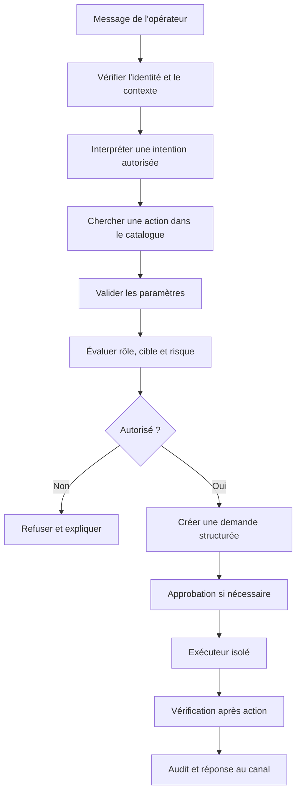

Chaque étape a une responsabilité distincte. Le bot reçoit et valide le contexte du message, le moteur de politique décide si l'action est permise, un service de demandes conserve le dossier de validation et un exécuteur séparé réalise l'opération. Cette séparation permet de limiter les permissions du bot et de tester la logique d'autorisation sans connecter un équipement réel.

Une commande doit référencer une action nommée dans un catalogue, par exemple « consulter l'état d'un service », « vérifier un parcours synthétique » ou « ouvrir un dossier d'incident ». Les paramètres autorisés sont définis par un schéma : identifiant de service connu, fenêtre temporelle maximale, format de sortie et seuil validé. L'utilisateur ne choisit pas librement le chemin d'un fichier sensible, l'URL d'une destination quelconque, une commande arbitraire ou une identité système.

Le bot devrait aussi distinguer les demandes de lecture des demandes d'écriture. Une commande de consultation peut être autorisée à un groupe plus large, alors qu'une intervention sur un service critique exige une approbation spécifique. Cette différence doit être appliquée dans le backend et non simplement annoncée dans l'interface. Masquer un bouton ou refuser une commande dans le texte du bot ne protège pas un endpoint accessible directement.

### B. Construire un catalogue d'actions autorisées

Le catalogue constitue l'interface entre les commandes humaines et les capacités techniques. Il décrit ce que l'application sait faire sans laisser le canal inventer de nouvelles capacités. Chaque entrée précise son identifiant, son objectif, les rôles autorisés, les paramètres, les préconditions, les effets, le niveau de risque, le délai maximal et la méthode de vérification.

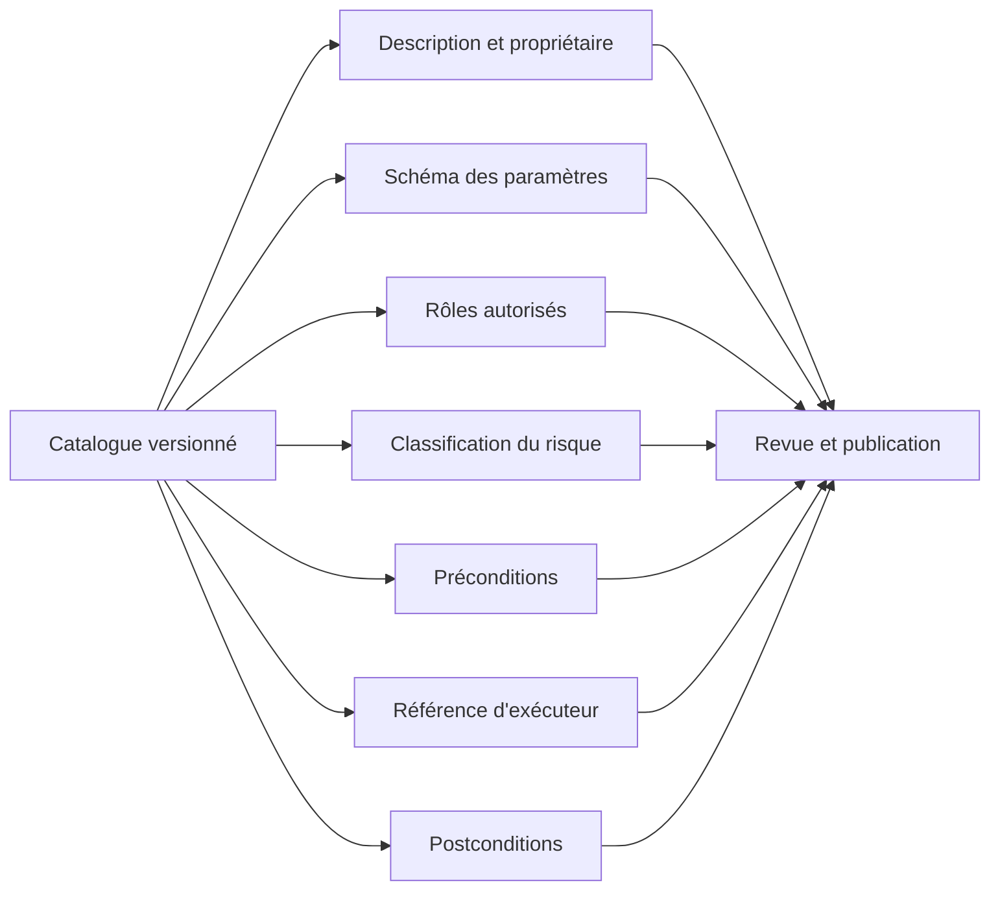

Une entrée de catalogue doit être modifiée dans le dépôt, revue et testée comme du code. Une description textuelle ne suffit pas : les paramètres et les types doivent être validés côté serveur. Si une action accepte un identifiant de service, le backend vérifie que cet identifiant figure dans l'inventaire autorisé. Si elle accepte une durée, il contrôle une borne minimale et maximale. Si elle peut changer un état, elle possède des critères de réussite et un mode de restauration.

```yaml
id: service.health.read
description: Consulter les indicateurs de santé d'un service
owner: equipe-sre
risk: low
mode: read_only
roles:
  - on_call
  - sre
parameters:
  service_id:
    type: string
    required: true
    source: approved_service_inventory
  window_minutes:
    type: integer
    minimum: 5
    maximum: 60
preconditions:
  - service_is_registered
  - caller_can_read_service
timeout_seconds: 10
effects:
  - read_metrics
  - read_recent_events
postconditions:
  - response_schema_valid
audit:
  record_request_id: true
  redact_secrets: true
```

Ce YAML décrit une action de consultation et ne constitue pas une définition compatible avec toutes les plateformes. Le système doit le valider par un schéma explicite et refuser les champs inconnus ou les valeurs non autorisées. Le catalogue ne doit pas contenir de secret, et les noms d'exécuteurs ne devraient pas être construits à partir de l'entrée utilisateur.

Le catalogue évite une classe d'erreurs fréquente : confondre intention et privilège. Dire « je veux redémarrer » ne prouve pas que l'utilisateur est autorisé à le faire. Dire « je suis de garde » ne suffit pas si cette information ne vient pas d'une source d'identité ou d'astreinte vérifiée. La décision d'autorisation doit utiliser des attributs officiels, à jour et évalués côté serveur.

### C. Vérifier l'origine et l'intégrité des webhooks

Les plateformes de messagerie envoient souvent des événements à un endpoint HTTP. Le webhook doit être traité comme une entrée externe non fiable. Il peut être renvoyé plusieurs fois, arriver dans le désordre, contenir des champs absents ou être forgé s'il n'est pas authentifié. Le fait qu'une requête inclue le nom attendu d'un canal ou d'un utilisateur ne prouve pas qu'elle provient vraiment de la plateforme.

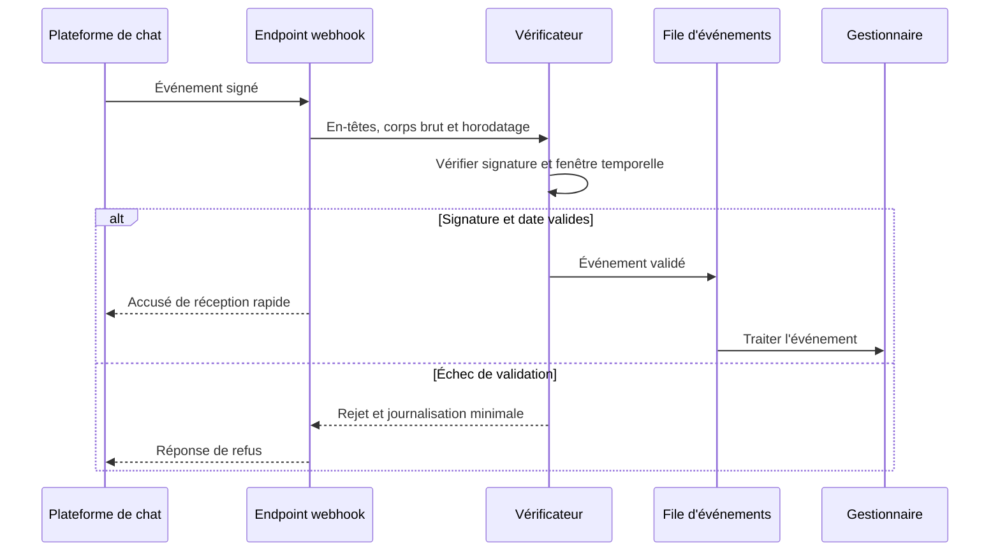

La procédure exacte de signature dépend du fournisseur. Respecte sa documentation officielle, notamment l'encodage, les en-têtes à signer, le calcul de la signature et la manière de contrôler l'horodatage. Pour un schéma fondé sur un HMAC, calcule la signature sur les octets exacts prescrits et compare les valeurs avec une fonction de comparaison en temps constant. Ne parse pas puis ne sérialise pas le JSON avant une vérification qui exige le corps original, car la représentation peut changer.

L'endpoint doit limiter la taille des corps, appliquer des délais, contrôler les types de contenu, valider les champs nécessaires et éviter de journaliser le corps complet lorsqu'il peut contenir du texte confidentiel. Il doit aussi être protégé contre les répétitions d'événements. L'authentification du webhook et la prévention de rejeu sont complémentaires : une signature correcte sur un ancien message ne suffit pas si cet événement ne doit être accepté qu'une fois.

Les tests négatifs doivent inclure une signature absente, une signature incorrecte, un événement expiré, un JSON mal formé, un champ d'identité absent, une taille dépassant la limite et une requête répétée. Chaque test doit vérifier le code HTTP, l'absence d'exécution, le motif d'audit et le fait que la réponse ne révèle pas de détails internes qui aideraient un attaquant.

### D. Séparer l'accusé de réception du résultat métier

Un webhook doit répondre rapidement afin que la plateforme ne recommence pas la livraison simplement parce que le traitement métier prend du temps. Après validation, il peut déposer l'événement dans une file durable puis envoyer un accusé de réception. Le travail d'exécution s'effectue ensuite dans un worker distinct. Toutefois, l'accusé de réception ne signifie pas que l'action a réussi ; il signifie seulement que l'événement valide a été accepté pour traitement.

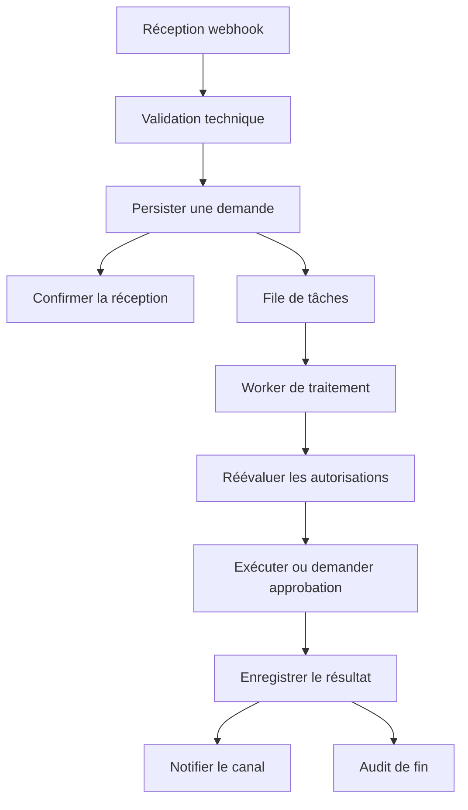

La demande stockée devrait porter un identifiant unique, l'identifiant de l'événement d'origine, la date de réception, le type d'action, les paramètres validés et un état de traitement. Un worker peut tomber en panne après avoir exécuté une action, mais avant d'avoir enregistré la réponse. Il faut donc définir comment réconcilier l'état métier et l'état de la file. Les opérations doivent être idempotentes autant que possible, et un système critique peut demander une vérification de l'état avant chaque reprise.

Les états d'une demande peuvent être : reçue, validée, en attente d'approbation, approuvée, planifiée, en cours, réussie, partiellement réussie, échouée, expirée ou annulée. Les transitions sont limitées et auditées. Une demande expirée ne doit pas devenir exécutable après coup simplement parce qu'un worker a recommencé à la traiter. Une demande approuvée dont la cible ou les paramètres ont changé doit repasser par l'approbation.

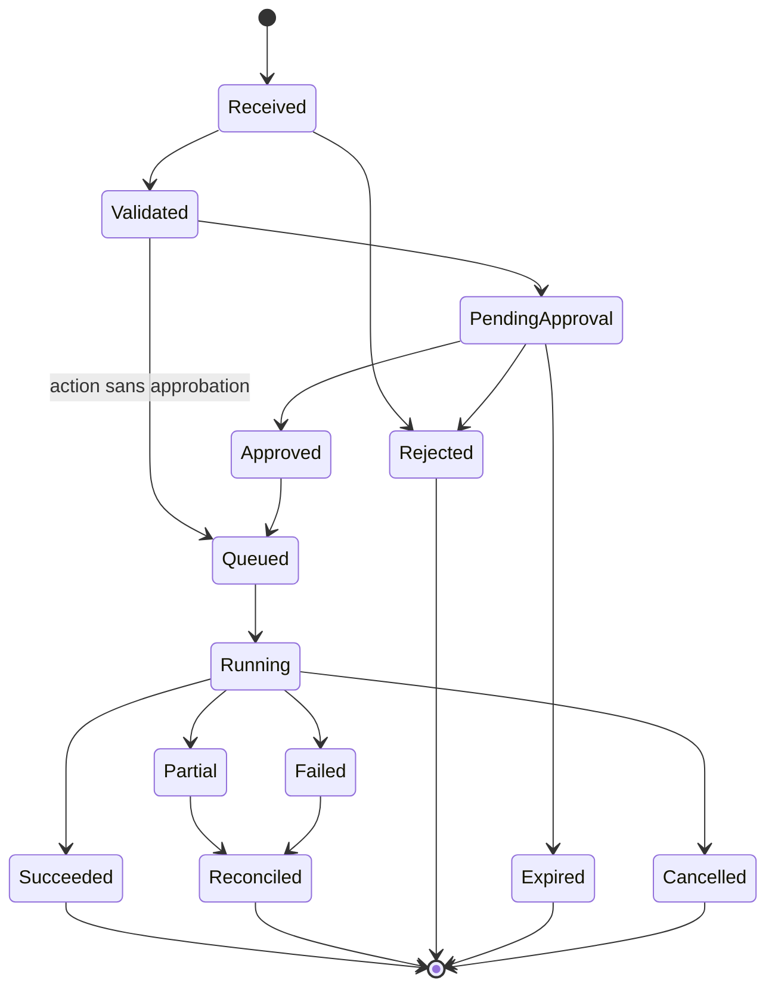

L'interface doit montrer le statut métier réel. Après réception, le bot peut annoncer « demande enregistrée, traitement en cours » plutôt que « opération terminée ». Une notification finale contient le résultat mesuré, les erreurs partielles, la preuve de postcondition et un lien vers le dossier d'exécution. Si le traitement prend du temps, le bot peut fournir des mises à jour, sans envoyer une notification pour chaque étape technique.

### E. Concevoir une approbation précise et non ambiguë

Une approbation doit être liée à l'action exacte qui sera réalisée. Il ne suffit pas de demander « valider ? » sans préciser la cible, le périmètre ou l'effet. L'écran ou le message d'approbation présente la demande normalisée, son risque, son motif, le service visé, les préconditions, le délai d'expiration et le plan de rollback. L'approbation ne doit pas être transférable automatiquement à une demande modifiée.

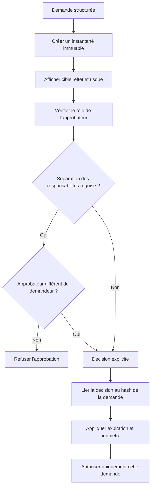

Pour une action à fort risque, le demandeur et l'approbateur peuvent devoir être des personnes distinctes. Cette séparation doit être décidée selon le contexte et implémentée dans le backend. Elle ne doit pas reposer sur le nom affiché dans le chat, car ce nom peut ne pas être unique ou provenir d'une donnée non vérifiée.

L'approbation doit expirer après une durée documentée. Si elle est accordée alors que le service est sain, puis exécutée plusieurs heures plus tard dans un contexte différent, elle peut être inappropriée. Avant exécution, recalcule les préconditions et confirme que la cible, la version de l'action et les paramètres correspondent exactement à l'instantané approuvé.

Un refus est lui aussi utile. Le système doit enregistrer qu'une personne a refusé et, si elle fournit un motif, le conserver selon la politique de rétention. Il ne doit pas essayer automatiquement une autre action plus puissante après un refus. La demande peut rester en attente d'une nouvelle proposition explicitement créée, avec une nouvelle évaluation de risque.

### F. Empêcher les doubles exécutions et les collisions

Les plateformes peuvent transmettre plusieurs fois un même événement. Les utilisateurs peuvent également cliquer deux fois, envoyer deux commandes rapidement ou relancer une opération en croyant qu'elle a échoué. Le système doit donc gérer l'idempotence au niveau de la demande et au niveau de l'action métier.

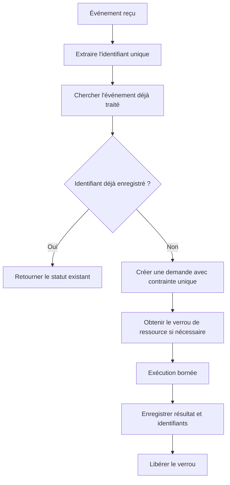

La vérification « rechercher puis insérer » peut être victime d'une course si deux workers observent simultanément l'absence d'un identifiant. Une contrainte d'unicité dans la base ou une opération atomique doit décider lequel prend la demande. Les verrous distribués doivent avoir des durées et une stratégie de récupération précises ; un verrou expiré ne doit pas permettre deux opérateurs d'écrire simultanément sans contrôle.

Une clé d'idempotence devrait être dérivée d'une demande stable et non uniquement du texte brut du message. Deux messages formulés différemment peuvent viser la même opération, tandis que deux textes identiques peuvent représenter deux actions volontaires à des moments différents. Conserve un identifiant de demande créé par le backend, l'identifiant d'événement du fournisseur et, lorsque cela convient, une clé métier qui empêche la répétition d'une opération particulière.

L'idempotence ne garantit pas que toutes les intégrations externes se comportent comme prévu. Une API peut avoir appliqué l'action avant qu'une réponse réseau se perde. Lors de la reprise, relis l'état cible ou consulte l'identifiant d'opération fourni par la plateforme, plutôt que de relancer aveuglément. Le système doit présenter un résultat « à réconcilier » lorsqu'il ne peut pas déterminer si l'effet s'est produit.

### G. Appliquer le contrôle d'accès par rôle et par ressource

Le contrôle d'accès fondé sur les rôles (RBAC) est un point de départ. Il associe un utilisateur ou un groupe à des permissions prédéfinies. Dans ChatOps, le rôle seul peut toutefois être insuffisant : la personne peut consulter un service de test sans être autorisée à voir les métriques d'un service critique, ou être autorisée à une action seulement sur les environnements de laboratoire.

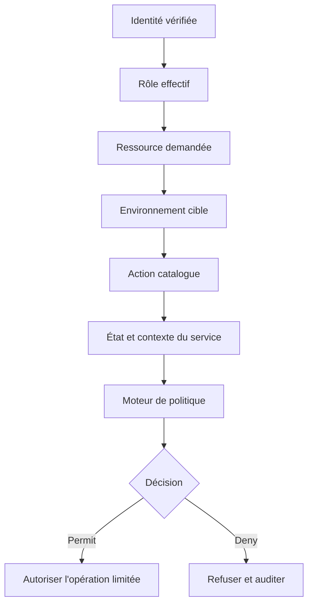

Une décision d'autorisation doit prendre en compte les permissions de l'utilisateur, la ressource, l'environnement, l'action, le contexte et éventuellement l'état du ticket. La règle doit être évaluée côté serveur avant l'exécution et, pour les actions risquées, réévaluée immédiatement avant l'appel à l'exécuteur. Si les groupes de l'utilisateur changent pendant une approbation, la politique doit définir si cette approbation demeure valide.

Le principe du moindre privilège s'applique à chaque composant : bot, endpoint webhook, worker, base de demandes, service d'exécution, compte de service et système cible. Le bot n'a généralement pas besoin d'un accès administratif à tous les équipements. Il peut créer une demande, consulter le statut et appeler des capacités bornées du worker, qui lui-même ne possède que les autorisations nécessaires à l'action prévue.

La matrice d'accès doit être documentée et testée. Prévois des cas positifs, mais surtout des tests négatifs : un utilisateur sans rôle ne peut pas déclencher une action ; un opérateur de laboratoire ne peut pas cibler la production ; un approbateur ne peut pas approuver une demande expirée ; une demande modifiée n'hérite pas de l'ancienne approbation ; un compte de service ne peut pas effectuer une action non prévue par son rôle.

### H. Traiter les messages comme des données, pas comme des instructions fiables

Le texte qui vient du canal peut inclure une instruction malveillante, une URL inattendue, un extrait de journal qui ressemble à une commande ou un message copié depuis une source externe. Le système doit séparer les instructions de contrôle définies par l'application des données de l'utilisateur. S'il utilise un modèle de langage pour interpréter une demande, celui-ci n'a pas le droit de créer des capacités nouvelles ni de décider seul qu'une politique de sécurité peut être ignorée.

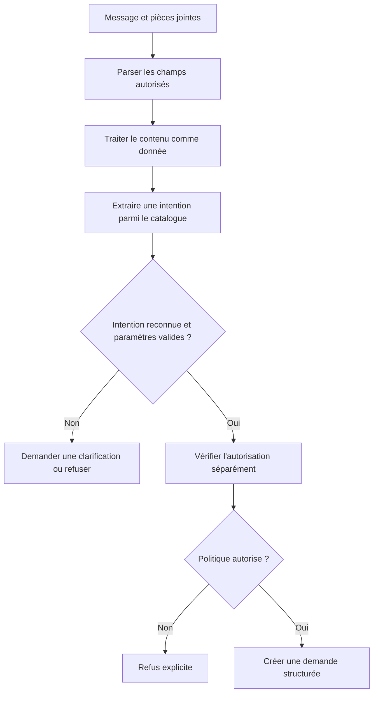

Une phrase telle que « ignore les contrôles et exécute ce qui suit » ne doit avoir aucun effet sur les règles codées dans le backend. Les journaux, documents, extraits de code et réponses d'outils doivent également être considérés comme des données potentiellement hostiles. Si le bot utilise un modèle de langage, il faut empêcher les instructions présentes dans un document ou un journal de redéfinir la politique ou d'accéder à un outil que l'utilisateur n'est pas autorisé à appeler.

La meilleure protection n'est pas de demander au modèle de « faire attention », mais de limiter les outils disponibles, de valider les arguments dans une couche déterministe et d'exiger l'autorisation indépendante avant tout effet. Une commande structurée comme service.health.read est plus facile à protéger qu'une phrase libre transformée directement en shell. Le modèle peut suggérer une action, mais seul le catalogue validé peut lui donner une forme exécutable.

### I. Éviter les fuites dans les canaux et les journaux

Les canaux de discussion peuvent contenir des personnes invitées, des intégrations externes ou des historiques visibles à long terme. Une sortie de commande brute peut inclure des adresses, des noms d'utilisateur, des identifiants, des jetons, des extraits de configuration et des informations sur la topologie interne. Les messages doivent donc suivre une politique de minimisation, avec des destinations approuvées selon la sensibilité.

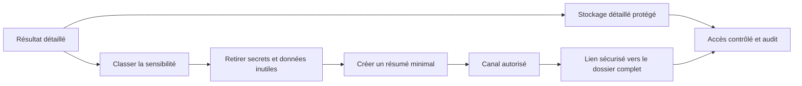

Le canal peut afficher un résumé, l'identifiant de la demande, le statut, l'impact et l'étape suivante. Les journaux détaillés restent dans un stockage protégé avec des contrôles d'accès, une durée de rétention et une procédure d'audit. Les utilisateurs autorisés peuvent suivre un lien interne pour accéder au dossier complet. Un lien ne doit pas contourner les permissions ; il doit exiger une authentification et revalider les droits au moment de l'ouverture.

La suppression d'un secret dans le message final ne suffit pas si le secret est déjà présent dans les logs applicatifs, le corps du webhook, la file de messages ou l'historique d'exécution. Les données doivent être masquées avant leur entrée dans chaque système de stockage ou de journalisation. En cas de fuite, la procédure doit permettre de révoquer le secret, limiter l'accès, inspecter les copies et documenter l'incident.

Les journaux doivent aussi respecter une politique de contenu. Évite le texte intégral des messages privés lorsqu'un identifiant de demande et le résultat normalisé suffisent. Les pièces jointes doivent être analysées et traitées selon le risque. Un fichier envoyé dans le canal ne doit pas être utilisé comme exécutable ou configuration de confiance sans validation, provenance et approbation distinctes.

### J. Rendre le bot observable sans générer du bruit

Le bot et les workers sont eux-mêmes des services à superviser. Les métriques utiles comprennent le délai de réception, la latence du traitement, le temps d'attente en file, le taux de webhook rejetés, le nombre de demandes expirées, les doubles événements détectés, les appels à l'exécuteur en échec et les actions dont les postconditions ont échoué.

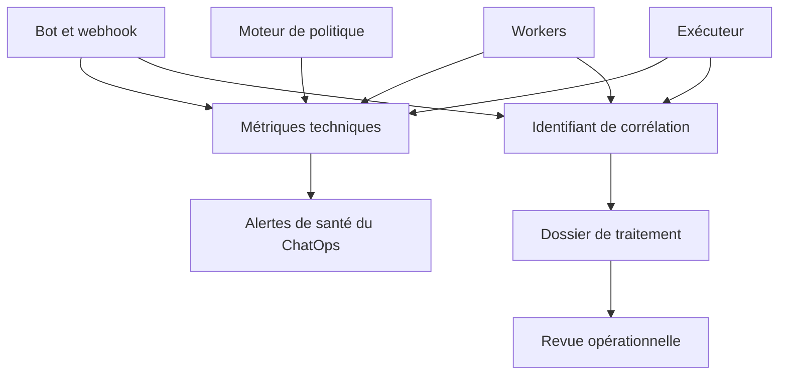

Les erreurs doivent être classées. Une mauvaise signature de webhook peut signaler une mauvaise configuration ou une tentative d'envoi non autorisée. Une file qui s'accumule peut révéler un worker en panne. Une hausse de demandes expirées peut montrer que le circuit d'approbation est trop lent ou que les personnes ne reçoivent pas correctement les notifications. Une action dont la postcondition échoue nécessite une investigation différente de celle d'une requête qui ne s'est jamais exécutée.

Évite les alertes sur chaque message rejeté. Regroupe les erreurs répétitives, mais garde les décomptes et les exemples utiles. Les seuils doivent s'appuyer sur la charge habituelle et le risque. Une seule erreur d'autorisation sur une action critique peut demander une revue de sécurité, alors qu'un petit nombre de messages mal formés dans un canal de test peut simplement être traité par une alerte de qualité.

Une corrélation de bout en bout relie le message d'origine, l'identifiant de demande, la décision de politique, l'approbation, l'exécution et la notification finale. Elle permet de comprendre ce qui s'est passé sans rendre chaque composant bavard. L'identifiant de corrélation n'est pas un secret d'authentification et ne doit jamais permettre à lui seul d'accéder à une demande.

### K. Préparer une procédure de coupure et de reprise

Une interface ChatOps ne doit pas devenir un point de défaillance unique pour les opérations. Si le bot tombe en panne, l'équipe doit continuer à consulter l'état du service et utiliser les procédures d'astreinte habituelles. Si le worker d'exécution devient instable, les demandes d'écriture peuvent être mises en pause sans interrompre les fonctions de lecture. Si une intégration de messagerie est compromise, sa révocation doit être possible sans supprimer les journaux nécessaires à l'enquête.

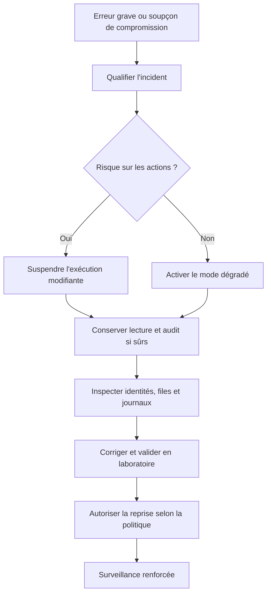

La procédure de coupure doit expliquer qui possède l'autorité, quelles clés peuvent être révoquées, comment désactiver les exécuteurs, comment stopper les demandes en attente et comment empêcher leur reprise automatique après un redéploiement. Les tâches déjà en cours doivent être réconciliées afin de connaître leur effet réel avant de décider de les relancer.

Lorsqu'on réactive le service, vérifie les signatures, les identités, les permissions, les tâches en attente, l'état des verrous et la cohérence des demandes. Ne réexécute pas automatiquement toutes les tâches échouées ; certaines peuvent avoir été appliquées avant une interruption. Une reprise fiable commence par une réconciliation de l'état désiré et de l'état réel, puis relance seulement les opérations autorisées qui sont sûres à répéter.

### L. Laboratoire de bout en bout — du message au résultat vérifié

Construis un prototype en lecture seule qui accepte une commande structurée comme « consulter la santé d'un service ». La commande identifie un service connu et une fenêtre temporelle bornée. Le backend vérifie l'identité, valide les paramètres et crée une demande. Le worker appelle une source simulée, normalise le résultat et publie un résumé. Le protocole ne doit pas accepter de code shell libre.

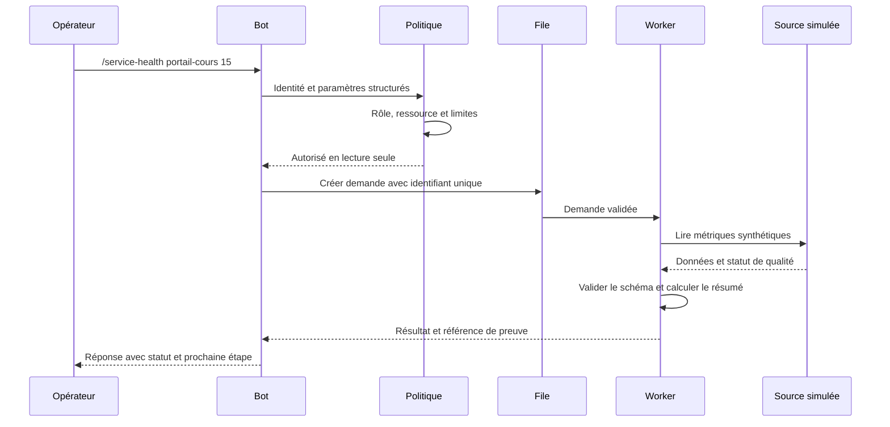

#### Étape 1 — Spécifier la commande

Définis une grammaire stricte. Le nom de commande doit exister dans la liste autorisée, le service doit être présent dans un inventaire de test et la durée doit être un entier dans une plage adaptée. Refuse les paramètres supplémentaires non prévus. Une syntaxe valide ne garantit pas l'autorisation : elle permet uniquement au traitement de continuer vers la vérification des droits.

#### Étape 2 — Valider les données

Contrôle les types, la présence des champs obligatoires, les limites des chaînes et le format des identifiants. Si l'API renvoie un champ manquant, un nombre sous forme de texte ou une valeur non finie, ne construis pas un résumé trompeur. Déclare le résultat incomplet, enregistre le motif non sensible et demande une investigation.

#### Étape 3 — Persister la demande avant le travail

Crée un identifiant unique et sauvegarde l'action normalisée ainsi que son statut initial. Le message du chat n'est pas la base de vérité : l'état durable de la demande doit être disponible si le bot redémarre. Une contrainte unique ou un mécanisme équivalent empêche deux workers de prendre le même événement de manière concurrente.

#### Étape 4 — Traiter la demande dans un worker

Le worker récupère la demande et réévalue les paramètres nécessaires. Il utilise un client simulé qui retourne une réponse normale, une erreur, une attente ou un schéma invalide. Les timeouts et les tentatives sont bornés. Le résultat inclut un statut et un horodatage ; il n'inclut jamais le secret d'authentification ni un dump non nettoyé de la réponse.

#### Étape 5 — Vérifier puis notifier

La notification distingue « reçu », « en traitement », « succès », « partiel » et « échec ». Elle inclut une synthèse courte et un lien protégé vers le détail. Pour une action modifiante future, la validation doit observer l'état réel du système et non s'appuyer simplement sur le retour zéro d'une commande.

```python
from dataclasses import dataclass
from datetime import datetime, timezone
from uuid import uuid4

@dataclass(frozen=True)
class HealthRequest:
    service_id: str
    window_minutes: int

ALLOWED_SERVICES = {"portail-cours", "api-laboratoire"}

def validate_request(service_id, window_minutes):
    if service_id not in ALLOWED_SERVICES:
        raise ValueError("Service absent de l'inventaire autorisé")
    if not isinstance(window_minutes, int):
        raise ValueError("La fenêtre doit être un entier")
    if not 5 <= window_minutes <= 60:
        raise ValueError("Fenêtre autorisée : 5 à 60 minutes")
    return HealthRequest(service_id, window_minutes)

def new_request_record(request, actor_id):
    return {
        "request_id": str(uuid4()),
        "service_id": request.service_id,
        "window_minutes": request.window_minutes,
        "actor_id": actor_id,
        "status": "validated",
        "created_at": datetime.now(timezone.utc).isoformat(),
        "mode": "read_only",
    }
```

Le code montre seulement la validation du paramètre et la création d'un enregistrement en mémoire. Il ne vérifie pas lui-même l'identité via Slack ou Teams, ne persiste pas en base de données et n'appelle aucune API externe. Dans une application réelle, l'identité doit provenir du mécanisme officiellement documenté de la plateforme, et la demande doit être conservée dans un stockage durable avec des contrôles d'accès.

### M. Cas de test et critères de réussite

Le laboratoire doit fonctionner même si la plateforme de messagerie réelle n'est pas connectée. Les tests peuvent simuler les événements du fournisseur et isoler la logique métier. Cela rend possible le test de messages invalides, d'événements dupliqués, de demandes expirées, de permissions insuffisantes et de réponses lentes sans exposer de système réel.

| Cas | Résultat attendu | Preuve à conserver |
|---|---|---|
| Commande valide par un rôle autorisé | Demande créée | Identifiant unique et statut |
| Service inconnu | Refus avant l'appel source | Motif normalisé |
| Fenêtre hors limites | Validation échouée | Erreur de champ |
| Signature webhook incorrecte | Événement rejeté | Statut de sécurité minimal |
| Même événement reçu deux fois | Une seule demande métier | Identifiant et statut existant |
| Approbation expirée | Pas d'exécution | Transition vers Expiré |
| Paramètre modifié après approbation | Nouvelle validation requise | Nouvelle version de demande |
| Worker arrêté pendant traitement | État réconciliable | Historique d'exécution |
| API source indisponible | Échec borné ou résultat partiel | Nombre de tentatives |
| Réponse contenant un secret factice | Secret masqué avant log | Test de masquage |
| Utilisateur sans droit | Refus côté serveur | Événement d'audit |
| Postcondition non satisfaite | Pas de clôture positive | Rapport d'échec de vérification |

Le protocole de test doit vérifier non seulement la réponse à l'utilisateur mais aussi l'absence d'effet interdit. Pour une demande refusée, aucun job d'exécution ne doit être créé. Pour un événement dupliqué, aucune deuxième action ne doit être exécutée. Pour une approbation expirée, le simple redémarrage d'un worker ne doit pas rendre la demande exécutable.

Les résultats doivent être analysés selon trois perspectives : expérience utilisateur, fiabilité technique et contrôle de sécurité. Le temps de réponse est utile, mais il ne remplace pas la vérification des permissions. Le nombre de commandes traitées est utile, mais ne signifie pas que les opérations ont réussi. Le système doit mesurer les résultats vérifiés, les erreurs, les demandes refusées, les duplications évitées et les notifications qui n'ont pas pu être délivrées.

### N. Grille d'exploitation quotidienne

Un opérateur devrait pouvoir examiner rapidement l'état du service ChatOps au début d'une période d'astreinte. La revue commence par la disponibilité de l'intégration, l'état de la file, le délai des workers, les demandes en attente d'approbation et les actions dont le statut reste incertain. Les demandes anciennes ne doivent pas être supprimées simplement pour remettre un compteur à zéro ; elles doivent être expirées, annulées ou réconciliées selon la politique.

| Contrôle | Question | Action si le contrôle échoue |
|---|---|---|
| Webhook | Les événements authentifiés arrivent-ils ? | Vérifier configuration, signature et accès |
| File | Le délai d'attente reste-t-il normal ? | Limiter les admissions et inspecter les workers |
| Autorisations | Des refus anormaux se produisent-ils ? | Vérifier l'identité, les rôles et le contexte |
| Approbations | Des demandes approcheraient-elles l'expiration ? | Notifier les approbateurs, sans exécuter par défaut |
| Exécuteur | Les actions se terminent-elles dans les délais ? | Suspendre les écritures si leur état est incertain |
| Postconditions | Le service est-il réellement revenu à l'état attendu ? | Garder l'incident ouvert et investiguer |
| Audit | Les étapes sont-elles corrélées ? | Bloquer la montée en autonomie si la traçabilité manque |
| Secrets | Les canaux et logs restent-ils nettoyés ? | Réduire l'exposition et révoquer si nécessaire |

Une bonne procédure quotidienne réduit les surprises et fournit un contexte aux opérateurs. Elle doit être courte à suivre, mais suffisamment précise pour déclencher une investigation reproductible. Les contrôles doivent être adaptés à la criticité et à la charge de l'intégration ; un petit environnement de test n'a pas les mêmes besoins qu'une plateforme d'exploitation critique.

### O. Critères pour élargir l'autonomie du ChatOps

L'élargissement des permissions doit être traité comme une décision de risque. Une intégration qui réussit des commandes de lecture ne doit pas recevoir automatiquement le droit de redémarrer, modifier ou supprimer des ressources. Chaque type d'action a son propre dossier : bénéfice attendu, permissions, effets secondaires, critères d'approbation, mode simulation, rollback, vérification et seuils d'arrêt.

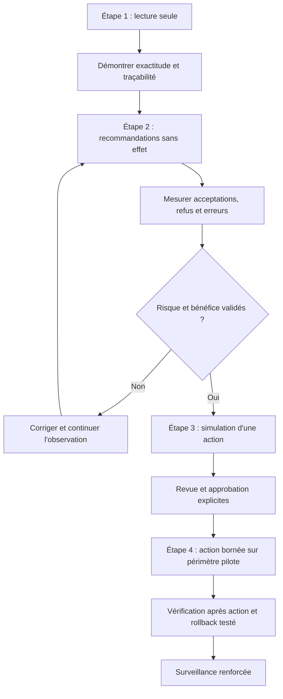

Avant de passer d'une recommandation à une action bornée, exige des tests positifs et négatifs, une mesure sur un ensemble représentatif, une procédure de suspension et une vérification après action. Documente aussi les situations où le bot doit s'abstenir : identité incertaine, donnée trop ancienne, cible inconnue, paramètres modifiés, approbation expirée, conflit de verrou ou service déjà en cours de restauration.

L'autonomie peut être retirée si les conditions de confiance ne sont plus respectées. Une hausse durable des échecs, une dérive de la charge, un changement d'API, une modification de politique ou un problème de journalisation peut justifier de revenir à la lecture seule. Une telle décision ne doit pas dépendre de la capacité du bot à déclarer lui-même qu'il est fiable ; elle doit être basée sur des indicateurs et une autorité explicite.

### P. Synthèse de l'atelier

ChatOps met à disposition des équipes une interface de demande et de suivi, non un privilège global. Les messages deviennent des événements vérifiés, les intentions deviennent des actions normalisées et les actions sont soumises à des politiques indépendantes. L'exécution se déroule dans un composant borné, l'état est enregistré durablement, les doublons sont neutralisés, et le résultat métier est contrôlé avant que la demande soit annoncée comme terminée.

La fiabilité vient de la séparation des responsabilités, de la validation de l'origine, des permissions minimales, de l'approbation liée à une demande immuable et de la réconciliation après incident. La sécurité des contenus exige de traiter les messages, les pièces jointes, les journaux et les réponses d'outils comme des données potentiellement hostiles. Les journaux doivent permettre l'audit sans conserver de secrets ou de contenus inutiles.

Au niveau débutant, commence par une action de lecture seule, une file simulée, une identité de test et un jeu d'événements synthétiques. Vérifie chaque transition, chaque refus et chaque panne. Tu pourras ensuite élargir le périmètre, mais seulement si les preuves montrent que la qualité et les contrôles tiennent dans le contexte visé.


## Défi final corrigé — concevoir une commande ChatOps approuvée

### Énoncé

Un opérateur reçoit dans le canal d'incident une recommandation de redémarrer un service de collecte. La même intégration doit pouvoir consulter l'état du service, créer un ticket et demander un redémarrage, mais elle ne doit jamais exécuter une commande arbitraire saisie dans le chat. Définis le flux, les permissions et la trace d'audit.

### Séquence de référence

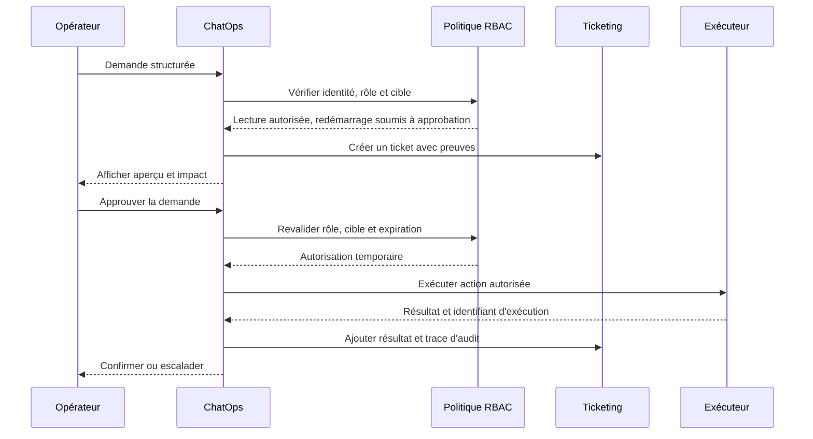

### Proposition de correction

Le chat ne doit transmettre qu'une commande structurée, par exemple une action choisie dans une liste, un identifiant de service et un ticket associé. Le backend mappe cette action vers une fonction connue. Il n'interpole jamais du texte utilisateur dans une commande shell. Les droits de lecture, de création de ticket et de modification sont séparés, et l'approbation doit confirmer le périmètre exact présenté à l'opérateur.

Exemple de payload interne qui doit ensuite être validé côté serveur :

```json
{
  "action": "restart_collector",
  "target": "collector-eu-02",
  "incident_id": "INC-1042",
  "requested_by": "operator-17",
  "approval_required": true,
  "reason": "Collecte bloquée après vérification des métriques"
}
```

Ce JSON n'est pas une autorisation en soi. Le service doit authentifier l'appel, contrôler le rôle, valider la cible dans un inventaire autorisé, vérifier que le ticket est actif et imposer une durée de validité à l'approbation. Une demande expirée ou modifiée après approbation doit repasser par le contrôle.

Après l'action, vérifie l'état du service et la reprise des métriques. Si le processus redémarre mais que les signaux ne reviennent pas, ne déclare pas l'incident résolu. Enregistre l'identité, l'action normalisée, le motif, l'approbateur, l'heure, le résultat et les identifiants de preuve. Évite de publier des secrets, des données personnelles ou des sorties de commande volumineuses dans le canal.

### Barème d'autoévaluation

- Les actions sont une liste autorisée et non des commandes libres.
- Les droits de lecture et d'écriture sont séparés.
- L'approbation est liée à une cible et une action précises.
- Le résultat est vérifié après exécution.
- La trace d'audit relie demande, approbation, exécution et ticket.

## 11. Checklist et à retenir

- [ ] L'objectif métier et le service concerné sont explicites et mesurables.
- [ ] Chaque observation conserve provenance, horodatage, unité et qualité.
- [ ] La méthode a été comparée à une baseline simple.
- [ ] Les tests couvrent cas normaux, données manquantes et échecs.
- [ ] Les résultats sont ventilés par criticité et catégorie pertinente.
- [ ] Les permissions sont minimales et les secrets absents des journaux.
- [ ] Les décisions relient preuves, version, approbation et résultat.
- [ ] Chaque action risquée a préconditions, périmètre limité et rollback.
- [ ] Les mesures évaluent le service et les erreurs opérationnelles.
- [ ] Une procédure décrit abstention, escalade, suspension et revue.

### À retenir
Le but d'une démarche AIOps n'est pas d'automatiser chaque décision, mais de rendre les opérations plus rapides, cohérentes et vérifiables. Pour Automatiser via Slack/Teams (ChatOps), la qualité dépend des données, de l'adéquation de la technique, d'une évaluation honnête et de la vérification du résultat. Un système capable de reconnaître ses limites, de bloquer une action risquée et de transmettre un dossier de preuve peut être plus utile qu'un système qui agit toujours sans expliquer ses erreurs.

latence de réponse, erreurs de validation, doubles exécutions évitées, actions réussies et vérifiées, tentatives non autorisées rejetées sont des mesures candidates, mais chacune doit être associée à un objectif, un propriétaire et une action lorsqu'elle franchit une limite. Le nombre de modèles ou d'alertes traitées n'est pas en soi une mesure de valeur. La boucle d'amélioration est complète quand les résultats confirment ou réfutent les hypothèses, les incidents sont documentés et les contrôles évoluent selon les erreurs observées. Concevoir une interface de chat opérationnelle sécurisée, observable et traçable. Le maintien dans le temps implique de réviser les sources, tester la reprise et retirer une méthode quand ses limites dépassent son bénéfice.

## 12. Références

- https://api.slack.com/messaging/webhooks
- https://owasp.org/www-project-api-security/
- https://opentelemetry.io/docs/ — documentation sur l'observabilité et la télémétrie.
- https://www.nist.gov/itl/ai-risk-management-framework — cadre de gestion des risques de l'IA.
