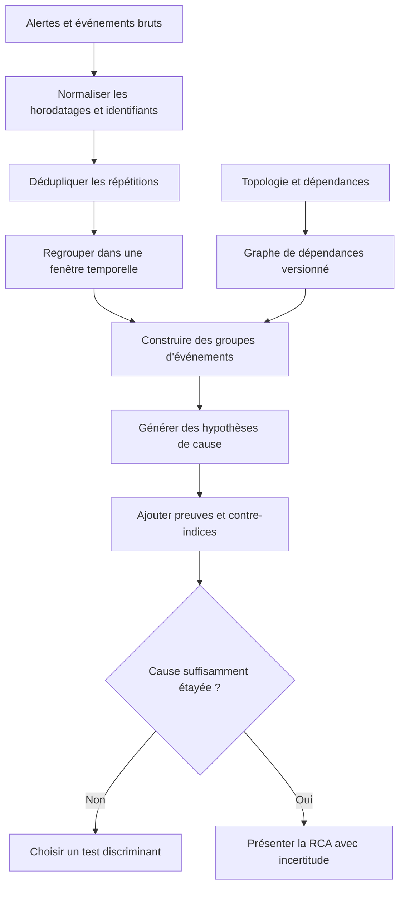
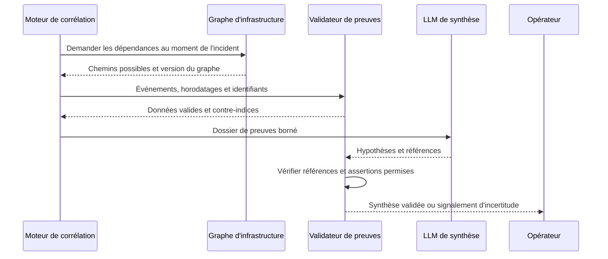

# Corrélation d'événements et RCA automatisée — Expert

> **Mise en contexte :** pendant une panne multisite, le centre de supervision reçoit des centaines d'alertes issues des routeurs, des commutateurs, des sondes applicatives et des outils cloud. Plusieurs alertes décrivent le même symptôme, d'autres signalent des conséquences en cascade, et quelques événements peuvent être sans rapport. Le défi est de regrouper les événements, reconstruire une chronologie, identifier les causes candidates et proposer des tests vérifiables sans confondre corrélation et causalité. Les exemples sont destinés à un environnement de test et ne doivent pas être utilisés comme un moteur de changement automatique sans validation.

## Sommaire

1. Objectifs et concepts
2. Corrélation, causalité et cause racine
3. Qualité des événements et schéma canonique
4. Horodatage, déduplication et fenêtrage
5. Corrélation temporelle et topologique
6. Représenter les dépendances sous forme de graphe
7. Scoring des causes candidates
8. Raisonnement causal et hypothèses concurrentes
9. Architecture d'une RCA automatisée
10. Implémentation Python pédagogique
11. TP : analyser une panne multisite
12. Évaluer les résultats et les erreurs
13. Exploitation, sécurité et gouvernance
14. Diagnostic et dépannage
15. Exercices corrigés
16. Défi final, checklist et références

## 1. Objectifs et concepts

La corrélation d'événements consiste à relier des observations qui semblent partager une origine, un contexte ou une chronologie. Elle sert à réduire le bruit, à former des incidents cohérents et à déterminer les informations les plus utiles à l'investigation. L'analyse de cause racine, souvent désignée par RCA, va plus loin : elle cherche à expliquer pourquoi la dégradation s'est produite et quelles preuves soutiennent l'explication. Une RCA automatisée fiable doit présenter un raisonnement traçable, des alternatives et des limites.

À la fin du cours, vous devez être capable de construire un modèle canonique d'événement, de traiter des événements dupliqués ou tardifs, de créer un graphe de dépendances, d'agréger des signaux temporels et topologiques, de classer plusieurs causes candidates et de mesurer la qualité des résultats. Vous devez surtout distinguer une hypothèse probable d'une cause confirmée. Le système peut accélérer le triage, mais il ne doit pas inventer une certitude lorsque les données sont insuffisantes.

Les usages comprennent le regroupement d'alarmes réseau, la corrélation entre changements de configuration et pertes de connectivité, l'identification de dépendances affectées, l'analyse de pannes DNS ou applicatives, la recherche d'une cause commune à plusieurs sites et l'aide au diagnostic d'incidents cloud. La méthode dépend des données disponibles : un centre de supervision qui ne possède aucun historique de topologie ne peut pas se comporter comme un système qui connaît les relations de dépendance métier en temps réel.

### Vocabulaire

- **Événement** : observation datée décrivant une transition, une anomalie ou un état.
- **Alarme** : événement ayant satisfait une règle de déclenchement ou une condition de notification.
- **Incident** : interruption ou dégradation opérationnelle nécessitant une prise en charge.
- **Corrélation** : relation statistique, temporelle, contextuelle ou topologique entre événements.
- **Cause racine** : facteur à l'origine du mécanisme de défaillance, à distinguer de ses symptômes.
- **Hypothèse candidate** : explication plausible qui reste à vérifier.
- **Dépendance** : relation selon laquelle la disponibilité ou le comportement d'un composant affecte un autre.
- **RCA** : processus de collecte de preuves, de recherche d'hypothèses, de tests et de documentation du mécanisme causal.

## 2. Corrélation, causalité et cause racine

Deux événements qui apparaissent ensemble ne sont pas nécessairement liés par une relation de cause à effet. Le trafic et la température peuvent augmenter simultanément parce que l'activité quotidienne du site a changé. Une hausse d'erreurs peut précéder un incident sans en être la cause. Une alerte sur un serveur peut survenir après une coupure réseau et simplement en être la conséquence. La chronologie fournit des indices, mais elle ne suffit pas seule à prouver la causalité.

### 2.1 Trois niveaux d'affirmation

Il est utile de distinguer :
1. **Observation :** les alertes de trois agences ont commencé dans une fenêtre de deux minutes.
2. **Hypothèse de corrélation :** ces alertes peuvent partager une dépendance commune.
3. **Cause confirmée :** un test discriminant, des preuves de changement et une restauration contrôlée démontrent que la défaillance de cette dépendance explique les symptômes observés.

L'interface doit conserver ces niveaux. Une réponse qui affiche « cause racine : routeur cœur » sans mention de confiance ni de preuve pousse les opérateurs à arrêter l'investigation. Préférez « cause candidate prioritaire : routeur cœur ; preuves : erreurs de voisinage précèdent trois symptômes ; preuve manquante : test indépendant depuis le site D ».

### 2.2 Un exemple de cause commune

Trois applications semblent indépendamment en panne. Un regroupement par application produit trois incidents séparés. En ajoutant la topologie, on découvre que les trois chemins passent par le même lien d'agrégation. Le lien devient une cause candidate commune. Cela ne prouve pas encore que le lien est défaillant : une panne d'alimentation peut toucher plusieurs équipements, un service DNS partagé peut expliquer les symptômes applicatifs, ou une maintenance peut avoir provoqué un comportement attendu. Le graphe améliore le raisonnement mais ne remplace pas les tests.

### 2.3 Symptôme, facteur contributif et cause racine

Un incident peut avoir plusieurs niveaux. Un délai élevé est un symptôme, une file saturée est un mécanisme immédiat et un changement de capacité peut être un facteur contributif. Une cause racine n'est pas toujours unique ; l'incident peut résulter de plusieurs facteurs qui se combinent. Chercher une seule cause coûte que coûte conduit à simplifier abusivement des incidents complexes.

Les rapports doivent préciser le niveau d'explication. « Le lien a perdu sa connectivité » décrit l'effet immédiat. « Le défaut du module optique a provoqué une hausse des erreurs et des pertes » est plus explicatif si l'inspection et les compteurs le confirment. « Le processus de maintenance a permis un déploiement de matériel non qualifié » peut être une cause organisationnelle plus profonde, qui demande une enquête différente.

## 3. Qualité des événements et schéma canonique

Les sources produisent des événements de formes différentes : syslog, traps SNMP, métriques, changements de configuration, traces applicatives, tickets et notifications de cloud. Avant de corréler, il faut normaliser les champs utiles et conserver les détails originaux. La normalisation doit rendre les formats comparables sans inventer d'information qui n'existait pas dans la source.

### 3.1 Schéma d'événement canonique

Un événement canonique peut contenir :
- un identifiant unique ou stable ;
- l'heure de l'événement et l'heure de réception ;
- l'actif, l'interface ou le service concernés ;
- une catégorie et une sévérité ;
- une mesure et son unité éventuelle ;
- le système source et la version du parseur ;
- un identifiant de changement ou d'incident si disponible ;
- l'état de qualité et de complétude des données ;
- la référence vers la charge utile originale conservée selon la politique de rétention.

Le schéma doit accepter les informations absentes. Une absence d'identifiant d'interface ne doit pas provoquer la création d'un champ fictif qui serait ensuite interprété comme une vraie interface. Les inconnues doivent être encodées explicitement et rester visibles pendant la corrélation.

### 3.2 Sévérité et taxonomie

Les systèmes ont souvent des échelles différentes. Un événement « critical » d'un outil peut correspondre à un « major » d'un autre. La taxonomie commune doit être documentée et peut conserver à la fois la sévérité source et la sévérité normalisée. Elle doit également distinguer les classes d'événements : disponibilité, performance, sécurité, changement, capacité, collecte ou diagnostic.

Une taxonomie trop générale réduit l'utilité des regroupements ; une taxonomie trop détaillée crée un catalogue difficile à entretenir. Commencez avec des catégories qui soutiennent des décisions concrètes et faites évoluer le schéma à partir des investigations réelles.

### 3.3 Conserver provenance et qualité

Chaque transformation doit garder la provenance. Si un parseur extrait la cible à partir d'un texte mal formé, la qualité est inférieure à celle d'un identifiant structuré fourni par l'API. Cette différence peut influencer le poids d'une preuve. Une donnée provenant d'un collecteur en panne ou d'un système dont l'horloge est décalée doit être signalée.

La normalisation n'est pas une occasion de supprimer les événements « bizarres ». Un événement inattendu peut révéler un changement de version, un défaut de parsing ou une nouvelle forme de panne. Le pipeline doit mettre les événements illisibles en quarantaine observable, avec compteurs et alertes sur la qualité de la collecte.

## 4. Horodatage, déduplication et fenêtrage

Les événements sont rarement livrés dans l'ordre exact de leur survenue. Les systèmes peuvent avoir des horloges décalées, des files d'attente, des pannes de collecte ou des reprises après interruption. La corrélation doit distinguer l'heure à laquelle le fait s'est produit de celle où le système l'a reçu.

### 4.1 Événement en retard

Si un événement possède une heure de source, une heure de réception et une identité de collecteur, il est possible d'estimer son retard et de détecter des anomalies d'horloge. Lorsque l'heure source est absente ou peu fiable, gardez le degré d'incertitude. Une séquence calculée à partir d'horodatages incorrects peut placer la conséquence avant la cause et orienter tout le diagnostic dans une mauvaise direction.

Les fenêtres de corrélation doivent être choisies selon la dynamique de l'incident. Une perte de connectivité peut produire ses symptômes en quelques secondes, tandis qu'une saturation progressive s'étale sur des heures. Une fenêtre unique pour tous les événements est rarement optimale. Les fenêtres peuvent être spécifiques à une classe et être ajustées par une validation sur les incidents historiques.

### 4.2 Déduplication

Une même panne peut générer des centaines d'alarmes identiques. La déduplication peut utiliser l'actif, le code, l'interface, la condition, une fenêtre et l'identifiant source. Mais elle doit éviter de fusionner deux pannes distinctes qui se répètent après un rétablissement. Il faut donc définir le moment où une alarme s'ouvre, se met à jour et se ferme, ainsi que la durée de silence nécessaire pour considérer un nouvel épisode.

Une empreinte trop simple basée uniquement sur le texte peut fusionner des équipements différents. Une empreinte trop stricte ne reconnaît pas les messages qui diffèrent légèrement. Conservez le compteur de répétition et les premières et dernières occurrences : cette information aide à distinguer un événement ponctuel d'une condition persistante.

### 4.3 Fenêtres, fenêtres glissantes et événements de changement

Une fenêtre fixe regroupe les événements sur des intervalles définis. Une fenêtre glissante recalcule continuellement les relations dans un horizon récent. Les fenêtres événementielles peuvent s'ouvrir lors d'un déclencheur et rester actives jusqu'à un rétablissement confirmé. Le choix dépend de la volumétrie, de la latence admissible et de la capacité du système à traiter les événements tardifs.

Les changements de configuration sont souvent des pivots utiles, mais « changement juste avant panne » n'établit pas automatiquement la causalité. Il faut vérifier la cible, le contenu réel du changement, l'heure d'application, les systèmes affectés et les hypothèses alternatives. Un changement sans rapport peut coïncider avec la panne par hasard, surtout dans une infrastructure qui évolue souvent.

## 5. Corrélation temporelle et topologique

La corrélation temporelle recherche des événements proches dans le temps. La corrélation topologique exploite les relations entre composants. La corrélation contextuelle intègre des attributs partagés : site, version, fournisseur, domaine de routage, service métier ou fenêtre de maintenance. Les meilleures investigations combinent ces dimensions au lieu de s'appuyer sur une seule.

### 5.1 Relations temporelles

Une relation temporelle peut indiquer qu'un événement A précède systématiquement un événement B, ou que plusieurs symptômes apparaissent après un même changement. Les mesures peuvent inclure le délai, la répétition de la séquence et la proportion d'incidents comparables. Il faut définir si le système attend une simultanéité ou un ordre temporel. Une corrélation qui ignore l'ordre peut relier un symptôme à un événement postérieur.

La temporalité est sensible aux événements manquants. Si le signal qui décrit le vrai début de panne n'a pas été collecté, l'algorithme peut attribuer la priorité à un événement secondaire. La chronologie doit montrer les lacunes et permettre à l'opérateur de comparer l'heure source à l'heure de réception.

### 5.2 Relations de topologie

La topologie représente des équipements, liens, interfaces, routes, services, dépendances DNS, applications, alimentations et sites. Un graphe permet de rechercher les ancêtres ou les dépendances partagées par les composants en panne. Les relations doivent être datées et qualifiées : une relation prévue n'est pas nécessairement une relation active à l'instant de l'incident.

~~~mermaid
flowchart TD
  Core[Routeur cœur] --> Agg1[Agrégation A]
  Core --> Agg2[Agrégation B]
  Agg1 --> Site1[Agence 1]
  Agg1 --> Site2[Agence 2]
  Agg2 --> Site3[Agence 3]
  Site1 --> App1[Application paiement]
  Site2 --> App2[Application stock]
  Site3 --> App3[Application métier]
  Core -. dépendance candidate .-> SharedDNS[DNS partagé]
~~~

Dans cette illustration, un incident affectant les trois agences peut conduire à examiner le routeur cœur ou une dépendance partagée. Si seules les applications échouent tandis que les tests réseau passent, le DNS ou une dépendance applicative commune devient une hypothèse importante. Si une seule agence échoue et qu'un seul lien présente des erreurs physiques, l'hypothèse locale gagne du poids.

### 5.3 Score combiné

Un score de cause candidate peut réunir la proximité temporelle, la relation topologique, la sévérité des symptômes, le lien à un changement, la fiabilité des sources et la similarité avec des incidents historiques. Chaque terme doit avoir une définition documentée. Les coefficients peuvent être définis par règle ou appris à partir d'exemples, mais le score doit rester interprétable par l'équipe.

Ne combinez pas aveuglément des nombres qui n'ont pas la même signification. Un score de similarité sémantique n'est pas une probabilité, pas plus qu'un poids de graphe. Si le score final est calibré comme une probabilité, cette calibration doit être testée sur une période indépendante. Sinon, présentez-le comme un rang ou un indice et évitez un pourcentage qui semble plus certain qu'il ne l'est.

## 6. Représenter les dépendances sous forme de graphe

Un graphe permet d'exprimer des relations directionnelles et non directionnelles. Un lien physique peut être représenté comme une relation bidirectionnelle, tandis qu'un service dépend d'un résolveur DNS dans une relation orientée. Un graphe de causalité candidat doit être distingué d'un graphe d'inventaire : une dépendance de service connue n'est pas forcément une preuve qu'elle a causé l'incident.

### 6.1 Types de nœuds et d'arêtes

Les nœuds peuvent représenter des équipements, interfaces, services, collecteurs, configurations, changements et incidents. Les arêtes peuvent représenter « connecte à », « dépend de », « transporte », « héberge », « modifié par » ou « observé par ». Chaque relation devrait porter une source, une date de validité et éventuellement une confiance. Une relation déduite doit être distinguée d'une relation directement enregistrée.

Un graphe détaillé peut devenir coûteux. Établissez des vues adaptées à la question : graphe réseau pour un incident de routage, graphe de service pour une transaction applicative, graphe de changement pour une dégradation post-déploiement. Le système ne doit pas parcourir sans limite tous les nœuds d'une infrastructure gigantesque et présenter des milliers de candidats.

### 6.2 Recherche des ancêtres communs

Pour plusieurs nœuds touchés, rechercher les dépendances communes qui se trouvent sur leurs chemins. Les ancêtres proches constituent des candidats, mais leur présence dans le graphe ne prouve pas qu'ils sont défaillants. Il faut ensuite examiner les états observés du candidat et chercher des événements qui discriminent entre lui et ses voisins.

Une dépendance très centrale sera souvent commune à de nombreux incidents et peut apparaître fréquemment dans les classements. Il faut corriger ce biais en tenant compte de la centralité et de la fréquence normale des événements. Un composant souvent traversé n'est pas automatiquement la cause la plus probable d'une panne particulière.

### 6.3 Topologie temporelle

Les relations doivent refléter l'état du réseau au moment de l'incident. Une migration peut avoir déplacé un service, et le graphe actuel peut être différent de celui du mois précédent. Si l'on attribue une panne passée à une dépendance apparue après l'événement, le diagnostic est invalide. Conservez des versions datées ou un historique de changements de topologie suffisant pour reconstruire l'état passé.

Quand aucune version historique complète n'est disponible, le dossier doit le signaler. Le système peut proposer des hypothèses, mais il doit réduire la confiance accordée aux conclusions qui dépendent d'un graphe incertain.

## 7. Scoring des causes candidates

Le classement doit être conçu pour orienter l'investigation. Un système qui fournit les dix premières hypothèses, leurs preuves et le prochain test le plus utile peut être plus opérationnel qu'un classifieur qui annonce une seule cause. L'opérateur doit pouvoir voir pourquoi une hypothèse est en tête et quelles observations pourraient la faire descendre.

### 7.1 Fonctions de score

Un score élémentaire peut être défini en combinant plusieurs facteurs normalisés :
- proximité temporelle entre le début du candidat et le premier symptôme ;
- correspondance topologique avec les actifs touchés ;
- présence d'un changement dans la fenêtre pertinente ;
- gravité et pertinence des mesures associées ;
- fiabilité, fraîcheur et indépendance des sources ;
- similarité avec des cas historiques dont la cause a été confirmée.

Un facteur ne doit pas être compté plusieurs fois sous des noms différents. Par exemple, plusieurs alarmes provenant du même collecteur défaillant ne sont pas trois preuves indépendantes. La diversité des sources et leur indépendance doivent être représentées dans le score ou dans le résumé de preuve.

### 7.2 Preuves contradictoires

Les éléments qui contredisent une hypothèse doivent rester visibles. Si un lien est candidat mais que des tests depuis plusieurs points confirment son fonctionnement et que la panne suit une erreur DNS, son rang doit diminuer. Ignorer les contre-indices crée un biais de confirmation qui est particulièrement dangereux dans une investigation assistée par IA générative.

### 7.3 Sélection du test suivant

Le meilleur prochain test n'est pas forcément le test le plus facile. Il doit réduire l'incertitude tout en limitant le coût et le risque. Pour départager une panne de lien et une panne DNS, comparer un ping par adresse IP et une résolution de nom depuis le même point peut être très informatif. Pour départager une panne de routeur et une panne d'alimentation, consulter les états des interfaces et les événements matériels peut être plus utile qu'un test applicatif supplémentaire.

Le moteur peut classer les tests en lecture seule, tests actifs avec faible impact, tests nécessitant une approbation et interventions disruptives. Le système doit privilégier les observations non invasives en première intention, puis escalader si la distinction nécessite une intervention plus risquée.

## 8. Raisonnement causal et hypothèses concurrentes

La causalité demande plus que la proximité temporelle. La preuve la plus utile est souvent une combinaison d'ordre temporel, de mécanisme plausible, de mesure directe et de test discriminant. Une intervention contrôlée qui restaure le service peut renforcer une hypothèse, mais elle doit être interprétée prudemment si plusieurs changements ont été réalisés en même temps.

### 8.1 Hypothèses concurrentes

Pour une baisse de connectivité, établir au moins plusieurs explications possibles : panne physique, changement de routage, saturation, défaut DNS, problème de collecte ou incident applicatif. Chaque hypothèse reçoit les preuves favorables, les preuves défavorables et le test qui permettrait de la vérifier. Cette méthode évite que le système se fixe sur la première relation visible.

Le dossier peut être présenté sous forme de tableau :

| Hypothèse | Preuves favorables | Contre-indices | Prochain test |
|---|---|---|---|
| Lien physique dégradé | Erreurs CRC et pertes sur le même port | État physique stable sur un autre instantané | Comparer compteurs et puissance optique |
| Problème DNS | Résolution intermittente, accès IP direct valide | Une seule application touchée | Comparer plusieurs résolveurs |
| Changement de routage | Modifications proches du début d'incident | Chemin secondaire également en échec | Vérifier routes, annonces et historique |
| Collecteur indisponible | Série de métriques interrompue | Les tests actifs échouent aussi | Valider depuis un point indépendant |
| Panne applicative | Réseau fonctionnel et erreur applicative explicite | Plusieurs services indépendants touchés | Comparer traces et dépendances partagées |

Ce tableau n'impose pas une cause. Il aide l'équipe à investir son temps dans les tests les plus discriminants et à conserver une explication alternative lorsque les données ne suffisent pas.

### 8.2 Cause racine ou cause la plus probable

Dans certains incidents, la cause réelle n'est confirmée qu'après intervention. Pendant le diagnostic, la formulation correcte est « cause la plus probable selon les preuves disponibles ». Après la résolution, l'équipe peut mettre à jour le dossier avec le mécanisme confirmé. Les deux états doivent être conservés pour mesurer la qualité des recommandations et éviter de réécrire l'histoire a posteriori.

### 8.3 Éviter les fausses causalités

Un changement récent attire naturellement l'attention, mais l'ordre temporel n'établit pas une causalité. Vérifiez si le changement touche la ressource, si le symptôme était absent auparavant, si des événements similaires surviennent sans ce changement, et si un mécanisme technique explique le résultat. Une comparaison avec des cas non affectés peut aider à estimer si l'événement est spécifique à la panne.

## 9. Architecture d'une RCA automatisée

Une architecture fiable contient les fonctions suivantes : ingestion multi-source, normalisation, déduplication, stockage temporel, inventaire topologique, moteur de corrélation, service de classement des hypothèses, recherche de runbooks, interface de validation et registre d'audit. Les composants peuvent être réunis dans une application au début, mais leurs responsabilités et leurs contrats doivent être séparés.

~~~mermaid
flowchart TD
  A[Syslog, métriques, traces, changements] --> B[Ingestion]
  B --> C[Validation et normalisation]
  C --> D[Déduplication et fenêtres temporelles]
  D --> E[Contexte topologique versionné]
  E --> F[Corrélation et candidats RCA]
  F --> G[Recherche de preuves et tests discriminants]
  G --> H[Rapport avec alternatives]
  H --> I[Validation opérateur]
  I --> J[Résolution et retour terrain]
  J --> K[Historique des incidents confirmés]
  K --> F
  C --> L[Quarantaine des événements invalides]
~~~

### 9.1 Ingestion et résilience

L'ingestion doit gérer les duplications, les retards, les interruptions et les pics de volume. Un mécanisme de reprise évite de perdre silencieusement les événements pendant une panne de collecteur. La priorité des événements doit être explicitée si le système est surchargé : perdre une télémétrie de faible priorité peut être acceptable, perdre les traces d'un changement sur un composant central peut dégrader fortement l'analyse.

Le pipeline conserve une voie d'observation des erreurs de parsing et de la qualité des sources. Il doit être possible de répondre à la question : « avons-nous peu d'alertes parce que le réseau va bien ou parce qu'un collecteur ne fonctionne plus ? ». Cette distinction est fondamentale.

### 9.2 Moteur de corrélation

Le moteur peut combiner règles, fenêtres, graphes et méthodes statistiques. Les règles conviennent aux relations bien établies, tandis que les modèles peuvent classer des séquences plus complexes. Un moteur hybride doit enregistrer quelle méthode a contribué à une hypothèse et ne pas présenter des résultats hétérogènes comme s'ils provenaient d'une seule probabilité calibrée.

L'évaluation doit inclure les incidents déjà connus et des périodes sans incident pour vérifier le bruit généré. Les événements de grande fréquence peuvent dominer la corrélation si leur poids n'est pas contrôlé. Les règles de suppression doivent limiter le bruit sans cacher un changement significatif dans le comportement d'un actif.

### 9.3 Rapport de RCA

Un rapport utile comprend le résumé de l'incident, la chronologie, les actifs touchés, les causes candidates classées, les preuves favorables et défavorables, le prochain test conseillé, les données manquantes et le niveau de confiance. Il cite des identifiants d'événement ou des références consultables plutôt que de présenter un récit sans provenance.

Si un LLM rédige la synthèse, l'application doit contrôler les citations, vérifier que les événements référencés existent et distinguer les faits du résumé généré. Toute commande ou hypothèse produite par le LLM est un contenu à examiner, pas une instruction d'exécution. Les secrets, clés et données non nécessaires doivent être supprimés avant envoi au modèle.

## 10. Implémentation Python pédagogique

Le code ci-dessous montre un classement simple de causes candidates. Il n'établit pas une causalité statistique. Les scores sont heuristiques, destinés à illustrer la combinaison de proximité temporelle et de relation topologique. Dans une application réelle, la qualité et l'indépendance des preuves, les données manquantes et les cas contradictoires doivent être traités plus finement.

~~~python
from dataclasses import dataclass
from datetime import datetime
from typing import Iterable


@dataclass(frozen=True)
class Event:
    event_id: str
    asset: str
    kind: str
    occurred_at: datetime
    severity: int
    source: str


@dataclass(frozen=True)
class Candidate:
    asset: str
    event_time: datetime
    topological_relevance: float
    change_related: bool


def temporal_score(candidate: Candidate, incident_start: datetime) -> float:
    """Score pédagogique décroissant avec le retard du candidat."""
    delta_seconds = abs((incident_start - candidate.event_time).total_seconds())
    hours = delta_seconds / 3600
    return max(0.0, 1.0 - hours / 24.0)


def rank_candidates(
    incident_start: datetime,
    candidates: Iterable[Candidate],
) -> list[tuple[Candidate, float]]:
    ranked = []
    for candidate in candidates:
        if not 0.0 <= candidate.topological_relevance <= 1.0:
            raise ValueError("La pertinence topologique doit être entre 0 et 1")
        score = (
            0.50 * temporal_score(candidate, incident_start)
            + 0.35 * candidate.topological_relevance
            + 0.15 * float(candidate.change_related)
        )
        ranked.append((candidate, score))
    return sorted(ranked, key=lambda item: item[1], reverse=True)


if __name__ == "__main__":
    start = datetime.fromisoformat("2026-09-12T09:30:00")
    candidates = [
        Candidate("core-r1", datetime.fromisoformat("2026-09-12T09:15:00"), 0.9, True),
        Candidate("dns-02", datetime.fromisoformat("2026-09-12T08:50:00"), 0.5, False),
        Candidate("access-sw-7", datetime.fromisoformat("2026-09-12T09:25:00"), 0.3, False),
    ]
    for candidate, score in rank_candidates(start, candidates):
        print(candidate.asset, round(score, 3))
~~~

Ce code ne doit pas piloter un réseau. Il ne contrôle ni la qualité des horloges, ni l'indépendance des sources, ni les contre-indices, ni la vérité de la topologie. Son rôle est d'expliquer comment un classement peut être construit et pourquoi le résultat demeure une hypothèse. En production, les scores devraient être versionnés et évalués sur des incidents dont la cause a été confirmée indépendamment.

### 10.1 Tests à ajouter

Testez les candidats exactement à l'heure de début, à douze heures d'écart et à plus de vingt-quatre heures. Vérifiez la gestion d'une pertinence topologique hors plage, d'une date absente, d'une source non fiable et de candidats identiques. Testez aussi les événements dont l'heure de réception est plus récente que l'heure de source. Un classement ne devrait pas être calculé à partir d'un horodatage incohérent sans signaler cette anomalie.

## 11. TP : analyser une panne multisite

### Scénario

Trois agences signalent des échecs d'accès à une application interne à 09 h 30. Les événements disponibles montrent une hausse de latence, plusieurs erreurs DNS, un changement sur le routeur cœur à 09 h 15 et un épisode de collecte manquante sur une agence. Vous devez produire un rapport de RCA en distinguant observation et hypothèse.

### Étape 1 — Normaliser et vérifier les événements

Attribuez un identifiant à chaque observation, séparez l'heure de survenue de l'heure de réception et notez la source. Vérifiez l'écart d'horloge entre les équipements. Dédupliquez les alarmes identiques sans perdre leur nombre d'occurrences. Marquez la collecte absente comme un état inconnu.

### Étape 2 — Reconstituer la chronologie

Construisez une chronologie avec au minimum les changements, les premières erreurs applicatives, les premiers échecs DNS, les métriques de latence et les tests de connectivité. Affichez les incertitudes temporelles. Ne placez pas un événement reçu tardivement dans la chronologie sur la seule base de son heure de réception si son heure d'origine est disponible.

### Étape 3 — Construire le graphe d'impact

Reliez les trois agences à leurs chemins, aux résolveurs DNS et à l'application. Identifiez les composants communs. Utilisez l'état topologique valable à l'heure de l'incident, pas uniquement la topologie actuelle. Si une partie du graphe est inconnue, la rapporter comme limite de l'analyse.

### Étape 4 — Classer les hypothèses

Hypothèses initiales : changement de routage, panne DNS partagée, problème applicatif, défaut de collecte ou plusieurs incidents distincts. Pour chaque hypothèse, lister les preuves favorables et défavorables. Choisissez un test discriminant à faible risque, tel qu'une résolution DNS et un accès IP direct depuis plusieurs agences.

### Étape 5 — Décider de la prochaine action

Ne modifiez pas automatiquement la route du cœur simplement parce qu'un changement est récent. Vérifiez le diff, les journaux d'application, l'état des voisins et les tests de bout en bout. Si le service est critique ou que la preuve n'est pas concluante, escaladez avec un dossier clair. Le but du TP est une RCA de qualité, pas un changement de configuration.

### Livrables

- un schéma canonique des événements ;
- une chronologie avec données manquantes visibles ;
- un graphe de dépendances ;
- un classement d'au moins trois hypothèses ;
- un test discriminant par hypothèse prioritaire ;
- un rapport qui sépare faits, inférences et inconnues ;
- une liste des éléments à confirmer après résolution.

## 12. Évaluer les résultats et les erreurs

Il faut évaluer la qualité du regroupement d'incidents et la justesse du diagnostic. Le regroupement peut être jugé sur le nombre d'événements pertinents conservés ensemble, les doublons supprimés, les incidents distincts fusionnés par erreur et le délai de création d'un incident utile. La RCA peut être évaluée sur la présence de la cause confirmée parmi les premières hypothèses, le temps de diagnostic et la qualité des preuves rapportées.

Une mesure de rang, comme le taux de causes confirmées en première ou troisième position, peut être plus adaptée qu'une exactitude binaire. Les opérateurs examinent souvent quelques hypothèses plutôt qu'une seule. Cependant, une liste longue qui contient la bonne réponse parmi vingt possibilités ne fournit pas nécessairement une grande valeur opérationnelle.

### 12.1 Mesurer les regroupements

Les faux regroupements fusionnent des incidents indépendants. Ils sont dangereux parce qu'ils peuvent entraîner une action de grande portée alors que seul un sous-ensemble est touché. Les séparations excessives fragmentent un même incident en plusieurs tickets et peuvent masquer une cause commune. Les deux erreurs doivent être mesurées.

Comparez les résultats automatiques avec des incidents étiquetés après investigation. Les labels opérationnels ne sont pas toujours parfaits ; certaines pannes restent ambiguës. Gardez un statut « non concluant » au lieu de forcer chaque dossier en vrai ou faux. Faites revoir un échantillon par des experts qui ne connaissent pas le classement du modèle lorsque c'est possible.

### 12.2 Mesurer l'aide à la décision

Le temps de triage peut diminuer même si le système ne trouve pas toujours immédiatement la cause. Mesurez le temps jusqu'à la première hypothèse utile, le nombre de recherches manuelles, la fréquence des hypothèses erronées, le taux de preuves réellement consultées et la qualité du compte rendu. Incluez des retours qualitatifs des personnes d'astreinte.

N'évaluez pas le système uniquement par le nombre de recommandations acceptées : un opérateur peut accepter trop facilement une explication convaincante. La validation doit vérifier la cause confirmée après résolution et la capacité du système à signaler correctement l'incertitude.

### 12.3 Régression et incidents rares

Construisez un corpus de référence avec des pannes confirmées et des périodes sans incident. Chaque mise à jour de la topologie, de la normalisation ou du modèle doit rejouer ce corpus. Un nouveau parseur peut changer la distribution des événements et modifier les résultats même si le moteur de corrélation n'a pas changé.

Les incidents graves et les cas d'abstention correcte doivent être suivis séparément. Une amélioration moyenne ne doit pas masquer une régression sur un type de panne critique. Après une modification, documentez les cas qui changent de classement et leur impact attendu.

## 13. Exploitation, sécurité et gouvernance

La RCA automatisée traite des informations sensibles : topologie, journaux d'authentification, noms de clients, adresses, configurations et incidents de sécurité. L'accès doit être limité au besoin de connaître, et les données transmises aux services externes doivent être minimisées. Le pipeline doit prévoir la redaction des secrets, les politiques de rétention et la journalisation des accès.

Les droits d'observation et les droits de changement doivent être séparés. Un moteur de corrélation devrait d'abord posséder des droits de lecture. Si un système de recommandation est ensuite relié à l'automatisation, les actions doivent passer par un moteur de politique distinct avec une liste blanche et des contrôles de préconditions. Une conclusion de RCA ne constitue pas une autorisation de corriger automatiquement.

Les rapports générés doivent conserver leurs sources. Un LLM peut aider à synthétiser des événements, mais la récupération de preuves, la validation des citations et la vérification des valeurs doivent être faites par l'application. Les journaux ou les tickets peuvent contenir des instructions malveillantes ; ces textes doivent être traités comme des données non fiables, pas comme des directives qui modifient les règles du système.

### 13.1 Journal d'audit

Conservez l'identifiant d'incident, la liste d'événements sources, les versions de parsing, la version du graphe, la version du moteur, les hypothèses calculées, la décision humaine et la cause finalement confirmée. Ne stockez que les informations nécessaires et protégez le journal contre les modifications non autorisées. L'audit doit permettre de reconstruire pourquoi une cause a été classée en tête à une date donnée.

### 13.2 Revue de la cause après résolution

Après l'incident, comparez la cause retenue et les hypothèses initiales. Notez les signaux qui étaient pertinents, ceux qui étaient trompeurs et ceux qui manquaient. La revue ne doit pas transformer automatiquement l'interprétation d'une seule équipe en vérité incontestable. Lorsque la cause reste incertaine, conservez le niveau d'incertitude afin de ne pas polluer les données d'apprentissage.

## 14. Diagnostic et dépannage

### Les événements sont regroupés en un seul incident géant

Vérifiez la fenêtre temporelle, les identifiants, les dépendances et les critères de déduplication. Les événements très fréquents ou un équipement central peuvent relier artificiellement des incidents sans rapport. Réduisez le périmètre de recherche, introduisez des frontières de service et comparez avec les incidents connus.

### Le système ne relie pas des symptômes identiques

Il peut manquer une normalisation des codes, une cartographie d'actifs ou un traitement des noms de champs. Vérifiez si le même événement est exprimé par plusieurs constructeurs et si les identifiants restent stables après remplacement matériel. N'abaissez pas simplement les seuils de similarité sans mesurer les faux regroupements.

### La cause candidate est toujours le composant le plus central

Une centralité élevée entraîne une fréquence de coïncidence élevée. Corrigez l'effet de la centralité, utilisez des preuves de défaillance directes et comparez les candidats avec des incidents sans impact. Un composant central doit être examiné, mais il ne doit pas gagner systématiquement faute de meilleure mesure.

### Le classement change lorsque des données tardives arrivent

C'est normal si la nouvelle information modifie la chronologie, mais le système doit gérer les mises à jour de dossier sans perdre l'ancien résultat. Conservez la version de chaque classement et indiquez pourquoi il a changé. Si les événements tardifs sont fréquents, ajustez la fenêtre d'attente ou fournissez un résultat provisoire puis un résultat révisé.

### La synthèse générative cite une alarme inexistante

Traitez cela comme une erreur bloquante. Les références d'événements doivent être validées contre le stockage et la synthèse doit être régénérée ou remplacée par un modèle déterministe. Un rapport sans source vérifiable ne doit pas être présenté comme une RCA soutenue par des preuves.

### Le système donne une seule cause même quand les preuves sont faibles

Ajoutez un statut « non concluant », autorisez plusieurs hypothèses et faites apparaître les données manquantes. Une interface qui force une réponse unique encourage une confiance non justifiée. Le système doit pouvoir indiquer que l'investigation nécessite un test ou une intervention humaine.

## Architecture de référence et implémentation guidée

La corrélation d'événements cherche à réduire le bruit et à trouver les dépendances plausibles entre les symptômes. L'analyse de cause racine ajoute une étape supplémentaire : elle doit comparer des hypothèses concurrentes et rechercher les observations qui peuvent les départager. Une proximité temporelle seule ne constitue pas une preuve de causalité.

### Corrélation temporelle et topologique



### Contrôler les preuves avant de publier la synthèse



### Exemple de rapprochement avec fenêtre temporelle

```python
from datetime import datetime, timedelta, timezone

def correlate_events(events, window_seconds=180):
    ordered = sorted(events, key=lambda event: event["timestamp"])
    groups = []
    for event in ordered:
        timestamp = event["timestamp"]
        if timestamp.tzinfo is None:
            raise ValueError("Chaque horodatage doit inclure son fuseau")
        timestamp = timestamp.astimezone(timezone.utc)

        if not groups:
            groups.append({"start": timestamp, "events": [event]})
            continue

        current = groups[-1]
        if (timestamp - current["start"]) <= timedelta(seconds=window_seconds):
            current["events"].append(event)
        else:
            groups.append({"start": timestamp, "events": [event]})
    return groups
```

Cette fonction démontre un regroupement temporel élémentaire, pas un moteur de RCA complet. En production, chaque événement doit être dédupliqué, les événements en retard doivent être gérés explicitement, les sources doivent être pondérées selon leur qualité et la fenêtre doit être liée au service étudié. Un seul groupe peut contenir plusieurs incidents indépendants.

### Travaux pratiques — mêmes symptômes, causes différentes

Construis un petit jeu contenant : une panne d'alimentation qui affecte un commutateur et ses descendants, une panne locale d'interface, un changement de routage, une alerte répétée et un événement arrivé en retard. Compare la corrélation temporelle seule à une corrélation enrichie par la topologie. Vérifie qu'une dépendance absente du graphe ne peut pas être présentée comme établie.

Pour chaque hypothèse de cause, impose un schéma comportant les événements favorables, les contre-indices, les dépendances utilisées, l'heure d'apparition, les inconnues et le test recommandé. L'arrivée tardive d'un événement doit pouvoir reclasser une hypothèse sans effacer l'historique des décisions précédentes. Ne force jamais un score unique à masquer une incertitude importante.

### Critères d'acceptation

Le système trace la version du graphe utilisée, conserve les événements sources, distingue corrélation et causalité et vérifie les identifiants de preuve avant d'afficher la synthèse. Il est préférable de proposer une investigation ciblée plutôt que d'annoncer une cause non démontrée.

## 15. Exercices corrigés

### Exercice 1 — Corrélation temporelle

Un changement survient cinq minutes avant une panne. Est-ce suffisant pour l'identifier comme cause racine ?

**Correction :** non. Il faut vérifier que le changement concerne les composants touchés, examiner le contenu réellement appliqué, chercher des preuves de mécanisme et tester des hypothèses concurrentes. La proximité temporelle est un indice, pas une preuve de causalité.

### Exercice 2 — Dépendance partagée

Quatre applications tombent simultanément en échec alors que leurs serveurs sont différents. Quelle stratégie est la plus utile en premier ?

**Correction :** rechercher une dépendance commune dans le graphe — réseau, DNS, identité, base partagée ou service d'authentification — puis la tester depuis plusieurs points. Ne pas conclure à une cause unique avant d'avoir vérifié que les symptômes suivent réellement cette dépendance.

### Exercice 3 — Événement tardif

Un événement de changement arrive vingt minutes après le début de l'incident, mais son heure source indique une application cinq minutes avant le début. Quelle heure doit être utilisée ?

**Correction :** l'heure source peut servir à reconstruire la chronologie si elle est fiable, tandis que l'heure de réception sert à mesurer le retard. Il faut noter la qualité de l'horloge et corroborer l'heure avec le journal de changement. Les deux timestamps doivent être conservés.

### Exercice 4 — Déduplication excessive

Le système fusionne deux pannes du même routeur à deux heures d'écart en un seul incident, alors qu'une première panne avait été résolue entre-temps.

**Correction :** intégrer l'état de l'incident, la période de rétablissement et la durée de silence dans la règle de déduplication. Une même identité d'actif ne signifie pas qu'il s'agit du même épisode. Conserver les occurrences et leurs états est indispensable.

### Exercice 5 — RCA générative

Un LLM produit un récit clair et une commande de correction, mais il cite des références d'événements introuvables.

**Correction :** rejeter la synthèse, vérifier les références par code et reconstruire le rapport à partir des preuves connues. La commande n'est pas exécutée. Le cas doit être ajouté au corpus de tests adverses.

## 16. Défi final, checklist et références

### Défi

Le centre de supervision reçoit de nombreuses alertes pendant une dégradation qui touche trois agences. Concevez un moteur qui déduplique les alertes, les relie à la topologie et produit trois hypothèses classées, avec les preuves et le test suivant. Le moteur ne doit pas déclencher de changement de configuration.

### Proposition de correction

Normalisez les événements en conservant leur provenance et les deux timestamps. Dédupliquez par identité stable, type et fenêtre contrôlée, tout en préservant le nombre d'occurrences et l'historique de l'incident. Reconstituez la topologie valable à l'heure du problème et identifiez les dépendances partagées. Combinez temporalité, topologie, changements et qualité des sources pour classer les candidats.

Présentez au minimum trois hypothèses concurrentes. Pour chacune, fournir les événements favorables, les contre-indices, le niveau d'incertitude et un test discriminant. Le rapport distingue clairement les observations des inférences. Toute citation produite par un LLM doit être vérifiée par le service qui détient les événements. Aucune action de changement n'est exécutée ; les résultats sont présentés à l'opérateur pour validation.

### Checklist de production

- [ ] Schéma canonique versionné et provenance conservée.
- [ ] Heure source et heure de réception différenciées.
- [ ] Données tardives, duplication et valeurs inconnues gérées.
- [ ] Déduplication testée contre les incidents distincts et les récidives.
- [ ] Topologie datée, source et qualité des relations documentées.
- [ ] Corrélation temporelle, topologique et contextuelle explicable.
- [ ] Plusieurs hypothèses et contre-indices présentés.
- [ ] Cause probable distinguée d'une cause confirmée.
- [ ] Tests discriminants non invasifs privilégiés.
- [ ] Rapport relié à des événements consultables.
- [ ] Sorties génératives et références validées.
- [ ] Accès, rétention et redaction des données sensibles définis.
- [ ] Corpus de référence maintenu et tests de non-régression exécutés.
- [ ] Cause confirmée et résultat terrain réintégrés selon une procédure revue.

### Références

- OpenTelemetry, documentation : https://opentelemetry.io/docs/
- Prometheus, bonnes pratiques de surveillance : https://prometheus.io/docs/practices/
- NIST, AI Risk Management Framework : https://www.nist.gov/itl/ai-risk-management-framework
- OpenConfig, modèles et spécifications : https://www.openconfig.net/
- Google SRE, ressources d'ingénierie de fiabilité : https://sre.google/

La conclusion centrale est que la corrélation automatise la recherche d'indices, tandis que la RCA doit expliquer une chaîne plausible et vérifiable. Un système digne de confiance garde les contre-indices, indique l'incertitude, cite des événements réels et privilégie le test qui permet de distinguer les hypothèses plutôt que d'imposer prématurément une cause unique.