# Jumeaux numériques réseau — Intermédiaire

> **Mise en contexte :** une migration de routage touche plusieurs sites ; un schéma statique ne montre ni toutes les dépendances ni l'impact d'une perte de lien. Le but est d'améliorer les opérations de manière mesurable, vérifiable et proportionnée au risque. Les exemples sont pédagogiques : les tester dans un laboratoire et adapter identités, versions, capacités et permissions avant tout usage réel.

## Sommaire
1. Introduction et objectifs
2. Concepts clés
3. Architecture de référence
4. Pipeline et algorithmes
5. Étude de cas détaillée
6. Implémentation et TP
7. Sécurité et gouvernance
8. Pièges à éviter
9. Diagnostic et dépannage
10. Exercices corrigés
11. Checklist et à retenir
12. Références

## 1. Introduction et objectifs

créer un modèle synchronisé et calibré pour comparer des scénarios avant de toucher au réseau réel. Le scénario de départ est concret : une migration de routage touche plusieurs sites ; un schéma statique ne montre ni toutes les dépendances ni l'impact d'une perte de lien. Les équipes doivent agir rapidement, alors que les observations peuvent être contradictoires, les horloges décalées et les interventions porteuses de risques. La solution doit distinguer un signal, une hypothèse, une décision et une preuve de résultat. Une alerte n'est pas automatiquement un incident confirmé, un score n'est pas une preuve de causalité, et l'exécution d'une commande ne prouve pas le rétablissement du service.

Les outils utiles sont topologie, inventaire, simulateur, modèles de capacité et tests de scénarios. Ils ne doivent pas tous être déployés simplement parce qu'ils existent. Chaque composant doit répondre à une exigence identifiée et avoir un propriétaire. Une première version en lecture seule est souvent préférable : elle permet de mesurer les performances, de comprendre les erreurs et de définir les conditions minimales avant d'accorder une capacité d'action. L'automatisation se justifie lorsque son gain est mesurable et que la réponse aux échecs est maîtrisée.

À la fin du cours, l'apprenant doit savoir expliquer les concepts, décrire l'architecture, concevoir un essai reproductible, choisir des métriques adaptées, analyser les erreurs et défendre ses limites. Il doit aussi être capable de documenter quand la méthode ne doit pas être utilisée, quand l'incertitude impose une abstention et quand une approbation humaine est obligatoire.

### Objectifs pédagogiques
- Définir une question opérationnelle mesurable.
- Identifier les données, leur provenance et leur fraîcheur.
- Construire une architecture d'analyse et de vérification.
- Comparer la méthode à une baseline simple.
- Limiter privilèges et rayon d'impact.
- Documenter l'incertitude, l'escalade et le retour arrière.

## 2. Concepts clés

### 1. Jumeau numérique
Une représentation mise à jour du système réel est alimentée par des données et sert à observer ou simuler son comportement.

Dans une exploitation réelle, Jumeau numérique doit répondre à une question opérationnelle clairement formulée. Une représentation mise à jour du système réel est alimentée par des données et sert à observer ou simuler son comportement. L'équipe désigne la source de vérité, le propriétaire, la fréquence de mise à jour et le périmètre d'utilisation avant de rendre un résultat visible aux opérateurs. Pour le scénario « une migration de routage touche plusieurs sites ; un schéma statique ne montre ni toutes les dépendances ni l'impact d'une perte de lien », cela évite de transformer une intuition en instruction. Il faut aussi préciser quand le système doit s'abstenir, demander des données supplémentaires ou transférer le dossier à une personne responsable.

La mise en œuvre de Jumeau numérique se découpe en étapes testables : validation des entrées, contrôle des sources, traitement des valeurs absentes, journalisation et vérification des sorties. L'outil topologie peut contribuer au processus, mais sa présence ne garantit pas sa fiabilité. Les erreurs doivent rester explicites au lieu d'être converties en valeurs par défaut silencieuses. Une exécution fiable distingue succès, échec, état partiel et état impossible à déterminer, et conserve la version de code ou de modèle qui a produit la sortie.

L'évaluation de Jumeau numérique couvre les cas habituels, les cas limites, les données manquantes et les situations inédites. Il faut mesurer couverture de topologie et segmenter les résultats par site, plateforme ou criticité. Une moyenne globale peut masquer une défaillance rare mais grave ; garder des exemples concrets aide à comprendre faux positifs et faux négatifs. Après tout changement de données, d'algorithme ou de dépendance, rejouer un corpus de référence et vérifier que le comportement attendu persiste.

Aucune approche liée à Jumeau numérique n'est universellement meilleure. Une règle peut être plus simple à expliquer, un modèle peut capter des interactions, et une génération de texte peut accélérer une synthèse tout en introduisant des erreurs plausibles. Le choix dépend du coût des erreurs, des données, de la latence, de l'explicabilité et de la maintenance. Une baseline et un mode manuel doivent rester disponibles lorsque les observations sont incomplètes ou la méthode n'atteint plus le niveau de qualité attendu.

### 2. Modèle de topologie
Le modèle représente équipements, liens, capacités, protocoles et dépendances de services.

Dans une exploitation réelle, Modèle de topologie doit répondre à une question opérationnelle clairement formulée. Le modèle représente équipements, liens, capacités, protocoles et dépendances de services. L'équipe désigne la source de vérité, le propriétaire, la fréquence de mise à jour et le périmètre d'utilisation avant de rendre un résultat visible aux opérateurs. Pour le scénario « une migration de routage touche plusieurs sites ; un schéma statique ne montre ni toutes les dépendances ni l'impact d'une perte de lien », cela évite de transformer une intuition en instruction. Il faut aussi préciser quand le système doit s'abstenir, demander des données supplémentaires ou transférer le dossier à une personne responsable.

La mise en œuvre de Modèle de topologie se découpe en étapes testables : validation des entrées, contrôle des sources, traitement des valeurs absentes, journalisation et vérification des sorties. L'outil inventaire peut contribuer au processus, mais sa présence ne garantit pas sa fiabilité. Les erreurs doivent rester explicites au lieu d'être converties en valeurs par défaut silencieuses. Une exécution fiable distingue succès, échec, état partiel et état impossible à déterminer, et conserve la version de code ou de modèle qui a produit la sortie.

L'évaluation de Modèle de topologie couvre les cas habituels, les cas limites, les données manquantes et les situations inédites. Il faut mesurer fraîcheur des données et segmenter les résultats par site, plateforme ou criticité. Une moyenne globale peut masquer une défaillance rare mais grave ; garder des exemples concrets aide à comprendre faux positifs et faux négatifs. Après tout changement de données, d'algorithme ou de dépendance, rejouer un corpus de référence et vérifier que le comportement attendu persiste.

### 3. Synchronisation
Les données réelles sont rapprochées du modèle périodiquement ou événementiellement, avec provenance et fraîcheur.

Dans une exploitation réelle, Synchronisation doit répondre à une question opérationnelle clairement formulée. Les données réelles sont rapprochées du modèle périodiquement ou événementiellement, avec provenance et fraîcheur. L'équipe désigne la source de vérité, le propriétaire, la fréquence de mise à jour et le périmètre d'utilisation avant de rendre un résultat visible aux opérateurs. Pour le scénario « une migration de routage touche plusieurs sites ; un schéma statique ne montre ni toutes les dépendances ni l'impact d'une perte de lien », cela évite de transformer une intuition en instruction. Il faut aussi préciser quand le système doit s'abstenir, demander des données supplémentaires ou transférer le dossier à une personne responsable.

La mise en œuvre de Synchronisation se découpe en étapes testables : validation des entrées, contrôle des sources, traitement des valeurs absentes, journalisation et vérification des sorties. L'outil simulateur peut contribuer au processus, mais sa présence ne garantit pas sa fiabilité. Les erreurs doivent rester explicites au lieu d'être converties en valeurs par défaut silencieuses. Une exécution fiable distingue succès, échec, état partiel et état impossible à déterminer, et conserve la version de code ou de modèle qui a produit la sortie.

L'évaluation de Synchronisation couvre les cas habituels, les cas limites, les données manquantes et les situations inédites. Il faut mesurer dépendances représentées et segmenter les résultats par site, plateforme ou criticité. Une moyenne globale peut masquer une défaillance rare mais grave ; garder des exemples concrets aide à comprendre faux positifs et faux négatifs. Après tout changement de données, d'algorithme ou de dépendance, rejouer un corpus de référence et vérifier que le comportement attendu persiste.

### 4. Fidélité
La fidélité indique si la simulation reproduit les propriétés utiles ; une propriété omise doit rester explicitement indiquée.

Dans une exploitation réelle, Fidélité doit répondre à une question opérationnelle clairement formulée. La fidélité indique si la simulation reproduit les propriétés utiles ; une propriété omise doit rester explicitement indiquée. L'équipe désigne la source de vérité, le propriétaire, la fréquence de mise à jour et le périmètre d'utilisation avant de rendre un résultat visible aux opérateurs. Pour le scénario « une migration de routage touche plusieurs sites ; un schéma statique ne montre ni toutes les dépendances ni l'impact d'une perte de lien », cela évite de transformer une intuition en instruction. Il faut aussi préciser quand le système doit s'abstenir, demander des données supplémentaires ou transférer le dossier à une personne responsable.

La mise en œuvre de Fidélité se découpe en étapes testables : validation des entrées, contrôle des sources, traitement des valeurs absentes, journalisation et vérification des sorties. L'outil modèles de capacité et tests de scénarios peut contribuer au processus, mais sa présence ne garantit pas sa fiabilité. Les erreurs doivent rester explicites au lieu d'être converties en valeurs par défaut silencieuses. Une exécution fiable distingue succès, échec, état partiel et état impossible à déterminer, et conserve la version de code ou de modèle qui a produit la sortie.

L'évaluation de Fidélité couvre les cas habituels, les cas limites, les données manquantes et les situations inédites. Il faut mesurer écart entre simulation et observation et segmenter les résultats par site, plateforme ou criticité. Une moyenne globale peut masquer une défaillance rare mais grave ; garder des exemples concrets aide à comprendre faux positifs et faux négatifs. Après tout changement de données, d'algorithme ou de dépendance, rejouer un corpus de référence et vérifier que le comportement attendu persiste.

Aucune approche liée à Fidélité n'est universellement meilleure. Une règle peut être plus simple à expliquer, un modèle peut capter des interactions, et une génération de texte peut accélérer une synthèse tout en introduisant des erreurs plausibles. Le choix dépend du coût des erreurs, des données, de la latence, de l'explicabilité et de la maintenance. Une baseline et un mode manuel doivent rester disponibles lorsque les observations sont incomplètes ou la méthode n'atteint plus le niveau de qualité attendu.

### 5. Scénario contrefactuel
Un scénario teste ce qui pourrait arriver après une perte de lien, un pic de charge ou une modification de politique.

Dans une exploitation réelle, Scénario contrefactuel doit répondre à une question opérationnelle clairement formulée. Un scénario teste ce qui pourrait arriver après une perte de lien, un pic de charge ou une modification de politique. L'équipe désigne la source de vérité, le propriétaire, la fréquence de mise à jour et le périmètre d'utilisation avant de rendre un résultat visible aux opérateurs. Pour le scénario « une migration de routage touche plusieurs sites ; un schéma statique ne montre ni toutes les dépendances ni l'impact d'une perte de lien », cela évite de transformer une intuition en instruction. Il faut aussi préciser quand le système doit s'abstenir, demander des données supplémentaires ou transférer le dossier à une personne responsable.

La mise en œuvre de Scénario contrefactuel se découpe en étapes testables : validation des entrées, contrôle des sources, traitement des valeurs absentes, journalisation et vérification des sorties. L'outil topologie peut contribuer au processus, mais sa présence ne garantit pas sa fiabilité. Les erreurs doivent rester explicites au lieu d'être converties en valeurs par défaut silencieuses. Une exécution fiable distingue succès, échec, état partiel et état impossible à déterminer, et conserve la version de code ou de modèle qui a produit la sortie.

L'évaluation de Scénario contrefactuel couvre les cas habituels, les cas limites, les données manquantes et les situations inédites. Il faut mesurer changements validés avant production et segmenter les résultats par site, plateforme ou criticité. Une moyenne globale peut masquer une défaillance rare mais grave ; garder des exemples concrets aide à comprendre faux positifs et faux négatifs. Après tout changement de données, d'algorithme ou de dépendance, rejouer un corpus de référence et vérifier que le comportement attendu persiste.

### 6. Calibration
Les résultats de simulation sont comparés à des observations et les écarts doivent être expliqués.

Dans une exploitation réelle, Calibration doit répondre à une question opérationnelle clairement formulée. Les résultats de simulation sont comparés à des observations et les écarts doivent être expliqués. L'équipe désigne la source de vérité, le propriétaire, la fréquence de mise à jour et le périmètre d'utilisation avant de rendre un résultat visible aux opérateurs. Pour le scénario « une migration de routage touche plusieurs sites ; un schéma statique ne montre ni toutes les dépendances ni l'impact d'une perte de lien », cela évite de transformer une intuition en instruction. Il faut aussi préciser quand le système doit s'abstenir, demander des données supplémentaires ou transférer le dossier à une personne responsable.

La mise en œuvre de Calibration se découpe en étapes testables : validation des entrées, contrôle des sources, traitement des valeurs absentes, journalisation et vérification des sorties. L'outil inventaire peut contribuer au processus, mais sa présence ne garantit pas sa fiabilité. Les erreurs doivent rester explicites au lieu d'être converties en valeurs par défaut silencieuses. Une exécution fiable distingue succès, échec, état partiel et état impossible à déterminer, et conserve la version de code ou de modèle qui a produit la sortie.

L'évaluation de Calibration couvre les cas habituels, les cas limites, les données manquantes et les situations inédites. Il faut mesurer couverture de topologie et segmenter les résultats par site, plateforme ou criticité. Une moyenne globale peut masquer une défaillance rare mais grave ; garder des exemples concrets aide à comprendre faux positifs et faux négatifs. Après tout changement de données, d'algorithme ou de dépendance, rejouer un corpus de référence et vérifier que le comportement attendu persiste.

### 7. Décision de changement
La simulation aide à comparer les options mais ne remplace pas revue, canary, validation post-action et rollback.

Dans une exploitation réelle, Décision de changement doit répondre à une question opérationnelle clairement formulée. La simulation aide à comparer les options mais ne remplace pas revue, canary, validation post-action et rollback. L'équipe désigne la source de vérité, le propriétaire, la fréquence de mise à jour et le périmètre d'utilisation avant de rendre un résultat visible aux opérateurs. Pour le scénario « une migration de routage touche plusieurs sites ; un schéma statique ne montre ni toutes les dépendances ni l'impact d'une perte de lien », cela évite de transformer une intuition en instruction. Il faut aussi préciser quand le système doit s'abstenir, demander des données supplémentaires ou transférer le dossier à une personne responsable.

La mise en œuvre de Décision de changement se découpe en étapes testables : validation des entrées, contrôle des sources, traitement des valeurs absentes, journalisation et vérification des sorties. L'outil simulateur peut contribuer au processus, mais sa présence ne garantit pas sa fiabilité. Les erreurs doivent rester explicites au lieu d'être converties en valeurs par défaut silencieuses. Une exécution fiable distingue succès, échec, état partiel et état impossible à déterminer, et conserve la version de code ou de modèle qui a produit la sortie.

L'évaluation de Décision de changement couvre les cas habituels, les cas limites, les données manquantes et les situations inédites. Il faut mesurer fraîcheur des données et segmenter les résultats par site, plateforme ou criticité. Une moyenne globale peut masquer une défaillance rare mais grave ; garder des exemples concrets aide à comprendre faux positifs et faux négatifs. Après tout changement de données, d'algorithme ou de dépendance, rejouer un corpus de référence et vérifier que le comportement attendu persiste.

Aucune approche liée à Décision de changement n'est universellement meilleure. Une règle peut être plus simple à expliquer, un modèle peut capter des interactions, et une génération de texte peut accélérer une synthèse tout en introduisant des erreurs plausibles. Le choix dépend du coût des erreurs, des données, de la latence, de l'explicabilité et de la maintenance. Une baseline et un mode manuel doivent rester disponibles lorsque les observations sont incomplètes ou la méthode n'atteint plus le niveau de qualité attendu.

## 3. Architecture de référence

Une architecture fiable sépare la collecte, la normalisation, l'analyse, la politique d'autorisation et la vérification. Un détecteur ne doit pas être relié directement à une commande privilégiée : la moindre fausse alerte pourrait déclencher une intervention inappropriée. Entre proposition et exécution, un point de décision doit examiner qualité des données, confiance, criticité, cible, préconditions et nécessité d'une revue.

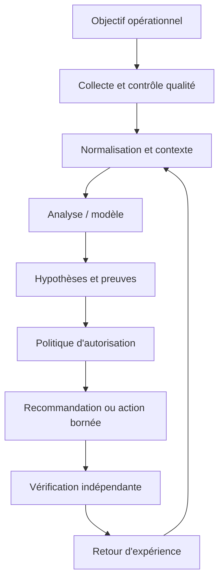

Chaque observation conserve source, horodatage, unité, cible, fraîcheur et état de qualité. Le résultat de l'analyse référence sa version et ses entrées. La décision expose actions permises, préconditions, approbations, quotas et conditions d'arrêt. La sortie finale indique les preuves exigées avant de déclarer le succès, ainsi que les situations qui imposent une escalade.

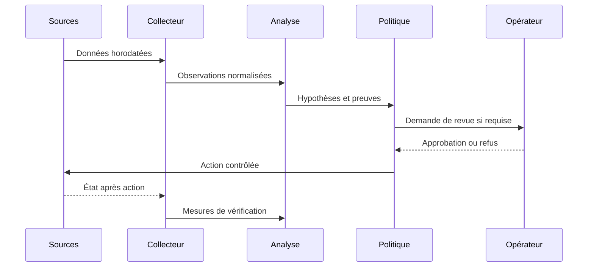

### Décision sous incertitude

La sécurité liée à Séparation entre analyse et exécution doit être conçue en amont : privilèges minimaux, protection des secrets, audit, séparation de l'analyse et de l'exécution, et règles d'escalade. Le piège principal ici est de traiter le modèle comme une copie parfaite. Les données externes doivent rester des données, jamais une autorité qui redéfinit les permissions. Pour une opération à fort impact, il faut des préconditions vérifiables, une approbation adaptée et un retour arrière testé, même lorsque le score du modèle semble très élevé.

Quand Données manquantes produit un résultat inattendu, commencer par l'heure, la source, l'unité, la cible, la fraîcheur, la version et le code d'erreur. Comparer l'observation brute à sa représentation transformée, puis chercher une modification récente. Tester une hypothèse à la fois et consigner la preuve du résultat sans copier de secrets dans le ticket. Une fois la cause confirmée, ajouter un test de régression et vérifier qu'il échoue avant le correctif et passe après celui-ci.

À l'échelle, Mode dégradé doit gérer des volumes et versions hétérogènes sans perdre de traçabilité. Borner la concurrence, isoler les erreurs par cible, limiter les files et surveiller les retards protègent l'aval. La reprise d'une panne peut elle-même provoquer une surcharge si toutes les sources se reconnectent simultanément. Le système doit pouvoir réduire sa fréquence ou revenir à une méthode simple, tout en signalant explicitement ce mode dégradé au lieu d'afficher un faux état normal.

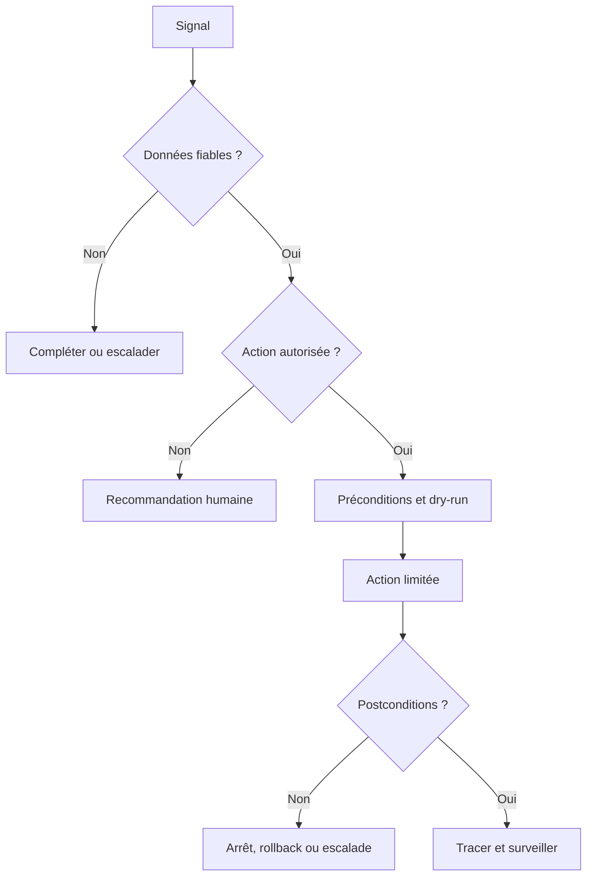

## 4. Pipeline et algorithmes

Le pipeline décrit ici est une chaîne de responsabilités, pas nécessairement six services séparés. Chaque étape doit avoir des entrées et sorties définies, des tests et une méthode de gestion des erreurs. Les données sont validées avant l'analyse, le contexte est enrichi avant l'interprétation, et la politique est consultée avant une action. Cette séquence permet de démarrer en mode observation et d'augmenter l'autonomie uniquement lorsque les critères sont prouvés.

### Étape 1 — Construire le graphe
Rassembler nœuds, liens, capacités, protocoles et dépendances.

La mise en œuvre de Construire le graphe se découpe en étapes testables : validation des entrées, contrôle des sources, traitement des valeurs absentes, journalisation et vérification des sorties. L'outil topologie peut contribuer au processus, mais sa présence ne garantit pas sa fiabilité. Les erreurs doivent rester explicites au lieu d'être converties en valeurs par défaut silencieuses. Une exécution fiable distingue succès, échec, état partiel et état impossible à déterminer, et conserve la version de code ou de modèle qui a produit la sortie.

Quand Construire le graphe produit un résultat inattendu, commencer par l'heure, la source, l'unité, la cible, la fraîcheur, la version et le code d'erreur. Comparer l'observation brute à sa représentation transformée, puis chercher une modification récente. Tester une hypothèse à la fois et consigner la preuve du résultat sans copier de secrets dans le ticket. Une fois la cause confirmée, ajouter un test de régression et vérifier qu'il échoue avant le correctif et passe après celui-ci.

### Étape 2 — Qualifier la fraîcheur
Attacher source, timestamp, version et niveau de confiance.

La mise en œuvre de Qualifier la fraîcheur se découpe en étapes testables : validation des entrées, contrôle des sources, traitement des valeurs absentes, journalisation et vérification des sorties. L'outil inventaire peut contribuer au processus, mais sa présence ne garantit pas sa fiabilité. Les erreurs doivent rester explicites au lieu d'être converties en valeurs par défaut silencieuses. Une exécution fiable distingue succès, échec, état partiel et état impossible à déterminer, et conserve la version de code ou de modèle qui a produit la sortie.

Quand Qualifier la fraîcheur produit un résultat inattendu, commencer par l'heure, la source, l'unité, la cible, la fraîcheur, la version et le code d'erreur. Comparer l'observation brute à sa représentation transformée, puis chercher une modification récente. Tester une hypothèse à la fois et consigner la preuve du résultat sans copier de secrets dans le ticket. Une fois la cause confirmée, ajouter un test de régression et vérifier qu'il échoue avant le correctif et passe après celui-ci.

### Étape 3 — Calibrer
Comparer le modèle à des scénarios historiques ou tests contrôlés.

La mise en œuvre de Calibrer se découpe en étapes testables : validation des entrées, contrôle des sources, traitement des valeurs absentes, journalisation et vérification des sorties. L'outil simulateur peut contribuer au processus, mais sa présence ne garantit pas sa fiabilité. Les erreurs doivent rester explicites au lieu d'être converties en valeurs par défaut silencieuses. Une exécution fiable distingue succès, échec, état partiel et état impossible à déterminer, et conserve la version de code ou de modèle qui a produit la sortie.

Quand Calibrer produit un résultat inattendu, commencer par l'heure, la source, l'unité, la cible, la fraîcheur, la version et le code d'erreur. Comparer l'observation brute à sa représentation transformée, puis chercher une modification récente. Tester une hypothèse à la fois et consigner la preuve du résultat sans copier de secrets dans le ticket. Une fois la cause confirmée, ajouter un test de régression et vérifier qu'il échoue avant le correctif et passe après celui-ci.

### Étape 4 — Définir les scénarios
Préciser événement hypothétique, charge, contraintes et critères de réussite.

La mise en œuvre de Définir les scénarios se découpe en étapes testables : validation des entrées, contrôle des sources, traitement des valeurs absentes, journalisation et vérification des sorties. L'outil modèles de capacité et tests de scénarios peut contribuer au processus, mais sa présence ne garantit pas sa fiabilité. Les erreurs doivent rester explicites au lieu d'être converties en valeurs par défaut silencieuses. Une exécution fiable distingue succès, échec, état partiel et état impossible à déterminer, et conserve la version de code ou de modèle qui a produit la sortie.

Quand Définir les scénarios produit un résultat inattendu, commencer par l'heure, la source, l'unité, la cible, la fraîcheur, la version et le code d'erreur. Comparer l'observation brute à sa représentation transformée, puis chercher une modification récente. Tester une hypothèse à la fois et consigner la preuve du résultat sans copier de secrets dans le ticket. Une fois la cause confirmée, ajouter un test de régression et vérifier qu'il échoue avant le correctif et passe après celui-ci.

### Étape 5 — Simuler
Comparer chemins, capacités restantes, résilience et services touchés.

La mise en œuvre de Simuler se découpe en étapes testables : validation des entrées, contrôle des sources, traitement des valeurs absentes, journalisation et vérification des sorties. L'outil topologie peut contribuer au processus, mais sa présence ne garantit pas sa fiabilité. Les erreurs doivent rester explicites au lieu d'être converties en valeurs par défaut silencieuses. Une exécution fiable distingue succès, échec, état partiel et état impossible à déterminer, et conserve la version de code ou de modèle qui a produit la sortie.

Quand Simuler produit un résultat inattendu, commencer par l'heure, la source, l'unité, la cible, la fraîcheur, la version et le code d'erreur. Comparer l'observation brute à sa représentation transformée, puis chercher une modification récente. Tester une hypothèse à la fois et consigner la preuve du résultat sans copier de secrets dans le ticket. Une fois la cause confirmée, ajouter un test de régression et vérifier qu'il échoue avant le correctif et passe après celui-ci.

### Étape 6 — Comparer au réel
Après un changement contrôlé, vérifier les prédictions et corriger le modèle.

La mise en œuvre de Comparer au réel se découpe en étapes testables : validation des entrées, contrôle des sources, traitement des valeurs absentes, journalisation et vérification des sorties. L'outil inventaire peut contribuer au processus, mais sa présence ne garantit pas sa fiabilité. Les erreurs doivent rester explicites au lieu d'être converties en valeurs par défaut silencieuses. Une exécution fiable distingue succès, échec, état partiel et état impossible à déterminer, et conserve la version de code ou de modèle qui a produit la sortie.

Quand Comparer au réel produit un résultat inattendu, commencer par l'heure, la source, l'unité, la cible, la fraîcheur, la version et le code d'erreur. Comparer l'observation brute à sa représentation transformée, puis chercher une modification récente. Tester une hypothèse à la fois et consigner la preuve du résultat sans copier de secrets dans le ticket. Une fois la cause confirmée, ajouter un test de régression et vérifier qu'il échoue avant le correctif et passe après celui-ci.

### Pseudocode défensif
```text
observations = collecter()
si qualité(observations) insuffisante:
    signaler les données manquantes et escalader
sinon:
    contexte = enrichir(observations, inventaire, changements, dépendances)
    hypothèses = analyser(contexte)
    vérifier la provenance de chaque preuve
    si preuve insuffisante ou action hors politique:
        recommander sans exécuter
    sinon:
        préparer diff, préconditions, approbations et rollback
        appliquer sur un petit périmètre
        mesurer les postconditions indépendantes
        restaurer ou escalader si non conforme
        journaliser version, preuves, décision et résultat
```

Ce pseudocode explique la logique et n'est pas une bibliothèque prête pour la production. Chaque étape exige des tests, des permissions appropriées et un mode de reprise explicite. Un système fiable ne remplace pas l'incertitude par une valeur par défaut ; il la rend visible et réduit son autonomie lorsque les preuves sont incomplètes.

## 5. Étude de cas détaillée

### Situation et impact
une migration de routage touche plusieurs sites ; un schéma statique ne montre ni toutes les dépendances ni l'impact d'une perte de lien. L'équipe commence par établir le périmètre, l'impact utilisateur, la chronologie et la criticité des actifs. Sa première question n'est pas « quel modèle est à la mode ? », mais « quelle décision doit devenir meilleure, et quelle preuve permettra de le démontrer ? ». Cette formulation évite la dérive du périmètre et fixe un critère d'arrêt si la solution n'apporte pas de valeur.

### Phase 1 — Établir les faits
Conserver les données brutes en lecture seule et noter les sources, timestamps, versions et transformations. Vérifier les changements récents et la qualité de collecte. Les valeurs absentes demeurent absentes ; elles ne sont pas remplacées par zéro. L'impact métier est mesuré séparément de l'état d'un équipement. Les contradictions entre systèmes sont documentées au lieu d'être résolues par intuition.

### Phase 2 — Comparer les hypothèses
Décrire au moins deux explications si les preuves ne permettent pas de conclure directement. Pour chacune, noter les observations favorables, les contre-indices et le test qui peut la distinguer. La priorité dépend de l'impact, de la plausibilité et du coût du test. Une ressemblance avec un incident historique ne suffit pas : versions, topologie, capacité et fenêtre de charge peuvent changer l'explication.

### Phase 3 — Préparer une réponse proportionnée
Privilégier les contrôles non destructifs. Si une modification devient nécessaire, préciser cible, diff, préconditions, impact, fenêtre, critères d'arrêt et rollback. Une revue indépendante s'impose lorsque le rayon d'impact est grand. Le plan doit permettre de refuser une action lorsque les preuves ne sont pas suffisantes.

### Phase 4 — Vérifier
Après action, contrôler mesures indépendantes : fonctionnement du service, latence, erreurs, connectivité, état de configuration ou autre indicateur pertinent. Une seule valeur favorable ne prouve pas un rétablissement durable. Lorsque les postconditions échouent, arrêter, restaurer selon le plan ou escalader. Le compte rendu distingue ce qui a été tenté, observé, confirmé et laissé inconnu.

### Phase 5 — Tirer des leçons
Comparer les hypothèses initiales aux preuves finales. Ajouter tests de régression, sources manquantes et contrôles à améliorer. Une règle ou un modèle mis à jour passe par une revue et une expérimentation contrôlée avant généralisation. Les conclusions non confirmées ne deviennent pas automatiquement de nouvelles étiquettes d'entraînement.

### Conditions de clôture
La clôture exige soit une preuve de rétablissement, soit une déclaration explicite que le service reste dégradé. Le dossier conserve sources, versions, actions, approbations, résultats et suivis. La cause racine n'est déclarée confirmée que si les preuves le permettent. Une conclusion honnêtement partielle est préférable à une explication catégorique impossible à reproduire.

## 6. Implémentation et TP

Exécuter les travaux pratiques dans un laboratoire isolé ou sur des systèmes autorisés. Noter les versions, dépendances, données et critères de réussite. Le résultat doit pouvoir être reproduit par un autre opérateur ; un succès affiché par l'outil ne remplace pas le contrôle de l'état réel.

### TP 1 — Construire un graphe de laboratoire avec équipements et liens.
**Procédure.** Construire un graphe de laboratoire avec équipements et liens. Utiliser une cible limitée, capturer l'état initial et ne changer qu'un paramètre à la fois. Relier le travail au concept « Jumeau numérique » : Une représentation mise à jour du système réel est alimentée par des données et sert à observer ou simuler son comportement. Conserver commande, entrée, version et sortie.

**Contrôle.** Reproduire le résultat, puis tester une erreur contrôlée, une donnée manquante et une dépendance indisponible. Vérifier l'état effectif, les effets secondaires et la procédure de reprise. Si le résultat ne peut pas être déterminé, signaler cet état plutôt que le considérer comme une réussite. Décrire ce qui est démontré et les limites qui subsistent avant un déploiement plus large.

### TP 2 — Importer des données d'inventaire et horodater les sources.
**Procédure.** Importer des données d'inventaire et horodater les sources. Utiliser une cible limitée, capturer l'état initial et ne changer qu'un paramètre à la fois. Relier le travail au concept « Modèle de topologie » : Le modèle représente équipements, liens, capacités, protocoles et dépendances de services. Conserver commande, entrée, version et sortie.

**Contrôle.** Reproduire le résultat, puis tester une erreur contrôlée, une donnée manquante et une dépendance indisponible. Vérifier l'état effectif, les effets secondaires et la procédure de reprise. Si le résultat ne peut pas être déterminé, signaler cet état plutôt que le considérer comme une réussite. Décrire ce qui est démontré et les limites qui subsistent avant un déploiement plus large.

### TP 3 — Marquer explicitement les attributs inconnus ou anciens.
**Procédure.** Marquer explicitement les attributs inconnus ou anciens. Utiliser une cible limitée, capturer l'état initial et ne changer qu'un paramètre à la fois. Relier le travail au concept « Synchronisation » : Les données réelles sont rapprochées du modèle périodiquement ou événementiellement, avec provenance et fraîcheur. Conserver commande, entrée, version et sortie.

**Contrôle.** Reproduire le résultat, puis tester une erreur contrôlée, une donnée manquante et une dépendance indisponible. Vérifier l'état effectif, les effets secondaires et la procédure de reprise. Si le résultat ne peut pas être déterminé, signaler cet état plutôt que le considérer comme une réussite. Décrire ce qui est démontré et les limites qui subsistent avant un déploiement plus large.

### TP 4 — Simuler la perte d'un lien principal.
**Procédure.** Simuler la perte d'un lien principal. Utiliser une cible limitée, capturer l'état initial et ne changer qu'un paramètre à la fois. Relier le travail au concept « Fidélité » : La fidélité indique si la simulation reproduit les propriétés utiles ; une propriété omise doit rester explicitement indiquée. Conserver commande, entrée, version et sortie.

**Contrôle.** Reproduire le résultat, puis tester une erreur contrôlée, une donnée manquante et une dépendance indisponible. Vérifier l'état effectif, les effets secondaires et la procédure de reprise. Si le résultat ne peut pas être déterminé, signaler cet état plutôt que le considérer comme une réussite. Décrire ce qui est démontré et les limites qui subsistent avant un déploiement plus large.

### TP 5 — Comparer chemin alternatif, capacité et impact service.
**Procédure.** Comparer chemin alternatif, capacité et impact service. Utiliser une cible limitée, capturer l'état initial et ne changer qu'un paramètre à la fois. Relier le travail au concept « Scénario contrefactuel » : Un scénario teste ce qui pourrait arriver après une perte de lien, un pic de charge ou une modification de politique. Conserver commande, entrée, version et sortie.

**Contrôle.** Reproduire le résultat, puis tester une erreur contrôlée, une donnée manquante et une dépendance indisponible. Vérifier l'état effectif, les effets secondaires et la procédure de reprise. Si le résultat ne peut pas être déterminé, signaler cet état plutôt que le considérer comme une réussite. Décrire ce qui est démontré et les limites qui subsistent avant un déploiement plus large.

### TP 6 — Calibrer le modèle avec un scénario connu.
**Procédure.** Calibrer le modèle avec un scénario connu. Utiliser une cible limitée, capturer l'état initial et ne changer qu'un paramètre à la fois. Relier le travail au concept « Calibration » : Les résultats de simulation sont comparés à des observations et les écarts doivent être expliqués. Conserver commande, entrée, version et sortie.

**Contrôle.** Reproduire le résultat, puis tester une erreur contrôlée, une donnée manquante et une dépendance indisponible. Vérifier l'état effectif, les effets secondaires et la procédure de reprise. Si le résultat ne peut pas être déterminé, signaler cet état plutôt que le considérer comme une réussite. Décrire ce qui est démontré et les limites qui subsistent avant un déploiement plus large.

### TP 7 — Comparer la simulation à l'observation du laboratoire.
**Procédure.** Comparer la simulation à l'observation du laboratoire. Utiliser une cible limitée, capturer l'état initial et ne changer qu'un paramètre à la fois. Relier le travail au concept « Décision de changement » : La simulation aide à comparer les options mais ne remplace pas revue, canary, validation post-action et rollback. Conserver commande, entrée, version et sortie.

**Contrôle.** Reproduire le résultat, puis tester une erreur contrôlée, une donnée manquante et une dépendance indisponible. Vérifier l'état effectif, les effets secondaires et la procédure de reprise. Si le résultat ne peut pas être déterminé, signaler cet état plutôt que le considérer comme une réussite. Décrire ce qui est démontré et les limites qui subsistent avant un déploiement plus large.

### Exemple technique
```text
network:
  version: "lab-2026-10-28"
  nodes:
    - id: core-a
      role: core
      capacity_mbps: 10000
    - id: edge-a
      role: edge
      capacity_mbps: 1000
  links:
    - from: edge-a
      to: core-a
      capacity_mbps: 1000
      latency_ms: 2
      observed_at: "2026-10-28T08:00:00Z"
  assumptions:
    omitted_effects: ["vendor-specific-queueing"]

# Valider identifiants, unités et fraîcheur ; documenter les hypothèses omises.
```
Ce fragment est un point de départ pédagogique, pas une configuration universelle. Les versions, options et capacités peuvent varier : lire la documentation officielle et tester en laboratoire. Ne pas coder de secrets en dur. Tout changement réel exige un périmètre limité, une autorisation appropriée et une vérification post-action.

### Livrables
- Un fichier versionné décrivant entrée, sortie et dépendances.
- Un journal corrélé à la cible et à la version, sans secrets.
- Des tests positifs et négatifs, dont données manquantes et échec d'accès.
- Des critères d'arrêt et un rollback testé.
- Une note de résultats, hypothèses et limites.

## 7. Sécurité et gouvernance

### 1. Qualité et provenance
Chaque observation conserve source, horodatage, unité et fraîcheur. Traduire ce principe en contrôle observable, propriétaire, fréquence de revue et preuve de passage. Une politique sans test dépend de la mémoire ; un test sans propriétaire n'est plus maintenu lorsque l'équipe change. Relancer la revue après un changement majeur de données, d'équipement, de modèle ou de finalité.

La gouvernance de Qualité et provenance précise qui peut créer, modifier, approuver, consulter et retirer la logique. Le propriétaire connaît le but, les limites, le budget d'erreur et les critères de suspension. Les décisions doivent être retraçables jusqu'aux données, paramètres et versions utilisés. Une règle sans propriétaire finit par dépendre de la mémoire des personnes ; une métrique sans décision associée devient décorative. La revue doit être planifiée et déclenchée de nouveau après un changement majeur de contexte.

### 2. Identités
Les comptes de service ont le minimum de permissions nécessaires. Traduire ce principe en contrôle observable, propriétaire, fréquence de revue et preuve de passage. Une politique sans test dépend de la mémoire ; un test sans propriétaire n'est plus maintenu lorsque l'équipe change. Relancer la revue après un changement majeur de données, d'équipement, de modèle ou de finalité.

La gouvernance de Identités précise qui peut créer, modifier, approuver, consulter et retirer la logique. Le propriétaire connaît le but, les limites, le budget d'erreur et les critères de suspension. Les décisions doivent être retraçables jusqu'aux données, paramètres et versions utilisés. Une règle sans propriétaire finit par dépendre de la mémoire des personnes ; une métrique sans décision associée devient décorative. La revue doit être planifiée et déclenchée de nouveau après un changement majeur de contexte.

### 3. Traçabilité
Version, preuves, décision, approbation, cible et résultat restent corrélés. Traduire ce principe en contrôle observable, propriétaire, fréquence de revue et preuve de passage. Une politique sans test dépend de la mémoire ; un test sans propriétaire n'est plus maintenu lorsque l'équipe change. Relancer la revue après un changement majeur de données, d'équipement, de modèle ou de finalité.

La gouvernance de Traçabilité précise qui peut créer, modifier, approuver, consulter et retirer la logique. Le propriétaire connaît le but, les limites, le budget d'erreur et les critères de suspension. Les décisions doivent être retraçables jusqu'aux données, paramètres et versions utilisés. Une règle sans propriétaire finit par dépendre de la mémoire des personnes ; une métrique sans décision associée devient décorative. La revue doit être planifiée et déclenchée de nouveau après un changement majeur de contexte.

### 4. Revue humaine
Le réviseur dispose de temps, preuves et autorité pour refuser. Traduire ce principe en contrôle observable, propriétaire, fréquence de revue et preuve de passage. Une politique sans test dépend de la mémoire ; un test sans propriétaire n'est plus maintenu lorsque l'équipe change. Relancer la revue après un changement majeur de données, d'équipement, de modèle ou de finalité.

La gouvernance de Revue humaine précise qui peut créer, modifier, approuver, consulter et retirer la logique. Le propriétaire connaît le but, les limites, le budget d'erreur et les critères de suspension. Les décisions doivent être retraçables jusqu'aux données, paramètres et versions utilisés. Une règle sans propriétaire finit par dépendre de la mémoire des personnes ; une métrique sans décision associée devient décorative. La revue doit être planifiée et déclenchée de nouveau après un changement majeur de contexte.

### 5. Gestion du risque
Chaque mode d'échec a prévention, détection, réponse et propriétaire. Traduire ce principe en contrôle observable, propriétaire, fréquence de revue et preuve de passage. Une politique sans test dépend de la mémoire ; un test sans propriétaire n'est plus maintenu lorsque l'équipe change. Relancer la revue après un changement majeur de données, d'équipement, de modèle ou de finalité.

La gouvernance de Gestion du risque précise qui peut créer, modifier, approuver, consulter et retirer la logique. Le propriétaire connaît le but, les limites, le budget d'erreur et les critères de suspension. Les décisions doivent être retraçables jusqu'aux données, paramètres et versions utilisés. Une règle sans propriétaire finit par dépendre de la mémoire des personnes ; une métrique sans décision associée devient décorative. La revue doit être planifiée et déclenchée de nouveau après un changement majeur de contexte.

### 6. Réversibilité
Retrait, suspension et retour à une version saine sont testés. Traduire ce principe en contrôle observable, propriétaire, fréquence de revue et preuve de passage. Une politique sans test dépend de la mémoire ; un test sans propriétaire n'est plus maintenu lorsque l'équipe change. Relancer la revue après un changement majeur de données, d'équipement, de modèle ou de finalité.

La gouvernance de Réversibilité précise qui peut créer, modifier, approuver, consulter et retirer la logique. Le propriétaire connaît le but, les limites, le budget d'erreur et les critères de suspension. Les décisions doivent être retraçables jusqu'aux données, paramètres et versions utilisés. Une règle sans propriétaire finit par dépendre de la mémoire des personnes ; une métrique sans décision associée devient décorative. La revue doit être planifiée et déclenchée de nouveau après un changement majeur de contexte.

## 8. Pièges à éviter

### Piège 1 — traiter le modèle comme une copie parfaite
Ce défaut peut produire un faux diagnostic, une action inutile ou une perte de confiance. Les signes précoces peuvent être une source contradictoire, une hausse d'erreurs, un écart entre sites ou l'absence de preuve. Pour ce cours, le risque « traiter le modèle comme une copie parfaite » doit être associé à un test négatif explicite et à une réponse déterminée lorsque le garde-fou échoue.

La prévention s'appuie sur « Jumeau numérique ». Une représentation mise à jour du système réel est alimentée par des données et sert à observer ou simuler son comportement. Un avertissement n'est utile que s'il change la décision, bloque une action risquée ou déclenche une revue. La checklist de déploiement doit préciser qui observe le signal, quel seuil est acceptable et qui peut suspendre la méthode. Il faut documenter aussi les défaillances que le contrôle ne couvre pas.

### Piège 2 — ne pas signaler les données périmées
Ce défaut peut produire un faux diagnostic, une action inutile ou une perte de confiance. Les signes précoces peuvent être une source contradictoire, une hausse d'erreurs, un écart entre sites ou l'absence de preuve. Pour ce cours, le risque « ne pas signaler les données périmées » doit être associé à un test négatif explicite et à une réponse déterminée lorsque le garde-fou échoue.

La prévention s'appuie sur « Modèle de topologie ». Le modèle représente équipements, liens, capacités, protocoles et dépendances de services. Un avertissement n'est utile que s'il change la décision, bloque une action risquée ou déclenche une revue. La checklist de déploiement doit préciser qui observe le signal, quel seuil est acceptable et qui peut suspendre la méthode. Il faut documenter aussi les défaillances que le contrôle ne couvre pas.

### Piège 3 — simuler seulement le trafic nominal
Ce défaut peut produire un faux diagnostic, une action inutile ou une perte de confiance. Les signes précoces peuvent être une source contradictoire, une hausse d'erreurs, un écart entre sites ou l'absence de preuve. Pour ce cours, le risque « simuler seulement le trafic nominal » doit être associé à un test négatif explicite et à une réponse déterminée lorsque le garde-fou échoue.

La prévention s'appuie sur « Synchronisation ». Les données réelles sont rapprochées du modèle périodiquement ou événementiellement, avec provenance et fraîcheur. Un avertissement n'est utile que s'il change la décision, bloque une action risquée ou déclenche une revue. La checklist de déploiement doit préciser qui observe le signal, quel seuil est acceptable et qui peut suspendre la méthode. Il faut documenter aussi les défaillances que le contrôle ne couvre pas.

### Piège 4 — annoncer une précision sans calibration
Ce défaut peut produire un faux diagnostic, une action inutile ou une perte de confiance. Les signes précoces peuvent être une source contradictoire, une hausse d'erreurs, un écart entre sites ou l'absence de preuve. Pour ce cours, le risque « annoncer une précision sans calibration » doit être associé à un test négatif explicite et à une réponse déterminée lorsque le garde-fou échoue.

La prévention s'appuie sur « Fidélité ». La fidélité indique si la simulation reproduit les propriétés utiles ; une propriété omise doit rester explicitement indiquée. Un avertissement n'est utile que s'il change la décision, bloque une action risquée ou déclenche une revue. La checklist de déploiement doit préciser qui observe le signal, quel seuil est acceptable et qui peut suspendre la méthode. Il faut documenter aussi les défaillances que le contrôle ne couvre pas.

### Piège 5 — oublier les dépendances applicatives
Ce défaut peut produire un faux diagnostic, une action inutile ou une perte de confiance. Les signes précoces peuvent être une source contradictoire, une hausse d'erreurs, un écart entre sites ou l'absence de preuve. Pour ce cours, le risque « oublier les dépendances applicatives » doit être associé à un test négatif explicite et à une réponse déterminée lorsque le garde-fou échoue.

La prévention s'appuie sur « Scénario contrefactuel ». Un scénario teste ce qui pourrait arriver après une perte de lien, un pic de charge ou une modification de politique. Un avertissement n'est utile que s'il change la décision, bloque une action risquée ou déclenche une revue. La checklist de déploiement doit préciser qui observe le signal, quel seuil est acceptable et qui peut suspendre la méthode. Il faut documenter aussi les défaillances que le contrôle ne couvre pas.

### Piège 6 — confondre simulation et autorisation
Ce défaut peut produire un faux diagnostic, une action inutile ou une perte de confiance. Les signes précoces peuvent être une source contradictoire, une hausse d'erreurs, un écart entre sites ou l'absence de preuve. Pour ce cours, le risque « confondre simulation et autorisation » doit être associé à un test négatif explicite et à une réponse déterminée lorsque le garde-fou échoue.

La prévention s'appuie sur « Calibration ». Les résultats de simulation sont comparés à des observations et les écarts doivent être expliqués. Un avertissement n'est utile que s'il change la décision, bloque une action risquée ou déclenche une revue. La checklist de déploiement doit préciser qui observe le signal, quel seuil est acceptable et qui peut suspendre la méthode. Il faut documenter aussi les défaillances que le contrôle ne couvre pas.

### Piège 7 — ne jamais comparer prédiction et réalité
Ce défaut peut produire un faux diagnostic, une action inutile ou une perte de confiance. Les signes précoces peuvent être une source contradictoire, une hausse d'erreurs, un écart entre sites ou l'absence de preuve. Pour ce cours, le risque « ne jamais comparer prédiction et réalité » doit être associé à un test négatif explicite et à une réponse déterminée lorsque le garde-fou échoue.

La prévention s'appuie sur « Décision de changement ». La simulation aide à comparer les options mais ne remplace pas revue, canary, validation post-action et rollback. Un avertissement n'est utile que s'il change la décision, bloque une action risquée ou déclenche une revue. La checklist de déploiement doit préciser qui observe le signal, quel seuil est acceptable et qui peut suspendre la méthode. Il faut documenter aussi les défaillances que le contrôle ne couvre pas.

## 9. Diagnostic et dépannage

### Aucun résultat
Vérifier accès, période, filtres, identité et version du schéma. Dans le contexte de Jumeaux numériques réseau, examiner d'abord le risque « traiter le modèle comme une copie parfaite ». Comparer observation brute et donnée transformée, retracer la version utilisée et vérifier les modifications récentes. Construire deux hypothèses alternatives et effectuer un test non destructif qui permet de les départager. Éviter les changements simultanés. Si les preuves restent incomplètes, garder l'incertitude visible et utiliser le mode sûr.

### Résultats variables
Comparer dataset, code, paramètres, dépendances et transformations. Dans le contexte de Jumeaux numériques réseau, examiner d'abord le risque « ne pas signaler les données périmées ». Comparer observation brute et donnée transformée, retracer la version utilisée et vérifier les modifications récentes. Construire deux hypothèses alternatives et effectuer un test non destructif qui permet de les départager. Éviter les changements simultanés. Si les preuves restent incomplètes, garder l'incertitude visible et utiliser le mode sûr.

### Trop d'alertes
Inspecter duplications, saisonnalité, baseline et seuils. Dans le contexte de Jumeaux numériques réseau, examiner d'abord le risque « simuler seulement le trafic nominal ». Comparer observation brute et donnée transformée, retracer la version utilisée et vérifier les modifications récentes. Construire deux hypothèses alternatives et effectuer un test non destructif qui permet de les départager. Éviter les changements simultanés. Si les preuves restent incomplètes, garder l'incertitude visible et utiliser le mode sûr.

### Incident manqué
Reconstituer l'information disponible au moment de la décision. Dans le contexte de Jumeaux numériques réseau, examiner d'abord le risque « annoncer une précision sans calibration ». Comparer observation brute et donnée transformée, retracer la version utilisée et vérifier les modifications récentes. Construire deux hypothèses alternatives et effectuer un test non destructif qui permet de les départager. Éviter les changements simultanés. Si les preuves restent incomplètes, garder l'incertitude visible et utiliser le mode sûr.

### Action sans effet
Mesurer les postconditions indépendantes et chercher les effets secondaires. Dans le contexte de Jumeaux numériques réseau, examiner d'abord le risque « oublier les dépendances applicatives ». Comparer observation brute et donnée transformée, retracer la version utilisée et vérifier les modifications récentes. Construire deux hypothèses alternatives et effectuer un test non destructif qui permet de les départager. Éviter les changements simultanés. Si les preuves restent incomplètes, garder l'incertitude visible et utiliser le mode sûr.

### Qualité en baisse
Rechercher dérive, migration, changement de capacité ou de version. Dans le contexte de Jumeaux numériques réseau, examiner d'abord le risque « confondre simulation et autorisation ». Comparer observation brute et donnée transformée, retracer la version utilisée et vérifier les modifications récentes. Construire deux hypothèses alternatives et effectuer un test non destructif qui permet de les départager. Éviter les changements simultanés. Si les preuves restent incomplètes, garder l'incertitude visible et utiliser le mode sûr.

## 10. Exercices corrigés

### Exercice 1 — Jumeau numérique
**Énoncé.** Pour le scénario « une migration de routage touche plusieurs sites ; un schéma statique ne montre ni toutes les dépendances ni l'impact d'une perte de lien », l'équipe veut généraliser une méthode qui utilise Jumeau numérique. Quelle preuve doit-elle recueillir avant l'étape « Construire le graphe » et comment prévenir « traiter le modèle comme une copie parfaite » ?

**Correction détaillée.** Définir le résultat attendu et le coût de l'erreur. Vérifier la provenance, la fraîcheur et la disponibilité temporelle des entrées. Construire un essai reproductible et le comparer à une baseline. Rassembler nœuds, liens, capacités, protocoles et dépendances. Analyser les erreurs par catégorie d'actifs, puis fixer des seuils et une revue adaptée au risque. Le déploiement commence sur un périmètre limité et possède une restauration testée. Si les preuves sont insuffisantes, la bonne décision est d'observer, de demander une donnée complémentaire ou d'escalader.

**Pourquoi un raccourci échoue.** Un exemple favorable ne prouve pas un gain durable. Une métrique globale masque des cas critiques et une collecte lacunaire peut cacher les erreurs. La version et les conditions doivent rester disponibles pour reproduire le résultat. L'exercice est réussi si une autre personne peut expliquer le choix, ses limites et le mécanisme de retrait.

### Exercice 2 — Modèle de topologie
**Énoncé.** Pour le scénario « une migration de routage touche plusieurs sites ; un schéma statique ne montre ni toutes les dépendances ni l'impact d'une perte de lien », l'équipe veut généraliser une méthode qui utilise Modèle de topologie. Quelle preuve doit-elle recueillir avant l'étape « Qualifier la fraîcheur » et comment prévenir « ne pas signaler les données périmées » ?

**Correction détaillée.** Définir le résultat attendu et le coût de l'erreur. Vérifier la provenance, la fraîcheur et la disponibilité temporelle des entrées. Construire un essai reproductible et le comparer à une baseline. Attacher source, timestamp, version et niveau de confiance. Analyser les erreurs par catégorie d'actifs, puis fixer des seuils et une revue adaptée au risque. Le déploiement commence sur un périmètre limité et possède une restauration testée. Si les preuves sont insuffisantes, la bonne décision est d'observer, de demander une donnée complémentaire ou d'escalader.

**Pourquoi un raccourci échoue.** Un exemple favorable ne prouve pas un gain durable. Une métrique globale masque des cas critiques et une collecte lacunaire peut cacher les erreurs. La version et les conditions doivent rester disponibles pour reproduire le résultat. L'exercice est réussi si une autre personne peut expliquer le choix, ses limites et le mécanisme de retrait.

### Exercice 3 — Synchronisation
**Énoncé.** Pour le scénario « une migration de routage touche plusieurs sites ; un schéma statique ne montre ni toutes les dépendances ni l'impact d'une perte de lien », l'équipe veut généraliser une méthode qui utilise Synchronisation. Quelle preuve doit-elle recueillir avant l'étape « Calibrer » et comment prévenir « simuler seulement le trafic nominal » ?

**Correction détaillée.** Définir le résultat attendu et le coût de l'erreur. Vérifier la provenance, la fraîcheur et la disponibilité temporelle des entrées. Construire un essai reproductible et le comparer à une baseline. Comparer le modèle à des scénarios historiques ou tests contrôlés. Analyser les erreurs par catégorie d'actifs, puis fixer des seuils et une revue adaptée au risque. Le déploiement commence sur un périmètre limité et possède une restauration testée. Si les preuves sont insuffisantes, la bonne décision est d'observer, de demander une donnée complémentaire ou d'escalader.

**Pourquoi un raccourci échoue.** Un exemple favorable ne prouve pas un gain durable. Une métrique globale masque des cas critiques et une collecte lacunaire peut cacher les erreurs. La version et les conditions doivent rester disponibles pour reproduire le résultat. L'exercice est réussi si une autre personne peut expliquer le choix, ses limites et le mécanisme de retrait.

### Exercice 4 — Fidélité
**Énoncé.** Pour le scénario « une migration de routage touche plusieurs sites ; un schéma statique ne montre ni toutes les dépendances ni l'impact d'une perte de lien », l'équipe veut généraliser une méthode qui utilise Fidélité. Quelle preuve doit-elle recueillir avant l'étape « Définir les scénarios » et comment prévenir « annoncer une précision sans calibration » ?

**Correction détaillée.** Définir le résultat attendu et le coût de l'erreur. Vérifier la provenance, la fraîcheur et la disponibilité temporelle des entrées. Construire un essai reproductible et le comparer à une baseline. Préciser événement hypothétique, charge, contraintes et critères de réussite. Analyser les erreurs par catégorie d'actifs, puis fixer des seuils et une revue adaptée au risque. Le déploiement commence sur un périmètre limité et possède une restauration testée. Si les preuves sont insuffisantes, la bonne décision est d'observer, de demander une donnée complémentaire ou d'escalader.

**Pourquoi un raccourci échoue.** Un exemple favorable ne prouve pas un gain durable. Une métrique globale masque des cas critiques et une collecte lacunaire peut cacher les erreurs. La version et les conditions doivent rester disponibles pour reproduire le résultat. L'exercice est réussi si une autre personne peut expliquer le choix, ses limites et le mécanisme de retrait.

### Exercice 5 — Scénario contrefactuel
**Énoncé.** Pour le scénario « une migration de routage touche plusieurs sites ; un schéma statique ne montre ni toutes les dépendances ni l'impact d'une perte de lien », l'équipe veut généraliser une méthode qui utilise Scénario contrefactuel. Quelle preuve doit-elle recueillir avant l'étape « Simuler » et comment prévenir « oublier les dépendances applicatives » ?

**Correction détaillée.** Définir le résultat attendu et le coût de l'erreur. Vérifier la provenance, la fraîcheur et la disponibilité temporelle des entrées. Construire un essai reproductible et le comparer à une baseline. Comparer chemins, capacités restantes, résilience et services touchés. Analyser les erreurs par catégorie d'actifs, puis fixer des seuils et une revue adaptée au risque. Le déploiement commence sur un périmètre limité et possède une restauration testée. Si les preuves sont insuffisantes, la bonne décision est d'observer, de demander une donnée complémentaire ou d'escalader.

**Pourquoi un raccourci échoue.** Un exemple favorable ne prouve pas un gain durable. Une métrique globale masque des cas critiques et une collecte lacunaire peut cacher les erreurs. La version et les conditions doivent rester disponibles pour reproduire le résultat. L'exercice est réussi si une autre personne peut expliquer le choix, ses limites et le mécanisme de retrait.

## Atelier approfondi — construire un jumeau numérique fiable et vérifiable

Un jumeau numérique utile n'est pas simplement un dessin interactif d'une infrastructure. C'est une représentation numérique versionnée qui relie des objets réels, leurs relations, leur état observé, leurs contraintes et les hypothèses utilisées pour raisonner sur leur comportement. Il permet d'explorer des scénarios, d'estimer un impact ou de préparer une décision avant de modifier un système réel. Sa valeur dépend toutefois de la qualité de sa synchronisation, de la fidélité du modèle et de la manière dont ses limites sont affichées.

Le fil rouge de cet atelier est un réseau multisite composé de routeurs, de liens principaux et de secours, de services applicatifs et de dépendances partagées. L'équipe veut évaluer l'effet d'une perte de lien ou d'une modification de routage avant de l'appliquer. Le modèle reçoit des informations issues de l'inventaire, de la configuration, de la télémétrie et de l'historique de changement. Chaque source peut être incomplète ou en retard ; le jumeau doit donc décrire la qualité de ses informations au lieu de prétendre connaître parfaitement la réalité.

### 1. Définir ce que le jumeau doit permettre de décider

Commencez par la décision opérationnelle, puis déterminez ce qui doit être représenté. Un jumeau destiné à visualiser la topologie n'a pas besoin du même niveau de détail qu'un modèle qui estime la capacité après la perte d'un lien. Un modèle qui étudie la propagation des dépendances applicatives a besoin de relations différentes d'un modèle qui compare des chemins physiques. Tenter de représenter absolument tous les détails dès le départ augmente le coût d'entretien sans garantir une meilleure décision.

Rédigez une question testable, par exemple : « Si le lien principal entre le site A et le cœur de réseau devient indisponible, les services critiques conservent-ils un chemin disponible et une capacité suffisante ? » Cette question définit des éléments à représenter : chemins, capacités, état des interfaces, dépendances de services, contraintes de routage et objectifs de service. Elle définit aussi des résultats à mesurer : connectivité, latence estimée, saturation potentielle, dépendances sans chemin alternatif et incertitudes.

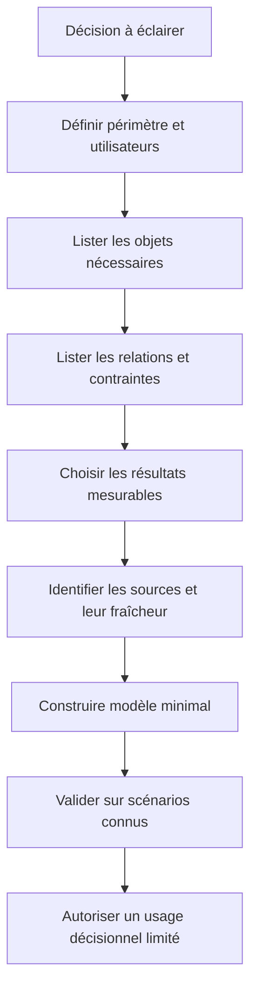

La portée d'un jumeau doit être écrite explicitement. Elle peut couvrir un seul site ou une famille d'équipements ; elle peut représenter uniquement la topologie et les capacités, ou inclure certains états dynamiques. Listez également les éléments qui ne sont pas modélisés. Si les politiques de pare-feu, les règles de routage dynamique ou la dépendance à un service tiers ne sont pas présentes, les résultats qui en dépendent doivent porter cette limite. Un modèle partiel clairement délimité est plus utile qu'un modèle qui semble complet mais laisse croire qu'il simule des éléments absents.

Identifiez les utilisateurs et les décisions prises par chacun. Un ingénieur réseau peut utiliser le jumeau pour tester un chemin alternatif. Un responsable de changement peut examiner le périmètre et les conditions d'arrêt. Une équipe applicative peut vouloir comprendre si un service conserve toutes ses dépendances. Les résultats doivent être adaptés à chaque décision sans changer la base factuelle sous-jacente. Les différents écrans doivent renvoyer vers le même état du modèle et la même version du scénario.

### 2. Distinguer le monde réel, l'observation et le modèle

Trois représentations doivent rester distinctes : l'état réel, les données reçues par les systèmes d'observabilité et l'état estimé du jumeau. L'état réel peut changer entre deux collectes. L'observabilité peut être partielle ou retardée. Le jumeau est une représentation calculée à partir des sources et des règles de modélisation. Ces trois éléments ne doivent pas être confondus, notamment lorsqu'une valeur est ancienne ou qu'un capteur est hors ligne.

Pour chaque propriété, conservez sa provenance, son heure source si disponible, son heure de réception, la méthode de calcul, sa qualité et sa période de validité. Une capacité tirée d'une fiche constructeur n'a pas la même signification qu'une capacité mesurée après configuration. Une relation déclarée dans un inventaire n'a pas le même niveau de preuve qu'un chemin réellement observé. Ces distinctions permettent à l'utilisateur de savoir quelles parties du jumeau sont confirmées et quelles parties sont des hypothèses.

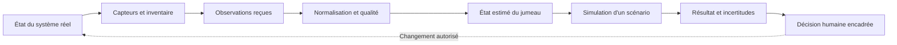

L'observation n'est pas automatiquement la vérité. Un compteur peut avoir été remis à zéro, une session peut être interrompue ou une valeur peut être calculée à partir d'une donnée en cache. Le jumeau doit indiquer si la propriété a été observée récemment, calculée ou simplement copiée depuis une source statique. Les propriétés nécessaires à une décision critique doivent posséder une règle de fraîcheur et une condition d'abstention lorsque la règle n'est pas satisfaite.

Évitez de faire disparaître les inconnues en remplaçant une valeur absente par une valeur par défaut. Une capacité inconnue ne doit pas devenir zéro, et un état de port inconnu ne doit pas être présenté comme « actif ». Utilisez des états explicites tels que confirmé, estimé, périmé, inconnu, contradictoire ou non applicable. La simulation peut parfois continuer avec une hypothèse, mais elle doit exposer cette hypothèse et tester la sensibilité du résultat à sa valeur.

### 3. Construire une identité stable pour chaque objet

Le jumeau agrège des informations qui peuvent employer des noms différents. Le même équipement peut apparaître sous un nom DNS, un nom de supervision, un numéro d'inventaire et un identifiant fournisseur. Ces noms changent parfois lors d'une migration. Définissez un identifiant canonique qui reste stable et gérez les alias dans une table distincte. Le nom d'affichage est une propriété, pas une clé immuable.

L'identité doit aussi être contextualisée. Un port peut être nommé Eth1/1 sur plusieurs routeurs. Un service peut être déployé en plusieurs régions. Les identifiants doivent inclure ou référencer le système propriétaire et le périmètre approprié. Un objet supprimé puis recréé ne doit pas automatiquement hériter de toutes les observations de son prédécesseur si ses caractéristiques ou son rôle ont changé.

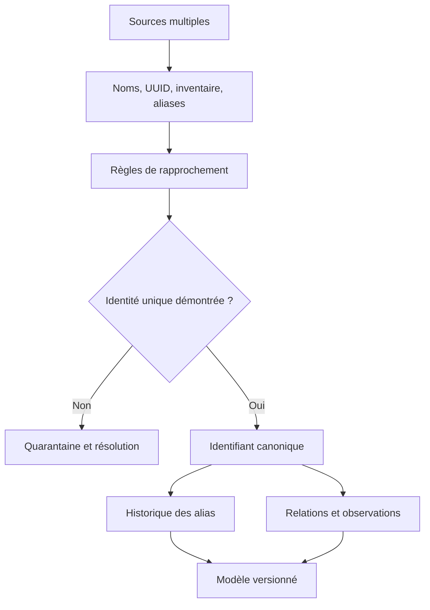

Le rapprochement automatique des entités doit garder ses éléments explicatifs. Une similarité de nom peut suggérer deux objets identiques, mais elle n'est pas une preuve suffisante pour fusionner des identités. Utilisez des clés plus fortes quand elles sont disponibles, comme l'identifiant d'inventaire ou un identifiant stable délivré par la plateforme. Si une fusion d'entités est acceptée, conservez une trace de l'ancienne décision et la possibilité de la corriger.

La résolution d'identité est particulièrement importante pour les historiques. Lorsqu'un port change de nom, les observations anciennes doivent rester associées à l'objet approprié. Lorsqu'un équipement est remplacé, une continuité logique peut exister au niveau du rôle mais pas au niveau de l'identité physique. Représentez le remplacement comme une relation de succession plutôt que d'écraser silencieusement l'objet précédent.

### 4. Versionner la topologie et ses changements

Une topologie est datée. Un lien peut être déplacé, un chemin alternatif ajouté, un routeur remplacé ou une dépendance applicative modifiée. Si le jumeau ne conserve que la dernière version, une simulation historique peut utiliser des relations qui n'existaient pas lors de l'incident. La représentation doit permettre de retrouver l'état valide à un instant donné.

Chaque relation importante devrait préciser son type, sa source, son début de validité et, si elle est connue, sa fin de validité. Les changements planifiés peuvent être enregistrés à l'avance, mais ils ne doivent devenir l'état courant qu'après confirmation d'application. L'état prévu par un plan et l'état observé après le changement sont deux versions distinctes : un déploiement approuvé n'est pas la preuve qu'il a réussi.

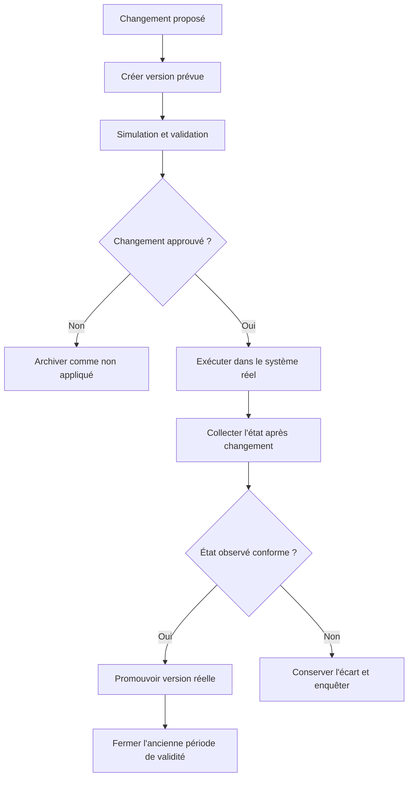

La topologie devrait pouvoir représenter plusieurs types de relation : physique, connectivité logique, routage, dépendance applicative, hébergement, identité ou observation. Un lien physique ne signifie pas toujours que le trafic passe par ce lien ; une dépendance applicative ne prouve pas que chaque requête en dépend à chaque instant. Le type de relation et la méthode de validation doivent être visibles. Les graphes de dépendances doivent aussi gérer les cycles lorsqu'ils existent.

Les sources contradictoires doivent être traitées explicitement. Si l'inventaire indique qu'un équipement est connecté à un port mais que la collecte indique un autre voisin, ne choisissez pas l'une des sources sans conserver l'autre. Marquez la relation comme contestée, cherchez la date de validité et déterminez quelle source fait autorité pour cette propriété. Un jumeau ne doit pas donner une impression de précision supérieure à celle de ses données.

### 5. Synchroniser le jumeau sans absorber les pannes

La synchronisation consiste à comparer les observations reçues à l'état enregistré et à mettre à jour les propriétés qui ont changé. Une synchronisation trop fréquente peut consommer des ressources et faire varier la simulation à chaque bruit de télémétrie. Une synchronisation trop lente rend le modèle obsolète. Le choix dépend des propriétés : un état de port peut nécessiter une mise à jour rapide, alors que des dimensions physiques changent rarement.

Définissez des fréquences selon les familles de données et des règles événementielles pour les changements importants. Un changement détecté peut entraîner une actualisation ciblée plutôt qu'une reconstruction complète. Chaque mise à jour doit cependant être atomique pour la version utilisée par une simulation : il ne faudrait pas qu'un calcul lise la nouvelle capacité d'un lien et l'ancienne connectivité de ce même lien sans le savoir.

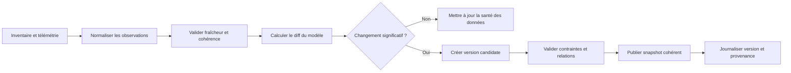

Un jumeau doit rester résilient lorsque la source est indisponible. Si la collecte cesse, il peut conserver le dernier état observé à condition de le marquer périmé. Il peut aussi utiliser une valeur issue d'un inventaire, mais il doit préserver la différence entre cette valeur statique et une mesure récente. Les consommateurs doivent pouvoir filtrer ou bloquer les scénarios qui reposent sur des propriétés trop anciennes.

La synchronisation doit éviter les oscillations causées par le bruit. Si une métrique fluctue autour d'une limite et entraîne une reconfiguration du modèle à chaque échantillon, les simulations peuvent changer continuellement sans différence opérationnelle significative. Introduisez des règles de stabilité, des fenêtres de validation ou une hystérésis quand le domaine le justifie. Ne lissez cependant pas les changements importants au point de masquer une rupture réelle.

### 6. Représenter la capacité et les contraintes physiques

Une topologie visuellement correcte peut être opérationnellement fausse si les capacités, les limites de flux ou les contraintes de service sont absentes. Pour analyser la perte d'un lien, le modèle doit représenter la capacité nominale, les débits attendus, les chemins qui resteraient disponibles et les dépendances qui ne disposent pas de secours. Il faut également préciser si la capacité annoncée est nominale, configurée, mesurée ou effective après les politiques et réservations.

Une simulation de charge ne doit pas simplement additionner les volumes et les comparer à un débit maximal. Il peut exister des politiques de qualité de service, des limites de CPU, des contraintes de routage, des réservations, des règles de préférence ou des dépendances applicatives qui modifient le comportement. Le niveau de détail doit rester proportionné à la décision que la simulation va influencer.

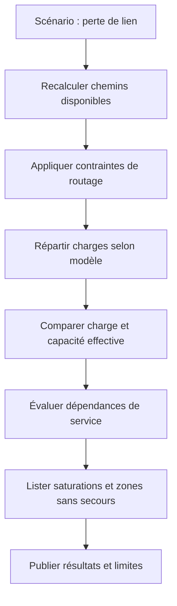

Les unités et conventions doivent être explicites. Les débits en bits par seconde ne sont pas des volumes en octets ; les valeurs par direction ne doivent pas être additionnées sans tenir compte de la capacité full-duplex ou des restrictions de l'équipement. Une capacité agrégée ne signifie pas qu'un flux peut utiliser cette capacité s'il est contraint à un seul chemin. Documentez les hypothèses de distribution du trafic et les règles d'affectation des flux.

Les contraintes de disponibilité doivent être liées au service. Une route alternative existe dans la topologie, mais elle peut partager un conduit physique, une alimentation, une zone de panne ou un équipement intermédiaire avec la route principale. Le modèle doit représenter les dépendances communes lorsque celles-ci sont importantes. Sinon, la simulation peut surestimer la résilience en comptant deux chemins qui échoueraient ensemble.

### 7. Paramètres, hypothèses et incertitude

Un résultat de simulation dépend des valeurs d'entrée, des hypothèses et du modèle de comportement. Il faut rendre ces trois éléments visibles. Une capacité mesurée hier, une estimation issue de la documentation et une valeur saisie manuellement ne possèdent pas le même niveau de confiance. Chaque entrée devrait avoir une provenance, une date, une unité, une plage de validité et une méthode de validation.

Lorsque la valeur est incertaine, utilisez une plage plutôt qu'un unique nombre prétendument exact. Par exemple, une demande future peut être examinée dans un scénario bas, central et haut. Si le résultat change radicalement selon une petite variation, le modèle doit signaler cette sensibilité. Une décision robuste est préférable lorsqu'elle reste valable sur une plage réaliste de paramètres.

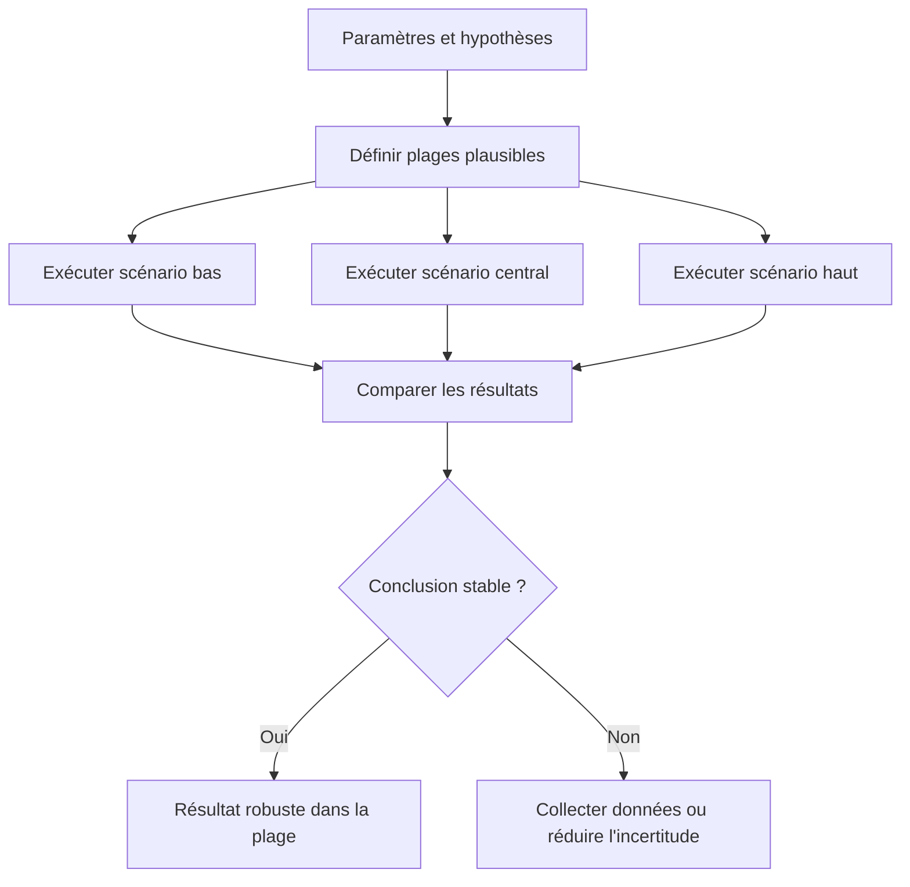

La sensibilité montre quels paramètres contrôlent le résultat. Dans un modèle de capacité, il peut s'agir du trafic de pointe, de la distribution entre les routes ou de l'indisponibilité d'un lien. Un paramètre très influent doit être vérifié avec une meilleure source ou testé par une expérimentation prudente. Il est inutile de consacrer beaucoup d'efforts à affiner un paramètre auquel le résultat est peu sensible, sauf s'il a d'autres implications.

Distinguez l'incertitude des données et l'incertitude du modèle. Les données peuvent être récentes mais incomplètes ; le modèle peut être simplifié même avec des données exactes. Par exemple, disposer des capacités exactes des liens n'aide pas si le modèle ne représente pas les politiques de routage qui déterminent la circulation. Le rapport doit dire si la limite vient d'une donnée manquante, d'une approximation mathématique ou d'une règle opérationnelle non représentée.

### 8. Concevoir un catalogue de scénarios

Un catalogue de scénarios donne une méthode répétable pour tester le jumeau. Il couvre le fonctionnement nominal, la panne d'un lien, la panne d'un équipement, la perte d'une région, la variation de demande, un changement planifié et une combinaison de plusieurs défaillances. Les scénarios doivent représenter non seulement les cas évidents, mais aussi les limites qui pourraient invalider une conclusion : lien alternatif saturé, dépendance commune, information périmée ou absence de route de gestion.

Chaque scénario doit indiquer l'état initial, l'événement injecté, la durée, les hypothèses, les sorties attendues et les critères de réussite. Le résultat doit être reproductible avec le même snapshot, la même version de modèle et les mêmes paramètres. Sans cette discipline, deux personnes peuvent comparer des simulations différentes tout en pensant tester le même cas.

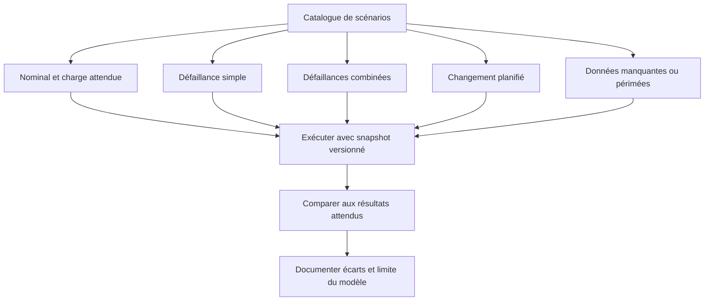

Évitez de considérer chaque scénario synthétique comme représentatif de la production. Le test démontre le comportement du modèle dans les hypothèses choisies, pas sa capacité à reproduire toutes les conditions réelles. Utilisez des cas d'incident historiques lorsque les données sont assez fiables, mais séparez-les des scénarios créés pour construire le modèle. La sélection des scénarios doit être guidée par le risque métier, les dépendances critiques et les erreurs rencontrées auparavant.

Testez aussi les scénarios négatifs. Une simulation doit refuser de produire une recommandation robuste lorsque des éléments essentiels sont absents. Une simulation de perte de lien sans capacité de secours connue peut afficher des hypothèses, mais ne doit pas certifier la continuité du service. Une topologie trop ancienne peut justifier une demande de synchronisation avant tout avis. L'abstention fait partie du comportement attendu.

### 9. Vérifier la fidélité du jumeau par comparaison au réel

La fidélité est propre à la question évaluée. Un modèle peut reproduire convenablement la connectivité mais être mauvais pour estimer la latence, la capacité ou l'effet d'une panne combinée. Définissez une fidélité par dimension : correspondance des objets, exactitude des dépendances, estimation de capacité, comportement dynamique et prédiction de service. Ne résumez pas toutes ces dimensions en un seul pourcentage sans expliquer la méthode de calcul.

Comparez les prévisions aux observations après un événement réel. Pour une migration, le jumeau peut prédire les chemins, les volumes et les services affectés ; les mesures après migration permettent d'évaluer l'écart. L'analyse ne doit pas cacher les écarts non prévus. Documentez si la cause est une entrée incorrecte, une hypothèse erronée, une dynamique manquante ou une erreur de mesure. Ces catégories appellent des corrections différentes.

```mermaid
flowchart LR
    A["Prédiction avant événement"] --> B["Enregistrer snapshot et paramètres"]
    B --> C["Événement réel"]
    C --> D["Collecter observations après événement"]
    D --> E["Aligner variables et fenêtres"]
    E --> F["Calculer écarts par dimension"]
    F --> G["Classer origine des écarts"]
    G --> H["Mettre à jour données ou modèle"]
    H --> I["Rejouer scénarios de régression"]
```

Les observations réelles doivent être comparables aux sorties simulées. Un débit moyen calculé sur une minute ne peut pas être comparé directement à un pic instantané. Une mesure du plan de contrôle ne correspond pas nécessairement à l'expérience utilisateur. Définissez les fenêtres, unités, populations et conditions de mesure avant d'évaluer l'erreur. Si la collecte est incomplète pendant l'événement, la comparaison doit l'indiquer explicitement.

Une erreur faible sur une métrique globale peut masquer une conséquence grave pour un petit service critique. Ventilez les résultats selon les services, sites, classes de trafic et modes de fonctionnement concernés. Une bonne fidélité moyenne ne garantit pas que le modèle décrit correctement les cas qui comptent le plus. Les critères de validation doivent donc refléter le risque, et pas seulement minimiser une erreur arithmétique générale.

### 10. Modéliser les événements et les transitions

Le jumeau peut représenter les états stables ainsi que les transitions entre eux. Une interface peut passer d'un état disponible à dégradé, puis indisponible, puis en récupération. Une simple propriété booléenne masque cette dynamique. Le modèle doit définir les transitions autorisées, les mesures qui les déclenchent, les délais d'observation et les conditions de retour à un état normal. Les états incertains ou contradictoires doivent être représentés plutôt que forcés dans une catégorie normale.

Des transitions avec hystérésis réduisent les oscillations lorsqu'une mesure fluctue autour d'une limite. Le seuil de passage à l'état dégradé peut différer du seuil nécessaire pour déclarer le retour à la normale, et une période de stabilité peut être exigée. Le choix exact dépend du signal et du service. Cette approche évite qu'un état de service oscille à chaque échantillon sans améliorer l'interprétation de la situation.

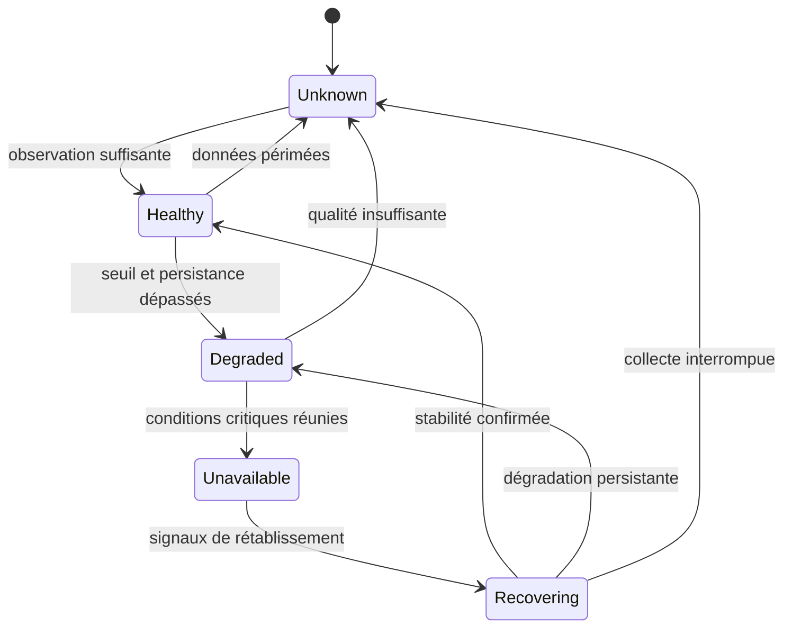

L'ordre des transitions et la qualité de mesure doivent être testés. Si une valeur arrive en retard alors que le système est déjà en récupération, le moteur doit décider si elle actualise l'historique, modifie l'état ou reste une preuve tardive. Cette décision dépend de l'horodatage, de la fenêtre, de la source et de la tolérance de réordonnancement. Le modèle de transition doit être déterministe dans les conditions identiques et conserver les informations permettant d'expliquer une divergence.

Les états de service sont souvent composés. Un service peut sembler disponible mais avoir une latence inacceptable ; il peut être accessible depuis un site mais pas depuis un autre. Ne réduisez pas tous les états à un simple « up/down » si la décision requiert le niveau de dégradation ou le périmètre d'impact. Définissez les dimensions nécessaires et la manière dont elles se combinent pour former un état de service agrégé.

### 11. Gouverner les mises à jour du modèle

La mise à jour d'un jumeau peut changer l'interprétation de nombreuses simulations. Un nouvel inventaire, une capacité différente, une nouvelle dépendance ou une modification d'algorithme doit produire une version traçable. Conservez l'instantané de départ, les données utilisées, les transformations et la version du moteur de simulation. Une modification de modèle ne doit pas effacer les résultats déjà obtenus pour des décisions antérieures.

Un pipeline de validation peut comparer la nouvelle version à un ensemble de scénarios de référence. Les écarts inattendus doivent être examinés, même si la mise à jour semble mineure. Il est utile de distinguer un changement attendu, comme l'ajout confirmé d'un lien, d'une régression, comme la disparition inexplicable d'une dépendance. L'automatisation peut signaler ces différences, mais la publication d'un modèle servant à des décisions à fort impact doit suivre une procédure d'approbation.

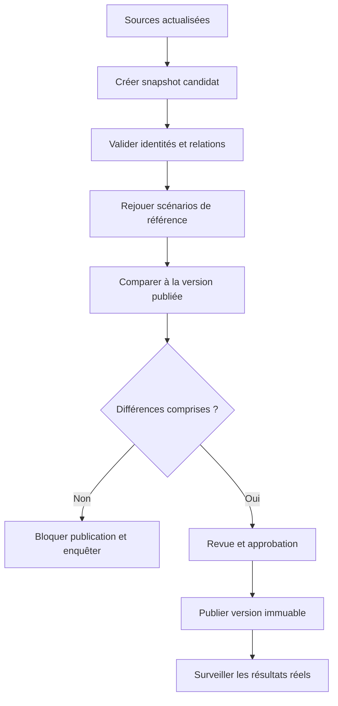

Les versions doivent avoir un identifiant stable et une politique de conservation. Un résultat de simulation doit référencer le snapshot et la version de l'algorithme, pas uniquement l'heure d'exécution. Si la même simulation est relancée plus tard, il faut pouvoir retrouver les mêmes entrées. Lorsque cela n'est plus possible, le rapport doit indiquer que la reproduction exacte est limitée.

La gouvernance inclut aussi le retrait d'un modèle. Si les écarts au réel deviennent trop grands, si une dépendance critique manque ou si les données ne sont plus assez fraîches, le jumeau doit perdre son statut d'aide à la décision automatisée et passer à un mode informatif ou suspendu. Afficher un résultat avec un avertissement discret ne suffit pas si le consommateur continue à l'utiliser comme une certification de sécurité.

### 12. Exemple de contrat de simulation

Un contrat doit décrire le snapshot, le scénario, les paramètres, les résultats attendus, les métriques de qualité et les limites. Le consommateur doit pouvoir distinguer une simulation terminée, une simulation partielle, un rejet pour données insuffisantes et une erreur de calcul. Une réponse vide ne doit pas être considérée comme un succès. De même, une simulation partielle ne doit pas être confondue avec un résultat complet pour tout le périmètre.

```json
{
  "model_id": "network-twin-site-group",
  "model_version": "2026-10-28T09:00Z",
  "scenario_id": "primary-link-failure",
  "scenario_version": "2",
  "scope": ["site-a", "site-b", "wan-core"],
  "inputs": {
    "traffic_window": "15m",
    "link_failure": "wan-a-core-1"
  },
  "status": "completed_with_assumptions",
  "assumptions": [
    "traffic distribution uses the last valid 15-minute window",
    "application dependency graph was verified within freshness policy"
  ],
  "results": {
    "services_with_alternate_path": ["service-a", "service-b"],
    "services_without_confirmed_path": ["service-c"],
    "capacity_warning": true
  },
  "limitations": ["routing convergence is approximated"]
}
```

Le contrat doit faire la différence entre résultat calculé et résultat observé. Un statut « completed » indique que le moteur a terminé son calcul, pas que le scénario prédit a été validé dans l'infrastructure réelle. Le champ des hypothèses doit rester facilement accessible aux consommateurs et ne pas être enfoui dans une longue chaîne de texte. Les résultats qui reposent sur des données périmées ou des relations inconnues doivent être marqués et éventuellement bloqués pour les usages critiques.

La version du scénario doit être immuable dès qu'une décision de changement en dépend. Si l'on corrige les paramètres ou les cibles après une simulation, il s'agit d'un nouveau scénario et les résultats doivent être recalculés. Associez les résultats au demandeur, à la version du moteur, à l'identité du snapshot et à la durée de calcul, sans rendre ces métadonnées dépendantes d'une seule interface utilisateur.

### 13. Laboratoire : comparer deux scénarios contradictoires

Le laboratoire modélise un site relié au cœur de réseau par un lien principal et un lien de secours. Le service utilise plusieurs dépendances partagées. Le premier scénario suppose que le lien principal tombe, tandis que le second suppose que le même lien est indisponible au moment où le lien de secours subit une charge importante. Les deux cas peuvent aboutir à des résultats très différents, même si les mêmes équipements et services apparaissent dans le modèle.

Commencez par documenter le graphe et ses sources. Vérifiez les identifiants, les relations, les capacités, les unités, la fraîcheur et les services dépendants. Établissez un scénario nominal comme contrôle, puis appliquez une seule modification à la fois. Enregistrez les chemins, la capacité restante, les services potentiellement affectés, les hypothèses et le niveau de confiance. Ne modifiez pas simultanément la topologie et le modèle de trafic sans enregistrer l'effet de chaque changement.

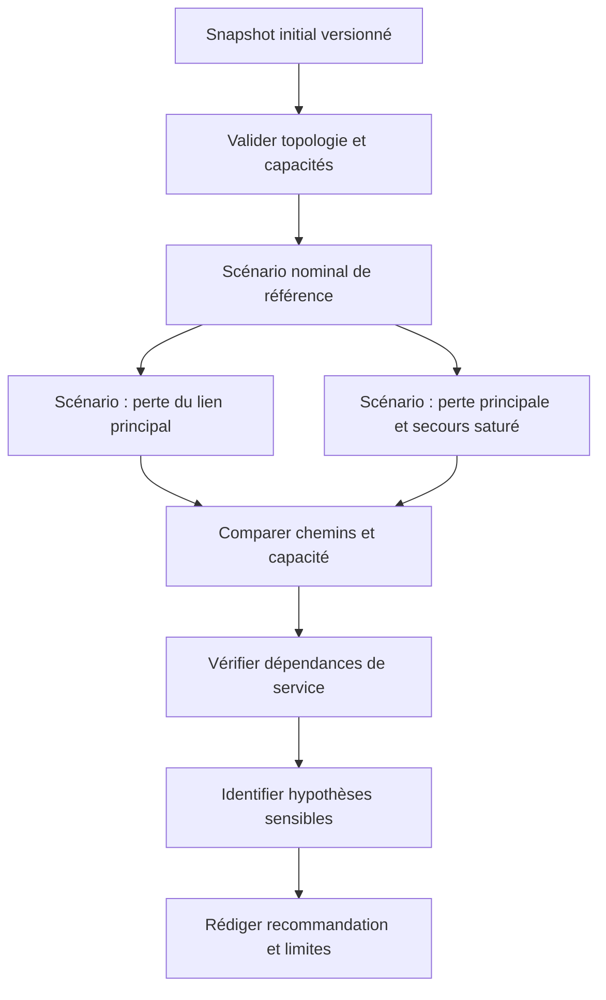

Faites varier les hypothèses de trafic : demande basse, attendue et élevée. Examinez si le service conserve un chemin alternatif et si la capacité du secours reste suffisante. Ajoutez un cas où la topologie est périmée ou le débit mesuré est incomplet ; la simulation doit alors annoncer la limite ou refuser de conclure sur la capacité restante. Ce cas négatif est indispensable pour vérifier que l'outil ne produit pas une réponse rassurante quand ses données sont insuffisantes.

Comparez ensuite la prédiction avec des observations d'un laboratoire réel ou d'une simulation indépendante, si disponibles. Mesurez les erreurs par dimension et expliquez les différences : hypothèse de trafic, route réelle, politique non modélisée, latence de convergence ou mesure imprécise. L'objectif n'est pas d'ajuster le jumeau jusqu'à ce qu'il imite un seul résultat, mais d'améliorer sa fidélité sur plusieurs scénarios pertinents sans sacrifier la capacité à expliquer le modèle.

### 14. Intégrer le jumeau dans un workflow de changement sans lui déléguer l'autorité

Le jumeau peut contribuer à préparer un changement, mais il ne doit pas devenir lui-même l'autorité d'exécution. Une simulation peut indiquer qu'une modification semble sûre sous certaines hypothèses. La décision finale doit encore vérifier les préconditions réelles, les approbations, le périmètre, la fraîcheur des données et les règles de changement. La simulation et l'exécution doivent être séparées dans les droits et dans les journaux.

La chaîne peut générer un plan, afficher la version du modèle, présenter les scénarios testés, exposer les résultats défavorables et demander une approbation. Juste avant l'application, elle doit vérifier que l'état réel n'a pas trop changé depuis le snapshot. Si une nouvelle panne ou un changement de topologie est survenu, l'approbation peut être devenue obsolète. Dans ce cas, recalculer et faire réexaminer le plan est plus sûr que poursuivre selon l'ancien résultat.

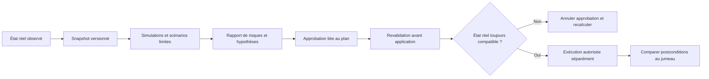

Le rapport de simulation devrait indiquer les risques qui ne peuvent pas être vérifiés. « Aucun impact détecté » ne signifie pas « aucun impact possible » lorsque certaines dépendances sont absentes. Utilisez des statuts explicites comme validé dans le périmètre, validation partielle, données insuffisantes ou scénario rejeté. Les décisions à haut impact devraient exiger une revue humaine et un plan de retour arrière testé.

Après le changement, comparez l'état réel aux prédictions : chemin emprunté, capacité, latence, taux d'erreur et disponibilité du service. Les écarts doivent être classés et utilisés pour corriger les données ou le modèle. Un bon jumeau devient plus fiable parce qu'il apprend de l'écart entre prédiction et résultat ; il ne doit pas simplement supprimer les résultats qui contredisent son hypothèse.

### 15. Sécurité, accès et résistance aux données trompeuses

Le jumeau rassemble la topologie, les dépendances, les capacités et les relations entre services. Ces informations sont sensibles : elles peuvent révéler des chemins critiques, des points de concentration et des composants dont la défaillance aurait un impact large. Contrôlez qui peut lire le modèle complet, qui peut exporter des snapshots et qui peut modifier les relations utilisées par les simulations. Les droits de lecture ne doivent pas automatiquement autoriser la modification d'une topologie ou la publication d'une nouvelle version.

Les données d'entrée doivent être considérées comme potentiellement erronées ou malformées. Un nom ou attribut provenant d'un inventaire externe ne doit pas pouvoir être interprété comme une commande ou modifier un filtre de requête sans validation. Vérifiez les tailles, les types, les références et les limites de graphe. Si le modèle permet d'injecter des scénarios, limitez les ressources et le temps d'exécution pour éviter qu'une simulation trop lourde bloque le service.

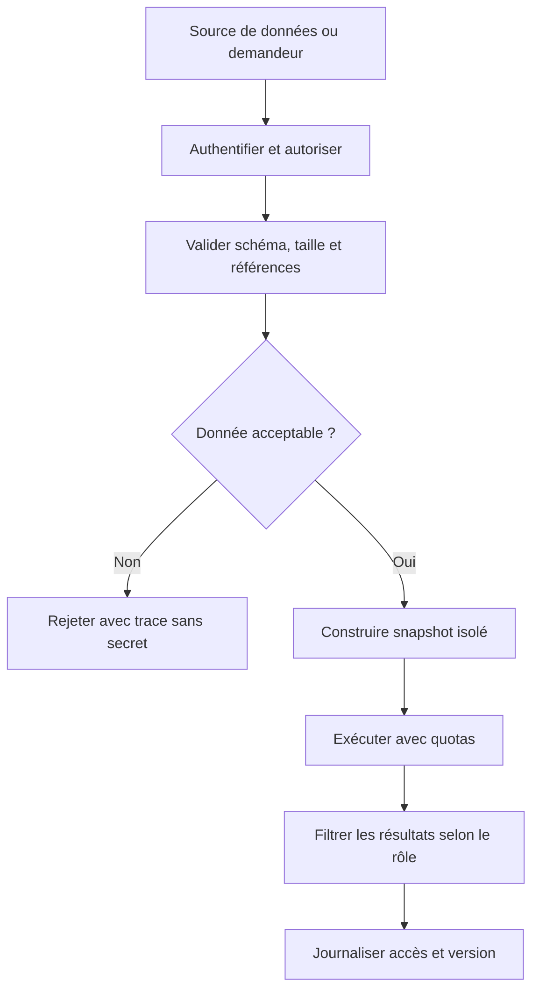

Les logs et rapports ne doivent pas exposer de secrets, de données personnelles inutiles ni de détails qui dépassent le besoin du destinataire. Préservez la traçabilité des modifications et l'historique des versions. Une relation falsifiée ou une capacité erronée peut manipuler les conclusions de plusieurs simulations ; les changements de données doivent donc être audités comme les changements de code.

Lorsque le jumeau est utilisé pour des décisions automatisées, ajoutez des contrôles afin qu'un résultat ne puisse pas être transformé directement en action destructive. Le service d'exécution doit vérifier ses propres permissions et préconditions. Une simulation n'est pas une autorisation, et un résultat de simulation n'est pas une preuve de comportement réel.

### 16. Maintenir le modèle dans le temps

Le modèle vieillit lorsque les actifs changent, que les relations évoluent, que la demande se modifie ou que de nouvelles règles opérationnelles apparaissent. Mesurez le retard entre une modification réelle et sa représentation dans le jumeau, le taux d'objets sans propriétaire, les relations non vérifiées, la proportion de propriétés périmées et la fréquence des divergences détectées après incident.

Créez un processus de réconciliation : comparer régulièrement le jumeau avec l'inventaire, les configurations et les observations. Les écarts doivent être classés en changement réel, retard de synchronisation, défaut de collecte, conflit de sources ou erreur du modèle. Ne corrigez pas automatiquement toutes les différences sans comprendre leur source ; un inventaire peut être ancien, mais la télémétrie peut aussi être trompeuse.

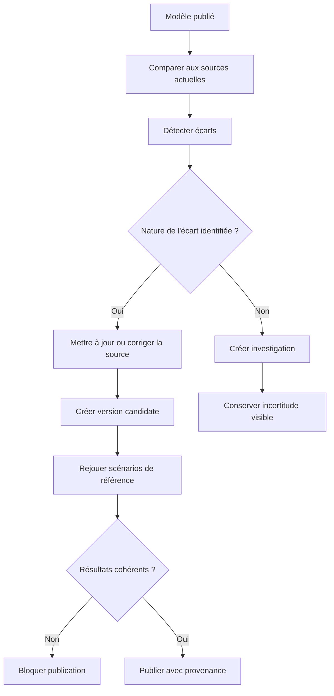

Une réconciliation peut être automatisée dans la détection des différences, mais le changement du modèle doit suivre une politique adaptée à son impact. Une correction d'étiquette sans effet sur les dépendances peut être automatique dans certaines conditions ; une modification de capacité ou de topologie critique peut exiger une revue. Enregistrez le motif, l'auteur ou le système source, la version antérieure et le résultat des tests.

Révisez aussi les scénarios de référence. Un ensemble de tests qui ne couvre que l'ancienne architecture ne montre plus si le modèle décrit le comportement actuel. Ajoutez des cas à partir des incidents réels et des nouvelles dépendances. Conservez toutefois un jeu stable pour comparer les versions sans changer les conditions de mesure au même moment.

### 17. Livrable final de l'atelier

Le livrable est un dossier capable d'être relu par une équipe réseau, une équipe applicative et un responsable de changement. Il contient la question opérationnelle, le périmètre du modèle, les sources et leur fraîcheur, les hypothèses, les versions du snapshot et du simulateur, les scénarios, les résultats par dimension, les tests de sensibilité, les écarts observés et les critères d'acceptation.

Le dossier doit mettre en avant les inconnues au même titre que les résultats. Pour chaque conclusion importante, indiquez quelles données la soutiennent, quels éléments pourraient la contredire et quelle partie du système n'a pas été modélisée. Si le jumeau prédit qu'un service conserve un chemin mais ne représente pas les règles de routage réelles, cette conclusion doit être qualifiée comme partielle. La transparence sur le périmètre évite que les utilisateurs attribuent au modèle des capacités qu'il ne possède pas.

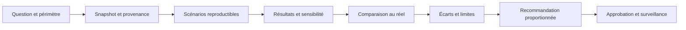

L'acceptation finale doit s'appuyer sur des critères mesurables : exactitude des identités et relations essentielles, fraîcheur des données, reproductibilité des scénarios, stabilité du résultat dans la plage d'incertitude, capacité à signaler les informations manquantes et contrôle des droits. La qualité visuelle de la représentation ne doit pas être confondue avec sa fidélité technique.

### Grille d'autoévaluation de l'atelier

- [ ] Le jumeau a une décision opérationnelle clairement définie.
- [ ] L'état réel, les observations et l'état estimé sont distingués.
- [ ] Les identités sont stables et les alias historisés.
- [ ] La topologie est versionnée temporellement.
- [ ] Les relations et propriétés portent provenance et fraîcheur.
- [ ] Les valeurs inconnues ne sont pas remplacées silencieusement par des valeurs par défaut.
- [ ] Les scénarios couvrent pannes simples, combinées et données insuffisantes.
- [ ] Les capacités, unités et contraintes de service sont représentées.
- [ ] Les hypothèses incertaines sont testées par sensibilité.
- [ ] Les prédictions sont comparées à des observations réelles comparables.
- [ ] Le contrat distingue résultat de simulation et réalité confirmée.
- [ ] L'approbation de changement reste séparée de la simulation.
- [ ] Les versions et les scénarios sont reproductibles.
- [ ] Les données sensibles et les droits d'accès sont contrôlés.
- [ ] Le jumeau peut s'abstenir lorsque le modèle est périmé ou incomplet.

## Défi final corrigé — valider une modification dans le jumeau numérique

### Énoncé

Une modification du routage doit déplacer le trafic d'un lien primaire vers un lien de secours. Avant de toucher la production, le réseau veut simuler la convergence, les contraintes de capacité et les chemins qui deviennent inaccessibles. Le jumeau numérique doit être suffisamment fidèle aux versions, topologie, politiques et limites réellement déployées ; il ne doit pas annoncer une simulation concluante sur un état trop ancien.

### Boucle de synchronisation et simulation

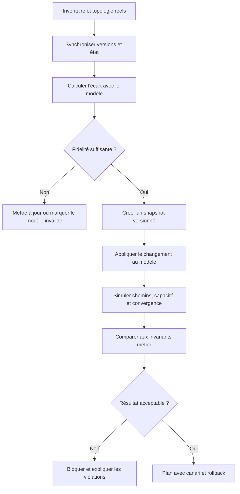

### Exemple de contrat de simulation

```python
def assess_simulation(snapshot, proposal, simulator):
    if not snapshot.version or not snapshot.captured_at:
        return {"status": "invalid", "reason": "snapshot_non_versionne"}
    if snapshot.stale:
        return {"status": "invalid", "reason": "snapshot_perime"}
    result = simulator.run(snapshot=snapshot, proposal=proposal)
    violations = []
    if result.unreachable_critical_services:
        violations.append("service_critique_injoignable")
    if result.link_utilization_peak > 0.80:
        violations.append("capacite_insuffisante")
    return {
        "status": "blocked" if violations else "candidate",
        "violations": violations,
        "snapshot_version": snapshot.version,
        "simulation_id": result.id,
    }
```

Le seuil de 80 % est illustratif : une limite opérationnelle doit être définie avec les marges, les pointes, le type de lien et le contrat de service. Le résultat conserve l'identifiant du snapshot et du moteur de simulation pour pouvoir le reproduire.

### Proposition de correction

Sépare la topologie logique, les liens physiques, les capacités, les métriques, les règles et les versions de configuration. Chaque objet doit avoir une source de vérité et un horodatage de synchronisation. Une différence entre le modèle et le réseau réel est une information de qualité majeure : si elle touche un équipement ou un chemin critique, la simulation doit échouer de manière contrôlée ou être marquée comme incertaine.

Teste d'abord les invariants : services critiques joignables, absence de boucles, chemins de secours disponibles, capacité maximale respectée et convergence dans le délai attendu. Garde des scénarios de référence dont les résultats connus détectent une régression du simulateur. Compare occasionnellement les résultats simulés à un changement réellement approuvé et mesure les différences.

Un jumeau n'est ni un miroir parfait ni une garantie de sécurité. Le déploiement en production garde ses propres contrôles : approbation, canari, mesure des services, critères d'arrêt et retour arrière. Le résultat du simulateur doit expliquer les hypothèses, les écarts connus et les parties du réseau qui ne sont pas modélisées.

### Barème d'autoévaluation

- Le snapshot est daté et versionné.
- La fidélité du modèle est évaluée avant simulation.
- Les invariants et les limites de capacité sont explicites.
- Les résultats sont reproductibles et comparés à des références.
- La simulation complète, sans remplacer, le contrôle du changement réel.

## 11. Checklist et à retenir

- [ ] L'objectif métier et le service sont écrits et mesurables.
- [ ] Chaque observation conserve provenance, heure, unité et qualité.
- [ ] La méthode est comparée à une baseline.
- [ ] Les tests incluent données manquantes et échecs de dépendance.
- [ ] Les résultats sont segmentés par criticité et type de cible.
- [ ] Les droits sont minimaux et les secrets absents des logs.
- [ ] La décision relie preuves, version, approbation et résultat.
- [ ] Toute action risquée a préconditions, périmètre et rollback.
- [ ] Les indicateurs mesurent le service, pas seulement le modèle.
- [ ] La procédure couvre abstention, escalade, suspension et revue.

### À retenir
Le but de Jumeaux numériques réseau n'est pas d'automatiser toutes les décisions, mais de rendre l'exploitation plus rapide, cohérente et vérifiable. Une solution utile s'appuie sur des données explicites, une technique adaptée, une évaluation honnête et des postconditions mesurées. Elle sait signaler ses limites, bloquer une action risquée et transmettre les preuves qui permettent à une autre personne de reprendre l'analyse.

Les mesures possibles comprennent couverture de topologie, fraîcheur des données, dépendances représentées, écart entre simulation et observation, changements validés avant production. Chacune doit être associée à un objectif, un responsable et une action lorsque la limite est dépassée. Le nombre de modèles ou d'alertes traitées ne prouve pas la valeur opérationnelle. Il faut confirmer ou réfuter les hypothèses avec les résultats, documenter les erreurs et améliorer les tests. créer un modèle synchronisé et calibré pour comparer des scénarios avant de toucher au réseau réel Le maintien dans le temps exige de réviser les sources, vérifier la reprise et retirer une méthode dont les limites dépassent le bénéfice.

## 12. Références

- https://openconfig.net/
- https://opentelemetry.io/docs/
- https://opentelemetry.io/docs/ — concepts d'observabilité et de télémétrie.
- https://www.nist.gov/itl/ai-risk-management-framework — cadre de gestion des risques de l'IA.
