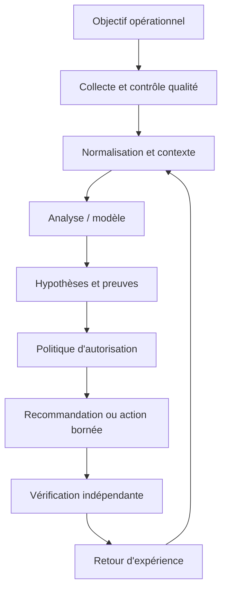
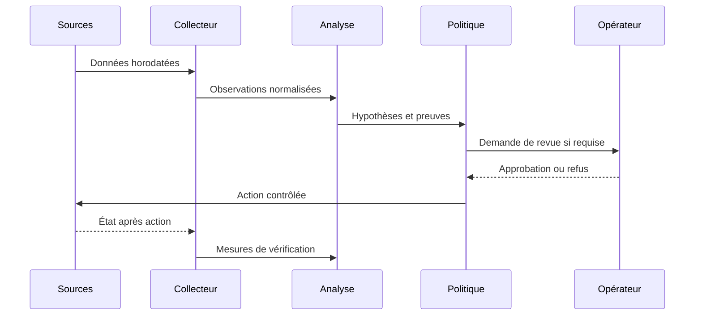
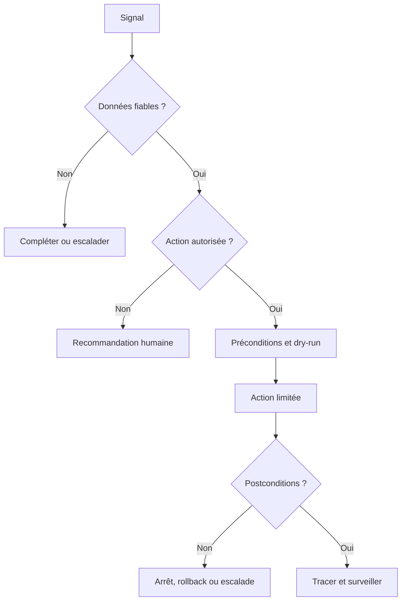

# Jumeaux numériques réseau — Intermédiaire

> **Mise en contexte :** une migration de routage touche plusieurs sites ; un schéma statique ne montre ni toutes les dépendances ni l'impact d'une perte de lien. Le but est d'améliorer les opérations de manière mesurable, vérifiable et proportionnée au risque. Les exemples sont pédagogiques : les tester dans un laboratoire et adapter identités, versions, capacités et permissions avant tout usage réel.

## Sommaire
1. Introduction et objectifs
2. Concepts clés
3. Architecture de référence
4. Pipeline et algorithmes
5. Étude de cas détaillée
6. Implémentation et TP
7. Sécurité et gouvernance
8. Pièges à éviter
9. Diagnostic et dépannage
10. Exercices corrigés
11. Checklist et à retenir
12. Références

## 1. Introduction et objectifs

créer un modèle synchronisé et calibré pour comparer des scénarios avant de toucher au réseau réel. Le scénario de départ est concret : une migration de routage touche plusieurs sites ; un schéma statique ne montre ni toutes les dépendances ni l'impact d'une perte de lien. Les équipes doivent agir rapidement, alors que les observations peuvent être contradictoires, les horloges décalées et les interventions porteuses de risques. La solution doit distinguer un signal, une hypothèse, une décision et une preuve de résultat. Une alerte n'est pas automatiquement un incident confirmé, un score n'est pas une preuve de causalité, et l'exécution d'une commande ne prouve pas le rétablissement du service.

Les outils utiles sont topologie, inventaire, simulateur, modèles de capacité et tests de scénarios. Ils ne doivent pas tous être déployés simplement parce qu'ils existent. Chaque composant doit répondre à une exigence identifiée et avoir un propriétaire. Une première version en lecture seule est souvent préférable : elle permet de mesurer les performances, de comprendre les erreurs et de définir les conditions minimales avant d'accorder une capacité d'action. L'automatisation se justifie lorsque son gain est mesurable et que la réponse aux échecs est maîtrisée.

À la fin du cours, l'apprenant doit savoir expliquer les concepts, décrire l'architecture, concevoir un essai reproductible, choisir des métriques adaptées, analyser les erreurs et défendre ses limites. Il doit aussi être capable de documenter quand la méthode ne doit pas être utilisée, quand l'incertitude impose une abstention et quand une approbation humaine est obligatoire.

### Objectifs pédagogiques
- Définir une question opérationnelle mesurable.
- Identifier les données, leur provenance et leur fraîcheur.
- Construire une architecture d'analyse et de vérification.
- Comparer la méthode à une baseline simple.
- Limiter privilèges et rayon d'impact.
- Documenter l'incertitude, l'escalade et le retour arrière.

## 2. Concepts clés

### 1. Jumeau numérique
Une représentation mise à jour du système réel est alimentée par des données et sert à observer ou simuler son comportement.

Dans une exploitation réelle, Jumeau numérique doit répondre à une question opérationnelle clairement formulée. Une représentation mise à jour du système réel est alimentée par des données et sert à observer ou simuler son comportement. L'équipe désigne la source de vérité, le propriétaire, la fréquence de mise à jour et le périmètre d'utilisation avant de rendre un résultat visible aux opérateurs. Pour le scénario « une migration de routage touche plusieurs sites ; un schéma statique ne montre ni toutes les dépendances ni l'impact d'une perte de lien », cela évite de transformer une intuition en instruction. Il faut aussi préciser quand le système doit s'abstenir, demander des données supplémentaires ou transférer le dossier à une personne responsable.

La mise en œuvre de Jumeau numérique se découpe en étapes testables : validation des entrées, contrôle des sources, traitement des valeurs absentes, journalisation et vérification des sorties. L'outil topologie peut contribuer au processus, mais sa présence ne garantit pas sa fiabilité. Les erreurs doivent rester explicites au lieu d'être converties en valeurs par défaut silencieuses. Une exécution fiable distingue succès, échec, état partiel et état impossible à déterminer, et conserve la version de code ou de modèle qui a produit la sortie.

L'évaluation de Jumeau numérique couvre les cas habituels, les cas limites, les données manquantes et les situations inédites. Il faut mesurer couverture de topologie et segmenter les résultats par site, plateforme ou criticité. Une moyenne globale peut masquer une défaillance rare mais grave ; garder des exemples concrets aide à comprendre faux positifs et faux négatifs. Après tout changement de données, d'algorithme ou de dépendance, rejouer un corpus de référence et vérifier que le comportement attendu persiste.

Aucune approche liée à Jumeau numérique n'est universellement meilleure. Une règle peut être plus simple à expliquer, un modèle peut capter des interactions, et une génération de texte peut accélérer une synthèse tout en introduisant des erreurs plausibles. Le choix dépend du coût des erreurs, des données, de la latence, de l'explicabilité et de la maintenance. Une baseline et un mode manuel doivent rester disponibles lorsque les observations sont incomplètes ou la méthode n'atteint plus le niveau de qualité attendu.

### 2. Modèle de topologie
Le modèle représente équipements, liens, capacités, protocoles et dépendances de services.

Dans une exploitation réelle, Modèle de topologie doit répondre à une question opérationnelle clairement formulée. Le modèle représente équipements, liens, capacités, protocoles et dépendances de services. L'équipe désigne la source de vérité, le propriétaire, la fréquence de mise à jour et le périmètre d'utilisation avant de rendre un résultat visible aux opérateurs. Pour le scénario « une migration de routage touche plusieurs sites ; un schéma statique ne montre ni toutes les dépendances ni l'impact d'une perte de lien », cela évite de transformer une intuition en instruction. Il faut aussi préciser quand le système doit s'abstenir, demander des données supplémentaires ou transférer le dossier à une personne responsable.

La mise en œuvre de Modèle de topologie se découpe en étapes testables : validation des entrées, contrôle des sources, traitement des valeurs absentes, journalisation et vérification des sorties. L'outil inventaire peut contribuer au processus, mais sa présence ne garantit pas sa fiabilité. Les erreurs doivent rester explicites au lieu d'être converties en valeurs par défaut silencieuses. Une exécution fiable distingue succès, échec, état partiel et état impossible à déterminer, et conserve la version de code ou de modèle qui a produit la sortie.

L'évaluation de Modèle de topologie couvre les cas habituels, les cas limites, les données manquantes et les situations inédites. Il faut mesurer fraîcheur des données et segmenter les résultats par site, plateforme ou criticité. Une moyenne globale peut masquer une défaillance rare mais grave ; garder des exemples concrets aide à comprendre faux positifs et faux négatifs. Après tout changement de données, d'algorithme ou de dépendance, rejouer un corpus de référence et vérifier que le comportement attendu persiste.

### 3. Synchronisation
Les données réelles sont rapprochées du modèle périodiquement ou événementiellement, avec provenance et fraîcheur.

Dans une exploitation réelle, Synchronisation doit répondre à une question opérationnelle clairement formulée. Les données réelles sont rapprochées du modèle périodiquement ou événementiellement, avec provenance et fraîcheur. L'équipe désigne la source de vérité, le propriétaire, la fréquence de mise à jour et le périmètre d'utilisation avant de rendre un résultat visible aux opérateurs. Pour le scénario « une migration de routage touche plusieurs sites ; un schéma statique ne montre ni toutes les dépendances ni l'impact d'une perte de lien », cela évite de transformer une intuition en instruction. Il faut aussi préciser quand le système doit s'abstenir, demander des données supplémentaires ou transférer le dossier à une personne responsable.

La mise en œuvre de Synchronisation se découpe en étapes testables : validation des entrées, contrôle des sources, traitement des valeurs absentes, journalisation et vérification des sorties. L'outil simulateur peut contribuer au processus, mais sa présence ne garantit pas sa fiabilité. Les erreurs doivent rester explicites au lieu d'être converties en valeurs par défaut silencieuses. Une exécution fiable distingue succès, échec, état partiel et état impossible à déterminer, et conserve la version de code ou de modèle qui a produit la sortie.

L'évaluation de Synchronisation couvre les cas habituels, les cas limites, les données manquantes et les situations inédites. Il faut mesurer dépendances représentées et segmenter les résultats par site, plateforme ou criticité. Une moyenne globale peut masquer une défaillance rare mais grave ; garder des exemples concrets aide à comprendre faux positifs et faux négatifs. Après tout changement de données, d'algorithme ou de dépendance, rejouer un corpus de référence et vérifier que le comportement attendu persiste.

### 4. Fidélité
La fidélité indique si la simulation reproduit les propriétés utiles ; une propriété omise doit rester explicitement indiquée.

Dans une exploitation réelle, Fidélité doit répondre à une question opérationnelle clairement formulée. La fidélité indique si la simulation reproduit les propriétés utiles ; une propriété omise doit rester explicitement indiquée. L'équipe désigne la source de vérité, le propriétaire, la fréquence de mise à jour et le périmètre d'utilisation avant de rendre un résultat visible aux opérateurs. Pour le scénario « une migration de routage touche plusieurs sites ; un schéma statique ne montre ni toutes les dépendances ni l'impact d'une perte de lien », cela évite de transformer une intuition en instruction. Il faut aussi préciser quand le système doit s'abstenir, demander des données supplémentaires ou transférer le dossier à une personne responsable.

La mise en œuvre de Fidélité se découpe en étapes testables : validation des entrées, contrôle des sources, traitement des valeurs absentes, journalisation et vérification des sorties. L'outil modèles de capacité et tests de scénarios peut contribuer au processus, mais sa présence ne garantit pas sa fiabilité. Les erreurs doivent rester explicites au lieu d'être converties en valeurs par défaut silencieuses. Une exécution fiable distingue succès, échec, état partiel et état impossible à déterminer, et conserve la version de code ou de modèle qui a produit la sortie.

L'évaluation de Fidélité couvre les cas habituels, les cas limites, les données manquantes et les situations inédites. Il faut mesurer écart entre simulation et observation et segmenter les résultats par site, plateforme ou criticité. Une moyenne globale peut masquer une défaillance rare mais grave ; garder des exemples concrets aide à comprendre faux positifs et faux négatifs. Après tout changement de données, d'algorithme ou de dépendance, rejouer un corpus de référence et vérifier que le comportement attendu persiste.

Aucune approche liée à Fidélité n'est universellement meilleure. Une règle peut être plus simple à expliquer, un modèle peut capter des interactions, et une génération de texte peut accélérer une synthèse tout en introduisant des erreurs plausibles. Le choix dépend du coût des erreurs, des données, de la latence, de l'explicabilité et de la maintenance. Une baseline et un mode manuel doivent rester disponibles lorsque les observations sont incomplètes ou la méthode n'atteint plus le niveau de qualité attendu.

### 5. Scénario contrefactuel
Un scénario teste ce qui pourrait arriver après une perte de lien, un pic de charge ou une modification de politique.

Dans une exploitation réelle, Scénario contrefactuel doit répondre à une question opérationnelle clairement formulée. Un scénario teste ce qui pourrait arriver après une perte de lien, un pic de charge ou une modification de politique. L'équipe désigne la source de vérité, le propriétaire, la fréquence de mise à jour et le périmètre d'utilisation avant de rendre un résultat visible aux opérateurs. Pour le scénario « une migration de routage touche plusieurs sites ; un schéma statique ne montre ni toutes les dépendances ni l'impact d'une perte de lien », cela évite de transformer une intuition en instruction. Il faut aussi préciser quand le système doit s'abstenir, demander des données supplémentaires ou transférer le dossier à une personne responsable.

La mise en œuvre de Scénario contrefactuel se découpe en étapes testables : validation des entrées, contrôle des sources, traitement des valeurs absentes, journalisation et vérification des sorties. L'outil topologie peut contribuer au processus, mais sa présence ne garantit pas sa fiabilité. Les erreurs doivent rester explicites au lieu d'être converties en valeurs par défaut silencieuses. Une exécution fiable distingue succès, échec, état partiel et état impossible à déterminer, et conserve la version de code ou de modèle qui a produit la sortie.

L'évaluation de Scénario contrefactuel couvre les cas habituels, les cas limites, les données manquantes et les situations inédites. Il faut mesurer changements validés avant production et segmenter les résultats par site, plateforme ou criticité. Une moyenne globale peut masquer une défaillance rare mais grave ; garder des exemples concrets aide à comprendre faux positifs et faux négatifs. Après tout changement de données, d'algorithme ou de dépendance, rejouer un corpus de référence et vérifier que le comportement attendu persiste.

### 6. Calibration
Les résultats de simulation sont comparés à des observations et les écarts doivent être expliqués.

Dans une exploitation réelle, Calibration doit répondre à une question opérationnelle clairement formulée. Les résultats de simulation sont comparés à des observations et les écarts doivent être expliqués. L'équipe désigne la source de vérité, le propriétaire, la fréquence de mise à jour et le périmètre d'utilisation avant de rendre un résultat visible aux opérateurs. Pour le scénario « une migration de routage touche plusieurs sites ; un schéma statique ne montre ni toutes les dépendances ni l'impact d'une perte de lien », cela évite de transformer une intuition en instruction. Il faut aussi préciser quand le système doit s'abstenir, demander des données supplémentaires ou transférer le dossier à une personne responsable.

La mise en œuvre de Calibration se découpe en étapes testables : validation des entrées, contrôle des sources, traitement des valeurs absentes, journalisation et vérification des sorties. L'outil inventaire peut contribuer au processus, mais sa présence ne garantit pas sa fiabilité. Les erreurs doivent rester explicites au lieu d'être converties en valeurs par défaut silencieuses. Une exécution fiable distingue succès, échec, état partiel et état impossible à déterminer, et conserve la version de code ou de modèle qui a produit la sortie.

L'évaluation de Calibration couvre les cas habituels, les cas limites, les données manquantes et les situations inédites. Il faut mesurer couverture de topologie et segmenter les résultats par site, plateforme ou criticité. Une moyenne globale peut masquer une défaillance rare mais grave ; garder des exemples concrets aide à comprendre faux positifs et faux négatifs. Après tout changement de données, d'algorithme ou de dépendance, rejouer un corpus de référence et vérifier que le comportement attendu persiste.

### 7. Décision de changement
La simulation aide à comparer les options mais ne remplace pas revue, canary, validation post-action et rollback.

Dans une exploitation réelle, Décision de changement doit répondre à une question opérationnelle clairement formulée. La simulation aide à comparer les options mais ne remplace pas revue, canary, validation post-action et rollback. L'équipe désigne la source de vérité, le propriétaire, la fréquence de mise à jour et le périmètre d'utilisation avant de rendre un résultat visible aux opérateurs. Pour le scénario « une migration de routage touche plusieurs sites ; un schéma statique ne montre ni toutes les dépendances ni l'impact d'une perte de lien », cela évite de transformer une intuition en instruction. Il faut aussi préciser quand le système doit s'abstenir, demander des données supplémentaires ou transférer le dossier à une personne responsable.

La mise en œuvre de Décision de changement se découpe en étapes testables : validation des entrées, contrôle des sources, traitement des valeurs absentes, journalisation et vérification des sorties. L'outil simulateur peut contribuer au processus, mais sa présence ne garantit pas sa fiabilité. Les erreurs doivent rester explicites au lieu d'être converties en valeurs par défaut silencieuses. Une exécution fiable distingue succès, échec, état partiel et état impossible à déterminer, et conserve la version de code ou de modèle qui a produit la sortie.

L'évaluation de Décision de changement couvre les cas habituels, les cas limites, les données manquantes et les situations inédites. Il faut mesurer fraîcheur des données et segmenter les résultats par site, plateforme ou criticité. Une moyenne globale peut masquer une défaillance rare mais grave ; garder des exemples concrets aide à comprendre faux positifs et faux négatifs. Après tout changement de données, d'algorithme ou de dépendance, rejouer un corpus de référence et vérifier que le comportement attendu persiste.

Aucune approche liée à Décision de changement n'est universellement meilleure. Une règle peut être plus simple à expliquer, un modèle peut capter des interactions, et une génération de texte peut accélérer une synthèse tout en introduisant des erreurs plausibles. Le choix dépend du coût des erreurs, des données, de la latence, de l'explicabilité et de la maintenance. Une baseline et un mode manuel doivent rester disponibles lorsque les observations sont incomplètes ou la méthode n'atteint plus le niveau de qualité attendu.

## 3. Architecture de référence

Une architecture fiable sépare la collecte, la normalisation, l'analyse, la politique d'autorisation et la vérification. Un détecteur ne doit pas être relié directement à une commande privilégiée : la moindre fausse alerte pourrait déclencher une intervention inappropriée. Entre proposition et exécution, un point de décision doit examiner qualité des données, confiance, criticité, cible, préconditions et nécessité d'une revue.



Chaque observation conserve source, horodatage, unité, cible, fraîcheur et état de qualité. Le résultat de l'analyse référence sa version et ses entrées. La décision expose actions permises, préconditions, approbations, quotas et conditions d'arrêt. La sortie finale indique les preuves exigées avant de déclarer le succès, ainsi que les situations qui imposent une escalade.



### Décision sous incertitude

La sécurité liée à Séparation entre analyse et exécution doit être conçue en amont : privilèges minimaux, protection des secrets, audit, séparation de l'analyse et de l'exécution, et règles d'escalade. Le piège principal ici est de traiter le modèle comme une copie parfaite. Les données externes doivent rester des données, jamais une autorité qui redéfinit les permissions. Pour une opération à fort impact, il faut des préconditions vérifiables, une approbation adaptée et un retour arrière testé, même lorsque le score du modèle semble très élevé.

Quand Données manquantes produit un résultat inattendu, commencer par l'heure, la source, l'unité, la cible, la fraîcheur, la version et le code d'erreur. Comparer l'observation brute à sa représentation transformée, puis chercher une modification récente. Tester une hypothèse à la fois et consigner la preuve du résultat sans copier de secrets dans le ticket. Une fois la cause confirmée, ajouter un test de régression et vérifier qu'il échoue avant le correctif et passe après celui-ci.

À l'échelle, Mode dégradé doit gérer des volumes et versions hétérogènes sans perdre de traçabilité. Borner la concurrence, isoler les erreurs par cible, limiter les files et surveiller les retards protègent l'aval. La reprise d'une panne peut elle-même provoquer une surcharge si toutes les sources se reconnectent simultanément. Le système doit pouvoir réduire sa fréquence ou revenir à une méthode simple, tout en signalant explicitement ce mode dégradé au lieu d'afficher un faux état normal.



## 4. Pipeline et algorithmes

Le pipeline décrit ici est une chaîne de responsabilités, pas nécessairement six services séparés. Chaque étape doit avoir des entrées et sorties définies, des tests et une méthode de gestion des erreurs. Les données sont validées avant l'analyse, le contexte est enrichi avant l'interprétation, et la politique est consultée avant une action. Cette séquence permet de démarrer en mode observation et d'augmenter l'autonomie uniquement lorsque les critères sont prouvés.

### Étape 1 — Construire le graphe
Rassembler nœuds, liens, capacités, protocoles et dépendances.

La mise en œuvre de Construire le graphe se découpe en étapes testables : validation des entrées, contrôle des sources, traitement des valeurs absentes, journalisation et vérification des sorties. L'outil topologie peut contribuer au processus, mais sa présence ne garantit pas sa fiabilité. Les erreurs doivent rester explicites au lieu d'être converties en valeurs par défaut silencieuses. Une exécution fiable distingue succès, échec, état partiel et état impossible à déterminer, et conserve la version de code ou de modèle qui a produit la sortie.

Quand Construire le graphe produit un résultat inattendu, commencer par l'heure, la source, l'unité, la cible, la fraîcheur, la version et le code d'erreur. Comparer l'observation brute à sa représentation transformée, puis chercher une modification récente. Tester une hypothèse à la fois et consigner la preuve du résultat sans copier de secrets dans le ticket. Une fois la cause confirmée, ajouter un test de régression et vérifier qu'il échoue avant le correctif et passe après celui-ci.

### Étape 2 — Qualifier la fraîcheur
Attacher source, timestamp, version et niveau de confiance.

La mise en œuvre de Qualifier la fraîcheur se découpe en étapes testables : validation des entrées, contrôle des sources, traitement des valeurs absentes, journalisation et vérification des sorties. L'outil inventaire peut contribuer au processus, mais sa présence ne garantit pas sa fiabilité. Les erreurs doivent rester explicites au lieu d'être converties en valeurs par défaut silencieuses. Une exécution fiable distingue succès, échec, état partiel et état impossible à déterminer, et conserve la version de code ou de modèle qui a produit la sortie.

Quand Qualifier la fraîcheur produit un résultat inattendu, commencer par l'heure, la source, l'unité, la cible, la fraîcheur, la version et le code d'erreur. Comparer l'observation brute à sa représentation transformée, puis chercher une modification récente. Tester une hypothèse à la fois et consigner la preuve du résultat sans copier de secrets dans le ticket. Une fois la cause confirmée, ajouter un test de régression et vérifier qu'il échoue avant le correctif et passe après celui-ci.

### Étape 3 — Calibrer
Comparer le modèle à des scénarios historiques ou tests contrôlés.

La mise en œuvre de Calibrer se découpe en étapes testables : validation des entrées, contrôle des sources, traitement des valeurs absentes, journalisation et vérification des sorties. L'outil simulateur peut contribuer au processus, mais sa présence ne garantit pas sa fiabilité. Les erreurs doivent rester explicites au lieu d'être converties en valeurs par défaut silencieuses. Une exécution fiable distingue succès, échec, état partiel et état impossible à déterminer, et conserve la version de code ou de modèle qui a produit la sortie.

Quand Calibrer produit un résultat inattendu, commencer par l'heure, la source, l'unité, la cible, la fraîcheur, la version et le code d'erreur. Comparer l'observation brute à sa représentation transformée, puis chercher une modification récente. Tester une hypothèse à la fois et consigner la preuve du résultat sans copier de secrets dans le ticket. Une fois la cause confirmée, ajouter un test de régression et vérifier qu'il échoue avant le correctif et passe après celui-ci.

### Étape 4 — Définir les scénarios
Préciser événement hypothétique, charge, contraintes et critères de réussite.

La mise en œuvre de Définir les scénarios se découpe en étapes testables : validation des entrées, contrôle des sources, traitement des valeurs absentes, journalisation et vérification des sorties. L'outil modèles de capacité et tests de scénarios peut contribuer au processus, mais sa présence ne garantit pas sa fiabilité. Les erreurs doivent rester explicites au lieu d'être converties en valeurs par défaut silencieuses. Une exécution fiable distingue succès, échec, état partiel et état impossible à déterminer, et conserve la version de code ou de modèle qui a produit la sortie.

Quand Définir les scénarios produit un résultat inattendu, commencer par l'heure, la source, l'unité, la cible, la fraîcheur, la version et le code d'erreur. Comparer l'observation brute à sa représentation transformée, puis chercher une modification récente. Tester une hypothèse à la fois et consigner la preuve du résultat sans copier de secrets dans le ticket. Une fois la cause confirmée, ajouter un test de régression et vérifier qu'il échoue avant le correctif et passe après celui-ci.

### Étape 5 — Simuler
Comparer chemins, capacités restantes, résilience et services touchés.

La mise en œuvre de Simuler se découpe en étapes testables : validation des entrées, contrôle des sources, traitement des valeurs absentes, journalisation et vérification des sorties. L'outil topologie peut contribuer au processus, mais sa présence ne garantit pas sa fiabilité. Les erreurs doivent rester explicites au lieu d'être converties en valeurs par défaut silencieuses. Une exécution fiable distingue succès, échec, état partiel et état impossible à déterminer, et conserve la version de code ou de modèle qui a produit la sortie.

Quand Simuler produit un résultat inattendu, commencer par l'heure, la source, l'unité, la cible, la fraîcheur, la version et le code d'erreur. Comparer l'observation brute à sa représentation transformée, puis chercher une modification récente. Tester une hypothèse à la fois et consigner la preuve du résultat sans copier de secrets dans le ticket. Une fois la cause confirmée, ajouter un test de régression et vérifier qu'il échoue avant le correctif et passe après celui-ci.

### Étape 6 — Comparer au réel
Après un changement contrôlé, vérifier les prédictions et corriger le modèle.

La mise en œuvre de Comparer au réel se découpe en étapes testables : validation des entrées, contrôle des sources, traitement des valeurs absentes, journalisation et vérification des sorties. L'outil inventaire peut contribuer au processus, mais sa présence ne garantit pas sa fiabilité. Les erreurs doivent rester explicites au lieu d'être converties en valeurs par défaut silencieuses. Une exécution fiable distingue succès, échec, état partiel et état impossible à déterminer, et conserve la version de code ou de modèle qui a produit la sortie.

Quand Comparer au réel produit un résultat inattendu, commencer par l'heure, la source, l'unité, la cible, la fraîcheur, la version et le code d'erreur. Comparer l'observation brute à sa représentation transformée, puis chercher une modification récente. Tester une hypothèse à la fois et consigner la preuve du résultat sans copier de secrets dans le ticket. Une fois la cause confirmée, ajouter un test de régression et vérifier qu'il échoue avant le correctif et passe après celui-ci.

### Pseudocode défensif
```text
observations = collecter()
si qualité(observations) insuffisante:
    signaler les données manquantes et escalader
sinon:
    contexte = enrichir(observations, inventaire, changements, dépendances)
    hypothèses = analyser(contexte)
    vérifier la provenance de chaque preuve
    si preuve insuffisante ou action hors politique:
        recommander sans exécuter
    sinon:
        préparer diff, préconditions, approbations et rollback
        appliquer sur un petit périmètre
        mesurer les postconditions indépendantes
        restaurer ou escalader si non conforme
        journaliser version, preuves, décision et résultat
```

Ce pseudocode explique la logique et n'est pas une bibliothèque prête pour la production. Chaque étape exige des tests, des permissions appropriées et un mode de reprise explicite. Un système fiable ne remplace pas l'incertitude par une valeur par défaut ; il la rend visible et réduit son autonomie lorsque les preuves sont incomplètes.

## 5. Étude de cas détaillée

### Situation et impact
une migration de routage touche plusieurs sites ; un schéma statique ne montre ni toutes les dépendances ni l'impact d'une perte de lien. L'équipe commence par établir le périmètre, l'impact utilisateur, la chronologie et la criticité des actifs. Sa première question n'est pas « quel modèle est à la mode ? », mais « quelle décision doit devenir meilleure, et quelle preuve permettra de le démontrer ? ». Cette formulation évite la dérive du périmètre et fixe un critère d'arrêt si la solution n'apporte pas de valeur.

### Phase 1 — Établir les faits
Conserver les données brutes en lecture seule et noter les sources, timestamps, versions et transformations. Vérifier les changements récents et la qualité de collecte. Les valeurs absentes demeurent absentes ; elles ne sont pas remplacées par zéro. L'impact métier est mesuré séparément de l'état d'un équipement. Les contradictions entre systèmes sont documentées au lieu d'être résolues par intuition.

### Phase 2 — Comparer les hypothèses
Décrire au moins deux explications si les preuves ne permettent pas de conclure directement. Pour chacune, noter les observations favorables, les contre-indices et le test qui peut la distinguer. La priorité dépend de l'impact, de la plausibilité et du coût du test. Une ressemblance avec un incident historique ne suffit pas : versions, topologie, capacité et fenêtre de charge peuvent changer l'explication.

### Phase 3 — Préparer une réponse proportionnée
Privilégier les contrôles non destructifs. Si une modification devient nécessaire, préciser cible, diff, préconditions, impact, fenêtre, critères d'arrêt et rollback. Une revue indépendante s'impose lorsque le rayon d'impact est grand. Le plan doit permettre de refuser une action lorsque les preuves ne sont pas suffisantes.

### Phase 4 — Vérifier
Après action, contrôler mesures indépendantes : fonctionnement du service, latence, erreurs, connectivité, état de configuration ou autre indicateur pertinent. Une seule valeur favorable ne prouve pas un rétablissement durable. Lorsque les postconditions échouent, arrêter, restaurer selon le plan ou escalader. Le compte rendu distingue ce qui a été tenté, observé, confirmé et laissé inconnu.

### Phase 5 — Tirer des leçons
Comparer les hypothèses initiales aux preuves finales. Ajouter tests de régression, sources manquantes et contrôles à améliorer. Une règle ou un modèle mis à jour passe par une revue et une expérimentation contrôlée avant généralisation. Les conclusions non confirmées ne deviennent pas automatiquement de nouvelles étiquettes d'entraînement.

### Conditions de clôture
La clôture exige soit une preuve de rétablissement, soit une déclaration explicite que le service reste dégradé. Le dossier conserve sources, versions, actions, approbations, résultats et suivis. La cause racine n'est déclarée confirmée que si les preuves le permettent. Une conclusion honnêtement partielle est préférable à une explication catégorique impossible à reproduire.

## 6. Implémentation et TP

Exécuter les travaux pratiques dans un laboratoire isolé ou sur des systèmes autorisés. Noter les versions, dépendances, données et critères de réussite. Le résultat doit pouvoir être reproduit par un autre opérateur ; un succès affiché par l'outil ne remplace pas le contrôle de l'état réel.

### TP 1 — Construire un graphe de laboratoire avec équipements et liens.
**Procédure.** Construire un graphe de laboratoire avec équipements et liens. Utiliser une cible limitée, capturer l'état initial et ne changer qu'un paramètre à la fois. Relier le travail au concept « Jumeau numérique » : Une représentation mise à jour du système réel est alimentée par des données et sert à observer ou simuler son comportement. Conserver commande, entrée, version et sortie.

**Contrôle.** Reproduire le résultat, puis tester une erreur contrôlée, une donnée manquante et une dépendance indisponible. Vérifier l'état effectif, les effets secondaires et la procédure de reprise. Si le résultat ne peut pas être déterminé, signaler cet état plutôt que le considérer comme une réussite. Décrire ce qui est démontré et les limites qui subsistent avant un déploiement plus large.

### TP 2 — Importer des données d'inventaire et horodater les sources.
**Procédure.** Importer des données d'inventaire et horodater les sources. Utiliser une cible limitée, capturer l'état initial et ne changer qu'un paramètre à la fois. Relier le travail au concept « Modèle de topologie » : Le modèle représente équipements, liens, capacités, protocoles et dépendances de services. Conserver commande, entrée, version et sortie.

**Contrôle.** Reproduire le résultat, puis tester une erreur contrôlée, une donnée manquante et une dépendance indisponible. Vérifier l'état effectif, les effets secondaires et la procédure de reprise. Si le résultat ne peut pas être déterminé, signaler cet état plutôt que le considérer comme une réussite. Décrire ce qui est démontré et les limites qui subsistent avant un déploiement plus large.

### TP 3 — Marquer explicitement les attributs inconnus ou anciens.
**Procédure.** Marquer explicitement les attributs inconnus ou anciens. Utiliser une cible limitée, capturer l'état initial et ne changer qu'un paramètre à la fois. Relier le travail au concept « Synchronisation » : Les données réelles sont rapprochées du modèle périodiquement ou événementiellement, avec provenance et fraîcheur. Conserver commande, entrée, version et sortie.

**Contrôle.** Reproduire le résultat, puis tester une erreur contrôlée, une donnée manquante et une dépendance indisponible. Vérifier l'état effectif, les effets secondaires et la procédure de reprise. Si le résultat ne peut pas être déterminé, signaler cet état plutôt que le considérer comme une réussite. Décrire ce qui est démontré et les limites qui subsistent avant un déploiement plus large.

### TP 4 — Simuler la perte d'un lien principal.
**Procédure.** Simuler la perte d'un lien principal. Utiliser une cible limitée, capturer l'état initial et ne changer qu'un paramètre à la fois. Relier le travail au concept « Fidélité » : La fidélité indique si la simulation reproduit les propriétés utiles ; une propriété omise doit rester explicitement indiquée. Conserver commande, entrée, version et sortie.

**Contrôle.** Reproduire le résultat, puis tester une erreur contrôlée, une donnée manquante et une dépendance indisponible. Vérifier l'état effectif, les effets secondaires et la procédure de reprise. Si le résultat ne peut pas être déterminé, signaler cet état plutôt que le considérer comme une réussite. Décrire ce qui est démontré et les limites qui subsistent avant un déploiement plus large.

### TP 5 — Comparer chemin alternatif, capacité et impact service.
**Procédure.** Comparer chemin alternatif, capacité et impact service. Utiliser une cible limitée, capturer l'état initial et ne changer qu'un paramètre à la fois. Relier le travail au concept « Scénario contrefactuel » : Un scénario teste ce qui pourrait arriver après une perte de lien, un pic de charge ou une modification de politique. Conserver commande, entrée, version et sortie.

**Contrôle.** Reproduire le résultat, puis tester une erreur contrôlée, une donnée manquante et une dépendance indisponible. Vérifier l'état effectif, les effets secondaires et la procédure de reprise. Si le résultat ne peut pas être déterminé, signaler cet état plutôt que le considérer comme une réussite. Décrire ce qui est démontré et les limites qui subsistent avant un déploiement plus large.

### TP 6 — Calibrer le modèle avec un scénario connu.
**Procédure.** Calibrer le modèle avec un scénario connu. Utiliser une cible limitée, capturer l'état initial et ne changer qu'un paramètre à la fois. Relier le travail au concept « Calibration » : Les résultats de simulation sont comparés à des observations et les écarts doivent être expliqués. Conserver commande, entrée, version et sortie.

**Contrôle.** Reproduire le résultat, puis tester une erreur contrôlée, une donnée manquante et une dépendance indisponible. Vérifier l'état effectif, les effets secondaires et la procédure de reprise. Si le résultat ne peut pas être déterminé, signaler cet état plutôt que le considérer comme une réussite. Décrire ce qui est démontré et les limites qui subsistent avant un déploiement plus large.

### TP 7 — Comparer la simulation à l'observation du laboratoire.
**Procédure.** Comparer la simulation à l'observation du laboratoire. Utiliser une cible limitée, capturer l'état initial et ne changer qu'un paramètre à la fois. Relier le travail au concept « Décision de changement » : La simulation aide à comparer les options mais ne remplace pas revue, canary, validation post-action et rollback. Conserver commande, entrée, version et sortie.

**Contrôle.** Reproduire le résultat, puis tester une erreur contrôlée, une donnée manquante et une dépendance indisponible. Vérifier l'état effectif, les effets secondaires et la procédure de reprise. Si le résultat ne peut pas être déterminé, signaler cet état plutôt que le considérer comme une réussite. Décrire ce qui est démontré et les limites qui subsistent avant un déploiement plus large.

### Exemple technique
```text
network:
  version: "lab-2026-10-28"
  nodes:
    - id: core-a
      role: core
      capacity_mbps: 10000
    - id: edge-a
      role: edge
      capacity_mbps: 1000
  links:
    - from: edge-a
      to: core-a
      capacity_mbps: 1000
      latency_ms: 2
      observed_at: "2026-10-28T08:00:00Z"
  assumptions:
    omitted_effects: ["vendor-specific-queueing"]

# Valider identifiants, unités et fraîcheur ; documenter les hypothèses omises.
```
Ce fragment est un point de départ pédagogique, pas une configuration universelle. Les versions, options et capacités peuvent varier : lire la documentation officielle et tester en laboratoire. Ne pas coder de secrets en dur. Tout changement réel exige un périmètre limité, une autorisation appropriée et une vérification post-action.

### Livrables
- Un fichier versionné décrivant entrée, sortie et dépendances.
- Un journal corrélé à la cible et à la version, sans secrets.
- Des tests positifs et négatifs, dont données manquantes et échec d'accès.
- Des critères d'arrêt et un rollback testé.
- Une note de résultats, hypothèses et limites.

## 7. Sécurité et gouvernance

### 1. Qualité et provenance
Chaque observation conserve source, horodatage, unité et fraîcheur. Traduire ce principe en contrôle observable, propriétaire, fréquence de revue et preuve de passage. Une politique sans test dépend de la mémoire ; un test sans propriétaire n'est plus maintenu lorsque l'équipe change. Relancer la revue après un changement majeur de données, d'équipement, de modèle ou de finalité.

La gouvernance de Qualité et provenance précise qui peut créer, modifier, approuver, consulter et retirer la logique. Le propriétaire connaît le but, les limites, le budget d'erreur et les critères de suspension. Les décisions doivent être retraçables jusqu'aux données, paramètres et versions utilisés. Une règle sans propriétaire finit par dépendre de la mémoire des personnes ; une métrique sans décision associée devient décorative. La revue doit être planifiée et déclenchée de nouveau après un changement majeur de contexte.

### 2. Identités
Les comptes de service ont le minimum de permissions nécessaires. Traduire ce principe en contrôle observable, propriétaire, fréquence de revue et preuve de passage. Une politique sans test dépend de la mémoire ; un test sans propriétaire n'est plus maintenu lorsque l'équipe change. Relancer la revue après un changement majeur de données, d'équipement, de modèle ou de finalité.

La gouvernance de Identités précise qui peut créer, modifier, approuver, consulter et retirer la logique. Le propriétaire connaît le but, les limites, le budget d'erreur et les critères de suspension. Les décisions doivent être retraçables jusqu'aux données, paramètres et versions utilisés. Une règle sans propriétaire finit par dépendre de la mémoire des personnes ; une métrique sans décision associée devient décorative. La revue doit être planifiée et déclenchée de nouveau après un changement majeur de contexte.

### 3. Traçabilité
Version, preuves, décision, approbation, cible et résultat restent corrélés. Traduire ce principe en contrôle observable, propriétaire, fréquence de revue et preuve de passage. Une politique sans test dépend de la mémoire ; un test sans propriétaire n'est plus maintenu lorsque l'équipe change. Relancer la revue après un changement majeur de données, d'équipement, de modèle ou de finalité.

La gouvernance de Traçabilité précise qui peut créer, modifier, approuver, consulter et retirer la logique. Le propriétaire connaît le but, les limites, le budget d'erreur et les critères de suspension. Les décisions doivent être retraçables jusqu'aux données, paramètres et versions utilisés. Une règle sans propriétaire finit par dépendre de la mémoire des personnes ; une métrique sans décision associée devient décorative. La revue doit être planifiée et déclenchée de nouveau après un changement majeur de contexte.

### 4. Revue humaine
Le réviseur dispose de temps, preuves et autorité pour refuser. Traduire ce principe en contrôle observable, propriétaire, fréquence de revue et preuve de passage. Une politique sans test dépend de la mémoire ; un test sans propriétaire n'est plus maintenu lorsque l'équipe change. Relancer la revue après un changement majeur de données, d'équipement, de modèle ou de finalité.

La gouvernance de Revue humaine précise qui peut créer, modifier, approuver, consulter et retirer la logique. Le propriétaire connaît le but, les limites, le budget d'erreur et les critères de suspension. Les décisions doivent être retraçables jusqu'aux données, paramètres et versions utilisés. Une règle sans propriétaire finit par dépendre de la mémoire des personnes ; une métrique sans décision associée devient décorative. La revue doit être planifiée et déclenchée de nouveau après un changement majeur de contexte.

### 5. Gestion du risque
Chaque mode d'échec a prévention, détection, réponse et propriétaire. Traduire ce principe en contrôle observable, propriétaire, fréquence de revue et preuve de passage. Une politique sans test dépend de la mémoire ; un test sans propriétaire n'est plus maintenu lorsque l'équipe change. Relancer la revue après un changement majeur de données, d'équipement, de modèle ou de finalité.

La gouvernance de Gestion du risque précise qui peut créer, modifier, approuver, consulter et retirer la logique. Le propriétaire connaît le but, les limites, le budget d'erreur et les critères de suspension. Les décisions doivent être retraçables jusqu'aux données, paramètres et versions utilisés. Une règle sans propriétaire finit par dépendre de la mémoire des personnes ; une métrique sans décision associée devient décorative. La revue doit être planifiée et déclenchée de nouveau après un changement majeur de contexte.

### 6. Réversibilité
Retrait, suspension et retour à une version saine sont testés. Traduire ce principe en contrôle observable, propriétaire, fréquence de revue et preuve de passage. Une politique sans test dépend de la mémoire ; un test sans propriétaire n'est plus maintenu lorsque l'équipe change. Relancer la revue après un changement majeur de données, d'équipement, de modèle ou de finalité.

La gouvernance de Réversibilité précise qui peut créer, modifier, approuver, consulter et retirer la logique. Le propriétaire connaît le but, les limites, le budget d'erreur et les critères de suspension. Les décisions doivent être retraçables jusqu'aux données, paramètres et versions utilisés. Une règle sans propriétaire finit par dépendre de la mémoire des personnes ; une métrique sans décision associée devient décorative. La revue doit être planifiée et déclenchée de nouveau après un changement majeur de contexte.

## 8. Pièges à éviter

### Piège 1 — traiter le modèle comme une copie parfaite
Ce défaut peut produire un faux diagnostic, une action inutile ou une perte de confiance. Les signes précoces peuvent être une source contradictoire, une hausse d'erreurs, un écart entre sites ou l'absence de preuve. Pour ce cours, le risque « traiter le modèle comme une copie parfaite » doit être associé à un test négatif explicite et à une réponse déterminée lorsque le garde-fou échoue.

La prévention s'appuie sur « Jumeau numérique ». Une représentation mise à jour du système réel est alimentée par des données et sert à observer ou simuler son comportement. Un avertissement n'est utile que s'il change la décision, bloque une action risquée ou déclenche une revue. La checklist de déploiement doit préciser qui observe le signal, quel seuil est acceptable et qui peut suspendre la méthode. Il faut documenter aussi les défaillances que le contrôle ne couvre pas.

### Piège 2 — ne pas signaler les données périmées
Ce défaut peut produire un faux diagnostic, une action inutile ou une perte de confiance. Les signes précoces peuvent être une source contradictoire, une hausse d'erreurs, un écart entre sites ou l'absence de preuve. Pour ce cours, le risque « ne pas signaler les données périmées » doit être associé à un test négatif explicite et à une réponse déterminée lorsque le garde-fou échoue.

La prévention s'appuie sur « Modèle de topologie ». Le modèle représente équipements, liens, capacités, protocoles et dépendances de services. Un avertissement n'est utile que s'il change la décision, bloque une action risquée ou déclenche une revue. La checklist de déploiement doit préciser qui observe le signal, quel seuil est acceptable et qui peut suspendre la méthode. Il faut documenter aussi les défaillances que le contrôle ne couvre pas.

### Piège 3 — simuler seulement le trafic nominal
Ce défaut peut produire un faux diagnostic, une action inutile ou une perte de confiance. Les signes précoces peuvent être une source contradictoire, une hausse d'erreurs, un écart entre sites ou l'absence de preuve. Pour ce cours, le risque « simuler seulement le trafic nominal » doit être associé à un test négatif explicite et à une réponse déterminée lorsque le garde-fou échoue.

La prévention s'appuie sur « Synchronisation ». Les données réelles sont rapprochées du modèle périodiquement ou événementiellement, avec provenance et fraîcheur. Un avertissement n'est utile que s'il change la décision, bloque une action risquée ou déclenche une revue. La checklist de déploiement doit préciser qui observe le signal, quel seuil est acceptable et qui peut suspendre la méthode. Il faut documenter aussi les défaillances que le contrôle ne couvre pas.

### Piège 4 — annoncer une précision sans calibration
Ce défaut peut produire un faux diagnostic, une action inutile ou une perte de confiance. Les signes précoces peuvent être une source contradictoire, une hausse d'erreurs, un écart entre sites ou l'absence de preuve. Pour ce cours, le risque « annoncer une précision sans calibration » doit être associé à un test négatif explicite et à une réponse déterminée lorsque le garde-fou échoue.

La prévention s'appuie sur « Fidélité ». La fidélité indique si la simulation reproduit les propriétés utiles ; une propriété omise doit rester explicitement indiquée. Un avertissement n'est utile que s'il change la décision, bloque une action risquée ou déclenche une revue. La checklist de déploiement doit préciser qui observe le signal, quel seuil est acceptable et qui peut suspendre la méthode. Il faut documenter aussi les défaillances que le contrôle ne couvre pas.

### Piège 5 — oublier les dépendances applicatives
Ce défaut peut produire un faux diagnostic, une action inutile ou une perte de confiance. Les signes précoces peuvent être une source contradictoire, une hausse d'erreurs, un écart entre sites ou l'absence de preuve. Pour ce cours, le risque « oublier les dépendances applicatives » doit être associé à un test négatif explicite et à une réponse déterminée lorsque le garde-fou échoue.

La prévention s'appuie sur « Scénario contrefactuel ». Un scénario teste ce qui pourrait arriver après une perte de lien, un pic de charge ou une modification de politique. Un avertissement n'est utile que s'il change la décision, bloque une action risquée ou déclenche une revue. La checklist de déploiement doit préciser qui observe le signal, quel seuil est acceptable et qui peut suspendre la méthode. Il faut documenter aussi les défaillances que le contrôle ne couvre pas.

### Piège 6 — confondre simulation et autorisation
Ce défaut peut produire un faux diagnostic, une action inutile ou une perte de confiance. Les signes précoces peuvent être une source contradictoire, une hausse d'erreurs, un écart entre sites ou l'absence de preuve. Pour ce cours, le risque « confondre simulation et autorisation » doit être associé à un test négatif explicite et à une réponse déterminée lorsque le garde-fou échoue.

La prévention s'appuie sur « Calibration ». Les résultats de simulation sont comparés à des observations et les écarts doivent être expliqués. Un avertissement n'est utile que s'il change la décision, bloque une action risquée ou déclenche une revue. La checklist de déploiement doit préciser qui observe le signal, quel seuil est acceptable et qui peut suspendre la méthode. Il faut documenter aussi les défaillances que le contrôle ne couvre pas.

### Piège 7 — ne jamais comparer prédiction et réalité
Ce défaut peut produire un faux diagnostic, une action inutile ou une perte de confiance. Les signes précoces peuvent être une source contradictoire, une hausse d'erreurs, un écart entre sites ou l'absence de preuve. Pour ce cours, le risque « ne jamais comparer prédiction et réalité » doit être associé à un test négatif explicite et à une réponse déterminée lorsque le garde-fou échoue.

La prévention s'appuie sur « Décision de changement ». La simulation aide à comparer les options mais ne remplace pas revue, canary, validation post-action et rollback. Un avertissement n'est utile que s'il change la décision, bloque une action risquée ou déclenche une revue. La checklist de déploiement doit préciser qui observe le signal, quel seuil est acceptable et qui peut suspendre la méthode. Il faut documenter aussi les défaillances que le contrôle ne couvre pas.

## 9. Diagnostic et dépannage

### Aucun résultat
Vérifier accès, période, filtres, identité et version du schéma. Dans le contexte de Jumeaux numériques réseau, examiner d'abord le risque « traiter le modèle comme une copie parfaite ». Comparer observation brute et donnée transformée, retracer la version utilisée et vérifier les modifications récentes. Construire deux hypothèses alternatives et effectuer un test non destructif qui permet de les départager. Éviter les changements simultanés. Si les preuves restent incomplètes, garder l'incertitude visible et utiliser le mode sûr.

### Résultats variables
Comparer dataset, code, paramètres, dépendances et transformations. Dans le contexte de Jumeaux numériques réseau, examiner d'abord le risque « ne pas signaler les données périmées ». Comparer observation brute et donnée transformée, retracer la version utilisée et vérifier les modifications récentes. Construire deux hypothèses alternatives et effectuer un test non destructif qui permet de les départager. Éviter les changements simultanés. Si les preuves restent incomplètes, garder l'incertitude visible et utiliser le mode sûr.

### Trop d'alertes
Inspecter duplications, saisonnalité, baseline et seuils. Dans le contexte de Jumeaux numériques réseau, examiner d'abord le risque « simuler seulement le trafic nominal ». Comparer observation brute et donnée transformée, retracer la version utilisée et vérifier les modifications récentes. Construire deux hypothèses alternatives et effectuer un test non destructif qui permet de les départager. Éviter les changements simultanés. Si les preuves restent incomplètes, garder l'incertitude visible et utiliser le mode sûr.

### Incident manqué
Reconstituer l'information disponible au moment de la décision. Dans le contexte de Jumeaux numériques réseau, examiner d'abord le risque « annoncer une précision sans calibration ». Comparer observation brute et donnée transformée, retracer la version utilisée et vérifier les modifications récentes. Construire deux hypothèses alternatives et effectuer un test non destructif qui permet de les départager. Éviter les changements simultanés. Si les preuves restent incomplètes, garder l'incertitude visible et utiliser le mode sûr.

### Action sans effet
Mesurer les postconditions indépendantes et chercher les effets secondaires. Dans le contexte de Jumeaux numériques réseau, examiner d'abord le risque « oublier les dépendances applicatives ». Comparer observation brute et donnée transformée, retracer la version utilisée et vérifier les modifications récentes. Construire deux hypothèses alternatives et effectuer un test non destructif qui permet de les départager. Éviter les changements simultanés. Si les preuves restent incomplètes, garder l'incertitude visible et utiliser le mode sûr.

### Qualité en baisse
Rechercher dérive, migration, changement de capacité ou de version. Dans le contexte de Jumeaux numériques réseau, examiner d'abord le risque « confondre simulation et autorisation ». Comparer observation brute et donnée transformée, retracer la version utilisée et vérifier les modifications récentes. Construire deux hypothèses alternatives et effectuer un test non destructif qui permet de les départager. Éviter les changements simultanés. Si les preuves restent incomplètes, garder l'incertitude visible et utiliser le mode sûr.

## 10. Exercices corrigés

### Exercice 1 — Jumeau numérique
**Énoncé.** Pour le scénario « une migration de routage touche plusieurs sites ; un schéma statique ne montre ni toutes les dépendances ni l'impact d'une perte de lien », l'équipe veut généraliser une méthode qui utilise Jumeau numérique. Quelle preuve doit-elle recueillir avant l'étape « Construire le graphe » et comment prévenir « traiter le modèle comme une copie parfaite » ?

**Correction détaillée.** Définir le résultat attendu et le coût de l'erreur. Vérifier la provenance, la fraîcheur et la disponibilité temporelle des entrées. Construire un essai reproductible et le comparer à une baseline. Rassembler nœuds, liens, capacités, protocoles et dépendances. Analyser les erreurs par catégorie d'actifs, puis fixer des seuils et une revue adaptée au risque. Le déploiement commence sur un périmètre limité et possède une restauration testée. Si les preuves sont insuffisantes, la bonne décision est d'observer, de demander une donnée complémentaire ou d'escalader.

**Pourquoi un raccourci échoue.** Un exemple favorable ne prouve pas un gain durable. Une métrique globale masque des cas critiques et une collecte lacunaire peut cacher les erreurs. La version et les conditions doivent rester disponibles pour reproduire le résultat. L'exercice est réussi si une autre personne peut expliquer le choix, ses limites et le mécanisme de retrait.

### Exercice 2 — Modèle de topologie
**Énoncé.** Pour le scénario « une migration de routage touche plusieurs sites ; un schéma statique ne montre ni toutes les dépendances ni l'impact d'une perte de lien », l'équipe veut généraliser une méthode qui utilise Modèle de topologie. Quelle preuve doit-elle recueillir avant l'étape « Qualifier la fraîcheur » et comment prévenir « ne pas signaler les données périmées » ?

**Correction détaillée.** Définir le résultat attendu et le coût de l'erreur. Vérifier la provenance, la fraîcheur et la disponibilité temporelle des entrées. Construire un essai reproductible et le comparer à une baseline. Attacher source, timestamp, version et niveau de confiance. Analyser les erreurs par catégorie d'actifs, puis fixer des seuils et une revue adaptée au risque. Le déploiement commence sur un périmètre limité et possède une restauration testée. Si les preuves sont insuffisantes, la bonne décision est d'observer, de demander une donnée complémentaire ou d'escalader.

**Pourquoi un raccourci échoue.** Un exemple favorable ne prouve pas un gain durable. Une métrique globale masque des cas critiques et une collecte lacunaire peut cacher les erreurs. La version et les conditions doivent rester disponibles pour reproduire le résultat. L'exercice est réussi si une autre personne peut expliquer le choix, ses limites et le mécanisme de retrait.

### Exercice 3 — Synchronisation
**Énoncé.** Pour le scénario « une migration de routage touche plusieurs sites ; un schéma statique ne montre ni toutes les dépendances ni l'impact d'une perte de lien », l'équipe veut généraliser une méthode qui utilise Synchronisation. Quelle preuve doit-elle recueillir avant l'étape « Calibrer » et comment prévenir « simuler seulement le trafic nominal » ?

**Correction détaillée.** Définir le résultat attendu et le coût de l'erreur. Vérifier la provenance, la fraîcheur et la disponibilité temporelle des entrées. Construire un essai reproductible et le comparer à une baseline. Comparer le modèle à des scénarios historiques ou tests contrôlés. Analyser les erreurs par catégorie d'actifs, puis fixer des seuils et une revue adaptée au risque. Le déploiement commence sur un périmètre limité et possède une restauration testée. Si les preuves sont insuffisantes, la bonne décision est d'observer, de demander une donnée complémentaire ou d'escalader.

**Pourquoi un raccourci échoue.** Un exemple favorable ne prouve pas un gain durable. Une métrique globale masque des cas critiques et une collecte lacunaire peut cacher les erreurs. La version et les conditions doivent rester disponibles pour reproduire le résultat. L'exercice est réussi si une autre personne peut expliquer le choix, ses limites et le mécanisme de retrait.

### Exercice 4 — Fidélité
**Énoncé.** Pour le scénario « une migration de routage touche plusieurs sites ; un schéma statique ne montre ni toutes les dépendances ni l'impact d'une perte de lien », l'équipe veut généraliser une méthode qui utilise Fidélité. Quelle preuve doit-elle recueillir avant l'étape « Définir les scénarios » et comment prévenir « annoncer une précision sans calibration » ?

**Correction détaillée.** Définir le résultat attendu et le coût de l'erreur. Vérifier la provenance, la fraîcheur et la disponibilité temporelle des entrées. Construire un essai reproductible et le comparer à une baseline. Préciser événement hypothétique, charge, contraintes et critères de réussite. Analyser les erreurs par catégorie d'actifs, puis fixer des seuils et une revue adaptée au risque. Le déploiement commence sur un périmètre limité et possède une restauration testée. Si les preuves sont insuffisantes, la bonne décision est d'observer, de demander une donnée complémentaire ou d'escalader.

**Pourquoi un raccourci échoue.** Un exemple favorable ne prouve pas un gain durable. Une métrique globale masque des cas critiques et une collecte lacunaire peut cacher les erreurs. La version et les conditions doivent rester disponibles pour reproduire le résultat. L'exercice est réussi si une autre personne peut expliquer le choix, ses limites et le mécanisme de retrait.

### Exercice 5 — Scénario contrefactuel
**Énoncé.** Pour le scénario « une migration de routage touche plusieurs sites ; un schéma statique ne montre ni toutes les dépendances ni l'impact d'une perte de lien », l'équipe veut généraliser une méthode qui utilise Scénario contrefactuel. Quelle preuve doit-elle recueillir avant l'étape « Simuler » et comment prévenir « oublier les dépendances applicatives » ?

**Correction détaillée.** Définir le résultat attendu et le coût de l'erreur. Vérifier la provenance, la fraîcheur et la disponibilité temporelle des entrées. Construire un essai reproductible et le comparer à une baseline. Comparer chemins, capacités restantes, résilience et services touchés. Analyser les erreurs par catégorie d'actifs, puis fixer des seuils et une revue adaptée au risque. Le déploiement commence sur un périmètre limité et possède une restauration testée. Si les preuves sont insuffisantes, la bonne décision est d'observer, de demander une donnée complémentaire ou d'escalader.

**Pourquoi un raccourci échoue.** Un exemple favorable ne prouve pas un gain durable. Une métrique globale masque des cas critiques et une collecte lacunaire peut cacher les erreurs. La version et les conditions doivent rester disponibles pour reproduire le résultat. L'exercice est réussi si une autre personne peut expliquer le choix, ses limites et le mécanisme de retrait.

## 11. Checklist et à retenir

- [ ] L'objectif métier et le service sont écrits et mesurables.
- [ ] Chaque observation conserve provenance, heure, unité et qualité.
- [ ] La méthode est comparée à une baseline.
- [ ] Les tests incluent données manquantes et échecs de dépendance.
- [ ] Les résultats sont segmentés par criticité et type de cible.
- [ ] Les droits sont minimaux et les secrets absents des logs.
- [ ] La décision relie preuves, version, approbation et résultat.
- [ ] Toute action risquée a préconditions, périmètre et rollback.
- [ ] Les indicateurs mesurent le service, pas seulement le modèle.
- [ ] La procédure couvre abstention, escalade, suspension et revue.

### À retenir
Le but de Jumeaux numériques réseau n'est pas d'automatiser toutes les décisions, mais de rendre l'exploitation plus rapide, cohérente et vérifiable. Une solution utile s'appuie sur des données explicites, une technique adaptée, une évaluation honnête et des postconditions mesurées. Elle sait signaler ses limites, bloquer une action risquée et transmettre les preuves qui permettent à une autre personne de reprendre l'analyse.

Les mesures possibles comprennent couverture de topologie, fraîcheur des données, dépendances représentées, écart entre simulation et observation, changements validés avant production. Chacune doit être associée à un objectif, un responsable et une action lorsque la limite est dépassée. Le nombre de modèles ou d'alertes traitées ne prouve pas la valeur opérationnelle. Il faut confirmer ou réfuter les hypothèses avec les résultats, documenter les erreurs et améliorer les tests. créer un modèle synchronisé et calibré pour comparer des scénarios avant de toucher au réseau réel Le maintien dans le temps exige de réviser les sources, vérifier la reprise et retirer une méthode dont les limites dépassent le bénéfice.

## 12. Références

- https://openconfig.net/
- https://opentelemetry.io/docs/
- https://opentelemetry.io/docs/ — concepts d'observabilité et de télémétrie.
- https://www.nist.gov/itl/ai-risk-management-framework — cadre de gestion des risques de l'IA.
