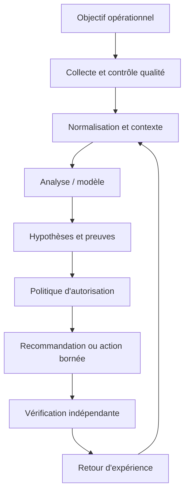
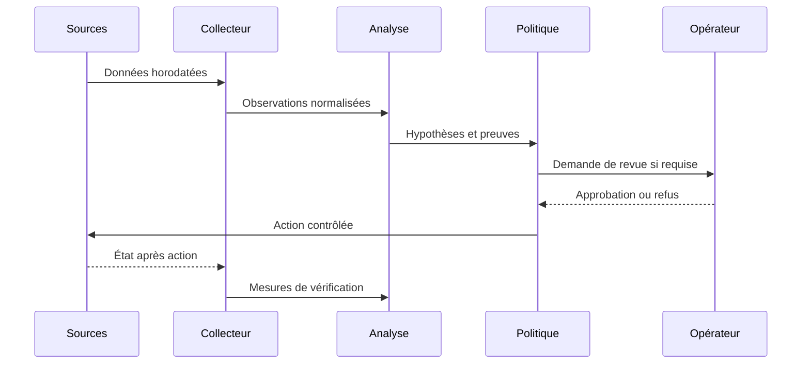
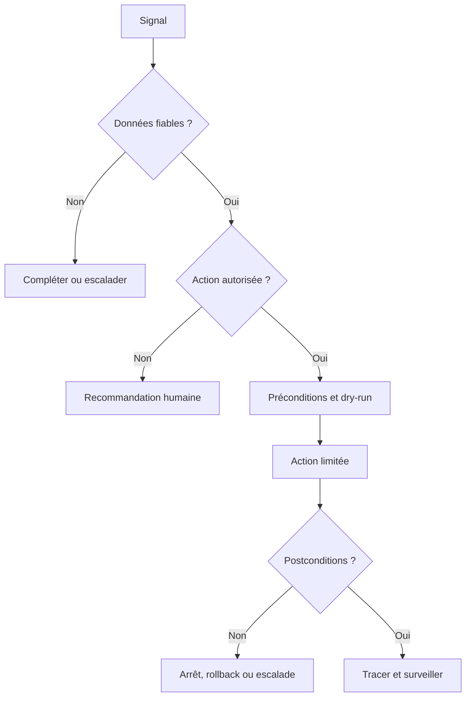

# IA Générative pour le diagnostic d'incidents — Expert

> **Mise en contexte :** un incident multi-sites produit de nombreuses alertes et changements ; l'astreinte a besoin d'hypothèses testables et ne doit pas accepter une cause inventée. Le but est d'améliorer les opérations de manière mesurable, vérifiable et proportionnée au risque. Les exemples sont pédagogiques : les tester dans un laboratoire et adapter identités, versions, capacités et permissions avant tout usage réel.

## Sommaire
1. Introduction et objectifs
2. Concepts clés
3. Architecture de référence
4. Pipeline et algorithmes
5. Étude de cas détaillée
6. Implémentation et TP
7. Sécurité et gouvernance
8. Pièges à éviter
9. Diagnostic et dépannage
10. Exercices corrigés
11. Checklist et à retenir
12. Références

## 1. Introduction et objectifs

utiliser un LLM pour synthétiser les preuves, comparer des causes candidates et recommander des tests sans automatiser une conclusion non vérifiée. Le scénario de départ est concret : un incident multi-sites produit de nombreuses alertes et changements ; l'astreinte a besoin d'hypothèses testables et ne doit pas accepter une cause inventée. Les équipes doivent agir rapidement, alors que les observations peuvent être contradictoires, les horloges décalées et les interventions porteuses de risques. La solution doit distinguer un signal, une hypothèse, une décision et une preuve de résultat. Une alerte n'est pas automatiquement un incident confirmé, un score n'est pas une preuve de causalité, et l'exécution d'une commande ne prouve pas le rétablissement du service.

Les outils utiles sont RAG, LLM, graphe de dépendances, journaux, chronologie et validation humaine. Ils ne doivent pas tous être déployés simplement parce qu'ils existent. Chaque composant doit répondre à une exigence identifiée et avoir un propriétaire. Une première version en lecture seule est souvent préférable : elle permet de mesurer les performances, de comprendre les erreurs et de définir les conditions minimales avant d'accorder une capacité d'action. L'automatisation se justifie lorsque son gain est mesurable et que la réponse aux échecs est maîtrisée.

À la fin du cours, l'apprenant doit savoir expliquer les concepts, décrire l'architecture, concevoir un essai reproductible, choisir des métriques adaptées, analyser les erreurs et défendre ses limites. Il doit aussi être capable de documenter quand la méthode ne doit pas être utilisée, quand l'incertitude impose une abstention et quand une approbation humaine est obligatoire.

### Objectifs pédagogiques
- Définir une question opérationnelle mesurable.
- Identifier les données, leur provenance et leur fraîcheur.
- Construire une architecture d'analyse et de vérification.
- Comparer la méthode à une baseline simple.
- Limiter privilèges et rayon d'impact.
- Documenter l'incertitude, l'escalade et le retour arrière.

## 2. Concepts clés

### 1. Dossier de preuve
Le dossier rassemble observations brutes, journaux, changements, topologie, timestamps, sources et limites.

Dans une exploitation réelle, Dossier de preuve doit répondre à une question opérationnelle clairement formulée. Le dossier rassemble observations brutes, journaux, changements, topologie, timestamps, sources et limites. L'équipe désigne la source de vérité, le propriétaire, la fréquence de mise à jour et le périmètre d'utilisation avant de rendre un résultat visible aux opérateurs. Pour le scénario « un incident multi-sites produit de nombreuses alertes et changements ; l'astreinte a besoin d'hypothèses testables et ne doit pas accepter une cause inventée », cela évite de transformer une intuition en instruction. Il faut aussi préciser quand le système doit s'abstenir, demander des données supplémentaires ou transférer le dossier à une personne responsable.

La mise en œuvre de Dossier de preuve se découpe en étapes testables : validation des entrées, contrôle des sources, traitement des valeurs absentes, journalisation et vérification des sorties. L'outil RAG peut contribuer au processus, mais sa présence ne garantit pas sa fiabilité. Les erreurs doivent rester explicites au lieu d'être converties en valeurs par défaut silencieuses. Une exécution fiable distingue succès, échec, état partiel et état impossible à déterminer, et conserve la version de code ou de modèle qui a produit la sortie.

L'évaluation de Dossier de preuve couvre les cas habituels, les cas limites, les données manquantes et les situations inédites. Il faut mesurer précision de cause racine confirmée et segmenter les résultats par site, plateforme ou criticité. Une moyenne globale peut masquer une défaillance rare mais grave ; garder des exemples concrets aide à comprendre faux positifs et faux négatifs. Après tout changement de données, d'algorithme ou de dépendance, rejouer un corpus de référence et vérifier que le comportement attendu persiste.

Aucune approche liée à Dossier de preuve n'est universellement meilleure. Une règle peut être plus simple à expliquer, un modèle peut capter des interactions, et une génération de texte peut accélérer une synthèse tout en introduisant des erreurs plausibles. Le choix dépend du coût des erreurs, des données, de la latence, de l'explicabilité et de la maintenance. Une baseline et un mode manuel doivent rester disponibles lorsque les observations sont incomplètes ou la méthode n'atteint plus le niveau de qualité attendu.

### 2. Chronologie
Une timeline harmonise événements pour séparer précurseurs, symptômes et effets postérieurs.

Dans une exploitation réelle, Chronologie doit répondre à une question opérationnelle clairement formulée. Une timeline harmonise événements pour séparer précurseurs, symptômes et effets postérieurs. L'équipe désigne la source de vérité, le propriétaire, la fréquence de mise à jour et le périmètre d'utilisation avant de rendre un résultat visible aux opérateurs. Pour le scénario « un incident multi-sites produit de nombreuses alertes et changements ; l'astreinte a besoin d'hypothèses testables et ne doit pas accepter une cause inventée », cela évite de transformer une intuition en instruction. Il faut aussi préciser quand le système doit s'abstenir, demander des données supplémentaires ou transférer le dossier à une personne responsable.

La mise en œuvre de Chronologie se découpe en étapes testables : validation des entrées, contrôle des sources, traitement des valeurs absentes, journalisation et vérification des sorties. L'outil LLM peut contribuer au processus, mais sa présence ne garantit pas sa fiabilité. Les erreurs doivent rester explicites au lieu d'être converties en valeurs par défaut silencieuses. Une exécution fiable distingue succès, échec, état partiel et état impossible à déterminer, et conserve la version de code ou de modèle qui a produit la sortie.

L'évaluation de Chronologie couvre les cas habituels, les cas limites, les données manquantes et les situations inédites. Il faut mesurer proportion de faits liés à une preuve et segmenter les résultats par site, plateforme ou criticité. Une moyenne globale peut masquer une défaillance rare mais grave ; garder des exemples concrets aide à comprendre faux positifs et faux négatifs. Après tout changement de données, d'algorithme ou de dépendance, rejouer un corpus de référence et vérifier que le comportement attendu persiste.

### 3. RAG opérationnel
La recherche récupère runbooks et incidents analogues en appliquant permissions et fraîcheur.

Dans une exploitation réelle, RAG opérationnel doit répondre à une question opérationnelle clairement formulée. La recherche récupère runbooks et incidents analogues en appliquant permissions et fraîcheur. L'équipe désigne la source de vérité, le propriétaire, la fréquence de mise à jour et le périmètre d'utilisation avant de rendre un résultat visible aux opérateurs. Pour le scénario « un incident multi-sites produit de nombreuses alertes et changements ; l'astreinte a besoin d'hypothèses testables et ne doit pas accepter une cause inventée », cela évite de transformer une intuition en instruction. Il faut aussi préciser quand le système doit s'abstenir, demander des données supplémentaires ou transférer le dossier à une personne responsable.

La mise en œuvre de RAG opérationnel se découpe en étapes testables : validation des entrées, contrôle des sources, traitement des valeurs absentes, journalisation et vérification des sorties. L'outil graphe de dépendances peut contribuer au processus, mais sa présence ne garantit pas sa fiabilité. Les erreurs doivent rester explicites au lieu d'être converties en valeurs par défaut silencieuses. Une exécution fiable distingue succès, échec, état partiel et état impossible à déterminer, et conserve la version de code ou de modèle qui a produit la sortie.

L'évaluation de RAG opérationnel couvre les cas habituels, les cas limites, les données manquantes et les situations inédites. Il faut mesurer utilité des tests proposés et segmenter les résultats par site, plateforme ou criticité. Une moyenne globale peut masquer une défaillance rare mais grave ; garder des exemples concrets aide à comprendre faux positifs et faux négatifs. Après tout changement de données, d'algorithme ou de dépendance, rejouer un corpus de référence et vérifier que le comportement attendu persiste.

### 4. Hypothèse falsifiable
Une hypothèse énumère preuves favorables, contre-indices et test qui permet de la distinguer.

Dans une exploitation réelle, Hypothèse falsifiable doit répondre à une question opérationnelle clairement formulée. Une hypothèse énumère preuves favorables, contre-indices et test qui permet de la distinguer. L'équipe désigne la source de vérité, le propriétaire, la fréquence de mise à jour et le périmètre d'utilisation avant de rendre un résultat visible aux opérateurs. Pour le scénario « un incident multi-sites produit de nombreuses alertes et changements ; l'astreinte a besoin d'hypothèses testables et ne doit pas accepter une cause inventée », cela évite de transformer une intuition en instruction. Il faut aussi préciser quand le système doit s'abstenir, demander des données supplémentaires ou transférer le dossier à une personne responsable.

La mise en œuvre de Hypothèse falsifiable se découpe en étapes testables : validation des entrées, contrôle des sources, traitement des valeurs absentes, journalisation et vérification des sorties. L'outil journaux peut contribuer au processus, mais sa présence ne garantit pas sa fiabilité. Les erreurs doivent rester explicites au lieu d'être converties en valeurs par défaut silencieuses. Une exécution fiable distingue succès, échec, état partiel et état impossible à déterminer, et conserve la version de code ou de modèle qui a produit la sortie.

L'évaluation de Hypothèse falsifiable couvre les cas habituels, les cas limites, les données manquantes et les situations inédites. Il faut mesurer abstention correcte et segmenter les résultats par site, plateforme ou criticité. Une moyenne globale peut masquer une défaillance rare mais grave ; garder des exemples concrets aide à comprendre faux positifs et faux négatifs. Après tout changement de données, d'algorithme ou de dépendance, rejouer un corpus de référence et vérifier que le comportement attendu persiste.

Aucune approche liée à Hypothèse falsifiable n'est universellement meilleure. Une règle peut être plus simple à expliquer, un modèle peut capter des interactions, et une génération de texte peut accélérer une synthèse tout en introduisant des erreurs plausibles. Le choix dépend du coût des erreurs, des données, de la latence, de l'explicabilité et de la maintenance. Une baseline et un mode manuel doivent rester disponibles lorsque les observations sont incomplètes ou la méthode n'atteint plus le niveau de qualité attendu.

### 5. Incertitude
Les données manquantes ou contradictoires doivent réduire la confiance et conduire à une vérification complémentaire.

Dans une exploitation réelle, Incertitude doit répondre à une question opérationnelle clairement formulée. Les données manquantes ou contradictoires doivent réduire la confiance et conduire à une vérification complémentaire. L'équipe désigne la source de vérité, le propriétaire, la fréquence de mise à jour et le périmètre d'utilisation avant de rendre un résultat visible aux opérateurs. Pour le scénario « un incident multi-sites produit de nombreuses alertes et changements ; l'astreinte a besoin d'hypothèses testables et ne doit pas accepter une cause inventée », cela évite de transformer une intuition en instruction. Il faut aussi préciser quand le système doit s'abstenir, demander des données supplémentaires ou transférer le dossier à une personne responsable.

La mise en œuvre de Incertitude se découpe en étapes testables : validation des entrées, contrôle des sources, traitement des valeurs absentes, journalisation et vérification des sorties. L'outil chronologie et validation humaine peut contribuer au processus, mais sa présence ne garantit pas sa fiabilité. Les erreurs doivent rester explicites au lieu d'être converties en valeurs par défaut silencieuses. Une exécution fiable distingue succès, échec, état partiel et état impossible à déterminer, et conserve la version de code ou de modèle qui a produit la sortie.

L'évaluation de Incertitude couvre les cas habituels, les cas limites, les données manquantes et les situations inédites. Il faut mesurer temps de diagnostic et segmenter les résultats par site, plateforme ou criticité. Une moyenne globale peut masquer une défaillance rare mais grave ; garder des exemples concrets aide à comprendre faux positifs et faux négatifs. Après tout changement de données, d'algorithme ou de dépendance, rejouer un corpus de référence et vérifier que le comportement attendu persiste.

### 6. Réponse structurée
Le diagnostic présente faits, hypothèses, tests, risques et identifiants de source dans un format validé.

Dans une exploitation réelle, Réponse structurée doit répondre à une question opérationnelle clairement formulée. Le diagnostic présente faits, hypothèses, tests, risques et identifiants de source dans un format validé. L'équipe désigne la source de vérité, le propriétaire, la fréquence de mise à jour et le périmètre d'utilisation avant de rendre un résultat visible aux opérateurs. Pour le scénario « un incident multi-sites produit de nombreuses alertes et changements ; l'astreinte a besoin d'hypothèses testables et ne doit pas accepter une cause inventée », cela évite de transformer une intuition en instruction. Il faut aussi préciser quand le système doit s'abstenir, demander des données supplémentaires ou transférer le dossier à une personne responsable.

La mise en œuvre de Réponse structurée se découpe en étapes testables : validation des entrées, contrôle des sources, traitement des valeurs absentes, journalisation et vérification des sorties. L'outil RAG peut contribuer au processus, mais sa présence ne garantit pas sa fiabilité. Les erreurs doivent rester explicites au lieu d'être converties en valeurs par défaut silencieuses. Une exécution fiable distingue succès, échec, état partiel et état impossible à déterminer, et conserve la version de code ou de modèle qui a produit la sortie.

L'évaluation de Réponse structurée couvre les cas habituels, les cas limites, les données manquantes et les situations inédites. Il faut mesurer précision de cause racine confirmée et segmenter les résultats par site, plateforme ou criticité. Une moyenne globale peut masquer une défaillance rare mais grave ; garder des exemples concrets aide à comprendre faux positifs et faux négatifs. Après tout changement de données, d'algorithme ou de dépendance, rejouer un corpus de référence et vérifier que le comportement attendu persiste.

### 7. Évaluation
La qualité se mesure sur causes confirmées, citations, utilité des tests et abstention appropriée.

Dans une exploitation réelle, Évaluation doit répondre à une question opérationnelle clairement formulée. La qualité se mesure sur causes confirmées, citations, utilité des tests et abstention appropriée. L'équipe désigne la source de vérité, le propriétaire, la fréquence de mise à jour et le périmètre d'utilisation avant de rendre un résultat visible aux opérateurs. Pour le scénario « un incident multi-sites produit de nombreuses alertes et changements ; l'astreinte a besoin d'hypothèses testables et ne doit pas accepter une cause inventée », cela évite de transformer une intuition en instruction. Il faut aussi préciser quand le système doit s'abstenir, demander des données supplémentaires ou transférer le dossier à une personne responsable.

La mise en œuvre de Évaluation se découpe en étapes testables : validation des entrées, contrôle des sources, traitement des valeurs absentes, journalisation et vérification des sorties. L'outil LLM peut contribuer au processus, mais sa présence ne garantit pas sa fiabilité. Les erreurs doivent rester explicites au lieu d'être converties en valeurs par défaut silencieuses. Une exécution fiable distingue succès, échec, état partiel et état impossible à déterminer, et conserve la version de code ou de modèle qui a produit la sortie.

L'évaluation de Évaluation couvre les cas habituels, les cas limites, les données manquantes et les situations inédites. Il faut mesurer proportion de faits liés à une preuve et segmenter les résultats par site, plateforme ou criticité. Une moyenne globale peut masquer une défaillance rare mais grave ; garder des exemples concrets aide à comprendre faux positifs et faux négatifs. Après tout changement de données, d'algorithme ou de dépendance, rejouer un corpus de référence et vérifier que le comportement attendu persiste.

Aucune approche liée à Évaluation n'est universellement meilleure. Une règle peut être plus simple à expliquer, un modèle peut capter des interactions, et une génération de texte peut accélérer une synthèse tout en introduisant des erreurs plausibles. Le choix dépend du coût des erreurs, des données, de la latence, de l'explicabilité et de la maintenance. Une baseline et un mode manuel doivent rester disponibles lorsque les observations sont incomplètes ou la méthode n'atteint plus le niveau de qualité attendu.

## 3. Architecture de référence

Une architecture fiable sépare la collecte, la normalisation, l'analyse, la politique d'autorisation et la vérification. Un détecteur ne doit pas être relié directement à une commande privilégiée : la moindre fausse alerte pourrait déclencher une intervention inappropriée. Entre proposition et exécution, un point de décision doit examiner qualité des données, confiance, criticité, cible, préconditions et nécessité d'une revue.



Chaque observation conserve source, horodatage, unité, cible, fraîcheur et état de qualité. Le résultat de l'analyse référence sa version et ses entrées. La décision expose actions permises, préconditions, approbations, quotas et conditions d'arrêt. La sortie finale indique les preuves exigées avant de déclarer le succès, ainsi que les situations qui imposent une escalade.



### Décision sous incertitude

La sécurité liée à Séparation entre analyse et exécution doit être conçue en amont : privilèges minimaux, protection des secrets, audit, séparation de l'analyse et de l'exécution, et règles d'escalade. Le piège principal ici est de prendre une explication fluide pour une preuve. Les données externes doivent rester des données, jamais une autorité qui redéfinit les permissions. Pour une opération à fort impact, il faut des préconditions vérifiables, une approbation adaptée et un retour arrière testé, même lorsque le score du modèle semble très élevé.

Quand Données manquantes produit un résultat inattendu, commencer par l'heure, la source, l'unité, la cible, la fraîcheur, la version et le code d'erreur. Comparer l'observation brute à sa représentation transformée, puis chercher une modification récente. Tester une hypothèse à la fois et consigner la preuve du résultat sans copier de secrets dans le ticket. Une fois la cause confirmée, ajouter un test de régression et vérifier qu'il échoue avant le correctif et passe après celui-ci.

À l'échelle, Mode dégradé doit gérer des volumes et versions hétérogènes sans perdre de traçabilité. Borner la concurrence, isoler les erreurs par cible, limiter les files et surveiller les retards protègent l'aval. La reprise d'une panne peut elle-même provoquer une surcharge si toutes les sources se reconnectent simultanément. Le système doit pouvoir réduire sa fréquence ou revenir à une méthode simple, tout en signalant explicitement ce mode dégradé au lieu d'afficher un faux état normal.



## 4. Pipeline et algorithmes

Le pipeline décrit ici est une chaîne de responsabilités, pas nécessairement six services séparés. Chaque étape doit avoir des entrées et sorties définies, des tests et une méthode de gestion des erreurs. Les données sont validées avant l'analyse, le contexte est enrichi avant l'interprétation, et la politique est consultée avant une action. Cette séquence permet de démarrer en mode observation et d'augmenter l'autonomie uniquement lorsque les critères sont prouvés.

### Étape 1 — Rassembler les preuves
Collecter signaux et contexte en préservant provenance et timestamps.

La mise en œuvre de Rassembler les preuves se découpe en étapes testables : validation des entrées, contrôle des sources, traitement des valeurs absentes, journalisation et vérification des sorties. L'outil RAG peut contribuer au processus, mais sa présence ne garantit pas sa fiabilité. Les erreurs doivent rester explicites au lieu d'être converties en valeurs par défaut silencieuses. Une exécution fiable distingue succès, échec, état partiel et état impossible à déterminer, et conserve la version de code ou de modèle qui a produit la sortie.

Quand Rassembler les preuves produit un résultat inattendu, commencer par l'heure, la source, l'unité, la cible, la fraîcheur, la version et le code d'erreur. Comparer l'observation brute à sa représentation transformée, puis chercher une modification récente. Tester une hypothèse à la fois et consigner la preuve du résultat sans copier de secrets dans le ticket. Une fois la cause confirmée, ajouter un test de régression et vérifier qu'il échoue avant le correctif et passe après celui-ci.

### Étape 2 — Reconstruire le temps
Aligner journaux, métriques, changements et impact utilisateur.

La mise en œuvre de Reconstruire le temps se découpe en étapes testables : validation des entrées, contrôle des sources, traitement des valeurs absentes, journalisation et vérification des sorties. L'outil LLM peut contribuer au processus, mais sa présence ne garantit pas sa fiabilité. Les erreurs doivent rester explicites au lieu d'être converties en valeurs par défaut silencieuses. Une exécution fiable distingue succès, échec, état partiel et état impossible à déterminer, et conserve la version de code ou de modèle qui a produit la sortie.

Quand Reconstruire le temps produit un résultat inattendu, commencer par l'heure, la source, l'unité, la cible, la fraîcheur, la version et le code d'erreur. Comparer l'observation brute à sa représentation transformée, puis chercher une modification récente. Tester une hypothèse à la fois et consigner la preuve du résultat sans copier de secrets dans le ticket. Une fois la cause confirmée, ajouter un test de régression et vérifier qu'il échoue avant le correctif et passe après celui-ci.

### Étape 3 — Récupérer la connaissance
Chercher des runbooks et incidents autorisés.

La mise en œuvre de Récupérer la connaissance se découpe en étapes testables : validation des entrées, contrôle des sources, traitement des valeurs absentes, journalisation et vérification des sorties. L'outil graphe de dépendances peut contribuer au processus, mais sa présence ne garantit pas sa fiabilité. Les erreurs doivent rester explicites au lieu d'être converties en valeurs par défaut silencieuses. Une exécution fiable distingue succès, échec, état partiel et état impossible à déterminer, et conserve la version de code ou de modèle qui a produit la sortie.

Quand Récupérer la connaissance produit un résultat inattendu, commencer par l'heure, la source, l'unité, la cible, la fraîcheur, la version et le code d'erreur. Comparer l'observation brute à sa représentation transformée, puis chercher une modification récente. Tester une hypothèse à la fois et consigner la preuve du résultat sans copier de secrets dans le ticket. Une fois la cause confirmée, ajouter un test de régression et vérifier qu'il échoue avant le correctif et passe après celui-ci.

### Étape 4 — Générer les hypothèses
Produire causes candidates avec preuves, inconnues et contradictions.

La mise en œuvre de Générer les hypothèses se découpe en étapes testables : validation des entrées, contrôle des sources, traitement des valeurs absentes, journalisation et vérification des sorties. L'outil journaux peut contribuer au processus, mais sa présence ne garantit pas sa fiabilité. Les erreurs doivent rester explicites au lieu d'être converties en valeurs par défaut silencieuses. Une exécution fiable distingue succès, échec, état partiel et état impossible à déterminer, et conserve la version de code ou de modèle qui a produit la sortie.

Quand Générer les hypothèses produit un résultat inattendu, commencer par l'heure, la source, l'unité, la cible, la fraîcheur, la version et le code d'erreur. Comparer l'observation brute à sa représentation transformée, puis chercher une modification récente. Tester une hypothèse à la fois et consigner la preuve du résultat sans copier de secrets dans le ticket. Une fois la cause confirmée, ajouter un test de régression et vérifier qu'il échoue avant le correctif et passe après celui-ci.

### Étape 5 — Choisir les tests
Privilégier des vérifications peu risquées et discriminantes.

La mise en œuvre de Choisir les tests se découpe en étapes testables : validation des entrées, contrôle des sources, traitement des valeurs absentes, journalisation et vérification des sorties. L'outil chronologie et validation humaine peut contribuer au processus, mais sa présence ne garantit pas sa fiabilité. Les erreurs doivent rester explicites au lieu d'être converties en valeurs par défaut silencieuses. Une exécution fiable distingue succès, échec, état partiel et état impossible à déterminer, et conserve la version de code ou de modèle qui a produit la sortie.

Quand Choisir les tests produit un résultat inattendu, commencer par l'heure, la source, l'unité, la cible, la fraîcheur, la version et le code d'erreur. Comparer l'observation brute à sa représentation transformée, puis chercher une modification récente. Tester une hypothèse à la fois et consigner la preuve du résultat sans copier de secrets dans le ticket. Une fois la cause confirmée, ajouter un test de régression et vérifier qu'il échoue avant le correctif et passe après celui-ci.

### Étape 6 — Confirmer
Faire valider les preuves et enrichir le post-mortem de manière contrôlée.

La mise en œuvre de Confirmer se découpe en étapes testables : validation des entrées, contrôle des sources, traitement des valeurs absentes, journalisation et vérification des sorties. L'outil RAG peut contribuer au processus, mais sa présence ne garantit pas sa fiabilité. Les erreurs doivent rester explicites au lieu d'être converties en valeurs par défaut silencieuses. Une exécution fiable distingue succès, échec, état partiel et état impossible à déterminer, et conserve la version de code ou de modèle qui a produit la sortie.

Quand Confirmer produit un résultat inattendu, commencer par l'heure, la source, l'unité, la cible, la fraîcheur, la version et le code d'erreur. Comparer l'observation brute à sa représentation transformée, puis chercher une modification récente. Tester une hypothèse à la fois et consigner la preuve du résultat sans copier de secrets dans le ticket. Une fois la cause confirmée, ajouter un test de régression et vérifier qu'il échoue avant le correctif et passe après celui-ci.

### Pseudocode défensif
```text
observations = collecter()
si qualité(observations) insuffisante:
    signaler les données manquantes et escalader
sinon:
    contexte = enrichir(observations, inventaire, changements, dépendances)
    hypothèses = analyser(contexte)
    vérifier la provenance de chaque preuve
    si preuve insuffisante ou action hors politique:
        recommander sans exécuter
    sinon:
        préparer diff, préconditions, approbations et rollback
        appliquer sur un petit périmètre
        mesurer les postconditions indépendantes
        restaurer ou escalader si non conforme
        journaliser version, preuves, décision et résultat
```

Ce pseudocode explique la logique et n'est pas une bibliothèque prête pour la production. Chaque étape exige des tests, des permissions appropriées et un mode de reprise explicite. Un système fiable ne remplace pas l'incertitude par une valeur par défaut ; il la rend visible et réduit son autonomie lorsque les preuves sont incomplètes.

## 5. Étude de cas détaillée

### Situation et impact
un incident multi-sites produit de nombreuses alertes et changements ; l'astreinte a besoin d'hypothèses testables et ne doit pas accepter une cause inventée. L'équipe commence par établir le périmètre, l'impact utilisateur, la chronologie et la criticité des actifs. Sa première question n'est pas « quel modèle est à la mode ? », mais « quelle décision doit devenir meilleure, et quelle preuve permettra de le démontrer ? ». Cette formulation évite la dérive du périmètre et fixe un critère d'arrêt si la solution n'apporte pas de valeur.

### Phase 1 — Établir les faits
Conserver les données brutes en lecture seule et noter les sources, timestamps, versions et transformations. Vérifier les changements récents et la qualité de collecte. Les valeurs absentes demeurent absentes ; elles ne sont pas remplacées par zéro. L'impact métier est mesuré séparément de l'état d'un équipement. Les contradictions entre systèmes sont documentées au lieu d'être résolues par intuition.

### Phase 2 — Comparer les hypothèses
Décrire au moins deux explications si les preuves ne permettent pas de conclure directement. Pour chacune, noter les observations favorables, les contre-indices et le test qui peut la distinguer. La priorité dépend de l'impact, de la plausibilité et du coût du test. Une ressemblance avec un incident historique ne suffit pas : versions, topologie, capacité et fenêtre de charge peuvent changer l'explication.

### Phase 3 — Préparer une réponse proportionnée
Privilégier les contrôles non destructifs. Si une modification devient nécessaire, préciser cible, diff, préconditions, impact, fenêtre, critères d'arrêt et rollback. Une revue indépendante s'impose lorsque le rayon d'impact est grand. Le plan doit permettre de refuser une action lorsque les preuves ne sont pas suffisantes.

### Phase 4 — Vérifier
Après action, contrôler mesures indépendantes : fonctionnement du service, latence, erreurs, connectivité, état de configuration ou autre indicateur pertinent. Une seule valeur favorable ne prouve pas un rétablissement durable. Lorsque les postconditions échouent, arrêter, restaurer selon le plan ou escalader. Le compte rendu distingue ce qui a été tenté, observé, confirmé et laissé inconnu.

### Phase 5 — Tirer des leçons
Comparer les hypothèses initiales aux preuves finales. Ajouter tests de régression, sources manquantes et contrôles à améliorer. Une règle ou un modèle mis à jour passe par une revue et une expérimentation contrôlée avant généralisation. Les conclusions non confirmées ne deviennent pas automatiquement de nouvelles étiquettes d'entraînement.

### Conditions de clôture
La clôture exige soit une preuve de rétablissement, soit une déclaration explicite que le service reste dégradé. Le dossier conserve sources, versions, actions, approbations, résultats et suivis. La cause racine n'est déclarée confirmée que si les preuves le permettent. Une conclusion honnêtement partielle est préférable à une explication catégorique impossible à reproduire.

## 6. Implémentation et TP

Exécuter les travaux pratiques dans un laboratoire isolé ou sur des systèmes autorisés. Noter les versions, dépendances, données et critères de réussite. Le résultat doit pouvoir être reproduit par un autre opérateur ; un succès affiché par l'outil ne remplace pas le contrôle de l'état réel.

### TP 1 — Créer un dossier d'incident avec métriques, logs et changements.
**Procédure.** Créer un dossier d'incident avec métriques, logs et changements. Utiliser une cible limitée, capturer l'état initial et ne changer qu'un paramètre à la fois. Relier le travail au concept « Dossier de preuve » : Le dossier rassemble observations brutes, journaux, changements, topologie, timestamps, sources et limites. Conserver commande, entrée, version et sortie.

**Contrôle.** Reproduire le résultat, puis tester une erreur contrôlée, une donnée manquante et une dépendance indisponible. Vérifier l'état effectif, les effets secondaires et la procédure de reprise. Si le résultat ne peut pas être déterminé, signaler cet état plutôt que le considérer comme une réussite. Décrire ce qui est démontré et les limites qui subsistent avant un déploiement plus large.

### TP 2 — Normaliser les timestamps et documenter les trous de données.
**Procédure.** Normaliser les timestamps et documenter les trous de données. Utiliser une cible limitée, capturer l'état initial et ne changer qu'un paramètre à la fois. Relier le travail au concept « Chronologie » : Une timeline harmonise événements pour séparer précurseurs, symptômes et effets postérieurs. Conserver commande, entrée, version et sortie.

**Contrôle.** Reproduire le résultat, puis tester une erreur contrôlée, une donnée manquante et une dépendance indisponible. Vérifier l'état effectif, les effets secondaires et la procédure de reprise. Si le résultat ne peut pas être déterminé, signaler cet état plutôt que le considérer comme une réussite. Décrire ce qui est démontré et les limites qui subsistent avant un déploiement plus large.

### TP 3 — Récupérer des procédures autorisées avec identifiants de source.
**Procédure.** Récupérer des procédures autorisées avec identifiants de source. Utiliser une cible limitée, capturer l'état initial et ne changer qu'un paramètre à la fois. Relier le travail au concept « RAG opérationnel » : La recherche récupère runbooks et incidents analogues en appliquant permissions et fraîcheur. Conserver commande, entrée, version et sortie.

**Contrôle.** Reproduire le résultat, puis tester une erreur contrôlée, une donnée manquante et une dépendance indisponible. Vérifier l'état effectif, les effets secondaires et la procédure de reprise. Si le résultat ne peut pas être déterminé, signaler cet état plutôt que le considérer comme une réussite. Décrire ce qui est démontré et les limites qui subsistent avant un déploiement plus large.

### TP 4 — Générer trois hypothèses et relier chacune à des preuves.
**Procédure.** Générer trois hypothèses et relier chacune à des preuves. Utiliser une cible limitée, capturer l'état initial et ne changer qu'un paramètre à la fois. Relier le travail au concept « Hypothèse falsifiable » : Une hypothèse énumère preuves favorables, contre-indices et test qui permet de la distinguer. Conserver commande, entrée, version et sortie.

**Contrôle.** Reproduire le résultat, puis tester une erreur contrôlée, une donnée manquante et une dépendance indisponible. Vérifier l'état effectif, les effets secondaires et la procédure de reprise. Si le résultat ne peut pas être déterminé, signaler cet état plutôt que le considérer comme une réussite. Décrire ce qui est démontré et les limites qui subsistent avant un déploiement plus large.

### TP 5 — Demander inconnues et contre-indices explicitement.
**Procédure.** Demander inconnues et contre-indices explicitement. Utiliser une cible limitée, capturer l'état initial et ne changer qu'un paramètre à la fois. Relier le travail au concept « Incertitude » : Les données manquantes ou contradictoires doivent réduire la confiance et conduire à une vérification complémentaire. Conserver commande, entrée, version et sortie.

**Contrôle.** Reproduire le résultat, puis tester une erreur contrôlée, une donnée manquante et une dépendance indisponible. Vérifier l'état effectif, les effets secondaires et la procédure de reprise. Si le résultat ne peut pas être déterminé, signaler cet état plutôt que le considérer comme une réussite. Décrire ce qui est démontré et les limites qui subsistent avant un déploiement plus large.

### TP 6 — Valider le schéma et vérifier chaque citation.
**Procédure.** Valider le schéma et vérifier chaque citation. Utiliser une cible limitée, capturer l'état initial et ne changer qu'un paramètre à la fois. Relier le travail au concept « Réponse structurée » : Le diagnostic présente faits, hypothèses, tests, risques et identifiants de source dans un format validé. Conserver commande, entrée, version et sortie.

**Contrôle.** Reproduire le résultat, puis tester une erreur contrôlée, une donnée manquante et une dépendance indisponible. Vérifier l'état effectif, les effets secondaires et la procédure de reprise. Si le résultat ne peut pas être déterminé, signaler cet état plutôt que le considérer comme une réussite. Décrire ce qui est démontré et les limites qui subsistent avant un déploiement plus large.

### TP 7 — Comparer la proposition au post-mortem final confirmé.
**Procédure.** Comparer la proposition au post-mortem final confirmé. Utiliser une cible limitée, capturer l'état initial et ne changer qu'un paramètre à la fois. Relier le travail au concept « Évaluation » : La qualité se mesure sur causes confirmées, citations, utilité des tests et abstention appropriée. Conserver commande, entrée, version et sortie.

**Contrôle.** Reproduire le résultat, puis tester une erreur contrôlée, une donnée manquante et une dépendance indisponible. Vérifier l'état effectif, les effets secondaires et la procédure de reprise. Si le résultat ne peut pas être déterminé, signaler cet état plutôt que le considérer comme une réussite. Décrire ce qui est démontré et les limites qui subsistent avant un déploiement plus large.

### Exemple technique
```text
diagnosis:
  incident_id: INC-2026-1042
  hypotheses:
    - claim: "Saturation du lien"
      evidence_ids: ["metric-17", "event-22"]
      contradicting_evidence: ["metric-31"]
      next_test: "Comparer utilisation et erreurs avant/après"
      risk: low
  unknowns: ["Compteur manquant pendant 40 secondes"]
  execution_allowed: false

# Vérifier chaque evidence_id : tant que les preuves n'existent pas, il s'agit d'une hypothèse.
```
Ce fragment est un point de départ pédagogique, pas une configuration universelle. Les versions, options et capacités peuvent varier : lire la documentation officielle et tester en laboratoire. Ne pas coder de secrets en dur. Tout changement réel exige un périmètre limité, une autorisation appropriée et une vérification post-action.

### Livrables
- Un fichier versionné décrivant entrée, sortie et dépendances.
- Un journal corrélé à la cible et à la version, sans secrets.
- Des tests positifs et négatifs, dont données manquantes et échec d'accès.
- Des critères d'arrêt et un rollback testé.
- Une note de résultats, hypothèses et limites.

## 7. Sécurité et gouvernance

### 1. Qualité et provenance
Chaque observation conserve source, horodatage, unité et fraîcheur. Traduire ce principe en contrôle observable, propriétaire, fréquence de revue et preuve de passage. Une politique sans test dépend de la mémoire ; un test sans propriétaire n'est plus maintenu lorsque l'équipe change. Relancer la revue après un changement majeur de données, d'équipement, de modèle ou de finalité.

La gouvernance de Qualité et provenance précise qui peut créer, modifier, approuver, consulter et retirer la logique. Le propriétaire connaît le but, les limites, le budget d'erreur et les critères de suspension. Les décisions doivent être retraçables jusqu'aux données, paramètres et versions utilisés. Une règle sans propriétaire finit par dépendre de la mémoire des personnes ; une métrique sans décision associée devient décorative. La revue doit être planifiée et déclenchée de nouveau après un changement majeur de contexte.

### 2. Identités
Les comptes de service ont le minimum de permissions nécessaires. Traduire ce principe en contrôle observable, propriétaire, fréquence de revue et preuve de passage. Une politique sans test dépend de la mémoire ; un test sans propriétaire n'est plus maintenu lorsque l'équipe change. Relancer la revue après un changement majeur de données, d'équipement, de modèle ou de finalité.

La gouvernance de Identités précise qui peut créer, modifier, approuver, consulter et retirer la logique. Le propriétaire connaît le but, les limites, le budget d'erreur et les critères de suspension. Les décisions doivent être retraçables jusqu'aux données, paramètres et versions utilisés. Une règle sans propriétaire finit par dépendre de la mémoire des personnes ; une métrique sans décision associée devient décorative. La revue doit être planifiée et déclenchée de nouveau après un changement majeur de contexte.

### 3. Traçabilité
Version, preuves, décision, approbation, cible et résultat restent corrélés. Traduire ce principe en contrôle observable, propriétaire, fréquence de revue et preuve de passage. Une politique sans test dépend de la mémoire ; un test sans propriétaire n'est plus maintenu lorsque l'équipe change. Relancer la revue après un changement majeur de données, d'équipement, de modèle ou de finalité.

La gouvernance de Traçabilité précise qui peut créer, modifier, approuver, consulter et retirer la logique. Le propriétaire connaît le but, les limites, le budget d'erreur et les critères de suspension. Les décisions doivent être retraçables jusqu'aux données, paramètres et versions utilisés. Une règle sans propriétaire finit par dépendre de la mémoire des personnes ; une métrique sans décision associée devient décorative. La revue doit être planifiée et déclenchée de nouveau après un changement majeur de contexte.

### 4. Revue humaine
Le réviseur dispose de temps, preuves et autorité pour refuser. Traduire ce principe en contrôle observable, propriétaire, fréquence de revue et preuve de passage. Une politique sans test dépend de la mémoire ; un test sans propriétaire n'est plus maintenu lorsque l'équipe change. Relancer la revue après un changement majeur de données, d'équipement, de modèle ou de finalité.

La gouvernance de Revue humaine précise qui peut créer, modifier, approuver, consulter et retirer la logique. Le propriétaire connaît le but, les limites, le budget d'erreur et les critères de suspension. Les décisions doivent être retraçables jusqu'aux données, paramètres et versions utilisés. Une règle sans propriétaire finit par dépendre de la mémoire des personnes ; une métrique sans décision associée devient décorative. La revue doit être planifiée et déclenchée de nouveau après un changement majeur de contexte.

### 5. Gestion du risque
Chaque mode d'échec a prévention, détection, réponse et propriétaire. Traduire ce principe en contrôle observable, propriétaire, fréquence de revue et preuve de passage. Une politique sans test dépend de la mémoire ; un test sans propriétaire n'est plus maintenu lorsque l'équipe change. Relancer la revue après un changement majeur de données, d'équipement, de modèle ou de finalité.

La gouvernance de Gestion du risque précise qui peut créer, modifier, approuver, consulter et retirer la logique. Le propriétaire connaît le but, les limites, le budget d'erreur et les critères de suspension. Les décisions doivent être retraçables jusqu'aux données, paramètres et versions utilisés. Une règle sans propriétaire finit par dépendre de la mémoire des personnes ; une métrique sans décision associée devient décorative. La revue doit être planifiée et déclenchée de nouveau après un changement majeur de contexte.

### 6. Réversibilité
Retrait, suspension et retour à une version saine sont testés. Traduire ce principe en contrôle observable, propriétaire, fréquence de revue et preuve de passage. Une politique sans test dépend de la mémoire ; un test sans propriétaire n'est plus maintenu lorsque l'équipe change. Relancer la revue après un changement majeur de données, d'équipement, de modèle ou de finalité.

La gouvernance de Réversibilité précise qui peut créer, modifier, approuver, consulter et retirer la logique. Le propriétaire connaît le but, les limites, le budget d'erreur et les critères de suspension. Les décisions doivent être retraçables jusqu'aux données, paramètres et versions utilisés. Une règle sans propriétaire finit par dépendre de la mémoire des personnes ; une métrique sans décision associée devient décorative. La revue doit être planifiée et déclenchée de nouveau après un changement majeur de contexte.

## 8. Pièges à éviter

### Piège 1 — prendre une explication fluide pour une preuve
Ce défaut peut produire un faux diagnostic, une action inutile ou une perte de confiance. Les signes précoces peuvent être une source contradictoire, une hausse d'erreurs, un écart entre sites ou l'absence de preuve. Pour ce cours, le risque « prendre une explication fluide pour une preuve » doit être associé à un test négatif explicite et à une réponse déterminée lorsque le garde-fou échoue.

La prévention s'appuie sur « Dossier de preuve ». Le dossier rassemble observations brutes, journaux, changements, topologie, timestamps, sources et limites. Un avertissement n'est utile que s'il change la décision, bloque une action risquée ou déclenche une revue. La checklist de déploiement doit préciser qui observe le signal, quel seuil est acceptable et qui peut suspendre la méthode. Il faut documenter aussi les défaillances que le contrôle ne couvre pas.

### Piège 2 — omettre les sources des faits
Ce défaut peut produire un faux diagnostic, une action inutile ou une perte de confiance. Les signes précoces peuvent être une source contradictoire, une hausse d'erreurs, un écart entre sites ou l'absence de preuve. Pour ce cours, le risque « omettre les sources des faits » doit être associé à un test négatif explicite et à une réponse déterminée lorsque le garde-fou échoue.

La prévention s'appuie sur « Chronologie ». Une timeline harmonise événements pour séparer précurseurs, symptômes et effets postérieurs. Un avertissement n'est utile que s'il change la décision, bloque une action risquée ou déclenche une revue. La checklist de déploiement doit préciser qui observe le signal, quel seuil est acceptable et qui peut suspendre la méthode. Il faut documenter aussi les défaillances que le contrôle ne couvre pas.

### Piège 3 — inclure des documents hors autorisation
Ce défaut peut produire un faux diagnostic, une action inutile ou une perte de confiance. Les signes précoces peuvent être une source contradictoire, une hausse d'erreurs, un écart entre sites ou l'absence de preuve. Pour ce cours, le risque « inclure des documents hors autorisation » doit être associé à un test négatif explicite et à une réponse déterminée lorsque le garde-fou échoue.

La prévention s'appuie sur « RAG opérationnel ». La recherche récupère runbooks et incidents analogues en appliquant permissions et fraîcheur. Un avertissement n'est utile que s'il change la décision, bloque une action risquée ou déclenche une revue. La checklist de déploiement doit préciser qui observe le signal, quel seuil est acceptable et qui peut suspendre la méthode. Il faut documenter aussi les défaillances que le contrôle ne couvre pas.

### Piège 4 — laisser un agent exécuter une action destructive
Ce défaut peut produire un faux diagnostic, une action inutile ou une perte de confiance. Les signes précoces peuvent être une source contradictoire, une hausse d'erreurs, un écart entre sites ou l'absence de preuve. Pour ce cours, le risque « laisser un agent exécuter une action destructive » doit être associé à un test négatif explicite et à une réponse déterminée lorsque le garde-fou échoue.

La prévention s'appuie sur « Hypothèse falsifiable ». Une hypothèse énumère preuves favorables, contre-indices et test qui permet de la distinguer. Un avertissement n'est utile que s'il change la décision, bloque une action risquée ou déclenche une revue. La checklist de déploiement doit préciser qui observe le signal, quel seuil est acceptable et qui peut suspendre la méthode. Il faut documenter aussi les défaillances que le contrôle ne couvre pas.

### Piège 5 — ignorer les contradictions
Ce défaut peut produire un faux diagnostic, une action inutile ou une perte de confiance. Les signes précoces peuvent être une source contradictoire, une hausse d'erreurs, un écart entre sites ou l'absence de preuve. Pour ce cours, le risque « ignorer les contradictions » doit être associé à un test négatif explicite et à une réponse déterminée lorsque le garde-fou échoue.

La prévention s'appuie sur « Incertitude ». Les données manquantes ou contradictoires doivent réduire la confiance et conduire à une vérification complémentaire. Un avertissement n'est utile que s'il change la décision, bloque une action risquée ou déclenche une revue. La checklist de déploiement doit préciser qui observe le signal, quel seuil est acceptable et qui peut suspendre la méthode. Il faut documenter aussi les défaillances que le contrôle ne couvre pas.

### Piège 6 — évaluer uniquement les incidents faciles
Ce défaut peut produire un faux diagnostic, une action inutile ou une perte de confiance. Les signes précoces peuvent être une source contradictoire, une hausse d'erreurs, un écart entre sites ou l'absence de preuve. Pour ce cours, le risque « évaluer uniquement les incidents faciles » doit être associé à un test négatif explicite et à une réponse déterminée lorsque le garde-fou échoue.

La prévention s'appuie sur « Réponse structurée ». Le diagnostic présente faits, hypothèses, tests, risques et identifiants de source dans un format validé. Un avertissement n'est utile que s'il change la décision, bloque une action risquée ou déclenche une revue. La checklist de déploiement doit préciser qui observe le signal, quel seuil est acceptable et qui peut suspendre la méthode. Il faut documenter aussi les défaillances que le contrôle ne couvre pas.

### Piège 7 — apprendre automatiquement de RCA non confirmées
Ce défaut peut produire un faux diagnostic, une action inutile ou une perte de confiance. Les signes précoces peuvent être une source contradictoire, une hausse d'erreurs, un écart entre sites ou l'absence de preuve. Pour ce cours, le risque « apprendre automatiquement de RCA non confirmées » doit être associé à un test négatif explicite et à une réponse déterminée lorsque le garde-fou échoue.

La prévention s'appuie sur « Évaluation ». La qualité se mesure sur causes confirmées, citations, utilité des tests et abstention appropriée. Un avertissement n'est utile que s'il change la décision, bloque une action risquée ou déclenche une revue. La checklist de déploiement doit préciser qui observe le signal, quel seuil est acceptable et qui peut suspendre la méthode. Il faut documenter aussi les défaillances que le contrôle ne couvre pas.

## 9. Diagnostic et dépannage

### Aucun résultat
Vérifier accès, période, filtres, identité et version du schéma. Dans le contexte de IA Générative pour le diagnostic d'incidents, examiner d'abord le risque « prendre une explication fluide pour une preuve ». Comparer observation brute et donnée transformée, retracer la version utilisée et vérifier les modifications récentes. Construire deux hypothèses alternatives et effectuer un test non destructif qui permet de les départager. Éviter les changements simultanés. Si les preuves restent incomplètes, garder l'incertitude visible et utiliser le mode sûr.

### Résultats variables
Comparer dataset, code, paramètres, dépendances et transformations. Dans le contexte de IA Générative pour le diagnostic d'incidents, examiner d'abord le risque « omettre les sources des faits ». Comparer observation brute et donnée transformée, retracer la version utilisée et vérifier les modifications récentes. Construire deux hypothèses alternatives et effectuer un test non destructif qui permet de les départager. Éviter les changements simultanés. Si les preuves restent incomplètes, garder l'incertitude visible et utiliser le mode sûr.

### Trop d'alertes
Inspecter duplications, saisonnalité, baseline et seuils. Dans le contexte de IA Générative pour le diagnostic d'incidents, examiner d'abord le risque « inclure des documents hors autorisation ». Comparer observation brute et donnée transformée, retracer la version utilisée et vérifier les modifications récentes. Construire deux hypothèses alternatives et effectuer un test non destructif qui permet de les départager. Éviter les changements simultanés. Si les preuves restent incomplètes, garder l'incertitude visible et utiliser le mode sûr.

### Incident manqué
Reconstituer l'information disponible au moment de la décision. Dans le contexte de IA Générative pour le diagnostic d'incidents, examiner d'abord le risque « laisser un agent exécuter une action destructive ». Comparer observation brute et donnée transformée, retracer la version utilisée et vérifier les modifications récentes. Construire deux hypothèses alternatives et effectuer un test non destructif qui permet de les départager. Éviter les changements simultanés. Si les preuves restent incomplètes, garder l'incertitude visible et utiliser le mode sûr.

### Action sans effet
Mesurer les postconditions indépendantes et chercher les effets secondaires. Dans le contexte de IA Générative pour le diagnostic d'incidents, examiner d'abord le risque « ignorer les contradictions ». Comparer observation brute et donnée transformée, retracer la version utilisée et vérifier les modifications récentes. Construire deux hypothèses alternatives et effectuer un test non destructif qui permet de les départager. Éviter les changements simultanés. Si les preuves restent incomplètes, garder l'incertitude visible et utiliser le mode sûr.

### Qualité en baisse
Rechercher dérive, migration, changement de capacité ou de version. Dans le contexte de IA Générative pour le diagnostic d'incidents, examiner d'abord le risque « évaluer uniquement les incidents faciles ». Comparer observation brute et donnée transformée, retracer la version utilisée et vérifier les modifications récentes. Construire deux hypothèses alternatives et effectuer un test non destructif qui permet de les départager. Éviter les changements simultanés. Si les preuves restent incomplètes, garder l'incertitude visible et utiliser le mode sûr.

## 10. Exercices corrigés

### Exercice 1 — Dossier de preuve
**Énoncé.** Pour le scénario « un incident multi-sites produit de nombreuses alertes et changements ; l'astreinte a besoin d'hypothèses testables et ne doit pas accepter une cause inventée », l'équipe veut généraliser une méthode qui utilise Dossier de preuve. Quelle preuve doit-elle recueillir avant l'étape « Rassembler les preuves » et comment prévenir « prendre une explication fluide pour une preuve » ?

**Correction détaillée.** Définir le résultat attendu et le coût de l'erreur. Vérifier la provenance, la fraîcheur et la disponibilité temporelle des entrées. Construire un essai reproductible et le comparer à une baseline. Collecter signaux et contexte en préservant provenance et timestamps. Analyser les erreurs par catégorie d'actifs, puis fixer des seuils et une revue adaptée au risque. Le déploiement commence sur un périmètre limité et possède une restauration testée. Si les preuves sont insuffisantes, la bonne décision est d'observer, de demander une donnée complémentaire ou d'escalader.

**Pourquoi un raccourci échoue.** Un exemple favorable ne prouve pas un gain durable. Une métrique globale masque des cas critiques et une collecte lacunaire peut cacher les erreurs. La version et les conditions doivent rester disponibles pour reproduire le résultat. L'exercice est réussi si une autre personne peut expliquer le choix, ses limites et le mécanisme de retrait.

### Exercice 2 — Chronologie
**Énoncé.** Pour le scénario « un incident multi-sites produit de nombreuses alertes et changements ; l'astreinte a besoin d'hypothèses testables et ne doit pas accepter une cause inventée », l'équipe veut généraliser une méthode qui utilise Chronologie. Quelle preuve doit-elle recueillir avant l'étape « Reconstruire le temps » et comment prévenir « omettre les sources des faits » ?

**Correction détaillée.** Définir le résultat attendu et le coût de l'erreur. Vérifier la provenance, la fraîcheur et la disponibilité temporelle des entrées. Construire un essai reproductible et le comparer à une baseline. Aligner journaux, métriques, changements et impact utilisateur. Analyser les erreurs par catégorie d'actifs, puis fixer des seuils et une revue adaptée au risque. Le déploiement commence sur un périmètre limité et possède une restauration testée. Si les preuves sont insuffisantes, la bonne décision est d'observer, de demander une donnée complémentaire ou d'escalader.

**Pourquoi un raccourci échoue.** Un exemple favorable ne prouve pas un gain durable. Une métrique globale masque des cas critiques et une collecte lacunaire peut cacher les erreurs. La version et les conditions doivent rester disponibles pour reproduire le résultat. L'exercice est réussi si une autre personne peut expliquer le choix, ses limites et le mécanisme de retrait.

### Exercice 3 — RAG opérationnel
**Énoncé.** Pour le scénario « un incident multi-sites produit de nombreuses alertes et changements ; l'astreinte a besoin d'hypothèses testables et ne doit pas accepter une cause inventée », l'équipe veut généraliser une méthode qui utilise RAG opérationnel. Quelle preuve doit-elle recueillir avant l'étape « Récupérer la connaissance » et comment prévenir « inclure des documents hors autorisation » ?

**Correction détaillée.** Définir le résultat attendu et le coût de l'erreur. Vérifier la provenance, la fraîcheur et la disponibilité temporelle des entrées. Construire un essai reproductible et le comparer à une baseline. Chercher des runbooks et incidents autorisés. Analyser les erreurs par catégorie d'actifs, puis fixer des seuils et une revue adaptée au risque. Le déploiement commence sur un périmètre limité et possède une restauration testée. Si les preuves sont insuffisantes, la bonne décision est d'observer, de demander une donnée complémentaire ou d'escalader.

**Pourquoi un raccourci échoue.** Un exemple favorable ne prouve pas un gain durable. Une métrique globale masque des cas critiques et une collecte lacunaire peut cacher les erreurs. La version et les conditions doivent rester disponibles pour reproduire le résultat. L'exercice est réussi si une autre personne peut expliquer le choix, ses limites et le mécanisme de retrait.

### Exercice 4 — Hypothèse falsifiable
**Énoncé.** Pour le scénario « un incident multi-sites produit de nombreuses alertes et changements ; l'astreinte a besoin d'hypothèses testables et ne doit pas accepter une cause inventée », l'équipe veut généraliser une méthode qui utilise Hypothèse falsifiable. Quelle preuve doit-elle recueillir avant l'étape « Générer les hypothèses » et comment prévenir « laisser un agent exécuter une action destructive » ?

**Correction détaillée.** Définir le résultat attendu et le coût de l'erreur. Vérifier la provenance, la fraîcheur et la disponibilité temporelle des entrées. Construire un essai reproductible et le comparer à une baseline. Produire causes candidates avec preuves, inconnues et contradictions. Analyser les erreurs par catégorie d'actifs, puis fixer des seuils et une revue adaptée au risque. Le déploiement commence sur un périmètre limité et possède une restauration testée. Si les preuves sont insuffisantes, la bonne décision est d'observer, de demander une donnée complémentaire ou d'escalader.

**Pourquoi un raccourci échoue.** Un exemple favorable ne prouve pas un gain durable. Une métrique globale masque des cas critiques et une collecte lacunaire peut cacher les erreurs. La version et les conditions doivent rester disponibles pour reproduire le résultat. L'exercice est réussi si une autre personne peut expliquer le choix, ses limites et le mécanisme de retrait.

### Exercice 5 — Incertitude
**Énoncé.** Pour le scénario « un incident multi-sites produit de nombreuses alertes et changements ; l'astreinte a besoin d'hypothèses testables et ne doit pas accepter une cause inventée », l'équipe veut généraliser une méthode qui utilise Incertitude. Quelle preuve doit-elle recueillir avant l'étape « Choisir les tests » et comment prévenir « ignorer les contradictions » ?

**Correction détaillée.** Définir le résultat attendu et le coût de l'erreur. Vérifier la provenance, la fraîcheur et la disponibilité temporelle des entrées. Construire un essai reproductible et le comparer à une baseline. Privilégier des vérifications peu risquées et discriminantes. Analyser les erreurs par catégorie d'actifs, puis fixer des seuils et une revue adaptée au risque. Le déploiement commence sur un périmètre limité et possède une restauration testée. Si les preuves sont insuffisantes, la bonne décision est d'observer, de demander une donnée complémentaire ou d'escalader.

**Pourquoi un raccourci échoue.** Un exemple favorable ne prouve pas un gain durable. Une métrique globale masque des cas critiques et une collecte lacunaire peut cacher les erreurs. La version et les conditions doivent rester disponibles pour reproduire le résultat. L'exercice est réussi si une autre personne peut expliquer le choix, ses limites et le mécanisme de retrait.

## 11. Checklist et à retenir

- [ ] L'objectif métier et le service sont écrits et mesurables.
- [ ] Chaque observation conserve provenance, heure, unité et qualité.
- [ ] La méthode est comparée à une baseline.
- [ ] Les tests incluent données manquantes et échecs de dépendance.
- [ ] Les résultats sont segmentés par criticité et type de cible.
- [ ] Les droits sont minimaux et les secrets absents des logs.
- [ ] La décision relie preuves, version, approbation et résultat.
- [ ] Toute action risquée a préconditions, périmètre et rollback.
- [ ] Les indicateurs mesurent le service, pas seulement le modèle.
- [ ] La procédure couvre abstention, escalade, suspension et revue.

### À retenir
Le but de IA Générative pour le diagnostic d'incidents n'est pas d'automatiser toutes les décisions, mais de rendre l'exploitation plus rapide, cohérente et vérifiable. Une solution utile s'appuie sur des données explicites, une technique adaptée, une évaluation honnête et des postconditions mesurées. Elle sait signaler ses limites, bloquer une action risquée et transmettre les preuves qui permettent à une autre personne de reprendre l'analyse.

Les mesures possibles comprennent précision de cause racine confirmée, proportion de faits liés à une preuve, utilité des tests proposés, abstention correcte, temps de diagnostic. Chacune doit être associée à un objectif, un responsable et une action lorsque la limite est dépassée. Le nombre de modèles ou d'alertes traitées ne prouve pas la valeur opérationnelle. Il faut confirmer ou réfuter les hypothèses avec les résultats, documenter les erreurs et améliorer les tests. utiliser un LLM pour synthétiser les preuves, comparer des causes candidates et recommander des tests sans automatiser une conclusion non vérifiée Le maintien dans le temps exige de réviser les sources, vérifier la reprise et retirer une méthode dont les limites dépassent le bénéfice.

## 12. Références

- https://www.nist.gov/publications/artificial-intelligence-risk-management-framework-generative-artificial-intelligence
- https://genai.owasp.org/llm-top-10/
- https://opentelemetry.io/docs/
- https://opentelemetry.io/docs/ — concepts d'observabilité et de télémétrie.
- https://www.nist.gov/itl/ai-risk-management-framework — cadre de gestion des risques de l'IA.
