# IA Générative pour le diagnostic d'incidents — Expert

> **Mise en contexte :** un incident multi-sites produit de nombreuses alertes et changements ; l'astreinte a besoin d'hypothèses testables et ne doit pas accepter une cause inventée. Le but est d'améliorer les opérations de manière mesurable, vérifiable et proportionnée au risque. Les exemples sont pédagogiques : les tester dans un laboratoire et adapter identités, versions, capacités et permissions avant tout usage réel.

## Sommaire
1. Introduction et objectifs
2. Concepts clés
3. Architecture de référence
4. Pipeline et algorithmes
5. Étude de cas détaillée
6. Implémentation et TP
7. Sécurité et gouvernance
8. Pièges à éviter
9. Diagnostic et dépannage
10. Exercices corrigés
11. Checklist et à retenir
12. Références

## 1. Introduction et objectifs

utiliser un LLM pour synthétiser les preuves, comparer des causes candidates et recommander des tests sans automatiser une conclusion non vérifiée. Le scénario de départ est concret : un incident multi-sites produit de nombreuses alertes et changements ; l'astreinte a besoin d'hypothèses testables et ne doit pas accepter une cause inventée. Les équipes doivent agir rapidement, alors que les observations peuvent être contradictoires, les horloges décalées et les interventions porteuses de risques. La solution doit distinguer un signal, une hypothèse, une décision et une preuve de résultat. Une alerte n'est pas automatiquement un incident confirmé, un score n'est pas une preuve de causalité, et l'exécution d'une commande ne prouve pas le rétablissement du service.

Les outils utiles sont RAG, LLM, graphe de dépendances, journaux, chronologie et validation humaine. Ils ne doivent pas tous être déployés simplement parce qu'ils existent. Chaque composant doit répondre à une exigence identifiée et avoir un propriétaire. Une première version en lecture seule est souvent préférable : elle permet de mesurer les performances, de comprendre les erreurs et de définir les conditions minimales avant d'accorder une capacité d'action. L'automatisation se justifie lorsque son gain est mesurable et que la réponse aux échecs est maîtrisée.

À la fin du cours, l'apprenant doit savoir expliquer les concepts, décrire l'architecture, concevoir un essai reproductible, choisir des métriques adaptées, analyser les erreurs et défendre ses limites. Il doit aussi être capable de documenter quand la méthode ne doit pas être utilisée, quand l'incertitude impose une abstention et quand une approbation humaine est obligatoire.

### Objectifs pédagogiques
- Définir une question opérationnelle mesurable.
- Identifier les données, leur provenance et leur fraîcheur.
- Construire une architecture d'analyse et de vérification.
- Comparer la méthode à une baseline simple.
- Limiter privilèges et rayon d'impact.
- Documenter l'incertitude, l'escalade et le retour arrière.

## 2. Concepts clés

### 1. Dossier de preuve
Le dossier rassemble observations brutes, journaux, changements, topologie, timestamps, sources et limites.

Dans une exploitation réelle, Dossier de preuve doit répondre à une question opérationnelle clairement formulée. Le dossier rassemble observations brutes, journaux, changements, topologie, timestamps, sources et limites. L'équipe désigne la source de vérité, le propriétaire, la fréquence de mise à jour et le périmètre d'utilisation avant de rendre un résultat visible aux opérateurs. Pour le scénario « un incident multi-sites produit de nombreuses alertes et changements ; l'astreinte a besoin d'hypothèses testables et ne doit pas accepter une cause inventée », cela évite de transformer une intuition en instruction. Il faut aussi préciser quand le système doit s'abstenir, demander des données supplémentaires ou transférer le dossier à une personne responsable.

La mise en œuvre de Dossier de preuve se découpe en étapes testables : validation des entrées, contrôle des sources, traitement des valeurs absentes, journalisation et vérification des sorties. L'outil RAG peut contribuer au processus, mais sa présence ne garantit pas sa fiabilité. Les erreurs doivent rester explicites au lieu d'être converties en valeurs par défaut silencieuses. Une exécution fiable distingue succès, échec, état partiel et état impossible à déterminer, et conserve la version de code ou de modèle qui a produit la sortie.

L'évaluation de Dossier de preuve couvre les cas habituels, les cas limites, les données manquantes et les situations inédites. Il faut mesurer précision de cause racine confirmée et segmenter les résultats par site, plateforme ou criticité. Une moyenne globale peut masquer une défaillance rare mais grave ; garder des exemples concrets aide à comprendre faux positifs et faux négatifs. Après tout changement de données, d'algorithme ou de dépendance, rejouer un corpus de référence et vérifier que le comportement attendu persiste.

Aucune approche liée à Dossier de preuve n'est universellement meilleure. Une règle peut être plus simple à expliquer, un modèle peut capter des interactions, et une génération de texte peut accélérer une synthèse tout en introduisant des erreurs plausibles. Le choix dépend du coût des erreurs, des données, de la latence, de l'explicabilité et de la maintenance. Une baseline et un mode manuel doivent rester disponibles lorsque les observations sont incomplètes ou la méthode n'atteint plus le niveau de qualité attendu.

### 2. Chronologie
Une timeline harmonise événements pour séparer précurseurs, symptômes et effets postérieurs.

Dans une exploitation réelle, Chronologie doit répondre à une question opérationnelle clairement formulée. Une timeline harmonise événements pour séparer précurseurs, symptômes et effets postérieurs. L'équipe désigne la source de vérité, le propriétaire, la fréquence de mise à jour et le périmètre d'utilisation avant de rendre un résultat visible aux opérateurs. Pour le scénario « un incident multi-sites produit de nombreuses alertes et changements ; l'astreinte a besoin d'hypothèses testables et ne doit pas accepter une cause inventée », cela évite de transformer une intuition en instruction. Il faut aussi préciser quand le système doit s'abstenir, demander des données supplémentaires ou transférer le dossier à une personne responsable.

La mise en œuvre de Chronologie se découpe en étapes testables : validation des entrées, contrôle des sources, traitement des valeurs absentes, journalisation et vérification des sorties. L'outil LLM peut contribuer au processus, mais sa présence ne garantit pas sa fiabilité. Les erreurs doivent rester explicites au lieu d'être converties en valeurs par défaut silencieuses. Une exécution fiable distingue succès, échec, état partiel et état impossible à déterminer, et conserve la version de code ou de modèle qui a produit la sortie.

L'évaluation de Chronologie couvre les cas habituels, les cas limites, les données manquantes et les situations inédites. Il faut mesurer proportion de faits liés à une preuve et segmenter les résultats par site, plateforme ou criticité. Une moyenne globale peut masquer une défaillance rare mais grave ; garder des exemples concrets aide à comprendre faux positifs et faux négatifs. Après tout changement de données, d'algorithme ou de dépendance, rejouer un corpus de référence et vérifier que le comportement attendu persiste.

### 3. RAG opérationnel
La recherche récupère runbooks et incidents analogues en appliquant permissions et fraîcheur.

Dans une exploitation réelle, RAG opérationnel doit répondre à une question opérationnelle clairement formulée. La recherche récupère runbooks et incidents analogues en appliquant permissions et fraîcheur. L'équipe désigne la source de vérité, le propriétaire, la fréquence de mise à jour et le périmètre d'utilisation avant de rendre un résultat visible aux opérateurs. Pour le scénario « un incident multi-sites produit de nombreuses alertes et changements ; l'astreinte a besoin d'hypothèses testables et ne doit pas accepter une cause inventée », cela évite de transformer une intuition en instruction. Il faut aussi préciser quand le système doit s'abstenir, demander des données supplémentaires ou transférer le dossier à une personne responsable.

La mise en œuvre de RAG opérationnel se découpe en étapes testables : validation des entrées, contrôle des sources, traitement des valeurs absentes, journalisation et vérification des sorties. L'outil graphe de dépendances peut contribuer au processus, mais sa présence ne garantit pas sa fiabilité. Les erreurs doivent rester explicites au lieu d'être converties en valeurs par défaut silencieuses. Une exécution fiable distingue succès, échec, état partiel et état impossible à déterminer, et conserve la version de code ou de modèle qui a produit la sortie.

L'évaluation de RAG opérationnel couvre les cas habituels, les cas limites, les données manquantes et les situations inédites. Il faut mesurer utilité des tests proposés et segmenter les résultats par site, plateforme ou criticité. Une moyenne globale peut masquer une défaillance rare mais grave ; garder des exemples concrets aide à comprendre faux positifs et faux négatifs. Après tout changement de données, d'algorithme ou de dépendance, rejouer un corpus de référence et vérifier que le comportement attendu persiste.

### 4. Hypothèse falsifiable
Une hypothèse énumère preuves favorables, contre-indices et test qui permet de la distinguer.

Dans une exploitation réelle, Hypothèse falsifiable doit répondre à une question opérationnelle clairement formulée. Une hypothèse énumère preuves favorables, contre-indices et test qui permet de la distinguer. L'équipe désigne la source de vérité, le propriétaire, la fréquence de mise à jour et le périmètre d'utilisation avant de rendre un résultat visible aux opérateurs. Pour le scénario « un incident multi-sites produit de nombreuses alertes et changements ; l'astreinte a besoin d'hypothèses testables et ne doit pas accepter une cause inventée », cela évite de transformer une intuition en instruction. Il faut aussi préciser quand le système doit s'abstenir, demander des données supplémentaires ou transférer le dossier à une personne responsable.

La mise en œuvre de Hypothèse falsifiable se découpe en étapes testables : validation des entrées, contrôle des sources, traitement des valeurs absentes, journalisation et vérification des sorties. L'outil journaux peut contribuer au processus, mais sa présence ne garantit pas sa fiabilité. Les erreurs doivent rester explicites au lieu d'être converties en valeurs par défaut silencieuses. Une exécution fiable distingue succès, échec, état partiel et état impossible à déterminer, et conserve la version de code ou de modèle qui a produit la sortie.

L'évaluation de Hypothèse falsifiable couvre les cas habituels, les cas limites, les données manquantes et les situations inédites. Il faut mesurer abstention correcte et segmenter les résultats par site, plateforme ou criticité. Une moyenne globale peut masquer une défaillance rare mais grave ; garder des exemples concrets aide à comprendre faux positifs et faux négatifs. Après tout changement de données, d'algorithme ou de dépendance, rejouer un corpus de référence et vérifier que le comportement attendu persiste.

Aucune approche liée à Hypothèse falsifiable n'est universellement meilleure. Une règle peut être plus simple à expliquer, un modèle peut capter des interactions, et une génération de texte peut accélérer une synthèse tout en introduisant des erreurs plausibles. Le choix dépend du coût des erreurs, des données, de la latence, de l'explicabilité et de la maintenance. Une baseline et un mode manuel doivent rester disponibles lorsque les observations sont incomplètes ou la méthode n'atteint plus le niveau de qualité attendu.

### 5. Incertitude
Les données manquantes ou contradictoires doivent réduire la confiance et conduire à une vérification complémentaire.

Dans une exploitation réelle, Incertitude doit répondre à une question opérationnelle clairement formulée. Les données manquantes ou contradictoires doivent réduire la confiance et conduire à une vérification complémentaire. L'équipe désigne la source de vérité, le propriétaire, la fréquence de mise à jour et le périmètre d'utilisation avant de rendre un résultat visible aux opérateurs. Pour le scénario « un incident multi-sites produit de nombreuses alertes et changements ; l'astreinte a besoin d'hypothèses testables et ne doit pas accepter une cause inventée », cela évite de transformer une intuition en instruction. Il faut aussi préciser quand le système doit s'abstenir, demander des données supplémentaires ou transférer le dossier à une personne responsable.

La mise en œuvre de Incertitude se découpe en étapes testables : validation des entrées, contrôle des sources, traitement des valeurs absentes, journalisation et vérification des sorties. L'outil chronologie et validation humaine peut contribuer au processus, mais sa présence ne garantit pas sa fiabilité. Les erreurs doivent rester explicites au lieu d'être converties en valeurs par défaut silencieuses. Une exécution fiable distingue succès, échec, état partiel et état impossible à déterminer, et conserve la version de code ou de modèle qui a produit la sortie.

L'évaluation de Incertitude couvre les cas habituels, les cas limites, les données manquantes et les situations inédites. Il faut mesurer temps de diagnostic et segmenter les résultats par site, plateforme ou criticité. Une moyenne globale peut masquer une défaillance rare mais grave ; garder des exemples concrets aide à comprendre faux positifs et faux négatifs. Après tout changement de données, d'algorithme ou de dépendance, rejouer un corpus de référence et vérifier que le comportement attendu persiste.

### 6. Réponse structurée
Le diagnostic présente faits, hypothèses, tests, risques et identifiants de source dans un format validé.

Dans une exploitation réelle, Réponse structurée doit répondre à une question opérationnelle clairement formulée. Le diagnostic présente faits, hypothèses, tests, risques et identifiants de source dans un format validé. L'équipe désigne la source de vérité, le propriétaire, la fréquence de mise à jour et le périmètre d'utilisation avant de rendre un résultat visible aux opérateurs. Pour le scénario « un incident multi-sites produit de nombreuses alertes et changements ; l'astreinte a besoin d'hypothèses testables et ne doit pas accepter une cause inventée », cela évite de transformer une intuition en instruction. Il faut aussi préciser quand le système doit s'abstenir, demander des données supplémentaires ou transférer le dossier à une personne responsable.

La mise en œuvre de Réponse structurée se découpe en étapes testables : validation des entrées, contrôle des sources, traitement des valeurs absentes, journalisation et vérification des sorties. L'outil RAG peut contribuer au processus, mais sa présence ne garantit pas sa fiabilité. Les erreurs doivent rester explicites au lieu d'être converties en valeurs par défaut silencieuses. Une exécution fiable distingue succès, échec, état partiel et état impossible à déterminer, et conserve la version de code ou de modèle qui a produit la sortie.

L'évaluation de Réponse structurée couvre les cas habituels, les cas limites, les données manquantes et les situations inédites. Il faut mesurer précision de cause racine confirmée et segmenter les résultats par site, plateforme ou criticité. Une moyenne globale peut masquer une défaillance rare mais grave ; garder des exemples concrets aide à comprendre faux positifs et faux négatifs. Après tout changement de données, d'algorithme ou de dépendance, rejouer un corpus de référence et vérifier que le comportement attendu persiste.

### 7. Évaluation
La qualité se mesure sur causes confirmées, citations, utilité des tests et abstention appropriée.

Dans une exploitation réelle, Évaluation doit répondre à une question opérationnelle clairement formulée. La qualité se mesure sur causes confirmées, citations, utilité des tests et abstention appropriée. L'équipe désigne la source de vérité, le propriétaire, la fréquence de mise à jour et le périmètre d'utilisation avant de rendre un résultat visible aux opérateurs. Pour le scénario « un incident multi-sites produit de nombreuses alertes et changements ; l'astreinte a besoin d'hypothèses testables et ne doit pas accepter une cause inventée », cela évite de transformer une intuition en instruction. Il faut aussi préciser quand le système doit s'abstenir, demander des données supplémentaires ou transférer le dossier à une personne responsable.

La mise en œuvre de Évaluation se découpe en étapes testables : validation des entrées, contrôle des sources, traitement des valeurs absentes, journalisation et vérification des sorties. L'outil LLM peut contribuer au processus, mais sa présence ne garantit pas sa fiabilité. Les erreurs doivent rester explicites au lieu d'être converties en valeurs par défaut silencieuses. Une exécution fiable distingue succès, échec, état partiel et état impossible à déterminer, et conserve la version de code ou de modèle qui a produit la sortie.

L'évaluation de Évaluation couvre les cas habituels, les cas limites, les données manquantes et les situations inédites. Il faut mesurer proportion de faits liés à une preuve et segmenter les résultats par site, plateforme ou criticité. Une moyenne globale peut masquer une défaillance rare mais grave ; garder des exemples concrets aide à comprendre faux positifs et faux négatifs. Après tout changement de données, d'algorithme ou de dépendance, rejouer un corpus de référence et vérifier que le comportement attendu persiste.

Aucune approche liée à Évaluation n'est universellement meilleure. Une règle peut être plus simple à expliquer, un modèle peut capter des interactions, et une génération de texte peut accélérer une synthèse tout en introduisant des erreurs plausibles. Le choix dépend du coût des erreurs, des données, de la latence, de l'explicabilité et de la maintenance. Une baseline et un mode manuel doivent rester disponibles lorsque les observations sont incomplètes ou la méthode n'atteint plus le niveau de qualité attendu.

## 3. Architecture de référence

Une architecture fiable sépare la collecte, la normalisation, l'analyse, la politique d'autorisation et la vérification. Un détecteur ne doit pas être relié directement à une commande privilégiée : la moindre fausse alerte pourrait déclencher une intervention inappropriée. Entre proposition et exécution, un point de décision doit examiner qualité des données, confiance, criticité, cible, préconditions et nécessité d'une revue.

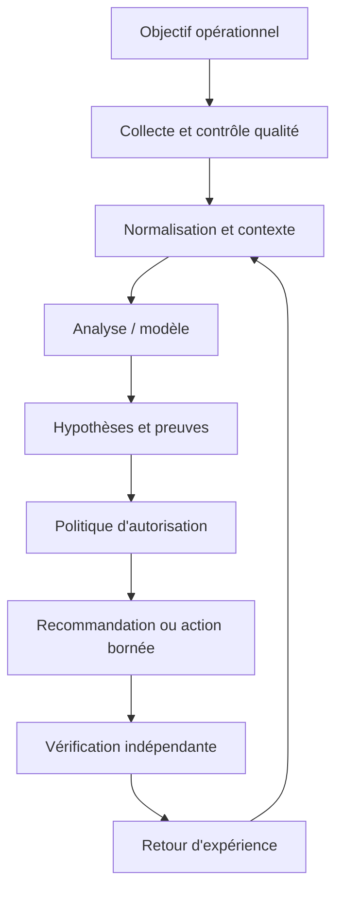

Chaque observation conserve source, horodatage, unité, cible, fraîcheur et état de qualité. Le résultat de l'analyse référence sa version et ses entrées. La décision expose actions permises, préconditions, approbations, quotas et conditions d'arrêt. La sortie finale indique les preuves exigées avant de déclarer le succès, ainsi que les situations qui imposent une escalade.

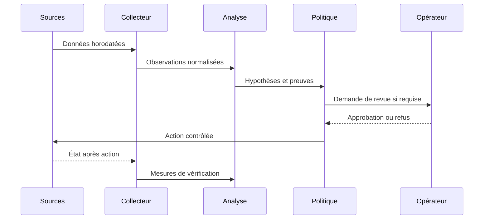

### Décision sous incertitude

La sécurité liée à Séparation entre analyse et exécution doit être conçue en amont : privilèges minimaux, protection des secrets, audit, séparation de l'analyse et de l'exécution, et règles d'escalade. Le piège principal ici est de prendre une explication fluide pour une preuve. Les données externes doivent rester des données, jamais une autorité qui redéfinit les permissions. Pour une opération à fort impact, il faut des préconditions vérifiables, une approbation adaptée et un retour arrière testé, même lorsque le score du modèle semble très élevé.

Quand Données manquantes produit un résultat inattendu, commencer par l'heure, la source, l'unité, la cible, la fraîcheur, la version et le code d'erreur. Comparer l'observation brute à sa représentation transformée, puis chercher une modification récente. Tester une hypothèse à la fois et consigner la preuve du résultat sans copier de secrets dans le ticket. Une fois la cause confirmée, ajouter un test de régression et vérifier qu'il échoue avant le correctif et passe après celui-ci.

À l'échelle, Mode dégradé doit gérer des volumes et versions hétérogènes sans perdre de traçabilité. Borner la concurrence, isoler les erreurs par cible, limiter les files et surveiller les retards protègent l'aval. La reprise d'une panne peut elle-même provoquer une surcharge si toutes les sources se reconnectent simultanément. Le système doit pouvoir réduire sa fréquence ou revenir à une méthode simple, tout en signalant explicitement ce mode dégradé au lieu d'afficher un faux état normal.

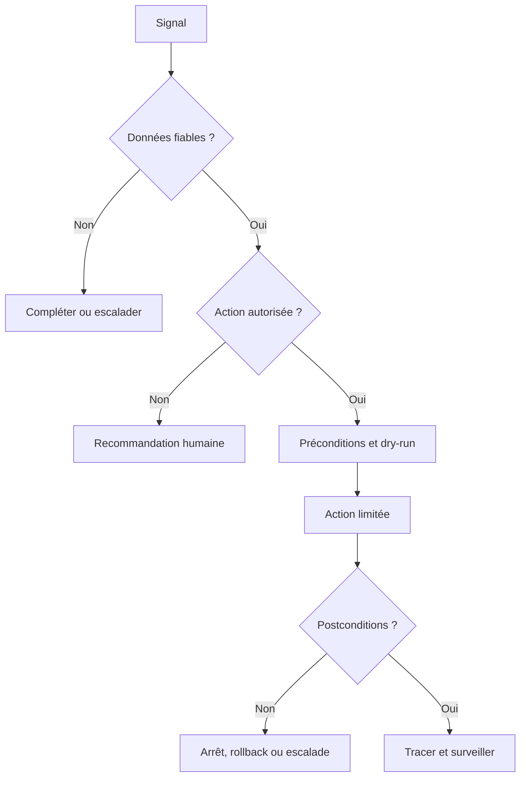

## 4. Pipeline et algorithmes

Le pipeline décrit ici est une chaîne de responsabilités, pas nécessairement six services séparés. Chaque étape doit avoir des entrées et sorties définies, des tests et une méthode de gestion des erreurs. Les données sont validées avant l'analyse, le contexte est enrichi avant l'interprétation, et la politique est consultée avant une action. Cette séquence permet de démarrer en mode observation et d'augmenter l'autonomie uniquement lorsque les critères sont prouvés.

### Étape 1 — Rassembler les preuves
Collecter signaux et contexte en préservant provenance et timestamps.

La mise en œuvre de Rassembler les preuves se découpe en étapes testables : validation des entrées, contrôle des sources, traitement des valeurs absentes, journalisation et vérification des sorties. L'outil RAG peut contribuer au processus, mais sa présence ne garantit pas sa fiabilité. Les erreurs doivent rester explicites au lieu d'être converties en valeurs par défaut silencieuses. Une exécution fiable distingue succès, échec, état partiel et état impossible à déterminer, et conserve la version de code ou de modèle qui a produit la sortie.

Quand Rassembler les preuves produit un résultat inattendu, commencer par l'heure, la source, l'unité, la cible, la fraîcheur, la version et le code d'erreur. Comparer l'observation brute à sa représentation transformée, puis chercher une modification récente. Tester une hypothèse à la fois et consigner la preuve du résultat sans copier de secrets dans le ticket. Une fois la cause confirmée, ajouter un test de régression et vérifier qu'il échoue avant le correctif et passe après celui-ci.

### Étape 2 — Reconstruire le temps
Aligner journaux, métriques, changements et impact utilisateur.

La mise en œuvre de Reconstruire le temps se découpe en étapes testables : validation des entrées, contrôle des sources, traitement des valeurs absentes, journalisation et vérification des sorties. L'outil LLM peut contribuer au processus, mais sa présence ne garantit pas sa fiabilité. Les erreurs doivent rester explicites au lieu d'être converties en valeurs par défaut silencieuses. Une exécution fiable distingue succès, échec, état partiel et état impossible à déterminer, et conserve la version de code ou de modèle qui a produit la sortie.

Quand Reconstruire le temps produit un résultat inattendu, commencer par l'heure, la source, l'unité, la cible, la fraîcheur, la version et le code d'erreur. Comparer l'observation brute à sa représentation transformée, puis chercher une modification récente. Tester une hypothèse à la fois et consigner la preuve du résultat sans copier de secrets dans le ticket. Une fois la cause confirmée, ajouter un test de régression et vérifier qu'il échoue avant le correctif et passe après celui-ci.

### Étape 3 — Récupérer la connaissance
Chercher des runbooks et incidents autorisés.

La mise en œuvre de Récupérer la connaissance se découpe en étapes testables : validation des entrées, contrôle des sources, traitement des valeurs absentes, journalisation et vérification des sorties. L'outil graphe de dépendances peut contribuer au processus, mais sa présence ne garantit pas sa fiabilité. Les erreurs doivent rester explicites au lieu d'être converties en valeurs par défaut silencieuses. Une exécution fiable distingue succès, échec, état partiel et état impossible à déterminer, et conserve la version de code ou de modèle qui a produit la sortie.

Quand Récupérer la connaissance produit un résultat inattendu, commencer par l'heure, la source, l'unité, la cible, la fraîcheur, la version et le code d'erreur. Comparer l'observation brute à sa représentation transformée, puis chercher une modification récente. Tester une hypothèse à la fois et consigner la preuve du résultat sans copier de secrets dans le ticket. Une fois la cause confirmée, ajouter un test de régression et vérifier qu'il échoue avant le correctif et passe après celui-ci.

### Étape 4 — Générer les hypothèses
Produire causes candidates avec preuves, inconnues et contradictions.

La mise en œuvre de Générer les hypothèses se découpe en étapes testables : validation des entrées, contrôle des sources, traitement des valeurs absentes, journalisation et vérification des sorties. L'outil journaux peut contribuer au processus, mais sa présence ne garantit pas sa fiabilité. Les erreurs doivent rester explicites au lieu d'être converties en valeurs par défaut silencieuses. Une exécution fiable distingue succès, échec, état partiel et état impossible à déterminer, et conserve la version de code ou de modèle qui a produit la sortie.

Quand Générer les hypothèses produit un résultat inattendu, commencer par l'heure, la source, l'unité, la cible, la fraîcheur, la version et le code d'erreur. Comparer l'observation brute à sa représentation transformée, puis chercher une modification récente. Tester une hypothèse à la fois et consigner la preuve du résultat sans copier de secrets dans le ticket. Une fois la cause confirmée, ajouter un test de régression et vérifier qu'il échoue avant le correctif et passe après celui-ci.

### Étape 5 — Choisir les tests
Privilégier des vérifications peu risquées et discriminantes.

La mise en œuvre de Choisir les tests se découpe en étapes testables : validation des entrées, contrôle des sources, traitement des valeurs absentes, journalisation et vérification des sorties. L'outil chronologie et validation humaine peut contribuer au processus, mais sa présence ne garantit pas sa fiabilité. Les erreurs doivent rester explicites au lieu d'être converties en valeurs par défaut silencieuses. Une exécution fiable distingue succès, échec, état partiel et état impossible à déterminer, et conserve la version de code ou de modèle qui a produit la sortie.

Quand Choisir les tests produit un résultat inattendu, commencer par l'heure, la source, l'unité, la cible, la fraîcheur, la version et le code d'erreur. Comparer l'observation brute à sa représentation transformée, puis chercher une modification récente. Tester une hypothèse à la fois et consigner la preuve du résultat sans copier de secrets dans le ticket. Une fois la cause confirmée, ajouter un test de régression et vérifier qu'il échoue avant le correctif et passe après celui-ci.

### Étape 6 — Confirmer
Faire valider les preuves et enrichir le post-mortem de manière contrôlée.

La mise en œuvre de Confirmer se découpe en étapes testables : validation des entrées, contrôle des sources, traitement des valeurs absentes, journalisation et vérification des sorties. L'outil RAG peut contribuer au processus, mais sa présence ne garantit pas sa fiabilité. Les erreurs doivent rester explicites au lieu d'être converties en valeurs par défaut silencieuses. Une exécution fiable distingue succès, échec, état partiel et état impossible à déterminer, et conserve la version de code ou de modèle qui a produit la sortie.

Quand Confirmer produit un résultat inattendu, commencer par l'heure, la source, l'unité, la cible, la fraîcheur, la version et le code d'erreur. Comparer l'observation brute à sa représentation transformée, puis chercher une modification récente. Tester une hypothèse à la fois et consigner la preuve du résultat sans copier de secrets dans le ticket. Une fois la cause confirmée, ajouter un test de régression et vérifier qu'il échoue avant le correctif et passe après celui-ci.

### Pseudocode défensif
```text
observations = collecter()
si qualité(observations) insuffisante:
    signaler les données manquantes et escalader
sinon:
    contexte = enrichir(observations, inventaire, changements, dépendances)
    hypothèses = analyser(contexte)
    vérifier la provenance de chaque preuve
    si preuve insuffisante ou action hors politique:
        recommander sans exécuter
    sinon:
        préparer diff, préconditions, approbations et rollback
        appliquer sur un petit périmètre
        mesurer les postconditions indépendantes
        restaurer ou escalader si non conforme
        journaliser version, preuves, décision et résultat
```

Ce pseudocode explique la logique et n'est pas une bibliothèque prête pour la production. Chaque étape exige des tests, des permissions appropriées et un mode de reprise explicite. Un système fiable ne remplace pas l'incertitude par une valeur par défaut ; il la rend visible et réduit son autonomie lorsque les preuves sont incomplètes.

## 5. Étude de cas détaillée

### Situation et impact
un incident multi-sites produit de nombreuses alertes et changements ; l'astreinte a besoin d'hypothèses testables et ne doit pas accepter une cause inventée. L'équipe commence par établir le périmètre, l'impact utilisateur, la chronologie et la criticité des actifs. Sa première question n'est pas « quel modèle est à la mode ? », mais « quelle décision doit devenir meilleure, et quelle preuve permettra de le démontrer ? ». Cette formulation évite la dérive du périmètre et fixe un critère d'arrêt si la solution n'apporte pas de valeur.

### Phase 1 — Établir les faits
Conserver les données brutes en lecture seule et noter les sources, timestamps, versions et transformations. Vérifier les changements récents et la qualité de collecte. Les valeurs absentes demeurent absentes ; elles ne sont pas remplacées par zéro. L'impact métier est mesuré séparément de l'état d'un équipement. Les contradictions entre systèmes sont documentées au lieu d'être résolues par intuition.

### Phase 2 — Comparer les hypothèses
Décrire au moins deux explications si les preuves ne permettent pas de conclure directement. Pour chacune, noter les observations favorables, les contre-indices et le test qui peut la distinguer. La priorité dépend de l'impact, de la plausibilité et du coût du test. Une ressemblance avec un incident historique ne suffit pas : versions, topologie, capacité et fenêtre de charge peuvent changer l'explication.

### Phase 3 — Préparer une réponse proportionnée
Privilégier les contrôles non destructifs. Si une modification devient nécessaire, préciser cible, diff, préconditions, impact, fenêtre, critères d'arrêt et rollback. Une revue indépendante s'impose lorsque le rayon d'impact est grand. Le plan doit permettre de refuser une action lorsque les preuves ne sont pas suffisantes.

### Phase 4 — Vérifier
Après action, contrôler mesures indépendantes : fonctionnement du service, latence, erreurs, connectivité, état de configuration ou autre indicateur pertinent. Une seule valeur favorable ne prouve pas un rétablissement durable. Lorsque les postconditions échouent, arrêter, restaurer selon le plan ou escalader. Le compte rendu distingue ce qui a été tenté, observé, confirmé et laissé inconnu.

### Phase 5 — Tirer des leçons
Comparer les hypothèses initiales aux preuves finales. Ajouter tests de régression, sources manquantes et contrôles à améliorer. Une règle ou un modèle mis à jour passe par une revue et une expérimentation contrôlée avant généralisation. Les conclusions non confirmées ne deviennent pas automatiquement de nouvelles étiquettes d'entraînement.

### Conditions de clôture
La clôture exige soit une preuve de rétablissement, soit une déclaration explicite que le service reste dégradé. Le dossier conserve sources, versions, actions, approbations, résultats et suivis. La cause racine n'est déclarée confirmée que si les preuves le permettent. Une conclusion honnêtement partielle est préférable à une explication catégorique impossible à reproduire.

## 6. Implémentation et TP

Exécuter les travaux pratiques dans un laboratoire isolé ou sur des systèmes autorisés. Noter les versions, dépendances, données et critères de réussite. Le résultat doit pouvoir être reproduit par un autre opérateur ; un succès affiché par l'outil ne remplace pas le contrôle de l'état réel.

### TP 1 — Créer un dossier d'incident avec métriques, logs et changements.
**Procédure.** Créer un dossier d'incident avec métriques, logs et changements. Utiliser une cible limitée, capturer l'état initial et ne changer qu'un paramètre à la fois. Relier le travail au concept « Dossier de preuve » : Le dossier rassemble observations brutes, journaux, changements, topologie, timestamps, sources et limites. Conserver commande, entrée, version et sortie.

**Contrôle.** Reproduire le résultat, puis tester une erreur contrôlée, une donnée manquante et une dépendance indisponible. Vérifier l'état effectif, les effets secondaires et la procédure de reprise. Si le résultat ne peut pas être déterminé, signaler cet état plutôt que le considérer comme une réussite. Décrire ce qui est démontré et les limites qui subsistent avant un déploiement plus large.

### TP 2 — Normaliser les timestamps et documenter les trous de données.
**Procédure.** Normaliser les timestamps et documenter les trous de données. Utiliser une cible limitée, capturer l'état initial et ne changer qu'un paramètre à la fois. Relier le travail au concept « Chronologie » : Une timeline harmonise événements pour séparer précurseurs, symptômes et effets postérieurs. Conserver commande, entrée, version et sortie.

**Contrôle.** Reproduire le résultat, puis tester une erreur contrôlée, une donnée manquante et une dépendance indisponible. Vérifier l'état effectif, les effets secondaires et la procédure de reprise. Si le résultat ne peut pas être déterminé, signaler cet état plutôt que le considérer comme une réussite. Décrire ce qui est démontré et les limites qui subsistent avant un déploiement plus large.

### TP 3 — Récupérer des procédures autorisées avec identifiants de source.
**Procédure.** Récupérer des procédures autorisées avec identifiants de source. Utiliser une cible limitée, capturer l'état initial et ne changer qu'un paramètre à la fois. Relier le travail au concept « RAG opérationnel » : La recherche récupère runbooks et incidents analogues en appliquant permissions et fraîcheur. Conserver commande, entrée, version et sortie.

**Contrôle.** Reproduire le résultat, puis tester une erreur contrôlée, une donnée manquante et une dépendance indisponible. Vérifier l'état effectif, les effets secondaires et la procédure de reprise. Si le résultat ne peut pas être déterminé, signaler cet état plutôt que le considérer comme une réussite. Décrire ce qui est démontré et les limites qui subsistent avant un déploiement plus large.

### TP 4 — Générer trois hypothèses et relier chacune à des preuves.
**Procédure.** Générer trois hypothèses et relier chacune à des preuves. Utiliser une cible limitée, capturer l'état initial et ne changer qu'un paramètre à la fois. Relier le travail au concept « Hypothèse falsifiable » : Une hypothèse énumère preuves favorables, contre-indices et test qui permet de la distinguer. Conserver commande, entrée, version et sortie.

**Contrôle.** Reproduire le résultat, puis tester une erreur contrôlée, une donnée manquante et une dépendance indisponible. Vérifier l'état effectif, les effets secondaires et la procédure de reprise. Si le résultat ne peut pas être déterminé, signaler cet état plutôt que le considérer comme une réussite. Décrire ce qui est démontré et les limites qui subsistent avant un déploiement plus large.

### TP 5 — Demander inconnues et contre-indices explicitement.
**Procédure.** Demander inconnues et contre-indices explicitement. Utiliser une cible limitée, capturer l'état initial et ne changer qu'un paramètre à la fois. Relier le travail au concept « Incertitude » : Les données manquantes ou contradictoires doivent réduire la confiance et conduire à une vérification complémentaire. Conserver commande, entrée, version et sortie.

**Contrôle.** Reproduire le résultat, puis tester une erreur contrôlée, une donnée manquante et une dépendance indisponible. Vérifier l'état effectif, les effets secondaires et la procédure de reprise. Si le résultat ne peut pas être déterminé, signaler cet état plutôt que le considérer comme une réussite. Décrire ce qui est démontré et les limites qui subsistent avant un déploiement plus large.

### TP 6 — Valider le schéma et vérifier chaque citation.
**Procédure.** Valider le schéma et vérifier chaque citation. Utiliser une cible limitée, capturer l'état initial et ne changer qu'un paramètre à la fois. Relier le travail au concept « Réponse structurée » : Le diagnostic présente faits, hypothèses, tests, risques et identifiants de source dans un format validé. Conserver commande, entrée, version et sortie.

**Contrôle.** Reproduire le résultat, puis tester une erreur contrôlée, une donnée manquante et une dépendance indisponible. Vérifier l'état effectif, les effets secondaires et la procédure de reprise. Si le résultat ne peut pas être déterminé, signaler cet état plutôt que le considérer comme une réussite. Décrire ce qui est démontré et les limites qui subsistent avant un déploiement plus large.

### TP 7 — Comparer la proposition au post-mortem final confirmé.
**Procédure.** Comparer la proposition au post-mortem final confirmé. Utiliser une cible limitée, capturer l'état initial et ne changer qu'un paramètre à la fois. Relier le travail au concept « Évaluation » : La qualité se mesure sur causes confirmées, citations, utilité des tests et abstention appropriée. Conserver commande, entrée, version et sortie.

**Contrôle.** Reproduire le résultat, puis tester une erreur contrôlée, une donnée manquante et une dépendance indisponible. Vérifier l'état effectif, les effets secondaires et la procédure de reprise. Si le résultat ne peut pas être déterminé, signaler cet état plutôt que le considérer comme une réussite. Décrire ce qui est démontré et les limites qui subsistent avant un déploiement plus large.

### Exemple technique
```text
diagnosis:
  incident_id: INC-2026-1042
  hypotheses:
    - claim: "Saturation du lien"
      evidence_ids: ["metric-17", "event-22"]
      contradicting_evidence: ["metric-31"]
      next_test: "Comparer utilisation et erreurs avant/après"
      risk: low
  unknowns: ["Compteur manquant pendant 40 secondes"]
  execution_allowed: false

# Vérifier chaque evidence_id : tant que les preuves n'existent pas, il s'agit d'une hypothèse.
```
Ce fragment est un point de départ pédagogique, pas une configuration universelle. Les versions, options et capacités peuvent varier : lire la documentation officielle et tester en laboratoire. Ne pas coder de secrets en dur. Tout changement réel exige un périmètre limité, une autorisation appropriée et une vérification post-action.

### Livrables
- Un fichier versionné décrivant entrée, sortie et dépendances.
- Un journal corrélé à la cible et à la version, sans secrets.
- Des tests positifs et négatifs, dont données manquantes et échec d'accès.
- Des critères d'arrêt et un rollback testé.
- Une note de résultats, hypothèses et limites.

## 7. Sécurité et gouvernance

### 1. Qualité et provenance
Chaque observation conserve source, horodatage, unité et fraîcheur. Traduire ce principe en contrôle observable, propriétaire, fréquence de revue et preuve de passage. Une politique sans test dépend de la mémoire ; un test sans propriétaire n'est plus maintenu lorsque l'équipe change. Relancer la revue après un changement majeur de données, d'équipement, de modèle ou de finalité.

La gouvernance de Qualité et provenance précise qui peut créer, modifier, approuver, consulter et retirer la logique. Le propriétaire connaît le but, les limites, le budget d'erreur et les critères de suspension. Les décisions doivent être retraçables jusqu'aux données, paramètres et versions utilisés. Une règle sans propriétaire finit par dépendre de la mémoire des personnes ; une métrique sans décision associée devient décorative. La revue doit être planifiée et déclenchée de nouveau après un changement majeur de contexte.

### 2. Identités
Les comptes de service ont le minimum de permissions nécessaires. Traduire ce principe en contrôle observable, propriétaire, fréquence de revue et preuve de passage. Une politique sans test dépend de la mémoire ; un test sans propriétaire n'est plus maintenu lorsque l'équipe change. Relancer la revue après un changement majeur de données, d'équipement, de modèle ou de finalité.

La gouvernance de Identités précise qui peut créer, modifier, approuver, consulter et retirer la logique. Le propriétaire connaît le but, les limites, le budget d'erreur et les critères de suspension. Les décisions doivent être retraçables jusqu'aux données, paramètres et versions utilisés. Une règle sans propriétaire finit par dépendre de la mémoire des personnes ; une métrique sans décision associée devient décorative. La revue doit être planifiée et déclenchée de nouveau après un changement majeur de contexte.

### 3. Traçabilité
Version, preuves, décision, approbation, cible et résultat restent corrélés. Traduire ce principe en contrôle observable, propriétaire, fréquence de revue et preuve de passage. Une politique sans test dépend de la mémoire ; un test sans propriétaire n'est plus maintenu lorsque l'équipe change. Relancer la revue après un changement majeur de données, d'équipement, de modèle ou de finalité.

La gouvernance de Traçabilité précise qui peut créer, modifier, approuver, consulter et retirer la logique. Le propriétaire connaît le but, les limites, le budget d'erreur et les critères de suspension. Les décisions doivent être retraçables jusqu'aux données, paramètres et versions utilisés. Une règle sans propriétaire finit par dépendre de la mémoire des personnes ; une métrique sans décision associée devient décorative. La revue doit être planifiée et déclenchée de nouveau après un changement majeur de contexte.

### 4. Revue humaine
Le réviseur dispose de temps, preuves et autorité pour refuser. Traduire ce principe en contrôle observable, propriétaire, fréquence de revue et preuve de passage. Une politique sans test dépend de la mémoire ; un test sans propriétaire n'est plus maintenu lorsque l'équipe change. Relancer la revue après un changement majeur de données, d'équipement, de modèle ou de finalité.

La gouvernance de Revue humaine précise qui peut créer, modifier, approuver, consulter et retirer la logique. Le propriétaire connaît le but, les limites, le budget d'erreur et les critères de suspension. Les décisions doivent être retraçables jusqu'aux données, paramètres et versions utilisés. Une règle sans propriétaire finit par dépendre de la mémoire des personnes ; une métrique sans décision associée devient décorative. La revue doit être planifiée et déclenchée de nouveau après un changement majeur de contexte.

### 5. Gestion du risque
Chaque mode d'échec a prévention, détection, réponse et propriétaire. Traduire ce principe en contrôle observable, propriétaire, fréquence de revue et preuve de passage. Une politique sans test dépend de la mémoire ; un test sans propriétaire n'est plus maintenu lorsque l'équipe change. Relancer la revue après un changement majeur de données, d'équipement, de modèle ou de finalité.

La gouvernance de Gestion du risque précise qui peut créer, modifier, approuver, consulter et retirer la logique. Le propriétaire connaît le but, les limites, le budget d'erreur et les critères de suspension. Les décisions doivent être retraçables jusqu'aux données, paramètres et versions utilisés. Une règle sans propriétaire finit par dépendre de la mémoire des personnes ; une métrique sans décision associée devient décorative. La revue doit être planifiée et déclenchée de nouveau après un changement majeur de contexte.

### 6. Réversibilité
Retrait, suspension et retour à une version saine sont testés. Traduire ce principe en contrôle observable, propriétaire, fréquence de revue et preuve de passage. Une politique sans test dépend de la mémoire ; un test sans propriétaire n'est plus maintenu lorsque l'équipe change. Relancer la revue après un changement majeur de données, d'équipement, de modèle ou de finalité.

La gouvernance de Réversibilité précise qui peut créer, modifier, approuver, consulter et retirer la logique. Le propriétaire connaît le but, les limites, le budget d'erreur et les critères de suspension. Les décisions doivent être retraçables jusqu'aux données, paramètres et versions utilisés. Une règle sans propriétaire finit par dépendre de la mémoire des personnes ; une métrique sans décision associée devient décorative. La revue doit être planifiée et déclenchée de nouveau après un changement majeur de contexte.

## 8. Pièges à éviter

### Piège 1 — prendre une explication fluide pour une preuve
Ce défaut peut produire un faux diagnostic, une action inutile ou une perte de confiance. Les signes précoces peuvent être une source contradictoire, une hausse d'erreurs, un écart entre sites ou l'absence de preuve. Pour ce cours, le risque « prendre une explication fluide pour une preuve » doit être associé à un test négatif explicite et à une réponse déterminée lorsque le garde-fou échoue.

La prévention s'appuie sur « Dossier de preuve ». Le dossier rassemble observations brutes, journaux, changements, topologie, timestamps, sources et limites. Un avertissement n'est utile que s'il change la décision, bloque une action risquée ou déclenche une revue. La checklist de déploiement doit préciser qui observe le signal, quel seuil est acceptable et qui peut suspendre la méthode. Il faut documenter aussi les défaillances que le contrôle ne couvre pas.

### Piège 2 — omettre les sources des faits
Ce défaut peut produire un faux diagnostic, une action inutile ou une perte de confiance. Les signes précoces peuvent être une source contradictoire, une hausse d'erreurs, un écart entre sites ou l'absence de preuve. Pour ce cours, le risque « omettre les sources des faits » doit être associé à un test négatif explicite et à une réponse déterminée lorsque le garde-fou échoue.

La prévention s'appuie sur « Chronologie ». Une timeline harmonise événements pour séparer précurseurs, symptômes et effets postérieurs. Un avertissement n'est utile que s'il change la décision, bloque une action risquée ou déclenche une revue. La checklist de déploiement doit préciser qui observe le signal, quel seuil est acceptable et qui peut suspendre la méthode. Il faut documenter aussi les défaillances que le contrôle ne couvre pas.

### Piège 3 — inclure des documents hors autorisation
Ce défaut peut produire un faux diagnostic, une action inutile ou une perte de confiance. Les signes précoces peuvent être une source contradictoire, une hausse d'erreurs, un écart entre sites ou l'absence de preuve. Pour ce cours, le risque « inclure des documents hors autorisation » doit être associé à un test négatif explicite et à une réponse déterminée lorsque le garde-fou échoue.

La prévention s'appuie sur « RAG opérationnel ». La recherche récupère runbooks et incidents analogues en appliquant permissions et fraîcheur. Un avertissement n'est utile que s'il change la décision, bloque une action risquée ou déclenche une revue. La checklist de déploiement doit préciser qui observe le signal, quel seuil est acceptable et qui peut suspendre la méthode. Il faut documenter aussi les défaillances que le contrôle ne couvre pas.

### Piège 4 — laisser un agent exécuter une action destructive
Ce défaut peut produire un faux diagnostic, une action inutile ou une perte de confiance. Les signes précoces peuvent être une source contradictoire, une hausse d'erreurs, un écart entre sites ou l'absence de preuve. Pour ce cours, le risque « laisser un agent exécuter une action destructive » doit être associé à un test négatif explicite et à une réponse déterminée lorsque le garde-fou échoue.

La prévention s'appuie sur « Hypothèse falsifiable ». Une hypothèse énumère preuves favorables, contre-indices et test qui permet de la distinguer. Un avertissement n'est utile que s'il change la décision, bloque une action risquée ou déclenche une revue. La checklist de déploiement doit préciser qui observe le signal, quel seuil est acceptable et qui peut suspendre la méthode. Il faut documenter aussi les défaillances que le contrôle ne couvre pas.

### Piège 5 — ignorer les contradictions
Ce défaut peut produire un faux diagnostic, une action inutile ou une perte de confiance. Les signes précoces peuvent être une source contradictoire, une hausse d'erreurs, un écart entre sites ou l'absence de preuve. Pour ce cours, le risque « ignorer les contradictions » doit être associé à un test négatif explicite et à une réponse déterminée lorsque le garde-fou échoue.

La prévention s'appuie sur « Incertitude ». Les données manquantes ou contradictoires doivent réduire la confiance et conduire à une vérification complémentaire. Un avertissement n'est utile que s'il change la décision, bloque une action risquée ou déclenche une revue. La checklist de déploiement doit préciser qui observe le signal, quel seuil est acceptable et qui peut suspendre la méthode. Il faut documenter aussi les défaillances que le contrôle ne couvre pas.

### Piège 6 — évaluer uniquement les incidents faciles
Ce défaut peut produire un faux diagnostic, une action inutile ou une perte de confiance. Les signes précoces peuvent être une source contradictoire, une hausse d'erreurs, un écart entre sites ou l'absence de preuve. Pour ce cours, le risque « évaluer uniquement les incidents faciles » doit être associé à un test négatif explicite et à une réponse déterminée lorsque le garde-fou échoue.

La prévention s'appuie sur « Réponse structurée ». Le diagnostic présente faits, hypothèses, tests, risques et identifiants de source dans un format validé. Un avertissement n'est utile que s'il change la décision, bloque une action risquée ou déclenche une revue. La checklist de déploiement doit préciser qui observe le signal, quel seuil est acceptable et qui peut suspendre la méthode. Il faut documenter aussi les défaillances que le contrôle ne couvre pas.

### Piège 7 — apprendre automatiquement de RCA non confirmées
Ce défaut peut produire un faux diagnostic, une action inutile ou une perte de confiance. Les signes précoces peuvent être une source contradictoire, une hausse d'erreurs, un écart entre sites ou l'absence de preuve. Pour ce cours, le risque « apprendre automatiquement de RCA non confirmées » doit être associé à un test négatif explicite et à une réponse déterminée lorsque le garde-fou échoue.

La prévention s'appuie sur « Évaluation ». La qualité se mesure sur causes confirmées, citations, utilité des tests et abstention appropriée. Un avertissement n'est utile que s'il change la décision, bloque une action risquée ou déclenche une revue. La checklist de déploiement doit préciser qui observe le signal, quel seuil est acceptable et qui peut suspendre la méthode. Il faut documenter aussi les défaillances que le contrôle ne couvre pas.

## 9. Diagnostic et dépannage

### Aucun résultat
Vérifier accès, période, filtres, identité et version du schéma. Dans le contexte de IA Générative pour le diagnostic d'incidents, examiner d'abord le risque « prendre une explication fluide pour une preuve ». Comparer observation brute et donnée transformée, retracer la version utilisée et vérifier les modifications récentes. Construire deux hypothèses alternatives et effectuer un test non destructif qui permet de les départager. Éviter les changements simultanés. Si les preuves restent incomplètes, garder l'incertitude visible et utiliser le mode sûr.

### Résultats variables
Comparer dataset, code, paramètres, dépendances et transformations. Dans le contexte de IA Générative pour le diagnostic d'incidents, examiner d'abord le risque « omettre les sources des faits ». Comparer observation brute et donnée transformée, retracer la version utilisée et vérifier les modifications récentes. Construire deux hypothèses alternatives et effectuer un test non destructif qui permet de les départager. Éviter les changements simultanés. Si les preuves restent incomplètes, garder l'incertitude visible et utiliser le mode sûr.

### Trop d'alertes
Inspecter duplications, saisonnalité, baseline et seuils. Dans le contexte de IA Générative pour le diagnostic d'incidents, examiner d'abord le risque « inclure des documents hors autorisation ». Comparer observation brute et donnée transformée, retracer la version utilisée et vérifier les modifications récentes. Construire deux hypothèses alternatives et effectuer un test non destructif qui permet de les départager. Éviter les changements simultanés. Si les preuves restent incomplètes, garder l'incertitude visible et utiliser le mode sûr.

### Incident manqué
Reconstituer l'information disponible au moment de la décision. Dans le contexte de IA Générative pour le diagnostic d'incidents, examiner d'abord le risque « laisser un agent exécuter une action destructive ». Comparer observation brute et donnée transformée, retracer la version utilisée et vérifier les modifications récentes. Construire deux hypothèses alternatives et effectuer un test non destructif qui permet de les départager. Éviter les changements simultanés. Si les preuves restent incomplètes, garder l'incertitude visible et utiliser le mode sûr.

### Action sans effet
Mesurer les postconditions indépendantes et chercher les effets secondaires. Dans le contexte de IA Générative pour le diagnostic d'incidents, examiner d'abord le risque « ignorer les contradictions ». Comparer observation brute et donnée transformée, retracer la version utilisée et vérifier les modifications récentes. Construire deux hypothèses alternatives et effectuer un test non destructif qui permet de les départager. Éviter les changements simultanés. Si les preuves restent incomplètes, garder l'incertitude visible et utiliser le mode sûr.

### Qualité en baisse
Rechercher dérive, migration, changement de capacité ou de version. Dans le contexte de IA Générative pour le diagnostic d'incidents, examiner d'abord le risque « évaluer uniquement les incidents faciles ». Comparer observation brute et donnée transformée, retracer la version utilisée et vérifier les modifications récentes. Construire deux hypothèses alternatives et effectuer un test non destructif qui permet de les départager. Éviter les changements simultanés. Si les preuves restent incomplètes, garder l'incertitude visible et utiliser le mode sûr.

## 10. Exercices corrigés

### Exercice 1 — Dossier de preuve
**Énoncé.** Pour le scénario « un incident multi-sites produit de nombreuses alertes et changements ; l'astreinte a besoin d'hypothèses testables et ne doit pas accepter une cause inventée », l'équipe veut généraliser une méthode qui utilise Dossier de preuve. Quelle preuve doit-elle recueillir avant l'étape « Rassembler les preuves » et comment prévenir « prendre une explication fluide pour une preuve » ?

**Correction détaillée.** Définir le résultat attendu et le coût de l'erreur. Vérifier la provenance, la fraîcheur et la disponibilité temporelle des entrées. Construire un essai reproductible et le comparer à une baseline. Collecter signaux et contexte en préservant provenance et timestamps. Analyser les erreurs par catégorie d'actifs, puis fixer des seuils et une revue adaptée au risque. Le déploiement commence sur un périmètre limité et possède une restauration testée. Si les preuves sont insuffisantes, la bonne décision est d'observer, de demander une donnée complémentaire ou d'escalader.

**Pourquoi un raccourci échoue.** Un exemple favorable ne prouve pas un gain durable. Une métrique globale masque des cas critiques et une collecte lacunaire peut cacher les erreurs. La version et les conditions doivent rester disponibles pour reproduire le résultat. L'exercice est réussi si une autre personne peut expliquer le choix, ses limites et le mécanisme de retrait.

### Exercice 2 — Chronologie
**Énoncé.** Pour le scénario « un incident multi-sites produit de nombreuses alertes et changements ; l'astreinte a besoin d'hypothèses testables et ne doit pas accepter une cause inventée », l'équipe veut généraliser une méthode qui utilise Chronologie. Quelle preuve doit-elle recueillir avant l'étape « Reconstruire le temps » et comment prévenir « omettre les sources des faits » ?

**Correction détaillée.** Définir le résultat attendu et le coût de l'erreur. Vérifier la provenance, la fraîcheur et la disponibilité temporelle des entrées. Construire un essai reproductible et le comparer à une baseline. Aligner journaux, métriques, changements et impact utilisateur. Analyser les erreurs par catégorie d'actifs, puis fixer des seuils et une revue adaptée au risque. Le déploiement commence sur un périmètre limité et possède une restauration testée. Si les preuves sont insuffisantes, la bonne décision est d'observer, de demander une donnée complémentaire ou d'escalader.

**Pourquoi un raccourci échoue.** Un exemple favorable ne prouve pas un gain durable. Une métrique globale masque des cas critiques et une collecte lacunaire peut cacher les erreurs. La version et les conditions doivent rester disponibles pour reproduire le résultat. L'exercice est réussi si une autre personne peut expliquer le choix, ses limites et le mécanisme de retrait.

### Exercice 3 — RAG opérationnel
**Énoncé.** Pour le scénario « un incident multi-sites produit de nombreuses alertes et changements ; l'astreinte a besoin d'hypothèses testables et ne doit pas accepter une cause inventée », l'équipe veut généraliser une méthode qui utilise RAG opérationnel. Quelle preuve doit-elle recueillir avant l'étape « Récupérer la connaissance » et comment prévenir « inclure des documents hors autorisation » ?

**Correction détaillée.** Définir le résultat attendu et le coût de l'erreur. Vérifier la provenance, la fraîcheur et la disponibilité temporelle des entrées. Construire un essai reproductible et le comparer à une baseline. Chercher des runbooks et incidents autorisés. Analyser les erreurs par catégorie d'actifs, puis fixer des seuils et une revue adaptée au risque. Le déploiement commence sur un périmètre limité et possède une restauration testée. Si les preuves sont insuffisantes, la bonne décision est d'observer, de demander une donnée complémentaire ou d'escalader.

**Pourquoi un raccourci échoue.** Un exemple favorable ne prouve pas un gain durable. Une métrique globale masque des cas critiques et une collecte lacunaire peut cacher les erreurs. La version et les conditions doivent rester disponibles pour reproduire le résultat. L'exercice est réussi si une autre personne peut expliquer le choix, ses limites et le mécanisme de retrait.

### Exercice 4 — Hypothèse falsifiable
**Énoncé.** Pour le scénario « un incident multi-sites produit de nombreuses alertes et changements ; l'astreinte a besoin d'hypothèses testables et ne doit pas accepter une cause inventée », l'équipe veut généraliser une méthode qui utilise Hypothèse falsifiable. Quelle preuve doit-elle recueillir avant l'étape « Générer les hypothèses » et comment prévenir « laisser un agent exécuter une action destructive » ?

**Correction détaillée.** Définir le résultat attendu et le coût de l'erreur. Vérifier la provenance, la fraîcheur et la disponibilité temporelle des entrées. Construire un essai reproductible et le comparer à une baseline. Produire causes candidates avec preuves, inconnues et contradictions. Analyser les erreurs par catégorie d'actifs, puis fixer des seuils et une revue adaptée au risque. Le déploiement commence sur un périmètre limité et possède une restauration testée. Si les preuves sont insuffisantes, la bonne décision est d'observer, de demander une donnée complémentaire ou d'escalader.

**Pourquoi un raccourci échoue.** Un exemple favorable ne prouve pas un gain durable. Une métrique globale masque des cas critiques et une collecte lacunaire peut cacher les erreurs. La version et les conditions doivent rester disponibles pour reproduire le résultat. L'exercice est réussi si une autre personne peut expliquer le choix, ses limites et le mécanisme de retrait.

### Exercice 5 — Incertitude
**Énoncé.** Pour le scénario « un incident multi-sites produit de nombreuses alertes et changements ; l'astreinte a besoin d'hypothèses testables et ne doit pas accepter une cause inventée », l'équipe veut généraliser une méthode qui utilise Incertitude. Quelle preuve doit-elle recueillir avant l'étape « Choisir les tests » et comment prévenir « ignorer les contradictions » ?

**Correction détaillée.** Définir le résultat attendu et le coût de l'erreur. Vérifier la provenance, la fraîcheur et la disponibilité temporelle des entrées. Construire un essai reproductible et le comparer à une baseline. Privilégier des vérifications peu risquées et discriminantes. Analyser les erreurs par catégorie d'actifs, puis fixer des seuils et une revue adaptée au risque. Le déploiement commence sur un périmètre limité et possède une restauration testée. Si les preuves sont insuffisantes, la bonne décision est d'observer, de demander une donnée complémentaire ou d'escalader.

**Pourquoi un raccourci échoue.** Un exemple favorable ne prouve pas un gain durable. Une métrique globale masque des cas critiques et une collecte lacunaire peut cacher les erreurs. La version et les conditions doivent rester disponibles pour reproduire le résultat. L'exercice est réussi si une autre personne peut expliquer le choix, ses limites et le mécanisme de retrait.

## Atelier approfondi — bâtir un copilote génératif d'incident contraint par les preuves

Un copilote génératif pour les opérations doit aider une équipe à comprendre une situation et à choisir la prochaine vérification utile. Sa valeur ne vient pas de sa capacité à écrire une réponse fluide, mais de sa capacité à rester attaché aux faits disponibles, à signaler les contradictions et à refuser une conclusion lorsque le dossier est insuffisant. Dans un incident complexe, plusieurs explications peuvent être plausibles ; le copilote doit faciliter leur comparaison plutôt que sélectionner une histoire séduisante au premier passage.

Le fil rouge est un incident multisite décrit par des métriques, des journaux, des traces, des changements de configuration, des tickets et de la documentation technique. L'assistant doit construire une chronologie, récupérer des procédures autorisées, proposer des hypothèses falsifiables et préparer des tests non destructifs. Il ne doit ni inventer un événement, ni confondre une relation temporelle avec une causalité, ni exécuter une action à fort impact sur la seule base d'une génération de texte.

### 1. Définir une mission limitée et mesurable

Commencez par déterminer le rôle exact du copilote. Peut-il uniquement résumer un dossier ? Peut-il lancer des requêtes de diagnostic en lecture seule ? Peut-il créer un ticket ? Peut-il préparer un plan de changement ? Les permissions, les données accessibles et les tests de validation dépendent de la réponse. Évitez une mission vague telle que « résoudre automatiquement les incidents » si aucune limite d'action, aucun objectif mesuré et aucun mécanisme de contrôle n'ont été définis.

Une mission bien cadrée décrit les utilisateurs, les sources autorisées, les types de problème, les résultats attendus, les décisions interdites, les conditions d'abstention et le mode de reprise lorsqu'un composant est indisponible. Le copilote peut, par exemple, fournir une chronologie et jusqu'à trois hypothèses classées, chacune avec ses éléments favorables, ses contradictions et une vérification proposée. Ce contrat est plus vérifiable qu'une demande de produire « la cause racine ».

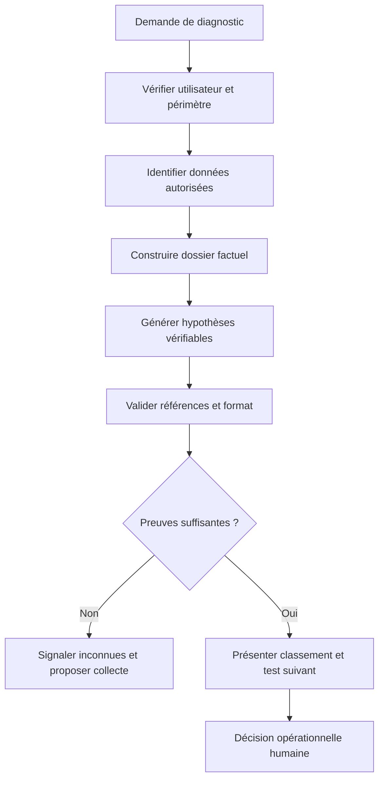

Définissez la sortie attendue avant de choisir le modèle. Une réponse pourrait contenir un résumé factuel, une chronologie, les hypothèses concurrentes, les preuves associées, les éléments contradictoires, les données manquantes, les prochaines vérifications et un niveau de confiance qualitatif. Les champs doivent être définis avec précision. « Confiance élevée » ne doit pas résulter uniquement d'un ton affirmatif ; le système doit respecter des règles qui tiennent compte de la qualité des données et des preuves indépendantes.

Les critères de réussite se mesurent sur le travail de diagnostic : les faits cités existent-ils ? Les références correspondent-elles au dossier ? Les causes plausibles sont-elles distinguées des certitudes ? Les inconnues sont-elles signalées ? Le test proposé discrimine-t-il réellement les hypothèses ? La synthèse réduit-elle le temps de compréhension sans augmenter les erreurs opérationnelles ? Le nombre de tokens, le temps de réponse et la satisfaction de lecture sont utiles pour l'exploitation, mais ne prouvent pas la qualité du diagnostic.

### 2. Construire un dossier de preuves avant d'appeler le modèle

Le modèle de langage ne devrait pas recevoir un assemblage non contrôlé de documents et être chargé d'inventer lui-même la structure des faits. Construisez d'abord un dossier canonique. Il contient l'identifiant de l'incident, les cibles, les événements normalisés, les horodatages disponibles, la qualité des sources, les changements pertinents, la topologie historique et les références aux éléments d'origine. Les éléments inconnus, contradictoires ou trop anciens restent explicitement marqués.

Le dossier factuel doit être distingué des interprétations produites auparavant. Si un ticket contient une hypothèse formulée par un opérateur, gardez-la comme hypothèse attribuée et non comme vérité confirmée. Si un résumé précédent a repris une erreur, ne lui accordez pas plus de poids qu'à l'événement initial. La provenance doit suivre chaque fait au fil des transformations.

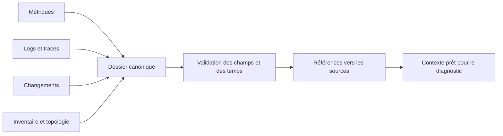

Chaque preuve devrait porter une identité stable, un type, une source, une période, un horodatage d'événement si disponible, un horodatage de réception, une qualité et un statut de validation. Une preuve peut être directe, dérivée ou estimée. Une valeur de latence tirée d'un compteur est une observation ; une moyenne calculée sur une fenêtre est une donnée dérivée ; une cause suggérée par un moteur de corrélation est une inférence. Cette différence doit être visible au modèle et à l'utilisateur.

La construction du dossier doit respecter les permissions. Le moteur de recherche ne doit pas récupérer un document simplement parce qu'il est pertinent si l'utilisateur ou le système appelant n'est pas autorisé à le consulter. La validation des droits doit précéder la génération, puis les contrôles de sortie doivent s'assurer que la réponse ne divulgue pas des extraits provenant d'un périmètre interdit. Filtrer la sortie après avoir exposé toutes les données au modèle peut ne pas suffire dans une architecture multi-tenant.

### 3. Construire un RAG traçable et limité aux sources autorisées

La génération augmentée par récupération, ou RAG, consiste à retrouver du contenu pertinent pour fournir un contexte au modèle. En AIOps, les sources peuvent inclure des runbooks, des procédures de maintenance, des fiches d'actifs et des post-mortems. Les documents doivent être indexés avec un identifiant, un propriétaire, une version, une date de validité, une classification de sensibilité et des permissions. Un document obsolète peut rester utile pour expliquer un incident ancien, mais ne doit pas être présenté comme une procédure actuelle.

Le découpage en fragments influence le résultat. Un fragment trop court peut perdre la condition ou l'avertissement qui donne son sens à une instruction ; un fragment trop long peut enfouir les passages pertinents et consommer le budget de contexte. Préservez les titres, les liens hiérarchiques, les versions et les métadonnées essentielles. Testez plusieurs stratégies de découpage sur un jeu de questions opérationnelles validées plutôt que d'adopter une taille unique sans mesure.

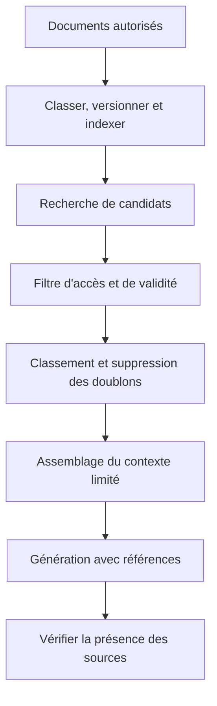

La recherche lexicale et la recherche sémantique ont des forces différentes. La recherche lexicale retrouve bien les références exactes, les identifiants d'erreur et les noms de commandes. La recherche sémantique peut retrouver des documents qui expriment la même idée avec d'autres mots. Les deux peuvent être combinées, mais le résultat doit être évalué sur les questions réelles des opérateurs. Un document qui semble sémantiquement proche peut concerner une autre version d'équipement ou un autre domaine.

La pertinence du document ne garantit pas son applicabilité. Un runbook de laboratoire peut être inadapté à la production ; une procédure ancienne peut citer un chemin qui n'existe plus ; une note peut contenir une hypothèse non validée. Le contexte devrait donc exposer la version, la date, le statut et le périmètre des documents. Le modèle doit pouvoir répondre qu'aucune procédure approuvée n'a été trouvée plutôt que d'improviser une procédure à partir d'un document voisin.

### 4. Protéger le modèle contre l'injection de consignes

Les données opérationnelles sont des entrées non fiables. Un ticket, un log, un commentaire de commit ou une page récupérée peut contenir un texte qui demande de divulguer un secret, de contourner une politique ou d'exécuter une commande. Ce texte doit rester une donnée à analyser, pas une consigne qui remplace les instructions du système. Les instructions et les données doivent être séparées dans le format d'entrée, mais cette séparation de format ne suffit pas à garantir l'absence d'injection.

Limitez les capacités des outils disponibles. Un modèle qui analyse un ticket n'a pas besoin d'un outil capable de modifier la configuration du réseau. Si une recherche est nécessaire, elle devrait appliquer une liste de sources autorisées et des contrôles d'accès. Si un outil de lecture de l'état est permis, sa sortie doit être structurée et sa portée limitée. Pour toute action plus risquée, exigez une validation indépendante de la politique et, selon le cas, une approbation humaine.

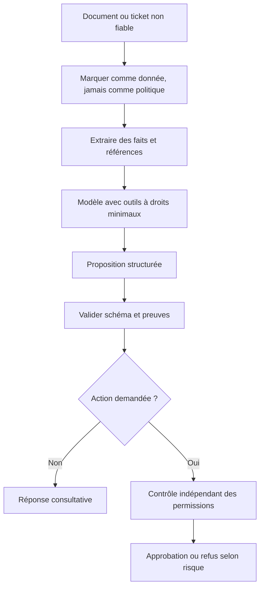

N'accordez pas au modèle la capacité d'écrire directement dans un terminal à privilèges sans contrôle externe. Les sorties de modèle sont du texte potentiellement mal formé et peuvent inclure des commandes dangereuses ou des arguments inattendus. Les outils devraient accepter des opérations typées, valider leurs paramètres et appliquer un périmètre maximal. Une liste blanche d'actions autorisées est plus sûre que d'essayer de détecter toutes les formes possibles d'une commande interdite dans un texte libre.

Les tests d'injection doivent couvrir les documents récupérés, les logs, les tickets, les noms d'hôte, les champs d'inventaire et les réponses d'outils. Vérifiez que le modèle ne révèle pas de données auxquelles l'appelant n'a pas droit, ne suit pas les consignes cachées dans les contenus et ne transforme pas une phrase dans un log en autorisation d'action. Enregistrez le résultat du test et la version de la politique, sans conserver inutilement de secrets.

### 5. Produire des hypothèses falsifiables plutôt qu'une cause unique

Une hypothèse utile précise ce qui pourrait être vrai, les observations qui la soutiennent, les observations qui la contredisent et le test qui pourrait la renforcer ou l'affaiblir. « Le réseau est en panne » est trop vague ; « la perte de paquets sur le chemin partagé a précédé les erreurs applicatives et pourrait expliquer la dégradation des deux sites » est vérifiable si les mesures temporelles et les dépendances confirment ces éléments.

Le modèle doit présenter plusieurs hypothèses concurrentes lorsque les preuves ne permettent pas d'en retenir une seule. Les hypothèses peuvent concerner une dépendance réseau, un service applicatif, un déploiement récent ou un problème de collecte. Le classement doit être expliqué par des éléments concrets et la qualité des données, pas par la seule confiance exprimée dans le texte généré.

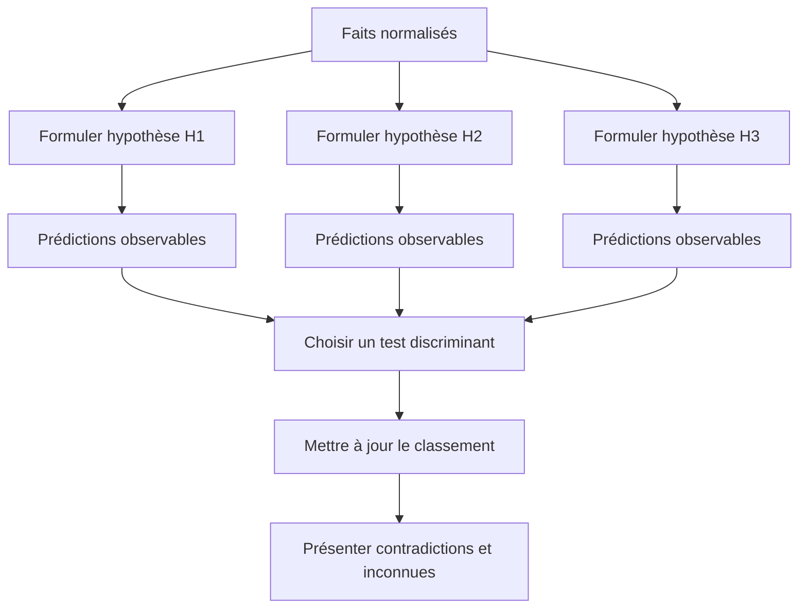

Pour chaque hypothèse, fournissez un identifiant, une description, les preuves favorables, les preuves défavorables, les inconnues, un niveau de confiance qualitatif et les tests possibles. Une hypothèse rejetée ne doit pas disparaître de l'historique si elle a orienté une décision importante. Elle peut être conservée avec le motif de rejet et la preuve qui a permis de la réfuter.

Un bon test discrimine réellement les hypothèses. Interroger une métrique déjà connue peut confirmer qu'un symptôme existe sans révéler sa cause. Une lecture d'état ciblée, une comparaison avec un site non affecté ou un examen du changement de configuration peut parfois fournir davantage d'information. Il faut aussi considérer le coût, le délai et le risque du test. Les actions perturbatrices ne doivent pas être lancées uniquement parce qu'elles rendraient l'hypothèse plus facile à trancher.

### 6. Déterminer quand le modèle doit s'abstenir

L'abstention est une sortie fonctionnelle : elle indique que le dossier ne permet pas une réponse assez fiable. Elle doit être déclenchée par des conditions observables, telles qu'une donnée essentielle périmée, une contradiction majeure, une source indisponible, une absence de procédure approuvée, un schéma invalide ou un faible écart entre les hypothèses candidates. Le système peut demander une collecte supplémentaire ou une revue humaine au lieu d'annoncer une conclusion.

Distinguez « je n'ai pas trouvé de preuve », « la source ne mesure pas ce phénomène » et « les preuves disponibles se contredisent ». Ces états conduisent à des actions différentes. Une absence de preuve peut justifier une requête de diagnostic ; l'absence de mesure peut exiger une amélioration d'instrumentation ; une contradiction peut nécessiter une vérification indépendante. Une unique réponse « données insuffisantes » est parfois acceptable pour l'utilisateur, mais le journal technique doit conserver la catégorie d'incertitude.

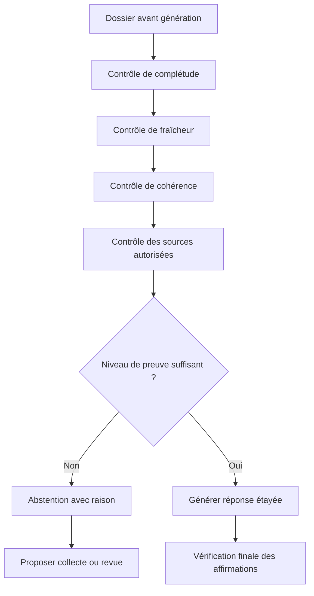

Le seuil d'abstention doit être calibré sur des cas difficiles, pas seulement sur les incidents évidents. Un modèle qui répond toujours peut sembler plus utile dans une démonstration, mais il peut également produire davantage de conclusions non étayées. Mesurez la couverture des réponses et leur qualité : quel pourcentage de cas reçoit une réponse, et parmi ces réponses, combien respectent les critères de justesse et de traçabilité ? Une réduction de couverture peut être acceptable si elle évite des erreurs graves.

L'abstention doit aussi être prévue dans l'interface et le processus de travail. Si l'utilisateur est poussé à choisir une seule cause, il peut ignorer la réserve exprimée par le modèle. Affichez clairement le statut, les informations manquantes, les options disponibles et la personne ou équipe qui peut poursuivre l'analyse. La procédure de recours doit fonctionner lorsque le modèle est indisponible ou contesté.

### 7. Évaluer un système RAG sur des dossiers réels représentatifs

Une évaluation de RAG doit mesurer séparément la récupération des documents et la qualité de la réponse générée. Si la procédure correcte n'est pas récupérée, le modèle peut donner une mauvaise réponse même si sa génération est cohérente. Si le bon document est présent mais ignoré ou mal interprété, le problème se situe ailleurs. Mesurer une seule appréciation globale ne permet pas de distinguer ces causes.

Construisez un jeu d'évaluation à partir de questions opérationnelles réelles, de cas d'incident confirmés, de cas ambigus et de cas pour lesquels aucune réponse autorisée n'existe. Pour chaque question, définissez les sources attendues, les affirmations obligatoires, les limites à reconnaître et les réponses qui doivent être refusées. Les jeux doivent couvrir plusieurs équipements, versions, catégories de service et périodes, afin d'éviter de surévaluer un système spécialisé sur une poignée d'exemples faciles.

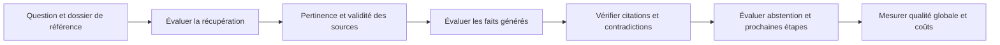

Mesurez la précision de récupération, la couverture des sources attendues, la fidélité des affirmations, la pertinence des recommandations et la capacité à reconnaître une absence de preuve. Une référence valide et pertinente ne garantit pas que la réponse la représente correctement. Inversement, une phrase peut être plausible mais non étayée par les sources autorisées ; elle ne doit pas être considérée comme correcte dans un système qui exige une preuve traçable.

Faites évaluer les cas sensibles par des experts opérationnels qui ne sont pas les seuls auteurs du prompt ou du pipeline. Un jugement humain doit lui-même avoir un protocole : consignes, critères, exemples, conservation des désaccords et procédure d'arbitrage. Les évaluateurs peuvent être influencés par une réponse fluide ou par le résultat final connu ; des essais à l'aveugle sur des dossiers où la vérité est temporairement masquée peuvent aider à évaluer si l'explication permet réellement d'enquêter.

### 8. Maîtriser la fenêtre de contexte et la hiérarchie des preuves

Le nombre de documents récupérés n'est pas un indicateur de qualité en soi. Un contexte trop petit peut omettre une condition importante ; un contexte trop grand peut diluer les éléments essentiels, augmenter le coût et favoriser les contradictions. Classez les sources selon leur autorité pour la propriété concernée, leur fraîcheur et leur validité. Une configuration observée peut être plus pertinente pour l'état actuel qu'une fiche documentaire ; une procédure officielle approuvée peut être plus pertinente pour savoir quelle action est permise.

Ne donnez pas automatiquement la priorité à un document simplement parce qu'il est plus récent. Un log récent peut contenir du texte arbitraire, et une procédure approuvée peut rester valide sur une période plus longue. La sélection doit considérer le type de question : pour la valeur mesurée, utilisez une source de télémétrie ; pour les permissions, utilisez une politique officielle ; pour l'état de changement, utilisez le registre d'exécution. La provenance et le type de donnée aident à appliquer la règle appropriée.

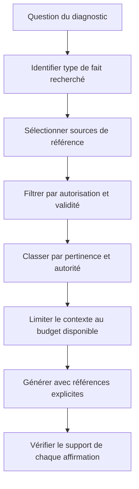

Les informations contradictoires ne doivent pas être fusionnées dans une formulation vague. Si le registre de changement dit qu'une modification a réussi mais que la configuration observée ne correspond pas, présentez les deux faits avec leurs heures. La réponse doit proposer les vérifications utiles pour résoudre le conflit. Un modèle ne devrait pas arbitrer une contradiction simplement en choisissant la source qui s'accorde le mieux avec l'hypothèse la plus probable.

Le contexte peut aussi être structuré en niveaux : faits confirmés, hypothèses, procédures approuvées et résultats de tests. Cette organisation aide le modèle à différencier ce qu'il peut affirmer, ce qu'il peut envisager et ce qu'il peut recommander. Elle facilite également le contrôle automatique de la réponse. Si une phrase attribue une cause au titre des faits confirmés alors qu'elle provient uniquement d'une hypothèse, la validation peut la rejeter ou exiger une reformulation.

### 9. Vérifier les affirmations plutôt que la seule forme JSON

Une sortie JSON valide est plus facile à traiter, mais elle peut contenir des faits inventés. Validez d'abord le schéma, les champs obligatoires, les types, les limites de taille et les identifiants. Vérifiez ensuite la substance : chaque identifiant de preuve doit exister dans le dossier, les timestamps doivent correspondre, les actifs doivent être présents dans le périmètre et toute conclusion doit être reliée à des éléments qui la soutiennent.

Une réponse structurée peut contenir des sections distinctes pour les faits, les hypothèses, les contradictions, les inconnues, les recommandations consultatives et les actions interdites. Les références devraient être des identifiants de source plutôt que des citations générées librement. Le système de rendu peut ensuite afficher le contenu source afin que l'utilisateur confirme la relation entre la phrase et la preuve.

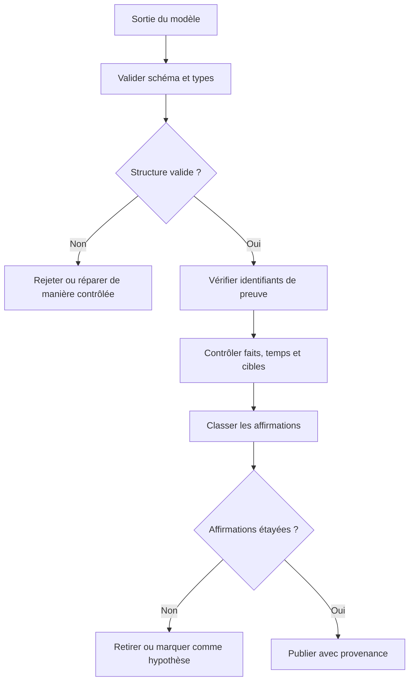

Le contrôle doit être conservateur. Une correspondance de nom ne suffit pas à prouver une référence correcte si plusieurs équipements partagent un nom semblable. Une phrase qui combine trois faits peut être partiellement vraie et partiellement inventée ; il peut être nécessaire de la décomposer en affirmations atomiques. Pour les décisions critiques, ajoutez une revue humaine et un test déterministe sur les propriétés essentielles.

Conservez les échecs de validation en tant que données de qualité. Les types de défaut peuvent inclure référence inexistante, période incorrecte, cause présentée comme fait, source hors périmètre, hypothèse sans test ou action interdite. Ces catégories aident à améliorer le système sans se limiter à modifier le prompt à chaque erreur. Toute correction doit être rejouée sur les cas précédents afin de détecter les régressions.

### 10. Contrôler les outils et les actions d'un agent

Un agent de diagnostic peut avoir accès à des outils de recherche, de lecture de métriques, de récupération de logs ou de consultation d'inventaire. L'accès à un outil doit être borné par la tâche et l'identité de l'appelant. L'agent ne doit pas pouvoir étendre son périmètre en demandant à un autre outil d'ignorer la politique. Chaque appel doit valider les paramètres, la cible, les droits, la durée et la taille de la réponse.

Séparez les outils de lecture et les outils qui modifient l'état. Le modèle peut proposer une commande ou un plan, mais son texte ne doit pas être exécuté directement. Les outils d'écriture doivent utiliser une API typée, une politique indépendante, une approbation selon le risque et un mécanisme de vérification. Les sorties d'outils sont elles-mêmes des données à contrôler : une réponse contenant du texte malveillant ou un contenu inattendu ne doit pas changer les règles du système.

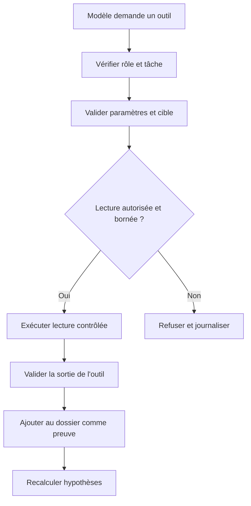

Le nombre d'appels et le temps total doivent être bornés. Un agent qui boucle en interrogeant chaque équipement peut épuiser l'API ou perturber l'administration. Définissez un budget de requêtes, une limite de profondeur, un délai par outil et une durée maximale du workflow. Lorsque le budget est épuisé, l'agent doit fournir les preuves déjà obtenues, expliquer les informations manquantes et demander une décision plutôt que poursuivre sans limite.

Les outils doivent aussi être observables. Conservez l'action demandée, la cible autorisée, le statut, la durée et une référence au résultat, en masquant les secrets. Mesurez les erreurs par outil, le taux de refus, le nombre de tentatives, les délais et la part de réponses qui sont utilisées dans la synthèse finale. Une disponibilité élevée de l'outil n'assure pas la justesse du diagnostic, mais elle aide à localiser les défauts de la chaîne.

### 11. Évaluer l'impact sur les opérateurs et le processus

Le copilote peut réduire le temps nécessaire pour reconstituer la chronologie, mais il peut aussi provoquer une dépendance excessive à ses propositions. Lorsque les opérateurs voient toujours une cause candidate en premier, ils peuvent négliger des pistes alternatives ou suivre la recommandation même lorsqu'elle contredit leur expérience. L'interface doit montrer des hypothèses concurrentes, les preuves manquantes et les tests capables de les distinguer.

Évaluez l'impact sur le processus de travail, pas seulement le temps de génération. Mesurez le temps pour identifier la première hypothèse pertinente, le temps jusqu'à une décision vérifiable, le taux de corrections par les opérateurs, les recommandations contestées, les changements inutiles évités et les incidents aggravés par une suggestion erronée. Les résultats doivent être comparés à une procédure de référence sur des cas de complexité comparable.

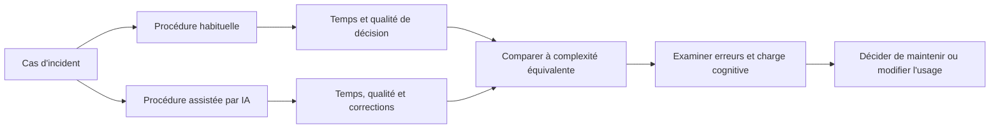

Une évaluation expérimentale doit éviter les conclusions hâtives. Si un groupe d'opérateurs expérimentés utilise le copilote et qu'un groupe moins expérimenté suit la procédure habituelle, la différence ne peut pas être attribuée uniquement au modèle. Il faut définir les tâches, les participants, les critères, le niveau d'assistance et les erreurs de référence. Les retours qualitatifs sont précieux pour identifier les points où l'explication aide ou distrait, mais ils complètent les mesures objectives au lieu de les remplacer.

L'organisation doit préserver le droit de contester la proposition. L'opérateur doit pouvoir indiquer qu'une cause est incorrecte, demander une vérification différente ou choisir une voie manuelle. Cette contestation ne devrait pas automatiquement pénaliser l'utilisateur ou déclencher un réentraînement non contrôlé. Les désaccords doivent être classés, examinés et utilisés pour améliorer les données et les règles après validation.

### 12. Concevoir une procédure d'incident IA et de récupération

Une erreur du copilote peut être un simple résumé incomplet, mais elle peut aussi induire une modification dangereuse, exposer des données ou retarder la résolution d'un incident critique. Définissez des catégories de gravité et une réponse associée. Un défaut factuel peut nécessiter la correction du dossier et un test de régression ; une divulgation de données exige une réponse de sécurité et de confidentialité ; une recommandation qui a provoqué un changement dommageable peut exiger la suspension de l'intégration d'action.

Préservez l'entrée, les sources effectivement récupérées, la sortie, la version du modèle, le prompt de politique ou sa référence contrôlée, les paramètres, les outils appelés et les décisions humaines. Évitez de conserver des données sensibles sans limite ; les preuves d'incident doivent suivre une politique de rétention et d'accès. Un dossier d'analyse doit pouvoir expliquer ce qui s'est passé sans devenir un nouveau point de fuite.

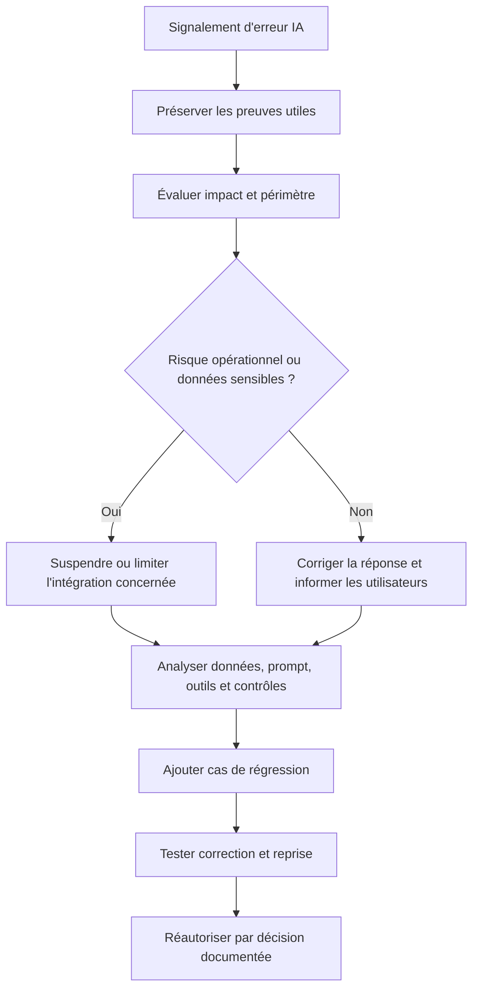

Le rétablissement ne consiste pas uniquement à déployer un prompt corrigé. Vérifiez les droits, les données récupérées, le format des sorties, les filtres de preuve et les contrôles d'outils. Si une action a été exécutée, vérifiez l'état réel et les effets de service. Si une donnée a été divulguée, appliquez la procédure de confidentialité correspondante. La correction doit s'attaquer au mécanisme qui a permis l'incident, pas seulement à la phrase qui a rendu l'erreur visible.

Prévoyez un mode de repli qui permet aux opérations de continuer lorsque le modèle est indisponible, que les sources ne répondent pas ou que la qualité de sortie chute. Le repli peut être une procédure classique de triage, un rapport déterministe ou une lecture directe des événements. Le système doit afficher clairement qu'il fonctionne en mode dégradé, sans mélanger les conclusions automatiques et les conclusions humaines dans un même statut ambigu.

### 13. Gouverner les versions, fournisseurs et coûts

Les modèles et services génératifs évoluent : nouvelles versions, changements de comportement, limites de contexte, tarifs et mécanismes de rétention peuvent modifier le fonctionnement du copilote. Le fournisseur ne doit pas être une boîte noire non suivie. Enregistrez l'identité du modèle, sa version ou référence disponible, les paramètres importants, les dépendances, les règles de récupération et les évaluations effectuées. Si une version précise n'est pas garantie par le fournisseur, mesurez la dérive de comportement par des tests récurrents.

Le coût doit être envisagé comme un contrôle de fiabilité et d'accès. Un agent de diagnostic qui récupère trop de documents ou lance un grand nombre d'appels peut générer une facture imprévisible et créer une latence excessive. Définissez un budget par incident, des limites d'outils, une durée maximale et une taille de contexte. Le système doit conserver une sortie utile lorsque le budget est épuisé, en présentant les faits déjà vérifiés et les limites restantes.

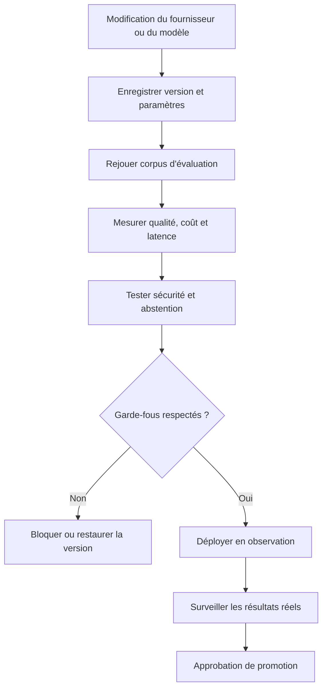

La rétention des données transmises au fournisseur doit être examinée avant d'envoyer des logs ou des configurations. Les identifiants, les secrets et les informations de topologie doivent être minimisés et masqués si leur transmission est autorisée. Un masquage doit être évalué sur toutes les parties de la requête, y compris les documents récupérés et les messages d'erreur. La politique de fournisseur, les contrats et les configurations doivent être réexaminés lorsque les conditions changent.

Prévoyez une stratégie de sortie : export des dossiers et des références, remplacement du modèle ou du service, révocation des identifiants, bascule vers un processus manuel et conservation des traces nécessaires à la continuité. La portabilité ne concerne pas uniquement les poids du modèle ; elle inclut les prompts, les règles, les évaluations, les outils et les documents indexés. Un système difficile à remplacer peut créer une dépendance opérationnelle même s'il fournit de bons résultats à court terme.

### 14. Projet de synthèse — copilote de diagnostic défendable

Le projet final du présent atelier consiste à construire une chaîne de diagnostic qui ne se contente pas de fournir une réponse persuasive. Elle reçoit un dossier d'incident, vérifie les sources, récupère une procédure autorisée, génère des hypothèses et propose une prochaine vérification. Elle refuse les consignes malveillantes présentes dans les données, n'invente pas de preuve et explique quand elle ne dispose pas d'assez d'informations.

Le livrable comprend le contrat d'entrée et de sortie, le registre de sources autorisées, les contrôles de récupération, les règles de validation des affirmations, les permissions d'outils, le corpus d'évaluation et la procédure d'incident. Il doit distinguer les vérifications automatisées des revues humaines et préciser quelles décisions ne peuvent pas être prises par le modèle.

```mermaid
flowchart LR
    A["Dossier d'incident"] --> B["Validation et provenance"]
    B --> C["Récupération autorisée"]
    C --> D["Hypothèses structurées"]
    D --> E["Contrôle des affirmations"]
    E --> F["Test suivant et incertitude"]
    F --> G["Revue humaine"]
    G --> H["Résultat documenté"]
    H --> I["Évaluation et amélioration"]
```

Construisez un corpus qui couvre au moins un incident clair, un incident ambigu, une contradiction entre sources, des données manquantes, une procédure obsolète, une tentative d'injection de consigne et une requête hors périmètre. Pour chaque cas, définissez ce que le système doit dire, ce qu'il doit refuser et quelles références il doit conserver. Les critères doivent porter sur les faits, l'abstention, l'utilité du test proposé, le coût et le temps de traitement.

Les résultats du projet doivent mentionner les limites. Un jeu synthétique prouve que certains mécanismes répondent aux scénarios créés ; il ne prouve pas une performance équivalente sur toute la production. Une bonne évaluation historique ne garantit pas que les futures versions du modèle se comporteront de la même manière. La mise en service exige une période d'observation, un propriétaire, un registre de versions et une procédure de suspension testée.

### Grille d'autoévaluation de l'atelier

- [ ] La mission du copilote et ses décisions interdites sont explicites.
- [ ] Le dossier de preuve sépare faits, données dérivées et hypothèses.
- [ ] Le RAG respecte les accès et la validité des documents.
- [ ] Les documents et logs sont traités comme des données non fiables.
- [ ] Les hypothèses sont falsifiables et incluent des alternatives.
- [ ] L'abstention est déclenchée par des conditions observables.
- [ ] Le retrieval est évalué séparément de la génération.
- [ ] La validation contrôle les affirmations et pas seulement le format.
- [ ] Les outils sont bornés par rôle, périmètre, durée et budget.
- [ ] Les résultats du copilote sont comparés à une procédure de référence.
- [ ] Les incidents IA ont une procédure de suspension, d'enquête et de reprise.
- [ ] Les versions et coûts des fournisseurs sont surveillés.
- [ ] Les données sensibles sont minimisées et protégées.
- [ ] La stratégie de sortie et le mode de repli sont testés.

## Défi final corrigé — produire une hypothèse d'incident défendable

### Énoncé

Un incident touche quatre agences. Le système reçoit des changements récents, des alertes réseau, des extraits de logs et une fiche de service. L'équipe attend une synthèse avec une chronologie, deux causes possibles, les preuves pour et contre chacune, puis la prochaine vérification la plus informative. La génération ne doit pas citer un événement inexistant, transformer une corrélation en causalité ni lancer une commande.

### Architecture de diagnostic bornée par les preuves

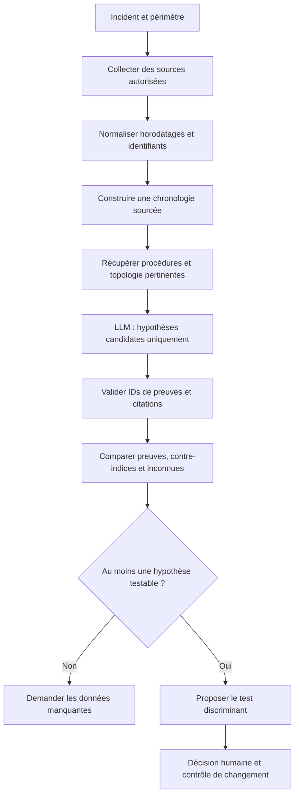

### Exemple de format de sortie

```json
{
  "incident_id": "INC-2048",
  "timeline": [
    {"timestamp": "2026-10-28T08:41:00Z", "event_id": "evt-18"}
  ],
  "hypotheses": [
    {
      "statement": "Une congestion du lien partagé contribue à la dégradation.",
      "supporting_evidence": ["evt-18", "metric-77"],
      "contradicting_evidence": ["metric-81"],
      "unknowns": ["mesures de pertes sur le chemin de secours"],
      "next_test": "Comparer pertes et latence du chemin de secours sur la même fenêtre"
    }
  ],
  "decision": "human_review_required"
}
```

### Proposition de correction

Le backend prépare un paquet de preuves sélectionnées selon le périmètre de l'incident et les droits du demandeur. Chaque événement reçoit un identifiant stable et un horodatage normalisé ; chaque document récupéré conserve son propriétaire, sa version et son niveau de confiance. Le modèle génère une structure limitée, mais le serveur valide que les identifiants cités existent et correspondent bien au dossier.

Évalue la qualité sur des incidents historiques avec une vérité terrain documentée. Mesure la couverture des faits importants, les citations valides, les affirmations non étayées, le taux d'abstention appropriée et la valeur du test suggéré. Ne demande pas au LLM de s'auto-noter pour déterminer si ses preuves sont bonnes : sa confiance déclarée n'est pas une mesure calibrée. Utilise des règles déterministes pour la validation des références et un opérateur pour apprécier le raisonnement.

Chaque hypothèse doit être falsifiable. « Le réseau est lent » ne suffit pas ; « la saturation du lien X précède la dégradation sur les services qui l'empruntent » permet de choisir une mesure discriminante. Inclure les contre-indices aide à éviter le diagnostic prématuré. Le système ne dispose d'aucun accès d'exécution : il propose une investigation, tandis qu'un workflow séparé assure les droits, l'approbation et la sécurité des actions.

### Barème d'autoévaluation

- La chronologie est liée à des événements réels et horodatés.
- Les hypothèses citent des éléments favorables et contraires.
- Les affirmations et les identifiants de preuve sont validés côté serveur.
- La prochaine vérification distingue réellement les hypothèses.
- La décision finale et toute action restent sous contrôle opérationnel.

## 11. Checklist et à retenir

- [ ] L'objectif métier et le service sont écrits et mesurables.
- [ ] Chaque observation conserve provenance, heure, unité et qualité.
- [ ] La méthode est comparée à une baseline.
- [ ] Les tests incluent données manquantes et échecs de dépendance.
- [ ] Les résultats sont segmentés par criticité et type de cible.
- [ ] Les droits sont minimaux et les secrets absents des logs.
- [ ] La décision relie preuves, version, approbation et résultat.
- [ ] Toute action risquée a préconditions, périmètre et rollback.
- [ ] Les indicateurs mesurent le service, pas seulement le modèle.
- [ ] La procédure couvre abstention, escalade, suspension et revue.

### À retenir
Le but de IA Générative pour le diagnostic d'incidents n'est pas d'automatiser toutes les décisions, mais de rendre l'exploitation plus rapide, cohérente et vérifiable. Une solution utile s'appuie sur des données explicites, une technique adaptée, une évaluation honnête et des postconditions mesurées. Elle sait signaler ses limites, bloquer une action risquée et transmettre les preuves qui permettent à une autre personne de reprendre l'analyse.

Les mesures possibles comprennent précision de cause racine confirmée, proportion de faits liés à une preuve, utilité des tests proposés, abstention correcte, temps de diagnostic. Chacune doit être associée à un objectif, un responsable et une action lorsque la limite est dépassée. Le nombre de modèles ou d'alertes traitées ne prouve pas la valeur opérationnelle. Il faut confirmer ou réfuter les hypothèses avec les résultats, documenter les erreurs et améliorer les tests. utiliser un LLM pour synthétiser les preuves, comparer des causes candidates et recommander des tests sans automatiser une conclusion non vérifiée Le maintien dans le temps exige de réviser les sources, vérifier la reprise et retirer une méthode dont les limites dépassent le bénéfice.

## 12. Références

- https://www.nist.gov/publications/artificial-intelligence-risk-management-framework-generative-artificial-intelligence
- https://genai.owasp.org/llm-top-10/
- https://opentelemetry.io/docs/
- https://opentelemetry.io/docs/ — concepts d'observabilité et de télémétrie.
- https://www.nist.gov/itl/ai-risk-management-framework — cadre de gestion des risques de l'IA.
