# IA, Machine Learning, Deep Learning — Débutant

> **Mise en contexte :** ce cours étudie le problème suivant : une équipe veut classifier des tickets, détecter des valeurs inhabituelles et résumer des journaux, puis envisage un seul modèle pour tous ces besoins. L'objectif est d'améliorer les opérations de manière mesurable, vérifiable et proportionnée au risque. Les exemples doivent être adaptés et testés en laboratoire avant toute utilisation sur une infrastructure réelle.

## Sommaire

1. Introduction et objectifs
2. Concepts clés
3. Architecture de référence
4. Pipeline et algorithmes
5. Étude de cas
6. Implémentation guidée et laboratoire
7. Sécurité et gouvernance
8. Pièges à éviter
9. Diagnostic et dépannage
10. Exercices corrigés
11. Checklist et à retenir
12. Références

## 1. Introduction et objectifs

L'AIOps applique l'analyse de données et l'automatisation aux opérations informatiques afin de rendre la détection, le diagnostic et la résolution plus cohérents. Pour **IA, Machine Learning, Deep Learning**, l'enjeu est de distinguer règles déterministes, machine learning, deep learning et modèles génératifs.. Le besoin est concret : les équipes doivent agir rapidement, mais les observations peuvent être contradictoires, les horloges décalées et les interventions porteuses de risques. La solution doit ainsi distinguer un signal, une hypothèse, une décision et une preuve de résultat.

Le scénario de départ est : une équipe veut classifier des tickets, détecter des valeurs inhabituelles et résumer des journaux, puis envisage un seul modèle pour tous ces besoins. Il illustre que des outils techniquement capables ne suffisent pas. La qualité dépend de données fiables, d'une question mesurable, d'une référence de comparaison et d'une procédure de reprise. Le système doit savoir reconnaître une donnée absente, exposer ses limites et demander de l'aide. L'automatisation n'est pas un objectif en soi : elle est justifiée uniquement si elle améliore un résultat opérationnel sans déplacer le risque vers les utilisateurs ou l'équipe d'astreinte.

Les outils possibles comprennent règles expertes, scikit-learn, jeux de validation, matrices de confusion. Ils ne doivent pas tous être déployés dans le même projet. Chaque composant doit répondre à un besoin identifié et avoir un propriétaire. Une architecture réduite, testée et bien observée est préférable à un assemblage complexe dont personne ne peut expliquer les erreurs. La première version peut rester en lecture seule ; l'autorité d'agir se développe seulement après des essais reproductibles, une mesure des erreurs et une validation de la procédure de retour arrière.

### Objectifs pédagogiques
- Décrire les concepts principaux et leurs limites.
- Définir les sources de données, la qualité attendue et les propriétaires.
- Décrire le chemin entre observation, analyse, décision, action et vérification.
- Mesurer les erreurs et comparer la solution à une baseline.
- Protéger les accès et documenter une stratégie d'escalade et de reprise.

### Vocabulaire opérationnel
Une **observation** est une mesure ou un événement provenant d'une source identifiée. Un **signal** est une interprétation d'observations dans un contexte. Une **hypothèse** est une explication testable. Une **décision** sélectionne une action ou une abstention. Une **postcondition** est un état vérifiable qui doit être vrai après une intervention. Ces mots ne sont pas interchangeables. Une alerte n'est pas automatiquement un incident confirmé, un score ne constitue pas une preuve de cause racine et l'exécution d'une commande ne prouve pas que le service est rétabli.

## 2. Concepts clés

### 1. Intelligence artificielle

L'IA regroupe différentes méthodes qui exécutent des tâches de perception, de raisonnement ou de génération ; le terme ne garantit pas qu'un système apprend.

Sur le terrain, Intelligence artificielle doit être relié à une question opérationnelle et à une décision possible. L'IA regroupe différentes méthodes qui exécutent des tâches de perception, de raisonnement ou de génération ; le terme ne garantit pas qu'un système apprend. Il faut nommer la source de vérité, le propriétaire, la fréquence de mise à jour et le périmètre d'utilisation avant d'automatiser. Pour le scénario « une équipe veut classifier des tickets, détecter des valeurs inhabituelles et résumer des journaux, puis envisage un seul modèle pour tous ces besoins », cette précision empêche de transformer une intuition en commande. Elle permet aussi de définir quand il faut s'abstenir, demander davantage de données ou transmettre le dossier à une personne responsable.

La mise en œuvre de Intelligence artificielle gagne à être découpée en contrôles testables. Vérifier d'abord le format et la provenance des entrées, puis les hypothèses, les valeurs manquantes et les versions. L'outil règles expertes peut contribuer à cette étape, mais sa présence ne garantit pas la qualité. Les erreurs doivent rester explicites au lieu d'être converties silencieusement en valeurs par défaut. Une exécution fiable sait différencier une réussite, un échec, un résultat partiel et un état impossible à déterminer.

L'évaluation de Intelligence artificielle doit inclure les cas courants, les cas limites et les exemples difficiles. La mesure doit inclure précision, rappel et F1, tout en examinant les différences selon la criticité et le type de cible. Un score moyen peut masquer une défaillance rare mais coûteuse ; il faut donc conserver des exemples concrets, mesurer faux positifs et faux négatifs et expliquer le coût de chaque erreur. Après une évolution de données, de code ou de modèle, les mêmes tests doivent être rejoués pour vérifier que le comportement attendu persiste.

Aucune technique associée à Intelligence artificielle n'est universellement préférable. Une règle peut être plus explicable, un modèle peut capter davantage de variables, et un système génératif peut accélérer la synthèse sans garantir la vérité. Le choix doit tenir compte des données, de la latence, du coût d'erreur, de l'explicabilité et de la maintenance. La baseline et le mode manuel doivent rester disponibles pour les périodes où les observations sont incomplètes ou que le système n'a plus la qualité attendue.

### 2. Machine Learning

Le ML apprend des relations à partir d'exemples et dépend de la qualité des données, de la cible et de l'évaluation.

Sur le terrain, Machine Learning doit être relié à une question opérationnelle et à une décision possible. Le ML apprend des relations à partir d'exemples et dépend de la qualité des données, de la cible et de l'évaluation. Il faut nommer la source de vérité, le propriétaire, la fréquence de mise à jour et le périmètre d'utilisation avant d'automatiser. Pour le scénario « une équipe veut classifier des tickets, détecter des valeurs inhabituelles et résumer des journaux, puis envisage un seul modèle pour tous ces besoins », cette précision empêche de transformer une intuition en commande. Elle permet aussi de définir quand il faut s'abstenir, demander davantage de données ou transmettre le dossier à une personne responsable.

La mise en œuvre de Machine Learning gagne à être découpée en contrôles testables. Vérifier d'abord le format et la provenance des entrées, puis les hypothèses, les valeurs manquantes et les versions. L'outil scikit-learn peut contribuer à cette étape, mais sa présence ne garantit pas la qualité. Les erreurs doivent rester explicites au lieu d'être converties silencieusement en valeurs par défaut. Une exécution fiable sait différencier une réussite, un échec, un résultat partiel et un état impossible à déterminer.

L'évaluation de Machine Learning doit inclure les cas courants, les cas limites et les exemples difficiles. La mesure doit inclure courbe précision-rappel pour classes rares, tout en examinant les différences selon la criticité et le type de cible. Un score moyen peut masquer une défaillance rare mais coûteuse ; il faut donc conserver des exemples concrets, mesurer faux positifs et faux négatifs et expliquer le coût de chaque erreur. Après une évolution de données, de code ou de modèle, les mêmes tests doivent être rejoués pour vérifier que le comportement attendu persiste.

### 3. Apprentissage supervisé

Le supervisé utilise des étiquettes connues et nécessite une séparation entraînement-validation-test sans fuite d'information.

Sur le terrain, Apprentissage supervisé doit être relié à une question opérationnelle et à une décision possible. Le supervisé utilise des étiquettes connues et nécessite une séparation entraînement-validation-test sans fuite d'information. Il faut nommer la source de vérité, le propriétaire, la fréquence de mise à jour et le périmètre d'utilisation avant d'automatiser. Pour le scénario « une équipe veut classifier des tickets, détecter des valeurs inhabituelles et résumer des journaux, puis envisage un seul modèle pour tous ces besoins », cette précision empêche de transformer une intuition en commande. Elle permet aussi de définir quand il faut s'abstenir, demander davantage de données ou transmettre le dossier à une personne responsable.

La mise en œuvre de Apprentissage supervisé gagne à être découpée en contrôles testables. Vérifier d'abord le format et la provenance des entrées, puis les hypothèses, les valeurs manquantes et les versions. L'outil jeux de validation peut contribuer à cette étape, mais sa présence ne garantit pas la qualité. Les erreurs doivent rester explicites au lieu d'être converties silencieusement en valeurs par défaut. Une exécution fiable sait différencier une réussite, un échec, un résultat partiel et un état impossible à déterminer.

L'évaluation de Apprentissage supervisé doit inclure les cas courants, les cas limites et les exemples difficiles. La mesure doit inclure MAE ou RMSE pour prévision, tout en examinant les différences selon la criticité et le type de cible. Un score moyen peut masquer une défaillance rare mais coûteuse ; il faut donc conserver des exemples concrets, mesurer faux positifs et faux négatifs et expliquer le coût de chaque erreur. Après une évolution de données, de code ou de modèle, les mêmes tests doivent être rejoués pour vérifier que le comportement attendu persiste.

### 4. Non supervisé

Le non supervisé cherche structures ou observations inhabituelles sans disposer d'une étiquette exhaustive ; un cluster n'est pas automatiquement une catégorie métier.

Sur le terrain, Non supervisé doit être relié à une question opérationnelle et à une décision possible. Le non supervisé cherche structures ou observations inhabituelles sans disposer d'une étiquette exhaustive ; un cluster n'est pas automatiquement une catégorie métier. Il faut nommer la source de vérité, le propriétaire, la fréquence de mise à jour et le périmètre d'utilisation avant d'automatiser. Pour le scénario « une équipe veut classifier des tickets, détecter des valeurs inhabituelles et résumer des journaux, puis envisage un seul modèle pour tous ces besoins », cette précision empêche de transformer une intuition en commande. Elle permet aussi de définir quand il faut s'abstenir, demander davantage de données ou transmettre le dossier à une personne responsable.

La mise en œuvre de Non supervisé gagne à être découpée en contrôles testables. Vérifier d'abord le format et la provenance des entrées, puis les hypothèses, les valeurs manquantes et les versions. L'outil matrices de confusion peut contribuer à cette étape, mais sa présence ne garantit pas la qualité. Les erreurs doivent rester explicites au lieu d'être converties silencieusement en valeurs par défaut. Une exécution fiable sait différencier une réussite, un échec, un résultat partiel et un état impossible à déterminer.

L'évaluation de Non supervisé doit inclure les cas courants, les cas limites et les exemples difficiles. La mesure doit inclure taux d'affirmations générées non sourcées, tout en examinant les différences selon la criticité et le type de cible. Un score moyen peut masquer une défaillance rare mais coûteuse ; il faut donc conserver des exemples concrets, mesurer faux positifs et faux négatifs et expliquer le coût de chaque erreur. Après une évolution de données, de code ou de modèle, les mêmes tests doivent être rejoués pour vérifier que le comportement attendu persiste.

Aucune technique associée à Non supervisé n'est universellement préférable. Une règle peut être plus explicable, un modèle peut capter davantage de variables, et un système génératif peut accélérer la synthèse sans garantir la vérité. Le choix doit tenir compte des données, de la latence, du coût d'erreur, de l'explicabilité et de la maintenance. La baseline et le mode manuel doivent rester disponibles pour les périodes où les observations sont incomplètes ou que le système n'a plus la qualité attendue.

### 5. Deep Learning

Les réseaux neuronaux profonds apprennent des représentations complexes mais peuvent exiger davantage de données, de calcul et de surveillance.

Sur le terrain, Deep Learning doit être relié à une question opérationnelle et à une décision possible. Les réseaux neuronaux profonds apprennent des représentations complexes mais peuvent exiger davantage de données, de calcul et de surveillance. Il faut nommer la source de vérité, le propriétaire, la fréquence de mise à jour et le périmètre d'utilisation avant d'automatiser. Pour le scénario « une équipe veut classifier des tickets, détecter des valeurs inhabituelles et résumer des journaux, puis envisage un seul modèle pour tous ces besoins », cette précision empêche de transformer une intuition en commande. Elle permet aussi de définir quand il faut s'abstenir, demander davantage de données ou transmettre le dossier à une personne responsable.

La mise en œuvre de Deep Learning gagne à être découpée en contrôles testables. Vérifier d'abord le format et la provenance des entrées, puis les hypothèses, les valeurs manquantes et les versions. L'outil règles expertes peut contribuer à cette étape, mais sa présence ne garantit pas la qualité. Les erreurs doivent rester explicites au lieu d'être converties silencieusement en valeurs par défaut. Une exécution fiable sait différencier une réussite, un échec, un résultat partiel et un état impossible à déterminer.

L'évaluation de Deep Learning doit inclure les cas courants, les cas limites et les exemples difficiles. La mesure doit inclure latence, coût et taux d'abstention, tout en examinant les différences selon la criticité et le type de cible. Un score moyen peut masquer une défaillance rare mais coûteuse ; il faut donc conserver des exemples concrets, mesurer faux positifs et faux négatifs et expliquer le coût de chaque erreur. Après une évolution de données, de code ou de modèle, les mêmes tests doivent être rejoués pour vérifier que le comportement attendu persiste.

### 6. Modèle génératif

Un modèle génératif produit du contenu contextuel ; une réponse fluide peut être inexacte ou non étayée.

Sur le terrain, Modèle génératif doit être relié à une question opérationnelle et à une décision possible. Un modèle génératif produit du contenu contextuel ; une réponse fluide peut être inexacte ou non étayée. Il faut nommer la source de vérité, le propriétaire, la fréquence de mise à jour et le périmètre d'utilisation avant d'automatiser. Pour le scénario « une équipe veut classifier des tickets, détecter des valeurs inhabituelles et résumer des journaux, puis envisage un seul modèle pour tous ces besoins », cette précision empêche de transformer une intuition en commande. Elle permet aussi de définir quand il faut s'abstenir, demander davantage de données ou transmettre le dossier à une personne responsable.

La mise en œuvre de Modèle génératif gagne à être découpée en contrôles testables. Vérifier d'abord le format et la provenance des entrées, puis les hypothèses, les valeurs manquantes et les versions. L'outil scikit-learn peut contribuer à cette étape, mais sa présence ne garantit pas la qualité. Les erreurs doivent rester explicites au lieu d'être converties silencieusement en valeurs par défaut. Une exécution fiable sait différencier une réussite, un échec, un résultat partiel et un état impossible à déterminer.

L'évaluation de Modèle génératif doit inclure les cas courants, les cas limites et les exemples difficiles. La mesure doit inclure précision, rappel et F1, tout en examinant les différences selon la criticité et le type de cible. Un score moyen peut masquer une défaillance rare mais coûteuse ; il faut donc conserver des exemples concrets, mesurer faux positifs et faux négatifs et expliquer le coût de chaque erreur. Après une évolution de données, de code ou de modèle, les mêmes tests doivent être rejoués pour vérifier que le comportement attendu persiste.

### 7. Règles et modèles

Une règle peut être préférable si la condition est stable et explicable ; la complexité doit démontrer un bénéfice mesuré.

Sur le terrain, Règles et modèles doit être relié à une question opérationnelle et à une décision possible. Une règle peut être préférable si la condition est stable et explicable ; la complexité doit démontrer un bénéfice mesuré. Il faut nommer la source de vérité, le propriétaire, la fréquence de mise à jour et le périmètre d'utilisation avant d'automatiser. Pour le scénario « une équipe veut classifier des tickets, détecter des valeurs inhabituelles et résumer des journaux, puis envisage un seul modèle pour tous ces besoins », cette précision empêche de transformer une intuition en commande. Elle permet aussi de définir quand il faut s'abstenir, demander davantage de données ou transmettre le dossier à une personne responsable.

La mise en œuvre de Règles et modèles gagne à être découpée en contrôles testables. Vérifier d'abord le format et la provenance des entrées, puis les hypothèses, les valeurs manquantes et les versions. L'outil jeux de validation peut contribuer à cette étape, mais sa présence ne garantit pas la qualité. Les erreurs doivent rester explicites au lieu d'être converties silencieusement en valeurs par défaut. Une exécution fiable sait différencier une réussite, un échec, un résultat partiel et un état impossible à déterminer.

L'évaluation de Règles et modèles doit inclure les cas courants, les cas limites et les exemples difficiles. La mesure doit inclure courbe précision-rappel pour classes rares, tout en examinant les différences selon la criticité et le type de cible. Un score moyen peut masquer une défaillance rare mais coûteuse ; il faut donc conserver des exemples concrets, mesurer faux positifs et faux négatifs et expliquer le coût de chaque erreur. Après une évolution de données, de code ou de modèle, les mêmes tests doivent être rejoués pour vérifier que le comportement attendu persiste.

Aucune technique associée à Règles et modèles n'est universellement préférable. Une règle peut être plus explicable, un modèle peut capter davantage de variables, et un système génératif peut accélérer la synthèse sans garantir la vérité. Le choix doit tenir compte des données, de la latence, du coût d'erreur, de l'explicabilité et de la maintenance. La baseline et le mode manuel doivent rester disponibles pour les périodes où les observations sont incomplètes ou que le système n'a plus la qualité attendue.

## 3. Architecture de référence

Une architecture exploitable sépare au minimum la production des données, leur normalisation, le calcul analytique, la politique d'autorisation et la vérification. Il est risqué de relier directement un détecteur à une commande privilégiée : une fausse alerte devient alors une action potentiellement dommageable. Entre la proposition et l'exécution, il faut un point de décision explicite qui examine la qualité de données, la confiance, la criticité, le périmètre autorisé, le plan de reprise et la nécessité d'une approbation humaine. La boucle se ferme uniquement quand l'état du service est observé après l'intervention.

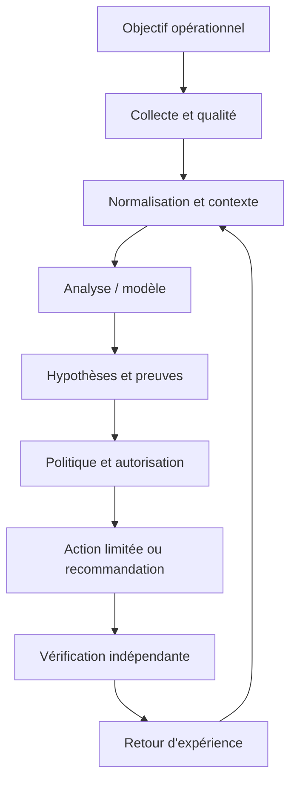

Le premier contrat concerne la donnée : source, horodatage, unité, cible, fraîcheur et état de qualité sont conservés. Le contrat du modèle ou de la règle précise la version, les entrées attendues, les métriques de validation et les limites. Le contrat de décision énumère les actions permises, les préconditions, les approbations, les quotas et les conditions d'arrêt. Le contrat de sortie indique enfin la preuve requise pour déclarer un rétablissement. Ces frontières permettent de tester chaque partie indépendamment, de corriger un composant sans dissimuler l'origine de l'erreur et d'auditer une action plusieurs semaines plus tard.

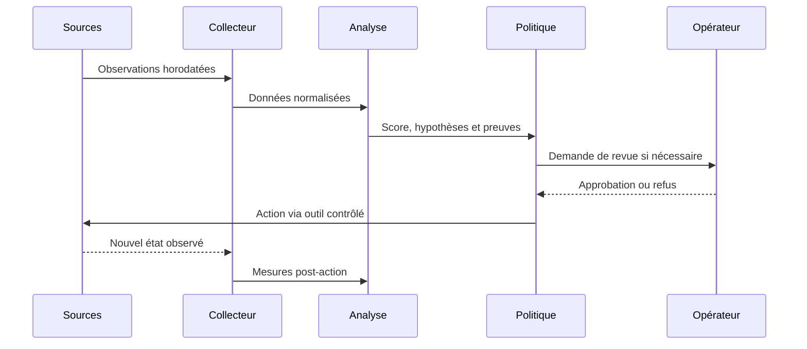

### Frontières de sécurité et mode dégradé

Le contrôle de sécurité lié à Séparation analyse/exécution doit être conçu dès le départ. Appliquer le moindre privilège, protéger les secrets, tracer les décisions et séparer analyse et exécution. Le piège à surveiller est : appeler IA toute automatisation conditionnelle. Lorsque des données externes entrent dans le pipeline, elles ne doivent pas modifier les règles d'accès ni fournir des instructions privilégiées. Toute action à fort impact exige des préconditions compréhensibles, une approbation adaptée et une façon testée de revenir vers un état sûr.

Si Données manquantes produit un résultat incohérent, commencer par vérifier horloge, source, unité, cible, fraîcheur, version et erreur d'accès. Comparer une observation brute avec sa valeur transformée, puis rechercher les modifications récentes. Pour le scénario étudié, un contrôle utile consiste à tester une seule hypothèse à la fois et à conserver la preuve du résultat. Ne pas recopier de secrets dans le ticket. Une fois le défaut confirmé, ajouter un test de régression afin que la même anomalie ne revienne pas avec une mise à jour.

À l'échelle, Résilience du pipeline doit gérer des volumes, équipements et versions hétérogènes sans perdre de traçabilité. Borner la concurrence, isoler les erreurs par cible, limiter le buffering et mesurer les files protège le système aval. La reprise d'une panne peut elle-même provoquer une surcharge si toutes les cibles se reconnectent simultanément. Une architecture robuste sait réduire la fréquence ou revenir à une méthode plus simple, tout en signalant explicitement cette dégradation au lieu d'afficher une apparence de fonctionnement normal.

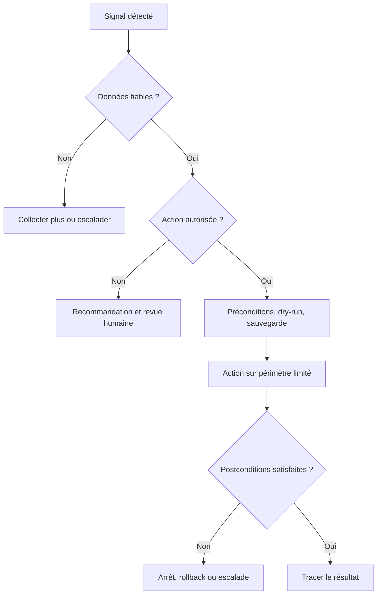

## 4. Pipeline et algorithmes

Le pipeline présenté ici est une chaîne de responsabilités, pas nécessairement un ensemble de microservices séparés. Une petite mise en œuvre peut héberger plusieurs étapes dans un seul processus, à condition de conserver des contrats clairs, des tests et des journaux. L'ordre importe : la qualité est vérifiée avant le calcul, le contexte avant l'interprétation et l'autorisation avant l'exécution. Cette discipline rend possible le fonctionnement en mode observation au départ puis, si les critères le justifient, une automatisation graduée.

### Étape 1 — Formuler la tâche
Distinguer classification, prévision, détection sans étiquette et génération.

La mise en œuvre de Formuler la tâche gagne à être découpée en contrôles testables. Vérifier d'abord le format et la provenance des entrées, puis les hypothèses, les valeurs manquantes et les versions. L'outil règles expertes peut contribuer à cette étape, mais sa présence ne garantit pas la qualité. Les erreurs doivent rester explicites au lieu d'être converties silencieusement en valeurs par défaut. Une exécution fiable sait différencier une réussite, un échec, un résultat partiel et un état impossible à déterminer.

Si Formuler la tâche produit un résultat incohérent, commencer par vérifier horloge, source, unité, cible, fraîcheur, version et erreur d'accès. Comparer une observation brute avec sa valeur transformée, puis rechercher les modifications récentes. Pour le scénario étudié, un contrôle utile consiste à tester une seule hypothèse à la fois et à conserver la preuve du résultat. Ne pas recopier de secrets dans le ticket. Une fois le défaut confirmé, ajouter un test de régression afin que la même anomalie ne revienne pas avec une mise à jour.

### Étape 2 — Créer une baseline
Construire une référence simple avant de choisir un modèle complexe.

La mise en œuvre de Créer une baseline gagne à être découpée en contrôles testables. Vérifier d'abord le format et la provenance des entrées, puis les hypothèses, les valeurs manquantes et les versions. L'outil scikit-learn peut contribuer à cette étape, mais sa présence ne garantit pas la qualité. Les erreurs doivent rester explicites au lieu d'être converties silencieusement en valeurs par défaut. Une exécution fiable sait différencier une réussite, un échec, un résultat partiel et un état impossible à déterminer.

Si Créer une baseline produit un résultat incohérent, commencer par vérifier horloge, source, unité, cible, fraîcheur, version et erreur d'accès. Comparer une observation brute avec sa valeur transformée, puis rechercher les modifications récentes. Pour le scénario étudié, un contrôle utile consiste à tester une seule hypothèse à la fois et à conserver la preuve du résultat. Ne pas recopier de secrets dans le ticket. Une fois le défaut confirmé, ajouter un test de régression afin que la même anomalie ne revienne pas avec une mise à jour.

### Étape 3 — Préparer les données
Vérifier étiquettes, représentativité, fuite et déséquilibre.

La mise en œuvre de Préparer les données gagne à être découpée en contrôles testables. Vérifier d'abord le format et la provenance des entrées, puis les hypothèses, les valeurs manquantes et les versions. L'outil jeux de validation peut contribuer à cette étape, mais sa présence ne garantit pas la qualité. Les erreurs doivent rester explicites au lieu d'être converties silencieusement en valeurs par défaut. Une exécution fiable sait différencier une réussite, un échec, un résultat partiel et un état impossible à déterminer.

Si Préparer les données produit un résultat incohérent, commencer par vérifier horloge, source, unité, cible, fraîcheur, version et erreur d'accès. Comparer une observation brute avec sa valeur transformée, puis rechercher les modifications récentes. Pour le scénario étudié, un contrôle utile consiste à tester une seule hypothèse à la fois et à conserver la preuve du résultat. Ne pas recopier de secrets dans le ticket. Une fois le défaut confirmé, ajouter un test de régression afin que la même anomalie ne revienne pas avec une mise à jour.

### Étape 4 — Choisir l'approche
Comparer règles, modèles supervisés, clustering ou LLM selon la tâche.

La mise en œuvre de Choisir l'approche gagne à être découpée en contrôles testables. Vérifier d'abord le format et la provenance des entrées, puis les hypothèses, les valeurs manquantes et les versions. L'outil matrices de confusion peut contribuer à cette étape, mais sa présence ne garantit pas la qualité. Les erreurs doivent rester explicites au lieu d'être converties silencieusement en valeurs par défaut. Une exécution fiable sait différencier une réussite, un échec, un résultat partiel et un état impossible à déterminer.

Si Choisir l'approche produit un résultat incohérent, commencer par vérifier horloge, source, unité, cible, fraîcheur, version et erreur d'accès. Comparer une observation brute avec sa valeur transformée, puis rechercher les modifications récentes. Pour le scénario étudié, un contrôle utile consiste à tester une seule hypothèse à la fois et à conserver la preuve du résultat. Ne pas recopier de secrets dans le ticket. Une fois le défaut confirmé, ajouter un test de régression afin que la même anomalie ne revienne pas avec une mise à jour.

### Étape 5 — Évaluer les erreurs
Mesurer les erreurs pertinentes et examiner les cas critiques.

La mise en œuvre de Évaluer les erreurs gagne à être découpée en contrôles testables. Vérifier d'abord le format et la provenance des entrées, puis les hypothèses, les valeurs manquantes et les versions. L'outil règles expertes peut contribuer à cette étape, mais sa présence ne garantit pas la qualité. Les erreurs doivent rester explicites au lieu d'être converties silencieusement en valeurs par défaut. Une exécution fiable sait différencier une réussite, un échec, un résultat partiel et un état impossible à déterminer.

Si Évaluer les erreurs produit un résultat incohérent, commencer par vérifier horloge, source, unité, cible, fraîcheur, version et erreur d'accès. Comparer une observation brute avec sa valeur transformée, puis rechercher les modifications récentes. Pour le scénario étudié, un contrôle utile consiste à tester une seule hypothèse à la fois et à conserver la preuve du résultat. Ne pas recopier de secrets dans le ticket. Une fois le défaut confirmé, ajouter un test de régression afin que la même anomalie ne revienne pas avec une mise à jour.

### Étape 6 — Décider du déploiement
Comparer gain, latence, coût, explicabilité et stratégie de repli.

La mise en œuvre de Décider du déploiement gagne à être découpée en contrôles testables. Vérifier d'abord le format et la provenance des entrées, puis les hypothèses, les valeurs manquantes et les versions. L'outil scikit-learn peut contribuer à cette étape, mais sa présence ne garantit pas la qualité. Les erreurs doivent rester explicites au lieu d'être converties silencieusement en valeurs par défaut. Une exécution fiable sait différencier une réussite, un échec, un résultat partiel et un état impossible à déterminer.

Si Décider du déploiement produit un résultat incohérent, commencer par vérifier horloge, source, unité, cible, fraîcheur, version et erreur d'accès. Comparer une observation brute avec sa valeur transformée, puis rechercher les modifications récentes. Pour le scénario étudié, un contrôle utile consiste à tester une seule hypothèse à la fois et à conserver la preuve du résultat. Ne pas recopier de secrets dans le ticket. Une fois le défaut confirmé, ajouter un test de régression afin que la même anomalie ne revienne pas avec une mise à jour.

### Pseudocode de décision défensive
```text
observations = collecter()
si qualite(observations) insuffisante:
    journaliser("données insuffisantes")
    demander_verification_humaine()
sinon:
    contexte = enrichir(observations, inventaire, changements, dépendances)
    hypotheses = analyser(contexte)
    preuves = verifier_provenance(hypotheses)
    si preuves insuffisantes ou action hors politique:
        recommander_sans_executer()
    sinon:
        plan = preparer_diff_preconditions_et_rollback()
        si validation(plan) et approbations(plan):
            appliquer_sur_perimetre_limite(plan)
            resultat = mesurer_postconditions()
            si resultat non conforme: rollback_ou_escalade()
            tracer(version, preuves, action, resultat)
```

Ce pseudocode sert à expliquer le flux de décision ; il ne constitue pas une bibliothèque prête pour la production. Chaque fonction doit être implémentée, testée et protégée. Le comportement doit être prévisible lorsque les données manquent, qu'un service externe ne répond pas ou que le résultat demeure ambigu. Une bonne conception ne remplace pas l'incertitude par une valeur par défaut. Elle la rend visible, limite l'impact et garde une voie de reprise.

## 5. Étude de cas détaillée

### Situation et impact
une équipe veut classifier des tickets, détecter des valeurs inhabituelles et résumer des journaux, puis envisage un seul modèle pour tous ces besoins. L'équipe réunit responsable de service, ingénieur réseau, administrateur système et propriétaire de l'automatisation. Avant d'agir, elle définit l'impact observé, la fenêtre de temps, les actifs concernés et les services prioritaires. La première question n'est pas « quel modèle utiliser ? », mais « quelle décision doit être améliorée et quelle preuve montrera que le changement a servi son objectif ? ». Cette formulation fixe le périmètre et donne un critère d'arrêt si la solution n'apporte pas de valeur démontrable.

### Phase 1 — Établir les faits
Les observations doivent garder les heures originales et les identifiants de source. L'équipe vérifie la qualité de collecte, les changements récents, les dépendances et l'expérience utilisateur. Les valeurs manquantes sont identifiées explicitement plutôt que remplacées silencieusement par zéro. Les symptômes sont séparés des causes supposées, et les sources qui se contredisent sont enregistrées dans le dossier. La preuve de départ sert de référence pour vérifier si une intervention améliore réellement la situation et permet à un autre opérateur de reproduire l'analyse.

### Phase 2 — Poser plusieurs hypothèses
Quand plusieurs causes sont possibles, l'équipe note au minimum deux hypothèses, les observations qui les soutiennent, les éléments qui les contredisent et les tests qui peuvent les différencier. La priorité combine probabilité, impact et coût d'un test. Une hypothèse populaire n'est pas nécessairement correcte : un cas qui ressemble à un incident passé peut différer par la capacité, le routage, la version de logiciel ou la période de charge. Les hypothèses restent des hypothèses jusqu'à ce qu'une preuve suffisante permette de les confirmer.

### Phase 3 — Choisir une réponse proportionnée
Commencer par les vérifications non destructives : comparer l'état, consulter les changements, tester la connectivité ou inspecter une dépendance. Si une modification est nécessaire, définir précisément la cible, la commande ou le changement attendu, les préconditions, les critères d'arrêt et le rollback. Une revue indépendante s'impose lorsque le rayon d'impact est élevé. Le plan doit permettre à l'opérateur de comprendre pourquoi l'action est proposée et dans quelles circonstances il doit la refuser.

### Phase 4 — Vérifier les postconditions
La validation repose sur des mesures indépendantes du simple statut de commande : latence, erreurs, connectivité, état de configuration ou indicateur du service. La fenêtre d'observation doit éviter de confondre un échantillon favorable avec un rétablissement durable. Si les conditions ne sont pas satisfaites, appliquer la règle d'arrêt prévue et lancer un rollback ou une escalade. Le compte rendu distingue l'action exécutée, l'effet mesuré, les effets secondaires et les informations qui restent inconnues.

### Phase 5 — Capitaliser avec prudence
Le post-mortem compare les hypothèses initiales avec les preuves finales, relève les signaux manquants et ajoute des tests de régression. Une règle ou un modèle amélioré passe en revue et en essai contrôlé avant généralisation. Il faut éviter de réentraîner automatiquement sur des conclusions incertaines ou des tickets contenant uniquement des suppositions. Le retour d'expérience doit décrire les situations où la méthode a échoué autant que les cas où elle a réussi.

### Critères de clôture
La clôture exige une preuve de rétablissement, ou une déclaration explicite que le service reste dégradé. Le dossier réunit sources, versions, changement exact, approbation, résultats et suivi. La cause racine n'est marquée comme confirmée que si les observations la soutiennent suffisamment. En l'absence de preuve, une conclusion partielle est plus utile qu'un récit catégorique. La qualité se mesure au diagnostic reproductible, au risque contrôlé et à la possibilité d'améliorer le système à partir des erreurs observées.

## 6. Implémentation guidée et laboratoire

Le laboratoire doit être exécuté dans un environnement isolé ou sur des systèmes explicitement autorisés. Avant de commencer, noter les versions, dépendances, données d'entrée et condition de réussite. Ne pas copier les exemples sur un réseau de production sans adapter les identifiants, certificats, permissions et tests de restauration. Le livrable final doit être compréhensible par une autre personne, ré-exécutable et accompagné d'une liste claire de ses limites.

### TP 1 — Formuler une tâche de classification, une détection et un résumé.
**Procédure.** Formuler une tâche de classification, une détection et un résumé. Commencer par une cible de laboratoire minimale et capturer l'état de départ. Relier ce travail au concept « Intelligence artificielle » : L'IA regroupe différentes méthodes qui exécutent des tâches de perception, de raisonnement ou de génération ; le terme ne garantit pas qu'un système apprend. Conserver la commande, les entrées, le résultat et la version des outils. Ne changer qu'une variable à la fois pour pouvoir attribuer un écart à sa cause.

**Critère de réussite.** Un autre opérateur doit pouvoir reproduire le résultat et identifier la preuve attendue. Tester aussi un échec contrôlé, une valeur manquante ou une dépendance indisponible. Si le résultat n'est pas déterminable, garder cet état explicite ; ne pas le convertir en succès. Vérifier les postconditions réelles, les effets secondaires et la procédure de reprise. Documenter ce qui a été démontré, ce qui reste une hypothèse et quelle amélioration serait nécessaire avant un usage à plus grande échelle.

### TP 2 — Définir les entrées, la cible et la métrique de chaque tâche.
**Procédure.** Définir les entrées, la cible et la métrique de chaque tâche. Commencer par une cible de laboratoire minimale et capturer l'état de départ. Relier ce travail au concept « Machine Learning » : Le ML apprend des relations à partir d'exemples et dépend de la qualité des données, de la cible et de l'évaluation. Conserver la commande, les entrées, le résultat et la version des outils. Ne changer qu'une variable à la fois pour pouvoir attribuer un écart à sa cause.

**Critère de réussite.** Un autre opérateur doit pouvoir reproduire le résultat et identifier la preuve attendue. Tester aussi un échec contrôlé, une valeur manquante ou une dépendance indisponible. Si le résultat n'est pas déterminable, garder cet état explicite ; ne pas le convertir en succès. Vérifier les postconditions réelles, les effets secondaires et la procédure de reprise. Documenter ce qui a été démontré, ce qui reste une hypothèse et quelle amélioration serait nécessaire avant un usage à plus grande échelle.

### TP 3 — Créer une baseline explicable pour l'une des tâches.
**Procédure.** Créer une baseline explicable pour l'une des tâches. Commencer par une cible de laboratoire minimale et capturer l'état de départ. Relier ce travail au concept « Apprentissage supervisé » : Le supervisé utilise des étiquettes connues et nécessite une séparation entraînement-validation-test sans fuite d'information. Conserver la commande, les entrées, le résultat et la version des outils. Ne changer qu'une variable à la fois pour pouvoir attribuer un écart à sa cause.

**Critère de réussite.** Un autre opérateur doit pouvoir reproduire le résultat et identifier la preuve attendue. Tester aussi un échec contrôlé, une valeur manquante ou une dépendance indisponible. Si le résultat n'est pas déterminable, garder cet état explicite ; ne pas le convertir en succès. Vérifier les postconditions réelles, les effets secondaires et la procédure de reprise. Documenter ce qui a été démontré, ce qui reste une hypothèse et quelle amélioration serait nécessaire avant un usage à plus grande échelle.

### TP 4 — Séparer les observations dans le temps lorsque c'est pertinent.
**Procédure.** Séparer les observations dans le temps lorsque c'est pertinent. Commencer par une cible de laboratoire minimale et capturer l'état de départ. Relier ce travail au concept « Non supervisé » : Le non supervisé cherche structures ou observations inhabituelles sans disposer d'une étiquette exhaustive ; un cluster n'est pas automatiquement une catégorie métier. Conserver la commande, les entrées, le résultat et la version des outils. Ne changer qu'une variable à la fois pour pouvoir attribuer un écart à sa cause.

**Critère de réussite.** Un autre opérateur doit pouvoir reproduire le résultat et identifier la preuve attendue. Tester aussi un échec contrôlé, une valeur manquante ou une dépendance indisponible. Si le résultat n'est pas déterminable, garder cet état explicite ; ne pas le convertir en succès. Vérifier les postconditions réelles, les effets secondaires et la procédure de reprise. Documenter ce qui a été démontré, ce qui reste une hypothèse et quelle amélioration serait nécessaire avant un usage à plus grande échelle.

### TP 5 — Comparer méthode simple et modèle candidat sur les mêmes données.
**Procédure.** Comparer méthode simple et modèle candidat sur les mêmes données. Commencer par une cible de laboratoire minimale et capturer l'état de départ. Relier ce travail au concept « Deep Learning » : Les réseaux neuronaux profonds apprennent des représentations complexes mais peuvent exiger davantage de données, de calcul et de surveillance. Conserver la commande, les entrées, le résultat et la version des outils. Ne changer qu'une variable à la fois pour pouvoir attribuer un écart à sa cause.

**Critère de réussite.** Un autre opérateur doit pouvoir reproduire le résultat et identifier la preuve attendue. Tester aussi un échec contrôlé, une valeur manquante ou une dépendance indisponible. Si le résultat n'est pas déterminable, garder cet état explicite ; ne pas le convertir en succès. Vérifier les postconditions réelles, les effets secondaires et la procédure de reprise. Documenter ce qui a été démontré, ce qui reste une hypothèse et quelle amélioration serait nécessaire avant un usage à plus grande échelle.

### TP 6 — Examiner faux positifs, faux négatifs et cas difficiles.
**Procédure.** Examiner faux positifs, faux négatifs et cas difficiles. Commencer par une cible de laboratoire minimale et capturer l'état de départ. Relier ce travail au concept « Modèle génératif » : Un modèle génératif produit du contenu contextuel ; une réponse fluide peut être inexacte ou non étayée. Conserver la commande, les entrées, le résultat et la version des outils. Ne changer qu'une variable à la fois pour pouvoir attribuer un écart à sa cause.

**Critère de réussite.** Un autre opérateur doit pouvoir reproduire le résultat et identifier la preuve attendue. Tester aussi un échec contrôlé, une valeur manquante ou une dépendance indisponible. Si le résultat n'est pas déterminable, garder cet état explicite ; ne pas le convertir en succès. Vérifier les postconditions réelles, les effets secondaires et la procédure de reprise. Documenter ce qui a été démontré, ce qui reste une hypothèse et quelle amélioration serait nécessaire avant un usage à plus grande échelle.

### TP 7 — Documenter les limites avant toute mise en production.
**Procédure.** Documenter les limites avant toute mise en production. Commencer par une cible de laboratoire minimale et capturer l'état de départ. Relier ce travail au concept « Règles et modèles » : Une règle peut être préférable si la condition est stable et explicable ; la complexité doit démontrer un bénéfice mesuré. Conserver la commande, les entrées, le résultat et la version des outils. Ne changer qu'une variable à la fois pour pouvoir attribuer un écart à sa cause.

**Critère de réussite.** Un autre opérateur doit pouvoir reproduire le résultat et identifier la preuve attendue. Tester aussi un échec contrôlé, une valeur manquante ou une dépendance indisponible. Si le résultat n'est pas déterminable, garder cet état explicite ; ne pas le convertir en succès. Vérifier les postconditions réelles, les effets secondaires et la procédure de reprise. Documenter ce qui a été démontré, ce qui reste une hypothèse et quelle amélioration serait nécessaire avant un usage à plus grande échelle.

### Exemple de code ou de configuration

```python
from sklearn.dummy import DummyClassifier
from sklearn.metrics import classification_report
from sklearn.model_selection import train_test_split
from sklearn.tree import DecisionTreeClassifier

# X et y sont issus d'un jeu déjà contrôlé.
X_train, X_test, y_train, y_test = train_test_split(X, y, test_size=0.25, random_state=42, stratify=y)
for model in (DummyClassifier(strategy="most_frequent"), DecisionTreeClassifier(max_depth=4, random_state=42)):
    model.fit(X_train, y_train)
    print(type(model).__name__, classification_report(y_test, model.predict(X_test), zero_division=0))
```

Ce fragment est un point de départ pédagogique. Les versions, options CLI, capacités matérielles et schémas changent ; vérifier la documentation liée et tester dans un laboratoire. Le fragment n'inclut pas toute la configuration nécessaire à un déploiement réel. Les secrets ne doivent pas être ajoutés au code, et les exemples qui peuvent modifier un système doivent recevoir approbations, limites de portée et vérification post-action. Un parseur qui accepte la syntaxe ne certifie ni la conformité ni la disponibilité.

### Livrables attendus
- Un fichier versionné qui décrit entrées, sorties et dépendances.
- Un journal lié à la cible et à la version, sans secret.
- Des tests positifs, négatifs et de panne de dépendance.
- Des critères d'arrêt et une procédure de reprise testée.
- Une note décrivant les résultats et les limites.

## 7. Sécurité et gouvernance

### 1. Qualité et provenance
Chaque observation garde source, heure, unité et état de fraîcheur. Pour le contexte étudié, ce principe doit être traduit en contrôle observable, propriétaire, fréquence de revue et preuve de passage. Une politique sans test dépend de la mémoire des personnes ; un test sans propriétaire cesse d'être maintenu lorsque l'équipe change. La revue doit donc être planifiée et relancée après un changement majeur de données, de matériel, de finalité ou de modèle.

La gouvernance de Qualité et provenance définit qui peut créer, modifier, approuver, consulter et retirer la logique associée. Le propriétaire doit connaître l'objectif, les limites, les dépendances, le budget d'erreur et les critères de suspension. Les décisions doivent être retraçables jusqu'aux données et versions utilisées. Une règle sans propriétaire finit par dépendre de la mémoire de l'équipe ; un propriétaire sans mesure ne peut pas démontrer qu'elle fonctionne. La revue doit être planifiée et relancée à chaque changement majeur de données, d'équipement ou de finalité.

### 2. Identités et permissions
Les comptes d'automatisation reçoivent uniquement les privilèges nécessaires. Pour le contexte étudié, ce principe doit être traduit en contrôle observable, propriétaire, fréquence de revue et preuve de passage. Une politique sans test dépend de la mémoire des personnes ; un test sans propriétaire cesse d'être maintenu lorsque l'équipe change. La revue doit donc être planifiée et relancée après un changement majeur de données, de matériel, de finalité ou de modèle.

La gouvernance de Identités et permissions définit qui peut créer, modifier, approuver, consulter et retirer la logique associée. Le propriétaire doit connaître l'objectif, les limites, les dépendances, le budget d'erreur et les critères de suspension. Les décisions doivent être retraçables jusqu'aux données et versions utilisées. Une règle sans propriétaire finit par dépendre de la mémoire de l'équipe ; un propriétaire sans mesure ne peut pas démontrer qu'elle fonctionne. La revue doit être planifiée et relancée à chaque changement majeur de données, d'équipement ou de finalité.

### 3. Traçabilité
La version, les preuves, la décision, l'approbateur et le résultat sont corrélés. Pour le contexte étudié, ce principe doit être traduit en contrôle observable, propriétaire, fréquence de revue et preuve de passage. Une politique sans test dépend de la mémoire des personnes ; un test sans propriétaire cesse d'être maintenu lorsque l'équipe change. La revue doit donc être planifiée et relancée après un changement majeur de données, de matériel, de finalité ou de modèle.

La gouvernance de Traçabilité définit qui peut créer, modifier, approuver, consulter et retirer la logique associée. Le propriétaire doit connaître l'objectif, les limites, les dépendances, le budget d'erreur et les critères de suspension. Les décisions doivent être retraçables jusqu'aux données et versions utilisées. Une règle sans propriétaire finit par dépendre de la mémoire de l'équipe ; un propriétaire sans mesure ne peut pas démontrer qu'elle fonctionne. La revue doit être planifiée et relancée à chaque changement majeur de données, d'équipement ou de finalité.

### 4. Revue humaine
Le réviseur doit posséder preuves, temps et autorité pour refuser. Pour le contexte étudié, ce principe doit être traduit en contrôle observable, propriétaire, fréquence de revue et preuve de passage. Une politique sans test dépend de la mémoire des personnes ; un test sans propriétaire cesse d'être maintenu lorsque l'équipe change. La revue doit donc être planifiée et relancée après un changement majeur de données, de matériel, de finalité ou de modèle.

La gouvernance de Revue humaine définit qui peut créer, modifier, approuver, consulter et retirer la logique associée. Le propriétaire doit connaître l'objectif, les limites, les dépendances, le budget d'erreur et les critères de suspension. Les décisions doivent être retraçables jusqu'aux données et versions utilisées. Une règle sans propriétaire finit par dépendre de la mémoire de l'équipe ; un propriétaire sans mesure ne peut pas démontrer qu'elle fonctionne. La revue doit être planifiée et relancée à chaque changement majeur de données, d'équipement ou de finalité.

### 5. Mesure du risque
Chaque mode d'échec doit avoir prévention, détection, réponse et responsable. Pour le contexte étudié, ce principe doit être traduit en contrôle observable, propriétaire, fréquence de revue et preuve de passage. Une politique sans test dépend de la mémoire des personnes ; un test sans propriétaire cesse d'être maintenu lorsque l'équipe change. La revue doit donc être planifiée et relancée après un changement majeur de données, de matériel, de finalité ou de modèle.

La gouvernance de Mesure du risque définit qui peut créer, modifier, approuver, consulter et retirer la logique associée. Le propriétaire doit connaître l'objectif, les limites, les dépendances, le budget d'erreur et les critères de suspension. Les décisions doivent être retraçables jusqu'aux données et versions utilisées. Une règle sans propriétaire finit par dépendre de la mémoire de l'équipe ; un propriétaire sans mesure ne peut pas démontrer qu'elle fonctionne. La revue doit être planifiée et relancée à chaque changement majeur de données, d'équipement ou de finalité.

### 6. Réversibilité
La suspension du modèle et le retour à une version saine sont testés. Pour le contexte étudié, ce principe doit être traduit en contrôle observable, propriétaire, fréquence de revue et preuve de passage. Une politique sans test dépend de la mémoire des personnes ; un test sans propriétaire cesse d'être maintenu lorsque l'équipe change. La revue doit donc être planifiée et relancée après un changement majeur de données, de matériel, de finalité ou de modèle.

La gouvernance de Réversibilité définit qui peut créer, modifier, approuver, consulter et retirer la logique associée. Le propriétaire doit connaître l'objectif, les limites, les dépendances, le budget d'erreur et les critères de suspension. Les décisions doivent être retraçables jusqu'aux données et versions utilisées. Une règle sans propriétaire finit par dépendre de la mémoire de l'équipe ; un propriétaire sans mesure ne peut pas démontrer qu'elle fonctionne. La revue doit être planifiée et relancée à chaque changement majeur de données, d'équipement ou de finalité.

## 8. Pièges à éviter

### Piège 1 — Appeler IA toute automatisation conditionnelle

Ce piège peut produire un faux diagnostic, une action superflue ou une perte de confiance. Le signal précurseur est parfois subtil : incohérence entre sources, hausse d'erreurs, impossibilité d'expliquer la sortie ou comportement différent selon les sites. L'équipe doit rendre le signal mesurable, désigner qui réagit et préciser si l'action automatique se bloque ou si le traitement continue en mode dégradé.

La prévention doit être reliée à « Intelligence artificielle ». L'IA regroupe différentes méthodes qui exécutent des tâches de perception, de raisonnement ou de génération ; le terme ne garantit pas qu'un système apprend. Définir un test négatif qui fait apparaître le défaut et vérifier que la réponse attendue réduit le risque. Un garde-fou ne doit pas être un simple avertissement que les opérateurs apprennent à ignorer. En revue, demander quelle preuve montre que le contrôle fonctionne, quelle défaillance il couvre et quelle autre défaillance demeure possible.

### Piège 2 — Utiliser des données futures à l'entraînement

Ce piège peut produire un faux diagnostic, une action superflue ou une perte de confiance. Le signal précurseur est parfois subtil : incohérence entre sources, hausse d'erreurs, impossibilité d'expliquer la sortie ou comportement différent selon les sites. L'équipe doit rendre le signal mesurable, désigner qui réagit et préciser si l'action automatique se bloque ou si le traitement continue en mode dégradé.

La prévention doit être reliée à « Machine Learning ». Le ML apprend des relations à partir d'exemples et dépend de la qualité des données, de la cible et de l'évaluation. Définir un test négatif qui fait apparaître le défaut et vérifier que la réponse attendue réduit le risque. Un garde-fou ne doit pas être un simple avertissement que les opérateurs apprennent à ignorer. En revue, demander quelle preuve montre que le contrôle fonctionne, quelle défaillance il couvre et quelle autre défaillance demeure possible.

### Piège 3 — Choisir la précision globale pour une classe rare

Ce piège peut produire un faux diagnostic, une action superflue ou une perte de confiance. Le signal précurseur est parfois subtil : incohérence entre sources, hausse d'erreurs, impossibilité d'expliquer la sortie ou comportement différent selon les sites. L'équipe doit rendre le signal mesurable, désigner qui réagit et préciser si l'action automatique se bloque ou si le traitement continue en mode dégradé.

La prévention doit être reliée à « Apprentissage supervisé ». Le supervisé utilise des étiquettes connues et nécessite une séparation entraînement-validation-test sans fuite d'information. Définir un test négatif qui fait apparaître le défaut et vérifier que la réponse attendue réduit le risque. Un garde-fou ne doit pas être un simple avertissement que les opérateurs apprennent à ignorer. En revue, demander quelle preuve montre que le contrôle fonctionne, quelle défaillance il couvre et quelle autre défaillance demeure possible.

### Piège 4 — Confondre groupe mathématique et catégorie métier

Ce piège peut produire un faux diagnostic, une action superflue ou une perte de confiance. Le signal précurseur est parfois subtil : incohérence entre sources, hausse d'erreurs, impossibilité d'expliquer la sortie ou comportement différent selon les sites. L'équipe doit rendre le signal mesurable, désigner qui réagit et préciser si l'action automatique se bloque ou si le traitement continue en mode dégradé.

La prévention doit être reliée à « Non supervisé ». Le non supervisé cherche structures ou observations inhabituelles sans disposer d'une étiquette exhaustive ; un cluster n'est pas automatiquement une catégorie métier. Définir un test négatif qui fait apparaître le défaut et vérifier que la réponse attendue réduit le risque. Un garde-fou ne doit pas être un simple avertissement que les opérateurs apprennent à ignorer. En revue, demander quelle preuve montre que le contrôle fonctionne, quelle défaillance il couvre et quelle autre défaillance demeure possible.

### Piège 5 — Prendre un texte généré pour une preuve

Ce piège peut produire un faux diagnostic, une action superflue ou une perte de confiance. Le signal précurseur est parfois subtil : incohérence entre sources, hausse d'erreurs, impossibilité d'expliquer la sortie ou comportement différent selon les sites. L'équipe doit rendre le signal mesurable, désigner qui réagit et préciser si l'action automatique se bloque ou si le traitement continue en mode dégradé.

La prévention doit être reliée à « Deep Learning ». Les réseaux neuronaux profonds apprennent des représentations complexes mais peuvent exiger davantage de données, de calcul et de surveillance. Définir un test négatif qui fait apparaître le défaut et vérifier que la réponse attendue réduit le risque. Un garde-fou ne doit pas être un simple avertissement que les opérateurs apprennent à ignorer. En revue, demander quelle preuve montre que le contrôle fonctionne, quelle défaillance il couvre et quelle autre défaillance demeure possible.

### Piège 6 — Ignorer les coûts de calcul et de maintenance

Ce piège peut produire un faux diagnostic, une action superflue ou une perte de confiance. Le signal précurseur est parfois subtil : incohérence entre sources, hausse d'erreurs, impossibilité d'expliquer la sortie ou comportement différent selon les sites. L'équipe doit rendre le signal mesurable, désigner qui réagit et préciser si l'action automatique se bloque ou si le traitement continue en mode dégradé.

La prévention doit être reliée à « Modèle génératif ». Un modèle génératif produit du contenu contextuel ; une réponse fluide peut être inexacte ou non étayée. Définir un test négatif qui fait apparaître le défaut et vérifier que la réponse attendue réduit le risque. Un garde-fou ne doit pas être un simple avertissement que les opérateurs apprennent à ignorer. En revue, demander quelle preuve montre que le contrôle fonctionne, quelle défaillance il couvre et quelle autre défaillance demeure possible.

### Piège 7 — Ne jamais comparer à une baseline

Ce piège peut produire un faux diagnostic, une action superflue ou une perte de confiance. Le signal précurseur est parfois subtil : incohérence entre sources, hausse d'erreurs, impossibilité d'expliquer la sortie ou comportement différent selon les sites. L'équipe doit rendre le signal mesurable, désigner qui réagit et préciser si l'action automatique se bloque ou si le traitement continue en mode dégradé.

La prévention doit être reliée à « Règles et modèles ». Une règle peut être préférable si la condition est stable et explicable ; la complexité doit démontrer un bénéfice mesuré. Définir un test négatif qui fait apparaître le défaut et vérifier que la réponse attendue réduit le risque. Un garde-fou ne doit pas être un simple avertissement que les opérateurs apprennent à ignorer. En revue, demander quelle preuve montre que le contrôle fonctionne, quelle défaillance il couvre et quelle autre défaillance demeure possible.

## 9. Diagnostic et dépannage

### Aucun résultat n'est produit
Vérifier accès source, période de sélection, identité, filtres et version du schéma. Dans le cadre de IA, Machine Learning, Deep Learning, vérifier en particulier ce risque : appeler IA toute automatisation conditionnelle. Comparer les observations brutes à leur représentation transformée, retrouver la version du pipeline et noter si une modification récente correspond au début du problème. Formuler au moins deux explications alternatives et choisir un test à faible risque qui permet de les distinguer. Ne pas effectuer plusieurs changements simultanément, car cela rendrait l'analyse ambiguë. Si les preuves restent insuffisantes, rendre cette incertitude visible et utiliser le mode sûr.

### Les résultats varient
Comparer données, code, versions, transformations et paramètres sur un cas fixe. Dans le cadre de IA, Machine Learning, Deep Learning, vérifier en particulier ce risque : utiliser des données futures à l'entraînement. Comparer les observations brutes à leur représentation transformée, retrouver la version du pipeline et noter si une modification récente correspond au début du problème. Formuler au moins deux explications alternatives et choisir un test à faible risque qui permet de les distinguer. Ne pas effectuer plusieurs changements simultanément, car cela rendrait l'analyse ambiguë. Si les preuves restent insuffisantes, rendre cette incertitude visible et utiliser le mode sûr.

### Trop d'alertes
Inspecter doublons, saisonnalité, baseline, seuil et qualité du contexte avant de supprimer des alertes. Dans le cadre de IA, Machine Learning, Deep Learning, vérifier en particulier ce risque : choisir la précision globale pour une classe rare. Comparer les observations brutes à leur représentation transformée, retrouver la version du pipeline et noter si une modification récente correspond au début du problème. Formuler au moins deux explications alternatives et choisir un test à faible risque qui permet de les distinguer. Ne pas effectuer plusieurs changements simultanément, car cela rendrait l'analyse ambiguë. Si les preuves restent insuffisantes, rendre cette incertitude visible et utiliser le mode sûr.

### Un incident passe inaperçu
Reconstituer les informations disponibles au moment de décider et rechercher un seuil trop permissif ou une source absente. Dans le cadre de IA, Machine Learning, Deep Learning, vérifier en particulier ce risque : confondre groupe mathématique et catégorie métier. Comparer les observations brutes à leur représentation transformée, retrouver la version du pipeline et noter si une modification récente correspond au début du problème. Formuler au moins deux explications alternatives et choisir un test à faible risque qui permet de les distinguer. Ne pas effectuer plusieurs changements simultanément, car cela rendrait l'analyse ambiguë. Si les preuves restent insuffisantes, rendre cette incertitude visible et utiliser le mode sûr.

### L'action n'améliore pas le service
Vérifier postconditions indépendantes et effets secondaires, puis appliquer arrêt ou rollback selon le plan. Dans le cadre de IA, Machine Learning, Deep Learning, vérifier en particulier ce risque : prendre un texte généré pour une preuve. Comparer les observations brutes à leur représentation transformée, retrouver la version du pipeline et noter si une modification récente correspond au début du problème. Formuler au moins deux explications alternatives et choisir un test à faible risque qui permet de les distinguer. Ne pas effectuer plusieurs changements simultanément, car cela rendrait l'analyse ambiguë. Si les preuves restent insuffisantes, rendre cette incertitude visible et utiliser le mode sûr.

### La qualité diminue avec le temps
Rechercher dérive, changement de capacité, topologie, population ou version et réévaluer. Dans le cadre de IA, Machine Learning, Deep Learning, vérifier en particulier ce risque : ignorer les coûts de calcul et de maintenance. Comparer les observations brutes à leur représentation transformée, retrouver la version du pipeline et noter si une modification récente correspond au début du problème. Formuler au moins deux explications alternatives et choisir un test à faible risque qui permet de les distinguer. Ne pas effectuer plusieurs changements simultanément, car cela rendrait l'analyse ambiguë. Si les preuves restent insuffisantes, rendre cette incertitude visible et utiliser le mode sûr.

## 10. Exercices corrigés

### Exercice 1 — Intelligence artificielle
**Énoncé.** Dans un environnement inspiré du scénario « une équipe veut classifier des tickets, détecter des valeurs inhabituelles et résumer des journaux, puis envisage un seul modèle pour tous ces besoins », l'équipe veut généraliser une approche qui utilise « Intelligence artificielle ». Quelle preuve recueillir avant l'étape « Formuler la tâche », et comment réduire le risque suivant : appeler IA toute automatisation conditionnelle ?

**Correction détaillée.** Définir d'abord le résultat attendu et le coût d'une erreur. Vérifier que les entrées proviennent d'une source autorisée et qu'elles sont fraîches, cohérentes et disponibles au moment de la décision. Construire un essai reproductible, comparer à une baseline et analyser les erreurs par classe d'actif ou criticité. Distinguer classification, prévision, détection sans étiquette et génération. L'extension du périmètre exige des seuils écrits, une revue adaptée au risque, un déploiement progressif et un retour arrière. Si la preuve ne permet pas de trancher, demander une vérification complémentaire ou garder la solution en observation plutôt que d'inventer une certitude.

**Pourquoi les raccourcis échouent.** Un résultat favorable sur un exemple ne démontre pas une performance durable. Un score moyen peut masquer les catégories vulnérables ; une absence d'erreur visible peut provenir d'une télémétrie incomplète. Conserver les cas difficiles, les conditions de test et les versions utilisées rend possible une revue indépendante. L'exercice est réussi lorsque le choix, ses limites et le mécanisme de retrait sont compris par une autre personne.

### Exercice 2 — Machine Learning
**Énoncé.** Dans un environnement inspiré du scénario « une équipe veut classifier des tickets, détecter des valeurs inhabituelles et résumer des journaux, puis envisage un seul modèle pour tous ces besoins », l'équipe veut généraliser une approche qui utilise « Machine Learning ». Quelle preuve recueillir avant l'étape « Créer une baseline », et comment réduire le risque suivant : utiliser des données futures à l'entraînement ?

**Correction détaillée.** Définir d'abord le résultat attendu et le coût d'une erreur. Vérifier que les entrées proviennent d'une source autorisée et qu'elles sont fraîches, cohérentes et disponibles au moment de la décision. Construire un essai reproductible, comparer à une baseline et analyser les erreurs par classe d'actif ou criticité. Construire une référence simple avant de choisir un modèle complexe. L'extension du périmètre exige des seuils écrits, une revue adaptée au risque, un déploiement progressif et un retour arrière. Si la preuve ne permet pas de trancher, demander une vérification complémentaire ou garder la solution en observation plutôt que d'inventer une certitude.

**Pourquoi les raccourcis échouent.** Un résultat favorable sur un exemple ne démontre pas une performance durable. Un score moyen peut masquer les catégories vulnérables ; une absence d'erreur visible peut provenir d'une télémétrie incomplète. Conserver les cas difficiles, les conditions de test et les versions utilisées rend possible une revue indépendante. L'exercice est réussi lorsque le choix, ses limites et le mécanisme de retrait sont compris par une autre personne.

### Exercice 3 — Apprentissage supervisé
**Énoncé.** Dans un environnement inspiré du scénario « une équipe veut classifier des tickets, détecter des valeurs inhabituelles et résumer des journaux, puis envisage un seul modèle pour tous ces besoins », l'équipe veut généraliser une approche qui utilise « Apprentissage supervisé ». Quelle preuve recueillir avant l'étape « Préparer les données », et comment réduire le risque suivant : choisir la précision globale pour une classe rare ?

**Correction détaillée.** Définir d'abord le résultat attendu et le coût d'une erreur. Vérifier que les entrées proviennent d'une source autorisée et qu'elles sont fraîches, cohérentes et disponibles au moment de la décision. Construire un essai reproductible, comparer à une baseline et analyser les erreurs par classe d'actif ou criticité. Vérifier étiquettes, représentativité, fuite et déséquilibre. L'extension du périmètre exige des seuils écrits, une revue adaptée au risque, un déploiement progressif et un retour arrière. Si la preuve ne permet pas de trancher, demander une vérification complémentaire ou garder la solution en observation plutôt que d'inventer une certitude.

**Pourquoi les raccourcis échouent.** Un résultat favorable sur un exemple ne démontre pas une performance durable. Un score moyen peut masquer les catégories vulnérables ; une absence d'erreur visible peut provenir d'une télémétrie incomplète. Conserver les cas difficiles, les conditions de test et les versions utilisées rend possible une revue indépendante. L'exercice est réussi lorsque le choix, ses limites et le mécanisme de retrait sont compris par une autre personne.

### Exercice 4 — Non supervisé
**Énoncé.** Dans un environnement inspiré du scénario « une équipe veut classifier des tickets, détecter des valeurs inhabituelles et résumer des journaux, puis envisage un seul modèle pour tous ces besoins », l'équipe veut généraliser une approche qui utilise « Non supervisé ». Quelle preuve recueillir avant l'étape « Choisir l'approche », et comment réduire le risque suivant : confondre groupe mathématique et catégorie métier ?

**Correction détaillée.** Définir d'abord le résultat attendu et le coût d'une erreur. Vérifier que les entrées proviennent d'une source autorisée et qu'elles sont fraîches, cohérentes et disponibles au moment de la décision. Construire un essai reproductible, comparer à une baseline et analyser les erreurs par classe d'actif ou criticité. Comparer règles, modèles supervisés, clustering ou LLM selon la tâche. L'extension du périmètre exige des seuils écrits, une revue adaptée au risque, un déploiement progressif et un retour arrière. Si la preuve ne permet pas de trancher, demander une vérification complémentaire ou garder la solution en observation plutôt que d'inventer une certitude.

**Pourquoi les raccourcis échouent.** Un résultat favorable sur un exemple ne démontre pas une performance durable. Un score moyen peut masquer les catégories vulnérables ; une absence d'erreur visible peut provenir d'une télémétrie incomplète. Conserver les cas difficiles, les conditions de test et les versions utilisées rend possible une revue indépendante. L'exercice est réussi lorsque le choix, ses limites et le mécanisme de retrait sont compris par une autre personne.

### Exercice 5 — Deep Learning
**Énoncé.** Dans un environnement inspiré du scénario « une équipe veut classifier des tickets, détecter des valeurs inhabituelles et résumer des journaux, puis envisage un seul modèle pour tous ces besoins », l'équipe veut généraliser une approche qui utilise « Deep Learning ». Quelle preuve recueillir avant l'étape « Évaluer les erreurs », et comment réduire le risque suivant : prendre un texte généré pour une preuve ?

**Correction détaillée.** Définir d'abord le résultat attendu et le coût d'une erreur. Vérifier que les entrées proviennent d'une source autorisée et qu'elles sont fraîches, cohérentes et disponibles au moment de la décision. Construire un essai reproductible, comparer à une baseline et analyser les erreurs par classe d'actif ou criticité. Mesurer les erreurs pertinentes et examiner les cas critiques. L'extension du périmètre exige des seuils écrits, une revue adaptée au risque, un déploiement progressif et un retour arrière. Si la preuve ne permet pas de trancher, demander une vérification complémentaire ou garder la solution en observation plutôt que d'inventer une certitude.

**Pourquoi les raccourcis échouent.** Un résultat favorable sur un exemple ne démontre pas une performance durable. Un score moyen peut masquer les catégories vulnérables ; une absence d'erreur visible peut provenir d'une télémétrie incomplète. Conserver les cas difficiles, les conditions de test et les versions utilisées rend possible une revue indépendante. L'exercice est réussi lorsque le choix, ses limites et le mécanisme de retrait sont compris par une autre personne.


## Atelier approfondi — choisir, tester et exploiter une approche d'IA

Cette partie transforme les définitions du cours en une méthode concrète de choix. L'objectif n'est pas de retenir une liste d'algorithmes, mais d'apprendre à traduire un besoin en tâche précise, choisir une solution proportionnée, bâtir une référence simple, évaluer les erreurs et préparer une exploitation responsable. Ces compétences restent valables même si les bibliothèques, les modèles et les plateformes changent.

### A. Traduire le besoin en tâche observable

Une demande comme « ajouter de l'intelligence à la supervision » ne décrit pas un problème assez précis. Elle ne dit pas quelle entrée sera analysée, quelle sortie est attendue, comment la qualité sera évaluée, ni quelle décision dépendra du résultat. Avant de sélectionner un modèle, reformule la demande sous la forme suivante : « À partir de telles données, produire telle sortie, pour aider tel rôle à prendre telle décision, avec telle contrainte de délai et tel niveau de risque. »

Par exemple, « aider l'équipe à traiter les incidents plus vite » peut se décomposer en plusieurs tâches séparées. Une première tâche classe le texte d'un ticket dans une catégorie connue. Une deuxième estime la probabilité qu'une métrique soit inhabituelle. Une troisième prédit la demande de ressources dans la prochaine heure. Une quatrième résume les commentaires d'un incident pour aider l'astreinte. Ces tâches ont des sorties, des données et des critères de qualité différents ; les fusionner dans un seul problème rend l'évaluation confuse.

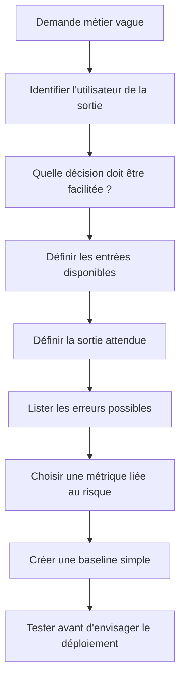

Pour chaque tâche, rédige une fiche courte contenant au moins ces champs : objectif, utilisateur, entrée, sortie, données requises, horizon temporel, fréquence de mise à jour, conséquences d'une erreur, baseline, métrique, seuil d'acceptation et décision de repli. Précise aussi ce qui est hors périmètre. Une classification de tickets, par exemple, ne doit pas automatiquement fermer le ticket, modifier une priorité critique ou envoyer des informations sensibles à un service non autorisé.

La formulation est importante parce qu'elle influence le choix de la technique. Si la sortie attendue est une catégorie parmi une liste connue, la classification supervisée peut convenir si des exemples étiquetés existent. Si l'on cherche à découvrir des groupes inconnus, le clustering peut aider à explorer les données. Si l'on veut une estimation chiffrée future, on parle de prévision. Si l'on veut résumer des textes, un modèle de langage peut être adapté, à condition de contrôler les sources et les affirmations. Si la tâche est simplement de vérifier qu'un seuil explicite n'est pas franchi, une règle déterministe peut suffire.

### B. Construire une carte de décision plutôt qu'un catalogue d'algorithmes

Le choix d'une approche doit suivre la structure du problème. Commence par demander si une règle claire et stable résout déjà la tâche. Si oui, mesure sa performance et son coût de maintenance avant de remplacer cette règle. Si la décision dépend d'exemples antérieurs étiquetés, évalue une approche supervisée. Si les catégories ne sont pas connues et que l'objectif est d'explorer des données, essaie une méthode non supervisée, sans supposer que les groupes mathématiques correspondent naturellement à des catégories métier. Si la donnée est fortement structurée, des modèles tabulaires simples sont souvent un bon point de départ. Le deep learning devient intéressant pour des volumes ou des modalités complexes, mais augmente les besoins en données, en calcul et en gouvernance. Un modèle génératif est utile pour manipuler le langage ou produire une synthèse, mais sa sortie doit être vérifiée.

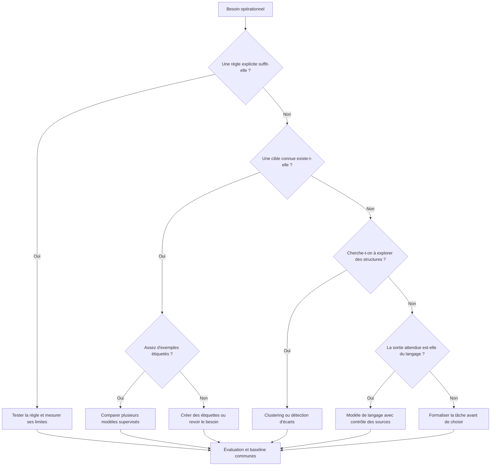

Ce parcours est un guide de réflexion, pas une vérité mécanique. Il peut conduire à une solution hybride. On peut utiliser une règle pour filtrer les cas évidents, un modèle supervisé pour classer le reste, puis un modèle de langage pour préparer une explication lisible à l'opérateur. Cette combinaison crée toutefois plusieurs points de défaillance et doit être évaluée comme une chaîne complète. Un composant médiocre ne devient pas fiable simplement parce qu'un autre composant est ajouté devant ou derrière lui.

Un tableau de décision est un outil de communication :

| Besoin | Approche de départ | Données nécessaires | Risque principal | Contrôle utile |
|---|---|---|---|---|
| Refuser une valeur hors limites documentées | Règle déterministe | Valeur et limites validées | Limite mal définie | Test de frontière et revue métier |
| Classer des tickets dans des catégories connues | ML supervisé | Tickets représentatifs avec étiquettes | Classes rares mal classées | Précision, rappel par classe, revue |
| Découvrir des familles d'incidents similaires | Non supervisé ou recherche de similarité | Représentations cohérentes des incidents | Groupes mathématiques mal interprétés | Évaluation humaine des groupes |
| Estimer la charge de la prochaine heure | Prévision | Historique daté et contexte | Saisonnalité ou rupture de régime | Erreur sur des périodes futures |
| Résumer un compte rendu d'incident | Modèle de langage | Texte autorisé et sources consultables | Omission ou affirmation inventée | Vérifier les éléments contre la source |
| Lire des images d'équipements | Vision par ordinateur | Images fiables et étiquettes adaptées | Conditions d'image non représentatives | Test selon environnement et appareil |
| Générer un runbook exécutable | Modèle de langage + validation stricte | Contexte technique et règles autorisées | Commande dangereuse ou invalide | Simulation, approbation, permissions minimales |

Le tableau ne doit pas devenir un raccourci qui dispense de l'essai. Deux problèmes ressemblants peuvent être différents si leurs volumes, leurs erreurs tolérables ou leurs données disponibles ne le sont pas. La « meilleure » approche est celle qui atteint les objectifs convenus avec des coûts, une complexité et un risque acceptables, pas celle qui utilise le modèle le plus récent.

### C. Rendre la différence entre règles et apprentissage très concrète

Une règle déterministe applique une logique écrite explicitement. Pour une métrique de température, une règle peut dire : si la valeur dépasse le seuil approuvé pendant trois fenêtres consécutives, créer une alerte. Son comportement est facile à expliquer, à tester et à versionner. En revanche, une règle doit être entretenue et peut être fragile lorsque les conditions changent. Si chaque variation demande plusieurs dizaines d'exceptions, la maintenance devient difficile.

Le ML apprend une relation à partir d'exemples. Pour des tickets, on peut lui fournir le texte et la catégorie confirmée par les opérateurs. Le modèle apprend des régularités statistiques, sans comprendre nécessairement le contexte comme un humain. Il peut échouer sur un nouveau produit, un vocabulaire différent ou une classe rare. Il faut donc surveiller sa qualité dans le temps et conserver une possibilité de révision humaine.

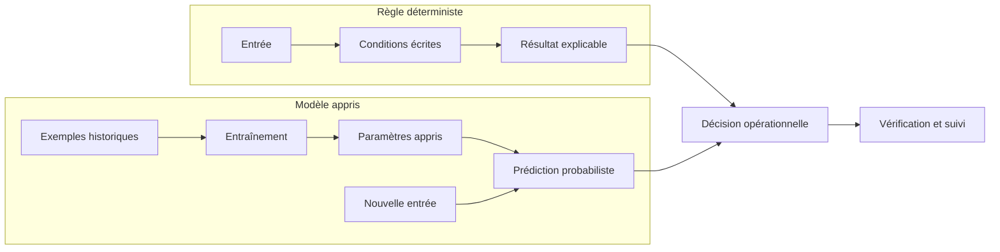

Considère une alerte pour une utilisation CPU élevée. Une règle simple peut être le bon choix si le niveau est strictement limité par une politique connue. Un modèle de détection d'anomalies peut être pertinent si la charge habituelle diffère fortement selon l'heure, le jour ou le type de service. Mais avant de déployer le modèle, compare-le à une règle et à une baseline temporelle. Si le gain est négligeable, la solution la plus simple peut être préférable.

Le choix peut être documenté par une justification explicite : « Nous gardons une règle pour le seuil critique parce qu'il provient d'une limite approuvée. Nous utilisons un modèle pour repérer des variations inhabituelles non décrites par cette règle. Le modèle ne peut pas supprimer ou modifier l'alerte critique ; il ajoute un contexte à examiner. » Cette séparation conserve le contrôle humain et rend le résultat testable.

### D. Comprendre le supervisé avec un exemple de classification de tickets

L'apprentissage supervisé utilise des exemples associés à une cible connue. Le modèle reçoit des caractéristiques (X) et apprend à prédire une cible (y). Pour la classification de tickets, (X) peut être le texte du ticket, le service, une catégorie technique autorisée et certains signaux contextuels. La cible (y) peut être une catégorie comme « réseau », « authentification », « base de données » ou « application ». Il faut éviter d'inclure dans les entrées des données révélant directement la réponse, par exemple un champ « équipe finale » rempli après le diagnostic.

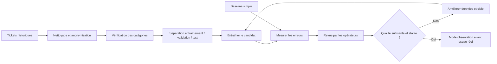

La qualité des étiquettes est essentielle. Si deux opérateurs attribuent des catégories différentes au même ticket, l'incohérence ne se résout pas toujours en utilisant un modèle plus complexe. Définis les catégories, les conditions de choix, le cas « autre » et le mécanisme de révision. Observe également si certaines classes sont très rares. Un modèle peut avoir une exactitude globale élevée en prédisant presque toujours la catégorie majoritaire, mais être inutile pour les catégories qui exigent une expertise spécifique.

Un jeu d'essai doit être séparé avant de sélectionner la meilleure configuration. Si le système sera utilisé à l'avenir, une séparation temporelle permet de simuler plus fidèlement ce qui sera connu au moment de la prédiction. Les tickets d'un même incident peuvent être très similaires ; les placer à la fois dans l'entraînement et dans le test pourrait donner une impression de performance exagérée. Selon l'usage, il faut parfois grouper les données par incident ou par service pendant la séparation.

Voici un mini-exemple de préparation de données tabulaires à adapter à un fichier de laboratoire. Le texte et les étiquettes doivent être contrôlés avant utilisation. Le code ne doit pas être alimenté par des tickets réels contenant des identifiants, secrets ou données personnelles sans autorisation et traitement approprié.

```python
import pandas as pd
from sklearn.model_selection import train_test_split
from sklearn.feature_extraction.text import TfidfVectorizer
from sklearn.pipeline import make_pipeline
from sklearn.linear_model import LogisticRegression
from sklearn.metrics import classification_report

# Exemple : données synthétiques, déjà anonymisées et étiquetées.
df = pd.DataFrame({
    "text": [
        "timeout gateway intersite",
        "échec ouverture session",
        "requête SQL trop lente",
        "perte paquets liaison",
        "jeton session expiré",
        "pool connexion base saturé",
        "latence tunnel réseau",
        "refus authentification"
    ],
    "category": [
        "reseau", "identite", "base", "reseau",
        "identite", "base", "reseau", "identite"
    ]
})

X_train, X_test, y_train, y_test = train_test_split(
    df["text"], df["category"], test_size=0.25,
    random_state=42, stratify=df["category"]
)

model = make_pipeline(
    TfidfVectorizer(ngram_range=(1, 2)),
    LogisticRegression(max_iter=1000, class_weight="balanced")
)
model.fit(X_train, y_train)
pred = model.predict(X_test)
print(classification_report(y_test, pred, zero_division=0))
```

Ce jeu minuscule sert à montrer le mécanisme, pas à démontrer une qualité réelle : quelques exemples ne couvrent pas la diversité du langage opérationnel. Les scores seront instables, et une classe représentée par trop peu de cas ne permet pas une estimation fiable. Pour un déploiement, il faut constituer des données suffisamment nombreuses, contrôler les doublons, définir les classes et examiner les erreurs avec les opérateurs.

### E. Distinguer classification, régression et prévision

La classification produit une catégorie ou un ensemble de catégories. La régression estime une valeur numérique pour une observation. La prévision estime une valeur future à partir d'un historique ordonné, souvent avec des régularités temporelles. Les trois tâches peuvent être apprises par des méthodes supervisées, mais leur évaluation n'est pas identique.

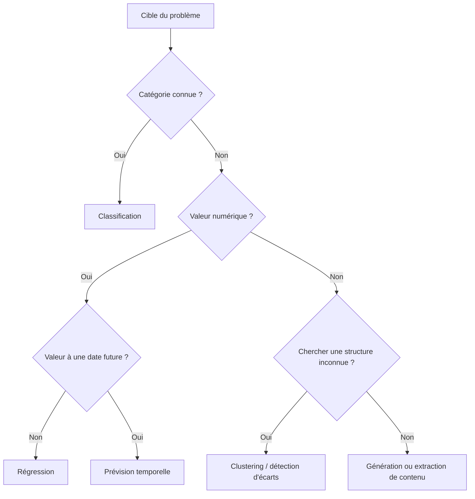

Pour une classification, on examine par exemple la précision, le rappel et la matrice de confusion. Pour une régression, on peut utiliser l'erreur absolue moyenne (MAE) ou l'erreur quadratique moyenne (RMSE), tout en vérifiant les unités et les valeurs extrêmes. Pour une prévision, les tests doivent respecter la chronologie. Une mesure qui utilise des observations futures dans les caractéristiques peut produire une précision illusoire qui disparaîtra une fois le modèle exploité.

Exemple : prévoir le nombre de demandes support reçues dans les trente prochaines minutes peut aider à organiser l'astreinte. Les entrées peuvent comprendre les volumes précédents, l'heure, le jour de la semaine, un calendrier de maintenance autorisé et le nombre d'incidents ouverts. Une donnée connue seulement après la période cible ne doit pas être utilisée. Compare le candidat à une baseline naïve, par exemple la même période de la semaine précédente ou la dernière valeur disponible. Si la prévision ne fait pas mieux de manière stable, elle ne justifie peut-être pas sa complexité.

```python
from sklearn.metrics import mean_absolute_error

actual = [18, 20, 17, 24]
baseline = [16, 19, 18, 21]
candidate = [19, 19, 16, 22]

mae_baseline = mean_absolute_error(actual, baseline)
mae_candidate = mean_absolute_error(actual, candidate)

print(f"MAE baseline : {mae_baseline:.2f}")
print(f"MAE candidat : {mae_candidate:.2f}")
print("Le candidat améliore la MAE :", mae_candidate < mae_baseline)
```

L'exemple compare deux listes déjà sorties d'un processus de prévision ; il ne construit pas un modèle et ne garantit pas une amélioration générale. L'évaluation doit être répétée sur plusieurs fenêtres historiques. Elle doit également tenir compte des conséquences : sous-estimer une charge qui exige un renfort peut coûter plus cher que la surestimer légèrement, alors que le compromis peut être différent pour d'autres services.

### F. Comprendre l'apprentissage non supervisé sans surinterpréter les groupes

Le non-supervisé cherche des structures dans les données sans disposer d'une cible correcte pour chaque exemple. Le clustering regroupe des observations selon une notion de distance ou de similarité. La détection d'anomalies cherche des observations qui s'écartent d'un comportement estimé. Ces méthodes peuvent aider à explorer un ensemble de tickets ou de métriques, mais elles ne « découvrent » pas automatiquement la vraie taxonomie métier.

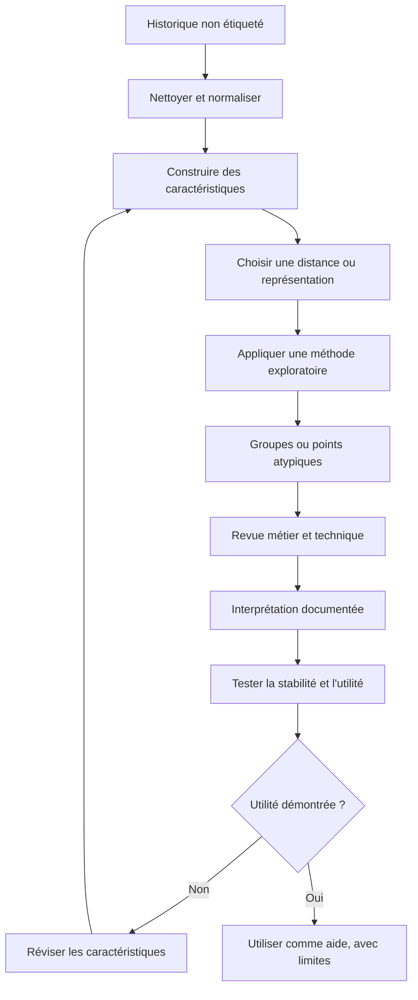

Imagine un algorithme qui regroupe les tickets d'incident en fonction de leurs textes. Un groupe peut rassembler des tickets mentionnant des « délais » et des « connexions ». Cela peut révéler un thème utile ou simplement refléter un vocabulaire fréquent. Il faut inspecter des exemples représentatifs, chercher les cas qui contredisent l'interprétation et comprendre si les groupes changent fortement quand on ajoute quelques nouveaux tickets.

Les métriques internes de clustering peuvent évaluer la cohésion ou la séparation mathématique, mais elles ne démontrent pas l'utilité opérationnelle. Les experts doivent vérifier si les groupes peuvent être nommés de manière cohérente, s'ils représentent un problème réel et s'ils accélèrent le diagnostic. Si les catégories varient au gré des versions, un opérateur ne doit pas voir un identifiant de cluster comme un nom de cause stable.

```python
from sklearn.feature_extraction.text import TfidfVectorizer
from sklearn.cluster import KMeans

texts = [
    "perte de paquets sur le lien WAN",
    "latence et pertes sur le tunnel réseau",
    "échec de connexion à la base",
    "requêtes SQL avec un délai élevé",
    "expiration du jeton utilisateur",
    "refus de connexion par le fournisseur identité"
]

vectorizer = TfidfVectorizer(stop_words=None, ngram_range=(1, 2))
X = vectorizer.fit_transform(texts)

clusters = KMeans(n_clusters=3, random_state=42, n_init=10)
labels = clusters.fit_predict(X)

for text, label in zip(texts, labels):
    print(label, text)
```

Les identifiants de groupe affichés par cet exemple n'ont pas de sens métier intrinsèque. Un autre entraînement, un autre choix de caractéristiques ou un autre nombre de groupes peut changer l'affectation. Il faut donc enregistrer la version, inspecter les exemples et donner aux groupes des noms documentés uniquement après revue. Il faut aussi s'abstenir d'inférer des informations sensibles ou de faire de la surveillance individuelle à partir de regroupements non validés.

### G. Comprendre le deep learning comme une famille de modèles, pas comme un synonyme de qualité

Le deep learning est un sous-ensemble du machine learning qui utilise des réseaux de neurones comportant plusieurs couches de transformations apprises. Il a permis des progrès importants sur des modalités complexes comme l'image, le son, le texte et certains signaux temporels. Cela ne signifie pas qu'il soit automatiquement mieux adapté à tout problème. Sur des tableaux relativement petits et propres, des méthodes plus simples peuvent être compétitives, plus faciles à diagnostiquer et moins coûteuses à maintenir.

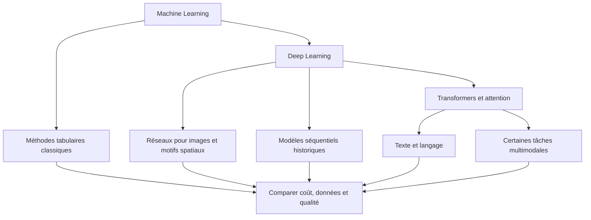

Un réseau de neurones apprend des représentations à partir de données. L'entraînement ajuste des paramètres selon une fonction de perte et un algorithme d'optimisation. Les hyperparamètres, comme la taille du modèle, le taux d'apprentissage ou le nombre d'époques, influencent la qualité. Si le modèle est trop flexible par rapport aux données, il peut mémoriser les exemples d'entraînement et généraliser mal. Si sa capacité est trop limitée, il peut rester incapable d'apprendre la relation utile.

L'entraînement demande souvent un budget de calcul plus important que celui d'une règle simple. Il implique aussi des décisions de préparation, d'architecture, de sélection de checkpoint, de régularisation et de surveillance. Pour certaines tâches, l'équipe ne dispose pas des données, du matériel ou de l'expertise requis. Utiliser un modèle préentraîné peut réduire certains coûts, mais les conditions d'utilisation, les limites, la sécurité et les performances sur le contexte réel doivent rester examinées.

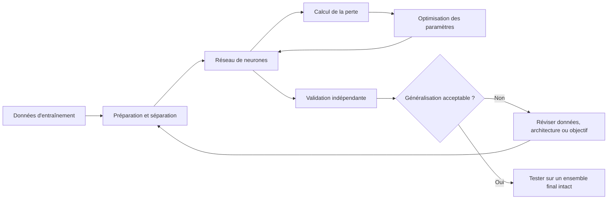

La boucle d'optimisation ne constitue pas une preuve d'utilité. La perte peut diminuer tandis que le modèle devient plus mauvais sur les observations futures. C'est pourquoi l'entraînement, la validation et le test ont des rôles distincts. L'ensemble de test ne doit pas être réutilisé de manière répétée pour choisir les paramètres, sous peine de contaminer l'évaluation finale.

Pour comparer un réseau et une méthode plus simple, consigne les mêmes jeux d'évaluation, les mêmes métriques métier et les mêmes contraintes de latence. Examine aussi le coût d'inférence, la consommation mémoire, le délai de démarrage, la dépendance à un accélérateur et les possibilités de maintenance. Une amélioration théorique très faible peut ne pas compenser un surcoût durable ou un fonctionnement moins prévisible.

### H. Comprendre un modèle génératif et ses différences avec un classifieur

Un modèle génératif produit du contenu : texte, code, image, audio ou d'autres représentations selon sa conception. Les grands modèles de langage génèrent généralement une séquence de tokens en s'appuyant sur un contexte et une distribution apprise. Ils peuvent résumer un journal, reformuler un compte rendu ou préparer une explication. Ils ne constituent pas pour autant une base de données toujours exacte et ne garantissent pas que chaque affirmation corresponde à une preuve existante.

Un classifieur et un modèle génératif répondent à des besoins différents. Le classifieur peut retourner une catégorie parmi celles prévues pendant l'entraînement. Le générateur peut produire une explication flexible, mais il peut aussi ajouter des détails plausibles qui ne figurent pas dans la source. Pour une tâche opérationnelle, cette flexibilité doit être encadrée par un contexte autorisé, une sortie attendue, des contrôles de structure et un mécanisme de vérification.

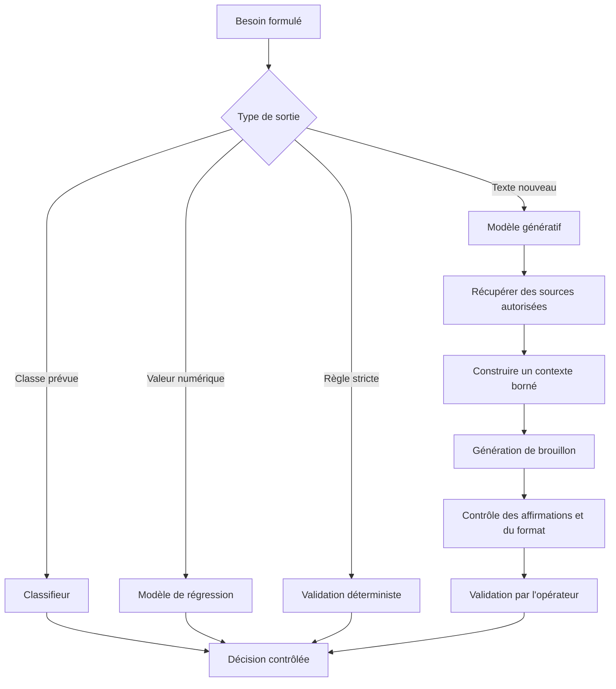

Un résumé de journal doit conserver la trace des éléments sources : fenêtre de temps, composants, message d'erreur, requête ou trace identifiante selon la politique de confidentialité, et liens consultables. Si le modèle écrit « la base a provoqué la panne » alors que le journal montre seulement un délai de connexion, l'affirmation dépasse la preuve. Un résultat correct devrait dire : « Plusieurs connexions à la base expirent pendant la fenêtre étudiée. La cause n'est pas encore établie ; vérifier la saturation du pool et la connectivité réseau. »

Un moyen de limiter les erreurs consiste à demander une sortie structurée, par exemple un résumé, une liste de faits sourcés, une liste d'hypothèses et une liste d'informations manquantes. Le format JSON permet d'automatiser certaines validations, mais un JSON valide peut contenir des conclusions fausses. La validation syntaxique et la validation factuelle sont donc deux contrôles distincts.

```json
{
  "summary": "Des délais de connexion à la base sont observés.",
  "facts": [
    {
      "statement": "Plusieurs connexions ont expiré pendant la fenêtre étudiée.",
      "evidence_id": "log-014"
    }
  ],
  "hypotheses": [
    "Saturation du pool de connexions",
    "Latence réseau vers le serveur de base"
  ],
  "missing_evidence": [
    "Métrique d'utilisation du pool",
    "Mesure de connectivité indépendante"
  ],
  "recommended_next_step": "Collecter les deux mesures manquantes avant de décider."
}
```

Cet exemple représente une forme de sortie préférable à une conclusion non nuancée. Le système doit aussi contrôler le volume de contenu envoyé, masquer les secrets et éviter d'exposer des données confidentielles à une API externe sans autorisation. Une sortie générée doit rester un brouillon tant qu'un besoin, une évaluation et un niveau de risque n'ont pas autorisé une autonomie supérieure.

### I. Mesurer les erreurs avec des métriques adaptées

La métrique n'est pas une décoration de rapport : elle définit ce que signifie réussir. L'exactitude globale (accuracy) est la proportion totale de prédictions correctes. Elle peut être trompeuse si une catégorie est dominante. La précision mesure, parmi les exemples prédits positifs, la part réellement positive. Le rappel mesure, parmi les exemples réellement positifs, la part retrouvée. Le F1 combine précision et rappel selon leur moyenne harmonique. La matrice de confusion révèle les classes entre lesquelles le modèle se trompe.

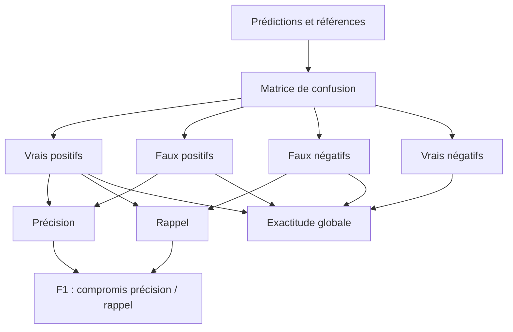

Dans les opérations, les erreurs n'ont pas toujours le même coût. Un faux positif peut déclencher une investigation inutile ; un faux négatif peut laisser une panne critique sans détection. L'équipe doit définir le compromis avec le propriétaire du service. Si les erreurs coûtent différemment selon la classe, rapporte les métriques par classe et examine les cas les plus graves. Un score moyen peut cacher qu'un petit groupe d'incidents importants est mal détecté.

Pour une régression ou une prévision, utilise des métriques numériques dont l'unité et l'interprétation sont claires. La MAE est la moyenne de la valeur absolue des écarts et reste dans la même unité que la cible. La RMSE pénalise davantage les grandes erreurs. Le choix dépend du coût des erreurs extrêmes et de la distribution des valeurs. Compare toujours le candidat à une baseline qui reflète un comportement simple connu.

Pour un modèle génératif, une mesure automatique de similarité textuelle ne suffit généralement pas à établir la fiabilité d'un résumé opérationnel. Il faut examiner la fidélité aux sources, les omissions importantes, les affirmations non justifiées, la cohérence, le format, la divulgation éventuelle de données et le temps nécessaire à la validation humaine. Les critères devraient être définis avant le test afin de réduire le risque de sélectionner après coup les résultats les plus flatteurs.

### J. Éviter les fuites de données et les évaluations trompeuses

Une fuite de données survient lorsque le modèle bénéficie, pendant la préparation ou l'évaluation, d'une information qu'il ne pourrait pas légitimement connaître au moment de la prédiction. Par exemple, une table peut contenir l'heure de résolution d'un ticket alors que le modèle est censé prédire son équipe dès l'ouverture. Si cette information influence les caractéristiques, le test est trompeur.

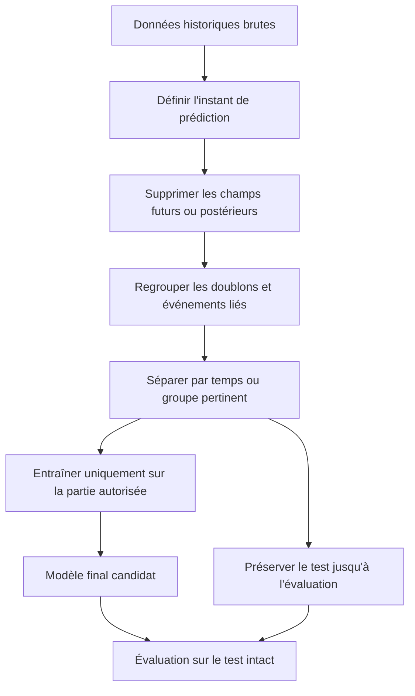

La séparation aléatoire n'est pas adaptée à toutes les situations. Elle peut suffire pour des données indépendantes et distribuées de manière adéquate, mais peut surestimer la qualité si les observations sont temporelles, répétées ou regroupées par client ou incident. Pour les données de séries temporelles, l'évaluation doit respecter l'ordre. Pour des événements appartenant au même incident, il peut être nécessaire de maintenir le groupe entier d'un seul côté de la séparation.

Il faut aussi protéger le test contre les réglages répétés. Chaque fois que l'équipe consulte ses résultats et choisit une nouvelle configuration en fonction du test, elle apprend indirectement de ce test. Pour l'évaluation finale, conserve un ensemble intact ou utilise un protocole de validation défini. Le nombre de données et la variabilité doivent être suffisants pour que l'incertitude des résultats soit comprise.

### K. Préparer les données comme un produit à part entière

La qualité d'un modèle est limitée par les données qu'il reçoit. Un jeu utile n'est pas seulement volumineux : il doit représenter les contextes attendus, avoir une définition stable des cibles et préserver la provenance. Les erreurs de saisie, les catégories ambiguës, les changements de vocabulaire et les données manquantes doivent être documentés. Les données historiques peuvent aussi refléter les décisions imparfaites d'une équipe, ses biais, ou un fonctionnement ancien qui n'est plus souhaitable.

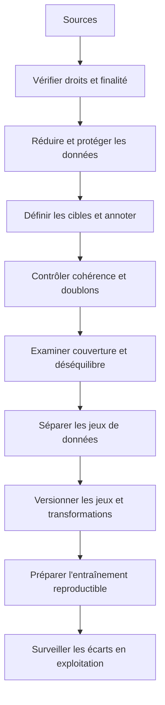

La provenance indique d'où provient chaque source, quand elle a été collectée, quelle transformation a été appliquée et quelle version a été utilisée. Cette traçabilité permet de comprendre pourquoi un modèle change après un réentraînement. Elle aide aussi à retirer des données qui n'ont plus de droit d'utilisation et à reconstruire une évaluation lorsqu'une erreur est découverte.

Avant l'annotation, prépare un guide avec des exemples positifs, négatifs et ambigus. Mesure l'accord entre annotateurs lorsqu'il est pertinent, puis résous les désaccords selon une procédure connue. Ne traite pas automatiquement les cas ambigus comme s'ils étaient certains. Prévois une classe « inconnu » ou une procédure d'abstention lorsque l'équipe ne dispose pas d'une information suffisante.

La confidentialité est une exigence de conception. Utilise des jeux synthétiques pour les premières expérimentations. Si des données réelles sont nécessaires, minimise les champs, retire les identifiants inutiles, contrôle les accès, limite la rétention et vérifie les obligations du contexte. Anonymiser ne se résume pas à supprimer un nom : des combinaisons de quasi-identifiants peuvent parfois réidentifier une personne.

### L. Interpréter les probabilités et organiser l'abstention

Une probabilité de sortie n'est pas nécessairement bien calibrée. Un modèle qui affiche 0,9 pour une catégorie devrait, sur un grand nombre de prédictions comparables et correctement calibrées, être exact environ 90 % du temps. Cette interprétation n'est pas garantie simplement parce que le logiciel imprime un nombre décimal. Il faut mesurer la calibration sur des observations séparées et vérifier si elle se maintient dans différents sous-groupes et dans le temps.

L'abstention est une option utile. Si la confiance ou la qualité de l'entrée ne suffit pas, le système peut renvoyer « à examiner » au lieu de choisir une classe. La règle d'abstention doit être évaluée elle-même : si elle s'applique trop souvent, la solution n'est pas utile ; si elle s'applique trop rarement, elle peut transférer des erreurs à l'opérateur. Mesure la couverture des prédictions et leur qualité sur les cas conservés.

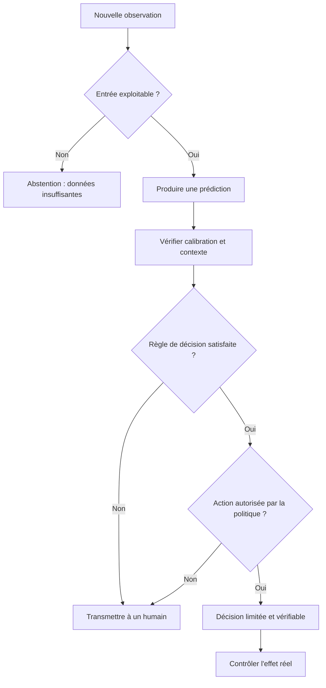

La décision peut utiliser différents seuils pour des classes dont les coûts d'erreur diffèrent. Une catégorie qui entraîne une intervention critique peut exiger un contrôle renforcé, même si elle est probable. Un modèle ne doit pas pouvoir élargir lui-même ses permissions simplement parce qu'il prédit une probabilité élevée.

### M. Comparer les solutions selon le coût total

Le coût ne s'arrête pas à l'entraînement. Il inclut l'ingestion et le stockage des données, les licences, les appels API, les ressources de calcul, la latence, la supervision de la plateforme, la validation humaine, les corrections et les mises à jour. Un système génératif peut réduire le temps de rédaction tout en exigeant une validation systématique. Un classifieur compact peut être moins spectaculaire, mais fonctionner près des données, de manière stable et peu coûteuse.

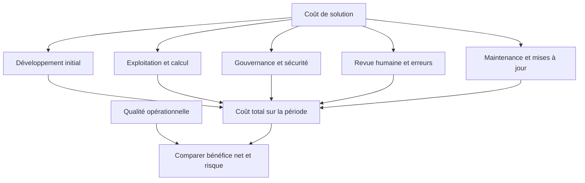

Prépare une estimation de coût sur une période représentative. Compare plusieurs variantes : règle seule, modèle classique, modèle préentraîné ou génératif, puis chaîne hybride. Calcule le coût par décision utile, mais examine aussi la gravité des erreurs. Une solution moins chère par requête peut s'avérer coûteuse si ses résultats entraînent des interventions inutiles ou manquent des incidents graves.

Le choix peut être documenté dans une fiche de décision technique qui liste les alternatives écartées et explique pourquoi. Cette fiche sert lors d'une revue ultérieure, quand un nouveau modèle devient disponible ou que les données changent. Elle empêche l'équipe de recommencer le débat sans savoir quelles contraintes avaient conduit à la décision initiale.

### N. Déployer et surveiller un modèle sans le considérer comme terminé

Un modèle n'est pas un fichier produit une fois pour toutes. Les données peuvent évoluer, le service peut changer, les catégories peuvent être redéfinies et les comportements utilisateurs peuvent varier. Le suivi doit donc mesurer à la fois la qualité de service, la qualité des données d'entrée et les performances des prédictions lorsqu'une vérité de référence devient disponible.

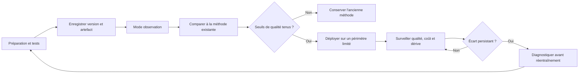

Le mode observation, parfois appelé shadow mode, permet de comparer les sorties d'un nouveau modèle à celles de la méthode actuelle sans lui donner directement l'autorité de modifier le service. Cela révèle des divergences et certains problèmes de latence ou de format. Il ne garantit pas à lui seul que le modèle sera bon dans tous les cas ; il faut aussi observer des périodes et contextes représentatifs.

La dérive des données signifie que les entrées se distribuent différemment de la période utilisée pour développer la solution. La dérive de concept signifie que la relation entre les entrées et la cible a changé. Les deux ne sont pas équivalentes et ne demandent pas toujours le même correctif. Un changement de trafic peut modifier les caractéristiques sans invalider le lien utile, tandis qu'une nouvelle architecture applicative peut rendre obsolètes d'anciennes associations. Avant de réentraîner, vérifie la collecte, les changements de service, les étiquettes et les coûts d'erreur.

Une procédure de retrait doit être aussi claire que la procédure de déploiement. Elle indique qui peut désactiver le modèle, quelle version de remplacement est utilisée, quelles alertes surveillent la transition et comment les décisions seront prises pendant l'incident. L'observabilité du modèle doit être exploitée comme celle du service : une sortie lente, une erreur de schéma, une indisponibilité de dépendance ou une hausse du coût peut justifier le retour à une solution de secours.

### O. Atelier comparatif : une même demande, plusieurs approches

**Contexte du laboratoire :** une équipe support informatique veut mieux traiter les tickets, repérer les comportements anormaux d'une API et produire un résumé d'incident. Il faut décider si une méthode unique peut remplir ces trois rôles. Les jeux de données sont synthétiques et les actions restent en lecture seule.

#### Travail 1 — Définir trois objectifs séparés

Pour le tri de tickets, la sortie attendue est une catégorie parmi une liste connue. Pour la détection d'anomalies, la sortie est un indicateur de cas à examiner, accompagné d'un contexte. Pour le résumé, la sortie est un texte bref relié aux événements d'origine. Chaque sortie reçoit sa propre métrique et sa propre procédure de vérification.

#### Travail 2 — Créer une solution simple de référence

Pour le tri, utilise d'abord une règle par mots-clés ou une prédiction de la catégorie majoritaire, afin d'avoir un point de comparaison. Pour les anomalies, utilise un seuil ou une baseline historique. Pour le résumé, une synthèse manuelle ou un modèle de gabarit qui sélectionne les champs structurés peut servir de référence. Les baselines doivent être honnêtes et documentées, même si elles sont rudimentaires.

#### Travail 3 — Entraîner ou configurer les candidats

Entraîne un classifieur classique sur les exemples de tickets. Pour les anomalies, teste une méthode robuste sur des séries synthétiques comprenant une période normale et plusieurs dégradations. Pour le résumé, prépare un prompt borné ou un gabarit qui interdit d'introduire une cause non confirmée. N'utilise pas un modèle génératif pour remplacer la classification si une sortie de classe stricte suffit.

#### Travail 4 — Construire des tests négatifs

Fais varier le vocabulaire d'un ticket, retire une mesure, ajoute un point extrême isolé, change l'ordre des journaux et insère une hypothèse non confirmée dans les notes de contexte. Le système doit reconnaître les cas non couverts et conserver la distinction entre un fait observable et une cause supposée.

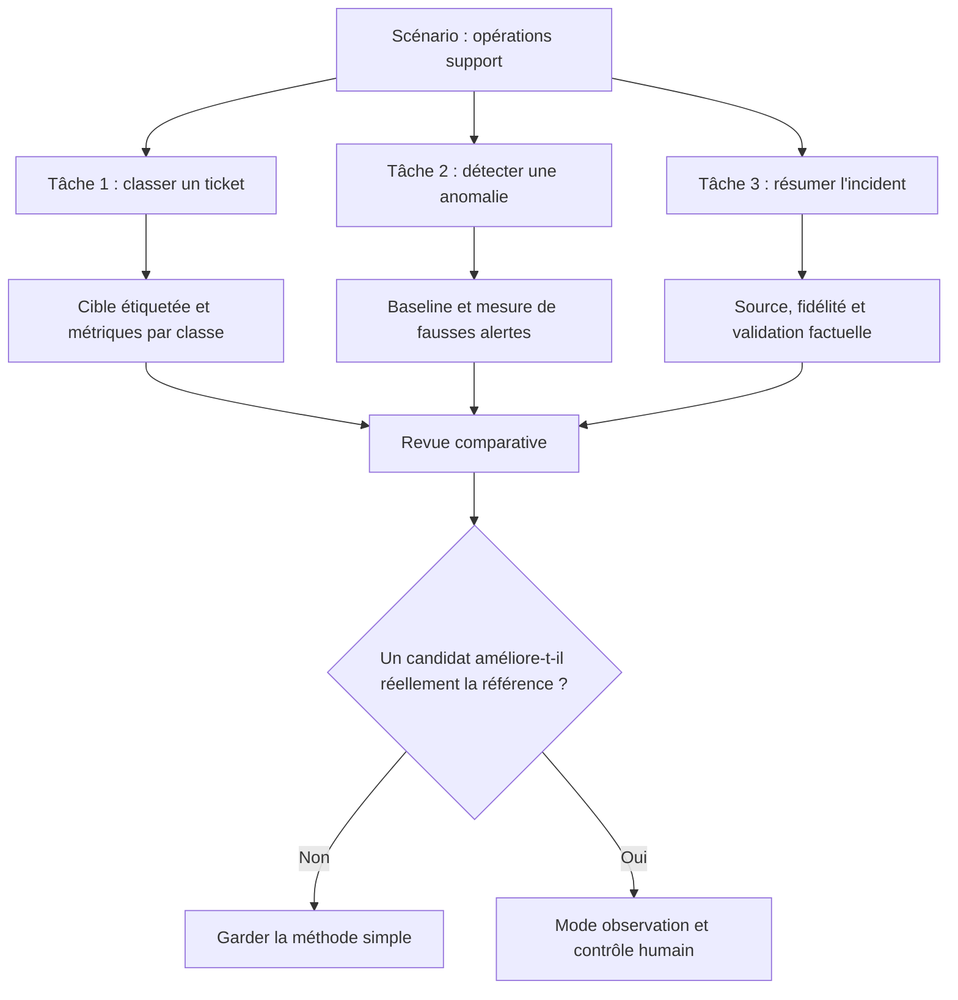

#### Travail 5 — Rédiger la décision

La conclusion ne doit pas être « l'IA est meilleure ». Elle doit indiquer, pour chaque tâche, les données disponibles, les résultats, les erreurs les plus coûteuses, le coût d'exploitation et les contraintes de sécurité. Il peut être raisonnable de retenir un modèle supervisé pour les tickets, une règle pour certaines limites et un modèle génératif pour préparer un résumé soumis à validation. L'architecture est choisie parce qu'elle répond aux besoins spécifiques, et non parce qu'un seul outil paraît capable de tout faire.

#### Livrable attendu

Remets un tableau avec les colonnes : tâche, baseline, candidat, métrique, résultat sur test intact, erreurs critiques, coût, contraintes, mode de repli et recommandation. Ajoute une brève justification des solutions écartées et une liste de tests avant déploiement. Le lecteur doit pouvoir reproduire la comparaison et comprendre quelles preuves soutiennent la décision.

### P. Modèle de fiche de décision réutilisable

La fiche suivante permet de documenter une décision en évitant qu'un modèle soit sélectionné uniquement sur sa nouveauté.

```yaml
decision:
  name: classification-tickets-support
  owner: equipe-support
  status: evaluation
problem:
  user: operateur-support
  intended_output: categorie_parmi_une_liste
  excluded_actions:
    - fermeture_automatique
    - changement_automatique_de_criticite
data:
  source: jeu_synthetique_anonymise
  target_definition: categories_version_1
  time_split: required
candidates:
  - name: regles_mots_cles
    role: baseline
  - name: tfidf_logistic_regression
    role: model_candidate
evaluation:
  metrics:
    - precision_per_class
    - recall_per_class
    - confusion_matrix
  error_review: mandatory
deployment:
  initial_mode: shadow
  human_review: required
  fallback: existing_triage_process
security:
  minimize_data: true
  protect_secrets: true
  audit_decisions: true
rollback:
  owner: equipe-support
  condition: quality_below_approved_threshold
```

Ce YAML est un exemple documentaire et n'est pas une configuration automatiquement exécutée par Skill-Tree. Il rend toutefois les attentes explicites : propriétaire, objectif, action exclue, données, tests, mode de fonctionnement, protections et retour arrière. Dans un environnement de production, le format de fiche doit être adapté à l'organisation et relié aux processus de validation existants.

### Q. Dix questions de revue avant d'accepter une solution

1. Peut-on expliquer la sortie attendue à une personne du métier en une phrase ?
2. Une règle plus simple donne-t-elle un résultat comparable ?
3. Les données d'entraînement représentent-elles les situations futures ?
4. Les données comprennent-elles des informations disponibles seulement après l'événement à prédire ?
5. La qualité est-elle mesurée sur un ensemble resté intact ?
6. Les erreurs sont-elles analysées par classe et par gravité ?
7. Le score affiché est-il calibré ou présenté comme une certitude sans preuve ?
8. Le système peut-il s'abstenir quand l'entrée est mauvaise ?
9. Les sorties sont-elles auditées, protégées et attribuables à une version ?
10. Le retour à la méthode de référence a-t-il été testé ?

Si plusieurs réponses sont inconnues, la solution n'est pas prête à recevoir une autorité opérationnelle. Il faut commencer par lever les incertitudes les plus risquées, et non ajouter de la complexité. Une expérimentation réussie est celle qui améliore une décision et expose honnêtement ses limites.

### R. Conclusion de l'atelier

L'intelligence artificielle, le machine learning, le deep learning et les modèles génératifs sont des familles liées, mais distinctes. Les règles déterministes demeurent utiles lorsque la logique est connue et doit être appliquée de manière reproductible. Le ML supervisé apprend à prédire une cible à partir d'exemples étiquetés. Les approches non supervisées explorent des structures sans cible de référence et exigent une interprétation prudente. Le deep learning apprend des représentations par des réseaux de neurones, souvent avec des exigences plus élevées en données et en calcul. Les modèles génératifs créent un contenu qui doit être vérifié, surtout lorsqu'il soutient une décision sensible.

La compétence de départ consiste à choisir l'approche par le besoin, pas par la mode. Définis la tâche, établis une baseline, sécurise les données, choisis une métrique alignée sur le risque, teste des cas négatifs et documente le repli. Une bonne solution sait aussi reconnaître les situations où elle ne doit pas répondre. Dans les opérations informatiques, cette capacité d'abstention est une qualité de fiabilité, pas une faiblesse.


## Défi final corrigé — choisir la bonne approche pour trois problèmes

### Énoncé

Une équipe reçoit trois demandes : classer automatiquement les tickets d'assistance, détecter une consommation CPU inhabituelle et extraire les numéros de série depuis des rapports rédigés en langage naturel. Pour chaque demande, choisis entre une règle déterministe, un modèle de Machine Learning et un modèle de langage. Explique quelles données seraient nécessaires, comment mesurer la qualité et pourquoi une bonne précision moyenne ne suffit pas toujours.

### Arbre de décision

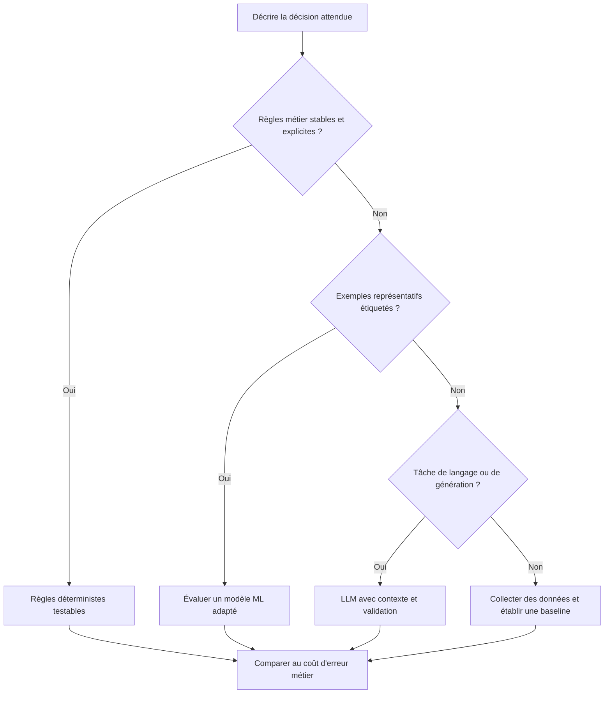

### Proposition de correction

Pour le classement des tickets, une règle peut suffire si les catégories sont peu nombreuses et les formulations contrôlées. Si les tickets sont variés et qu'un historique correctement étiqueté existe, un classifieur supervisé devient pertinent. La détection de consommation CPU inhabituelle peut commencer par une baseline tenant compte de l'heure et du jour, puis utiliser une méthode de détection d'anomalies ; l'absence d'étiquette ne signifie pas que chaque point atypique est une panne. L'extraction de numéros de série est une tâche de langage, mais une sortie générée doit être validée contre un format attendu et, si possible, contre l'inventaire de référence.

Pour évaluer, utilise un jeu de test séparé du jeu d'entraînement. Les données temporelles doivent être séparées chronologiquement afin d'éviter qu'un futur aide à prédire le passé. Pour des classes rares, examine précision, rappel et matrice de confusion, pas seulement l'accuracy. Une fausse alerte qui réveille l'astreinte n'a pas le même coût qu'une anomalie importante manquée.

Exemple de validation temporelle simple :

```python
# Les lignes sont triées par date : le test représente le futur.
cut = int(len(rows) * 0.8)
train_rows = rows[:cut]
test_rows = rows[cut:]

assert train_rows[-1]["timestamp"] < test_rows[0]["timestamp"]
print("Entraînement :", len(train_rows), "Test futur :", len(test_rows))
```

Cette séparation n'est pas une évaluation complète, mais elle évite une fuite temporelle évidente. Le choix final doit comparer le modèle à une baseline simple, inclure les coûts d'erreur et définir un mécanisme humain de contestation ou de correction.

### Barème d'autoévaluation

- Identifier la tâche et sa sortie attendue avant de choisir l'algorithme.
- Justifier les données et les étiquettes nécessaires.
- Séparer les données de test sans fuite.
- Choisir des métriques cohérentes avec les conséquences d'une erreur.
- Prévoir la validation de toute sortie générée.

## 11. Checklist et à retenir

- [ ] L'objectif métier et le service concerné sont explicites et mesurables.
- [ ] Chaque observation conserve provenance, horodatage, unité et qualité.
- [ ] La méthode a été comparée à une baseline simple.
- [ ] Les tests couvrent cas normaux, données manquantes et échecs.
- [ ] Les résultats sont ventilés par criticité et catégorie pertinente.
- [ ] Les permissions sont minimales et les secrets absents des journaux.
- [ ] Les décisions relient preuves, version, approbation et résultat.
- [ ] Chaque action risquée a préconditions, périmètre limité et rollback.
- [ ] Les mesures évaluent le service et les erreurs opérationnelles.
- [ ] Une procédure décrit abstention, escalade, suspension et revue.

### À retenir
Le but d'une démarche AIOps n'est pas d'automatiser chaque décision, mais de rendre les opérations plus rapides, cohérentes et vérifiables. Pour IA, Machine Learning, Deep Learning, la qualité dépend des données, de l'adéquation de la technique, d'une évaluation honnête et de la vérification du résultat. Un système capable de reconnaître ses limites, de bloquer une action risquée et de transmettre un dossier de preuve peut être plus utile qu'un système qui agit toujours sans expliquer ses erreurs.

précision, rappel et F1, courbe précision-rappel pour classes rares, MAE ou RMSE pour prévision, taux d'affirmations générées non sourcées, latence, coût et taux d'abstention sont des mesures candidates, mais chacune doit être associée à un objectif, un propriétaire et une action lorsqu'elle franchit une limite. Le nombre de modèles ou d'alertes traitées n'est pas en soi une mesure de valeur. La boucle d'amélioration est complète quand les résultats confirment ou réfutent les hypothèses, les incidents sont documentés et les contrôles évoluent selon les erreurs observées. Distinguer règles déterministes, Machine Learning, Deep Learning et modèles génératifs. Le maintien dans le temps implique de réviser les sources, tester la reprise et retirer une méthode quand ses limites dépassent son bénéfice.

## 12. Références

- https://scikit-learn.org/stable/supervised_learning.html
- https://scikit-learn.org/stable/modules/outlier_detection.html
- https://opentelemetry.io/docs/ — documentation sur l'observabilité et la télémétrie.
- https://www.nist.gov/itl/ai-risk-management-framework — cadre de gestion des risques de l'IA.
