# Intent-Based Networking (IBN) — Débutant

> **Mise en contexte :** ce cours étudie le problème suivant : une organisation veut segmenter les systèmes de paiement ; des équipements de marques différentes doivent appliquer une politique cohérente. L'objectif est d'améliorer les opérations de manière mesurable, vérifiable et proportionnée au risque. Les exemples doivent être adaptés et testés en laboratoire avant toute utilisation sur une infrastructure réelle.

## Sommaire

1. Introduction et objectifs
2. Concepts clés
3. Architecture de référence
4. Pipeline et algorithmes
5. Étude de cas
6. Implémentation guidée et laboratoire
7. Sécurité et gouvernance
8. Pièges à éviter
9. Diagnostic et dépannage
10. Exercices corrigés
11. Checklist et à retenir
12. Références

## 1. Introduction et objectifs

L'AIOps applique l'analyse de données et l'automatisation aux opérations informatiques afin de rendre la détection, le diagnostic et la résolution plus cohérents. Pour **Intent-Based Networking (IBN)**, l'enjeu est de exprimer un objectif réseau et le traduire en état cible, politique, configuration et conformité.. Le besoin est concret : les équipes doivent agir rapidement, mais les observations peuvent être contradictoires, les horloges décalées et les interventions porteuses de risques. La solution doit ainsi distinguer un signal, une hypothèse, une décision et une preuve de résultat.

Le scénario de départ est : une organisation veut segmenter les systèmes de paiement ; des équipements de marques différentes doivent appliquer une politique cohérente. Il illustre que des outils techniquement capables ne suffisent pas. La qualité dépend de données fiables, d'une question mesurable, d'une référence de comparaison et d'une procédure de reprise. Le système doit savoir reconnaître une donnée absente, exposer ses limites et demander de l'aide. L'automatisation n'est pas un objectif en soi : elle est justifiée uniquement si elle améliore un résultat opérationnel sans déplacer le risque vers les utilisateurs ou l'équipe d'astreinte.

Les outils possibles comprennent YAML, contrôleurs, inventaire, modèles de données, tests de conformité. Ils ne doivent pas tous être déployés dans le même projet. Chaque composant doit répondre à un besoin identifié et avoir un propriétaire. Une architecture réduite, testée et bien observée est préférable à un assemblage complexe dont personne ne peut expliquer les erreurs. La première version peut rester en lecture seule ; l'autorité d'agir se développe seulement après des essais reproductibles, une mesure des erreurs et une validation de la procédure de retour arrière.

### Objectifs pédagogiques
- Décrire les concepts principaux et leurs limites.
- Définir les sources de données, la qualité attendue et les propriétaires.
- Décrire le chemin entre observation, analyse, décision, action et vérification.
- Mesurer les erreurs et comparer la solution à une baseline.
- Protéger les accès et documenter une stratégie d'escalade et de reprise.

### Vocabulaire opérationnel
Une **observation** est une mesure ou un événement provenant d'une source identifiée. Un **signal** est une interprétation d'observations dans un contexte. Une **hypothèse** est une explication testable. Une **décision** sélectionne une action ou une abstention. Une **postcondition** est un état vérifiable qui doit être vrai après une intervention. Ces mots ne sont pas interchangeables. Une alerte n'est pas automatiquement un incident confirmé, un score ne constitue pas une preuve de cause racine et l'exécution d'une commande ne prouve pas que le service est rétabli.

## 2. Concepts clés

### 1. Intention

Une intention exprime le résultat souhaité et des contraintes métier plutôt qu'une séquence propre à un fournisseur.

Sur le terrain, Intention doit être relié à une question opérationnelle et à une décision possible. Une intention exprime le résultat souhaité et des contraintes métier plutôt qu'une séquence propre à un fournisseur. Il faut nommer la source de vérité, le propriétaire, la fréquence de mise à jour et le périmètre d'utilisation avant d'automatiser. Pour le scénario « une organisation veut segmenter les systèmes de paiement ; des équipements de marques différentes doivent appliquer une politique cohérente », cette précision empêche de transformer une intuition en commande. Elle permet aussi de définir quand il faut s'abstenir, demander davantage de données ou transmettre le dossier à une personne responsable.

La mise en œuvre de Intention gagne à être découpée en contrôles testables. Vérifier d'abord le format et la provenance des entrées, puis les hypothèses, les valeurs manquantes et les versions. L'outil YAML peut contribuer à cette étape, mais sa présence ne garantit pas la qualité. Les erreurs doivent rester explicites au lieu d'être converties silencieusement en valeurs par défaut. Une exécution fiable sait différencier une réussite, un échec, un résultat partiel et un état impossible à déterminer.

L'évaluation de Intention doit inclure les cas courants, les cas limites et les exemples difficiles. La mesure doit inclure conformité vérifiée, tout en examinant les différences selon la criticité et le type de cible. Un score moyen peut masquer une défaillance rare mais coûteuse ; il faut donc conserver des exemples concrets, mesurer faux positifs et faux négatifs et expliquer le coût de chaque erreur. Après une évolution de données, de code ou de modèle, les mêmes tests doivent être rejoués pour vérifier que le comportement attendu persiste.

Aucune technique associée à Intention n'est universellement préférable. Une règle peut être plus explicable, un modèle peut capter davantage de variables, et un système génératif peut accélérer la synthèse sans garantir la vérité. Le choix doit tenir compte des données, de la latence, du coût d'erreur, de l'explicabilité et de la maintenance. La baseline et le mode manuel doivent rester disponibles pour les périodes où les observations sont incomplètes ou que le système n'a plus la qualité attendue.

### 2. État cible

L'état cible décrit les propriétés attendues et des invariants testables, par exemple flux permis et interdits.

Sur le terrain, État cible doit être relié à une question opérationnelle et à une décision possible. L'état cible décrit les propriétés attendues et des invariants testables, par exemple flux permis et interdits. Il faut nommer la source de vérité, le propriétaire, la fréquence de mise à jour et le périmètre d'utilisation avant d'automatiser. Pour le scénario « une organisation veut segmenter les systèmes de paiement ; des équipements de marques différentes doivent appliquer une politique cohérente », cette précision empêche de transformer une intuition en commande. Elle permet aussi de définir quand il faut s'abstenir, demander davantage de données ou transmettre le dossier à une personne responsable.

La mise en œuvre de État cible gagne à être découpée en contrôles testables. Vérifier d'abord le format et la provenance des entrées, puis les hypothèses, les valeurs manquantes et les versions. L'outil contrôleurs peut contribuer à cette étape, mais sa présence ne garantit pas la qualité. Les erreurs doivent rester explicites au lieu d'être converties silencieusement en valeurs par défaut. Une exécution fiable sait différencier une réussite, un échec, un résultat partiel et un état impossible à déterminer.

L'évaluation de État cible doit inclure les cas courants, les cas limites et les exemples difficiles. La mesure doit inclure dérives non expliquées, tout en examinant les différences selon la criticité et le type de cible. Un score moyen peut masquer une défaillance rare mais coûteuse ; il faut donc conserver des exemples concrets, mesurer faux positifs et faux négatifs et expliquer le coût de chaque erreur. Après une évolution de données, de code ou de modèle, les mêmes tests doivent être rejoués pour vérifier que le comportement attendu persiste.

### 3. Traduction

La traduction relie le modèle commun aux capacités et ressources propres à chaque plateforme.

Sur le terrain, Traduction doit être relié à une question opérationnelle et à une décision possible. La traduction relie le modèle commun aux capacités et ressources propres à chaque plateforme. Il faut nommer la source de vérité, le propriétaire, la fréquence de mise à jour et le périmètre d'utilisation avant d'automatiser. Pour le scénario « une organisation veut segmenter les systèmes de paiement ; des équipements de marques différentes doivent appliquer une politique cohérente », cette précision empêche de transformer une intuition en commande. Elle permet aussi de définir quand il faut s'abstenir, demander davantage de données ou transmettre le dossier à une personne responsable.

La mise en œuvre de Traduction gagne à être découpée en contrôles testables. Vérifier d'abord le format et la provenance des entrées, puis les hypothèses, les valeurs manquantes et les versions. L'outil inventaire peut contribuer à cette étape, mais sa présence ne garantit pas la qualité. Les erreurs doivent rester explicites au lieu d'être converties silencieusement en valeurs par défaut. Une exécution fiable sait différencier une réussite, un échec, un résultat partiel et un état impossible à déterminer.

L'évaluation de Traduction doit inclure les cas courants, les cas limites et les exemples difficiles. La mesure doit inclure délai de réconciliation, tout en examinant les différences selon la criticité et le type de cible. Un score moyen peut masquer une défaillance rare mais coûteuse ; il faut donc conserver des exemples concrets, mesurer faux positifs et faux négatifs et expliquer le coût de chaque erreur. Après une évolution de données, de code ou de modèle, les mêmes tests doivent être rejoués pour vérifier que le comportement attendu persiste.

### 4. Conformité

Le contrôle compare état observé et invariants, en expliquant règles satisfaites, violées ou impossibles à vérifier.

Sur le terrain, Conformité doit être relié à une question opérationnelle et à une décision possible. Le contrôle compare état observé et invariants, en expliquant règles satisfaites, violées ou impossibles à vérifier. Il faut nommer la source de vérité, le propriétaire, la fréquence de mise à jour et le périmètre d'utilisation avant d'automatiser. Pour le scénario « une organisation veut segmenter les systèmes de paiement ; des équipements de marques différentes doivent appliquer une politique cohérente », cette précision empêche de transformer une intuition en commande. Elle permet aussi de définir quand il faut s'abstenir, demander davantage de données ou transmettre le dossier à une personne responsable.

La mise en œuvre de Conformité gagne à être découpée en contrôles testables. Vérifier d'abord le format et la provenance des entrées, puis les hypothèses, les valeurs manquantes et les versions. L'outil modèles de données peut contribuer à cette étape, mais sa présence ne garantit pas la qualité. Les erreurs doivent rester explicites au lieu d'être converties silencieusement en valeurs par défaut. Une exécution fiable sait différencier une réussite, un échec, un résultat partiel et un état impossible à déterminer.

L'évaluation de Conformité doit inclure les cas courants, les cas limites et les exemples difficiles. La mesure doit inclure exceptions expirées, tout en examinant les différences selon la criticité et le type de cible. Un score moyen peut masquer une défaillance rare mais coûteuse ; il faut donc conserver des exemples concrets, mesurer faux positifs et faux négatifs et expliquer le coût de chaque erreur. Après une évolution de données, de code ou de modèle, les mêmes tests doivent être rejoués pour vérifier que le comportement attendu persiste.

Aucune technique associée à Conformité n'est universellement préférable. Une règle peut être plus explicable, un modèle peut capter davantage de variables, et un système génératif peut accélérer la synthèse sans garantir la vérité. Le choix doit tenir compte des données, de la latence, du coût d'erreur, de l'explicabilité et de la maintenance. La baseline et le mode manuel doivent rester disponibles pour les périodes où les observations sont incomplètes ou que le système n'a plus la qualité attendue.

### 5. Boucle fermée

La boucle observe, détecte l'écart, décide, applique sous politique puis vérifie le nouvel état.

Sur le terrain, Boucle fermée doit être relié à une question opérationnelle et à une décision possible. La boucle observe, détecte l'écart, décide, applique sous politique puis vérifie le nouvel état. Il faut nommer la source de vérité, le propriétaire, la fréquence de mise à jour et le périmètre d'utilisation avant d'automatiser. Pour le scénario « une organisation veut segmenter les systèmes de paiement ; des équipements de marques différentes doivent appliquer une politique cohérente », cette précision empêche de transformer une intuition en commande. Elle permet aussi de définir quand il faut s'abstenir, demander davantage de données ou transmettre le dossier à une personne responsable.

La mise en œuvre de Boucle fermée gagne à être découpée en contrôles testables. Vérifier d'abord le format et la provenance des entrées, puis les hypothèses, les valeurs manquantes et les versions. L'outil tests de conformité peut contribuer à cette étape, mais sa présence ne garantit pas la qualité. Les erreurs doivent rester explicites au lieu d'être converties silencieusement en valeurs par défaut. Une exécution fiable sait différencier une réussite, un échec, un résultat partiel et un état impossible à déterminer.

L'évaluation de Boucle fermée doit inclure les cas courants, les cas limites et les exemples difficiles. La mesure doit inclure changements annulés après validation, tout en examinant les différences selon la criticité et le type de cible. Un score moyen peut masquer une défaillance rare mais coûteuse ; il faut donc conserver des exemples concrets, mesurer faux positifs et faux négatifs et expliquer le coût de chaque erreur. Après une évolution de données, de code ou de modèle, les mêmes tests doivent être rejoués pour vérifier que le comportement attendu persiste.

### 6. Dérive

Une divergence peut résulter d'une intervention manuelle, d'un changement légitime ou d'une erreur ; elle ne doit pas être corrigée aveuglément.

Sur le terrain, Dérive doit être relié à une question opérationnelle et à une décision possible. Une divergence peut résulter d'une intervention manuelle, d'un changement légitime ou d'une erreur ; elle ne doit pas être corrigée aveuglément. Il faut nommer la source de vérité, le propriétaire, la fréquence de mise à jour et le périmètre d'utilisation avant d'automatiser. Pour le scénario « une organisation veut segmenter les systèmes de paiement ; des équipements de marques différentes doivent appliquer une politique cohérente », cette précision empêche de transformer une intuition en commande. Elle permet aussi de définir quand il faut s'abstenir, demander davantage de données ou transmettre le dossier à une personne responsable.

La mise en œuvre de Dérive gagne à être découpée en contrôles testables. Vérifier d'abord le format et la provenance des entrées, puis les hypothèses, les valeurs manquantes et les versions. L'outil YAML peut contribuer à cette étape, mais sa présence ne garantit pas la qualité. Les erreurs doivent rester explicites au lieu d'être converties silencieusement en valeurs par défaut. Une exécution fiable sait différencier une réussite, un échec, un résultat partiel et un état impossible à déterminer.

L'évaluation de Dérive doit inclure les cas courants, les cas limites et les exemples difficiles. La mesure doit inclure conformité vérifiée, tout en examinant les différences selon la criticité et le type de cible. Un score moyen peut masquer une défaillance rare mais coûteuse ; il faut donc conserver des exemples concrets, mesurer faux positifs et faux négatifs et expliquer le coût de chaque erreur. Après une évolution de données, de code ou de modèle, les mêmes tests doivent être rejoués pour vérifier que le comportement attendu persiste.

### 7. Politique et exception

Les exceptions ont propriétaire, justification, périmètre et expiration pour éviter une dette de sécurité permanente.

Sur le terrain, Politique et exception doit être relié à une question opérationnelle et à une décision possible. Les exceptions ont propriétaire, justification, périmètre et expiration pour éviter une dette de sécurité permanente. Il faut nommer la source de vérité, le propriétaire, la fréquence de mise à jour et le périmètre d'utilisation avant d'automatiser. Pour le scénario « une organisation veut segmenter les systèmes de paiement ; des équipements de marques différentes doivent appliquer une politique cohérente », cette précision empêche de transformer une intuition en commande. Elle permet aussi de définir quand il faut s'abstenir, demander davantage de données ou transmettre le dossier à une personne responsable.

La mise en œuvre de Politique et exception gagne à être découpée en contrôles testables. Vérifier d'abord le format et la provenance des entrées, puis les hypothèses, les valeurs manquantes et les versions. L'outil contrôleurs peut contribuer à cette étape, mais sa présence ne garantit pas la qualité. Les erreurs doivent rester explicites au lieu d'être converties silencieusement en valeurs par défaut. Une exécution fiable sait différencier une réussite, un échec, un résultat partiel et un état impossible à déterminer.

L'évaluation de Politique et exception doit inclure les cas courants, les cas limites et les exemples difficiles. La mesure doit inclure dérives non expliquées, tout en examinant les différences selon la criticité et le type de cible. Un score moyen peut masquer une défaillance rare mais coûteuse ; il faut donc conserver des exemples concrets, mesurer faux positifs et faux négatifs et expliquer le coût de chaque erreur. Après une évolution de données, de code ou de modèle, les mêmes tests doivent être rejoués pour vérifier que le comportement attendu persiste.

Aucune technique associée à Politique et exception n'est universellement préférable. Une règle peut être plus explicable, un modèle peut capter davantage de variables, et un système génératif peut accélérer la synthèse sans garantir la vérité. Le choix doit tenir compte des données, de la latence, du coût d'erreur, de l'explicabilité et de la maintenance. La baseline et le mode manuel doivent rester disponibles pour les périodes où les observations sont incomplètes ou que le système n'a plus la qualité attendue.

## 3. Architecture de référence

Une architecture exploitable sépare au minimum la production des données, leur normalisation, le calcul analytique, la politique d'autorisation et la vérification. Il est risqué de relier directement un détecteur à une commande privilégiée : une fausse alerte devient alors une action potentiellement dommageable. Entre la proposition et l'exécution, il faut un point de décision explicite qui examine la qualité de données, la confiance, la criticité, le périmètre autorisé, le plan de reprise et la nécessité d'une approbation humaine. La boucle se ferme uniquement quand l'état du service est observé après l'intervention.

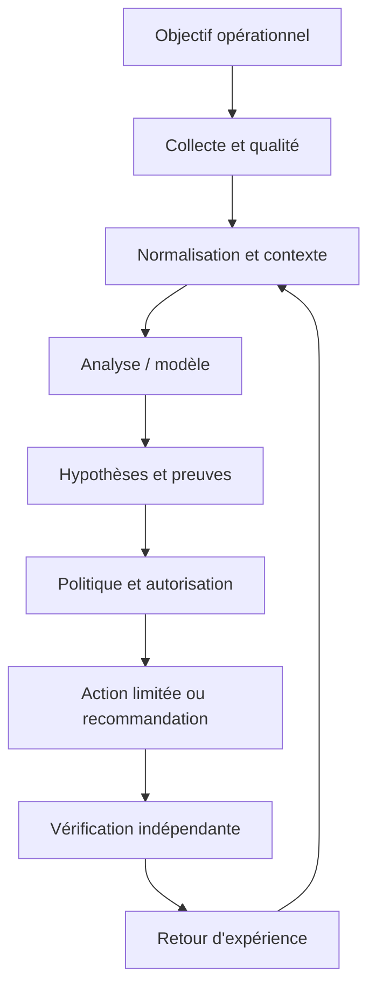

Le premier contrat concerne la donnée : source, horodatage, unité, cible, fraîcheur et état de qualité sont conservés. Le contrat du modèle ou de la règle précise la version, les entrées attendues, les métriques de validation et les limites. Le contrat de décision énumère les actions permises, les préconditions, les approbations, les quotas et les conditions d'arrêt. Le contrat de sortie indique enfin la preuve requise pour déclarer un rétablissement. Ces frontières permettent de tester chaque partie indépendamment, de corriger un composant sans dissimuler l'origine de l'erreur et d'auditer une action plusieurs semaines plus tard.

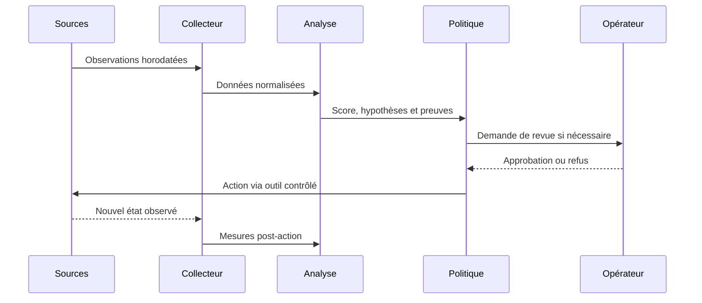

### Frontières de sécurité et mode dégradé

Le contrôle de sécurité lié à Séparation analyse/exécution doit être conçu dès le départ. Appliquer le moindre privilège, protéger les secrets, tracer les décisions et séparer analyse et exécution. Le piège à surveiller est : accepter un texte libre sans validation. Lorsque des données externes entrent dans le pipeline, elles ne doivent pas modifier les règles d'accès ni fournir des instructions privilégiées. Toute action à fort impact exige des préconditions compréhensibles, une approbation adaptée et une façon testée de revenir vers un état sûr.

Si Données manquantes produit un résultat incohérent, commencer par vérifier horloge, source, unité, cible, fraîcheur, version et erreur d'accès. Comparer une observation brute avec sa valeur transformée, puis rechercher les modifications récentes. Pour le scénario étudié, un contrôle utile consiste à tester une seule hypothèse à la fois et à conserver la preuve du résultat. Ne pas recopier de secrets dans le ticket. Une fois le défaut confirmé, ajouter un test de régression afin que la même anomalie ne revienne pas avec une mise à jour.

À l'échelle, Résilience du pipeline doit gérer des volumes, équipements et versions hétérogènes sans perdre de traçabilité. Borner la concurrence, isoler les erreurs par cible, limiter le buffering et mesurer les files protège le système aval. La reprise d'une panne peut elle-même provoquer une surcharge si toutes les cibles se reconnectent simultanément. Une architecture robuste sait réduire la fréquence ou revenir à une méthode plus simple, tout en signalant explicitement cette dégradation au lieu d'afficher une apparence de fonctionnement normal.

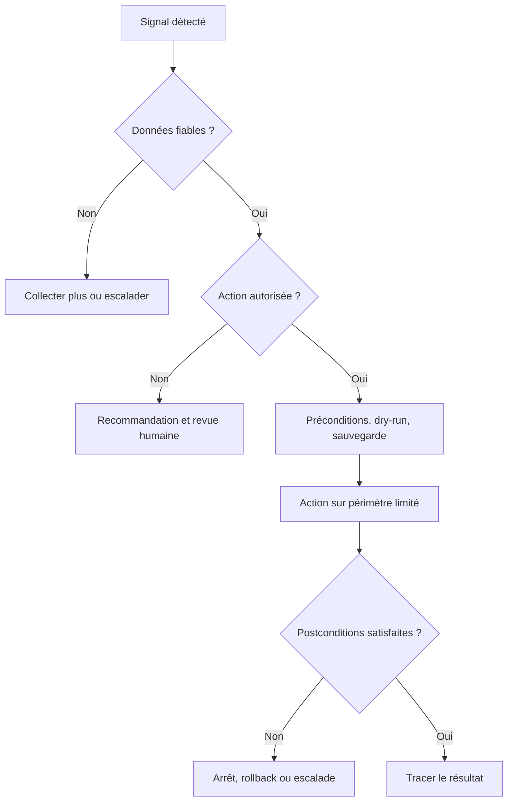

## 4. Pipeline et algorithmes

Le pipeline présenté ici est une chaîne de responsabilités, pas nécessairement un ensemble de microservices séparés. Une petite mise en œuvre peut héberger plusieurs étapes dans un seul processus, à condition de conserver des contrats clairs, des tests et des journaux. L'ordre importe : la qualité est vérifiée avant le calcul, le contexte avant l'interprétation et l'autorisation avant l'exécution. Cette discipline rend possible le fonctionnement en mode observation au départ puis, si les critères le justifient, une automatisation graduée.

### Étape 1 — Exprimer
Décrire zones, flux, disponibilité et contraintes métier.

La mise en œuvre de Exprimer gagne à être découpée en contrôles testables. Vérifier d'abord le format et la provenance des entrées, puis les hypothèses, les valeurs manquantes et les versions. L'outil YAML peut contribuer à cette étape, mais sa présence ne garantit pas la qualité. Les erreurs doivent rester explicites au lieu d'être converties silencieusement en valeurs par défaut. Une exécution fiable sait différencier une réussite, un échec, un résultat partiel et un état impossible à déterminer.

Si Exprimer produit un résultat incohérent, commencer par vérifier horloge, source, unité, cible, fraîcheur, version et erreur d'accès. Comparer une observation brute avec sa valeur transformée, puis rechercher les modifications récentes. Pour le scénario étudié, un contrôle utile consiste à tester une seule hypothèse à la fois et à conserver la preuve du résultat. Ne pas recopier de secrets dans le ticket. Une fois le défaut confirmé, ajouter un test de régression afin que la même anomalie ne revienne pas avec une mise à jour.

### Étape 2 — Valider
Détecter contradictions, champs absents et demandes impossibles.

La mise en œuvre de Valider gagne à être découpée en contrôles testables. Vérifier d'abord le format et la provenance des entrées, puis les hypothèses, les valeurs manquantes et les versions. L'outil contrôleurs peut contribuer à cette étape, mais sa présence ne garantit pas la qualité. Les erreurs doivent rester explicites au lieu d'être converties silencieusement en valeurs par défaut. Une exécution fiable sait différencier une réussite, un échec, un résultat partiel et un état impossible à déterminer.

Si Valider produit un résultat incohérent, commencer par vérifier horloge, source, unité, cible, fraîcheur, version et erreur d'accès. Comparer une observation brute avec sa valeur transformée, puis rechercher les modifications récentes. Pour le scénario étudié, un contrôle utile consiste à tester une seule hypothèse à la fois et à conserver la preuve du résultat. Ne pas recopier de secrets dans le ticket. Une fois le défaut confirmé, ajouter un test de régression afin que la même anomalie ne revienne pas avec une mise à jour.

### Étape 3 — Modéliser
Transformer le besoin en objets typés et invariants.

La mise en œuvre de Modéliser gagne à être découpée en contrôles testables. Vérifier d'abord le format et la provenance des entrées, puis les hypothèses, les valeurs manquantes et les versions. L'outil inventaire peut contribuer à cette étape, mais sa présence ne garantit pas la qualité. Les erreurs doivent rester explicites au lieu d'être converties silencieusement en valeurs par défaut. Une exécution fiable sait différencier une réussite, un échec, un résultat partiel et un état impossible à déterminer.

Si Modéliser produit un résultat incohérent, commencer par vérifier horloge, source, unité, cible, fraîcheur, version et erreur d'accès. Comparer une observation brute avec sa valeur transformée, puis rechercher les modifications récentes. Pour le scénario étudié, un contrôle utile consiste à tester une seule hypothèse à la fois et à conserver la preuve du résultat. Ne pas recopier de secrets dans le ticket. Une fois le défaut confirmé, ajouter un test de régression afin que la même anomalie ne revienne pas avec une mise à jour.

### Étape 4 — Compiler
Traduire le modèle selon les capacités de plateforme.

La mise en œuvre de Compiler gagne à être découpée en contrôles testables. Vérifier d'abord le format et la provenance des entrées, puis les hypothèses, les valeurs manquantes et les versions. L'outil modèles de données peut contribuer à cette étape, mais sa présence ne garantit pas la qualité. Les erreurs doivent rester explicites au lieu d'être converties silencieusement en valeurs par défaut. Une exécution fiable sait différencier une réussite, un échec, un résultat partiel et un état impossible à déterminer.

Si Compiler produit un résultat incohérent, commencer par vérifier horloge, source, unité, cible, fraîcheur, version et erreur d'accès. Comparer une observation brute avec sa valeur transformée, puis rechercher les modifications récentes. Pour le scénario étudié, un contrôle utile consiste à tester une seule hypothèse à la fois et à conserver la preuve du résultat. Ne pas recopier de secrets dans le ticket. Une fois le défaut confirmé, ajouter un test de régression afin que la même anomalie ne revienne pas avec une mise à jour.

### Étape 5 — Simuler
Calculer diff, impact et risques avant application.

La mise en œuvre de Simuler gagne à être découpée en contrôles testables. Vérifier d'abord le format et la provenance des entrées, puis les hypothèses, les valeurs manquantes et les versions. L'outil tests de conformité peut contribuer à cette étape, mais sa présence ne garantit pas la qualité. Les erreurs doivent rester explicites au lieu d'être converties silencieusement en valeurs par défaut. Une exécution fiable sait différencier une réussite, un échec, un résultat partiel et un état impossible à déterminer.

Si Simuler produit un résultat incohérent, commencer par vérifier horloge, source, unité, cible, fraîcheur, version et erreur d'accès. Comparer une observation brute avec sa valeur transformée, puis rechercher les modifications récentes. Pour le scénario étudié, un contrôle utile consiste à tester une seule hypothèse à la fois et à conserver la preuve du résultat. Ne pas recopier de secrets dans le ticket. Une fois le défaut confirmé, ajouter un test de régression afin que la même anomalie ne revienne pas avec une mise à jour.

### Étape 6 — Réconcilier
Déployer progressivement et vérifier l'état effectif.

La mise en œuvre de Réconcilier gagne à être découpée en contrôles testables. Vérifier d'abord le format et la provenance des entrées, puis les hypothèses, les valeurs manquantes et les versions. L'outil YAML peut contribuer à cette étape, mais sa présence ne garantit pas la qualité. Les erreurs doivent rester explicites au lieu d'être converties silencieusement en valeurs par défaut. Une exécution fiable sait différencier une réussite, un échec, un résultat partiel et un état impossible à déterminer.

Si Réconcilier produit un résultat incohérent, commencer par vérifier horloge, source, unité, cible, fraîcheur, version et erreur d'accès. Comparer une observation brute avec sa valeur transformée, puis rechercher les modifications récentes. Pour le scénario étudié, un contrôle utile consiste à tester une seule hypothèse à la fois et à conserver la preuve du résultat. Ne pas recopier de secrets dans le ticket. Une fois le défaut confirmé, ajouter un test de régression afin que la même anomalie ne revienne pas avec une mise à jour.

### Pseudocode de décision défensive
```text
observations = collecter()
si qualite(observations) insuffisante:
    journaliser("données insuffisantes")
    demander_verification_humaine()
sinon:
    contexte = enrichir(observations, inventaire, changements, dépendances)
    hypotheses = analyser(contexte)
    preuves = verifier_provenance(hypotheses)
    si preuves insuffisantes ou action hors politique:
        recommander_sans_executer()
    sinon:
        plan = preparer_diff_preconditions_et_rollback()
        si validation(plan) et approbations(plan):
            appliquer_sur_perimetre_limite(plan)
            resultat = mesurer_postconditions()
            si resultat non conforme: rollback_ou_escalade()
            tracer(version, preuves, action, resultat)
```

Ce pseudocode sert à expliquer le flux de décision ; il ne constitue pas une bibliothèque prête pour la production. Chaque fonction doit être implémentée, testée et protégée. Le comportement doit être prévisible lorsque les données manquent, qu'un service externe ne répond pas ou que le résultat demeure ambigu. Une bonne conception ne remplace pas l'incertitude par une valeur par défaut. Elle la rend visible, limite l'impact et garde une voie de reprise.

## 5. Étude de cas détaillée

### Situation et impact
une organisation veut segmenter les systèmes de paiement ; des équipements de marques différentes doivent appliquer une politique cohérente. L'équipe réunit responsable de service, ingénieur réseau, administrateur système et propriétaire de l'automatisation. Avant d'agir, elle définit l'impact observé, la fenêtre de temps, les actifs concernés et les services prioritaires. La première question n'est pas « quel modèle utiliser ? », mais « quelle décision doit être améliorée et quelle preuve montrera que le changement a servi son objectif ? ». Cette formulation fixe le périmètre et donne un critère d'arrêt si la solution n'apporte pas de valeur démontrable.

### Phase 1 — Établir les faits
Les observations doivent garder les heures originales et les identifiants de source. L'équipe vérifie la qualité de collecte, les changements récents, les dépendances et l'expérience utilisateur. Les valeurs manquantes sont identifiées explicitement plutôt que remplacées silencieusement par zéro. Les symptômes sont séparés des causes supposées, et les sources qui se contredisent sont enregistrées dans le dossier. La preuve de départ sert de référence pour vérifier si une intervention améliore réellement la situation et permet à un autre opérateur de reproduire l'analyse.

### Phase 2 — Poser plusieurs hypothèses
Quand plusieurs causes sont possibles, l'équipe note au minimum deux hypothèses, les observations qui les soutiennent, les éléments qui les contredisent et les tests qui peuvent les différencier. La priorité combine probabilité, impact et coût d'un test. Une hypothèse populaire n'est pas nécessairement correcte : un cas qui ressemble à un incident passé peut différer par la capacité, le routage, la version de logiciel ou la période de charge. Les hypothèses restent des hypothèses jusqu'à ce qu'une preuve suffisante permette de les confirmer.

### Phase 3 — Choisir une réponse proportionnée
Commencer par les vérifications non destructives : comparer l'état, consulter les changements, tester la connectivité ou inspecter une dépendance. Si une modification est nécessaire, définir précisément la cible, la commande ou le changement attendu, les préconditions, les critères d'arrêt et le rollback. Une revue indépendante s'impose lorsque le rayon d'impact est élevé. Le plan doit permettre à l'opérateur de comprendre pourquoi l'action est proposée et dans quelles circonstances il doit la refuser.

### Phase 4 — Vérifier les postconditions
La validation repose sur des mesures indépendantes du simple statut de commande : latence, erreurs, connectivité, état de configuration ou indicateur du service. La fenêtre d'observation doit éviter de confondre un échantillon favorable avec un rétablissement durable. Si les conditions ne sont pas satisfaites, appliquer la règle d'arrêt prévue et lancer un rollback ou une escalade. Le compte rendu distingue l'action exécutée, l'effet mesuré, les effets secondaires et les informations qui restent inconnues.

### Phase 5 — Capitaliser avec prudence
Le post-mortem compare les hypothèses initiales avec les preuves finales, relève les signaux manquants et ajoute des tests de régression. Une règle ou un modèle amélioré passe en revue et en essai contrôlé avant généralisation. Il faut éviter de réentraîner automatiquement sur des conclusions incertaines ou des tickets contenant uniquement des suppositions. Le retour d'expérience doit décrire les situations où la méthode a échoué autant que les cas où elle a réussi.

### Critères de clôture
La clôture exige une preuve de rétablissement, ou une déclaration explicite que le service reste dégradé. Le dossier réunit sources, versions, changement exact, approbation, résultats et suivi. La cause racine n'est marquée comme confirmée que si les observations la soutiennent suffisamment. En l'absence de preuve, une conclusion partielle est plus utile qu'un récit catégorique. La qualité se mesure au diagnostic reproductible, au risque contrôlé et à la possibilité d'améliorer le système à partir des erreurs observées.

## 6. Implémentation guidée et laboratoire

Le laboratoire doit être exécuté dans un environnement isolé ou sur des systèmes explicitement autorisés. Avant de commencer, noter les versions, dépendances, données d'entrée et condition de réussite. Ne pas copier les exemples sur un réseau de production sans adapter les identifiants, certificats, permissions et tests de restauration. Le livrable final doit être compréhensible par une autre personne, ré-exécutable et accompagné d'une liste claire de ses limites.

### TP 1 — Définir en YAML une intention de segmentation.
**Procédure.** Définir en YAML une intention de segmentation. Commencer par une cible de laboratoire minimale et capturer l'état de départ. Relier ce travail au concept « Intention » : Une intention exprime le résultat souhaité et des contraintes métier plutôt qu'une séquence propre à un fournisseur. Conserver la commande, les entrées, le résultat et la version des outils. Ne changer qu'une variable à la fois pour pouvoir attribuer un écart à sa cause.

**Critère de réussite.** Un autre opérateur doit pouvoir reproduire le résultat et identifier la preuve attendue. Tester aussi un échec contrôlé, une valeur manquante ou une dépendance indisponible. Si le résultat n'est pas déterminable, garder cet état explicite ; ne pas le convertir en succès. Vérifier les postconditions réelles, les effets secondaires et la procédure de reprise. Documenter ce qui a été démontré, ce qui reste une hypothèse et quelle amélioration serait nécessaire avant un usage à plus grande échelle.

### TP 2 — Énumérer flux autorisés et interdits par zone.
**Procédure.** Énumérer flux autorisés et interdits par zone. Commencer par une cible de laboratoire minimale et capturer l'état de départ. Relier ce travail au concept « État cible » : L'état cible décrit les propriétés attendues et des invariants testables, par exemple flux permis et interdits. Conserver la commande, les entrées, le résultat et la version des outils. Ne changer qu'une variable à la fois pour pouvoir attribuer un écart à sa cause.

**Critère de réussite.** Un autre opérateur doit pouvoir reproduire le résultat et identifier la preuve attendue. Tester aussi un échec contrôlé, une valeur manquante ou une dépendance indisponible. Si le résultat n'est pas déterminable, garder cet état explicite ; ne pas le convertir en succès. Vérifier les postconditions réelles, les effets secondaires et la procédure de reprise. Documenter ce qui a été démontré, ce qui reste une hypothèse et quelle amélioration serait nécessaire avant un usage à plus grande échelle.

### TP 3 — Valider le document par un schéma.
**Procédure.** Valider le document par un schéma. Commencer par une cible de laboratoire minimale et capturer l'état de départ. Relier ce travail au concept « Traduction » : La traduction relie le modèle commun aux capacités et ressources propres à chaque plateforme. Conserver la commande, les entrées, le résultat et la version des outils. Ne changer qu'une variable à la fois pour pouvoir attribuer un écart à sa cause.

**Critère de réussite.** Un autre opérateur doit pouvoir reproduire le résultat et identifier la preuve attendue. Tester aussi un échec contrôlé, une valeur manquante ou une dépendance indisponible. Si le résultat n'est pas déterminable, garder cet état explicite ; ne pas le convertir en succès. Vérifier les postconditions réelles, les effets secondaires et la procédure de reprise. Documenter ce qui a été démontré, ce qui reste une hypothèse et quelle amélioration serait nécessaire avant un usage à plus grande échelle.

### TP 4 — Construire une représentation neutre de l'état cible.
**Procédure.** Construire une représentation neutre de l'état cible. Commencer par une cible de laboratoire minimale et capturer l'état de départ. Relier ce travail au concept « Conformité » : Le contrôle compare état observé et invariants, en expliquant règles satisfaites, violées ou impossibles à vérifier. Conserver la commande, les entrées, le résultat et la version des outils. Ne changer qu'une variable à la fois pour pouvoir attribuer un écart à sa cause.

**Critère de réussite.** Un autre opérateur doit pouvoir reproduire le résultat et identifier la preuve attendue. Tester aussi un échec contrôlé, une valeur manquante ou une dépendance indisponible. Si le résultat n'est pas déterminable, garder cet état explicite ; ne pas le convertir en succès. Vérifier les postconditions réelles, les effets secondaires et la procédure de reprise. Documenter ce qui a été démontré, ce qui reste une hypothèse et quelle amélioration serait nécessaire avant un usage à plus grande échelle.

### TP 5 — Comparer un inventaire simulé et expliquer les écarts.
**Procédure.** Comparer un inventaire simulé et expliquer les écarts. Commencer par une cible de laboratoire minimale et capturer l'état de départ. Relier ce travail au concept « Boucle fermée » : La boucle observe, détecte l'écart, décide, applique sous politique puis vérifie le nouvel état. Conserver la commande, les entrées, le résultat et la version des outils. Ne changer qu'une variable à la fois pour pouvoir attribuer un écart à sa cause.

**Critère de réussite.** Un autre opérateur doit pouvoir reproduire le résultat et identifier la preuve attendue. Tester aussi un échec contrôlé, une valeur manquante ou une dépendance indisponible. Si le résultat n'est pas déterminable, garder cet état explicite ; ne pas le convertir en succès. Vérifier les postconditions réelles, les effets secondaires et la procédure de reprise. Documenter ce qui a été démontré, ce qui reste une hypothèse et quelle amélioration serait nécessaire avant un usage à plus grande échelle.

### TP 6 — Générer un plan sans le déployer.
**Procédure.** Générer un plan sans le déployer. Commencer par une cible de laboratoire minimale et capturer l'état de départ. Relier ce travail au concept « Dérive » : Une divergence peut résulter d'une intervention manuelle, d'un changement légitime ou d'une erreur ; elle ne doit pas être corrigée aveuglément. Conserver la commande, les entrées, le résultat et la version des outils. Ne changer qu'une variable à la fois pour pouvoir attribuer un écart à sa cause.

**Critère de réussite.** Un autre opérateur doit pouvoir reproduire le résultat et identifier la preuve attendue. Tester aussi un échec contrôlé, une valeur manquante ou une dépendance indisponible. Si le résultat n'est pas déterminable, garder cet état explicite ; ne pas le convertir en succès. Vérifier les postconditions réelles, les effets secondaires et la procédure de reprise. Documenter ce qui a été démontré, ce qui reste une hypothèse et quelle amélioration serait nécessaire avant un usage à plus grande échelle.

### TP 7 — Tester une dérive, puis écrire les contrôles de rollback.
**Procédure.** Tester une dérive, puis écrire les contrôles de rollback. Commencer par une cible de laboratoire minimale et capturer l'état de départ. Relier ce travail au concept « Politique et exception » : Les exceptions ont propriétaire, justification, périmètre et expiration pour éviter une dette de sécurité permanente. Conserver la commande, les entrées, le résultat et la version des outils. Ne changer qu'une variable à la fois pour pouvoir attribuer un écart à sa cause.

**Critère de réussite.** Un autre opérateur doit pouvoir reproduire le résultat et identifier la preuve attendue. Tester aussi un échec contrôlé, une valeur manquante ou une dépendance indisponible. Si le résultat n'est pas déterminable, garder cet état explicite ; ne pas le convertir en succès. Vérifier les postconditions réelles, les effets secondaires et la procédure de reprise. Documenter ce qui a été démontré, ce qui reste une hypothèse et quelle amélioration serait nécessaire avant un usage à plus grande échelle.

### Exemple de code ou de configuration

```yaml
intent:
  name: segmentation-paiement
  owner: equipe-reseau
  zones:
    - id: paiement
      allow: [core-banking, dns, ntp]
  invariants:
    - deny_cross_zone_by_default: true
    - require_change_approval: true
    - verify_after_apply: true
  exceptions:
    - id: maintenance
      expires_at: "2026-11-15T18:00:00Z"
      approved_by: responsable-securite

# Le document décrit l'intention ; un validateur doit vérifier schéma,
# cohérence, capacités et approbations avant de générer une configuration.
```

Ce fragment est un point de départ pédagogique. Les versions, options CLI, capacités matérielles et schémas changent ; vérifier la documentation liée et tester dans un laboratoire. Le fragment n'inclut pas toute la configuration nécessaire à un déploiement réel. Les secrets ne doivent pas être ajoutés au code, et les exemples qui peuvent modifier un système doivent recevoir approbations, limites de portée et vérification post-action. Un parseur qui accepte la syntaxe ne certifie ni la conformité ni la disponibilité.

### Livrables attendus
- Un fichier versionné qui décrit entrées, sorties et dépendances.
- Un journal lié à la cible et à la version, sans secret.
- Des tests positifs, négatifs et de panne de dépendance.
- Des critères d'arrêt et une procédure de reprise testée.
- Une note décrivant les résultats et les limites.

## 7. Sécurité et gouvernance

### 1. Qualité et provenance
Chaque observation garde source, heure, unité et état de fraîcheur. Pour le contexte étudié, ce principe doit être traduit en contrôle observable, propriétaire, fréquence de revue et preuve de passage. Une politique sans test dépend de la mémoire des personnes ; un test sans propriétaire cesse d'être maintenu lorsque l'équipe change. La revue doit donc être planifiée et relancée après un changement majeur de données, de matériel, de finalité ou de modèle.

La gouvernance de Qualité et provenance définit qui peut créer, modifier, approuver, consulter et retirer la logique associée. Le propriétaire doit connaître l'objectif, les limites, les dépendances, le budget d'erreur et les critères de suspension. Les décisions doivent être retraçables jusqu'aux données et versions utilisées. Une règle sans propriétaire finit par dépendre de la mémoire de l'équipe ; un propriétaire sans mesure ne peut pas démontrer qu'elle fonctionne. La revue doit être planifiée et relancée à chaque changement majeur de données, d'équipement ou de finalité.

### 2. Identités et permissions
Les comptes d'automatisation reçoivent uniquement les privilèges nécessaires. Pour le contexte étudié, ce principe doit être traduit en contrôle observable, propriétaire, fréquence de revue et preuve de passage. Une politique sans test dépend de la mémoire des personnes ; un test sans propriétaire cesse d'être maintenu lorsque l'équipe change. La revue doit donc être planifiée et relancée après un changement majeur de données, de matériel, de finalité ou de modèle.

La gouvernance de Identités et permissions définit qui peut créer, modifier, approuver, consulter et retirer la logique associée. Le propriétaire doit connaître l'objectif, les limites, les dépendances, le budget d'erreur et les critères de suspension. Les décisions doivent être retraçables jusqu'aux données et versions utilisées. Une règle sans propriétaire finit par dépendre de la mémoire de l'équipe ; un propriétaire sans mesure ne peut pas démontrer qu'elle fonctionne. La revue doit être planifiée et relancée à chaque changement majeur de données, d'équipement ou de finalité.

### 3. Traçabilité
La version, les preuves, la décision, l'approbateur et le résultat sont corrélés. Pour le contexte étudié, ce principe doit être traduit en contrôle observable, propriétaire, fréquence de revue et preuve de passage. Une politique sans test dépend de la mémoire des personnes ; un test sans propriétaire cesse d'être maintenu lorsque l'équipe change. La revue doit donc être planifiée et relancée après un changement majeur de données, de matériel, de finalité ou de modèle.

La gouvernance de Traçabilité définit qui peut créer, modifier, approuver, consulter et retirer la logique associée. Le propriétaire doit connaître l'objectif, les limites, les dépendances, le budget d'erreur et les critères de suspension. Les décisions doivent être retraçables jusqu'aux données et versions utilisées. Une règle sans propriétaire finit par dépendre de la mémoire de l'équipe ; un propriétaire sans mesure ne peut pas démontrer qu'elle fonctionne. La revue doit être planifiée et relancée à chaque changement majeur de données, d'équipement ou de finalité.

### 4. Revue humaine
Le réviseur doit posséder preuves, temps et autorité pour refuser. Pour le contexte étudié, ce principe doit être traduit en contrôle observable, propriétaire, fréquence de revue et preuve de passage. Une politique sans test dépend de la mémoire des personnes ; un test sans propriétaire cesse d'être maintenu lorsque l'équipe change. La revue doit donc être planifiée et relancée après un changement majeur de données, de matériel, de finalité ou de modèle.

La gouvernance de Revue humaine définit qui peut créer, modifier, approuver, consulter et retirer la logique associée. Le propriétaire doit connaître l'objectif, les limites, les dépendances, le budget d'erreur et les critères de suspension. Les décisions doivent être retraçables jusqu'aux données et versions utilisées. Une règle sans propriétaire finit par dépendre de la mémoire de l'équipe ; un propriétaire sans mesure ne peut pas démontrer qu'elle fonctionne. La revue doit être planifiée et relancée à chaque changement majeur de données, d'équipement ou de finalité.

### 5. Mesure du risque
Chaque mode d'échec doit avoir prévention, détection, réponse et responsable. Pour le contexte étudié, ce principe doit être traduit en contrôle observable, propriétaire, fréquence de revue et preuve de passage. Une politique sans test dépend de la mémoire des personnes ; un test sans propriétaire cesse d'être maintenu lorsque l'équipe change. La revue doit donc être planifiée et relancée après un changement majeur de données, de matériel, de finalité ou de modèle.

La gouvernance de Mesure du risque définit qui peut créer, modifier, approuver, consulter et retirer la logique associée. Le propriétaire doit connaître l'objectif, les limites, les dépendances, le budget d'erreur et les critères de suspension. Les décisions doivent être retraçables jusqu'aux données et versions utilisées. Une règle sans propriétaire finit par dépendre de la mémoire de l'équipe ; un propriétaire sans mesure ne peut pas démontrer qu'elle fonctionne. La revue doit être planifiée et relancée à chaque changement majeur de données, d'équipement ou de finalité.

### 6. Réversibilité
La suspension du modèle et le retour à une version saine sont testés. Pour le contexte étudié, ce principe doit être traduit en contrôle observable, propriétaire, fréquence de revue et preuve de passage. Une politique sans test dépend de la mémoire des personnes ; un test sans propriétaire cesse d'être maintenu lorsque l'équipe change. La revue doit donc être planifiée et relancée après un changement majeur de données, de matériel, de finalité ou de modèle.

La gouvernance de Réversibilité définit qui peut créer, modifier, approuver, consulter et retirer la logique associée. Le propriétaire doit connaître l'objectif, les limites, les dépendances, le budget d'erreur et les critères de suspension. Les décisions doivent être retraçables jusqu'aux données et versions utilisées. Une règle sans propriétaire finit par dépendre de la mémoire de l'équipe ; un propriétaire sans mesure ne peut pas démontrer qu'elle fonctionne. La revue doit être planifiée et relancée à chaque changement majeur de données, d'équipement ou de finalité.

## 8. Pièges à éviter

### Piège 1 — Accepter un texte libre sans validation

Ce piège peut produire un faux diagnostic, une action superflue ou une perte de confiance. Le signal précurseur est parfois subtil : incohérence entre sources, hausse d'erreurs, impossibilité d'expliquer la sortie ou comportement différent selon les sites. L'équipe doit rendre le signal mesurable, désigner qui réagit et préciser si l'action automatique se bloque ou si le traitement continue en mode dégradé.

La prévention doit être reliée à « Intention ». Une intention exprime le résultat souhaité et des contraintes métier plutôt qu'une séquence propre à un fournisseur. Définir un test négatif qui fait apparaître le défaut et vérifier que la réponse attendue réduit le risque. Un garde-fou ne doit pas être un simple avertissement que les opérateurs apprennent à ignorer. En revue, demander quelle preuve montre que le contrôle fonctionne, quelle défaillance il couvre et quelle autre défaillance demeure possible.

### Piège 2 — Ignorer les capacités propres aux plateformes

Ce piège peut produire un faux diagnostic, une action superflue ou une perte de confiance. Le signal précurseur est parfois subtil : incohérence entre sources, hausse d'erreurs, impossibilité d'expliquer la sortie ou comportement différent selon les sites. L'équipe doit rendre le signal mesurable, désigner qui réagit et préciser si l'action automatique se bloque ou si le traitement continue en mode dégradé.

La prévention doit être reliée à « État cible ». L'état cible décrit les propriétés attendues et des invariants testables, par exemple flux permis et interdits. Définir un test négatif qui fait apparaître le défaut et vérifier que la réponse attendue réduit le risque. Un garde-fou ne doit pas être un simple avertissement que les opérateurs apprennent à ignorer. En revue, demander quelle preuve montre que le contrôle fonctionne, quelle défaillance il couvre et quelle autre défaillance demeure possible.

### Piège 3 — Corriger une dérive qui était légitime

Ce piège peut produire un faux diagnostic, une action superflue ou une perte de confiance. Le signal précurseur est parfois subtil : incohérence entre sources, hausse d'erreurs, impossibilité d'expliquer la sortie ou comportement différent selon les sites. L'équipe doit rendre le signal mesurable, désigner qui réagit et préciser si l'action automatique se bloque ou si le traitement continue en mode dégradé.

La prévention doit être reliée à « Traduction ». La traduction relie le modèle commun aux capacités et ressources propres à chaque plateforme. Définir un test négatif qui fait apparaître le défaut et vérifier que la réponse attendue réduit le risque. Un garde-fou ne doit pas être un simple avertissement que les opérateurs apprennent à ignorer. En revue, demander quelle preuve montre que le contrôle fonctionne, quelle défaillance il couvre et quelle autre défaillance demeure possible.

### Piège 4 — Ne pas définir d'invariants vérifiables

Ce piège peut produire un faux diagnostic, une action superflue ou une perte de confiance. Le signal précurseur est parfois subtil : incohérence entre sources, hausse d'erreurs, impossibilité d'expliquer la sortie ou comportement différent selon les sites. L'équipe doit rendre le signal mesurable, désigner qui réagit et préciser si l'action automatique se bloque ou si le traitement continue en mode dégradé.

La prévention doit être reliée à « Conformité ». Le contrôle compare état observé et invariants, en expliquant règles satisfaites, violées ou impossibles à vérifier. Définir un test négatif qui fait apparaître le défaut et vérifier que la réponse attendue réduit le risque. Un garde-fou ne doit pas être un simple avertissement que les opérateurs apprennent à ignorer. En revue, demander quelle preuve montre que le contrôle fonctionne, quelle défaillance il couvre et quelle autre défaillance demeure possible.

### Piège 5 — Laisser une exception sans date de fin

Ce piège peut produire un faux diagnostic, une action superflue ou une perte de confiance. Le signal précurseur est parfois subtil : incohérence entre sources, hausse d'erreurs, impossibilité d'expliquer la sortie ou comportement différent selon les sites. L'équipe doit rendre le signal mesurable, désigner qui réagit et préciser si l'action automatique se bloque ou si le traitement continue en mode dégradé.

La prévention doit être reliée à « Boucle fermée ». La boucle observe, détecte l'écart, décide, applique sous politique puis vérifie le nouvel état. Définir un test négatif qui fait apparaître le défaut et vérifier que la réponse attendue réduit le risque. Un garde-fou ne doit pas être un simple avertissement que les opérateurs apprennent à ignorer. En revue, demander quelle preuve montre que le contrôle fonctionne, quelle défaillance il couvre et quelle autre défaillance demeure possible.

### Piège 6 — Générer sans simulation ni revue

Ce piège peut produire un faux diagnostic, une action superflue ou une perte de confiance. Le signal précurseur est parfois subtil : incohérence entre sources, hausse d'erreurs, impossibilité d'expliquer la sortie ou comportement différent selon les sites. L'équipe doit rendre le signal mesurable, désigner qui réagit et préciser si l'action automatique se bloque ou si le traitement continue en mode dégradé.

La prévention doit être reliée à « Dérive ». Une divergence peut résulter d'une intervention manuelle, d'un changement légitime ou d'une erreur ; elle ne doit pas être corrigée aveuglément. Définir un test négatif qui fait apparaître le défaut et vérifier que la réponse attendue réduit le risque. Un garde-fou ne doit pas être un simple avertissement que les opérateurs apprennent à ignorer. En revue, demander quelle preuve montre que le contrôle fonctionne, quelle défaillance il couvre et quelle autre défaillance demeure possible.

### Piège 7 — Déclarer conformité depuis le fichier prévu seulement

Ce piège peut produire un faux diagnostic, une action superflue ou une perte de confiance. Le signal précurseur est parfois subtil : incohérence entre sources, hausse d'erreurs, impossibilité d'expliquer la sortie ou comportement différent selon les sites. L'équipe doit rendre le signal mesurable, désigner qui réagit et préciser si l'action automatique se bloque ou si le traitement continue en mode dégradé.

La prévention doit être reliée à « Politique et exception ». Les exceptions ont propriétaire, justification, périmètre et expiration pour éviter une dette de sécurité permanente. Définir un test négatif qui fait apparaître le défaut et vérifier que la réponse attendue réduit le risque. Un garde-fou ne doit pas être un simple avertissement que les opérateurs apprennent à ignorer. En revue, demander quelle preuve montre que le contrôle fonctionne, quelle défaillance il couvre et quelle autre défaillance demeure possible.

## 9. Diagnostic et dépannage

### Aucun résultat n'est produit
Vérifier accès source, période de sélection, identité, filtres et version du schéma. Dans le cadre de Intent-Based Networking (IBN), vérifier en particulier ce risque : accepter un texte libre sans validation. Comparer les observations brutes à leur représentation transformée, retrouver la version du pipeline et noter si une modification récente correspond au début du problème. Formuler au moins deux explications alternatives et choisir un test à faible risque qui permet de les distinguer. Ne pas effectuer plusieurs changements simultanément, car cela rendrait l'analyse ambiguë. Si les preuves restent insuffisantes, rendre cette incertitude visible et utiliser le mode sûr.

### Les résultats varient
Comparer données, code, versions, transformations et paramètres sur un cas fixe. Dans le cadre de Intent-Based Networking (IBN), vérifier en particulier ce risque : ignorer les capacités propres aux plateformes. Comparer les observations brutes à leur représentation transformée, retrouver la version du pipeline et noter si une modification récente correspond au début du problème. Formuler au moins deux explications alternatives et choisir un test à faible risque qui permet de les distinguer. Ne pas effectuer plusieurs changements simultanément, car cela rendrait l'analyse ambiguë. Si les preuves restent insuffisantes, rendre cette incertitude visible et utiliser le mode sûr.

### Trop d'alertes
Inspecter doublons, saisonnalité, baseline, seuil et qualité du contexte avant de supprimer des alertes. Dans le cadre de Intent-Based Networking (IBN), vérifier en particulier ce risque : corriger une dérive qui était légitime. Comparer les observations brutes à leur représentation transformée, retrouver la version du pipeline et noter si une modification récente correspond au début du problème. Formuler au moins deux explications alternatives et choisir un test à faible risque qui permet de les distinguer. Ne pas effectuer plusieurs changements simultanément, car cela rendrait l'analyse ambiguë. Si les preuves restent insuffisantes, rendre cette incertitude visible et utiliser le mode sûr.

### Un incident passe inaperçu
Reconstituer les informations disponibles au moment de décider et rechercher un seuil trop permissif ou une source absente. Dans le cadre de Intent-Based Networking (IBN), vérifier en particulier ce risque : ne pas définir d'invariants vérifiables. Comparer les observations brutes à leur représentation transformée, retrouver la version du pipeline et noter si une modification récente correspond au début du problème. Formuler au moins deux explications alternatives et choisir un test à faible risque qui permet de les distinguer. Ne pas effectuer plusieurs changements simultanément, car cela rendrait l'analyse ambiguë. Si les preuves restent insuffisantes, rendre cette incertitude visible et utiliser le mode sûr.

### L'action n'améliore pas le service
Vérifier postconditions indépendantes et effets secondaires, puis appliquer arrêt ou rollback selon le plan. Dans le cadre de Intent-Based Networking (IBN), vérifier en particulier ce risque : laisser une exception sans date de fin. Comparer les observations brutes à leur représentation transformée, retrouver la version du pipeline et noter si une modification récente correspond au début du problème. Formuler au moins deux explications alternatives et choisir un test à faible risque qui permet de les distinguer. Ne pas effectuer plusieurs changements simultanément, car cela rendrait l'analyse ambiguë. Si les preuves restent insuffisantes, rendre cette incertitude visible et utiliser le mode sûr.

### La qualité diminue avec le temps
Rechercher dérive, changement de capacité, topologie, population ou version et réévaluer. Dans le cadre de Intent-Based Networking (IBN), vérifier en particulier ce risque : générer sans simulation ni revue. Comparer les observations brutes à leur représentation transformée, retrouver la version du pipeline et noter si une modification récente correspond au début du problème. Formuler au moins deux explications alternatives et choisir un test à faible risque qui permet de les distinguer. Ne pas effectuer plusieurs changements simultanément, car cela rendrait l'analyse ambiguë. Si les preuves restent insuffisantes, rendre cette incertitude visible et utiliser le mode sûr.

## 10. Exercices corrigés

### Exercice 1 — Intention
**Énoncé.** Dans un environnement inspiré du scénario « une organisation veut segmenter les systèmes de paiement ; des équipements de marques différentes doivent appliquer une politique cohérente », l'équipe veut généraliser une approche qui utilise « Intention ». Quelle preuve recueillir avant l'étape « Exprimer », et comment réduire le risque suivant : accepter un texte libre sans validation ?

**Correction détaillée.** Définir d'abord le résultat attendu et le coût d'une erreur. Vérifier que les entrées proviennent d'une source autorisée et qu'elles sont fraîches, cohérentes et disponibles au moment de la décision. Construire un essai reproductible, comparer à une baseline et analyser les erreurs par classe d'actif ou criticité. Décrire zones, flux, disponibilité et contraintes métier. L'extension du périmètre exige des seuils écrits, une revue adaptée au risque, un déploiement progressif et un retour arrière. Si la preuve ne permet pas de trancher, demander une vérification complémentaire ou garder la solution en observation plutôt que d'inventer une certitude.

**Pourquoi les raccourcis échouent.** Un résultat favorable sur un exemple ne démontre pas une performance durable. Un score moyen peut masquer les catégories vulnérables ; une absence d'erreur visible peut provenir d'une télémétrie incomplète. Conserver les cas difficiles, les conditions de test et les versions utilisées rend possible une revue indépendante. L'exercice est réussi lorsque le choix, ses limites et le mécanisme de retrait sont compris par une autre personne.

### Exercice 2 — État cible
**Énoncé.** Dans un environnement inspiré du scénario « une organisation veut segmenter les systèmes de paiement ; des équipements de marques différentes doivent appliquer une politique cohérente », l'équipe veut généraliser une approche qui utilise « État cible ». Quelle preuve recueillir avant l'étape « Valider », et comment réduire le risque suivant : ignorer les capacités propres aux plateformes ?

**Correction détaillée.** Définir d'abord le résultat attendu et le coût d'une erreur. Vérifier que les entrées proviennent d'une source autorisée et qu'elles sont fraîches, cohérentes et disponibles au moment de la décision. Construire un essai reproductible, comparer à une baseline et analyser les erreurs par classe d'actif ou criticité. Détecter contradictions, champs absents et demandes impossibles. L'extension du périmètre exige des seuils écrits, une revue adaptée au risque, un déploiement progressif et un retour arrière. Si la preuve ne permet pas de trancher, demander une vérification complémentaire ou garder la solution en observation plutôt que d'inventer une certitude.

**Pourquoi les raccourcis échouent.** Un résultat favorable sur un exemple ne démontre pas une performance durable. Un score moyen peut masquer les catégories vulnérables ; une absence d'erreur visible peut provenir d'une télémétrie incomplète. Conserver les cas difficiles, les conditions de test et les versions utilisées rend possible une revue indépendante. L'exercice est réussi lorsque le choix, ses limites et le mécanisme de retrait sont compris par une autre personne.

### Exercice 3 — Traduction
**Énoncé.** Dans un environnement inspiré du scénario « une organisation veut segmenter les systèmes de paiement ; des équipements de marques différentes doivent appliquer une politique cohérente », l'équipe veut généraliser une approche qui utilise « Traduction ». Quelle preuve recueillir avant l'étape « Modéliser », et comment réduire le risque suivant : corriger une dérive qui était légitime ?

**Correction détaillée.** Définir d'abord le résultat attendu et le coût d'une erreur. Vérifier que les entrées proviennent d'une source autorisée et qu'elles sont fraîches, cohérentes et disponibles au moment de la décision. Construire un essai reproductible, comparer à une baseline et analyser les erreurs par classe d'actif ou criticité. Transformer le besoin en objets typés et invariants. L'extension du périmètre exige des seuils écrits, une revue adaptée au risque, un déploiement progressif et un retour arrière. Si la preuve ne permet pas de trancher, demander une vérification complémentaire ou garder la solution en observation plutôt que d'inventer une certitude.

**Pourquoi les raccourcis échouent.** Un résultat favorable sur un exemple ne démontre pas une performance durable. Un score moyen peut masquer les catégories vulnérables ; une absence d'erreur visible peut provenir d'une télémétrie incomplète. Conserver les cas difficiles, les conditions de test et les versions utilisées rend possible une revue indépendante. L'exercice est réussi lorsque le choix, ses limites et le mécanisme de retrait sont compris par une autre personne.

### Exercice 4 — Conformité
**Énoncé.** Dans un environnement inspiré du scénario « une organisation veut segmenter les systèmes de paiement ; des équipements de marques différentes doivent appliquer une politique cohérente », l'équipe veut généraliser une approche qui utilise « Conformité ». Quelle preuve recueillir avant l'étape « Compiler », et comment réduire le risque suivant : ne pas définir d'invariants vérifiables ?

**Correction détaillée.** Définir d'abord le résultat attendu et le coût d'une erreur. Vérifier que les entrées proviennent d'une source autorisée et qu'elles sont fraîches, cohérentes et disponibles au moment de la décision. Construire un essai reproductible, comparer à une baseline et analyser les erreurs par classe d'actif ou criticité. Traduire le modèle selon les capacités de plateforme. L'extension du périmètre exige des seuils écrits, une revue adaptée au risque, un déploiement progressif et un retour arrière. Si la preuve ne permet pas de trancher, demander une vérification complémentaire ou garder la solution en observation plutôt que d'inventer une certitude.

**Pourquoi les raccourcis échouent.** Un résultat favorable sur un exemple ne démontre pas une performance durable. Un score moyen peut masquer les catégories vulnérables ; une absence d'erreur visible peut provenir d'une télémétrie incomplète. Conserver les cas difficiles, les conditions de test et les versions utilisées rend possible une revue indépendante. L'exercice est réussi lorsque le choix, ses limites et le mécanisme de retrait sont compris par une autre personne.

### Exercice 5 — Boucle fermée
**Énoncé.** Dans un environnement inspiré du scénario « une organisation veut segmenter les systèmes de paiement ; des équipements de marques différentes doivent appliquer une politique cohérente », l'équipe veut généraliser une approche qui utilise « Boucle fermée ». Quelle preuve recueillir avant l'étape « Simuler », et comment réduire le risque suivant : laisser une exception sans date de fin ?

**Correction détaillée.** Définir d'abord le résultat attendu et le coût d'une erreur. Vérifier que les entrées proviennent d'une source autorisée et qu'elles sont fraîches, cohérentes et disponibles au moment de la décision. Construire un essai reproductible, comparer à une baseline et analyser les erreurs par classe d'actif ou criticité. Calculer diff, impact et risques avant application. L'extension du périmètre exige des seuils écrits, une revue adaptée au risque, un déploiement progressif et un retour arrière. Si la preuve ne permet pas de trancher, demander une vérification complémentaire ou garder la solution en observation plutôt que d'inventer une certitude.

**Pourquoi les raccourcis échouent.** Un résultat favorable sur un exemple ne démontre pas une performance durable. Un score moyen peut masquer les catégories vulnérables ; une absence d'erreur visible peut provenir d'une télémétrie incomplète. Conserver les cas difficiles, les conditions de test et les versions utilisées rend possible une revue indépendante. L'exercice est réussi lorsque le choix, ses limites et le mécanisme de retrait sont compris par une autre personne.


## Atelier approfondi — concevoir et vérifier une intention réseau de bout en bout

Cet atelier développe une méthode pour transformer une demande métier en politique réseau mesurable, l'appliquer dans un périmètre contrôlé, puis prouver que l'état réel respecte toujours l'objectif. L'IBN n'est pas une phrase en langage naturel qui change directement un équipement. C'est une chaîne gouvernée : une intention est formalisée, les règles sont analysées, les capacités sont vérifiées, une configuration candidate est produite, les changements sont approuvés, puis le résultat est mesuré et comparé à l'état attendu.

Les exemples sont pédagogiques et utilisent des identifiants de laboratoire. Les réseaux, adresses et politiques doivent être adaptés à une maquette autorisée. La partie application décrit les contrôles nécessaires ; elle ne doit pas servir à pousser une configuration en production sans validation, fenêtre de changement et procédure de retour arrière.

### A. Distinguer objectif métier, intention, politique et configuration

Ces quatre niveaux sont liés, mais ils ne sont pas interchangeables. Un objectif métier explique pourquoi une propriété est nécessaire, par exemple protéger les transactions de paiement. Une intention réseau décrit le comportement attendu, comme « les postes invités ne peuvent pas initier de connexion vers le réseau de paiement ». La politique traduit cette intention en règles de communication testables. La configuration est l'expression technique propre à un équipement ou à une plateforme. Enfin, la conformité compare l'état effectivement observé à l'état déclaré.

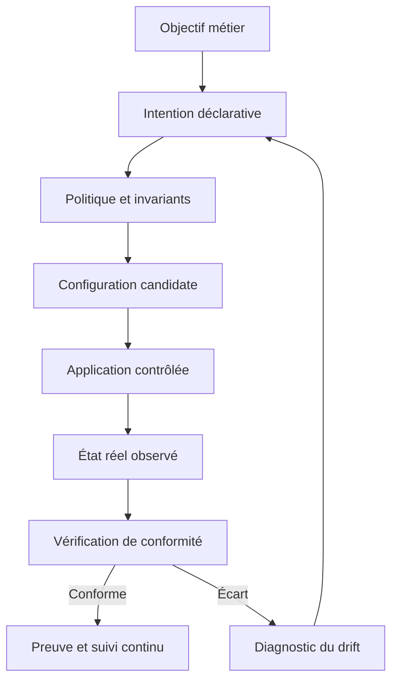

Un objectif trop vague ne peut pas être vérifié. « Le réseau doit être sécurisé » ne dit pas quels flux sont autorisés, quelles ressources sont protégées, ni comment tester la politique. Une meilleure formulation serait : « Les postes du segment invité ne peuvent initier de connexion vers les serveurs de paiement ; les contrôles DNS, DHCP et HTTPS nécessaires à leur usage sont explicitement autorisés ; toute exception est limitée dans le temps et attribuée à un propriétaire. » La seconde formulation contient des comportements à tester.

L'intention doit aussi décrire ce qui n'est pas autorisé. Dans la sécurité réseau, une liste d'autorisations ne doit pas laisser entendre que tout ce qui n'est pas cité doit être permis. Il est nécessaire de définir le comportement par défaut, les flux indispensables, les exceptions et la priorité en cas de règles contradictoires. Le modèle de refus par défaut est courant dans les contextes sensibles, mais son application doit tenir compte des besoins opérationnels et des dépendances nécessaires au service.

La configuration ne doit pas devenir la source de vérité métier. Il peut exister plusieurs manières techniques de réaliser la même intention, en fonction de l'équipement, de la version logicielle ou des capacités offertes. C'est précisément l'un des intérêts de l'approche déclarative : séparer le résultat voulu de la manière spécifique de l'obtenir. Cette séparation n'est valable que si la plateforme vérifie réellement que chaque équipement peut satisfaire le contrat.

### B. Rédiger une intention non ambiguë

Une intention utile décrit un sujet, une ressource, un comportement, une portée, des exceptions et des critères de validation. Elle indique également les hypothèses qui restent à confirmer. Si les groupes d'équipements, les plages d'adresses ou les identités ne sont pas connus, le compilateur ne doit pas inventer ces valeurs.

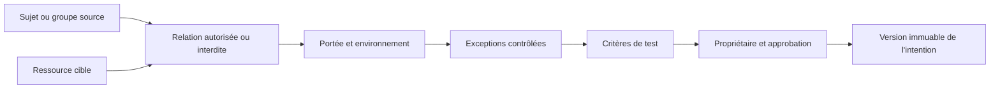

Pour commencer, formule les intentions sous forme de règles explicites. Par exemple :

- Les postes invités peuvent accéder à la passerelle de leur segment et aux résolveurs DNS approuvés.
- Les postes invités ne peuvent pas initier de connexion vers les serveurs de paiement.
- Les systèmes d'administration ne sont accessibles que depuis le segment d'administration et par les identités autorisées.
- Les exceptions sont accompagnées d'un ticket, d'un responsable et d'une date d'expiration.
- Un équipement qui ne prend pas en charge le contrôle nécessaire ne reçoit pas une mention « conforme » par défaut.

Chaque intention doit recevoir un identifiant stable, un propriétaire, une date de création, une version et un état de cycle de vie. Une modification d'intention doit produire un diff lisible, car une demande apparemment mineure peut autoriser un flux auparavant interdit. Les intentions obsolètes ne devraient pas être supprimées sans historique : une trace de leur retrait aide à reconstruire les décisions et à auditer les changements.

Un bon exercice consiste à demander à deux personnes de traduire indépendamment une exigence métier en tests. Si elles construisent des tests substantiellement différents, l'intention est probablement ambiguë. Clarifie alors les définitions : « administration », « invité », « serveur de paiement », « connexion initiée », « accès web » et « exception temporaire » doivent correspondre à des identités ou à des ressources établies, pas à des impressions.

### C. Formaliser l'intention dans un schéma déclaratif

Une déclaration structurée permet de vérifier les types et les champs attendus avant d'interpréter l'intention. YAML est lisible à la main, mais le choix du format est secondaire : l'essentiel est le contrat du schéma, ses versions, ses validations et son évolution. Les paramètres ne doivent pas être injectés directement dans des commandes ou des modèles de configuration.

```yaml
apiVersion: network-intent.skilltree/v1
kind: SegmentationPolicy
metadata:
  id: payment-zone-isolation
  owner: network-security
  version: 1
  environment: lab
intent:
  source_group: guest-endpoints
  destination_group: payment-servers
  action: deny
  direction: initiate
  default_policy: deny_unlisted
exceptions: []
verification:
  positive_tests:
    - guest_to_dns_approved
    - guest_to_gateway
  negative_tests:
    - guest_to_payment_tcp
    - guest_to_admin_plane
change_control:
  requires_review: true
  requires_simulation: true
  approval_group: network-change-reviewers
  rollback_required: true
```

Le contenu est un exemple de déclaration, pas un format standard compris automatiquement par tous les contrôleurs. Dans une implementation réelle, le schéma doit déclarer les propriétés autorisées, les types, les valeurs permises et les contraintes. Une propriété inconnue ne devrait pas être ignorée silencieusement : elle peut être une faute de frappe ou une tentative de contourner une règle.

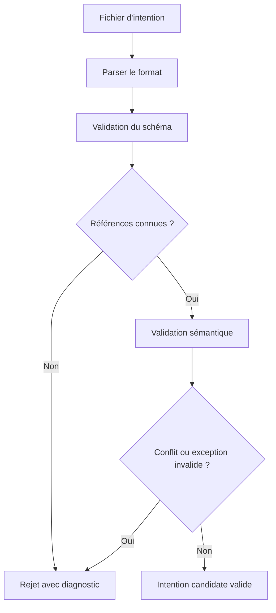

La validation syntaxique répond à « le fichier peut-il être lu ? ». La validation du schéma répond à « les champs et les types sont-ils corrects ? ». La validation sémantique répond à « les groupes existent-ils, les références sont-elles compatibles et la demande est-elle cohérente ? ». Ces trois étapes sont différentes. Un fichier YAML valide peut toujours décrire une politique dangereuse ou impossible à appliquer.

La validation sémantique doit notamment vérifier que les groupes de sources et de destinations existent, que les exceptions sont bien délimitées, que les protocoles et ports appartiennent à la liste autorisée, que les critères de conformité sont définis et que les identités ou sous-réseaux ne se chevauchent pas de manière inattendue. Dans un environnement critique, une intention dont l'interprétation reste incertaine doit être rejetée ou soumise à une clarification explicite.

### D. Construire un modèle de groupes et de dépendances

Une politique réseau dépend d'une représentation fiable des ressources. Le groupe « serveurs de paiement » ne devrait pas être une chaîne libre saisie dans un formulaire. Il doit correspondre à un groupe géré, avec des membres connus, une provenance et une fraîcheur. Les relations entre les applications et les composants réseau permettent aussi d'identifier les dépendances à préserver.

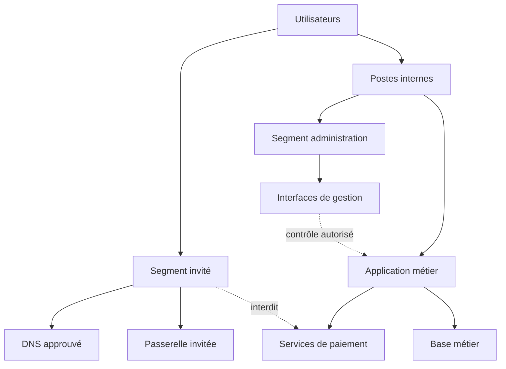

Un graphe de dépendances aide à distinguer les flux nécessaires des flux simplement observés. Il ne faut pas automatiquement autoriser toutes les connexions historiques : un système compromis ou mal configuré peut avoir établi des communications non souhaitées. La découverte contribue à formuler les questions, mais le propriétaire du service doit confirmer les dépendances nécessaires.

Chaque source d'inventaire doit être assortie d'une date de mise à jour et d'un état de qualité. Si un équipement vient d'être déplacé vers un nouveau groupe, le contrôleur doit savoir si le changement est approuvé et si les données sont suffisamment récentes. Une décision basée sur un inventaire périmé peut appliquer une politique à une mauvaise cible ou omettre un nouveau composant.

Les groupes dynamiques demandent des précautions supplémentaires. Si une règle s'applique à « tous les systèmes portant l'étiquette production », il faut définir qui peut modifier cette étiquette et comment le changement est audité. Une altération de la classification peut modifier le périmètre de nombreuses règles sans changement apparent de la politique. Le système doit donc traiter les données d'appartenance comme des éléments sensibles du contrôle d'accès, avec des tests et une traçabilité appropriés.

### E. Vérifier les capacités de chaque plateforme

Un objectif logique n'est pas forcément réalisable de façon identique sur toutes les plateformes. Certaines technologies prennent en charge des groupes dynamiques, d'autres seulement des listes statiques ; certaines permettent une politique avec état, d'autres ont des contraintes de règle ou de capacité ; certaines offrent un mécanisme de confirmation ou de rollback, d'autres exigent une procédure externe. Le contrôleur doit connaître ces limites avant de produire une configuration.

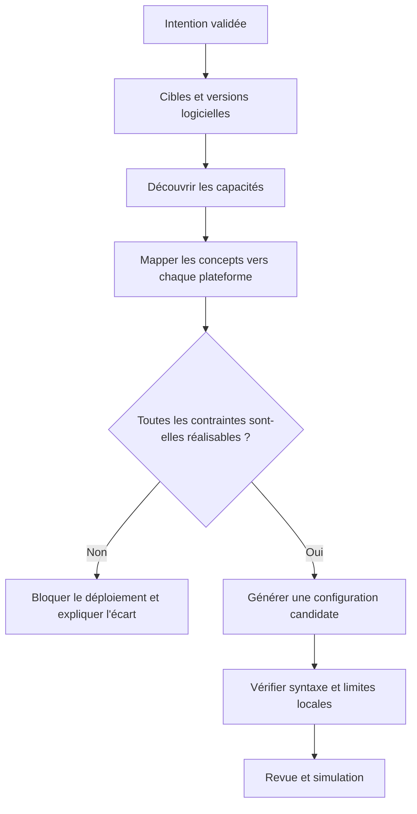

Une capacité ne devrait pas être considérée comme disponible simplement parce qu'un modèle de configuration contient un champ portant un nom similaire. Le contrôleur doit confirmer la prise en charge par la version exacte de la plateforme, les limites de taille et les contraintes de la topologie. Le résultat de cette vérification est une donnée de planification, avec sa source et la date de découverte.

Il faut distinguer trois états : une propriété prise en charge, une propriété non prise en charge et une propriété dont le support n'est pas connu. L'inconnu ne doit pas être converti en réussite. Pour une contrainte importante de sécurité, l'absence de mécanisme de contrôle devrait empêcher le déploiement ou imposer une exception formellement approuvée. Une solution partielle peut être proposée, mais son niveau de garantie doit être décrit sans ambiguïté.

Le plan peut aussi décrire les équivalences entre plateformes, mais ces équivalences doivent être testées. Une règle qui autorise un protocole sur un constructeur peut être traduite différemment sur un autre en raison des différences de sémantique ou d'ordre de traitement. Les tests doivent vérifier le comportement effectif, pas seulement que les commandes générées paraissent valides.

### F. Compiler une intention sans confondre génération et preuve

Le compilateur transforme une déclaration validée en une configuration candidate pour la plateforme cible. Il doit produire un plan lisible, un diff et des preuves sur la correspondance entre intention et règles générées. Il ne doit pas appliquer immédiatement la configuration parce que la génération s'est terminée sans erreur.

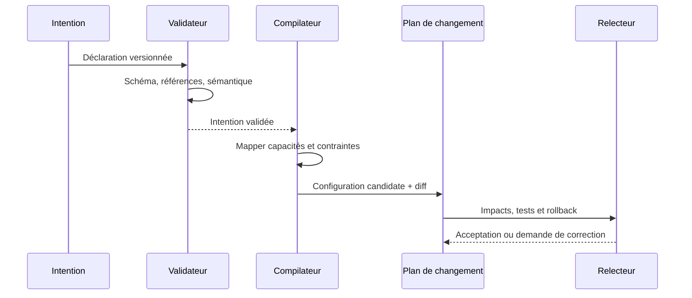

Le diff doit exprimer ce qui sera ajouté, modifié et supprimé. Les suppressions méritent une attention particulière car elles peuvent interrompre un service ou retirer une protection. L'opérateur doit savoir quel groupe de ressources est concerné, pourquoi le changement est nécessaire, quelles intentions seront affectées et quels tests attestent le résultat attendu.

Le compilateur peut utiliser des modèles versionnés, des bibliothèques de configuration ou des API officielles. Les chaînes issues de l'intention doivent être validées et échappées selon le format cible ; il ne faut pas concaténer une valeur arbitraire dans une commande de gestion. La génération doit être reproductible : avec la même version d'intention, le même inventaire, la même version de compilateur et les mêmes capacités, un résultat équivalent devrait être obtenu.

Pour démontrer la reproductibilité, conserve les versions des entrées et du compilateur, les paramètres non secrets, l'empreinte du plan et les résultats de validation. Si le résultat change, le système doit permettre d'identifier si cela vient d'une modification de l'intention, de l'inventaire, des capacités découvertes ou du logiciel de compilation.

### G. Tester les invariants et les flux permis/interdits

Un invariant est une propriété qui doit rester vraie malgré les changements de configuration. Les tests doivent vérifier au moins les comportements positifs et négatifs. Un test positif vérifie qu'un flux nécessaire fonctionne. Un test négatif vérifie qu'un flux interdit ne fonctionne pas. Une politique de segmentation n'est pas validée parce qu'un seul test réussi confirme l'accès légitime.

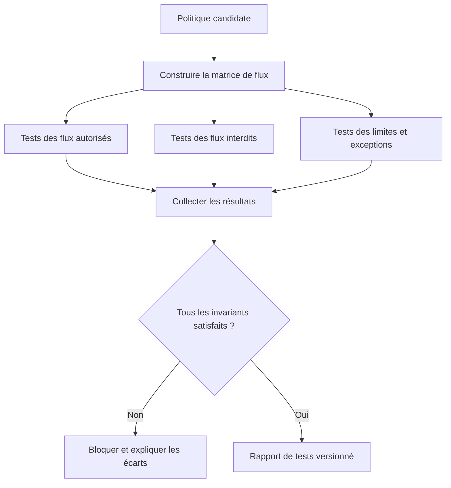

La matrice de tests doit préciser source, destination, protocole, port, direction, résultat attendu et justification. Il faut également tester les comportements implicites : accès d'administration, flux de retour, DNS et DHCP, gestion des erreurs, chemins alternatifs et communications entre zones. La liste dépend de la topologie et doit être validée par les responsables métier et sécurité.

| Source | Destination | Flux testé | Résultat attendu | Justification |
|---|---|---|---|---|
| Segment invité | DNS approuvé | Requête DNS autorisée | Autorisé | Résolution nécessaire |
| Segment invité | Passerelle du segment | Services requis | Autorisé selon politique | Accès réseau local |
| Segment invité | Serveur de paiement | Connexion initiée | Bloqué | Isolation de sécurité |
| Segment invité | Interface de gestion | Accès d'administration | Bloqué | Protection du plan de gestion |
| Segment interne | Application métier | HTTPS autorisé | Autorisé selon besoin | Parcours métier |
| Poste non géré | Segment administration | Accès de gestion | Bloqué | Limitation de privilège |

Le tableau est un exemple de laboratoire et ne suffit pas à décrire tous les flux d'une organisation. Il faut ajouter les dépendances réellement nécessaires, les ports précis, les directions et les modes de contrôle. Les résultats doivent inclure la méthode de test, l'horodatage et la preuve de la requête. Un simple statut « test réussi » sans contexte n'est pas suffisant pour l'audit.

Un test doit être répétable. Conserve les identifiants des tests et les résultats observés pour comparer avant et après le déploiement. Si le trafic n'a pas pu être généré, le résultat doit être « non testé », pas « autorisé » ni « conforme ». Une absence de preuve n'est pas une preuve de conformité.

### H. Simuler, planifier et approuver le changement

La simulation, ou mode dry-run, devrait montrer les changements proposés sans les appliquer. Elle permet de tester la génération, comparer le plan à l'état actuel et détecter des impacts inattendus. Une simulation réussie ne garantit pas que les équipements accepteront la configuration réelle ni que le comportement réseau sera correct, mais elle élimine certaines erreurs avant la modification.

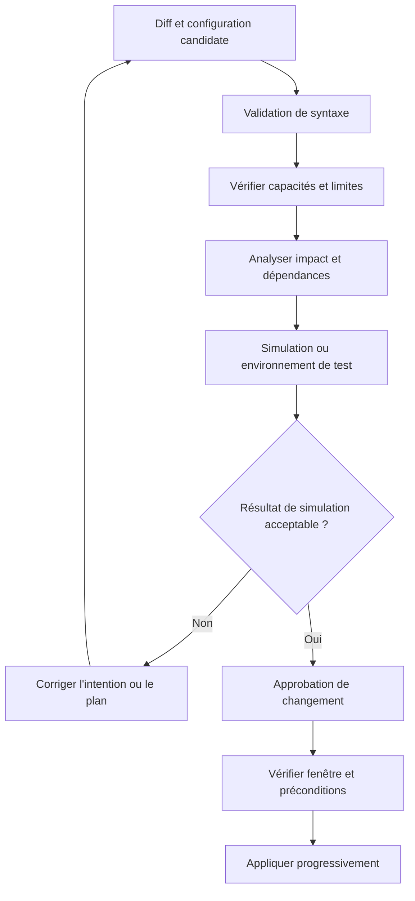

La demande de changement doit identifier le service, les équipements concernés, la version de l'intention, le diff, les tests, le risque, la fenêtre d'application, le responsable, l'observabilité attendue et le plan de restauration. L'approbation doit être associée à ce contenu précis. Si le plan est modifié après validation, il faut recommencer les étapes concernées.

La simulation devrait également mettre en évidence les ressources qui risquent d'être déconnectées, les règles qui disparaissent, la taille de la table de règles et les incompatibilités entre équipements. Les outils disponibles diffèrent, mais la méthode reste la même : expliciter les hypothèses, analyser les effets connus, et ne pas présenter les zones inconnues comme validées.

Pour un débutant, le bon déroulement est : d'abord réaliser les tests hors ligne, ensuite appliquer sur un environnement de laboratoire, enfin organiser une revue avant tout contexte réel. L'approbation formelle ne remplace pas les tests techniques ; elle atteste qu'une personne autorisée accepte le risque et le périmètre du changement.

### I. Déployer progressivement et préserver la possibilité de revenir en arrière

Les changements réseau peuvent couper l'accès au plan de gestion ou isoler un composant critique. Appliquer une politique sur tous les équipements en une seule fois augmente l'ampleur d'une erreur. Une stratégie progressive commence par un périmètre restreint, observe le résultat, puis poursuit seulement si les critères définis sont satisfaits.

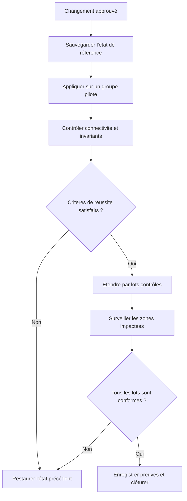

Le rollback doit être défini avant le changement et testé dans un environnement adapté. Il peut consister à restaurer une configuration versionnée, à réappliquer un état déclaré antérieur ou à utiliser un mécanisme natif de confirmation et d'annulation si la plateforme le propose. Le plan doit préciser comment récupérer l'accès si la modification coupe le canal de gestion.

La restauration doit être conditionnelle et vérifiée. Rejouer aveuglément une ancienne configuration peut écraser un changement légitime intervenu entre-temps. L'outil doit comparer l'état actuel, l'état désiré et l'état antérieur, puis demander une décision si le contexte a changé. Il faut conserver les versions et les empreintes qui permettent de savoir quelle configuration est restaurée.

Les critères de réussite peuvent combiner : équipements joignables, état de configuration attendu, tests de flux positifs réussis, tests de flux négatifs bloqués, absence de nouvelles alertes critiques et parcours applicatif sain. Les critères sont propres au changement. Si un indicateur attendu n'est pas mesurable, il doit être identifié avant la fenêtre de maintenance.

### J. Détecter et diagnostiquer la dérive de configuration

La dérive, ou drift, apparaît lorsque l'état réel ne correspond plus à l'état déclaré. Elle peut provenir d'une modification manuelle, d'une erreur d'automatisation, d'un changement de capacité, d'une mise à jour logicielle ou d'une évolution non reportée dans l'intention. Toute dérive n'est pas nécessairement malveillante, mais elle doit être expliquée et traitée selon son importance.

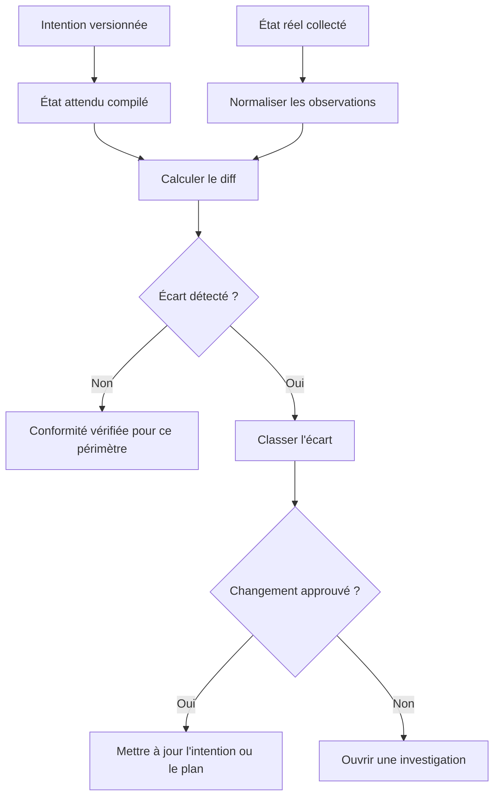

Pour être exploitable, le résultat de conformité doit indiquer l'intention et la version comparées, l'heure de collecte, la méthode, les équipements observés, la couverture et les champs qui diffèrent. Un statut global « non conforme » sans détail n'aide pas l'opérateur à comprendre si une règle a disparu, si une cible n'a pas répondu ou si une information est simplement inconnue.

Trois états sont utiles : conforme, non conforme et non vérifiable. « Conforme » suppose que les éléments requis ont été observés et vérifiés. « Non conforme » indique une différence démontrée. « Non vérifiable » indique que les preuves sont insuffisantes, que la collecte a échoué ou que la capacité de contrôle manque. Ces états ne doivent pas être fusionnés. En particulier, un équipement inaccessible ne doit jamais être marqué conforme par défaut.

Les écarts doivent être classés par risque. Une ouverture inattendue vers une zone sensible peut exiger une investigation urgente. Une différence de description ou un paramètre sans effet immédiat peut suivre un traitement standard. La classification doit être associée à des règles explicites, à un propriétaire et à une escalade lorsque la preuve ou le contexte n'est pas suffisant.

### K. Gérer les exceptions sans perdre le contrôle

Les environnements réels contiennent des exceptions : une maintenance temporaire, une dépendance historique, un équipement qui ne prend pas encore en charge une fonction ou un flux justifié par un besoin. Une exception ne doit pas devenir un contournement permanent. Elle doit être documentée, limitée à la ressource nécessaire, attribuée à un propriétaire et assortie d'une échéance ou d'une condition de retrait.

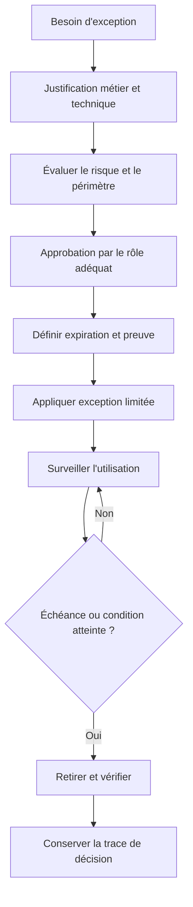

Le système doit vérifier les exceptions à chaque cycle de conformité. Une exception expirée ne peut pas continuer à justifier silencieusement un flux. Si le service en dépend encore, il faut créer une nouvelle demande avec une justification actuelle, plutôt que de repousser mécaniquement l'échéance.

Les exceptions devraient être aussi granulaires que possible. Autoriser un sous-réseau entier lorsque seul un hôte a un besoin spécifique élargit inutilement le risque. Limite le protocole, la destination, la direction et la durée lorsque cela est approprié. La preuve d'utilisation devrait confirmer que l'exception répond réellement au besoin déclaré et n'est pas devenue une autorisation inutile.

L'inventaire des exceptions doit être revu périodiquement. Le propriétaire du service confirme que le besoin existe toujours, la sécurité examine le risque et le système retire celles qui sont devenues obsolètes. Une automatisation peut rappeler l'échéance ou préparer un plan de retrait, mais elle ne doit pas créer un risque de coupure en supprimant sans contrôle une exception indispensable à un service critique.

### L. Construire un rapport de conformité interprétable

Un rapport de conformité n'est utile que s'il distingue les faits observés, la couverture de collecte et la conclusion. Il doit permettre de comprendre ce qui a été comparé, quelle version d'intention était utilisée, quel périmètre a été vérifié et où se trouvent les preuves détaillées.

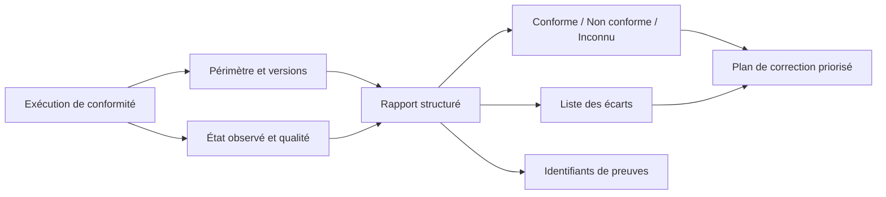

Un format de rapport peut inclure le nombre d'équipements attendus, le nombre contacté, le nombre vérifiable, le nombre conforme, le nombre non conforme, les erreurs de collecte, la version de l'intention, la version du compilateur, l'heure de calcul, les écarts critiques et les exceptions utilisées. Ce n'est pas seulement un tableau de bord : c'est un artefact de décision qui aide à expliquer si un déploiement doit continuer, être suspendu ou revenir en arrière.

```json
{
  "report_version": 1,
  "run_id": "ibn-lab-2026-014",
  "intent_id": "payment-zone-isolation",
  "intent_version": 1,
  "scope": "lab",
  "observed_at": "2026-10-28T08:30:00Z",
  "devices_expected": 6,
  "devices_observed": 5,
  "compliant": 3,
  "non_compliant": 1,
  "unknown": 2,
  "critical_drift": 1,
  "decision": "hold_for_review"
}
```

Les nombres sont fictifs et volontairement illustrent une prudence : si six équipements sont attendus et seulement cinq sont observés, la conclusion ne peut pas être « tous les équipements sont conformes ». Il faut réconcilier les champs de comptage dans un vrai schéma, car une cible peut être non observée et non conforme selon les conventions ; la taxonomie et les totaux doivent être explicitement définis pour éviter les doubles comptes.

Une bonne réponse de conformité ne dit pas uniquement « échec ». Elle indique l'intention concernée, l'équipement affecté, le champ attendu et le champ observé, la gravité, la provenance et la prochaine étape recommandée. Les informations sensibles de topologie doivent rester accessibles aux seuls rôles autorisés ; le canal général peut recevoir une synthèse et un lien protégé vers le rapport complet.

### M. Mesurer la qualité d'une démarche IBN

L'efficacité d'une démarche IBN ne se résume pas au nombre de configurations générées. Les indicateurs doivent mesurer la capacité à maintenir l'état attendu et à contrôler le risque. Parmi les mesures possibles : la proportion de ressources vérifiées, le taux de conformité, le nombre d'écarts critiques, le temps de détection du drift, le délai de correction, le nombre d'exceptions expirées, les changements annulés et la fréquence des déploiements bloqués en raison d'une incompatibilité.

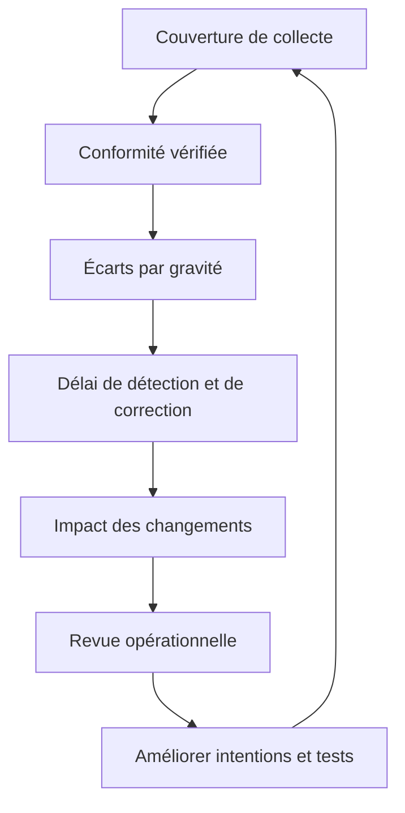

Les indicateurs doivent avoir des définitions stables. Une hausse du taux de conformité peut être trompeuse si le système ne collecte plus les données des équipements les plus difficiles à joindre. Il faut toujours afficher la couverture et le nombre de ressources non vérifiables. De même, une réduction du nombre d'écarts peut provenir d'une politique assouplie plutôt que d'une meilleure configuration ; les changements d'intention doivent donc faire partie de l'analyse.

La mesure doit distinguer prévention et détection. Le nombre de changements dangereux bloqués en simulation peut montrer l'utilité du contrôle en amont ; le délai de détection du drift mesure la capacité à identifier un changement postérieur. Les deux sont utiles et répondent à des questions différentes. Une équipe peut viser une réduction des écarts tout en conservant une voie explicite pour les changements urgents approuvés.

L'évaluation doit aussi inclure le coût de fonctionnement, la maintenance du catalogue de capacités, la qualité de l'inventaire, le temps de revue et la complexité du rollback. Un système qui réduit le délai de configuration mais multiplie les incidents de restauration n'a pas nécessairement amélioré la situation. Les objectifs doivent refléter le service et la sécurité, pas seulement la vitesse de changement.

### N. Intégrer l'IBN à la gestion de changements et à la revue de code

Les intentions, règles, tests et correspondances de plateformes peuvent être versionnés ensemble. Un changement d'intention devrait déclencher des contrôles : validation du schéma, comparaison du diff, tests positifs et négatifs, analyse des exceptions, vérification des capacités et génération du plan. Les éléments qui échouent doivent bloquer la publication du plan ou demander une résolution explicite.

```mermaid
flowchart LR
    PR["Proposition de changement"] --> SCHEMA["Valider schéma"]
    SCHEMA --> LINT["Contrôles sémantiques"]
    LINT --> TESTS["Tests des invariants"]
    TESTS --> CAPS["Tests de capacité"]
    CAPS --> DIFF["Analyser le diff"]
    DIFF --> REVIEW["Revue de code et de risque"]
    REVIEW --> ARTIFACT["Artefact de changement versionné"]
    ARTIFACT --> WINDOW["Fenêtre de déploiement"]
```

La revue doit vérifier la justification métier, le périmètre, les règles supprimées, les nouvelles autorisations, les exceptions, le risque, le test de restauration et les preuves attendues. Les commentaires doivent être résolus ou explicitement acceptés par les rôles autorisés. Une approbation doit se rapporter à la version de l'intention et au plan exact qui seront appliqués.

Une pipeline de validation peut produire des artefacts signés ou identifiés par empreinte. Au moment du déploiement, le système vérifie que l'artefact correspond à la révision approuvée et que les préconditions sont toujours satisfaites. Si l'inventaire ou les capacités ont changé depuis la simulation, le plan doit être revalidé.

La revue ne remplace pas la séparation des environnements. Les tests et les simulateurs s'exécutent d'abord dans un contexte isolé. Les accès à la production sont séparés, les secrets et certificats ne sont pas stockés dans les intentions, et le chemin de déploiement requiert une identité de service contrôlée. Les journaux relient la demande, la révision, l'approbation, l'exécuteur et la vérification finale.

### O. Laboratoire guidé : isoler un segment invité des paiements

**Objectif :** formaliser une intention d'isolation, construire une matrice de tests, simuler un plan, puis détecter un écart. L'exercice se déroule dans une maquette ; aucune configuration de production ne doit être appliquée.

**Préparation.** Crée un inventaire fictif avec un groupe invité, un groupe d'administration, une passerelle, un résolveur DNS et deux serveurs de test. Donne à chaque ressource un identifiant stable et un propriétaire. Définis une politique initiale approuvée puis ajoute une version d'intention qui interdit les nouvelles connexions du groupe invité vers les serveurs de paiement.

**Étape 1 — Écrire l'intention.** Utilise le schéma de la section C. Vérifie que la source et la destination existent, que l'environnement est bien le laboratoire, que la direction est explicite et que les exceptions sont vides ou documentées. Introduis volontairement une faute de frappe dans un nom de groupe : le validateur doit rejeter l'intention.

**Étape 2 — Produire les tests.** Prépare au moins deux tests autorisés et deux tests interdits. Pour chaque test, fixe un identifiant, la source, la destination, le protocole, le résultat attendu et le propriétaire métier de la règle. N'utilise pas un résultat « inconnu » comme réussite.

**Étape 3 — Générer le plan.** Compare l'intention candidate au plan actuel. Explique chaque ajout et suppression. Si une plateforme simulée n'a pas la capacité exigée, le plan doit indiquer qu'une partie de l'intention ne peut pas être garantie et bloquer le déploiement automatique.

**Étape 4 — Simuler puis approuver.** Conserve le diff, la version, les résultats des contrôles et la décision du relecteur. Modifie ensuite un champ après l'approbation : le test doit montrer que l'approbation ne s'applique plus à la nouvelle version.

**Étape 5 — Injecter une dérive.** Modifie volontairement une règle dans la représentation de l'état réel. Lance de nouveau la vérification de conformité. Le rapport doit préciser le champ qui diffère, l'heure d'observation et la gravité, sans classer l'ensemble comme conforme.

**Étape 6 — Tester l'inconnu.** Rends un équipement inaccessible ou retire une capacité de collecte. Le résultat doit être « non vérifiable ». Vérifie que les agrégats n'augmentent pas artificiellement le taux de conformité.

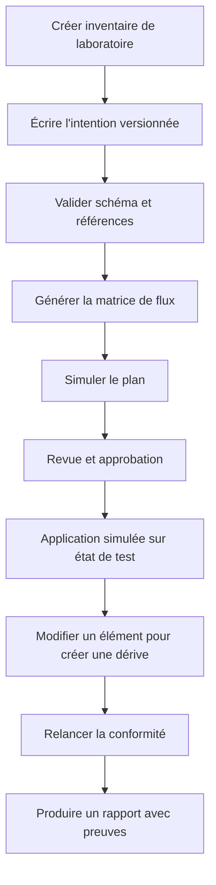

#### Livrables attendus

Le livrable doit inclure l'intention versionnée, l'inventaire synthétique, la matrice de tests, le diff du plan, les résultats de simulation, la preuve de l'approbation, un rapport de conformité et une description de la stratégie de rollback. Chaque fichier doit permettre de reproduire les résultats. Identifie clairement les éléments fictifs et les actions non exécutées.

#### Critères d'évaluation

- L'intention contient des groupes, un périmètre et des exceptions explicites.
- Le schéma et les références sont validés avant la génération.
- Les capacités insuffisantes bloquent une fausse déclaration de conformité.
- Les tests vérifient les flux permis comme les flux interdits.
- L'approbation est liée à la version exacte du plan.
- La dérive et l'absence de preuve sont distinguées.
- Le rollback et le compte rendu sont décrits avant le déploiement.

### P. Dix erreurs de conception à rechercher lors d'une revue

1. **Une intention vague.** Remplacer « renforcer la sécurité » par des propriétés testables et des critères explicites.
2. **Une référence non maîtrisée.** Ne pas résoudre un groupe ou un service à partir d'une simple chaîne sans inventaire de confiance.
3. **Une configuration générée et appliquée sans diff.** Toujours présenter les changements et leurs impacts.
4. **Une capacité supposée.** Exiger une preuve que la plateforme et sa version prennent en charge la contrainte.
5. **Des tests uniquement positifs.** Vérifier les flux interdits et les exceptions autant que les usages légitimes.
6. **Un équipement inaccessible marqué conforme.** Séparer clairement non conforme et non vérifiable.
7. **Une exception permanente.** Exiger un propriétaire, une portée, une justification et une échéance.
8. **Une approbation générique.** La lier à une intention, un plan et une version immuables.
9. **Un rollback non testé.** Prévoir la récupération d'accès et la restauration avant la fenêtre.
10. **Des indicateurs sans couverture.** Afficher les ressources non observées avec les taux de conformité.

Cette liste peut devenir une checklist de revue. Lorsqu'une règle ne peut pas être vérifiée, il faut enregistrer la limite et décider si elle est acceptable. Il ne faut pas transformer l'incertitude en conformité simplement pour rendre un tableau de bord vert.

### Q. Gérer le cycle de vie des intentions

Les intentions ont un cycle de vie comparable à celui d'un code maintenu. Elles sont proposées, revues, testées, approuvées, déployées, surveillées, modifiées et retirées. Une intention peut devenir obsolète si le service ou la topologie change. Elle ne doit pas rester active par défaut lorsque la ressource qu'elle décrit n'existe plus.

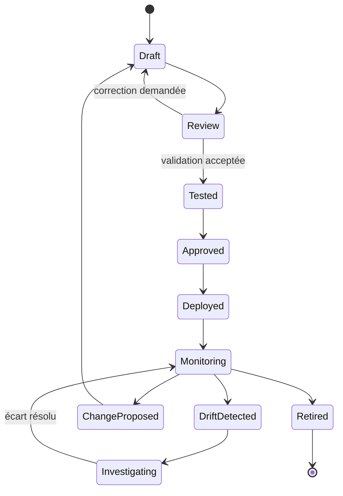

Chaque transition doit conserver son motif, l'auteur, la date, la version et les liens vers les tests ou la demande de changement. Une intention en cours de revue ne doit pas être utilisée pour calculer un plan de production. Une intention retirée doit rester disponible pour l'audit historique, mais ne doit plus déclencher de nouveau changement.

La gestion de versions doit aussi traiter les dépendances. Une version de schéma peut rendre un ancien fichier incompatible ; une nouvelle version de compilateur peut modifier la manière de traduire une règle ; une mise à jour logicielle peut retirer une capacité. Documente les migrations nécessaires et teste les anciennes intentions avant de migrer un grand périmètre.

### R. Synthèse — ce qui fait une démarche IBN fiable

L'IBN sépare la raison métier de la manière technique de configurer les équipements. L'intention est décrite dans une forme structurée et versionnée, puis contrôlée syntaxiquement et sémantiquement. Le système résout les références à partir d'un inventaire fiable, vérifie les capacités de chaque plateforme et produit un plan lisible. Les tests couvrent les comportements attendus comme les interdictions. La simulation, la revue, l'approbation et le déploiement progressif réduisent le risque. Après la modification, l'état réel est relu pour vérifier les invariants et détecter les dérives.

La conformité n'est crédible que si la couverture de collecte est connue. Un équipement inaccessible, une capacité inconnue ou un test non exécuté doit rester un état distinct. Les exceptions sont limitées et expirables. Les changements sont auditables et réversibles. Les indicateurs suivent la qualité de l'état réseau, le temps de détection, le risque des changements et le coût d'exploitation.

Au niveau débutant, maîtrise d'abord la chaîne complète en laboratoire : besoin, intention, schéma, inventaire, capacités, tests, plan, approbation, application contrôlée, mesure et réconciliation. N'ajoute l'automatisation de production qu'après avoir prouvé que chaque étape refuse les entrées invalides, expose les inconnues et préserve une voie de restauration. L'objectif n'est pas de produire une configuration plus vite, mais de maintenir un réseau cohérent avec les objectifs déclarés et vérifiables.

## Défi final corrigé — traduire une intention métier en contrôles réseau

### Énoncé

Une entreprise souhaite que les postes du réseau invité accèdent à Internet mais jamais aux serveurs de paiement. Le parc mélange des équipements de plusieurs fournisseurs. Rédige une intention lisible par l'équipe, définis comment la traduire en configuration et décris comment vérifier que l'état réellement observé satisfait l'objectif. Ne suppose pas que tous les équipements offrent les mêmes capacités.

### Boucle de conformité

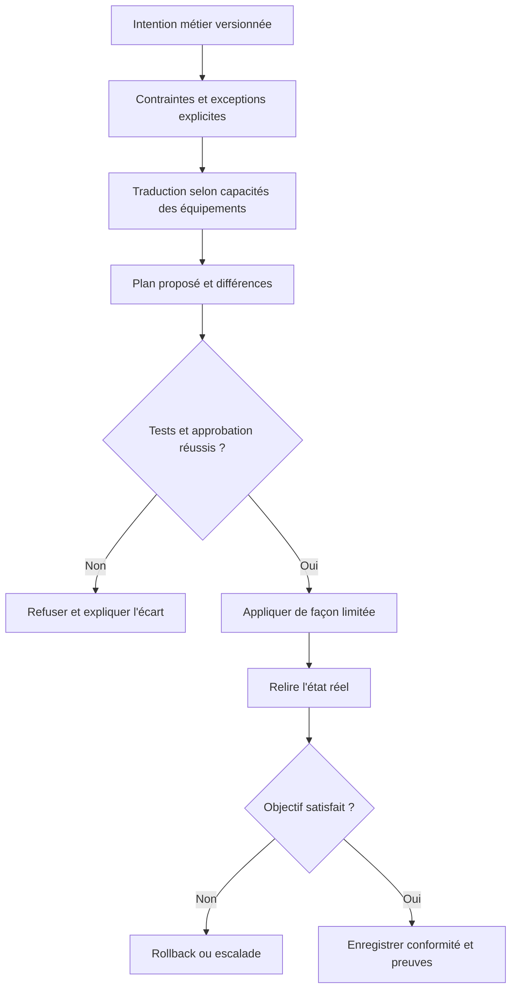

### Exemple d'intention déclarative

```yaml
intent_id: segmentation-invites-v1
scope:
  source_zone: guest
  destination_zone: payment
policy:
  default: deny
  allowed_services:
    - name: dns
      destination: approved-dns
      protocol: udp
      port: 53
    - name: web
      destination: internet
      protocol: tcp
      ports: [80, 443]
forbidden:
  - source_zone: guest
    destination_zone: payment
exceptions: []
verification:
  require_config_readback: true
  require_connectivity_tests: true
  require_owner_approval: true
```

### Proposition de correction

L'intention énonce une propriété observable, pas une commande fournisseur. Elle doit préciser le périmètre, les flux permis, les flux interdits, les exceptions approuvées, la portée temporelle et le propriétaire métier. Le traducteur vérifie ensuite les capacités de chaque équipement et produit un plan comprenant les changements prévus, les dépendances et le retour arrière.

Ne confonds pas « la configuration a été envoyée » avec « l'intention est satisfaite ». La vérification doit relire l'état réel et tester les chemins représentatifs, notamment un flux autorisé et un flux interdit. Si l'équipement ne permet pas d'exprimer la politique ou si l'inventaire est incomplet, le système signale l'écart au lieu de fabriquer une fausse conformité.

### Essais pratiques

1. Vérifie qu'un accès HTTPS vers Internet est autorisé.
2. Vérifie qu'un flux d'un poste invité vers un serveur de paiement est bloqué.
3. Supprime volontairement une règle du plan de test et vérifie que la comparaison d'état détecte le drift.
4. Introduis un équipement sans la capacité nécessaire et vérifie que le déploiement est arrêté.
5. Ajoute une exception temporaire avec propriétaire, justification et date d'expiration ; vérifie qu'elle cesse d'être valide après l'échéance.

### Barème d'autoévaluation

- L'intention exprime une propriété métier mesurable.
- Les exceptions sont explicites, limitées et traçables.
- Le plan est validé avant modification.
- L'état réel est relu après action.
- L'écart de capacité conduit à une alerte, jamais à une réussite fictive.

## 11. Checklist et à retenir

- [ ] L'objectif métier et le service concerné sont explicites et mesurables.
- [ ] Chaque observation conserve provenance, horodatage, unité et qualité.
- [ ] La méthode a été comparée à une baseline simple.
- [ ] Les tests couvrent cas normaux, données manquantes et échecs.
- [ ] Les résultats sont ventilés par criticité et catégorie pertinente.
- [ ] Les permissions sont minimales et les secrets absents des journaux.
- [ ] Les décisions relient preuves, version, approbation et résultat.
- [ ] Chaque action risquée a préconditions, périmètre limité et rollback.
- [ ] Les mesures évaluent le service et les erreurs opérationnelles.
- [ ] Une procédure décrit abstention, escalade, suspension et revue.

### À retenir
Le but d'une démarche AIOps n'est pas d'automatiser chaque décision, mais de rendre les opérations plus rapides, cohérentes et vérifiables. Pour Intent-Based Networking (IBN), la qualité dépend des données, de l'adéquation de la technique, d'une évaluation honnête et de la vérification du résultat. Un système capable de reconnaître ses limites, de bloquer une action risquée et de transmettre un dossier de preuve peut être plus utile qu'un système qui agit toujours sans expliquer ses erreurs.

conformité vérifiée, dérives non expliquées, délai de réconciliation, exceptions expirées, changements annulés après validation sont des mesures candidates, mais chacune doit être associée à un objectif, un propriétaire et une action lorsqu'elle franchit une limite. Le nombre de modèles ou d'alertes traitées n'est pas en soi une mesure de valeur. La boucle d'amélioration est complète quand les résultats confirment ou réfutent les hypothèses, les incidents sont documentés et les contrôles évoluent selon les erreurs observées. Exprimer un objectif réseau et le traduire en état cible, politique, configuration et conformité. Le maintien dans le temps implique de réviser les sources, tester la reprise et retirer une méthode quand ses limites dépassent son bénéfice.

## 12. Références

- https://openconfig.net/
- https://docs.ansible.com/projects/ansible/latest/network/getting_started/
- https://opentelemetry.io/docs/ — documentation sur l'observabilité et la télémétrie.
- https://www.nist.gov/itl/ai-risk-management-framework — cadre de gestion des risques de l'IA.
