# ML pour la supervision réseau — Intermédiaire

> **Mise en contexte :** ce cours étudie le problème suivant : l'équipe veut anticiper la congestion WAN, mais les variations quotidiennes, changements de capacité et erreurs de collecte compliquent le modèle. L'objectif est d'améliorer les opérations de manière mesurable, vérifiable et proportionnée au risque. Les exemples doivent être adaptés et testés en laboratoire avant toute utilisation sur une infrastructure réelle.

## Sommaire

1. Introduction et objectifs
2. Concepts clés
3. Architecture de référence
4. Pipeline et algorithmes
5. Étude de cas
6. Implémentation guidée et laboratoire
7. Sécurité et gouvernance
8. Pièges à éviter
9. Diagnostic et dépannage
10. Exercices corrigés
11. Checklist et à retenir
12. Références

## 1. Introduction et objectifs

L'AIOps applique l'analyse de données et l'automatisation aux opérations informatiques afin de rendre la détection, le diagnostic et la résolution plus cohérents. Pour **ML pour la supervision réseau**, l'enjeu est de créer des variables temporelles et évaluer des modèles de supervision réseau.. Le besoin est concret : les équipes doivent agir rapidement, mais les observations peuvent être contradictoires, les horloges décalées et les interventions porteuses de risques. La solution doit ainsi distinguer un signal, une hypothèse, une décision et une preuve de résultat.

Le scénario de départ est : l'équipe veut anticiper la congestion WAN, mais les variations quotidiennes, changements de capacité et erreurs de collecte compliquent le modèle. Il illustre que des outils techniquement capables ne suffisent pas. La qualité dépend de données fiables, d'une question mesurable, d'une référence de comparaison et d'une procédure de reprise. Le système doit savoir reconnaître une donnée absente, exposer ses limites et demander de l'aide. L'automatisation n'est pas un objectif en soi : elle est justifiée uniquement si elle améliore un résultat opérationnel sans déplacer le risque vers les utilisateurs ou l'équipe d'astreinte.

Les outils possibles comprennent Pandas, scikit-learn, métriques temporelles, validation chronologique. Ils ne doivent pas tous être déployés dans le même projet. Chaque composant doit répondre à un besoin identifié et avoir un propriétaire. Une architecture réduite, testée et bien observée est préférable à un assemblage complexe dont personne ne peut expliquer les erreurs. La première version peut rester en lecture seule ; l'autorité d'agir se développe seulement après des essais reproductibles, une mesure des erreurs et une validation de la procédure de retour arrière.

### Objectifs pédagogiques
- Décrire les concepts principaux et leurs limites.
- Définir les sources de données, la qualité attendue et les propriétaires.
- Décrire le chemin entre observation, analyse, décision, action et vérification.
- Mesurer les erreurs et comparer la solution à une baseline.
- Protéger les accès et documenter une stratégie d'escalade et de reprise.

### Vocabulaire opérationnel
Une **observation** est une mesure ou un événement provenant d'une source identifiée. Un **signal** est une interprétation d'observations dans un contexte. Une **hypothèse** est une explication testable. Une **décision** sélectionne une action ou une abstention. Une **postcondition** est un état vérifiable qui doit être vrai après une intervention. Ces mots ne sont pas interchangeables. Une alerte n'est pas automatiquement un incident confirmé, un score ne constitue pas une preuve de cause racine et l'exécution d'une commande ne prouve pas que le service est rétabli.

## 2. Concepts clés

### 1. Variable et étiquette

La variable décrit l'information disponible à un instant ; l'étiquette est la cible et doit correspondre à un événement réellement connu.

Sur le terrain, Variable et étiquette doit être relié à une question opérationnelle et à une décision possible. La variable décrit l'information disponible à un instant ; l'étiquette est la cible et doit correspondre à un événement réellement connu. Il faut nommer la source de vérité, le propriétaire, la fréquence de mise à jour et le périmètre d'utilisation avant d'automatiser. Pour le scénario « l'équipe veut anticiper la congestion WAN, mais les variations quotidiennes, changements de capacité et erreurs de collecte compliquent le modèle », cette précision empêche de transformer une intuition en commande. Elle permet aussi de définir quand il faut s'abstenir, demander davantage de données ou transmettre le dossier à une personne responsable.

La mise en œuvre de Variable et étiquette gagne à être découpée en contrôles testables. Vérifier d'abord le format et la provenance des entrées, puis les hypothèses, les valeurs manquantes et les versions. L'outil Pandas peut contribuer à cette étape, mais sa présence ne garantit pas la qualité. Les erreurs doivent rester explicites au lieu d'être converties silencieusement en valeurs par défaut. Une exécution fiable sait différencier une réussite, un échec, un résultat partiel et un état impossible à déterminer.

L'évaluation de Variable et étiquette doit inclure les cas courants, les cas limites et les exemples difficiles. La mesure doit inclure rappel à l'horizon défini, tout en examinant les différences selon la criticité et le type de cible. Un score moyen peut masquer une défaillance rare mais coûteuse ; il faut donc conserver des exemples concrets, mesurer faux positifs et faux négatifs et expliquer le coût de chaque erreur. Après une évolution de données, de code ou de modèle, les mêmes tests doivent être rejoués pour vérifier que le comportement attendu persiste.

Aucune technique associée à Variable et étiquette n'est universellement préférable. Une règle peut être plus explicable, un modèle peut capter davantage de variables, et un système génératif peut accélérer la synthèse sans garantir la vérité. Le choix doit tenir compte des données, de la latence, du coût d'erreur, de l'explicabilité et de la maintenance. La baseline et le mode manuel doivent rester disponibles pour les périodes où les observations sont incomplètes ou que le système n'a plus la qualité attendue.

### 2. Fenêtrage

Une fenêtre transforme une séquence en statistiques ou tendances ; sa largeur influence stabilité et délai.

Sur le terrain, Fenêtrage doit être relié à une question opérationnelle et à une décision possible. Une fenêtre transforme une séquence en statistiques ou tendances ; sa largeur influence stabilité et délai. Il faut nommer la source de vérité, le propriétaire, la fréquence de mise à jour et le périmètre d'utilisation avant d'automatiser. Pour le scénario « l'équipe veut anticiper la congestion WAN, mais les variations quotidiennes, changements de capacité et erreurs de collecte compliquent le modèle », cette précision empêche de transformer une intuition en commande. Elle permet aussi de définir quand il faut s'abstenir, demander davantage de données ou transmettre le dossier à une personne responsable.

La mise en œuvre de Fenêtrage gagne à être découpée en contrôles testables. Vérifier d'abord le format et la provenance des entrées, puis les hypothèses, les valeurs manquantes et les versions. L'outil scikit-learn peut contribuer à cette étape, mais sa présence ne garantit pas la qualité. Les erreurs doivent rester explicites au lieu d'être converties silencieusement en valeurs par défaut. Une exécution fiable sait différencier une réussite, un échec, un résultat partiel et un état impossible à déterminer.

L'évaluation de Fenêtrage doit inclure les cas courants, les cas limites et les exemples difficiles. La mesure doit inclure précision et faux positifs par lien, tout en examinant les différences selon la criticité et le type de cible. Un score moyen peut masquer une défaillance rare mais coûteuse ; il faut donc conserver des exemples concrets, mesurer faux positifs et faux négatifs et expliquer le coût de chaque erreur. Après une évolution de données, de code ou de modèle, les mêmes tests doivent être rejoués pour vérifier que le comportement attendu persiste.

### 3. Saisonnalité

Les profils journaliers ou hebdomadaires doivent être distingués des anomalies réelles.

Sur le terrain, Saisonnalité doit être relié à une question opérationnelle et à une décision possible. Les profils journaliers ou hebdomadaires doivent être distingués des anomalies réelles. Il faut nommer la source de vérité, le propriétaire, la fréquence de mise à jour et le périmètre d'utilisation avant d'automatiser. Pour le scénario « l'équipe veut anticiper la congestion WAN, mais les variations quotidiennes, changements de capacité et erreurs de collecte compliquent le modèle », cette précision empêche de transformer une intuition en commande. Elle permet aussi de définir quand il faut s'abstenir, demander davantage de données ou transmettre le dossier à une personne responsable.

La mise en œuvre de Saisonnalité gagne à être découpée en contrôles testables. Vérifier d'abord le format et la provenance des entrées, puis les hypothèses, les valeurs manquantes et les versions. L'outil métriques temporelles peut contribuer à cette étape, mais sa présence ne garantit pas la qualité. Les erreurs doivent rester explicites au lieu d'être converties silencieusement en valeurs par défaut. Une exécution fiable sait différencier une réussite, un échec, un résultat partiel et un état impossible à déterminer.

L'évaluation de Saisonnalité doit inclure les cas courants, les cas limites et les exemples difficiles. La mesure doit inclure délai d'avertissement utile, tout en examinant les différences selon la criticité et le type de cible. Un score moyen peut masquer une défaillance rare mais coûteuse ; il faut donc conserver des exemples concrets, mesurer faux positifs et faux négatifs et expliquer le coût de chaque erreur. Après une évolution de données, de code ou de modèle, les mêmes tests doivent être rejoués pour vérifier que le comportement attendu persiste.

### 4. Baseline

Une règle simple ou un modèle naïf permet de mesurer le bénéfice net d'un candidat.

Sur le terrain, Baseline doit être relié à une question opérationnelle et à une décision possible. Une règle simple ou un modèle naïf permet de mesurer le bénéfice net d'un candidat. Il faut nommer la source de vérité, le propriétaire, la fréquence de mise à jour et le périmètre d'utilisation avant d'automatiser. Pour le scénario « l'équipe veut anticiper la congestion WAN, mais les variations quotidiennes, changements de capacité et erreurs de collecte compliquent le modèle », cette précision empêche de transformer une intuition en commande. Elle permet aussi de définir quand il faut s'abstenir, demander davantage de données ou transmettre le dossier à une personne responsable.

La mise en œuvre de Baseline gagne à être découpée en contrôles testables. Vérifier d'abord le format et la provenance des entrées, puis les hypothèses, les valeurs manquantes et les versions. L'outil validation chronologique peut contribuer à cette étape, mais sa présence ne garantit pas la qualité. Les erreurs doivent rester explicites au lieu d'être converties silencieusement en valeurs par défaut. Une exécution fiable sait différencier une réussite, un échec, un résultat partiel et un état impossible à déterminer.

L'évaluation de Baseline doit inclure les cas courants, les cas limites et les exemples difficiles. La mesure doit inclure MAE/RMSE de prévision, tout en examinant les différences selon la criticité et le type de cible. Un score moyen peut masquer une défaillance rare mais coûteuse ; il faut donc conserver des exemples concrets, mesurer faux positifs et faux négatifs et expliquer le coût de chaque erreur. Après une évolution de données, de code ou de modèle, les mêmes tests doivent être rejoués pour vérifier que le comportement attendu persiste.

Aucune technique associée à Baseline n'est universellement préférable. Une règle peut être plus explicable, un modèle peut capter davantage de variables, et un système génératif peut accélérer la synthèse sans garantir la vérité. Le choix doit tenir compte des données, de la latence, du coût d'erreur, de l'explicabilité et de la maintenance. La baseline et le mode manuel doivent rester disponibles pour les périodes où les observations sont incomplètes ou que le système n'a plus la qualité attendue.

### 5. Validation temporelle

L'entraînement doit précéder le test afin de ne pas utiliser le futur.

Sur le terrain, Validation temporelle doit être relié à une question opérationnelle et à une décision possible. L'entraînement doit précéder le test afin de ne pas utiliser le futur. Il faut nommer la source de vérité, le propriétaire, la fréquence de mise à jour et le périmètre d'utilisation avant d'automatiser. Pour le scénario « l'équipe veut anticiper la congestion WAN, mais les variations quotidiennes, changements de capacité et erreurs de collecte compliquent le modèle », cette précision empêche de transformer une intuition en commande. Elle permet aussi de définir quand il faut s'abstenir, demander davantage de données ou transmettre le dossier à une personne responsable.

La mise en œuvre de Validation temporelle gagne à être découpée en contrôles testables. Vérifier d'abord le format et la provenance des entrées, puis les hypothèses, les valeurs manquantes et les versions. L'outil Pandas peut contribuer à cette étape, mais sa présence ne garantit pas la qualité. Les erreurs doivent rester explicites au lieu d'être converties silencieusement en valeurs par défaut. Une exécution fiable sait différencier une réussite, un échec, un résultat partiel et un état impossible à déterminer.

L'évaluation de Validation temporelle doit inclure les cas courants, les cas limites et les exemples difficiles. La mesure doit inclure erreurs par site et criticité, tout en examinant les différences selon la criticité et le type de cible. Un score moyen peut masquer une défaillance rare mais coûteuse ; il faut donc conserver des exemples concrets, mesurer faux positifs et faux négatifs et expliquer le coût de chaque erreur. Après une évolution de données, de code ou de modèle, les mêmes tests doivent être rejoués pour vérifier que le comportement attendu persiste.

### 6. Déséquilibre

Les congestions critiques sont rares ; faux positifs et faux négatifs ont des coûts différents.

Sur le terrain, Déséquilibre doit être relié à une question opérationnelle et à une décision possible. Les congestions critiques sont rares ; faux positifs et faux négatifs ont des coûts différents. Il faut nommer la source de vérité, le propriétaire, la fréquence de mise à jour et le périmètre d'utilisation avant d'automatiser. Pour le scénario « l'équipe veut anticiper la congestion WAN, mais les variations quotidiennes, changements de capacité et erreurs de collecte compliquent le modèle », cette précision empêche de transformer une intuition en commande. Elle permet aussi de définir quand il faut s'abstenir, demander davantage de données ou transmettre le dossier à une personne responsable.

La mise en œuvre de Déséquilibre gagne à être découpée en contrôles testables. Vérifier d'abord le format et la provenance des entrées, puis les hypothèses, les valeurs manquantes et les versions. L'outil scikit-learn peut contribuer à cette étape, mais sa présence ne garantit pas la qualité. Les erreurs doivent rester explicites au lieu d'être converties silencieusement en valeurs par défaut. Une exécution fiable sait différencier une réussite, un échec, un résultat partiel et un état impossible à déterminer.

L'évaluation de Déséquilibre doit inclure les cas courants, les cas limites et les exemples difficiles. La mesure doit inclure rappel à l'horizon défini, tout en examinant les différences selon la criticité et le type de cible. Un score moyen peut masquer une défaillance rare mais coûteuse ; il faut donc conserver des exemples concrets, mesurer faux positifs et faux négatifs et expliquer le coût de chaque erreur. Après une évolution de données, de code ou de modèle, les mêmes tests doivent être rejoués pour vérifier que le comportement attendu persiste.

### 7. Interprétation

Un score doit inclure lien, horizon, incertitude et vérification recommandée.

Sur le terrain, Interprétation doit être relié à une question opérationnelle et à une décision possible. Un score doit inclure lien, horizon, incertitude et vérification recommandée. Il faut nommer la source de vérité, le propriétaire, la fréquence de mise à jour et le périmètre d'utilisation avant d'automatiser. Pour le scénario « l'équipe veut anticiper la congestion WAN, mais les variations quotidiennes, changements de capacité et erreurs de collecte compliquent le modèle », cette précision empêche de transformer une intuition en commande. Elle permet aussi de définir quand il faut s'abstenir, demander davantage de données ou transmettre le dossier à une personne responsable.

La mise en œuvre de Interprétation gagne à être découpée en contrôles testables. Vérifier d'abord le format et la provenance des entrées, puis les hypothèses, les valeurs manquantes et les versions. L'outil métriques temporelles peut contribuer à cette étape, mais sa présence ne garantit pas la qualité. Les erreurs doivent rester explicites au lieu d'être converties silencieusement en valeurs par défaut. Une exécution fiable sait différencier une réussite, un échec, un résultat partiel et un état impossible à déterminer.

L'évaluation de Interprétation doit inclure les cas courants, les cas limites et les exemples difficiles. La mesure doit inclure précision et faux positifs par lien, tout en examinant les différences selon la criticité et le type de cible. Un score moyen peut masquer une défaillance rare mais coûteuse ; il faut donc conserver des exemples concrets, mesurer faux positifs et faux négatifs et expliquer le coût de chaque erreur. Après une évolution de données, de code ou de modèle, les mêmes tests doivent être rejoués pour vérifier que le comportement attendu persiste.

Aucune technique associée à Interprétation n'est universellement préférable. Une règle peut être plus explicable, un modèle peut capter davantage de variables, et un système génératif peut accélérer la synthèse sans garantir la vérité. Le choix doit tenir compte des données, de la latence, du coût d'erreur, de l'explicabilité et de la maintenance. La baseline et le mode manuel doivent rester disponibles pour les périodes où les observations sont incomplètes ou que le système n'a plus la qualité attendue.

## 3. Architecture de référence

Une architecture exploitable sépare au minimum la production des données, leur normalisation, le calcul analytique, la politique d'autorisation et la vérification. Il est risqué de relier directement un détecteur à une commande privilégiée : une fausse alerte devient alors une action potentiellement dommageable. Entre la proposition et l'exécution, il faut un point de décision explicite qui examine la qualité de données, la confiance, la criticité, le périmètre autorisé, le plan de reprise et la nécessité d'une approbation humaine. La boucle se ferme uniquement quand l'état du service est observé après l'intervention.

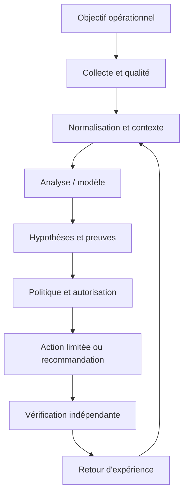

Le premier contrat concerne la donnée : source, horodatage, unité, cible, fraîcheur et état de qualité sont conservés. Le contrat du modèle ou de la règle précise la version, les entrées attendues, les métriques de validation et les limites. Le contrat de décision énumère les actions permises, les préconditions, les approbations, les quotas et les conditions d'arrêt. Le contrat de sortie indique enfin la preuve requise pour déclarer un rétablissement. Ces frontières permettent de tester chaque partie indépendamment, de corriger un composant sans dissimuler l'origine de l'erreur et d'auditer une action plusieurs semaines plus tard.

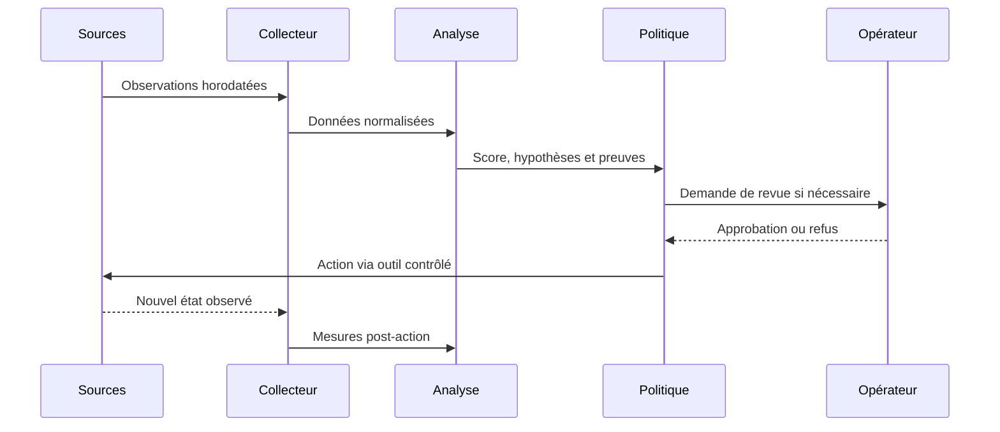

### Frontières de sécurité et mode dégradé

Le contrôle de sécurité lié à Séparation analyse/exécution doit être conçu dès le départ. Appliquer le moindre privilège, protéger les secrets, tracer les décisions et séparer analyse et exécution. Le piège à surveiller est : fuite temporelle. Lorsque des données externes entrent dans le pipeline, elles ne doivent pas modifier les règles d'accès ni fournir des instructions privilégiées. Toute action à fort impact exige des préconditions compréhensibles, une approbation adaptée et une façon testée de revenir vers un état sûr.

Si Données manquantes produit un résultat incohérent, commencer par vérifier horloge, source, unité, cible, fraîcheur, version et erreur d'accès. Comparer une observation brute avec sa valeur transformée, puis rechercher les modifications récentes. Pour le scénario étudié, un contrôle utile consiste à tester une seule hypothèse à la fois et à conserver la preuve du résultat. Ne pas recopier de secrets dans le ticket. Une fois le défaut confirmé, ajouter un test de régression afin que la même anomalie ne revienne pas avec une mise à jour.

À l'échelle, Résilience du pipeline doit gérer des volumes, équipements et versions hétérogènes sans perdre de traçabilité. Borner la concurrence, isoler les erreurs par cible, limiter le buffering et mesurer les files protège le système aval. La reprise d'une panne peut elle-même provoquer une surcharge si toutes les cibles se reconnectent simultanément. Une architecture robuste sait réduire la fréquence ou revenir à une méthode plus simple, tout en signalant explicitement cette dégradation au lieu d'afficher une apparence de fonctionnement normal.

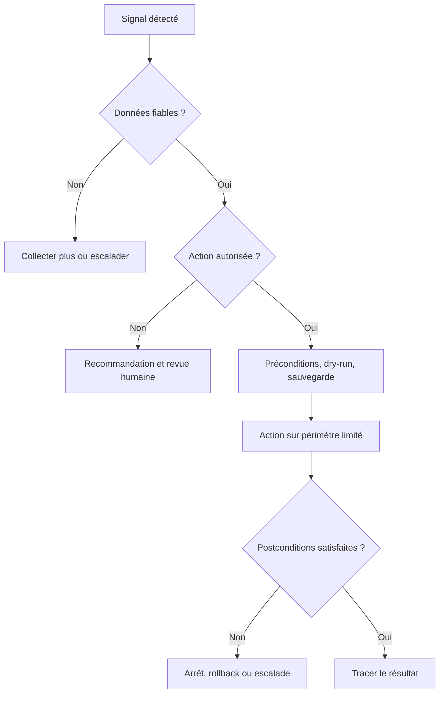

## 4. Pipeline et algorithmes

Le pipeline présenté ici est une chaîne de responsabilités, pas nécessairement un ensemble de microservices séparés. Une petite mise en œuvre peut héberger plusieurs étapes dans un seul processus, à condition de conserver des contrats clairs, des tests et des journaux. L'ordre importe : la qualité est vérifiée avant le calcul, le contexte avant l'interprétation et l'autorisation avant l'exécution. Cette discipline rend possible le fonctionnement en mode observation au départ puis, si les critères le justifient, une automatisation graduée.

### Étape 1 — Définir
Préciser cible, horizon et action attendue.

La mise en œuvre de Définir gagne à être découpée en contrôles testables. Vérifier d'abord le format et la provenance des entrées, puis les hypothèses, les valeurs manquantes et les versions. L'outil Pandas peut contribuer à cette étape, mais sa présence ne garantit pas la qualité. Les erreurs doivent rester explicites au lieu d'être converties silencieusement en valeurs par défaut. Une exécution fiable sait différencier une réussite, un échec, un résultat partiel et un état impossible à déterminer.

Si Définir produit un résultat incohérent, commencer par vérifier horloge, source, unité, cible, fraîcheur, version et erreur d'accès. Comparer une observation brute avec sa valeur transformée, puis rechercher les modifications récentes. Pour le scénario étudié, un contrôle utile consiste à tester une seule hypothèse à la fois et à conserver la preuve du résultat. Ne pas recopier de secrets dans le ticket. Une fois le défaut confirmé, ajouter un test de régression afin que la même anomalie ne revienne pas avec une mise à jour.

### Étape 2 — Assembler
Aligner timestamps, unités, changements et identifiants.

La mise en œuvre de Assembler gagne à être découpée en contrôles testables. Vérifier d'abord le format et la provenance des entrées, puis les hypothèses, les valeurs manquantes et les versions. L'outil scikit-learn peut contribuer à cette étape, mais sa présence ne garantit pas la qualité. Les erreurs doivent rester explicites au lieu d'être converties silencieusement en valeurs par défaut. Une exécution fiable sait différencier une réussite, un échec, un résultat partiel et un état impossible à déterminer.

Si Assembler produit un résultat incohérent, commencer par vérifier horloge, source, unité, cible, fraîcheur, version et erreur d'accès. Comparer une observation brute avec sa valeur transformée, puis rechercher les modifications récentes. Pour le scénario étudié, un contrôle utile consiste à tester une seule hypothèse à la fois et à conserver la preuve du résultat. Ne pas recopier de secrets dans le ticket. Une fois le défaut confirmé, ajouter un test de régression afin que la même anomalie ne revienne pas avec une mise à jour.

### Étape 3 — Créer les features
Calculer tendances sans fuite d'information future.

La mise en œuvre de Créer les features gagne à être découpée en contrôles testables. Vérifier d'abord le format et la provenance des entrées, puis les hypothèses, les valeurs manquantes et les versions. L'outil métriques temporelles peut contribuer à cette étape, mais sa présence ne garantit pas la qualité. Les erreurs doivent rester explicites au lieu d'être converties silencieusement en valeurs par défaut. Une exécution fiable sait différencier une réussite, un échec, un résultat partiel et un état impossible à déterminer.

Si Créer les features produit un résultat incohérent, commencer par vérifier horloge, source, unité, cible, fraîcheur, version et erreur d'accès. Comparer une observation brute avec sa valeur transformée, puis rechercher les modifications récentes. Pour le scénario étudié, un contrôle utile consiste à tester une seule hypothèse à la fois et à conserver la preuve du résultat. Ne pas recopier de secrets dans le ticket. Une fois le défaut confirmé, ajouter un test de régression afin que la même anomalie ne revienne pas avec une mise à jour.

### Étape 4 — Établir une référence
Comparer à des règles et profils simples.

La mise en œuvre de Établir une référence gagne à être découpée en contrôles testables. Vérifier d'abord le format et la provenance des entrées, puis les hypothèses, les valeurs manquantes et les versions. L'outil validation chronologique peut contribuer à cette étape, mais sa présence ne garantit pas la qualité. Les erreurs doivent rester explicites au lieu d'être converties silencieusement en valeurs par défaut. Une exécution fiable sait différencier une réussite, un échec, un résultat partiel et un état impossible à déterminer.

Si Établir une référence produit un résultat incohérent, commencer par vérifier horloge, source, unité, cible, fraîcheur, version et erreur d'accès. Comparer une observation brute avec sa valeur transformée, puis rechercher les modifications récentes. Pour le scénario étudié, un contrôle utile consiste à tester une seule hypothèse à la fois et à conserver la preuve du résultat. Ne pas recopier de secrets dans le ticket. Une fois le défaut confirmé, ajouter un test de régression afin que la même anomalie ne revienne pas avec une mise à jour.

### Étape 5 — Évaluer
Séparer chronologiquement et analyser erreurs par site.

La mise en œuvre de Évaluer gagne à être découpée en contrôles testables. Vérifier d'abord le format et la provenance des entrées, puis les hypothèses, les valeurs manquantes et les versions. L'outil Pandas peut contribuer à cette étape, mais sa présence ne garantit pas la qualité. Les erreurs doivent rester explicites au lieu d'être converties silencieusement en valeurs par défaut. Une exécution fiable sait différencier une réussite, un échec, un résultat partiel et un état impossible à déterminer.

Si Évaluer produit un résultat incohérent, commencer par vérifier horloge, source, unité, cible, fraîcheur, version et erreur d'accès. Comparer une observation brute avec sa valeur transformée, puis rechercher les modifications récentes. Pour le scénario étudié, un contrôle utile consiste à tester une seule hypothèse à la fois et à conserver la preuve du résultat. Ne pas recopier de secrets dans le ticket. Une fois le défaut confirmé, ajouter un test de régression afin que la même anomalie ne revienne pas avec une mise à jour.

### Étape 6 — Surveiller
Suivre dérive, données manquantes et valeur réelle.

La mise en œuvre de Surveiller gagne à être découpée en contrôles testables. Vérifier d'abord le format et la provenance des entrées, puis les hypothèses, les valeurs manquantes et les versions. L'outil scikit-learn peut contribuer à cette étape, mais sa présence ne garantit pas la qualité. Les erreurs doivent rester explicites au lieu d'être converties silencieusement en valeurs par défaut. Une exécution fiable sait différencier une réussite, un échec, un résultat partiel et un état impossible à déterminer.

Si Surveiller produit un résultat incohérent, commencer par vérifier horloge, source, unité, cible, fraîcheur, version et erreur d'accès. Comparer une observation brute avec sa valeur transformée, puis rechercher les modifications récentes. Pour le scénario étudié, un contrôle utile consiste à tester une seule hypothèse à la fois et à conserver la preuve du résultat. Ne pas recopier de secrets dans le ticket. Une fois le défaut confirmé, ajouter un test de régression afin que la même anomalie ne revienne pas avec une mise à jour.

### Pseudocode de décision défensive
```text
observations = collecter()
si qualite(observations) insuffisante:
    journaliser("données insuffisantes")
    demander_verification_humaine()
sinon:
    contexte = enrichir(observations, inventaire, changements, dépendances)
    hypotheses = analyser(contexte)
    preuves = verifier_provenance(hypotheses)
    si preuves insuffisantes ou action hors politique:
        recommander_sans_executer()
    sinon:
        plan = preparer_diff_preconditions_et_rollback()
        si validation(plan) et approbations(plan):
            appliquer_sur_perimetre_limite(plan)
            resultat = mesurer_postconditions()
            si resultat non conforme: rollback_ou_escalade()
            tracer(version, preuves, action, resultat)
```

Ce pseudocode sert à expliquer le flux de décision ; il ne constitue pas une bibliothèque prête pour la production. Chaque fonction doit être implémentée, testée et protégée. Le comportement doit être prévisible lorsque les données manquent, qu'un service externe ne répond pas ou que le résultat demeure ambigu. Une bonne conception ne remplace pas l'incertitude par une valeur par défaut. Elle la rend visible, limite l'impact et garde une voie de reprise.

## 5. Étude de cas détaillée

### Situation et impact
l'équipe veut anticiper la congestion WAN, mais les variations quotidiennes, changements de capacité et erreurs de collecte compliquent le modèle. L'équipe réunit responsable de service, ingénieur réseau, administrateur système et propriétaire de l'automatisation. Avant d'agir, elle définit l'impact observé, la fenêtre de temps, les actifs concernés et les services prioritaires. La première question n'est pas « quel modèle utiliser ? », mais « quelle décision doit être améliorée et quelle preuve montrera que le changement a servi son objectif ? ». Cette formulation fixe le périmètre et donne un critère d'arrêt si la solution n'apporte pas de valeur démontrable.

### Phase 1 — Établir les faits
Les observations doivent garder les heures originales et les identifiants de source. L'équipe vérifie la qualité de collecte, les changements récents, les dépendances et l'expérience utilisateur. Les valeurs manquantes sont identifiées explicitement plutôt que remplacées silencieusement par zéro. Les symptômes sont séparés des causes supposées, et les sources qui se contredisent sont enregistrées dans le dossier. La preuve de départ sert de référence pour vérifier si une intervention améliore réellement la situation et permet à un autre opérateur de reproduire l'analyse.

### Phase 2 — Poser plusieurs hypothèses
Quand plusieurs causes sont possibles, l'équipe note au minimum deux hypothèses, les observations qui les soutiennent, les éléments qui les contredisent et les tests qui peuvent les différencier. La priorité combine probabilité, impact et coût d'un test. Une hypothèse populaire n'est pas nécessairement correcte : un cas qui ressemble à un incident passé peut différer par la capacité, le routage, la version de logiciel ou la période de charge. Les hypothèses restent des hypothèses jusqu'à ce qu'une preuve suffisante permette de les confirmer.

### Phase 3 — Choisir une réponse proportionnée
Commencer par les vérifications non destructives : comparer l'état, consulter les changements, tester la connectivité ou inspecter une dépendance. Si une modification est nécessaire, définir précisément la cible, la commande ou le changement attendu, les préconditions, les critères d'arrêt et le rollback. Une revue indépendante s'impose lorsque le rayon d'impact est élevé. Le plan doit permettre à l'opérateur de comprendre pourquoi l'action est proposée et dans quelles circonstances il doit la refuser.

### Phase 4 — Vérifier les postconditions
La validation repose sur des mesures indépendantes du simple statut de commande : latence, erreurs, connectivité, état de configuration ou indicateur du service. La fenêtre d'observation doit éviter de confondre un échantillon favorable avec un rétablissement durable. Si les conditions ne sont pas satisfaites, appliquer la règle d'arrêt prévue et lancer un rollback ou une escalade. Le compte rendu distingue l'action exécutée, l'effet mesuré, les effets secondaires et les informations qui restent inconnues.

### Phase 5 — Capitaliser avec prudence
Le post-mortem compare les hypothèses initiales avec les preuves finales, relève les signaux manquants et ajoute des tests de régression. Une règle ou un modèle amélioré passe en revue et en essai contrôlé avant généralisation. Il faut éviter de réentraîner automatiquement sur des conclusions incertaines ou des tickets contenant uniquement des suppositions. Le retour d'expérience doit décrire les situations où la méthode a échoué autant que les cas où elle a réussi.

### Critères de clôture
La clôture exige une preuve de rétablissement, ou une déclaration explicite que le service reste dégradé. Le dossier réunit sources, versions, changement exact, approbation, résultats et suivi. La cause racine n'est marquée comme confirmée que si les observations la soutiennent suffisamment. En l'absence de preuve, une conclusion partielle est plus utile qu'un récit catégorique. La qualité se mesure au diagnostic reproductible, au risque contrôlé et à la possibilité d'améliorer le système à partir des erreurs observées.

## 6. Implémentation guidée et laboratoire

Le laboratoire doit être exécuté dans un environnement isolé ou sur des systèmes explicitement autorisés. Avant de commencer, noter les versions, dépendances, données d'entrée et condition de réussite. Ne pas copier les exemples sur un réseau de production sans adapter les identifiants, certificats, permissions et tests de restauration. Le livrable final doit être compréhensible par une autre personne, ré-exécutable et accompagné d'une liste claire de ses limites.

### TP 1 — Exporter débit, erreurs et latence par interface.
**Procédure.** Exporter débit, erreurs et latence par interface. Commencer par une cible de laboratoire minimale et capturer l'état de départ. Relier ce travail au concept « Variable et étiquette » : La variable décrit l'information disponible à un instant ; l'étiquette est la cible et doit correspondre à un événement réellement connu. Conserver la commande, les entrées, le résultat et la version des outils. Ne changer qu'une variable à la fois pour pouvoir attribuer un écart à sa cause.

**Critère de réussite.** Un autre opérateur doit pouvoir reproduire le résultat et identifier la preuve attendue. Tester aussi un échec contrôlé, une valeur manquante ou une dépendance indisponible. Si le résultat n'est pas déterminable, garder cet état explicite ; ne pas le convertir en succès. Vérifier les postconditions réelles, les effets secondaires et la procédure de reprise. Documenter ce qui a été démontré, ce qui reste une hypothèse et quelle amélioration serait nécessaire avant un usage à plus grande échelle.

### TP 2 — Aligner timestamps et annoter changements connus.
**Procédure.** Aligner timestamps et annoter changements connus. Commencer par une cible de laboratoire minimale et capturer l'état de départ. Relier ce travail au concept « Fenêtrage » : Une fenêtre transforme une séquence en statistiques ou tendances ; sa largeur influence stabilité et délai. Conserver la commande, les entrées, le résultat et la version des outils. Ne changer qu'une variable à la fois pour pouvoir attribuer un écart à sa cause.

**Critère de réussite.** Un autre opérateur doit pouvoir reproduire le résultat et identifier la preuve attendue. Tester aussi un échec contrôlé, une valeur manquante ou une dépendance indisponible. Si le résultat n'est pas déterminable, garder cet état explicite ; ne pas le convertir en succès. Vérifier les postconditions réelles, les effets secondaires et la procédure de reprise. Documenter ce qui a été démontré, ce qui reste une hypothèse et quelle amélioration serait nécessaire avant un usage à plus grande échelle.

### TP 3 — Créer fenêtres glissantes et variables calendaires.
**Procédure.** Créer fenêtres glissantes et variables calendaires. Commencer par une cible de laboratoire minimale et capturer l'état de départ. Relier ce travail au concept « Saisonnalité » : Les profils journaliers ou hebdomadaires doivent être distingués des anomalies réelles. Conserver la commande, les entrées, le résultat et la version des outils. Ne changer qu'une variable à la fois pour pouvoir attribuer un écart à sa cause.

**Critère de réussite.** Un autre opérateur doit pouvoir reproduire le résultat et identifier la preuve attendue. Tester aussi un échec contrôlé, une valeur manquante ou une dépendance indisponible. Si le résultat n'est pas déterminable, garder cet état explicite ; ne pas le convertir en succès. Vérifier les postconditions réelles, les effets secondaires et la procédure de reprise. Documenter ce qui a été démontré, ce qui reste une hypothèse et quelle amélioration serait nécessaire avant un usage à plus grande échelle.

### TP 4 — Construire un modèle naïf de référence.
**Procédure.** Construire un modèle naïf de référence. Commencer par une cible de laboratoire minimale et capturer l'état de départ. Relier ce travail au concept « Baseline » : Une règle simple ou un modèle naïf permet de mesurer le bénéfice net d'un candidat. Conserver la commande, les entrées, le résultat et la version des outils. Ne changer qu'une variable à la fois pour pouvoir attribuer un écart à sa cause.

**Critère de réussite.** Un autre opérateur doit pouvoir reproduire le résultat et identifier la preuve attendue. Tester aussi un échec contrôlé, une valeur manquante ou une dépendance indisponible. Si le résultat n'est pas déterminable, garder cet état explicite ; ne pas le convertir en succès. Vérifier les postconditions réelles, les effets secondaires et la procédure de reprise. Documenter ce qui a été démontré, ce qui reste une hypothèse et quelle amélioration serait nécessaire avant un usage à plus grande échelle.

### TP 5 — Entraîner un candidat avec test chronologique.
**Procédure.** Entraîner un candidat avec test chronologique. Commencer par une cible de laboratoire minimale et capturer l'état de départ. Relier ce travail au concept « Validation temporelle » : L'entraînement doit précéder le test afin de ne pas utiliser le futur. Conserver la commande, les entrées, le résultat et la version des outils. Ne changer qu'une variable à la fois pour pouvoir attribuer un écart à sa cause.

**Critère de réussite.** Un autre opérateur doit pouvoir reproduire le résultat et identifier la preuve attendue. Tester aussi un échec contrôlé, une valeur manquante ou une dépendance indisponible. Si le résultat n'est pas déterminable, garder cet état explicite ; ne pas le convertir en succès. Vérifier les postconditions réelles, les effets secondaires et la procédure de reprise. Documenter ce qui a été démontré, ce qui reste une hypothèse et quelle amélioration serait nécessaire avant un usage à plus grande échelle.

### TP 6 — Étudier les faux positifs lors des pointes normales.
**Procédure.** Étudier les faux positifs lors des pointes normales. Commencer par une cible de laboratoire minimale et capturer l'état de départ. Relier ce travail au concept « Déséquilibre » : Les congestions critiques sont rares ; faux positifs et faux négatifs ont des coûts différents. Conserver la commande, les entrées, le résultat et la version des outils. Ne changer qu'une variable à la fois pour pouvoir attribuer un écart à sa cause.

**Critère de réussite.** Un autre opérateur doit pouvoir reproduire le résultat et identifier la preuve attendue. Tester aussi un échec contrôlé, une valeur manquante ou une dépendance indisponible. Si le résultat n'est pas déterminable, garder cet état explicite ; ne pas le convertir en succès. Vérifier les postconditions réelles, les effets secondaires et la procédure de reprise. Documenter ce qui a été démontré, ce qui reste une hypothèse et quelle amélioration serait nécessaire avant un usage à plus grande échelle.

### TP 7 — Produire un score avec lien, horizon et incertitude.
**Procédure.** Produire un score avec lien, horizon et incertitude. Commencer par une cible de laboratoire minimale et capturer l'état de départ. Relier ce travail au concept « Interprétation » : Un score doit inclure lien, horizon, incertitude et vérification recommandée. Conserver la commande, les entrées, le résultat et la version des outils. Ne changer qu'une variable à la fois pour pouvoir attribuer un écart à sa cause.

**Critère de réussite.** Un autre opérateur doit pouvoir reproduire le résultat et identifier la preuve attendue. Tester aussi un échec contrôlé, une valeur manquante ou une dépendance indisponible. Si le résultat n'est pas déterminable, garder cet état explicite ; ne pas le convertir en succès. Vérifier les postconditions réelles, les effets secondaires et la procédure de reprise. Documenter ce qui a été démontré, ce qui reste une hypothèse et quelle amélioration serait nécessaire avant un usage à plus grande échelle.

### Exemple de code ou de configuration

```python
import pandas as pd
from sklearn.ensemble import RandomForestRegressor
from sklearn.metrics import mean_absolute_error

df = df.sort_values("timestamp").copy()
df["mean_15m"] = df.groupby("link_id")["utilization"].transform(lambda s: s.rolling(3, min_periods=3).mean())
df["delta"] = df.groupby("link_id")["utilization"].diff()
df = df.dropna(subset=["mean_15m", "target_future"])
cut = int(len(df) * 0.8)
train, test = df.iloc[:cut], df.iloc[cut:]
features = ["utilization", "mean_15m", "delta"]
model = RandomForestRegressor(n_estimators=100, random_state=42)
model.fit(train[features], train["target_future"])
print(mean_absolute_error(test["target_future"], model.predict(test[features])))
```

Ce fragment est un point de départ pédagogique. Les versions, options CLI, capacités matérielles et schémas changent ; vérifier la documentation liée et tester dans un laboratoire. Le fragment n'inclut pas toute la configuration nécessaire à un déploiement réel. Les secrets ne doivent pas être ajoutés au code, et les exemples qui peuvent modifier un système doivent recevoir approbations, limites de portée et vérification post-action. Un parseur qui accepte la syntaxe ne certifie ni la conformité ni la disponibilité.

### Livrables attendus
- Un fichier versionné qui décrit entrées, sorties et dépendances.
- Un journal lié à la cible et à la version, sans secret.
- Des tests positifs, négatifs et de panne de dépendance.
- Des critères d'arrêt et une procédure de reprise testée.
- Une note décrivant les résultats et les limites.

## 7. Sécurité et gouvernance

### 1. Qualité et provenance
Chaque observation garde source, heure, unité et état de fraîcheur. Pour le contexte étudié, ce principe doit être traduit en contrôle observable, propriétaire, fréquence de revue et preuve de passage. Une politique sans test dépend de la mémoire des personnes ; un test sans propriétaire cesse d'être maintenu lorsque l'équipe change. La revue doit donc être planifiée et relancée après un changement majeur de données, de matériel, de finalité ou de modèle.

La gouvernance de Qualité et provenance définit qui peut créer, modifier, approuver, consulter et retirer la logique associée. Le propriétaire doit connaître l'objectif, les limites, les dépendances, le budget d'erreur et les critères de suspension. Les décisions doivent être retraçables jusqu'aux données et versions utilisées. Une règle sans propriétaire finit par dépendre de la mémoire de l'équipe ; un propriétaire sans mesure ne peut pas démontrer qu'elle fonctionne. La revue doit être planifiée et relancée à chaque changement majeur de données, d'équipement ou de finalité.

### 2. Identités et permissions
Les comptes d'automatisation reçoivent uniquement les privilèges nécessaires. Pour le contexte étudié, ce principe doit être traduit en contrôle observable, propriétaire, fréquence de revue et preuve de passage. Une politique sans test dépend de la mémoire des personnes ; un test sans propriétaire cesse d'être maintenu lorsque l'équipe change. La revue doit donc être planifiée et relancée après un changement majeur de données, de matériel, de finalité ou de modèle.

La gouvernance de Identités et permissions définit qui peut créer, modifier, approuver, consulter et retirer la logique associée. Le propriétaire doit connaître l'objectif, les limites, les dépendances, le budget d'erreur et les critères de suspension. Les décisions doivent être retraçables jusqu'aux données et versions utilisées. Une règle sans propriétaire finit par dépendre de la mémoire de l'équipe ; un propriétaire sans mesure ne peut pas démontrer qu'elle fonctionne. La revue doit être planifiée et relancée à chaque changement majeur de données, d'équipement ou de finalité.

### 3. Traçabilité
La version, les preuves, la décision, l'approbateur et le résultat sont corrélés. Pour le contexte étudié, ce principe doit être traduit en contrôle observable, propriétaire, fréquence de revue et preuve de passage. Une politique sans test dépend de la mémoire des personnes ; un test sans propriétaire cesse d'être maintenu lorsque l'équipe change. La revue doit donc être planifiée et relancée après un changement majeur de données, de matériel, de finalité ou de modèle.

La gouvernance de Traçabilité définit qui peut créer, modifier, approuver, consulter et retirer la logique associée. Le propriétaire doit connaître l'objectif, les limites, les dépendances, le budget d'erreur et les critères de suspension. Les décisions doivent être retraçables jusqu'aux données et versions utilisées. Une règle sans propriétaire finit par dépendre de la mémoire de l'équipe ; un propriétaire sans mesure ne peut pas démontrer qu'elle fonctionne. La revue doit être planifiée et relancée à chaque changement majeur de données, d'équipement ou de finalité.

### 4. Revue humaine
Le réviseur doit posséder preuves, temps et autorité pour refuser. Pour le contexte étudié, ce principe doit être traduit en contrôle observable, propriétaire, fréquence de revue et preuve de passage. Une politique sans test dépend de la mémoire des personnes ; un test sans propriétaire cesse d'être maintenu lorsque l'équipe change. La revue doit donc être planifiée et relancée après un changement majeur de données, de matériel, de finalité ou de modèle.

La gouvernance de Revue humaine définit qui peut créer, modifier, approuver, consulter et retirer la logique associée. Le propriétaire doit connaître l'objectif, les limites, les dépendances, le budget d'erreur et les critères de suspension. Les décisions doivent être retraçables jusqu'aux données et versions utilisées. Une règle sans propriétaire finit par dépendre de la mémoire de l'équipe ; un propriétaire sans mesure ne peut pas démontrer qu'elle fonctionne. La revue doit être planifiée et relancée à chaque changement majeur de données, d'équipement ou de finalité.

### 5. Mesure du risque
Chaque mode d'échec doit avoir prévention, détection, réponse et responsable. Pour le contexte étudié, ce principe doit être traduit en contrôle observable, propriétaire, fréquence de revue et preuve de passage. Une politique sans test dépend de la mémoire des personnes ; un test sans propriétaire cesse d'être maintenu lorsque l'équipe change. La revue doit donc être planifiée et relancée après un changement majeur de données, de matériel, de finalité ou de modèle.

La gouvernance de Mesure du risque définit qui peut créer, modifier, approuver, consulter et retirer la logique associée. Le propriétaire doit connaître l'objectif, les limites, les dépendances, le budget d'erreur et les critères de suspension. Les décisions doivent être retraçables jusqu'aux données et versions utilisées. Une règle sans propriétaire finit par dépendre de la mémoire de l'équipe ; un propriétaire sans mesure ne peut pas démontrer qu'elle fonctionne. La revue doit être planifiée et relancée à chaque changement majeur de données, d'équipement ou de finalité.

### 6. Réversibilité
La suspension du modèle et le retour à une version saine sont testés. Pour le contexte étudié, ce principe doit être traduit en contrôle observable, propriétaire, fréquence de revue et preuve de passage. Une politique sans test dépend de la mémoire des personnes ; un test sans propriétaire cesse d'être maintenu lorsque l'équipe change. La revue doit donc être planifiée et relancée après un changement majeur de données, de matériel, de finalité ou de modèle.

La gouvernance de Réversibilité définit qui peut créer, modifier, approuver, consulter et retirer la logique associée. Le propriétaire doit connaître l'objectif, les limites, les dépendances, le budget d'erreur et les critères de suspension. Les décisions doivent être retraçables jusqu'aux données et versions utilisées. Une règle sans propriétaire finit par dépendre de la mémoire de l'équipe ; un propriétaire sans mesure ne peut pas démontrer qu'elle fonctionne. La revue doit être planifiée et relancée à chaque changement majeur de données, d'équipement ou de finalité.

## 8. Pièges à éviter

### Piège 1 — Fuite temporelle

Ce piège peut produire un faux diagnostic, une action superflue ou une perte de confiance. Le signal précurseur est parfois subtil : incohérence entre sources, hausse d'erreurs, impossibilité d'expliquer la sortie ou comportement différent selon les sites. L'équipe doit rendre le signal mesurable, désigner qui réagit et préciser si l'action automatique se bloque ou si le traitement continue en mode dégradé.

La prévention doit être reliée à « Variable et étiquette ». La variable décrit l'information disponible à un instant ; l'étiquette est la cible et doit correspondre à un événement réellement connu. Définir un test négatif qui fait apparaître le défaut et vérifier que la réponse attendue réduit le risque. Un garde-fou ne doit pas être un simple avertissement que les opérateurs apprennent à ignorer. En revue, demander quelle preuve montre que le contrôle fonctionne, quelle défaillance il couvre et quelle autre défaillance demeure possible.

### Piège 2 — Ignorer les changements de capacité

Ce piège peut produire un faux diagnostic, une action superflue ou une perte de confiance. Le signal précurseur est parfois subtil : incohérence entre sources, hausse d'erreurs, impossibilité d'expliquer la sortie ou comportement différent selon les sites. L'équipe doit rendre le signal mesurable, désigner qui réagit et préciser si l'action automatique se bloque ou si le traitement continue en mode dégradé.

La prévention doit être reliée à « Fenêtrage ». Une fenêtre transforme une séquence en statistiques ou tendances ; sa largeur influence stabilité et délai. Définir un test négatif qui fait apparaître le défaut et vérifier que la réponse attendue réduit le risque. Un garde-fou ne doit pas être un simple avertissement que les opérateurs apprennent à ignorer. En revue, demander quelle preuve montre que le contrôle fonctionne, quelle défaillance il couvre et quelle autre défaillance demeure possible.

### Piège 3 — Utiliser la précision globale avec événements rares

Ce piège peut produire un faux diagnostic, une action superflue ou une perte de confiance. Le signal précurseur est parfois subtil : incohérence entre sources, hausse d'erreurs, impossibilité d'expliquer la sortie ou comportement différent selon les sites. L'équipe doit rendre le signal mesurable, désigner qui réagit et préciser si l'action automatique se bloque ou si le traitement continue en mode dégradé.

La prévention doit être reliée à « Saisonnalité ». Les profils journaliers ou hebdomadaires doivent être distingués des anomalies réelles. Définir un test négatif qui fait apparaître le défaut et vérifier que la réponse attendue réduit le risque. Un garde-fou ne doit pas être un simple avertissement que les opérateurs apprennent à ignorer. En revue, demander quelle preuve montre que le contrôle fonctionne, quelle défaillance il couvre et quelle autre défaillance demeure possible.

### Piège 4 — Confondre prédiction et certitude de panne

Ce piège peut produire un faux diagnostic, une action superflue ou une perte de confiance. Le signal précurseur est parfois subtil : incohérence entre sources, hausse d'erreurs, impossibilité d'expliquer la sortie ou comportement différent selon les sites. L'équipe doit rendre le signal mesurable, désigner qui réagit et préciser si l'action automatique se bloque ou si le traitement continue en mode dégradé.

La prévention doit être reliée à « Baseline ». Une règle simple ou un modèle naïf permet de mesurer le bénéfice net d'un candidat. Définir un test négatif qui fait apparaître le défaut et vérifier que la réponse attendue réduit le risque. Un garde-fou ne doit pas être un simple avertissement que les opérateurs apprennent à ignorer. En revue, demander quelle preuve montre que le contrôle fonctionne, quelle défaillance il couvre et quelle autre défaillance demeure possible.

### Piège 5 — Aligner incorrectement les données

Ce piège peut produire un faux diagnostic, une action superflue ou une perte de confiance. Le signal précurseur est parfois subtil : incohérence entre sources, hausse d'erreurs, impossibilité d'expliquer la sortie ou comportement différent selon les sites. L'équipe doit rendre le signal mesurable, désigner qui réagit et préciser si l'action automatique se bloque ou si le traitement continue en mode dégradé.

La prévention doit être reliée à « Validation temporelle ». L'entraînement doit précéder le test afin de ne pas utiliser le futur. Définir un test négatif qui fait apparaître le défaut et vérifier que la réponse attendue réduit le risque. Un garde-fou ne doit pas être un simple avertissement que les opérateurs apprennent à ignorer. En revue, demander quelle preuve montre que le contrôle fonctionne, quelle défaillance il couvre et quelle autre défaillance demeure possible.

### Piège 6 — Ne pas comparer au baseline

Ce piège peut produire un faux diagnostic, une action superflue ou une perte de confiance. Le signal précurseur est parfois subtil : incohérence entre sources, hausse d'erreurs, impossibilité d'expliquer la sortie ou comportement différent selon les sites. L'équipe doit rendre le signal mesurable, désigner qui réagit et préciser si l'action automatique se bloque ou si le traitement continue en mode dégradé.

La prévention doit être reliée à « Déséquilibre ». Les congestions critiques sont rares ; faux positifs et faux négatifs ont des coûts différents. Définir un test négatif qui fait apparaître le défaut et vérifier que la réponse attendue réduit le risque. Un garde-fou ne doit pas être un simple avertissement que les opérateurs apprennent à ignorer. En revue, demander quelle preuve montre que le contrôle fonctionne, quelle défaillance il couvre et quelle autre défaillance demeure possible.

### Piège 7 — Laisser le trafic changer sans réévaluation

Ce piège peut produire un faux diagnostic, une action superflue ou une perte de confiance. Le signal précurseur est parfois subtil : incohérence entre sources, hausse d'erreurs, impossibilité d'expliquer la sortie ou comportement différent selon les sites. L'équipe doit rendre le signal mesurable, désigner qui réagit et préciser si l'action automatique se bloque ou si le traitement continue en mode dégradé.

La prévention doit être reliée à « Interprétation ». Un score doit inclure lien, horizon, incertitude et vérification recommandée. Définir un test négatif qui fait apparaître le défaut et vérifier que la réponse attendue réduit le risque. Un garde-fou ne doit pas être un simple avertissement que les opérateurs apprennent à ignorer. En revue, demander quelle preuve montre que le contrôle fonctionne, quelle défaillance il couvre et quelle autre défaillance demeure possible.

## 9. Diagnostic et dépannage

### Aucun résultat n'est produit
Vérifier accès source, période de sélection, identité, filtres et version du schéma. Dans le cadre de ML pour la supervision réseau, vérifier en particulier ce risque : fuite temporelle. Comparer les observations brutes à leur représentation transformée, retrouver la version du pipeline et noter si une modification récente correspond au début du problème. Formuler au moins deux explications alternatives et choisir un test à faible risque qui permet de les distinguer. Ne pas effectuer plusieurs changements simultanément, car cela rendrait l'analyse ambiguë. Si les preuves restent insuffisantes, rendre cette incertitude visible et utiliser le mode sûr.

### Les résultats varient
Comparer données, code, versions, transformations et paramètres sur un cas fixe. Dans le cadre de ML pour la supervision réseau, vérifier en particulier ce risque : ignorer les changements de capacité. Comparer les observations brutes à leur représentation transformée, retrouver la version du pipeline et noter si une modification récente correspond au début du problème. Formuler au moins deux explications alternatives et choisir un test à faible risque qui permet de les distinguer. Ne pas effectuer plusieurs changements simultanément, car cela rendrait l'analyse ambiguë. Si les preuves restent insuffisantes, rendre cette incertitude visible et utiliser le mode sûr.

### Trop d'alertes
Inspecter doublons, saisonnalité, baseline, seuil et qualité du contexte avant de supprimer des alertes. Dans le cadre de ML pour la supervision réseau, vérifier en particulier ce risque : utiliser la précision globale avec événements rares. Comparer les observations brutes à leur représentation transformée, retrouver la version du pipeline et noter si une modification récente correspond au début du problème. Formuler au moins deux explications alternatives et choisir un test à faible risque qui permet de les distinguer. Ne pas effectuer plusieurs changements simultanément, car cela rendrait l'analyse ambiguë. Si les preuves restent insuffisantes, rendre cette incertitude visible et utiliser le mode sûr.

### Un incident passe inaperçu
Reconstituer les informations disponibles au moment de décider et rechercher un seuil trop permissif ou une source absente. Dans le cadre de ML pour la supervision réseau, vérifier en particulier ce risque : confondre prédiction et certitude de panne. Comparer les observations brutes à leur représentation transformée, retrouver la version du pipeline et noter si une modification récente correspond au début du problème. Formuler au moins deux explications alternatives et choisir un test à faible risque qui permet de les distinguer. Ne pas effectuer plusieurs changements simultanément, car cela rendrait l'analyse ambiguë. Si les preuves restent insuffisantes, rendre cette incertitude visible et utiliser le mode sûr.

### L'action n'améliore pas le service
Vérifier postconditions indépendantes et effets secondaires, puis appliquer arrêt ou rollback selon le plan. Dans le cadre de ML pour la supervision réseau, vérifier en particulier ce risque : aligner incorrectement les données. Comparer les observations brutes à leur représentation transformée, retrouver la version du pipeline et noter si une modification récente correspond au début du problème. Formuler au moins deux explications alternatives et choisir un test à faible risque qui permet de les distinguer. Ne pas effectuer plusieurs changements simultanément, car cela rendrait l'analyse ambiguë. Si les preuves restent insuffisantes, rendre cette incertitude visible et utiliser le mode sûr.

### La qualité diminue avec le temps
Rechercher dérive, changement de capacité, topologie, population ou version et réévaluer. Dans le cadre de ML pour la supervision réseau, vérifier en particulier ce risque : ne pas comparer au baseline. Comparer les observations brutes à leur représentation transformée, retrouver la version du pipeline et noter si une modification récente correspond au début du problème. Formuler au moins deux explications alternatives et choisir un test à faible risque qui permet de les distinguer. Ne pas effectuer plusieurs changements simultanément, car cela rendrait l'analyse ambiguë. Si les preuves restent insuffisantes, rendre cette incertitude visible et utiliser le mode sûr.

## 10. Exercices corrigés

### Exercice 1 — Variable et étiquette
**Énoncé.** Dans un environnement inspiré du scénario « l'équipe veut anticiper la congestion WAN, mais les variations quotidiennes, changements de capacité et erreurs de collecte compliquent le modèle », l'équipe veut généraliser une approche qui utilise « Variable et étiquette ». Quelle preuve recueillir avant l'étape « Définir », et comment réduire le risque suivant : fuite temporelle ?

**Correction détaillée.** Définir d'abord le résultat attendu et le coût d'une erreur. Vérifier que les entrées proviennent d'une source autorisée et qu'elles sont fraîches, cohérentes et disponibles au moment de la décision. Construire un essai reproductible, comparer à une baseline et analyser les erreurs par classe d'actif ou criticité. Préciser cible, horizon et action attendue. L'extension du périmètre exige des seuils écrits, une revue adaptée au risque, un déploiement progressif et un retour arrière. Si la preuve ne permet pas de trancher, demander une vérification complémentaire ou garder la solution en observation plutôt que d'inventer une certitude.

**Pourquoi les raccourcis échouent.** Un résultat favorable sur un exemple ne démontre pas une performance durable. Un score moyen peut masquer les catégories vulnérables ; une absence d'erreur visible peut provenir d'une télémétrie incomplète. Conserver les cas difficiles, les conditions de test et les versions utilisées rend possible une revue indépendante. L'exercice est réussi lorsque le choix, ses limites et le mécanisme de retrait sont compris par une autre personne.

### Exercice 2 — Fenêtrage
**Énoncé.** Dans un environnement inspiré du scénario « l'équipe veut anticiper la congestion WAN, mais les variations quotidiennes, changements de capacité et erreurs de collecte compliquent le modèle », l'équipe veut généraliser une approche qui utilise « Fenêtrage ». Quelle preuve recueillir avant l'étape « Assembler », et comment réduire le risque suivant : ignorer les changements de capacité ?

**Correction détaillée.** Définir d'abord le résultat attendu et le coût d'une erreur. Vérifier que les entrées proviennent d'une source autorisée et qu'elles sont fraîches, cohérentes et disponibles au moment de la décision. Construire un essai reproductible, comparer à une baseline et analyser les erreurs par classe d'actif ou criticité. Aligner timestamps, unités, changements et identifiants. L'extension du périmètre exige des seuils écrits, une revue adaptée au risque, un déploiement progressif et un retour arrière. Si la preuve ne permet pas de trancher, demander une vérification complémentaire ou garder la solution en observation plutôt que d'inventer une certitude.

**Pourquoi les raccourcis échouent.** Un résultat favorable sur un exemple ne démontre pas une performance durable. Un score moyen peut masquer les catégories vulnérables ; une absence d'erreur visible peut provenir d'une télémétrie incomplète. Conserver les cas difficiles, les conditions de test et les versions utilisées rend possible une revue indépendante. L'exercice est réussi lorsque le choix, ses limites et le mécanisme de retrait sont compris par une autre personne.

### Exercice 3 — Saisonnalité
**Énoncé.** Dans un environnement inspiré du scénario « l'équipe veut anticiper la congestion WAN, mais les variations quotidiennes, changements de capacité et erreurs de collecte compliquent le modèle », l'équipe veut généraliser une approche qui utilise « Saisonnalité ». Quelle preuve recueillir avant l'étape « Créer les features », et comment réduire le risque suivant : utiliser la précision globale avec événements rares ?

**Correction détaillée.** Définir d'abord le résultat attendu et le coût d'une erreur. Vérifier que les entrées proviennent d'une source autorisée et qu'elles sont fraîches, cohérentes et disponibles au moment de la décision. Construire un essai reproductible, comparer à une baseline et analyser les erreurs par classe d'actif ou criticité. Calculer tendances sans fuite d'information future. L'extension du périmètre exige des seuils écrits, une revue adaptée au risque, un déploiement progressif et un retour arrière. Si la preuve ne permet pas de trancher, demander une vérification complémentaire ou garder la solution en observation plutôt que d'inventer une certitude.

**Pourquoi les raccourcis échouent.** Un résultat favorable sur un exemple ne démontre pas une performance durable. Un score moyen peut masquer les catégories vulnérables ; une absence d'erreur visible peut provenir d'une télémétrie incomplète. Conserver les cas difficiles, les conditions de test et les versions utilisées rend possible une revue indépendante. L'exercice est réussi lorsque le choix, ses limites et le mécanisme de retrait sont compris par une autre personne.

### Exercice 4 — Baseline
**Énoncé.** Dans un environnement inspiré du scénario « l'équipe veut anticiper la congestion WAN, mais les variations quotidiennes, changements de capacité et erreurs de collecte compliquent le modèle », l'équipe veut généraliser une approche qui utilise « Baseline ». Quelle preuve recueillir avant l'étape « Établir une référence », et comment réduire le risque suivant : confondre prédiction et certitude de panne ?

**Correction détaillée.** Définir d'abord le résultat attendu et le coût d'une erreur. Vérifier que les entrées proviennent d'une source autorisée et qu'elles sont fraîches, cohérentes et disponibles au moment de la décision. Construire un essai reproductible, comparer à une baseline et analyser les erreurs par classe d'actif ou criticité. Comparer à des règles et profils simples. L'extension du périmètre exige des seuils écrits, une revue adaptée au risque, un déploiement progressif et un retour arrière. Si la preuve ne permet pas de trancher, demander une vérification complémentaire ou garder la solution en observation plutôt que d'inventer une certitude.

**Pourquoi les raccourcis échouent.** Un résultat favorable sur un exemple ne démontre pas une performance durable. Un score moyen peut masquer les catégories vulnérables ; une absence d'erreur visible peut provenir d'une télémétrie incomplète. Conserver les cas difficiles, les conditions de test et les versions utilisées rend possible une revue indépendante. L'exercice est réussi lorsque le choix, ses limites et le mécanisme de retrait sont compris par une autre personne.

### Exercice 5 — Validation temporelle
**Énoncé.** Dans un environnement inspiré du scénario « l'équipe veut anticiper la congestion WAN, mais les variations quotidiennes, changements de capacité et erreurs de collecte compliquent le modèle », l'équipe veut généraliser une approche qui utilise « Validation temporelle ». Quelle preuve recueillir avant l'étape « Évaluer », et comment réduire le risque suivant : aligner incorrectement les données ?

**Correction détaillée.** Définir d'abord le résultat attendu et le coût d'une erreur. Vérifier que les entrées proviennent d'une source autorisée et qu'elles sont fraîches, cohérentes et disponibles au moment de la décision. Construire un essai reproductible, comparer à une baseline et analyser les erreurs par classe d'actif ou criticité. Séparer chronologiquement et analyser erreurs par site. L'extension du périmètre exige des seuils écrits, une revue adaptée au risque, un déploiement progressif et un retour arrière. Si la preuve ne permet pas de trancher, demander une vérification complémentaire ou garder la solution en observation plutôt que d'inventer une certitude.

**Pourquoi les raccourcis échouent.** Un résultat favorable sur un exemple ne démontre pas une performance durable. Un score moyen peut masquer les catégories vulnérables ; une absence d'erreur visible peut provenir d'une télémétrie incomplète. Conserver les cas difficiles, les conditions de test et les versions utilisées rend possible une revue indépendante. L'exercice est réussi lorsque le choix, ses limites et le mécanisme de retrait sont compris par une autre personne.


## Atelier avancé — construire un pipeline ML temporel pour la supervision réseau

Cet atelier développe une démarche intermédiaire pour transformer des métriques réseau en signaux prédictifs utiles. Il ne s'agit pas de « mettre du ML sur les métriques » sans définir ce que le modèle doit annoncer. Il faut fixer un instant de décision, un horizon de prévision, une cible observable, des variables disponibles à cet instant, une référence simple et des critères d'évaluation qui représentent le coût réel des erreurs.

Les exemples restent pédagogiques et utilisent des données synthétiques. Une prédiction de congestion ne doit jamais déclencher directement une modification de routage ou de capacité sans validation indépendante, politique de changement, surveillance et procédure de rollback. La première étape consiste à produire un signal consultable et à mesurer son utilité en mode observation.

### A. Fixer l'instant de prédiction et l'horizon

Un modèle temporel doit préciser ce qu'il sait à l'instant où il fait sa prédiction. Imaginons un point de décision à 10 h 00 : l'équipe veut savoir si un lien WAN dépassera son seuil de saturation au cours des quinze prochaines minutes. Les caractéristiques ne peuvent contenir que les informations disponibles jusqu'à 10 h 00. Les mesures de 10 h 05, même si elles se trouvent dans le même fichier historique, constituent une fuite si elles contribuent à prédire l'état futur depuis 10 h 00.

Il faut distinguer l'instant de mesure, l'instant de réception, l'instant de calcul des variables et l'instant où le modèle aurait pris sa décision. Ces dates servent à reconstruire le contexte réel. Une télémétrie reçue tardivement peut être connue de l'analyste historique, mais n'aurait pas été disponible au système à la date de décision. Le jeu de données d'évaluation doit simuler cette réalité.

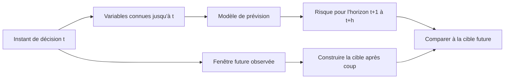

Un protocole clair définit :

- **L'instant de décision** : quand le score doit être disponible pour aider l'équipe.
- **La fréquence de prédiction** : à chaque minute, cinq minutes, ou lors d'un événement.
- **L'horizon** : durée pendant laquelle un événement futur est recherché.
- **La cible** : par exemple, le franchissement d'un seuil confirmé pendant une période minimale.
- **La fenêtre de mesure** : intervalle utilisé pour calculer les caractéristiques.
- **Le délai d'action utile** : le temps minimal dont l'équipe a besoin pour agir avant l'incident.

Ces paramètres influencent le résultat. Une alerte à cinq secondes d'un incident peut être techniquement correcte mais inutile si l'équipe a besoin de dix minutes pour intervenir. À l'inverse, un horizon trop long peut créer un volume d'alertes inutiles. L'horizon doit être décidé avec le propriétaire opérationnel, puis évalué en mesurant le délai d'anticipation réellement obtenu.

### B. Construire une cible qui représente un incident utile

La cible n'est pas forcément un simple franchissement de seuil. Pour entraîner un modèle supervisé, l'équipe doit créer une définition stable de l'événement que l'on veut prédire. Une cible possible est « le lien a dépassé 85 % d'utilisation pendant trois mesures consécutives dans les quinze minutes suivantes ». Une autre pourrait être « la latence p95 a dépassé le budget d'erreur et l'indicateur de perte de paquets a confirmé une dégradation ». La définition choisie doit être explicite et vérifiable.

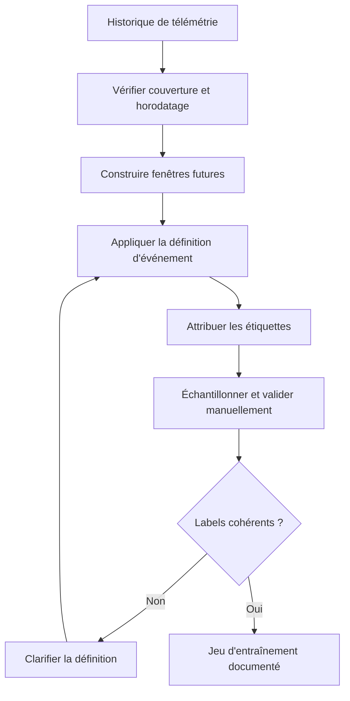

Il faut éviter deux pièges. Premièrement, un label qui définit toute valeur élevée comme « panne » peut confondre une hausse légitime de trafic avec une dégradation. Deuxièmement, un label dérivé d'une alerte déjà défectueuse peut apprendre à reproduire les erreurs de cette alerte. Lorsque c'est possible, rapproche plusieurs sources : métriques, tickets confirmés, contrôles synthétiques, changements et annotations d'opérateurs.

Documente la méthode de labellisation, les seuils appliqués, les exceptions et la façon de traiter les fenêtres où la télémétrie manque. Si aucune preuve ne permet de déterminer si l'événement a eu lieu, l'exemple ne doit pas être étiqueté automatiquement comme négatif. Il peut être marqué inconnu et exclu de l'entraînement principal, tout en restant dans un rapport de couverture.

Un label de qualité doit être aussi stable que possible dans le temps. Si la définition d'une congestion est modifiée, la nouvelle version doit être identifiée. Les résultats d'un modèle entraîné avec la définition précédente ne se comparent pas directement à ceux d'un modèle construit avec la nouvelle définition sans analyser la différence de sémantique.

### C. Concevoir des variables temporelles sans fuite de données

Les données réseau ont une structure temporelle : les dernières valeurs, les tendances, les variations, la période de la journée, le type de jour et les changements récents peuvent tous apporter du contexte. Les caractéristiques doivent être calculées en ne regardant que les observations antérieures ou disponibles à l'instant de décision. Il faut aussi traiter les fréquences de collecte différentes : une source de métriques toutes les trente secondes ne peut pas être alignée naïvement avec un journal émis de façon irrégulière.

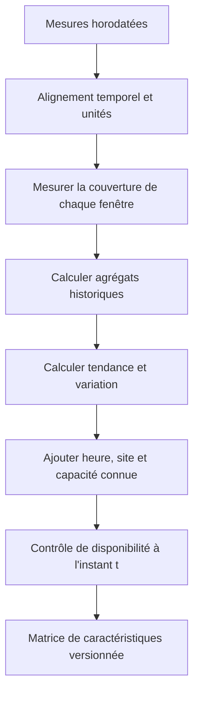

Des caractéristiques possibles sont la moyenne et le maximum des cinq dernières minutes, le percentile d'utilisation, la différence entre la fenêtre courante et la précédente, une pente approximative, le nombre de mesures manquantes, l'heure locale, le jour de semaine, la capacité déclarée du lien ou le nombre d'incidents ouverts. Chaque variable doit avoir un sens opérationnel documenté, une unité et une méthode de calcul.

Les variables dérivées du futur sont interdites. Pour prédire un incident à t+15, la moyenne de t+10 à t+15 ne peut pas être une caractéristique. Une normalisation ou une imputation calculée à partir de l'ensemble complet peut aussi introduire une fuite, car la transformation utilise des statistiques du futur. Les transformations apprises doivent être ajustées sur l'entraînement puis appliquées aux données de validation et de test.

Un autre risque est la fuite d'identité. Si le même incident apparaît dans plusieurs fenêtres presque identiques et que les fenêtres sont réparties aléatoirement dans les jeux, le test peut contenir une copie proche des exemples d'entraînement. Selon la question opérationnelle, regroupe les fenêtres par incident, lien, site ou période avant la séparation. La séparation doit simuler la difficulté à généraliser vers les événements réellement nouveaux.

Exemple de création de caractéristiques temporelles à partir d'une série déjà ordonnée. Le code suppose que les dates sont normalisées, qu'une cadence cohérente existe et que l'index est temporel ; dans un véritable projet, il faut vérifier ces hypothèses :

```python
import pandas as pd

def make_features(df: pd.DataFrame) -> pd.DataFrame:
    required = {"timestamp", "link_id", "utilization_pct"}
    missing = required - set(df.columns)
    if missing:
        raise ValueError(f"Colonnes manquantes : {sorted(missing)}")

    data = df.copy()
    data["timestamp"] = pd.to_datetime(data["timestamp"], utc=True)
    data = data.sort_values(["link_id", "timestamp"])
    grouped = data.groupby("link_id", group_keys=False)

    data["util_mean_5m"] = grouped["utilization_pct"].transform(
        lambda s: s.shift(1).rolling(5, min_periods=3).mean()
    )
    data["util_max_5m"] = grouped["utilization_pct"].transform(
        lambda s: s.shift(1).rolling(5, min_periods=3).max()
    )
    data["util_delta_1"] = grouped["utilization_pct"].diff().shift(1)
    data["hour_utc"] = data["timestamp"].dt.hour
    return data
```

Ce fragment illustre le principe d'une fenêtre historique ; il ne définit pas à lui seul un jeu complet pour l'entraînement. Le décalage utilisé doit être vérifié selon l'alignement du label et du timestamp de décision. Les mesures manquantes, les doublons, les trous de fréquence et le temps de réception doivent être contrôlés. Le code doit être testé sur des cas synthétiques où l'on sait exactement quelles valeurs peuvent être utilisées.

### D. Aligner les données et évaluer leur couverture

Une absence de métrique n'équivaut pas à une utilisation faible. Si un capteur ne répond pas pendant une période de congestion, les observations disponibles peuvent donner une image artificiellement saine. Il faut donc calculer la couverture par fenêtre, source et lien avant de considérer la valeur prédictive.

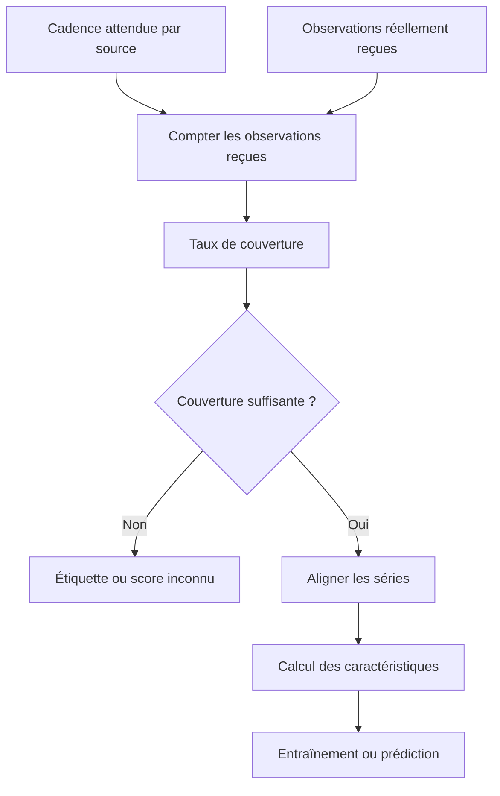

Précise les règles d'alignement : fenêtre gauche ou droite, bornes inclusives, valeur de remplacement éventuelle et tolérance à la latence. Si les sources utilisent des unités différentes, convertis-les selon un contrat validé. Si une mesure est reçue tardivement, décide si l'instant de décision aurait réellement pu la connaître. Une analyse hors ligne peut utiliser des données nettoyées, mais l'évaluation opérationnelle doit rester fidèle à l'information disponible au moment de l'action.

L'imputation peut être utile, par exemple en recopiant la dernière valeur connue dans une petite fenêtre, mais elle peut aussi prolonger artificiellement un état qui n'existe plus. Ajoute une variable indiquant que l'imputation a été utilisée et limite sa durée. Quand le manque dépasse la tolérance, le bon résultat peut être l'abstention plutôt qu'une estimation construite à partir de données insuffisantes.

La couverture est aussi un indicateur opérationnel en soi. Un modèle peut être très performant sur 60 % des fenêtres qui sont complètes, mais ne rien savoir pendant les périodes où les sources tombent. Dans le rapport, présente les performances en même temps que le pourcentage de prédictions réalisées, les périodes exclues et les raisons d'exclusion.

### E. Établir des baselines adaptées au rythme réseau

La baseline doit être assez forte pour rendre le test significatif. Comparer un modèle à une prédiction constante peut parfois aider à détecter une erreur de pipeline, mais ce n'est pas toujours un comparateur utile pour une série saisonnière. Pour un lien WAN, des références pertinentes peuvent être la dernière valeur disponible, la même période du jour précédent, une médiane des périodes similaires ou une règle simple fondée sur une tendance.

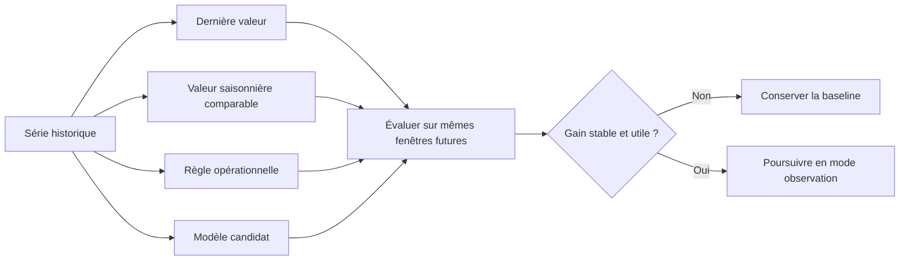

Le modèle doit battre la baseline sur des fenêtres futures, pas simplement obtenir un bon score sur les données d'entraînement. Le gain doit être stable sur plusieurs périodes et plusieurs liens représentatifs. Un modèle plus sophistiqué peut échouer pendant un jour férié, un changement d'architecture ou un transfert de trafic vers une autre route. Les résultats agrégés doivent être ventilés par type de lien et environnement.

La baseline apporte aussi un plan de secours. Si le modèle devient indisponible ou si sa qualité baisse, une règle validée peut continuer à assurer une surveillance de base. Le repli doit être documenté et testé. Il ne faut pas dépendre d'un modèle unique pour détecter les conditions qui signalent sa propre panne, par exemple la disparition complète de sa source de données.

### F. Séparer correctement l'entraînement, la validation et le test

Les séries temporelles ne doivent généralement pas être séparées par un tirage aléatoire de fenêtres. Utilise une séparation qui entraîne sur le passé, valide sur une période ultérieure et teste sur une période encore plus récente. La durée doit être adaptée à la saisonnalité, à la rareté des événements et aux changements opérationnels. Une seule séparation peut être insuffisante ; plusieurs fenêtres de validation glissante donnent une meilleure indication de stabilité.

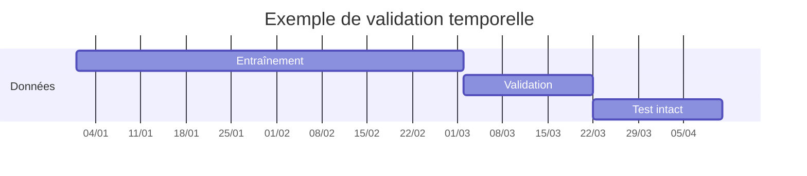

Un découpage chronologique doit respecter le temps de disponibilité des données. Si un incident commence avant la frontière du jeu de test et continue après, il faut déterminer si ses fenêtres se retrouvent dans plusieurs jeux. Il peut être utile d'ajouter une période de purge entre les jeux lorsque les fenêtres se chevauchent ou que les étiquettes utilisent un horizon futur, afin d'empêcher que la même occurrence influence à la fois l'entraînement et l'évaluation.

Dans une validation en origine glissante, on entraîne sur une période passée, évalue sur la période suivante, puis avance la fenêtre et répète. Cela permet de tester des contextes différents. Les résultats doivent ensuite être synthétisés en précisant la variabilité d'une fenêtre à l'autre plutôt que d'afficher uniquement la meilleure valeur.

```python
def forward_splits(n, train_size, valid_size, step):
    """Produit des intervalles d'indices chronologiques sans mélange aléatoire."""
    if min(n, train_size, valid_size, step) <= 0:
        raise ValueError("Les tailles doivent être positives")
    start = 0
    while start + train_size + valid_size <= n:
        train = (start, start + train_size)
        valid = (start + train_size, start + train_size + valid_size)
        yield train, valid
        start += step

for train_range, valid_range in forward_splits(
    n=240, train_size=120, valid_size=30, step=30
):
    print("train:", train_range, "validation:", valid_range)
```

Ce générateur produit des plages d'indices ; il ne gère pas les groupes d'incidents, les périodes de purge ou les irrégularités des timestamps. Ces contrôles doivent être ajoutés en fonction des données. L'important est que la logique de séparation soit écrite, testée et conservée avec la version du jeu de données.

### G. Gérer les événements rares et le déséquilibre des classes

Les incidents graves sont souvent rares. Un modèle qui annonce « pas de congestion » à chaque instant peut avoir 99 % d'exactitude si les fenêtres de congestion ne représentent qu'un faible pourcentage de l'historique. Son utilité est nulle pour l'anticipation des incidents. Évalue le rappel des événements importants, la précision des alertes, le nombre de fausses alertes par période et le délai d'anticipation.

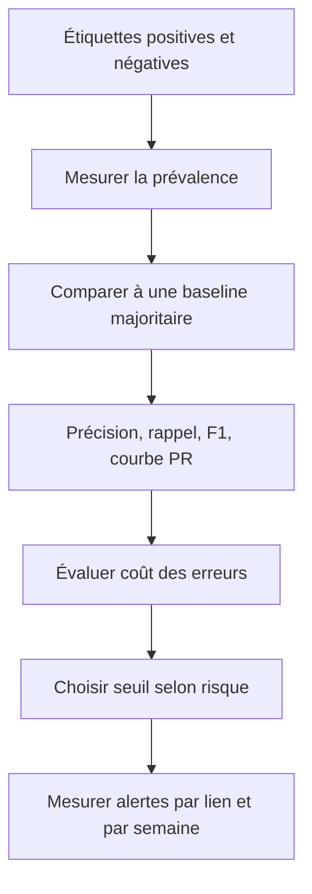

Le suréchantillonnage, le sous-échantillonnage et les poids de classes peuvent aider pendant l'entraînement, mais ils doivent être appliqués uniquement dans la partie entraînement de chaque fold. Si l'on rééchantillonne avant de séparer les données, des exemples très similaires peuvent se retrouver dans plusieurs jeux et gonfler les résultats. La distribution du jeu de test doit rester proche de la distribution future visée, ou être explicitement ajustée pour refléter un scénario particulier.

Le choix du seuil de décision n'est pas seulement mathématique. Si une fausse alerte coûte quelques minutes de vérification, l'équipe peut tolérer une sensibilité plus élevée. Si chaque alerte déclenche une opération risquée, la précision doit être davantage contrôlée. Il faut comparer plusieurs seuils avec des scénarios historiques et représenter le compromis plutôt que choisir systématiquement 0,5.

Les métriques doivent être ventilées par liens, régions, types de service et niveaux de criticité. Une précision moyenne acceptable peut masquer des performances faibles sur un groupe qui dispose de peu d'historique. Dans ce cas, prévois un seuil d'abstention, une règle de secours ou une revue humaine plutôt que de supposer que le modèle généralise uniformément.

### H. Calibrer les scores et les transformer en alertes utiles

Un score de modèle est une sortie numérique, pas toujours une probabilité fiable. Si le modèle indique 0,8, cela ne signifie pas automatiquement qu'il y aura 80 % de congestion dans le contexte courant. La calibration doit être mesurée sur des données séparées, et la décision utilise ensuite un seuil approuvé selon le coût d'erreur.

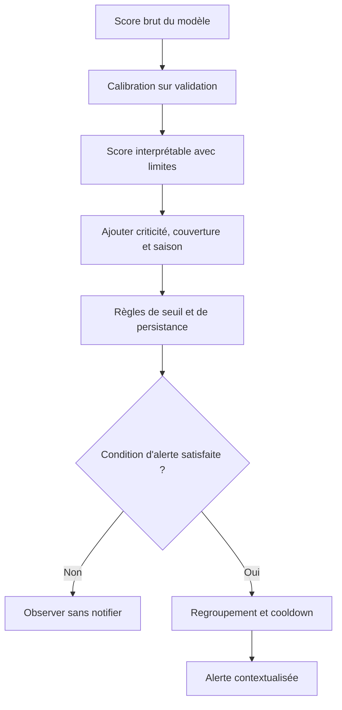

Une politique d'alerte peut exiger un score supérieur au seuil sur deux fenêtres consécutives, une couverture minimale et une confirmation par un indicateur opérationnel. La persistance réduit le bruit de certains points extrêmes, mais peut retarder les alertes ; ce compromis doit être mesuré. Les événements peuvent également être regroupés par lien et période afin d'éviter une notification par mesure, tout en conservant les éléments d'origine.

Chaque alerte devrait présenter le lien ou le service concerné, l'horizon prédit, la couverture des mesures, les variables principales, les comparaisons à la baseline, l'incertitude, le seuil appliqué et la prochaine étape recommandée. Évite les formulations catégoriques comme « le lien sera saturé » si la sortie indique seulement un score élevé. Préfère « risque élevé selon la définition versionnée, à confirmer par les indicateurs actuels ».

Il est essentiel de séparer un score prédictif de l'autorisation d'agir. Une probabilité élevée peut justifier une investigation, mais pas une modification automatique de routage ou l'augmentation de capacité sans politique distincte. L'action suit un cycle séparé comprenant approbation, préconditions, limites, vérification après action et rollback.

### I. Mesurer la valeur opérationnelle, pas seulement le score hors ligne

Une performance statistique devient utile lorsqu'elle améliore la décision opérationnelle. Pour un modèle de prévision de congestion, mesure le délai d'anticipation avant l'événement confirmé, le nombre de fausses alertes par semaine, le rappel des incidents prioritaires, la durée de service dégradé et la proportion d'alertes exploitées par l'équipe. Un modèle peut améliorer le rappel tout en saturant les opérateurs de notifications ; cela doit apparaître dans le résultat.

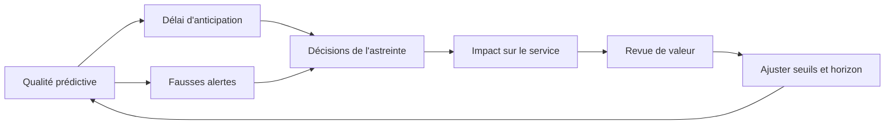

Définis une fenêtre de suivi et une façon de confirmer les événements. Sans vérité de référence, il est difficile de déterminer si un signal était utile. Une alerte ignorée n'est pas forcément un faux positif ; l'équipe peut n'avoir pas eu le temps de l'analyser. Un ticket ouvert par une alerte n'est pas forcément la preuve d'une dégradation réelle. Il faut un protocole de labellisation qui distingue les cas confirmés, infirmés et indéterminés.

Pour comparer le modèle à la méthode précédente, utilise si possible un mode shadow : le score est produit et enregistré, mais ne modifie pas la décision de production. À partir de cette période, mesure la performance sur les mêmes événements et la même définition. Les résultats peuvent ensuite soutenir un pilote limité avec des opérateurs informés. Une mise en service ne doit pas être présentée comme réussie si seul un test rétrospectif a été effectué.

### J. Détecter dérive des données et dérive de concept

La dérive des données apparaît lorsque la distribution des caractéristiques change : une capacité a été augmentée, un nouveau site a été ouvert, la télémétrie est modifiée ou les habitudes de trafic évoluent. La dérive de concept apparaît lorsque la relation entre les caractéristiques et la cible change : un schéma auparavant associé à une congestion n'a plus la même signification après une nouvelle architecture. Ces situations se diagnostiquent différemment.

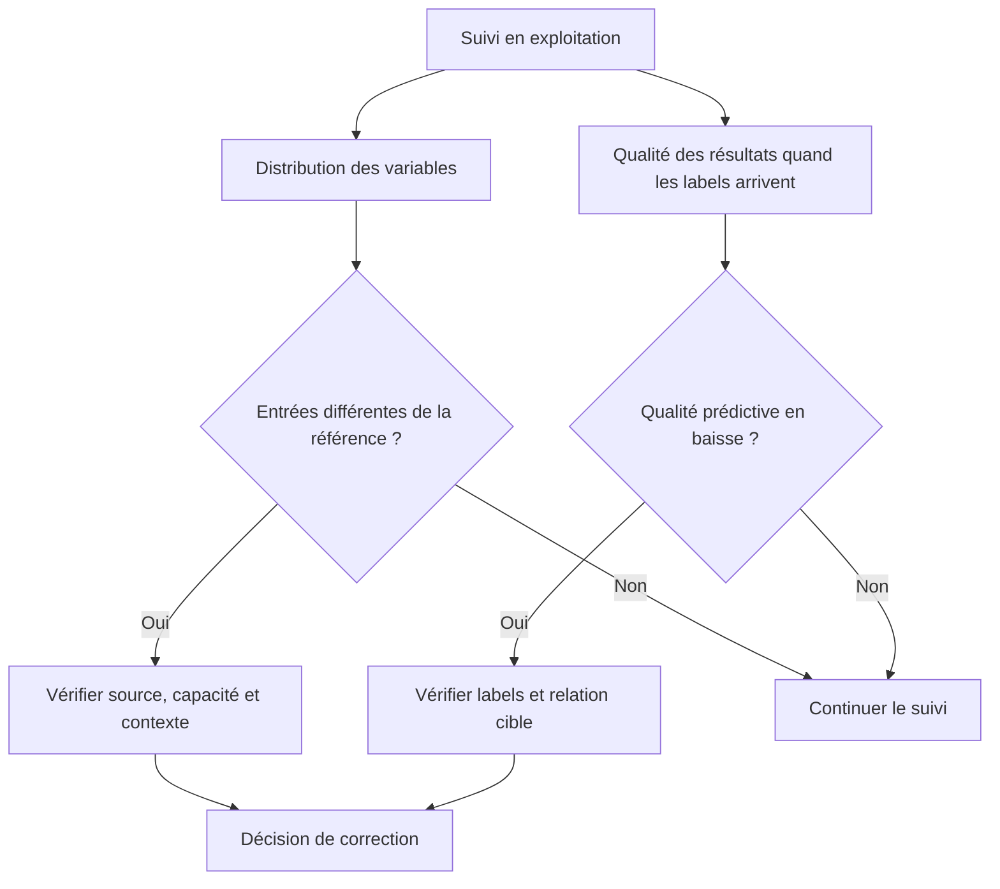

Un changement de distribution n'exige pas systématiquement un réentraînement. Il peut provenir d'une modification légitime de capacité ou d'une erreur de collecte. Avant toute adaptation, vérifie les sources, les unités, les horaires, la topologie, les changements récents et la définition de l'événement. Un réentraînement automatique sans analyse peut apprendre un état dégradé comme nouvelle normalité.

Il faut conserver une référence des distributions et de la qualité par groupe. Mesure la couverture, la fréquence des valeurs absentes, les plages plausibles, les changements de catégorie et les différences entre sites. Lorsque les labels arrivent plus tard, mesure les performances confirmées selon les mêmes définitions et compare-les à la référence.

Un plan d'action de dérive doit définir les conditions d'alerte, le propriétaire, les étapes de diagnostic, les critères de réentraînement, le protocole de validation, le mode shadow et la possibilité de revenir à la version antérieure. Les modèles et jeux de données doivent être versionnés afin de comprendre quelle évolution a provoqué un changement des résultats.

### K. Rendre la pipeline reproductible et auditable

Une pipeline ML ne se limite pas au fichier du modèle. Elle comprend les sources, les transformations, les règles d'étiquetage, la séparation temporelle, le code d'entraînement, les paramètres, les métriques, le seuil de décision et la procédure de déploiement. Si un seul de ces éléments change, la nouvelle évaluation doit conserver la trace de cette différence.

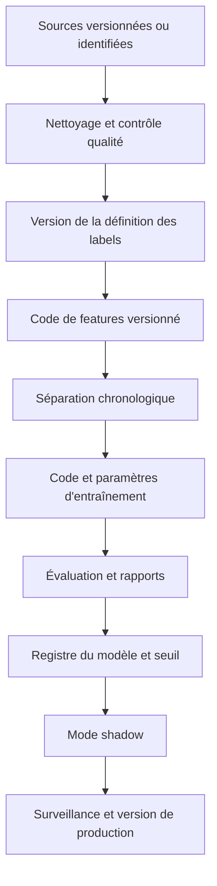

Le dossier d'un essai doit conserver la période de données, les filtres, le nombre d'exemples, le taux de données manquantes, les paramètres, la graine aléatoire si applicable, les versions des bibliothèques, les métriques par groupe et la matrice de confusion. Ne stocke pas des secrets ou des données détaillées de production dans le rapport ; privilégie les identifiants et les données minimisées.

Les résultats doivent être reproductibles autant que possible. Certaines bibliothèques ou exécutions matérielles peuvent introduire de petites variations ; l'objectif est alors de documenter l'environnement et les tolérances. La comparaison de versions doit utiliser la même période de test ou une suite de validation versionnée, tout en reconnaissant que les comportements peuvent changer avec le service.

```python
from dataclasses import dataclass
from datetime import datetime, timezone

@dataclass
class ExperimentCard:
    experiment_id: str
    dataset_version: str
    feature_version: str
    label_definition: str
    train_start: str
    train_end: str
    test_start: str
    test_end: str
    model_version: str
    threshold: float
    owner: str

def validate_experiment(card: ExperimentCard) -> None:
    if not card.experiment_id or not card.owner:
        raise ValueError("Identifiant d'essai et propriétaire obligatoires")
    if card.train_end >= card.test_start:
        raise ValueError("Le test doit commencer après la période d'entraînement")
    if not 0.0 <= card.threshold <= 1.0:
        raise ValueError("Le seuil doit être compris entre 0 et 1")

example = ExperimentCard(
    experiment_id="wan-risk-2026-01",
    dataset_version="dataset-v3",
    feature_version="features-v2",
    label_definition="congestion-15m-v1",
    train_start="2026-01-01",
    train_end="2026-03-31",
    test_start="2026-04-01",
    test_end="2026-04-30",
    model_version="baseline-candidate-2",
    threshold=0.72,
    owner="network-analytics",
)
validate_experiment(example)
```

Ce modèle de carte d'expérience est simplifié. Le test de comparaison des dates sous forme de chaînes ne suffit que pour un format ISO uniforme ; un système réel devrait parser et valider les dates ainsi que les fuseaux horaires. La carte illustre le principe de conserver la définition de la cible, des caractéristiques, des données, du modèle et du seuil ensemble.

### L. Laboratoire guidé — construire et évaluer un prédicteur de congestion

**Objectif :** préparer un petit jeu synthétique de métriques par lien et comparer un modèle candidat à une baseline dans le temps. Il s'agit d'un exercice d'analyse ; le résultat ne sera pas branché à un système d'écriture réseau.

#### Étape 1 — Définir la cible

Choisis une cible mesurable, par exemple « utilisation supérieure à un seuil de façon persistante au cours des quinze prochaines minutes ». Documente les cas non évaluables lorsque la couverture future est insuffisante. Sépare la construction de l'étiquette du calcul des variables afin de rendre la direction temporelle explicite.

#### Étape 2 — Préparer les variables

Par lien, calcule une moyenne historique, une valeur maximale sur une fenêtre, une variation récente et des variables calendaires. Exclue toute mesure après l'instant de décision. Conserve une variable de couverture et une version de schéma pour aider au diagnostic.

#### Étape 3 — Construire une baseline

La baseline peut utiliser une règle simple sur la tendance courante ou l'utilisation observée. Son seuil doit être documenté et ses résultats mesurés sur les mêmes fenêtres que le modèle candidat. Le modèle n'est pas considéré comme utile s'il ne produit qu'une meilleure métrique sur l'entraînement.

#### Étape 4 — Utiliser une séparation chronologique

Entraîne sur les périodes les plus anciennes, valide sur une période plus récente et réserve une période finale intacte. Si plusieurs liens ou incidents sont fortement corrélés, évalue aussi la généralisation sur des liens ou événements qui n'ont pas servi à entraîner. Fais attention au chevauchement entre les fenêtres qui définissent la cible.

#### Étape 5 — Choisir le seuil à partir du coût des erreurs

Calcule précision, rappel, F1, nombre de fausses alertes par période et délai d'anticipation. Compare plusieurs seuils sur la validation ; n'utilise pas le test final pour régler les paramètres. Présente le taux de couverture et les résultats par type de lien. Si le modèle est incertain ou que les données sont incomplètes, le statut doit rester inconnu plutôt que devenir une prédiction négative.

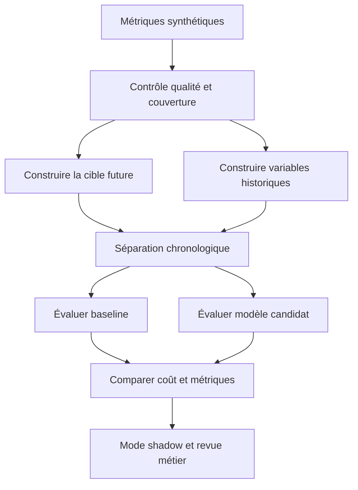

#### Exemple de comparaison métrique

Le fragment ci-dessous calcule plusieurs métriques sur des étiquettes et des scores supposés déjà produits par une méthode candidate. Il illustre la mesure, pas la création d'un modèle ni la définition d'une cible de congestion. Les valeurs sont fictives :

```python
from sklearn.metrics import (
    average_precision_score,
    confusion_matrix,
    precision_score,
    recall_score,
    f1_score,
)

y_true = [0, 0, 1, 0, 1, 0, 0, 1, 0, 0]
scores =  [0.08, 0.22, 0.83, 0.45, 0.71, 0.18, 0.32, 0.91, 0.20, 0.11]
threshold = 0.60
y_pred = [int(score >= threshold) for score in scores]

print("Matrice :", confusion_matrix(y_true, y_pred).tolist())
print("Précision :", precision_score(y_true, y_pred, zero_division=0))
print("Rappel :", recall_score(y_true, y_pred, zero_division=0))
print("F1 :", f1_score(y_true, y_pred, zero_division=0))
print("Average precision :", average_precision_score(y_true, scores))
```

Ce jeu d'exemple est petit et équilibré de manière artificielle ; ses scores n'ont pas de valeur d'estimation pour un réseau réel. Il faudrait des données historiques représentatives, une procédure de labellisation fiable et plusieurs fenêtres de test. L'average precision est une mesure utile pour les événements rares, mais elle doit rester accompagnée du nombre de cas positifs et du coût des alertes.

#### Étape 6 — Simuler le fonctionnement opérationnel

Rejoue une série de prédictions dans l'ordre du temps. Ajoute un état de couverture, un seuil d'alerte et un mécanisme de regroupement des événements. Simule ensuite des cas : lien sans mesures, capacité augmentée, montée légitime de trafic, événements manqués et changement de distribution. Le rapport final doit distinguer ce que le modèle a prédit, ce que le système a réellement observé et les cas qui n'ont pas pu être évalués.

### M. Contrôles de qualité à chaque exécution

Les contrôles doivent s'exécuter avant la prédiction, au moment de la production du score et lorsque la cible de référence devient disponible. Ils doivent aussi être séparés des alertes de congestion : une baisse de qualité des données peut demander une intervention de collecte sans indiquer que le réseau lui-même est congestionné.

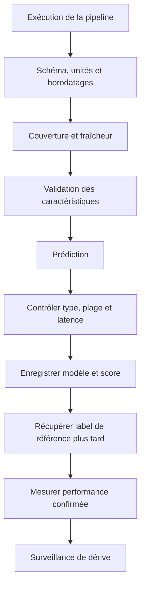

Définis des conditions d'abstention avant le lancement : horodatage trop ancien, taux de données manquantes supérieur à la limite, capacité inconnue, unité inattendue, modèle non disponible ou version de transformation incompatible. Si une condition est vraie, le pipeline ne doit pas transformer l'erreur en score normal. Le rapport explique alors le motif et le système de surveillance classique continue de fonctionner.

Le contrôle des sorties détecte les valeurs non finies, le mauvais schéma, les scores hors plage attendue, les délais anormaux et les versions non autorisées. Les métriques de modèle doivent être liées à l'identifiant d'exécution, au lien, au moment de prédiction et à l'horizon. Les journaux ne doivent pas recopier inutilement toutes les données brutes ou les identifiants sensibles.

### N. Définir les actions autorisées après une prédiction

Un modèle de congestion peut recommander une investigation, un contrôle supplémentaire ou une comparaison à la capacité connue. Il ne devrait pas modifier directement le routage à partir d'un score sans passer par un mécanisme de politique distinct. Une suggestion automatisée est une entrée dans le processus de décision ; l'action reste soumise à l'état actuel, à la criticité, aux préconditions et aux permissions.

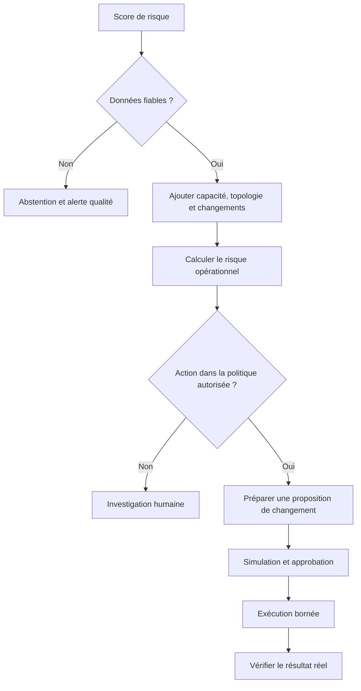

La recommandation doit expliquer pourquoi le risque a augmenté, quelles mesures sont observées, quelle est la couverture, quel horizon est évalué et quelle vérification distinguerait les hypothèses. Il faut éviter de confondre une corrélation entre utilisation et congestion avec une causalité certaine. Une hausse d'utilisation peut être normale si la capacité a été augmentée ou si la demande est légitime.

L'action autorisée peut être « notifier l'astreinte », « produire un rapport de lien » ou « lancer une mesure complémentaire » avant d'autoriser une configuration. Si l'équipe décide plus tard de donner au système une permission d'écriture, elle doit documenter le niveau de risque, l'étendue de l'action, la méthode de simulation, le rollback, les conditions d'arrêt et les preuves exigées après l'exécution.

### O. Revue de modèle et critères de retrait

La revue périodique examine la qualité des labels, les performances par sous-groupe, la couverture, les changements du réseau, le coût des erreurs, l'utilité des alertes et le résultat des actions prises après les alertes. Elle doit permettre de corriger les données, de modifier un seuil, de conserver la baseline ou de retirer le modèle. Le réentraînement ne doit pas être la réponse automatique à toute baisse de qualité.

Un modèle peut devoir être retiré si les sources sont trop incomplètes, si les labels ne sont plus fiables, si la performance n'est plus supérieure à la baseline ou si son coût opérationnel dépasse son bénéfice. Dans ce cas, la surveillance conventionnelle doit rester disponible. La procédure doit décrire qui décide du retrait, quelle version antérieure peut être restaurée et comment les scores en attente sont traités.

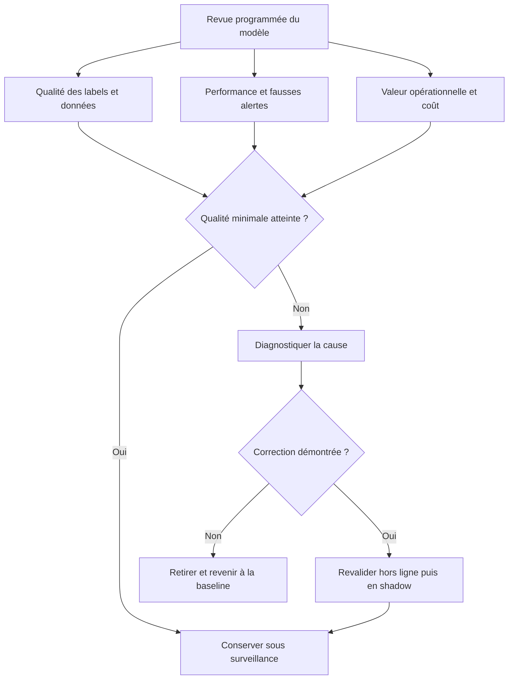

Toute évolution doit être évaluée sur un protocole comparable. Si le nouveau modèle utilise une nouvelle définition de la cible, un nouvel inventaire de liens ou une autre fenêtre, il faut faire apparaître ces changements. Le résultat de la revue doit être une décision explicite : continuer, restreindre, corriger, réentraîner, passer en observation ou retirer.

### P. Synthèse de l'atelier

La supervision réseau par ML repose sur une discipline temporelle autant que sur un algorithme. Il faut fixer l'instant de décision et l'horizon, construire une cible observée avec des règles reproductibles, dériver uniquement les variables disponibles à cet instant et mesurer la couverture. Les données sont séparées selon le temps, les baselines reflètent les régularités réelles du réseau et les métriques tiennent compte des événements rares et du coût des faux positifs et faux négatifs.

En exploitation, le score est accompagné de contexte, d'un indicateur de qualité et d'un état d'abstention. Il sert d'abord à fournir une recommandation explicable, puis est comparé à une vérité de référence lorsqu'elle devient disponible. La dérive des entrées et celle de la relation cible sont diagnostiquées avant toute mise à jour. Les versions des jeux de données, des variables, des modèles et des seuils sont conservées afin de rendre les résultats auditables.

Au niveau intermédiaire, la maîtrise consiste à construire un pipeline temporel correct, à mettre en place une évaluation solide et à intégrer le modèle dans une procédure opérationnelle sûre. La meilleure solution n'est pas nécessairement celle qui produit la meilleure métrique isolée. Elle doit anticiper suffisamment tôt les événements utiles, conserver un taux de fausses alertes supportable, s'abstenir lorsque les données sont insuffisantes et pouvoir revenir à la méthode de référence sans perturber la surveillance.

## Défi final corrigé — anticiper une congestion WAN sans fuite temporelle

### Énoncé

Les liens WAN présentent un pic quotidien autour de 09 h et parfois une congestion exceptionnelle avant une maintenance. Tu disposes de métriques horodatées : débit entrant/sortant, pertes, latence, état du lien et calendrier de changements. Construis une démarche qui estime le risque de congestion dans les quinze prochaines minutes. La cible est un avertissement utile à l'astreinte, pas un score de laboratoire flatteur.

### Pipeline temporel

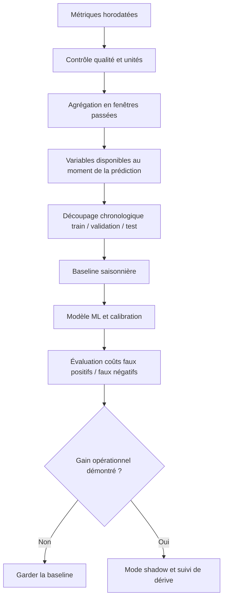

### Exemple de séparation temporelle

```python
import pandas as pd

df = pd.read_csv("wan_metrics.csv", parse_dates=["timestamp"])
df = df.sort_values("timestamp").dropna(subset=["timestamp", "utilization"])
df = df.drop_duplicates(subset=["device", "interface", "timestamp"])
df["hour"] = df["timestamp"].dt.hour
df["weekday"] = df["timestamp"].dt.dayofweek
df["utilization_lag_1"] = df.groupby(["device", "interface"])["utilization"].shift(1)
df["utilization_mean_5"] = (
    df.groupby(["device", "interface"])["utilization"]
      .transform(lambda s: s.shift(1).rolling(5, min_periods=5).mean())
)
df = df.dropna(subset=["utilization_lag_1", "utilization_mean_5"])

cutoff = df["timestamp"].quantile(0.8)
train = df[df["timestamp"] < cutoff]
test = df[df["timestamp"] >= cutoff]
assert train["timestamp"].max() < test["timestamp"].min()
```

Le code illustre la préparation des variables ; la colonne cible doit être définie à partir d'une fenêtre future, sans réutiliser cette fenêtre dans les variables explicatives. Pour une validation rigoureuse, réserve aussi une période distincte à la sélection du modèle et documente les changements de collecte.

### Proposition de correction

Définis d'abord la congestion : par exemple, utilisation supérieure à un seuil pendant plusieurs intervalles, accompagnée d'une dégradation de latence ou de pertes. Évite d'utiliser seulement un pic d'utilisation si certains liens peuvent fonctionner normalement à forte charge. Le choix de l'horizon de quinze minutes doit correspondre au temps réellement nécessaire pour agir.

La baseline saisonnière peut prédire la charge habituelle du même lien à la même heure et le même jour. Le modèle ML n'est utile que s'il apporte un gain reproductible sur les périodes futures et sur plusieurs types de liens. Évalue le rappel des incidents importants, le nombre de fausses alertes par semaine, le délai d'anticipation et la calibration des probabilités. Les prédictions doivent d'abord être observées en mode shadow sans déclencher d'action.

### Barème d'autoévaluation

- La cible est définie avec un horizon clair.
- Les variables n'utilisent que les informations disponibles à l'instant de prédiction.
- Le test est chronologique et séparé de l'entraînement.
- Le modèle est comparé à une baseline saisonnière.
- Le résultat est mesuré en coût opérationnel, puis observé en mode shadow.

## 11. Checklist et à retenir

- [ ] L'objectif métier et le service concerné sont explicites et mesurables.
- [ ] Chaque observation conserve provenance, horodatage, unité et qualité.
- [ ] La méthode a été comparée à une baseline simple.
- [ ] Les tests couvrent cas normaux, données manquantes et échecs.
- [ ] Les résultats sont ventilés par criticité et catégorie pertinente.
- [ ] Les permissions sont minimales et les secrets absents des journaux.
- [ ] Les décisions relient preuves, version, approbation et résultat.
- [ ] Chaque action risquée a préconditions, périmètre limité et rollback.
- [ ] Les mesures évaluent le service et les erreurs opérationnelles.
- [ ] Une procédure décrit abstention, escalade, suspension et revue.

### À retenir
Le but d'une démarche AIOps n'est pas d'automatiser chaque décision, mais de rendre les opérations plus rapides, cohérentes et vérifiables. Pour ML pour la supervision réseau, la qualité dépend des données, de l'adéquation de la technique, d'une évaluation honnête et de la vérification du résultat. Un système capable de reconnaître ses limites, de bloquer une action risquée et de transmettre un dossier de preuve peut être plus utile qu'un système qui agit toujours sans expliquer ses erreurs.

rappel à l'horizon défini, précision et faux positifs par lien, délai d'avertissement utile, MAE/RMSE de prévision, erreurs par site et criticité sont des mesures candidates, mais chacune doit être associée à un objectif, un propriétaire et une action lorsqu'elle franchit une limite. Le nombre de modèles ou d'alertes traitées n'est pas en soi une mesure de valeur. La boucle d'amélioration est complète quand les résultats confirment ou réfutent les hypothèses, les incidents sont documentés et les contrôles évoluent selon les erreurs observées. Créer des variables temporelles et évaluer des modèles de supervision réseau. Le maintien dans le temps implique de réviser les sources, tester la reprise et retirer une méthode quand ses limites dépassent son bénéfice.

## 12. Références

- https://scikit-learn.org/stable/modules/cross_validation.html
- https://opentelemetry.io/docs/
- https://opentelemetry.io/docs/ — documentation sur l'observabilité et la télémétrie.
- https://www.nist.gov/itl/ai-risk-management-framework — cadre de gestion des risques de l'IA.
