# MLOps pour l'infrastructure — Expert

> **Mise en contexte :** une équipe a développé un modèle qui repère les risques d'incident dans les métriques réseau. Le prototype fonctionne dans un notebook, mais les résultats changent selon la machine, les dépendances et les données chargées. Après une mise à jour du collecteur, le score se dégrade et personne ne sait si le modèle, le pipeline ou les données sont responsables. Le MLOps apporte des pratiques d'ingénierie pour construire, versionner, tester, déployer et surveiller des systèmes de machine learning sur la durée. L'objectif est la reproductibilité et la maîtrise du risque, non l'automatisation aveugle des déploiements.

## Sommaire

1. Objectifs et périmètre du MLOps
2. Cycle de vie d'un modèle opérationnel
3. Architecture de référence
4. Données, contrats et lignage
5. Versionnement et reproductibilité
6. Construire un pipeline d'entraînement
7. Tests de données, de modèles et de sécurité
8. Registre et promotion des modèles
9. CI/CD et déploiement contrôlé
10. Inférence, latence et disponibilité
11. Observabilité, dérive et qualité
12. Incident, rollback et réponse à une régression
13. Atelier Python et manifeste d'artefact
14. TP : industrialiser un modèle de supervision
15. Gouvernance, accès et coûts
16. Dépannage
17. Exercices corrigés
18. Défi final, checklist et références

## 1. Objectifs et périmètre du MLOps

Le MLOps applique l'ingénierie logicielle, l'automatisation des déploiements et la gestion des données au cycle de vie des modèles. Dans une infrastructure réseau, le modèle peut détecter des anomalies, prévoir des pannes, classer des incidents, aider à prioriser des inspections ou enrichir un diagnostic. Une fois en production, le système doit gérer les mises à jour de données, les changements de topologie, les dépendances logicielles, la disponibilité du service d'inférence et l'évolution des résultats.

Un prototype est souvent évalué sur un jeu de données fixe. Un système exploité doit fonctionner avec des entrées réelles, fournir un résultat dans un délai défini, signaler une entrée invalide, garder sa provenance et pouvoir être arrêté ou restauré. La performance dépend donc du pipeline complet : collecte, préparation, entraînement, évaluation, packaging, registre, déploiement, inférence, surveillance et retour terrain.

À la fin du cours, vous devez pouvoir concevoir une chaîne reproductible, versionner les données et les paramètres, automatiser les tests, définir des critères de promotion, surveiller la qualité en production, détecter une dérive, effectuer un rollback et expliquer les contrôles de sécurité. Vous devez également pouvoir justifier pourquoi chaque composant existe et quel problème il résout.

### Vocabulaire

- **Artefact** : fichier ou objet versionné produit par un pipeline, par exemple un modèle ou un rapport.
- **Lignage** : historique reliant données, code, paramètres, environnement, modèle et résultats.
- **Registre de modèles** : catalogue des versions, métadonnées et statuts des modèles.
- **CI** : intégration continue, qui exécute automatiquement des contrôles sur les changements.
- **CD** : livraison ou déploiement continu, qui prépare ou promeut des versions selon des règles.
- **Feature pipeline** : code qui transforme les données brutes en variables d'entrée du modèle.
- **Dérive de données** : évolution des entrées par rapport à la référence.
- **Dérive de concept** : changement de la relation entre variables et résultats.
- **Rollback** : retour contrôlé à une version précédente.
- **Reproductibilité** : possibilité de réexécuter le pipeline et de retrouver des résultats cohérents à partir des mêmes entrées, du même code et du même environnement.

## 2. Cycle de vie d'un modèle opérationnel

Le cycle de vie commence par un besoin métier mesurable. L'équipe définit le problème, les entrées, la cible, les utilisateurs, les conséquences d'une erreur et le délai disponible pour agir. Elle construit ensuite un dataset traçable, une baseline, un modèle candidat et une évaluation indépendante. Un modèle n'est publié que s'il satisfait des critères définis à l'avance et si les consommateurs savent comment utiliser son résultat.

~~~mermaid
flowchart TD
  A[Besoin opérationnel] --> B[Contrat de données et cible]
  B --> C[Ingestion et validation]
  C --> D[Préparation reproductible]
  D --> E[Entraînement et évaluation]
  E --> F{Critères remplis ?}
  F -->|Non| G[Analyse et nouvel essai]
  G --> D
  F -->|Oui| H[Registre et revue]
  H --> I[Déploiement progressif]
  I --> J[Inférence et observabilité]
  J --> K[Retour terrain et dérive]
  K --> L{Revue nécessaire ?}
  L -->|Oui| C
  L -->|Non| J
~~~

Une chaîne peut être techniquement automatisée tout en conservant des étapes d'approbation. La promotion d'un modèle qui influencera un réseau critique ne devrait pas être déclenchée uniquement par le fait qu'un pipeline s'est terminé avec le code de retour zéro. Le pipeline doit attester les critères statistiques, techniques et opérationnels.

### 2.1 Séparer les responsabilités

Le propriétaire métier définit le résultat opérationnel. L'équipe de données assure la qualité des mesures et des labels. L'équipe ML conçoit les variables, les modèles et l'évaluation. L'équipe plateforme fournit l'environnement, le registre, les déploiements et l'observabilité. L'équipe réseau valide que les recommandations ont un sens dans la topologie et les procédures. Une même petite équipe peut assumer plusieurs rôles, mais les responsabilités doivent être documentées.

La séparation évite de confier à un modèle la responsabilité d'une décision qui relève d'un propriétaire de service. Elle permet aussi de décider qui doit être alerté lorsque la qualité baisse ou lorsque les données ne sont plus disponibles.

### 2.2 Le notebook n'est pas une plateforme

Un notebook facilite l'exploration et les essais. Il devient fragile comme mécanisme de production s'il dépend d'un état en mémoire, d'un ordre d'exécution manuel ou d'une version implicite d'une bibliothèque. Le passage en pipeline exige de convertir les transformations en fonctions testables, d'expliciter les paramètres, de conserver les entrées et de décrire l'environnement.

Les sorties doivent être structurées : métriques, paramètres, schéma de données, erreurs, version de code et identifiant d'expérience. Un simple graphique dans un notebook ne suffit pas à justifier la promotion d'un modèle. Les résultats importants doivent pouvoir être comparés automatiquement et audités après coup.

## 3. Architecture de référence

Une architecture minimale comprend un stockage de données, un pipeline de préparation, un moteur d'entraînement, un système d'évaluation, un registre d'artefacts, un processus de déploiement et une chaîne de surveillance. Le nombre de services dépend du volume et des contraintes. Il est préférable de démarrer avec une architecture simple mais traçable plutôt que d'ajouter des composants qui n'ont pas de besoin identifié.

### 3.1 Environnement de développement

L'environnement de développement doit permettre d'explorer les données et de tester les fonctions avec un échantillon. Il ne doit pas avoir automatiquement les mêmes droits que la production. Les données sensibles peuvent être remplacées par un jeu anonymisé ou synthétique. Les secrets de production ne doivent pas être copiés dans les notebooks.

### 3.2 Entraînement et validation

Le pipeline d'entraînement reçoit des entrées identifiées, vérifie le schéma, prépare les variables, entraîne le modèle et génère un rapport d'évaluation. Chaque étape doit échouer explicitement si les préconditions ne sont pas satisfaites. Une entrée vide, une variable obligatoire absente ou une période sans événement ne doit pas produire un modèle trompeur marqué comme valide.

Le pipeline doit aussi pouvoir être exécuté sans accès aux systèmes opérationnels lorsqu'il n'en a pas besoin. Cette séparation diminue le risque que l'entraînement modifie accidentellement le réseau ou dépende de services en production.

### 3.3 Registre et inférence

Le registre conserve les artefacts, les métadonnées, les rapports et le statut de chaque version. Le service d'inférence charge une version approuvée, vérifie les données entrantes et renvoie une réponse conforme au contrat. Il doit identifier la version utilisée pour chaque score afin de permettre l'explication d'une décision passée.

L'inférence peut être intégrée à un collecteur, exposée par API, exécutée périodiquement ou consommée dans un flux. Le choix dépend de la latence, du volume, de la disponibilité et du coût. L'architecture doit prévoir le mode dégradé si le service ML est indisponible.

## 4. Données, contrats et lignage

Un contrat de données définit le schéma, les unités, les valeurs permises, les champs obligatoires, les règles de fraîcheur, la signification des valeurs manquantes et le propriétaire. Toute modification du contrat doit être traitée comme un changement logiciel. Un champ qui change de type ou de signification peut invalider un modèle sans produire d'erreur de parsing.

### 4.1 Contrôles de données

Les validations courantes incluent :
- présence des champs obligatoires ;
- types corrects et unités connues ;
- plages de valeurs plausibles ;
- absence de doublons d'identité au niveau prévu ;
- horodatages valides et retard de collecte acceptable ;
- taux de données manquantes sous des seuils définis ;
- distribution comparée à une référence ;
- vérification de l'intégrité des labels et de la fenêtre temporelle.

Les contrôles doivent produire un résultat exploitable : succès, avertissement ou échec bloquant. Une anomalie de qualité mineure peut conduire à une revue ; une absence de variable déterminante doit empêcher la promotion ou l'inférence concernée. L'équipe doit expliquer pourquoi un contrôle est bloquant et quel processus permet de le corriger.

### 4.2 Lignage complet

Un score ou un modèle devrait pouvoir être relié à la version des données, au code, aux paramètres, aux dépendances, à l'environnement et aux métriques. Sans lignage, deux artefacts dont les noms se ressemblent peuvent être impossibles à distinguer. Les noms datés sont utiles, mais ils ne remplacent pas des identifiants stables, des empreintes et des métadonnées.

Le lignage sert au débogage, à la conformité, à l'analyse post-incident et au retour arrière. Si un modèle produit une prédiction inattendue, il permet de déterminer quelle version et quel jeu de caractéristiques ont été utilisés au lieu de reconstruire les hypothèses à partir de souvenirs d'équipe.

### 4.3 Données sensibles et rétention

Les métriques d'infrastructure peuvent contenir des identifiants d'actifs, des adresses IP, des noms de services et des informations d'exploitation. Les journaux peuvent inclure des identifiants et des données applicatives. Il faut minimiser les informations nécessaires, contrôler les accès, chiffrer les stockages adaptés et définir des durées de rétention. Les environnements de développement ne doivent pas devenir une copie permanente de toutes les données opérationnelles.

## 5. Versionnement et reproductibilité

Les quatre éléments essentiels sont le code, les données, les paramètres et l'environnement logiciel. Les versions de modèles doivent être immuables après promotion ; une version corrigée reçoit un nouvel identifiant. Le versionnement ne consiste pas uniquement à nommer un fichier model-final-v2. Il doit permettre de vérifier que l'artefact chargé correspond bien à celui qui a été évalué et approuvé.

### 5.1 Code et données

Le code de préparation doit être versionné comme le code du modèle. Une modification de calcul d'une moyenne glissante peut changer tous les scores. Les datasets peuvent être stockés avec des versions ou des identifiants d'instantanés. Si les données ne peuvent pas être conservées pour des raisons de sécurité, les métadonnées, les empreintes et les jeux de test synthétiques peuvent aider à démontrer la reproductibilité.

### 5.2 Environnement logiciel

Les versions de Python, des bibliothèques et des outils doivent être fixées et mises à jour selon une procédure. Une dépendance flottante peut installer une version différente lors d'une exécution ultérieure. Utilisez un environnement isolé, un fichier de dépendances ou un conteneur construit de façon reproductible, puis faites analyser les dépendances selon les politiques de sécurité de l'organisation.

Une reproductibilité parfaite peut être difficile pour certaines opérations GPU ou certains algorithmes stochastiques. Dans ce cas, documentez les graines, les tolérances et les limites, puis définissez ce qui constitue un résultat reproductible pour l'usage concerné.

### 5.3 Manifeste d'artefact

Un manifeste peut enregistrer le nom du modèle, l'identifiant de version, l'empreinte de l'artefact, le commit de code, l'identifiant des données, les paramètres, les versions de dépendances, les métriques et la date de création. Les métadonnées ne doivent pas intégrer des secrets ou des données sensibles inutiles.

~~~json
{
  "model_name": "network-anomaly-ranker",
  "model_version": "1.4.0",
  "code_revision": "example-commit-sha",
  "dataset_version": "telemetry-snapshot-2026-09",
  "feature_schema": "v3",
  "metrics": {
    "precision_at_k": 0.82,
    "recall": 0.76
  },
  "approval_status": "candidate"
}
~~~

Les valeurs ci-dessus sont entièrement illustratives. Elles ne représentent pas une performance attendue ou mesurée. En production, les métriques doivent provenir du rapport d'évaluation et être reliées au protocole qui a produit le jeu de test.

## 6. Construire un pipeline d'entraînement

Un pipeline permet d'exécuter des étapes dans un ordre connu, d'enregistrer leurs entrées et sorties et de les réessayer sans devoir reconstruire manuellement l'état d'un notebook. Il peut être orchestré par un outil dédié ou un script simple si le volume est faible. L'outil ne résout pas la qualité du processus : celle-ci vient des contrats, des tests et de la traçabilité.

### 6.1 Les étapes essentielles

1. Charger une version de données déterminée.
2. Valider le schéma et les règles de qualité.
3. Construire les variables par une fonction versionnée.
4. Créer les séparations d'entraînement, validation et test.
5. Entraîner une baseline et un ou plusieurs candidats.
6. Calculer les métriques préalablement choisies.
7. Évaluer les segments et les cas limites.
8. Écrire modèle, rapport, manifeste et journaux.
9. Soumettre le candidat à une revue ou à un critère automatique de promotion.

Les étapes doivent être idempotentes lorsque possible. Réexécuter le pipeline sur les mêmes entrées ne doit pas écraser silencieusement le modèle approuvé. Les sorties sont nommées ou stockées par identifiant de run afin de préserver les essais antérieurs.

### 6.2 Paramètres et configuration

Les paramètres doivent être explicites et validés. Une plage invalide, un horizon négatif ou une taille de fenêtre nulle doit entraîner un échec clair. Les valeurs par défaut doivent être documentées et versionnées. Évitez d'intégrer en dur des chemins locaux ou des secrets dans le code d'apprentissage.

La configuration d'environnement peut varier, mais les écarts doivent être déclarés. Un endpoint de collecte de production ne doit pas être utilisé par erreur lors des tests. Un mode de simulation ou un dataset synthétique est utile pour automatiser les tests sans mettre en danger l'infrastructure.

### 6.3 Baseline et reproductibilité

Le pipeline doit entraîner une baseline simple, car elle permet d'évaluer le gain réel du modèle candidat. Une version plus sophistiquée ne doit être promue que si elle satisfait des critères métier et techniques. La baseline demeure utile comme solution de repli si la qualité du candidat baisse ou si ses dépendances deviennent indisponibles.

## 7. Tests de données, de modèles et de sécurité

La qualité de production repose sur une pyramide de tests. Les tests unitaires vérifient les fonctions de transformation. Les tests de données valident le schéma et les valeurs. Les tests de modèle vérifient les métriques et les comportements attendus sur des cas de référence. Les tests d'intégration valident le contrat d'inférence. Les tests de déploiement vérifient le chargement et le retour arrière.

### 7.1 Tests unitaires de caractéristiques

Pour une caractéristique de taux d'erreur, tester les valeurs normales, zéro, des compteurs qui diminuent après remise à zéro, les valeurs manquantes et les divisions par zéro. Vérifier que les unités et l'ordre temporel sont corrects. Les tests doivent couvrir les cas que les données réelles ont révélés comme source d'erreurs.

### 7.2 Tests de modèle

Les tests peuvent vérifier que les métriques restent au-dessus d'un minimum de référence, que le modèle répond au format contractuel, qu'il ne produit pas de NaN ou d'infini, qu'il gère les valeurs limites et que les cas critiques font l'objet d'un comportement prévu. Le seuil d'acceptation doit être justifié par le coût des erreurs, et pas choisi après avoir vu le résultat du candidat.

Un test de performance ne suffit pas. Le candidat doit être comparé à la version en production sur un même jeu de référence et sur une période plus récente. Toute amélioration doit être segmentée pour éviter qu'un gain global masque une régression sur un site critique.

### 7.3 Tests de sécurité et d'intégrité

Le pipeline doit contrôler les droits d'écriture dans le stockage d'artefacts, valider les fichiers d'entrée, empêcher l'exécution de code provenant d'une source non approuvée et limiter les secrets accessibles. Les modèles sérialisés peuvent être dangereux si leur format permet l'exécution de code lors du chargement ; le choix du format et la provenance de l'artefact doivent être évalués selon la bibliothèque utilisée.

L'analyse des dépendances, les contrôles d'accès, la signature ou l'empreinte des artefacts et la protection du pipeline CI sont des mesures importantes. Un acteur qui peut remplacer un modèle approuvé ou modifier le seuil de promotion peut changer le comportement du système sans modifier le code principal.

## 8. Registre et promotion des modèles

Le registre organise les versions selon leur état : expérimentation, candidat, validé, en production, retiré ou interdit. Il conserve les rapports qui permettent de comprendre la décision de promotion. Un registre n'est pas simplement un répertoire de fichiers ; il est un point de contrôle entre l'expérimentation et l'exploitation.

### 8.1 Critères de promotion

Un candidat peut être promu si le jeu de test est indépendant, les métriques principales atteignent le seuil, la qualité par segment est acceptable, le contrat d'entrée et de sortie est valide, les contrôles de sécurité passent et le rollback a été éprouvé. Les critères sont fixés avant l'évaluation. Modifier les seuils après avoir vu que le candidat échoue rend la validation moins crédible.

### 8.2 Version courante et version candidate

En mode champion-challenger, le modèle courant reste responsable de la production et un candidat est évalué séparément. On peut comparer les prédictions en mode fantôme, puis déployer le candidat sur une petite part du trafic si le contexte le permet. La stratégie doit définir comment mesurer les cas où le résultat réel n'est disponible que plusieurs jours après la prédiction.

### 8.3 Retrait d'une version

Le retrait doit empêcher de nouvelles inférences sans détruire les preuves nécessaires à l'audit. Il faut conserver le lien entre une prédiction et la version qui l'a produite. Si une version présente un défaut de sécurité ou de qualité, marquer clairement son statut et déclencher l'alerte appropriée.

## 9. CI/CD et déploiement contrôlé

L'intégration continue automatise les tests de code, de données et de contrat à chaque changement pertinent. Le déploiement continu prépare une version et la promeut selon les critères définis. Dans un environnement sensible, la livraison peut être automatique alors que la mise en production reste soumise à une approbation explicite.

~~~mermaid
flowchart LR
  A[Pull request] --> B[Lint et tests unitaires]
  B --> C[Validation du dataset]
  C --> D[Entraînement et évaluation]
  D --> E{Gates qualité}
  E -->|Échec| F[Rapport de rejet]
  E -->|Succès| G[Artefact candidat signé ou vérifié]
  G --> H[Registre]
  H --> I[Mode fantôme]
  I --> J[Revue et approbation]
  J --> K[Déploiement progressif]
  K --> L[Monitoring et rollback si nécessaire]
~~~

### 9.1 Exemple de pipeline déclaratif

Le pipeline concret dépend de l'hébergeur CI. Un workflow générique peut exécuter les étapes suivantes, sans supposer un accès au réseau de production :

~~~yaml
name: model-quality
on:
  pull_request:
  push:
    branches: [main]

jobs:
  validate:
    runs-on: ubuntu-latest
    steps:
      - uses: actions/checkout@v4
      - uses: actions/setup-python@v5
        with:
          python-version: "3.12"
      - run: python -m pip install -r requirements.txt
      - run: python -m compileall -q src
      - run: python -m unittest discover -s tests
      - run: python scripts/validate_dataset.py --sample data/sample.json
      - run: python scripts/evaluate_model.py --config configs/evaluation.yaml
~~~

Cet extrait est un modèle de conception, pas une configuration prête à déployer telle quelle. Les scripts, chemins, versions d'actions et mécanismes de secrets doivent correspondre au dépôt réel et être contrôlés dans la CI. Un job de validation ne doit pas utiliser de jeton de production ni modifier des équipements.

### 9.2 Déploiement progressif

Le mode fantôme calcule les scores sans les utiliser pour modifier le comportement opérationnel. Il permet de comparer le candidat au modèle courant, d'estimer le volume de nouvelles alertes et de détecter les différences avant d'exposer les opérateurs au changement. Un canari peut ensuite servir une part limitée de la charge. L'étendue du canari dépend du risque et de la capacité à revenir rapidement en arrière.

Un déploiement n'est pas réussi simplement parce que l'API répond. Il faut contrôler la latence, les erreurs, la qualité des données, la conformité du format et les résultats opérationnels. Les seuils d'arrêt doivent être clairs et le rollback testé avant le déploiement.

## 10. Inférence, latence et disponibilité

Le service d'inférence reçoit des caractéristiques validées et renvoie un résultat conforme à un schéma. Il doit imposer des limites de taille, de temps, de concurrence et de mémoire. Les requêtes invalides doivent produire une erreur claire et ne pas être transformées silencieusement en prédictions normales.

### 10.1 API et contrat

Définissez la version du schéma, les champs obligatoires, la version du modèle, la signification du score, le statut de qualité et les comportements d'erreur. Les clients doivent être capables de distinguer une absence de risque d'une impossibilité de calculer un risque. Ne retournez pas seulement null sans expliquer s'il s'agit d'une mesure absente, d'une version incompatible ou d'une erreur technique.

### 10.2 Latence et capacité

Les modèles peuvent être exécutés à la demande, en tâche périodique ou dans un flux. Le choix dépend du volume et du délai utile. Une prédiction de maintenance quotidienne n'a peut-être pas besoin d'un service synchrone à très faible latence. Le surdimensionnement augmente les coûts sans nécessairement améliorer le résultat opérationnel.

Mesurez le délai au percentile élevé, le débit, le taux d'erreur, la consommation mémoire et les temps de chargement. Les tests doivent inclure des pics et des entrées invalides. Prévoyez des limites de concurrence et une stratégie de dégradation si le service devient saturé.

### 10.3 Mode dégradé

Si le service de modèle est indisponible, l'application doit appliquer un comportement défini : utiliser la dernière version validée si cela est sûr, revenir à une baseline, continuer la surveillance déterministe ou marquer la prédiction indisponible. Elle ne doit pas remplacer l'échec par un score arbitraire. La politique de repli varie selon la fonction et le coût d'une erreur.

## 11. Observabilité, dérive et qualité

L'observabilité d'un modèle couvre les métriques de service, la qualité des entrées, le comportement des sorties et les résultats observés après l'action. Surveiller uniquement CPU et mémoire ne détecte pas une dégradation statistique. Surveiller uniquement les scores ne détecte pas nécessairement une panne du service. Les deux familles sont nécessaires.

### 11.1 Mesures techniques

Suivez latence, taux d'erreur, débit, saturation, temps de chargement, échecs de parsing, consommation mémoire, statut du registre et disponibilité des sources. Les alertes sur la chaîne d'inférence doivent pouvoir être distinguées des alertes sur le réseau surveillé par le modèle. Sinon, un incident sur la plateforme ML peut être pris pour une dégradation du service métier.

### 11.2 Qualité et dérive

Comparez les distributions des entrées à une référence, surveillez les valeurs manquantes et mesurez la fréquence des scores par plage. Lorsque les labels arrivent tard, calculez les métriques de performance quand les résultats sont disponibles et documentez ce retard. Un changement dans le nombre de prédictions n'indique pas à lui seul une dérive ; il peut provenir d'un changement de volume ou de sélection des actifs.

### 11.3 Réponse à une dérive

Une alerte de dérive déclenche une enquête. Vérifiez d'abord la collecte, les unités, le schéma, la fréquence et la topologie. Si la source a changé, corriger les données. Si le phénomène opérationnel a changé, évaluer un nouvel entraînement. Si les labels sont insuffisants, maintenir un mode prudent ou une baseline plutôt que de promouvoir automatiquement un candidat.

Un réentraînement sans revue peut apprendre un incident temporaire, incorporer des labels erronés ou rendre un modèle moins performant sur les sites minoritaires. La promotion reste conditionnée à une évaluation reproductible, des tests et une décision documentée.

## 12. Incident, rollback et réponse à une régression

Le modèle en production est un composant logiciel soumis aux incidents. Il faut définir une équipe responsable, une alerte, une procédure d'investigation et des conditions d'arrêt. Lorsqu'un changement provoque un comportement anormal, conserver les logs, l'identifiant de la version, les entrées et la configuration utile, dans le respect des règles de confidentialité.

### 12.1 Déclencheurs de rollback

Les déclencheurs peuvent inclure une hausse du taux d'erreur, une latence excessive, une entrée devenue incompatible, une baisse significative d'une métrique de qualité disponible ou un incident attribuable au comportement du modèle. Les seuils doivent être ajustés à l'application et définis avant le déploiement. Une décision de rollback doit être journalisée.

### 12.2 Retour arrière réel

Revenir à une ancienne version exige de restaurer le modèle, les variables et parfois le schéma de données compatible. Si le pipeline a changé la représentation des caractéristiques, l'ancien modèle peut ne plus être compatible avec les nouvelles entrées. Les modèles et leur code de transformation doivent donc être packagés ou reliés par un contrat versionné.

Un rollback doit être testé de façon périodique. Une procédure non exercée peut échouer lorsque les registres, les dépendances ou les secrets ont changé. Le test confirme aussi que le système ne modifie pas l'historique des prédictions et que les opérateurs savent quel modèle est redevenu actif.

### 12.3 Retour d'expérience

Après incident, identifier si l'échec vient des données, de la transformation, du modèle, de l'API, du déploiement, de la surveillance ou de la procédure d'action. Consigner une action corrective et un test de non-régression. Il ne faut pas conclure immédiatement que le modèle doit être réentraîné : un défaut d'unité ou un mauvais schéma peut expliquer la plupart des symptômes.

## 13. Atelier Python et manifeste d'artefact

Le code suivant écrit un manifeste d'exemple en JSON et calcule une empreinte de fichier lorsque le chemin fourni existe. Il illustre comment relier un artefact à ses métadonnées. Il n'entraîne pas de modèle et n'accorde aucun statut de production.

~~~python
import hashlib
import json
from pathlib import Path
from datetime import datetime, timezone


def sha256_file(path: Path) -> str:
    digest = hashlib.sha256()
    with path.open("rb") as stream:
        for chunk in iter(lambda: stream.read(1024 * 1024), b""):
            digest.update(chunk)
    return digest.hexdigest()


def build_manifest(model_path: Path, version: str, code_revision: str) -> dict:
    if not model_path.is_file():
        raise FileNotFoundError(f"Artefact absent : {model_path}")
    if not version.strip():
        raise ValueError("La version du modèle est obligatoire")
    if not code_revision.strip():
        raise ValueError("La révision du code est obligatoire")

    return {
        "model_version": version,
        "code_revision": code_revision,
        "artifact_name": model_path.name,
        "artifact_sha256": sha256_file(model_path),
        "created_at": datetime.now(timezone.utc).isoformat(),
        "status": "candidate",
    }


if __name__ == "__main__":
    artifact = Path("artifacts/model.bin")
    try:
        manifest = build_manifest(artifact, "0.1.0", "example-revision")
        Path("artifacts/manifest.json").write_text(
            json.dumps(manifest, indent=2),
            encoding="utf-8",
        )
        print("Manifeste écrit.")
    except (OSError, ValueError) as exc:
        raise SystemExit(f"Impossible de produire le manifeste : {exc}")
~~~

Le chemin d'artefact de l'exemple est fictif. Le script doit être exécuté sur une version de modèle obtenue par un processus contrôlé. Une empreinte confirme l'identité des octets ; elle ne prouve ni la qualité du modèle ni l'autorité de la personne qui l'a approuvé. La provenance de l'empreinte, la protection des droits d'écriture et la validation du manifeste restent nécessaires.

## 14. TP : industrialiser un modèle de supervision

### Scénario

Vous disposez d'un modèle qui classe des fenêtres de télémétrie selon le risque d'incident. Il a été entraîné dans un notebook. Vous devez transformer le prototype en pipeline qui produit un artefact, un rapport et un manifeste, puis qui peut être évalué et déployé en mode fantôme.

### Étape 1 — Isoler les fonctions

Séparez le chargement, la validation, la préparation des variables, l'entraînement, l'évaluation et la sauvegarde. Chaque fonction prend des entrées explicites et retourne une sortie définie. Les fonctions ne doivent pas dépendre d'une variable globale créée par l'exécution précédente d'une cellule de notebook.

### Étape 2 — Définir les contrats

Écrivez le schéma d'entrée et le schéma de sortie. Définissez les champs obligatoires, les valeurs nulles permises, l'horizon, l'unité de score et le statut des données. Ajoutez des erreurs explicites pour les entrées invalides. Versionnez les transformations avec le modèle afin d'empêcher les incompatibilités.

### Étape 3 — Ajouter les tests

Créez des tests unitaires pour les caractéristiques, les tests de données, des cas de référence pour le modèle et un test de contrat d'inférence. Ajoutez des cas où une variable est absente, un timestamp est invalide ou une distribution est anormale. Le pipeline doit bloquer la promotion lorsqu'un contrôle obligatoire échoue.

### Étape 4 — Automatiser l'évaluation

Faites tourner une baseline et le candidat sur un jeu de référence figé. Générez les métriques et un rapport de comparaison. Le pipeline doit produire le statut « candidat » et ne doit pas modifier le modèle approuvé si le candidat échoue. Consignez la révision de code, l'identifiant de dataset et les paramètres.

### Étape 5 — Mode fantôme et promotion

Déployez le candidat sans influencer l'exploitation. Comparez ses résultats au modèle courant, observez la latence et les entrées, puis faites examiner les écarts. Définissez les critères de promotion et les seuils de rollback. Documentez comment restaurer le modèle précédent avec le bon schéma de caractéristiques.

### Livrables du TP

- pipeline d'entraînement reproductible ;
- tests unitaires et tests de données ;
- rapport d'évaluation et baseline ;
- manifeste d'artefact ;
- politique d'acceptation d'une version ;
- contrat d'API ou de batch d'inférence ;
- plan de déploiement progressif ;
- procédure de rollback testée ;
- tableau de bord de dérive et de service.

## 15. Gouvernance, accès et coûts

La gouvernance doit documenter le propriétaire, la finalité, les données, les limites, les utilisateurs et la procédure de retrait du modèle. Les accès au stockage, au registre et aux workflows sont limités au besoin. Les secrets sont injectés depuis un mécanisme prévu à cet effet et ne sont pas enregistrés dans les sorties. Les journaux de CI ne doivent pas exposer d'identifiants ou de données sensibles.

Le coût comprend stockage des jeux de données, calcul d'entraînement, service d'inférence, observabilité, support et travail humain de validation. Une architecture complexe peut coûter davantage que le bénéfice de quelques prédictions quotidiennes. Estimez le coût par run et le coût de maintenance, puis déterminez si une exécution périodique, une batch ou une API sert réellement l'objectif.

Les dépendances doivent être mises à jour dans un processus contrôlé. La mise à jour d'une bibliothèque de ML peut changer le comportement, le temps d'exécution ou le format de sérialisation. Il faut tester le candidat, documenter la compatibilité et éviter les mises à niveau automatiques non évaluées sur la chaîne de production.

### Responsabilités et niveaux d'approbation

Un modèle utilisé pour fournir un tableau de bord informatif n'a pas le même profil de risque qu'un modèle qui priorise des actions sur les équipements. Le niveau de revue doit suivre l'impact de l'erreur. Pour une fonction à faible risque, un pipeline testé et une approbation d'équipe peuvent suffire. Pour une fonction critique, il peut être nécessaire d'avoir une revue métier, une revue de sécurité et une procédure de changement formelle.

La responsabilité ne disparaît pas parce que la décision contient un score de modèle. Le propriétaire du service reste responsable de la politique qui utilise ce score et doit pouvoir expliquer les critères de décision.

## 16. Dépannage

### Le modèle produit des résultats différents à chaque entraînement

Vérifiez les graines aléatoires, les partitions temporelles, les versions de dépendances, les transformations et l'ordre des données. Certains algorithmes sont stochastiques ; documentez la tolérance admise. Conservez les identifiants d'entrée et de configuration pour distinguer une variation attendue d'une régression.

### Le modèle enregistré ne se charge plus

Vérifiez la compatibilité entre la version de la bibliothèque qui a sérialisé l'artefact et celle qui le charge. Examinez l'empreinte, les permissions, le format et le manifeste. Ne désactivez pas les contrôles d'intégrité pour contourner l'erreur. Restaurer la version précédente peut être plus sûr pendant l'investigation.

### La CI réussit mais la production échoue

La CI peut ne pas reproduire les permissions, la source de données, le schéma, la configuration ou la charge réels. Comparez les environnements et ajoutez des tests de contrat. Les tests doivent rester isolés et ne pas accéder à la production par défaut ; les tests d'intégration privilégiés suivent un processus distinct.

### Les métriques se dégradent sans erreur technique

Inspectez la distribution des entrées, la qualité des labels et les segments. Une baisse de qualité n'implique pas nécessairement un défaut de code. Elle peut provenir d'un changement de réseau ou de comportement métier. Le modèle doit pouvoir être restreint à son périmètre évalué pendant l'investigation.

### Un déploiement n'a pas de rollback fiable

Le modèle courant n'est pas suffisamment traçable ou la transformation compatible n'est pas conservée. Cessez les promotions jusqu'à ce que les versions de modèle et de caractéristiques soient reliées, que la procédure de restauration soit testée et que les responsables connaissent les étapes nécessaires.

## Architecture de référence et implémentation guidée

Le MLOps appliqué à l'infrastructure réseau encadre toute la vie du modèle : données, expériences, validation, empaquetage, déploiement, surveillance, réentraînement, retrait et retour à la dernière version connue. Un déploiement réussi au sens informatique n'implique pas que le modèle est utile ou sûr sur les flux réels.

### De l'expérience à un service contrôlé

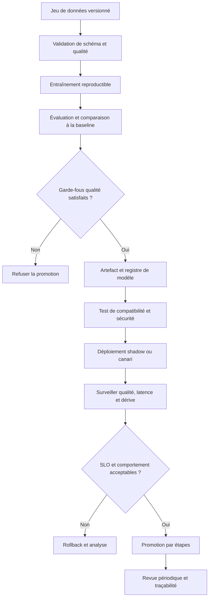

### Gestion des versions et retour arrière

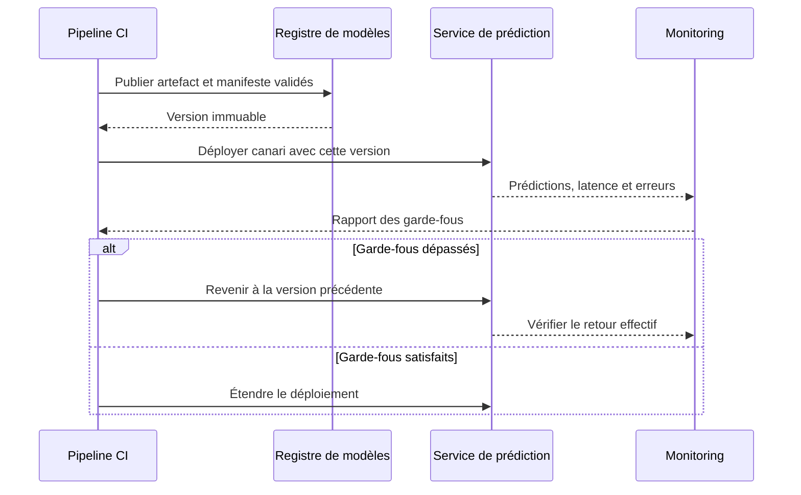

### Exemple de manifeste de modèle

```yaml
model:
  name: wan-congestion-risk
  version: 2026.10.3
  artifact_sha256: "REMPLACER_PAR_LE_SHA256_REEL"
data:
  dataset_version: wan-metrics-2026-10-01
  schema_version: 3
  feature_contract: wan-risk-features-v2
evaluation:
  temporal_test_end: "2026-09-30T23:59:59Z"
  baseline: seasonal-percentile-v1
  max_p95_latency_ms: 40
  minimum_recall_critical: 0.90
deployment:
  strategy: shadow
  rollback_version: 2026.09.2
  owner: network-reliability
```

Les seuils sont des exemples à calibrer avec les propriétaires du service. Le condensat d'artefact, le jeu de données, le schéma et le contrat de variables doivent être renseignés par la pipeline, jamais copiés manuellement sans contrôle. Un manifeste permet de répondre à la question : quel modèle, entraîné avec quelles données et évalué selon quelle politique, tourne actuellement ?

### Travaux pratiques — rendre le déploiement reproductible

Crée un petit modèle ou un modèle de référence et enregistre son contrat de données, ses dépendances et ses métriques. Produis deux artefacts avec des versions distinctes ; vérifie qu'un ancien nom ne peut pas être réutilisé silencieusement pour un contenu différent. Fais échouer une promotion lorsque le schéma d'entrée change, puis lorsque la performance sur la période temporelle diminue.

Simule ensuite une hausse de latence et une dérive de distribution. Le monitoring doit distinguer une panne du service de prédiction d'une dégradation de qualité du modèle. Le rollback doit restaurer le code, l'artefact et les paramètres compatibles, puis confirmer par lecture de l'état déployé qu'il est réellement effectif.

### Critères d'acceptation

Le modèle est reproductible, versionné, comparé à une baseline et promu par étapes. Le registre donne le lignage des données et artefacts. Le service expose latence, erreurs, disponibilité et indicateurs de dérive ; enfin, un rollback est démontré par un test, et pas seulement documenté dans un README.

## 17. Exercices corrigés

### Exercice 1 — Lignage

Un score a été généré il y a deux semaines, mais l'équipe ignore quelle version du modèle était active.

**Correction :** le système ne conserve pas une liaison obligatoire entre prédiction et version. Ajouter au résultat l'identifiant de modèle, la version de schéma et les métadonnées nécessaires, puis tester que chaque score expose ces champs. Préserver aussi le code, les paramètres et l'identifiant de dataset lorsque les politiques de conservation le permettent.

### Exercice 2 — Promotion automatique

Un candidat a une meilleure précision globale mais perd du rappel sur les équipements critiques.

**Correction :** ne pas le promouvoir automatiquement sur la seule métrique agrégée. Revoir les critères par segment, le coût des faux négatifs et les seuils de sécurité. Les critères de promotion auraient dû inclure les performances critiques avant l'entraînement du candidat.

### Exercice 3 — Dérive après changement de collecte

Après une mise à jour du collecteur, une métrique passe de secondes à millisecondes sans changement dans le contrat.

**Correction :** bloquer ou marquer les entrées concernées, corriger la normalisation et ajouter un test de schéma ou d'unité. Réentraîner un modèle sur les valeurs mal interprétées ne résoudrait pas le défaut. Les transformations versionnées doivent rendre ce type de changement visible.

### Exercice 4 — Échec du service de modèle

L'API d'inférence ne répond plus mais les règles de supervision classiques fonctionnent.

**Correction :** appliquer le mode dégradé prévu : conserver les alertes déterministes, marquer les scores ML indisponibles, journaliser l'incident et alerter le propriétaire. Ne pas convertir l'indisponibilité en score zéro. Restaurer le modèle après tests de service et vérification de la version active.

### Exercice 5 — Rollback incomplet

Le retour à l'ancien modèle fonctionne, mais le nouveau pipeline lui envoie des caractéristiques dont l'ordre a changé.

**Correction :** restaurer un ensemble cohérent modèle-plus-transformations ou une version compatible du schéma. Le rollback doit être testé sur le contrat complet et non seulement sur le fichier du modèle.

## Atelier approfondi — industrialiser un cycle MLOps expert

Cet atelier relie les concepts de la leçon dans une chaîne de production vérifiable. L'objectif n'est pas de construire un pipeline spectaculaire qui entraîne un modèle à chaque commit, mais un système capable d'expliquer chaque décision, de rejeter un candidat dangereux, de déployer progressivement et de revenir à une version connue. Dans un environnement AIOps, le résultat du modèle influence souvent la priorité donnée à un incident, la capacité d'une équipe à détecter une anomalie et la confiance des opérateurs. La qualité du processus est donc aussi importante que la qualité statistique du modèle.

### 1. Définir l'unité de livraison : un modèle n'est pas un fichier isolé

Un artefact de modèle ne suffit pas pour décrire ce qui tourne en production. Son comportement dépend des transformations, de l'ordre et des unités des caractéristiques, des valeurs par défaut, des seuils de décision, des bibliothèques, du code d'inférence et parfois d'un dictionnaire d'équipements ou d'un référentiel de services. Il faut livrer un ensemble cohérent, désigné ici comme une version du modèle opérationnel.

Ce paquet logique contient au minimum un identifiant immuable, la version du modèle, la révision du code, l'identifiant du jeu de données ou de son snapshot, la version du schéma, le fichier de paramètres, les transformations de caractéristiques, l'environnement d'exécution, les métriques de validation, les limites connues, le propriétaire et la date de création. Les données elles-mêmes peuvent être conservées dans un stockage séparé, selon les règles de confidentialité, mais l'identifiant et l'empreinte du snapshot doivent rester auditables.

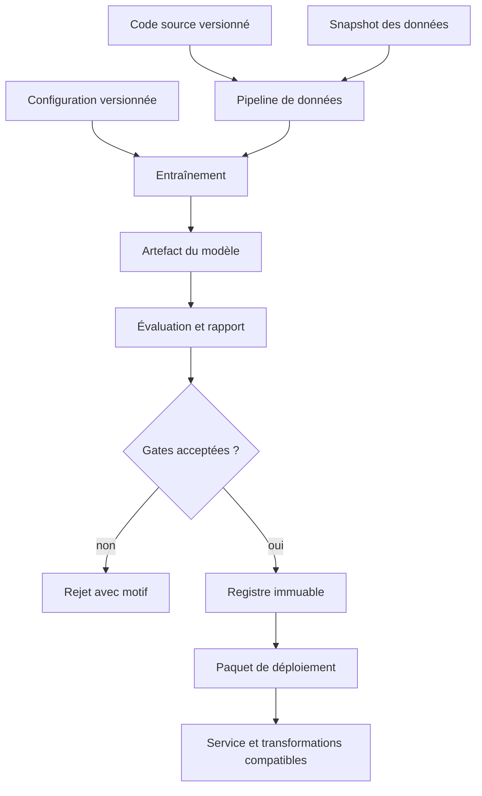

Il faut pouvoir répondre à une question d'audit sans reconstruire l'histoire à partir des journaux dispersés : « quelle combinaison exacte de données, de code, de paramètres et de transformations a produit cette prédiction ? ». Cette réponse doit être obtenue à partir de métadonnées fiables, pas d'une convention de nommage telle que latest, best ou final. Ces noms sont mouvants et ne doivent jamais être la seule référence d'un déploiement.

### 2. Concevoir les contrats de données avant le modèle

Un contrat formalise ce que le pipeline accepte et ce que le service produit. Il doit couvrir les noms des champs, les types, les unités, les plages plausibles, la politique des valeurs manquantes, la granularité temporelle, la fraîcheur, la cardinalité attendue et le traitement des catégories inconnues. Pour une télémétrie réseau, une valeur de latence de 25 millisecondes n'est pas interchangeable avec 25 secondes. Un changement d'unité peut laisser l'API techniquement fonctionnelle tout en rendant les scores absurdes.

Le contrat d'entrée n'est pas simplement un schéma JSON. Il précise la signification des champs et leurs relations. Par exemple, un taux de retransmission doit avoir un dénominateur défini, une fenêtre de calcul explicite et un comportement documenté lorsque le nombre de paquets observés est nul. Le contrat de sortie définit également la sémantique du score : probabilité calibrée ou score relatif, seuil de décision, version du modèle et raison éventuelle d'une abstention.

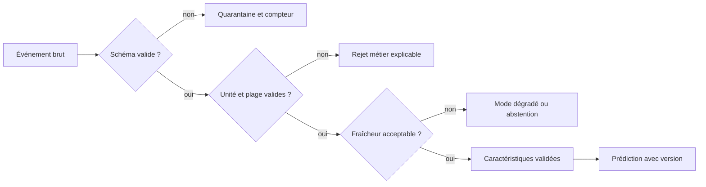

Séparez la validation structurelle de la validation sémantique. La première vérifie les colonnes, les types et les champs requis. La seconde vérifie les invariants : absence d'horodatage futur, ordre temporel cohérent, unités autorisées, identifiants non vides, valeurs compatibles avec le domaine et règles de calcul stables. Les deux niveaux doivent être exécutés dans le pipeline d'entraînement et à la frontière du service, avec des stratégies adaptées au coût de la vérification.

Toute évolution du contrat est une décision de compatibilité. Une colonne ajoutée avec une valeur par défaut peut être rétrocompatible ; renommer une caractéristique, changer son unité ou modifier son calcul ne l'est généralement pas. Versionnez le contrat, définissez une période de migration et testez les producteurs ainsi que les consommateurs. Ne corrigez jamais silencieusement des données ambiguës en leur attribuant une valeur plausible.

### 3. Assurer une reproductibilité utile, pas seulement théorique

La reproductibilité signifie que l'équipe peut expliquer et, dans la mesure permise par les outils et le matériel, reproduire le résultat. Certains entraînements distribués ou calculs accélérés ne sont pas strictement déterministes. Ce fait n'excuse pas l'absence de traçabilité : il faut enregistrer les graines aléatoires, les versions de bibliothèques, les paramètres, le matériel pertinent, la stratégie de parallélisme, l'ordre des données lorsqu'il influence le résultat et les métriques obtenues.

Un run doit disposer d'un identifiant stable et d'un statut terminal explicite : réussi, rejeté, interrompu ou échoué. Un fichier de métriques produit juste avant un crash ne doit pas être présenté comme un entraînement validé. Le pipeline doit enregistrer séparément le statut de l'entraînement, celui des évaluations et celui de la publication de l'artefact.

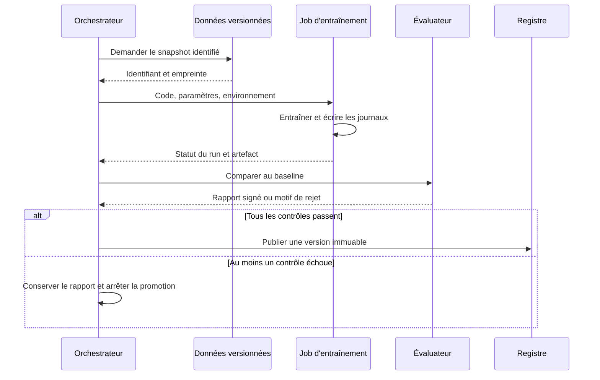

Il faut aussi séparer l'identité d'un run de celle d'un modèle. Deux entraînements peuvent produire des modèles différents à partir du même code et du même dataset, par exemple à cause d'une graine ou d'un changement d'environnement. Inversement, deux artefacts peuvent être identiques tout en provenant de runs distincts. Une empreinte cryptographique aide à comparer les contenus, mais ne remplace pas le registre de provenance.

Les données personnelles et les secrets ne doivent pas être copiés dans les journaux d'entraînement pour améliorer artificiellement la reproductibilité. Conservez les métadonnées minimales nécessaires, les identifiants d'accès contrôlés et les liens vers les sources autorisées. La durée de rétention doit être cohérente avec les obligations métier, les politiques de sécurité et les coûts de stockage.

### 4. Éviter les fuites temporelles et l'optimisme de validation

Dans les systèmes opérationnels, l'ordre temporel est souvent le premier piège. Une caractéristique calculée à partir d'événements futurs peut donner d'excellentes performances hors ligne et s'avérer impossible à calculer au moment réel de la prédiction. Il faut documenter, pour chaque variable, l'instant où sa valeur devient effectivement disponible. L'heure de l'incident, l'heure de réception et l'heure de disponibilité dans le pipeline peuvent être différentes.

Une séparation aléatoire des données n'est pas toujours valide. Si les exemples proches sont fortement corrélés, ou si le même équipement se retrouve dans l'entraînement et la validation, la performance peut mesurer la capacité à mémoriser un contexte plutôt qu'à généraliser. Pour un modèle visant des équipements nouveaux ou une période future, utilisez une séparation par temps, par site, par famille d'équipement ou une combinaison correspondant à l'usage prévu.

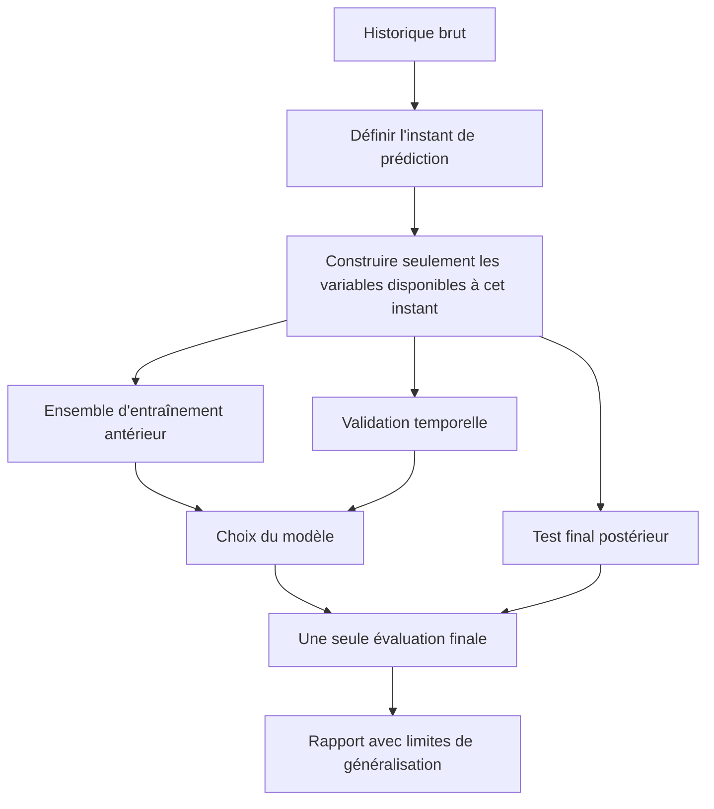

Le jeu de test final ne doit pas servir à choisir continuellement les paramètres. Si une équipe regarde le test à chaque itération et ajuste sa stratégie en fonction de ses résultats, le test devient indirectement une partie de l'entraînement. Gardez une période de test réellement réservée, documentez chaque changement de protocole et préférez une validation croisée temporelle lorsque le volume disponible le justifie.

Le rapport doit distinguer les performances agrégées des résultats par segment. Un modèle peut afficher une bonne précision globale tout en ratant les incidents rares d'un type d'équipement. Pour l'AIOps, analysez au minimum les faux négatifs coûteux, les faux positifs qui épuisent les équipes, le délai de détection et l'effet sur le volume d'alertes. Choisissez les métriques à partir de l'usage réel, non parce qu'elles sont simples à calculer.

### 5. Construire une CI adaptée aux systèmes ML

Une CI ML ne se limite pas à vérifier que le code Python compile. Elle doit tester les contrats, les transformations, le comportement du modèle, la compatibilité avec le service, la sécurité des dépendances et les conditions de promotion. Il n'est pas nécessaire de lancer un entraînement complet à chaque modification documentaire ou à chaque changement sans effet sur le modèle. Séparez les contrôles rapides des validations coûteuses, sans permettre à un raccourci de contourner la dernière barrière avant production.

Une stratégie pratique comprend quatre catégories. Les tests unitaires vérifient les fonctions de transformation et les cas limites. Les tests de données rejettent les schémas ou distributions impossibles. Les tests de modèle comparent le candidat à une baseline sur une suite figée et versionnée. Les tests de service vérifient que l'artefact réellement empaqueté se charge, respecte le contrat et produit des réponses compatibles avec le consommateur.

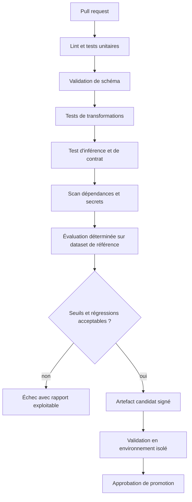

Le dataset de référence utilisé dans les tests doit lui-même être versionné et contrôlé. Il peut être petit pour les tests rapides, à condition de représenter les cas significatifs : entrée minimale, valeurs manquantes, catégories inconnues, plages limites, événements hors ordre et exemples qui doivent déclencher une abstention. Les jeux de référence ne doivent pas contenir de données sensibles sans justification et contrôle d'accès.

Les seuils de qualité doivent être définis avant de voir les résultats du candidat. Établissez les métriques obligatoires, la tolérance de régression, les segments critiques et les cas de rejet dur. Il est raisonnable d'avoir une zone de validation manuelle lorsque l'incertitude est élevée, mais cette zone ne doit pas devenir une approbation automatique par fatigue. Chaque exception doit enregistrer un responsable, une justification, une expiration et une mesure de réduction du risque.

### 6. Gérer le registre et la promotion comme une machine à états

Le registre est un dossier de décisions, pas un simple répertoire de fichiers. Une version peut passer par les états entraînée, évaluée, candidate, approuvée, déployée, retirée ou rejetée. Les transitions doivent être explicites et vérifier les conditions requises. Un modèle rejeté ne doit pas être promu par un appel qui change uniquement son étiquette ; une approbation humaine ne doit pas réécrire l'artefact après validation.

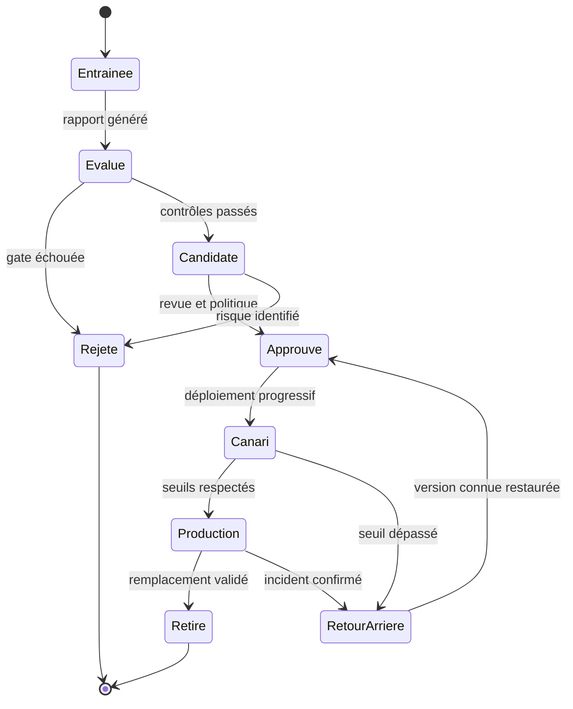

Conservez l'auteur de la transition, l'horodatage, le rapport évalué, le motif et l'identifiant du système cible. Les permissions d'entraînement ne devraient pas permettre automatiquement de publier en production. Une même identité technique ne devrait pas pouvoir créer un candidat arbitraire, ignorer les contrôles et valider son propre déploiement sans séparation des responsabilités lorsque le niveau de risque le justifie.

Les noms lisibles comme « stable » ou « production » peuvent servir d'alias, mais ils doivent pointer vers un identifiant immuable et leur résolution doit être journalisée. Lorsque le déploiement est déclenché, capturez l'identifiant exact résolu et comparez-le ensuite à l'état effectif du service. Sans cette vérification, l'équipe risque de croire qu'elle a promu une version alors qu'un processus concurrent a remplacé la référence.

### 7. Choisir les stratégies de déploiement et leur niveau de preuve

Le mode fantôme, ou shadow, permet de soumettre les mêmes événements au modèle candidat sans utiliser son résultat pour agir. Il mesure la latence, la disponibilité et les divergences sur du trafic réel, tout en limitant l'impact sur les utilisateurs. Il ne prouve toutefois pas à lui seul que la qualité du modèle est bonne : les labels peuvent arriver plus tard et certaines erreurs ne deviennent visibles qu'après intervention terrain.

Un canari dirige une petite fraction du trafic vers le candidat. Fixez à l'avance la durée minimale, la population exposée, les signaux d'arrêt et la procédure de retour. Si le volume d'événements est faible, un canari trop court peut donner une fausse assurance. Il est aussi essentiel de vérifier que les groupes comparés sont semblables et que le routage n'expose pas seulement des équipements faciles ou uniquement une région particulière.

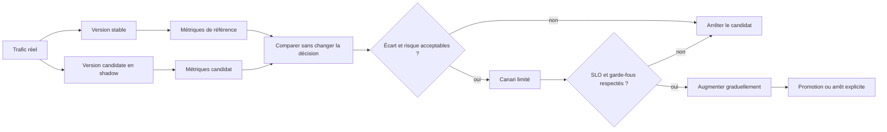

Le test A/B compare l'effet de variantes sur une mesure définie, mais il doit éviter les contaminations entre groupes. Il convient rarement de tester naïvement un modèle qui influence la charge ou les incidents de toute une infrastructure : la réponse à une alerte dans un groupe peut affecter les observations de l'autre. Dans ce cas, un déploiement progressif contrôlé, un test sur des segments isolés ou une validation en mode fantôme peuvent être plus appropriés.

Le pourcentage de trafic n'est pas une mesure de risque suffisante. Dix pour cent de requêtes peut représenter presque tous les événements rares ou critiques. Découpez aussi selon le service, la criticité, la région ou la famille d'équipements, et vérifiez que chaque segment respecte ses garde-fous. Un déploiement reste une décision opérationnelle : les limites statistiques, le plan de communication et les responsables d'arrêt doivent être clairs avant la première requête.

### 8. Définir des signaux de santé qui distinguent service et modèle

La santé du service décrit le fait que le système répond correctement : taux d'erreurs, latence, saturation, disponibilité, taille des files et fraîcheur des entrées. La santé du modèle décrit la pertinence des résultats : qualité sur les labels disponibles, calibration, dérive des caractéristiques, distribution des scores et performance par segment. Ces dimensions sont corrélées mais non interchangeables. Un modèle peut répondre en 20 millisecondes tout en se trompant systématiquement à cause d'une nouvelle unité de mesure.

Définissez des SLI observables, des objectifs SLO et des seuils opérationnels. Un SLI pourrait mesurer le pourcentage de prédictions valides respectant une latence donnée, sur une fenêtre et une population clairement définies. Un SLO est la cible sur la période, par exemple le taux de réponses conformes au contrat. Un budget d'erreur aide à arbitrer entre vitesse de livraison et stabilité ; il n'est pas une permission de dépasser une limite de sécurité explicite.

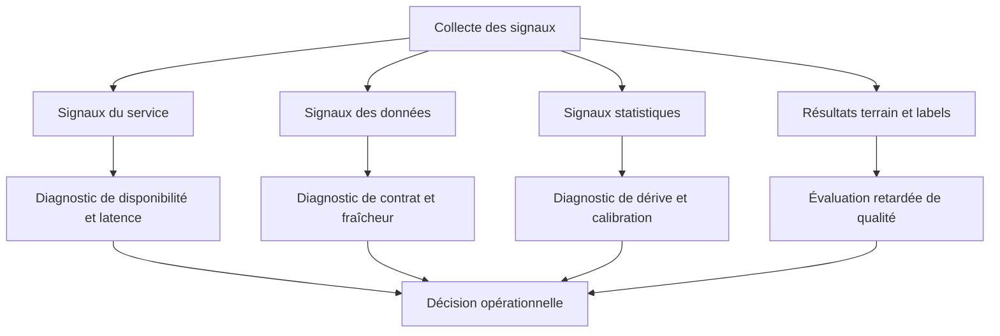

Pour les indicateurs de dérive, documentez la référence utilisée, la fenêtre courante, le volume minimal, la méthode statistique, le seuil et l'action associée. Une alerte ne doit pas être déclenchée par une variation saisonnière attendue sans contexte, ni ignorée parce qu'elle est fréquente. Établissez une période de référence, comparez des segments pertinents et vérifiez la qualité de la télémétrie qui alimente le contrôle de dérive.

Les labels terrain sont souvent tardifs, incomplets ou biaisés par la décision du modèle. Si les équipes n'inspectent que les alertes positives, il manque une partie des résultats négatifs et l'évaluation est biaisée. Prévoyez un échantillonnage de contrôle, une procédure de labellisation, l'enregistrement des interventions humaines et la distinction entre absence de preuve et preuve d'absence d'incident. Le tableau de bord doit afficher ces limites plutôt que présenter une précision prétendument exacte.

### 9. Séparer détection de dérive, diagnostic et réentraînement

La dérive des données signifie que les entrées ont changé ; elle ne prouve pas automatiquement que le modèle est devenu mauvais. Une nouvelle version de collecteur peut modifier les champs, une saison peut modifier la consommation ou un changement de topologie peut changer la distribution légitimement. La dérive de concept concerne la relation entre les caractéristiques et la cible. Dans beaucoup de systèmes opérationnels, ces deux phénomènes ne se détectent pas avec les mêmes signaux.

Un pipeline de réentraînement déclenché uniquement par un seuil de dérive peut amplifier le problème. Si le collecteur est cassé, réentraîner sur des données incorrectes donne un nouveau modèle adapté au défaut. Si les labels sont incomplets, le modèle peut apprendre les biais du processus d'incident. Le réentraînement doit être proposé par un déclencheur explicable, puis conditionné à la validation des données, à la disponibilité des labels et à une comparaison avec la version en place.

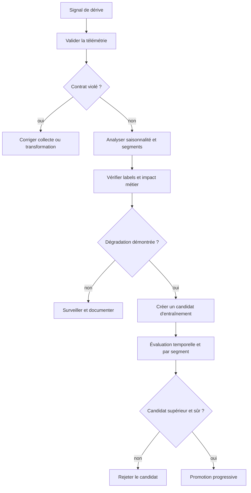

Définissez une politique qui sépare l'observation, l'investigation, la création de candidat et la promotion. Une hausse du taux de valeurs manquantes peut déclencher une investigation immédiatement ; elle ne doit pas nécessairement lancer l'entraînement. Une dégradation confirmée par des labels peut déclencher un candidat ; elle ne doit pas contourner les contrôles de qualité ou l'approbation nécessaire. Le réentraînement n'est pas une guérison automatique, c'est une nouvelle modification du système qui doit être évaluée.

Conservez un historique des décisions, même lorsque le résultat est « aucune action ». Cet historique permet de mesurer combien d'alertes de dérive étaient utiles, combien étaient des effets saisonniers et combien de fois une collecte défectueuse a été détectée. Il rend aussi les seuils révisables à partir d'un retour d'expérience plutôt que selon des impressions.

### 10. Tester le rollback complet et les modes dégradés

Un rollback fiable restaure un état compatible, pas uniquement les poids du modèle. L'ancienne version peut avoir besoin d'une ancienne transformation, d'un autre schéma de caractéristiques ou d'une bibliothèque qui n'est plus installée. La configuration des seuils, le code d'inférence, le contrat de sortie et les règles de routage font partie du périmètre de retour arrière. Il faut garder disponibles les artefacts que la politique de rétention autorise à réactiver.

Le test du rollback doit être pratiqué avant incident, puis vérifié lors d'un exercice périodique. Mesurez le temps entre la décision d'arrêt et le retour à un état stable, vérifiez l'identifiant de version effectivement utilisé et contrôlez le résultat avec une requête représentative. Il faut également vérifier le chemin de retour si le registre ou le service de déploiement est temporairement indisponible.

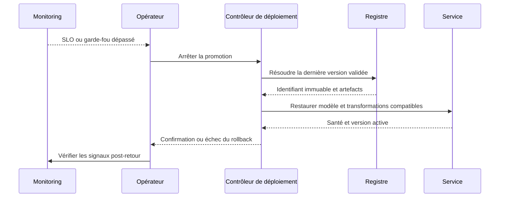

Prévoyez un mode dégradé utile. Si le modèle de scoring ne fonctionne plus, l'application peut conserver les règles déterministes, afficher explicitement l'absence de score ML et transmettre la décision à un opérateur. Remplacer une panne par un score nul ou une valeur par défaut sans signalement est dangereux : cela transforme une indisponibilité visible en résultat apparemment légitime. La stratégie de dégradation doit être compatible avec l'objectif métier et documentée dans les procédures d'exploitation.

Après un rollback, ne supprimez pas les traces du candidat. Préservez les métriques, le manifeste, les paramètres de routage et l'heure de transition afin de faciliter l'analyse de cause. L'incident doit permettre de distinguer un défaut de modèle, une incompatibilité de schéma, une régression de dépendance, une saturation d'infrastructure et un défaut de déploiement. Chaque cause conduit à un correctif différent.

### 11. Sécuriser la chaîne d'approvisionnement du modèle

Le modèle et son pipeline constituent une surface d'attaque. Un fichier de modèle sérialisé peut déclencher un comportement inattendu lors du chargement selon son format ; une dépendance compromise peut modifier les prédictions ou exfiltrer des données ; une identité de CI trop puissante peut publier un artefact qui n'a jamais été évalué. La sécurité ne doit donc pas être ajoutée uniquement au service en production : elle traverse les données, les environnements de build, le registre et les permissions de promotion.

Utilisez des dépendances verrouillées, des sources de paquets approuvées, des images d'exécution identifiées par digest, des secrets à courte durée de vie et des droits minimaux. Évitez de passer des jetons permanents aux jobs qui exécutent du code fourni par une pull request non fiable. Les permissions de lecture des données d'entraînement et d'écriture en production doivent être séparées. Les artefacts et manifestes importants doivent pouvoir être vérifiés par empreinte ou signature lorsque l'infrastructure le permet.

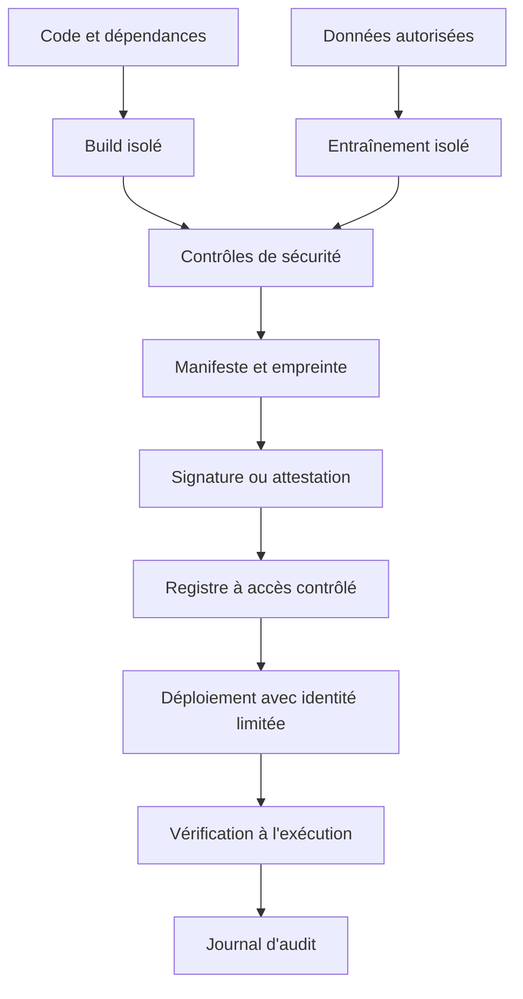

Les données de production doivent être minimisées. Les identifiants clients, adresses, secrets de configuration et données d'authentification ne devraient pas être envoyés au modèle ou inclus dans les journaux par défaut. Un identifiant pseudonymisé peut rester sensible si la ré-identification est possible. Définissez les champs autorisés, le masquage, la durée de conservation, les accès aux jeux de données et les conditions de suppression.

Un artefact signé prouve au mieux que le contenu correspond à une identité de signature et à un processus donné ; il ne prouve pas que le modèle est correct, sûr ou équitable. La signature doit être accompagnée des contrôles de contenu, des résultats d'évaluation et de la provenance. Le contrôle technique complète la gouvernance, il ne la remplace pas.

### 12. Concevoir la capacité, la latence et le coût d'inférence

La qualité d'un modèle en laboratoire ne suffit pas si son coût ou sa latence empêche l'usage prévu. Définissez un budget par prédiction, la charge moyenne et de pointe, le taux d'événements par équipement, les attentes de disponibilité et les pics lors d'incidents. Une panne réseau peut créer davantage de télémétrie précisément au moment où le modèle est le plus sollicité. Un benchmark effectué seulement sur une charge stable sous-estime donc le risque.

Mesurez la latence par percentiles plutôt que par la moyenne seule. Une moyenne de 40 ms peut masquer un p99 de plusieurs secondes. Séparez le temps de file, la préparation des caractéristiques, le chargement ou l'exécution du modèle, les appels externes et la sérialisation. Surveillez le débit utile et le taux d'échec, car un service rapide qui rejette une partie des requêtes ne satisfait pas le contrat.

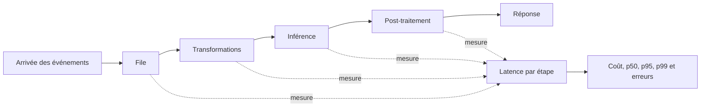

Évaluez l'effet du batch, du cache et de la mise en mémoire du modèle sur la latence, mais vérifiez que ces choix n'altèrent pas la sémantique. Le batch peut augmenter le débit mais retarder une prédiction urgente ; le cache peut réduire le coût mais rendre un résultat obsolète ; le partage d'un modèle chargé réduit le temps d'initialisation mais demande de bien gérer la concurrence. Chaque optimisation doit être accompagnée d'un test de charge et d'un test de correction.

Le coût doit être observé par unité utile : coût par mille prédictions conformes, coût par alerte pertinente ou coût par service couvert, selon le but du système. Cela évite de favoriser un système peu coûteux mais inutilisable. Définissez un comportement de surcharge : priorité aux événements critiques, limitation de débit, file bornée, abandon explicite d'événements trop anciens ou bascule vers une règle simple. Un mode de saturation non documenté peut créer une dégradation silencieuse.

### 13. Gérer les dépendances entre services et les effets de bord

Une chaîne ML dépend souvent d'un collecteur, d'un stockage, d'un orchestrateur, d'un registre, d'une API de caractéristiques et d'un système d'identité. Le déploiement doit identifier les dépendances obligatoires et facultatives. Une indisponibilité du stockage historique peut bloquer un entraînement futur, mais ne devrait pas forcément arrêter immédiatement l'inférence si les artefacts et les caractéristiques nécessaires sont déjà présents et valides.

Établissez des délais d'attente, des limites de tentatives, une temporisation exponentielle et un circuit breaker pour les appels distants. Les nouvelles tentatives doivent être sûres : une opération de publication ne doit pas créer plusieurs versions contradictoires si la réponse réseau est perdue après que le serveur a accepté la requête. Utilisez des clés d'idempotence ou vérifiez l'état final avant de recommencer.

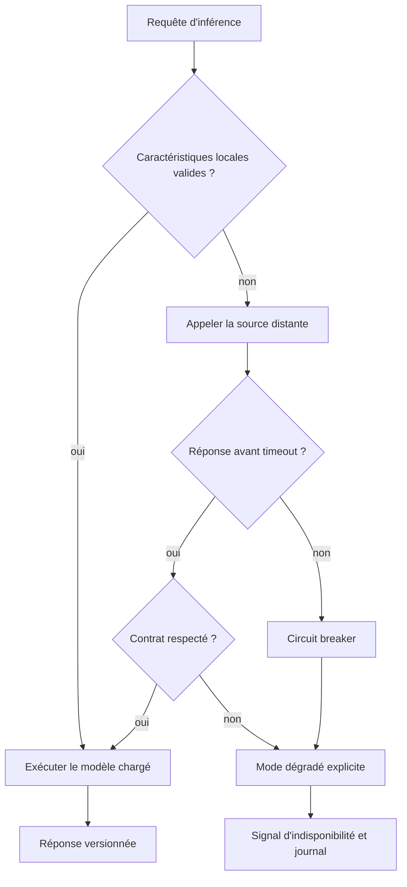

Les messages et files doivent transporter des métadonnées de traçabilité : identifiant de corrélation, horodatage d'émission, version du schéma, source et version du modèle lorsque la prédiction est matérialisée. Ne loguez pas tout le contenu brut si cela expose des secrets ou crée un volume excessif. Les identifiants doivent permettre de relier les étapes sans reconstituer de données sensibles.

Précisez le traitement des événements retardés, dupliqués et désordonnés. Selon l'application, il peut être nécessaire de dédupliquer, de rejeter les événements trop anciens, de recalculer une fenêtre ou de marquer la prédiction comme partielle. Ces règles ne peuvent pas être improvisées au moment d'un incident : elles font partie du contrat métier et doivent être testées.

### 14. Organiser l'observabilité et les réponses aux incidents

Un bon tableau de bord mène à une action ; il ne se limite pas à accumuler des courbes. Organisez la vue autour de questions opérationnelles : le service est-il disponible ? Les entrées sont-elles valides et assez fraîches ? Quel modèle et quel schéma sont actifs ? La qualité se dégrade-t-elle dans un segment ? Une dépendance ralentit-elle le pipeline ? Peut-on revenir à la version précédente sans perdre les événements ?

Les journaux structurés décrivent les décisions et les transitions. Les métriques agrègent les tendances. Les traces relient les étapes d'une requête ou d'un job. Les trois signaux sont complémentaires. Un identifiant de corrélation permet de passer d'une alerte agrégée à quelques événements précis, sans transformer chaque trace en stockage de contenu sensible. Définissez la cardinalité des étiquettes : utiliser chaque identifiant de flux comme label d'une métrique peut faire exploser le coût de stockage.

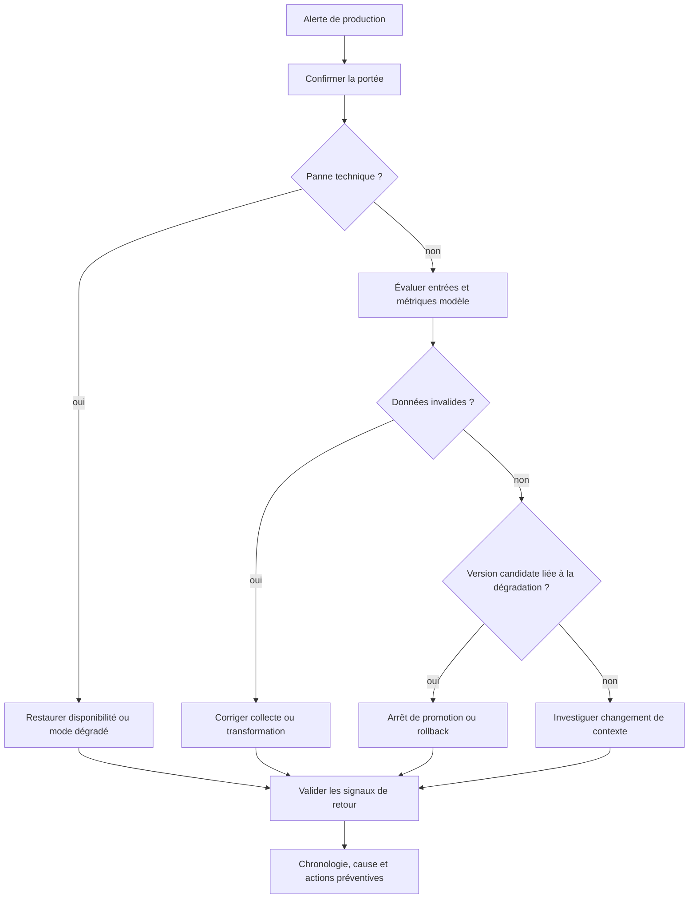

Une procédure d'incident doit préciser qui peut arrêter la promotion, qui décide du rollback, quelles équipes sont averties et quels seuils autorisent la reprise. Les responsabilités peuvent être partagées entre data science, plateforme, SRE et équipe métier ; le modèle d'astreinte doit éviter que chacun attende la décision des autres. Documentez les points de décision pour que l'opérateur ne doive pas improviser sous pression.

Après l'incident, établissez une chronologie fondée sur les données, séparez les faits des hypothèses, estimez l'impact, documentez les décisions et attribuez les actions correctives. Cherchez les défaillances de conception autant que l'erreur immédiate : absence d'un test d'unité, contrôle trop tardif, alerte ambiguë ou rollback qui restaure seulement le modèle. L'objectif est de réduire la probabilité et l'impact d'un incident similaire, pas de désigner une personne à blâmer.

### 15. Exercices avancés : prouver les propriétés du pipeline

**Exercice A — Incompatibilité de caractéristiques.** Le candidat améliore le rappel en validation, mais le service utilise une ancienne version de la transformation. Décrivez un test qui détecte ce décalage avant promotion.

**Correction attendue :** l'artefact de livraison doit déclarer la version du contrat et de la transformation. La CI charge exactement le paquet de service construit, lui fournit des fixtures versionnées et vérifie les noms, l'ordre logique, les unités, les valeurs par défaut et les résultats attendus. Un changement de contrat rompt la compatibilité explicitement ; l'environnement de validation ne doit pas reconstituer à la main une configuration différente de la production.

**Exercice B — Régression par segment.** Le score global reste stable, mais les faux négatifs triplent sur les équipements d'un fournisseur particulier.

**Correction attendue :** un gate segmenté rejette le candidat ou exige une revue selon la politique définie avant l'expérience. Vérifiez la taille de l'échantillon, le mode de collecte, la représentativité des labels et les intervalles d'incertitude. Évitez de masquer le problème par une moyenne pondérée. Si le segment est trop petit pour une estimation fiable, documentez l'incertitude et définissez un mode conservateur plutôt que de déclarer la qualité acceptable.

**Exercice C — Réentraînement en boucle.** Un seuil de dérive génère un entraînement chaque nuit ; les candidats n'améliorent pas les résultats et le coût explose.

**Correction attendue :** séparez l'alerte de dérive de la promotion, exigez une validation de la télémétrie et des labels, ajoutez une fenêtre de refroidissement et un contrôle de gain minimal par rapport au baseline. Une politique peut regrouper plusieurs signaux dans un dossier d'investigation sans lancer de job coûteux. Chaque run doit avoir une raison, un budget et un statut final. Le pipeline peut conclure qu'aucun réentraînement n'est justifié.

**Exercice D — Rollback incomplet.** L'ancien modèle est restauré mais le nouveau service conserve des paramètres de seuil et de normalisation incompatibles.

**Correction attendue :** versionnez et promouvez un ensemble cohérent comprenant l'artefact, la transformation, le schéma, les seuils et la configuration de service. Le test de retour arrière lance une requête de référence, vérifie l'identifiant effectivement servi et contrôle les métriques de santé après transition. La restauration doit être atomique du point de vue du consommateur, ou maintenir un mode temporaire qui évite l'association de composants incompatibles.

**Exercice E — Artefact altéré.** Le manifeste pointe vers un modèle dont l'empreinte ne correspond plus.

**Correction attendue :** refuser le chargement, signaler l'événement et revenir à un artefact précédemment validé dont l'identité est confirmée. N'ignorez pas l'écart sous prétexte que l'API démarre. Enregistrez la source et la chaîne de publication, restreignez les droits du compte responsable et recherchez une possible altération. Une signature est utile si les clés et les contrôles de confiance sont correctement gérés.

### 16. Atelier pratique — constituer un dossier de release

Créez un répertoire de release qui contient le manifeste, le rapport d'évaluation, les résultats des tests, la version du contrat, les instructions de lancement, les limites connues et la procédure de retour arrière. Le dossier ne doit pas contenir de secret ni de copie inutile des données. Les liens vers des stockages autorisés doivent utiliser des identifiants vérifiables et une politique de rétention explicite.

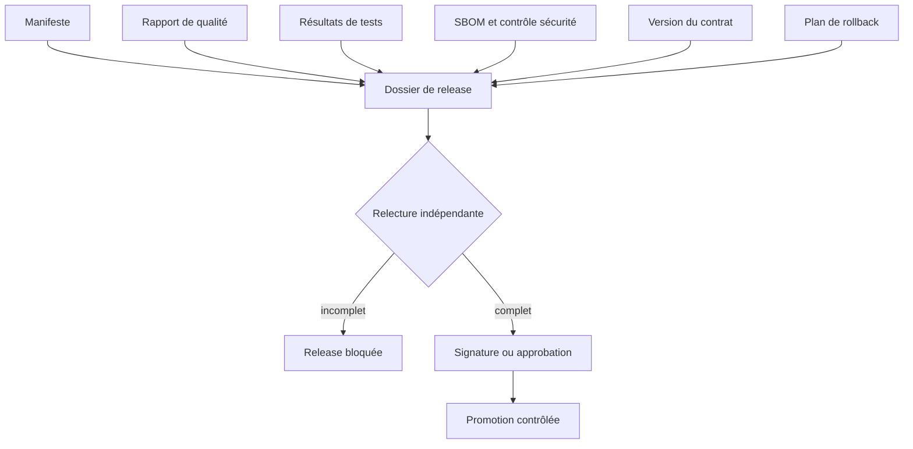

Le manifeste doit être lisible par une machine et par une personne. Il peut être en JSON ou YAML, avec une validation de schéma obligatoire. Exemple de structure illustrative :

```yaml
release_id: risk-score-2026-10-28.3
model:
  name: network-risk-classifier
  version: 4.2.0
  artifact_digest: sha256:...
code:
  commit: 0123456789abcdef
data:
  snapshot_id: telemetry-week-2026-40
  schema_version: telemetry-v3
features:
  pipeline_version: features-7
evaluation:
  report_id: evaluation-2026-10-28-103
  baseline_version: 4.1.2
  promotion_gate: passed
deployment:
  strategy: shadow-then-canary
  rollback_target: 4.1.2
ownership:
  team: platform-ai
```

Cet exemple n'est pas un format universel : adaptez les champs aux systèmes existants et validez le manifeste par un schéma maintenu en version. N'acceptez pas le texte libre « passed » comme seule preuve ; référencez un rapport signé ou un identifiant de run vérifiable. Les valeurs d'exemple doivent être remplacées par des valeurs réelles lors d'une release, sans réutiliser un identifiant déjà attribué à un contenu différent.

### 17. Critères de réussite de l'atelier

L'atelier est réussi lorsque l'équipe peut produire un candidat depuis une révision versionnée, expliquer de quelles données et transformations il dépend, reproduire les évaluations dans un environnement contrôlé et empêcher une promotion lorsque l'un des contrôles obligatoires échoue. Le candidat est ensuite chargé dans le même type de paquet que celui utilisé par le service, soumis à une évaluation de contrat et testé en mode fantôme avant tout élargissement du trafic.

Le registre permet de retrouver le modèle réellement actif, l'origine d'une prédiction et la justification de la décision de promotion. Les métriques distinguent disponibilité, latence, fraîcheur, dérive, qualité et coût. La procédure d'incident définit une action sûre en cas d'indisponibilité de modèle, de données incohérentes ou de dégradation par segment. Enfin, le retour arrière est exercé et confirme la version effective, les transformations et les paramètres restaurés.

Le point essentiel est de traiter la chaîne de modèle comme un système distribué à part entière. L'entraînement n'est qu'une étape ; les contrats, l'identité de l'artefact, les permissions, la compatibilité, les signaux de production et les décisions humaines déterminent si le système reste fiable dans la durée. Un pipeline expert est celui qui refuse une mauvaise livraison de façon explicable autant que celui qui livre un bon candidat rapidement.

## 18. Défi final, checklist et références

### Défi

Industrialisez un classifieur de risque réseau. Il reçoit des métriques, produit un score et aide à prioriser l'investigation. Il doit être déployé sans action automatique sur les équipements. Proposez le pipeline, les contrôles CI, le registre, le mode fantôme, la surveillance et la procédure de rollback.

### Correction proposée

Définir d'abord le contrat d'entrée et de sortie, la cible, les métriques d'acceptation et les utilisateurs. Le code de préparation est versionné et testé. Le pipeline charge un snapshot identifié, valide le schéma, construit les variables, entraîne baseline et candidat, réalise une évaluation temporelle et écrit un rapport avec manifeste. Un candidat qui ne respecte pas les seuils est rejeté sans modifier la version courante.

Les artefacts sont enregistrés avec leur empreinte, la révision de code, l'identifiant de données, les paramètres, les dépendances et le rapport. Le déploiement commence en mode fantôme. L'équipe compare les scores, la latence et la qualité des entrées avant une promotion approuvée. Les dashboards suivent les erreurs de service, la fraîcheur, la dérive et les résultats terrain.

Un rollback restaure le modèle et la chaîne de caractéristiques compatibles. Les seuils d'arrêt sont définis avant le canari. En cas de dégradation, le système revient à une version vérifiée ou à une baseline et conserve le dossier de l'incident. Le processus prévoit une revue pour déterminer si la cause vient de la collecte, du pipeline, du modèle ou du déploiement.

### Checklist

- [ ] Objectif métier, cible et métriques mesurables.
- [ ] Contrat de données et de sortie versionné.
- [ ] Code, paramètres, environnement et identifiant de données conservés.
- [ ] Pipeline exécutable et reproductible.
- [ ] Tests unitaires, de données, de modèle, d'intégration et de sécurité.
- [ ] Baseline et critères de promotion définis avant évaluation.
- [ ] Artefacts immuables, empreintes et registre.
- [ ] Droits de CI minimaux, secrets protégés et dépendances contrôlées.
- [ ] Déploiement en mode fantôme et canari si nécessaire.
- [ ] Métriques techniques et qualité statistique surveillées.
- [ ] Dérive interprétée avant tout réentraînement.
- [ ] Rollback modèle-plus-transformations testé.
- [ ] Responsable d'astreinte et procédure de retrait documentés.

### Références

- MLflow, documentation : https://mlflow.org/docs/latest/
- Scikit-learn, modèles et pipelines : https://scikit-learn.org/stable/
- GitHub Actions, documentation : https://docs.github.com/actions
- NIST, AI Risk Management Framework : https://www.nist.gov/itl/ai-risk-management-framework
- OpenTelemetry, documentation : https://opentelemetry.io/docs/

Le MLOps transforme une expérimentation en service maintenable. La clé n'est pas seulement de déployer rapidement : il faut savoir exactement quel modèle tourne, comment il a été produit, pourquoi il a été accepté, comment détecter sa dégradation et comment revenir à un état connu sans perdre la traçabilité.