# Automatisation avec Python et Bash — Débutant

> **Mise en contexte :** ce cours étudie le problème suivant : un script manuel collecte l'état des interfaces mais se bloque sur une cible indisponible, masque les erreurs et risque de répéter une modification. L'objectif est d'améliorer les opérations de manière mesurable, vérifiable et proportionnée au risque. Les exemples doivent être adaptés et testés en laboratoire avant toute utilisation sur une infrastructure réelle.

## Sommaire

1. Introduction et objectifs
2. Concepts clés
3. Architecture de référence
4. Pipeline et algorithmes
5. Étude de cas
6. Implémentation guidée et laboratoire
7. Sécurité et gouvernance
8. Pièges à éviter
9. Diagnostic et dépannage
10. Exercices corrigés
11. Checklist et à retenir
12. Références

## 1. Introduction et objectifs

L'AIOps applique l'analyse de données et l'automatisation aux opérations informatiques afin de rendre la détection, le diagnostic et la résolution plus cohérents. Pour **Automatisation avec Python et Bash**, l'enjeu est de écrire des scripts robustes et idempotents pour l'exploitation et la collecte réseau.. Le besoin est concret : les équipes doivent agir rapidement, mais les observations peuvent être contradictoires, les horloges décalées et les interventions porteuses de risques. La solution doit ainsi distinguer un signal, une hypothèse, une décision et une preuve de résultat.

Le scénario de départ est : un script manuel collecte l'état des interfaces mais se bloque sur une cible indisponible, masque les erreurs et risque de répéter une modification. Il illustre que des outils techniquement capables ne suffisent pas. La qualité dépend de données fiables, d'une question mesurable, d'une référence de comparaison et d'une procédure de reprise. Le système doit savoir reconnaître une donnée absente, exposer ses limites et demander de l'aide. L'automatisation n'est pas un objectif en soi : elle est justifiée uniquement si elle améliore un résultat opérationnel sans déplacer le risque vers les utilisateurs ou l'équipe d'astreinte.

Les outils possibles comprennent Python, Bash, subprocess, JSON, Git, journalisation. Ils ne doivent pas tous être déployés dans le même projet. Chaque composant doit répondre à un besoin identifié et avoir un propriétaire. Une architecture réduite, testée et bien observée est préférable à un assemblage complexe dont personne ne peut expliquer les erreurs. La première version peut rester en lecture seule ; l'autorité d'agir se développe seulement après des essais reproductibles, une mesure des erreurs et une validation de la procédure de retour arrière.

### Objectifs pédagogiques
- Décrire les concepts principaux et leurs limites.
- Définir les sources de données, la qualité attendue et les propriétaires.
- Décrire le chemin entre observation, analyse, décision, action et vérification.
- Mesurer les erreurs et comparer la solution à une baseline.
- Protéger les accès et documenter une stratégie d'escalade et de reprise.

### Vocabulaire opérationnel
Une **observation** est une mesure ou un événement provenant d'une source identifiée. Un **signal** est une interprétation d'observations dans un contexte. Une **hypothèse** est une explication testable. Une **décision** sélectionne une action ou une abstention. Une **postcondition** est un état vérifiable qui doit être vrai après une intervention. Ces mots ne sont pas interchangeables. Une alerte n'est pas automatiquement un incident confirmé, un score ne constitue pas une preuve de cause racine et l'exécution d'une commande ne prouve pas que le service est rétabli.

## 2. Concepts clés

### 1. Contrat d'entrée

Les paramètres, formats, champs requis et erreurs doivent être explicites avant d'appeler un outil externe.

Sur le terrain, Contrat d'entrée doit être relié à une question opérationnelle et à une décision possible. Les paramètres, formats, champs requis et erreurs doivent être explicites avant d'appeler un outil externe. Il faut nommer la source de vérité, le propriétaire, la fréquence de mise à jour et le périmètre d'utilisation avant d'automatiser. Pour le scénario « un script manuel collecte l'état des interfaces mais se bloque sur une cible indisponible, masque les erreurs et risque de répéter une modification », cette précision empêche de transformer une intuition en commande. Elle permet aussi de définir quand il faut s'abstenir, demander davantage de données ou transmettre le dossier à une personne responsable.

La mise en œuvre de Contrat d'entrée gagne à être découpée en contrôles testables. Vérifier d'abord le format et la provenance des entrées, puis les hypothèses, les valeurs manquantes et les versions. L'outil Python peut contribuer à cette étape, mais sa présence ne garantit pas la qualité. Les erreurs doivent rester explicites au lieu d'être converties silencieusement en valeurs par défaut. Une exécution fiable sait différencier une réussite, un échec, un résultat partiel et un état impossible à déterminer.

L'évaluation de Contrat d'entrée doit inclure les cas courants, les cas limites et les exemples difficiles. La mesure doit inclure taux de réussite, tout en examinant les différences selon la criticité et le type de cible. Un score moyen peut masquer une défaillance rare mais coûteuse ; il faut donc conserver des exemples concrets, mesurer faux positifs et faux négatifs et expliquer le coût de chaque erreur. Après une évolution de données, de code ou de modèle, les mêmes tests doivent être rejoués pour vérifier que le comportement attendu persiste.

Aucune technique associée à Contrat d'entrée n'est universellement préférable. Une règle peut être plus explicable, un modèle peut capter davantage de variables, et un système génératif peut accélérer la synthèse sans garantir la vérité. Le choix doit tenir compte des données, de la latence, du coût d'erreur, de l'explicabilité et de la maintenance. La baseline et le mode manuel doivent rester disponibles pour les périodes où les observations sont incomplètes ou que le système n'a plus la qualité attendue.

### 2. Idempotence

Une opération idempotente peut être répétée sans créer d'effets indésirables lorsque l'état cible est déjà atteint.

Sur le terrain, Idempotence doit être relié à une question opérationnelle et à une décision possible. Une opération idempotente peut être répétée sans créer d'effets indésirables lorsque l'état cible est déjà atteint. Il faut nommer la source de vérité, le propriétaire, la fréquence de mise à jour et le périmètre d'utilisation avant d'automatiser. Pour le scénario « un script manuel collecte l'état des interfaces mais se bloque sur une cible indisponible, masque les erreurs et risque de répéter une modification », cette précision empêche de transformer une intuition en commande. Elle permet aussi de définir quand il faut s'abstenir, demander davantage de données ou transmettre le dossier à une personne responsable.

La mise en œuvre de Idempotence gagne à être découpée en contrôles testables. Vérifier d'abord le format et la provenance des entrées, puis les hypothèses, les valeurs manquantes et les versions. L'outil Bash peut contribuer à cette étape, mais sa présence ne garantit pas la qualité. Les erreurs doivent rester explicites au lieu d'être converties silencieusement en valeurs par défaut. Une exécution fiable sait différencier une réussite, un échec, un résultat partiel et un état impossible à déterminer.

L'évaluation de Idempotence doit inclure les cas courants, les cas limites et les exemples difficiles. La mesure doit inclure timeouts par cible, tout en examinant les différences selon la criticité et le type de cible. Un score moyen peut masquer une défaillance rare mais coûteuse ; il faut donc conserver des exemples concrets, mesurer faux positifs et faux négatifs et expliquer le coût de chaque erreur. Après une évolution de données, de code ou de modèle, les mêmes tests doivent être rejoués pour vérifier que le comportement attendu persiste.

### 3. Codes de sortie

Le code de sortie, stdout et stderr aident l'appelant à distinguer succès, résultat et échec.

Sur le terrain, Codes de sortie doit être relié à une question opérationnelle et à une décision possible. Le code de sortie, stdout et stderr aident l'appelant à distinguer succès, résultat et échec. Il faut nommer la source de vérité, le propriétaire, la fréquence de mise à jour et le périmètre d'utilisation avant d'automatiser. Pour le scénario « un script manuel collecte l'état des interfaces mais se bloque sur une cible indisponible, masque les erreurs et risque de répéter une modification », cette précision empêche de transformer une intuition en commande. Elle permet aussi de définir quand il faut s'abstenir, demander davantage de données ou transmettre le dossier à une personne responsable.

La mise en œuvre de Codes de sortie gagne à être découpée en contrôles testables. Vérifier d'abord le format et la provenance des entrées, puis les hypothèses, les valeurs manquantes et les versions. L'outil subprocess peut contribuer à cette étape, mais sa présence ne garantit pas la qualité. Les erreurs doivent rester explicites au lieu d'être converties silencieusement en valeurs par défaut. Une exécution fiable sait différencier une réussite, un échec, un résultat partiel et un état impossible à déterminer.

L'évaluation de Codes de sortie doit inclure les cas courants, les cas limites et les exemples difficiles. La mesure doit inclure durée par opération, tout en examinant les différences selon la criticité et le type de cible. Un score moyen peut masquer une défaillance rare mais coûteuse ; il faut donc conserver des exemples concrets, mesurer faux positifs et faux négatifs et expliquer le coût de chaque erreur. Après une évolution de données, de code ou de modèle, les mêmes tests doivent être rejoués pour vérifier que le comportement attendu persiste.

### 4. Timeout et retries

Les délais doivent être bornés ; les retries ne doivent viser que les erreurs transitoires et respecter une limite.

Sur le terrain, Timeout et retries doit être relié à une question opérationnelle et à une décision possible. Les délais doivent être bornés ; les retries ne doivent viser que les erreurs transitoires et respecter une limite. Il faut nommer la source de vérité, le propriétaire, la fréquence de mise à jour et le périmètre d'utilisation avant d'automatiser. Pour le scénario « un script manuel collecte l'état des interfaces mais se bloque sur une cible indisponible, masque les erreurs et risque de répéter une modification », cette précision empêche de transformer une intuition en commande. Elle permet aussi de définir quand il faut s'abstenir, demander davantage de données ou transmettre le dossier à une personne responsable.

La mise en œuvre de Timeout et retries gagne à être découpée en contrôles testables. Vérifier d'abord le format et la provenance des entrées, puis les hypothèses, les valeurs manquantes et les versions. L'outil JSON peut contribuer à cette étape, mais sa présence ne garantit pas la qualité. Les erreurs doivent rester explicites au lieu d'être converties silencieusement en valeurs par défaut. Une exécution fiable sait différencier une réussite, un échec, un résultat partiel et un état impossible à déterminer.

L'évaluation de Timeout et retries doit inclure les cas courants, les cas limites et les exemples difficiles. La mesure doit inclure tentatives et reprises, tout en examinant les différences selon la criticité et le type de cible. Un score moyen peut masquer une défaillance rare mais coûteuse ; il faut donc conserver des exemples concrets, mesurer faux positifs et faux négatifs et expliquer le coût de chaque erreur. Après une évolution de données, de code ou de modèle, les mêmes tests doivent être rejoués pour vérifier que le comportement attendu persiste.

Aucune technique associée à Timeout et retries n'est universellement préférable. Une règle peut être plus explicable, un modèle peut capter davantage de variables, et un système génératif peut accélérer la synthèse sans garantir la vérité. Le choix doit tenir compte des données, de la latence, du coût d'erreur, de l'explicabilité et de la maintenance. La baseline et le mode manuel doivent rester disponibles pour les périodes où les observations sont incomplètes ou que le système n'a plus la qualité attendue.

### 5. Secrets

Les clés et mots de passe doivent provenir d'un gestionnaire protégé et ne jamais apparaître dans Git ou les logs.

Sur le terrain, Secrets doit être relié à une question opérationnelle et à une décision possible. Les clés et mots de passe doivent provenir d'un gestionnaire protégé et ne jamais apparaître dans Git ou les logs. Il faut nommer la source de vérité, le propriétaire, la fréquence de mise à jour et le périmètre d'utilisation avant d'automatiser. Pour le scénario « un script manuel collecte l'état des interfaces mais se bloque sur une cible indisponible, masque les erreurs et risque de répéter une modification », cette précision empêche de transformer une intuition en commande. Elle permet aussi de définir quand il faut s'abstenir, demander davantage de données ou transmettre le dossier à une personne responsable.

La mise en œuvre de Secrets gagne à être découpée en contrôles testables. Vérifier d'abord le format et la provenance des entrées, puis les hypothèses, les valeurs manquantes et les versions. L'outil Git peut contribuer à cette étape, mais sa présence ne garantit pas la qualité. Les erreurs doivent rester explicites au lieu d'être converties silencieusement en valeurs par défaut. Une exécution fiable sait différencier une réussite, un échec, un résultat partiel et un état impossible à déterminer.

L'évaluation de Secrets doit inclure les cas courants, les cas limites et les exemples difficiles. La mesure doit inclure actions vérifiées après exécution, tout en examinant les différences selon la criticité et le type de cible. Un score moyen peut masquer une défaillance rare mais coûteuse ; il faut donc conserver des exemples concrets, mesurer faux positifs et faux négatifs et expliquer le coût de chaque erreur. Après une évolution de données, de code ou de modèle, les mêmes tests doivent être rejoués pour vérifier que le comportement attendu persiste.

### 6. Journal structuré

Un journal exploitable conserve cible, opération, durée, résultat et corrélation sans stocker de données sensibles inutiles.

Sur le terrain, Journal structuré doit être relié à une question opérationnelle et à une décision possible. Un journal exploitable conserve cible, opération, durée, résultat et corrélation sans stocker de données sensibles inutiles. Il faut nommer la source de vérité, le propriétaire, la fréquence de mise à jour et le périmètre d'utilisation avant d'automatiser. Pour le scénario « un script manuel collecte l'état des interfaces mais se bloque sur une cible indisponible, masque les erreurs et risque de répéter une modification », cette précision empêche de transformer une intuition en commande. Elle permet aussi de définir quand il faut s'abstenir, demander davantage de données ou transmettre le dossier à une personne responsable.

La mise en œuvre de Journal structuré gagne à être découpée en contrôles testables. Vérifier d'abord le format et la provenance des entrées, puis les hypothèses, les valeurs manquantes et les versions. L'outil journalisation peut contribuer à cette étape, mais sa présence ne garantit pas la qualité. Les erreurs doivent rester explicites au lieu d'être converties silencieusement en valeurs par défaut. Une exécution fiable sait différencier une réussite, un échec, un résultat partiel et un état impossible à déterminer.

L'évaluation de Journal structuré doit inclure les cas courants, les cas limites et les exemples difficiles. La mesure doit inclure taux de réussite, tout en examinant les différences selon la criticité et le type de cible. Un score moyen peut masquer une défaillance rare mais coûteuse ; il faut donc conserver des exemples concrets, mesurer faux positifs et faux négatifs et expliquer le coût de chaque erreur. Après une évolution de données, de code ou de modèle, les mêmes tests doivent être rejoués pour vérifier que le comportement attendu persiste.

### 7. Tests et reprise

Les tests couvrent succès, erreur, données malformées, timeout et relance ; le dry-run rend les actions inspectables.

Sur le terrain, Tests et reprise doit être relié à une question opérationnelle et à une décision possible. Les tests couvrent succès, erreur, données malformées, timeout et relance ; le dry-run rend les actions inspectables. Il faut nommer la source de vérité, le propriétaire, la fréquence de mise à jour et le périmètre d'utilisation avant d'automatiser. Pour le scénario « un script manuel collecte l'état des interfaces mais se bloque sur une cible indisponible, masque les erreurs et risque de répéter une modification », cette précision empêche de transformer une intuition en commande. Elle permet aussi de définir quand il faut s'abstenir, demander davantage de données ou transmettre le dossier à une personne responsable.

La mise en œuvre de Tests et reprise gagne à être découpée en contrôles testables. Vérifier d'abord le format et la provenance des entrées, puis les hypothèses, les valeurs manquantes et les versions. L'outil Python peut contribuer à cette étape, mais sa présence ne garantit pas la qualité. Les erreurs doivent rester explicites au lieu d'être converties silencieusement en valeurs par défaut. Une exécution fiable sait différencier une réussite, un échec, un résultat partiel et un état impossible à déterminer.

L'évaluation de Tests et reprise doit inclure les cas courants, les cas limites et les exemples difficiles. La mesure doit inclure timeouts par cible, tout en examinant les différences selon la criticité et le type de cible. Un score moyen peut masquer une défaillance rare mais coûteuse ; il faut donc conserver des exemples concrets, mesurer faux positifs et faux négatifs et expliquer le coût de chaque erreur. Après une évolution de données, de code ou de modèle, les mêmes tests doivent être rejoués pour vérifier que le comportement attendu persiste.

Aucune technique associée à Tests et reprise n'est universellement préférable. Une règle peut être plus explicable, un modèle peut capter davantage de variables, et un système génératif peut accélérer la synthèse sans garantir la vérité. Le choix doit tenir compte des données, de la latence, du coût d'erreur, de l'explicabilité et de la maintenance. La baseline et le mode manuel doivent rester disponibles pour les périodes où les observations sont incomplètes ou que le système n'a plus la qualité attendue.

## 3. Architecture de référence

Une architecture exploitable sépare au minimum la production des données, leur normalisation, le calcul analytique, la politique d'autorisation et la vérification. Il est risqué de relier directement un détecteur à une commande privilégiée : une fausse alerte devient alors une action potentiellement dommageable. Entre la proposition et l'exécution, il faut un point de décision explicite qui examine la qualité de données, la confiance, la criticité, le périmètre autorisé, le plan de reprise et la nécessité d'une approbation humaine. La boucle se ferme uniquement quand l'état du service est observé après l'intervention.

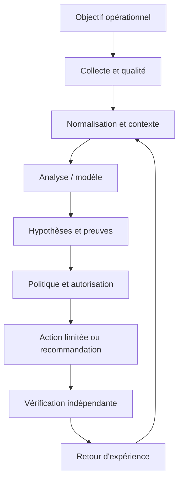

Le premier contrat concerne la donnée : source, horodatage, unité, cible, fraîcheur et état de qualité sont conservés. Le contrat du modèle ou de la règle précise la version, les entrées attendues, les métriques de validation et les limites. Le contrat de décision énumère les actions permises, les préconditions, les approbations, les quotas et les conditions d'arrêt. Le contrat de sortie indique enfin la preuve requise pour déclarer un rétablissement. Ces frontières permettent de tester chaque partie indépendamment, de corriger un composant sans dissimuler l'origine de l'erreur et d'auditer une action plusieurs semaines plus tard.

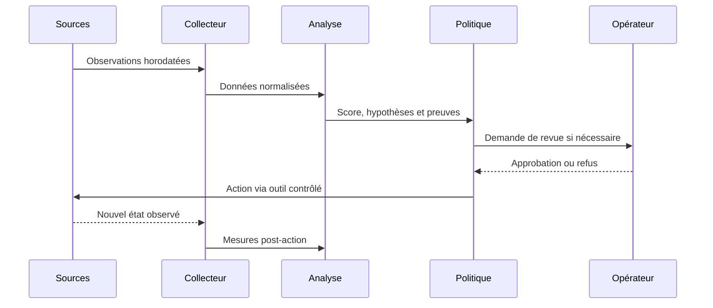

### Frontières de sécurité et mode dégradé

Le contrôle de sécurité lié à Séparation analyse/exécution doit être conçu dès le départ. Appliquer le moindre privilège, protéger les secrets, tracer les décisions et séparer analyse et exécution. Le piège à surveiller est : utiliser shell=True avec une entrée non fiable. Lorsque des données externes entrent dans le pipeline, elles ne doivent pas modifier les règles d'accès ni fournir des instructions privilégiées. Toute action à fort impact exige des préconditions compréhensibles, une approbation adaptée et une façon testée de revenir vers un état sûr.

Si Données manquantes produit un résultat incohérent, commencer par vérifier horloge, source, unité, cible, fraîcheur, version et erreur d'accès. Comparer une observation brute avec sa valeur transformée, puis rechercher les modifications récentes. Pour le scénario étudié, un contrôle utile consiste à tester une seule hypothèse à la fois et à conserver la preuve du résultat. Ne pas recopier de secrets dans le ticket. Une fois le défaut confirmé, ajouter un test de régression afin que la même anomalie ne revienne pas avec une mise à jour.

À l'échelle, Résilience du pipeline doit gérer des volumes, équipements et versions hétérogènes sans perdre de traçabilité. Borner la concurrence, isoler les erreurs par cible, limiter le buffering et mesurer les files protège le système aval. La reprise d'une panne peut elle-même provoquer une surcharge si toutes les cibles se reconnectent simultanément. Une architecture robuste sait réduire la fréquence ou revenir à une méthode plus simple, tout en signalant explicitement cette dégradation au lieu d'afficher une apparence de fonctionnement normal.

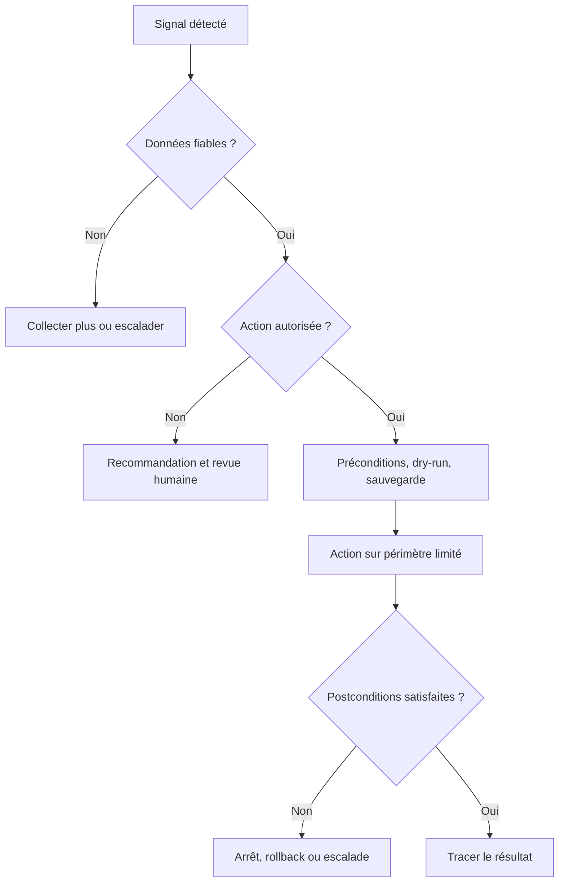

## 4. Pipeline et algorithmes

Le pipeline présenté ici est une chaîne de responsabilités, pas nécessairement un ensemble de microservices séparés. Une petite mise en œuvre peut héberger plusieurs étapes dans un seul processus, à condition de conserver des contrats clairs, des tests et des journaux. L'ordre importe : la qualité est vérifiée avant le calcul, le contexte avant l'interprétation et l'autorisation avant l'exécution. Cette discipline rend possible le fonctionnement en mode observation au départ puis, si les critères le justifient, une automatisation graduée.

### Étape 1 — Paramétrer
Déclarer arguments, variables, valeurs par défaut et secrets.

La mise en œuvre de Paramétrer gagne à être découpée en contrôles testables. Vérifier d'abord le format et la provenance des entrées, puis les hypothèses, les valeurs manquantes et les versions. L'outil Python peut contribuer à cette étape, mais sa présence ne garantit pas la qualité. Les erreurs doivent rester explicites au lieu d'être converties silencieusement en valeurs par défaut. Une exécution fiable sait différencier une réussite, un échec, un résultat partiel et un état impossible à déterminer.

Si Paramétrer produit un résultat incohérent, commencer par vérifier horloge, source, unité, cible, fraîcheur, version et erreur d'accès. Comparer une observation brute avec sa valeur transformée, puis rechercher les modifications récentes. Pour le scénario étudié, un contrôle utile consiste à tester une seule hypothèse à la fois et à conserver la preuve du résultat. Ne pas recopier de secrets dans le ticket. Une fois le défaut confirmé, ajouter un test de régression afin que la même anomalie ne revienne pas avec une mise à jour.

### Étape 2 — Valider la cible
Limiter les équipements et opérations autorisés.

La mise en œuvre de Valider la cible gagne à être découpée en contrôles testables. Vérifier d'abord le format et la provenance des entrées, puis les hypothèses, les valeurs manquantes et les versions. L'outil Bash peut contribuer à cette étape, mais sa présence ne garantit pas la qualité. Les erreurs doivent rester explicites au lieu d'être converties silencieusement en valeurs par défaut. Une exécution fiable sait différencier une réussite, un échec, un résultat partiel et un état impossible à déterminer.

Si Valider la cible produit un résultat incohérent, commencer par vérifier horloge, source, unité, cible, fraîcheur, version et erreur d'accès. Comparer une observation brute avec sa valeur transformée, puis rechercher les modifications récentes. Pour le scénario étudié, un contrôle utile consiste à tester une seule hypothèse à la fois et à conserver la preuve du résultat. Ne pas recopier de secrets dans le ticket. Une fois le défaut confirmé, ajouter un test de régression afin que la même anomalie ne revienne pas avec une mise à jour.

### Étape 3 — Lire l'état
Collecter la situation avant de modifier quoi que ce soit.

La mise en œuvre de Lire l'état gagne à être découpée en contrôles testables. Vérifier d'abord le format et la provenance des entrées, puis les hypothèses, les valeurs manquantes et les versions. L'outil subprocess peut contribuer à cette étape, mais sa présence ne garantit pas la qualité. Les erreurs doivent rester explicites au lieu d'être converties silencieusement en valeurs par défaut. Une exécution fiable sait différencier une réussite, un échec, un résultat partiel et un état impossible à déterminer.

Si Lire l'état produit un résultat incohérent, commencer par vérifier horloge, source, unité, cible, fraîcheur, version et erreur d'accès. Comparer une observation brute avec sa valeur transformée, puis rechercher les modifications récentes. Pour le scénario étudié, un contrôle utile consiste à tester une seule hypothèse à la fois et à conserver la preuve du résultat. Ne pas recopier de secrets dans le ticket. Une fois le défaut confirmé, ajouter un test de régression afin que la même anomalie ne revienne pas avec une mise à jour.

### Étape 4 — Calculer l'écart
Comparer état observé et état cible.

La mise en œuvre de Calculer l'écart gagne à être découpée en contrôles testables. Vérifier d'abord le format et la provenance des entrées, puis les hypothèses, les valeurs manquantes et les versions. L'outil JSON peut contribuer à cette étape, mais sa présence ne garantit pas la qualité. Les erreurs doivent rester explicites au lieu d'être converties silencieusement en valeurs par défaut. Une exécution fiable sait différencier une réussite, un échec, un résultat partiel et un état impossible à déterminer.

Si Calculer l'écart produit un résultat incohérent, commencer par vérifier horloge, source, unité, cible, fraîcheur, version et erreur d'accès. Comparer une observation brute avec sa valeur transformée, puis rechercher les modifications récentes. Pour le scénario étudié, un contrôle utile consiste à tester une seule hypothèse à la fois et à conserver la preuve du résultat. Ne pas recopier de secrets dans le ticket. Une fois le défaut confirmé, ajouter un test de régression afin que la même anomalie ne revienne pas avec une mise à jour.

### Étape 5 — Exécuter avec limites
Appliquer timeout, retries bornés et permissions minimales.

La mise en œuvre de Exécuter avec limites gagne à être découpée en contrôles testables. Vérifier d'abord le format et la provenance des entrées, puis les hypothèses, les valeurs manquantes et les versions. L'outil Git peut contribuer à cette étape, mais sa présence ne garantit pas la qualité. Les erreurs doivent rester explicites au lieu d'être converties silencieusement en valeurs par défaut. Une exécution fiable sait différencier une réussite, un échec, un résultat partiel et un état impossible à déterminer.

Si Exécuter avec limites produit un résultat incohérent, commencer par vérifier horloge, source, unité, cible, fraîcheur, version et erreur d'accès. Comparer une observation brute avec sa valeur transformée, puis rechercher les modifications récentes. Pour le scénario étudié, un contrôle utile consiste à tester une seule hypothèse à la fois et à conserver la preuve du résultat. Ne pas recopier de secrets dans le ticket. Une fois le défaut confirmé, ajouter un test de régression afin que la même anomalie ne revienne pas avec une mise à jour.

### Étape 6 — Vérifier et tracer
Relire l'état, consigner le résultat et retourner un code fiable.

La mise en œuvre de Vérifier et tracer gagne à être découpée en contrôles testables. Vérifier d'abord le format et la provenance des entrées, puis les hypothèses, les valeurs manquantes et les versions. L'outil journalisation peut contribuer à cette étape, mais sa présence ne garantit pas la qualité. Les erreurs doivent rester explicites au lieu d'être converties silencieusement en valeurs par défaut. Une exécution fiable sait différencier une réussite, un échec, un résultat partiel et un état impossible à déterminer.

Si Vérifier et tracer produit un résultat incohérent, commencer par vérifier horloge, source, unité, cible, fraîcheur, version et erreur d'accès. Comparer une observation brute avec sa valeur transformée, puis rechercher les modifications récentes. Pour le scénario étudié, un contrôle utile consiste à tester une seule hypothèse à la fois et à conserver la preuve du résultat. Ne pas recopier de secrets dans le ticket. Une fois le défaut confirmé, ajouter un test de régression afin que la même anomalie ne revienne pas avec une mise à jour.

### Pseudocode de décision défensive
```text
observations = collecter()
si qualite(observations) insuffisante:
    journaliser("données insuffisantes")
    demander_verification_humaine()
sinon:
    contexte = enrichir(observations, inventaire, changements, dépendances)
    hypotheses = analyser(contexte)
    preuves = verifier_provenance(hypotheses)
    si preuves insuffisantes ou action hors politique:
        recommander_sans_executer()
    sinon:
        plan = preparer_diff_preconditions_et_rollback()
        si validation(plan) et approbations(plan):
            appliquer_sur_perimetre_limite(plan)
            resultat = mesurer_postconditions()
            si resultat non conforme: rollback_ou_escalade()
            tracer(version, preuves, action, resultat)
```

Ce pseudocode sert à expliquer le flux de décision ; il ne constitue pas une bibliothèque prête pour la production. Chaque fonction doit être implémentée, testée et protégée. Le comportement doit être prévisible lorsque les données manquent, qu'un service externe ne répond pas ou que le résultat demeure ambigu. Une bonne conception ne remplace pas l'incertitude par une valeur par défaut. Elle la rend visible, limite l'impact et garde une voie de reprise.

## 5. Étude de cas détaillée

### Situation et impact
un script manuel collecte l'état des interfaces mais se bloque sur une cible indisponible, masque les erreurs et risque de répéter une modification. L'équipe réunit responsable de service, ingénieur réseau, administrateur système et propriétaire de l'automatisation. Avant d'agir, elle définit l'impact observé, la fenêtre de temps, les actifs concernés et les services prioritaires. La première question n'est pas « quel modèle utiliser ? », mais « quelle décision doit être améliorée et quelle preuve montrera que le changement a servi son objectif ? ». Cette formulation fixe le périmètre et donne un critère d'arrêt si la solution n'apporte pas de valeur démontrable.

### Phase 1 — Établir les faits
Les observations doivent garder les heures originales et les identifiants de source. L'équipe vérifie la qualité de collecte, les changements récents, les dépendances et l'expérience utilisateur. Les valeurs manquantes sont identifiées explicitement plutôt que remplacées silencieusement par zéro. Les symptômes sont séparés des causes supposées, et les sources qui se contredisent sont enregistrées dans le dossier. La preuve de départ sert de référence pour vérifier si une intervention améliore réellement la situation et permet à un autre opérateur de reproduire l'analyse.

### Phase 2 — Poser plusieurs hypothèses
Quand plusieurs causes sont possibles, l'équipe note au minimum deux hypothèses, les observations qui les soutiennent, les éléments qui les contredisent et les tests qui peuvent les différencier. La priorité combine probabilité, impact et coût d'un test. Une hypothèse populaire n'est pas nécessairement correcte : un cas qui ressemble à un incident passé peut différer par la capacité, le routage, la version de logiciel ou la période de charge. Les hypothèses restent des hypothèses jusqu'à ce qu'une preuve suffisante permette de les confirmer.

### Phase 3 — Choisir une réponse proportionnée
Commencer par les vérifications non destructives : comparer l'état, consulter les changements, tester la connectivité ou inspecter une dépendance. Si une modification est nécessaire, définir précisément la cible, la commande ou le changement attendu, les préconditions, les critères d'arrêt et le rollback. Une revue indépendante s'impose lorsque le rayon d'impact est élevé. Le plan doit permettre à l'opérateur de comprendre pourquoi l'action est proposée et dans quelles circonstances il doit la refuser.

### Phase 4 — Vérifier les postconditions
La validation repose sur des mesures indépendantes du simple statut de commande : latence, erreurs, connectivité, état de configuration ou indicateur du service. La fenêtre d'observation doit éviter de confondre un échantillon favorable avec un rétablissement durable. Si les conditions ne sont pas satisfaites, appliquer la règle d'arrêt prévue et lancer un rollback ou une escalade. Le compte rendu distingue l'action exécutée, l'effet mesuré, les effets secondaires et les informations qui restent inconnues.

### Phase 5 — Capitaliser avec prudence
Le post-mortem compare les hypothèses initiales avec les preuves finales, relève les signaux manquants et ajoute des tests de régression. Une règle ou un modèle amélioré passe en revue et en essai contrôlé avant généralisation. Il faut éviter de réentraîner automatiquement sur des conclusions incertaines ou des tickets contenant uniquement des suppositions. Le retour d'expérience doit décrire les situations où la méthode a échoué autant que les cas où elle a réussi.

### Critères de clôture
La clôture exige une preuve de rétablissement, ou une déclaration explicite que le service reste dégradé. Le dossier réunit sources, versions, changement exact, approbation, résultats et suivi. La cause racine n'est marquée comme confirmée que si les observations la soutiennent suffisamment. En l'absence de preuve, une conclusion partielle est plus utile qu'un récit catégorique. La qualité se mesure au diagnostic reproductible, au risque contrôlé et à la possibilité d'améliorer le système à partir des erreurs observées.

## 6. Implémentation guidée et laboratoire

Le laboratoire doit être exécuté dans un environnement isolé ou sur des systèmes explicitement autorisés. Avant de commencer, noter les versions, dépendances, données d'entrée et condition de réussite. Ne pas copier les exemples sur un réseau de production sans adapter les identifiants, certificats, permissions et tests de restauration. Le livrable final doit être compréhensible par une autre personne, ré-exécutable et accompagné d'une liste claire de ses limites.

### TP 1 — Lire un inventaire depuis un fichier JSON.
**Procédure.** Lire un inventaire depuis un fichier JSON. Commencer par une cible de laboratoire minimale et capturer l'état de départ. Relier ce travail au concept « Contrat d'entrée » : Les paramètres, formats, champs requis et erreurs doivent être explicites avant d'appeler un outil externe. Conserver la commande, les entrées, le résultat et la version des outils. Ne changer qu'une variable à la fois pour pouvoir attribuer un écart à sa cause.

**Critère de réussite.** Un autre opérateur doit pouvoir reproduire le résultat et identifier la preuve attendue. Tester aussi un échec contrôlé, une valeur manquante ou une dépendance indisponible. Si le résultat n'est pas déterminable, garder cet état explicite ; ne pas le convertir en succès. Vérifier les postconditions réelles, les effets secondaires et la procédure de reprise. Documenter ce qui a été démontré, ce qui reste une hypothèse et quelle amélioration serait nécessaire avant un usage à plus grande échelle.

### TP 2 — Valider identifiant, adresse et type pour chaque cible.
**Procédure.** Valider identifiant, adresse et type pour chaque cible. Commencer par une cible de laboratoire minimale et capturer l'état de départ. Relier ce travail au concept « Idempotence » : Une opération idempotente peut être répétée sans créer d'effets indésirables lorsque l'état cible est déjà atteint. Conserver la commande, les entrées, le résultat et la version des outils. Ne changer qu'une variable à la fois pour pouvoir attribuer un écart à sa cause.

**Critère de réussite.** Un autre opérateur doit pouvoir reproduire le résultat et identifier la preuve attendue. Tester aussi un échec contrôlé, une valeur manquante ou une dépendance indisponible. Si le résultat n'est pas déterminable, garder cet état explicite ; ne pas le convertir en succès. Vérifier les postconditions réelles, les effets secondaires et la procédure de reprise. Documenter ce qui a été démontré, ce qui reste une hypothèse et quelle amélioration serait nécessaire avant un usage à plus grande échelle.

### TP 3 — Collecter un état en lecture seule et normaliser la réponse.
**Procédure.** Collecter un état en lecture seule et normaliser la réponse. Commencer par une cible de laboratoire minimale et capturer l'état de départ. Relier ce travail au concept « Codes de sortie » : Le code de sortie, stdout et stderr aident l'appelant à distinguer succès, résultat et échec. Conserver la commande, les entrées, le résultat et la version des outils. Ne changer qu'une variable à la fois pour pouvoir attribuer un écart à sa cause.

**Critère de réussite.** Un autre opérateur doit pouvoir reproduire le résultat et identifier la preuve attendue. Tester aussi un échec contrôlé, une valeur manquante ou une dépendance indisponible. Si le résultat n'est pas déterminable, garder cet état explicite ; ne pas le convertir en succès. Vérifier les postconditions réelles, les effets secondaires et la procédure de reprise. Documenter ce qui a été démontré, ce qui reste une hypothèse et quelle amélioration serait nécessaire avant un usage à plus grande échelle.

### TP 4 — Ajouter timeout, codes de sortie et journaux structurés.
**Procédure.** Ajouter timeout, codes de sortie et journaux structurés. Commencer par une cible de laboratoire minimale et capturer l'état de départ. Relier ce travail au concept « Timeout et retries » : Les délais doivent être bornés ; les retries ne doivent viser que les erreurs transitoires et respecter une limite. Conserver la commande, les entrées, le résultat et la version des outils. Ne changer qu'une variable à la fois pour pouvoir attribuer un écart à sa cause.

**Critère de réussite.** Un autre opérateur doit pouvoir reproduire le résultat et identifier la preuve attendue. Tester aussi un échec contrôlé, une valeur manquante ou une dépendance indisponible. Si le résultat n'est pas déterminable, garder cet état explicite ; ne pas le convertir en succès. Vérifier les postconditions réelles, les effets secondaires et la procédure de reprise. Documenter ce qui a été démontré, ce qui reste une hypothèse et quelle amélioration serait nécessaire avant un usage à plus grande échelle.

### TP 5 — Simuler une cible injoignable et poursuivre proprement les autres.
**Procédure.** Simuler une cible injoignable et poursuivre proprement les autres. Commencer par une cible de laboratoire minimale et capturer l'état de départ. Relier ce travail au concept « Secrets » : Les clés et mots de passe doivent provenir d'un gestionnaire protégé et ne jamais apparaître dans Git ou les logs. Conserver la commande, les entrées, le résultat et la version des outils. Ne changer qu'une variable à la fois pour pouvoir attribuer un écart à sa cause.

**Critère de réussite.** Un autre opérateur doit pouvoir reproduire le résultat et identifier la preuve attendue. Tester aussi un échec contrôlé, une valeur manquante ou une dépendance indisponible. Si le résultat n'est pas déterminable, garder cet état explicite ; ne pas le convertir en succès. Vérifier les postconditions réelles, les effets secondaires et la procédure de reprise. Documenter ce qui a été démontré, ce qui reste une hypothèse et quelle amélioration serait nécessaire avant un usage à plus grande échelle.

### TP 6 — Ajouter un mode dry-run et vérifier qu'il ne modifie rien.
**Procédure.** Ajouter un mode dry-run et vérifier qu'il ne modifie rien. Commencer par une cible de laboratoire minimale et capturer l'état de départ. Relier ce travail au concept « Journal structuré » : Un journal exploitable conserve cible, opération, durée, résultat et corrélation sans stocker de données sensibles inutiles. Conserver la commande, les entrées, le résultat et la version des outils. Ne changer qu'une variable à la fois pour pouvoir attribuer un écart à sa cause.

**Critère de réussite.** Un autre opérateur doit pouvoir reproduire le résultat et identifier la preuve attendue. Tester aussi un échec contrôlé, une valeur manquante ou une dépendance indisponible. Si le résultat n'est pas déterminable, garder cet état explicite ; ne pas le convertir en succès. Vérifier les postconditions réelles, les effets secondaires et la procédure de reprise. Documenter ce qui a été démontré, ce qui reste une hypothèse et quelle amélioration serait nécessaire avant un usage à plus grande échelle.

### TP 7 — Tester le succès, les erreurs et les réponses mal formées.
**Procédure.** Tester le succès, les erreurs et les réponses mal formées. Commencer par une cible de laboratoire minimale et capturer l'état de départ. Relier ce travail au concept « Tests et reprise » : Les tests couvrent succès, erreur, données malformées, timeout et relance ; le dry-run rend les actions inspectables. Conserver la commande, les entrées, le résultat et la version des outils. Ne changer qu'une variable à la fois pour pouvoir attribuer un écart à sa cause.

**Critère de réussite.** Un autre opérateur doit pouvoir reproduire le résultat et identifier la preuve attendue. Tester aussi un échec contrôlé, une valeur manquante ou une dépendance indisponible. Si le résultat n'est pas déterminable, garder cet état explicite ; ne pas le convertir en succès. Vérifier les postconditions réelles, les effets secondaires et la procédure de reprise. Documenter ce qui a été démontré, ce qui reste une hypothèse et quelle amélioration serait nécessaire avant un usage à plus grande échelle.

### Exemple de code ou de configuration

```python
import logging, subprocess
logging.basicConfig(level=logging.INFO, format="%(asctime)s %(levelname)s %(message)s")
def run_read_only(command, timeout=10):
    if not isinstance(command, list) or not command:
        raise ValueError("Commande invalide")
    result = subprocess.run(command, capture_output=True, text=True, timeout=timeout, check=False)
    logging.info("commande terminee code=%s", result.returncode)
    if result.returncode != 0:
        raise RuntimeError(result.stderr.strip() or "Commande en échec")
    return result.stdout
print(run_read_only(["python", "--version"]))
```

Ce fragment est un point de départ pédagogique. Les versions, options CLI, capacités matérielles et schémas changent ; vérifier la documentation liée et tester dans un laboratoire. Le fragment n'inclut pas toute la configuration nécessaire à un déploiement réel. Les secrets ne doivent pas être ajoutés au code, et les exemples qui peuvent modifier un système doivent recevoir approbations, limites de portée et vérification post-action. Un parseur qui accepte la syntaxe ne certifie ni la conformité ni la disponibilité.

### Livrables attendus
- Un fichier versionné qui décrit entrées, sorties et dépendances.
- Un journal lié à la cible et à la version, sans secret.
- Des tests positifs, négatifs et de panne de dépendance.
- Des critères d'arrêt et une procédure de reprise testée.
- Une note décrivant les résultats et les limites.

## 7. Sécurité et gouvernance

### 1. Qualité et provenance
Chaque observation garde source, heure, unité et état de fraîcheur. Pour le contexte étudié, ce principe doit être traduit en contrôle observable, propriétaire, fréquence de revue et preuve de passage. Une politique sans test dépend de la mémoire des personnes ; un test sans propriétaire cesse d'être maintenu lorsque l'équipe change. La revue doit donc être planifiée et relancée après un changement majeur de données, de matériel, de finalité ou de modèle.

La gouvernance de Qualité et provenance définit qui peut créer, modifier, approuver, consulter et retirer la logique associée. Le propriétaire doit connaître l'objectif, les limites, les dépendances, le budget d'erreur et les critères de suspension. Les décisions doivent être retraçables jusqu'aux données et versions utilisées. Une règle sans propriétaire finit par dépendre de la mémoire de l'équipe ; un propriétaire sans mesure ne peut pas démontrer qu'elle fonctionne. La revue doit être planifiée et relancée à chaque changement majeur de données, d'équipement ou de finalité.

### 2. Identités et permissions
Les comptes d'automatisation reçoivent uniquement les privilèges nécessaires. Pour le contexte étudié, ce principe doit être traduit en contrôle observable, propriétaire, fréquence de revue et preuve de passage. Une politique sans test dépend de la mémoire des personnes ; un test sans propriétaire cesse d'être maintenu lorsque l'équipe change. La revue doit donc être planifiée et relancée après un changement majeur de données, de matériel, de finalité ou de modèle.

La gouvernance de Identités et permissions définit qui peut créer, modifier, approuver, consulter et retirer la logique associée. Le propriétaire doit connaître l'objectif, les limites, les dépendances, le budget d'erreur et les critères de suspension. Les décisions doivent être retraçables jusqu'aux données et versions utilisées. Une règle sans propriétaire finit par dépendre de la mémoire de l'équipe ; un propriétaire sans mesure ne peut pas démontrer qu'elle fonctionne. La revue doit être planifiée et relancée à chaque changement majeur de données, d'équipement ou de finalité.

### 3. Traçabilité
La version, les preuves, la décision, l'approbateur et le résultat sont corrélés. Pour le contexte étudié, ce principe doit être traduit en contrôle observable, propriétaire, fréquence de revue et preuve de passage. Une politique sans test dépend de la mémoire des personnes ; un test sans propriétaire cesse d'être maintenu lorsque l'équipe change. La revue doit donc être planifiée et relancée après un changement majeur de données, de matériel, de finalité ou de modèle.

La gouvernance de Traçabilité définit qui peut créer, modifier, approuver, consulter et retirer la logique associée. Le propriétaire doit connaître l'objectif, les limites, les dépendances, le budget d'erreur et les critères de suspension. Les décisions doivent être retraçables jusqu'aux données et versions utilisées. Une règle sans propriétaire finit par dépendre de la mémoire de l'équipe ; un propriétaire sans mesure ne peut pas démontrer qu'elle fonctionne. La revue doit être planifiée et relancée à chaque changement majeur de données, d'équipement ou de finalité.

### 4. Revue humaine
Le réviseur doit posséder preuves, temps et autorité pour refuser. Pour le contexte étudié, ce principe doit être traduit en contrôle observable, propriétaire, fréquence de revue et preuve de passage. Une politique sans test dépend de la mémoire des personnes ; un test sans propriétaire cesse d'être maintenu lorsque l'équipe change. La revue doit donc être planifiée et relancée après un changement majeur de données, de matériel, de finalité ou de modèle.

La gouvernance de Revue humaine définit qui peut créer, modifier, approuver, consulter et retirer la logique associée. Le propriétaire doit connaître l'objectif, les limites, les dépendances, le budget d'erreur et les critères de suspension. Les décisions doivent être retraçables jusqu'aux données et versions utilisées. Une règle sans propriétaire finit par dépendre de la mémoire de l'équipe ; un propriétaire sans mesure ne peut pas démontrer qu'elle fonctionne. La revue doit être planifiée et relancée à chaque changement majeur de données, d'équipement ou de finalité.

### 5. Mesure du risque
Chaque mode d'échec doit avoir prévention, détection, réponse et responsable. Pour le contexte étudié, ce principe doit être traduit en contrôle observable, propriétaire, fréquence de revue et preuve de passage. Une politique sans test dépend de la mémoire des personnes ; un test sans propriétaire cesse d'être maintenu lorsque l'équipe change. La revue doit donc être planifiée et relancée après un changement majeur de données, de matériel, de finalité ou de modèle.

La gouvernance de Mesure du risque définit qui peut créer, modifier, approuver, consulter et retirer la logique associée. Le propriétaire doit connaître l'objectif, les limites, les dépendances, le budget d'erreur et les critères de suspension. Les décisions doivent être retraçables jusqu'aux données et versions utilisées. Une règle sans propriétaire finit par dépendre de la mémoire de l'équipe ; un propriétaire sans mesure ne peut pas démontrer qu'elle fonctionne. La revue doit être planifiée et relancée à chaque changement majeur de données, d'équipement ou de finalité.

### 6. Réversibilité
La suspension du modèle et le retour à une version saine sont testés. Pour le contexte étudié, ce principe doit être traduit en contrôle observable, propriétaire, fréquence de revue et preuve de passage. Une politique sans test dépend de la mémoire des personnes ; un test sans propriétaire cesse d'être maintenu lorsque l'équipe change. La revue doit donc être planifiée et relancée après un changement majeur de données, de matériel, de finalité ou de modèle.

La gouvernance de Réversibilité définit qui peut créer, modifier, approuver, consulter et retirer la logique associée. Le propriétaire doit connaître l'objectif, les limites, les dépendances, le budget d'erreur et les critères de suspension. Les décisions doivent être retraçables jusqu'aux données et versions utilisées. Une règle sans propriétaire finit par dépendre de la mémoire de l'équipe ; un propriétaire sans mesure ne peut pas démontrer qu'elle fonctionne. La revue doit être planifiée et relancée à chaque changement majeur de données, d'équipement ou de finalité.

## 8. Pièges à éviter

### Piège 1 — Utiliser shell=True avec une entrée non fiable

Ce piège peut produire un faux diagnostic, une action superflue ou une perte de confiance. Le signal précurseur est parfois subtil : incohérence entre sources, hausse d'erreurs, impossibilité d'expliquer la sortie ou comportement différent selon les sites. L'équipe doit rendre le signal mesurable, désigner qui réagit et préciser si l'action automatique se bloque ou si le traitement continue en mode dégradé.

La prévention doit être reliée à « Contrat d'entrée ». Les paramètres, formats, champs requis et erreurs doivent être explicites avant d'appeler un outil externe. Définir un test négatif qui fait apparaître le défaut et vérifier que la réponse attendue réduit le risque. Un garde-fou ne doit pas être un simple avertissement que les opérateurs apprennent à ignorer. En revue, demander quelle preuve montre que le contrôle fonctionne, quelle défaillance il couvre et quelle autre défaillance demeure possible.

### Piège 2 — Réessayer sans limite une commande qui modifie l'état

Ce piège peut produire un faux diagnostic, une action superflue ou une perte de confiance. Le signal précurseur est parfois subtil : incohérence entre sources, hausse d'erreurs, impossibilité d'expliquer la sortie ou comportement différent selon les sites. L'équipe doit rendre le signal mesurable, désigner qui réagit et préciser si l'action automatique se bloque ou si le traitement continue en mode dégradé.

La prévention doit être reliée à « Idempotence ». Une opération idempotente peut être répétée sans créer d'effets indésirables lorsque l'état cible est déjà atteint. Définir un test négatif qui fait apparaître le défaut et vérifier que la réponse attendue réduit le risque. Un garde-fou ne doit pas être un simple avertissement que les opérateurs apprennent à ignorer. En revue, demander quelle preuve montre que le contrôle fonctionne, quelle défaillance il couvre et quelle autre défaillance demeure possible.

### Piège 3 — Exposer un jeton dans l'historique du shell

Ce piège peut produire un faux diagnostic, une action superflue ou une perte de confiance. Le signal précurseur est parfois subtil : incohérence entre sources, hausse d'erreurs, impossibilité d'expliquer la sortie ou comportement différent selon les sites. L'équipe doit rendre le signal mesurable, désigner qui réagit et préciser si l'action automatique se bloque ou si le traitement continue en mode dégradé.

La prévention doit être reliée à « Codes de sortie ». Le code de sortie, stdout et stderr aident l'appelant à distinguer succès, résultat et échec. Définir un test négatif qui fait apparaître le défaut et vérifier que la réponse attendue réduit le risque. Un garde-fou ne doit pas être un simple avertissement que les opérateurs apprennent à ignorer. En revue, demander quelle preuve montre que le contrôle fonctionne, quelle défaillance il couvre et quelle autre défaillance demeure possible.

### Piège 4 — Ignorer le code de sortie d'un processus

Ce piège peut produire un faux diagnostic, une action superflue ou une perte de confiance. Le signal précurseur est parfois subtil : incohérence entre sources, hausse d'erreurs, impossibilité d'expliquer la sortie ou comportement différent selon les sites. L'équipe doit rendre le signal mesurable, désigner qui réagit et préciser si l'action automatique se bloque ou si le traitement continue en mode dégradé.

La prévention doit être reliée à « Timeout et retries ». Les délais doivent être bornés ; les retries ne doivent viser que les erreurs transitoires et respecter une limite. Définir un test négatif qui fait apparaître le défaut et vérifier que la réponse attendue réduit le risque. Un garde-fou ne doit pas être un simple avertissement que les opérateurs apprennent à ignorer. En revue, demander quelle preuve montre que le contrôle fonctionne, quelle défaillance il couvre et quelle autre défaillance demeure possible.

### Piège 5 — Confondre réponse API et état réel

Ce piège peut produire un faux diagnostic, une action superflue ou une perte de confiance. Le signal précurseur est parfois subtil : incohérence entre sources, hausse d'erreurs, impossibilité d'expliquer la sortie ou comportement différent selon les sites. L'équipe doit rendre le signal mesurable, désigner qui réagit et préciser si l'action automatique se bloque ou si le traitement continue en mode dégradé.

La prévention doit être reliée à « Secrets ». Les clés et mots de passe doivent provenir d'un gestionnaire protégé et ne jamais apparaître dans Git ou les logs. Définir un test négatif qui fait apparaître le défaut et vérifier que la réponse attendue réduit le risque. Un garde-fou ne doit pas être un simple avertissement que les opérateurs apprennent à ignorer. En revue, demander quelle preuve montre que le contrôle fonctionne, quelle défaillance il couvre et quelle autre défaillance demeure possible.

### Piège 6 — Dépendre du répertoire courant implicite

Ce piège peut produire un faux diagnostic, une action superflue ou une perte de confiance. Le signal précurseur est parfois subtil : incohérence entre sources, hausse d'erreurs, impossibilité d'expliquer la sortie ou comportement différent selon les sites. L'équipe doit rendre le signal mesurable, désigner qui réagit et préciser si l'action automatique se bloque ou si le traitement continue en mode dégradé.

La prévention doit être reliée à « Journal structuré ». Un journal exploitable conserve cible, opération, durée, résultat et corrélation sans stocker de données sensibles inutiles. Définir un test négatif qui fait apparaître le défaut et vérifier que la réponse attendue réduit le risque. Un garde-fou ne doit pas être un simple avertissement que les opérateurs apprennent à ignorer. En revue, demander quelle preuve montre que le contrôle fonctionne, quelle défaillance il couvre et quelle autre défaillance demeure possible.

### Piège 7 — Laisser une exécution interrompue sans état explicite

Ce piège peut produire un faux diagnostic, une action superflue ou une perte de confiance. Le signal précurseur est parfois subtil : incohérence entre sources, hausse d'erreurs, impossibilité d'expliquer la sortie ou comportement différent selon les sites. L'équipe doit rendre le signal mesurable, désigner qui réagit et préciser si l'action automatique se bloque ou si le traitement continue en mode dégradé.

La prévention doit être reliée à « Tests et reprise ». Les tests couvrent succès, erreur, données malformées, timeout et relance ; le dry-run rend les actions inspectables. Définir un test négatif qui fait apparaître le défaut et vérifier que la réponse attendue réduit le risque. Un garde-fou ne doit pas être un simple avertissement que les opérateurs apprennent à ignorer. En revue, demander quelle preuve montre que le contrôle fonctionne, quelle défaillance il couvre et quelle autre défaillance demeure possible.

## 9. Diagnostic et dépannage

### Aucun résultat n'est produit
Vérifier accès source, période de sélection, identité, filtres et version du schéma. Dans le cadre de Automatisation avec Python et Bash, vérifier en particulier ce risque : utiliser shell=True avec une entrée non fiable. Comparer les observations brutes à leur représentation transformée, retrouver la version du pipeline et noter si une modification récente correspond au début du problème. Formuler au moins deux explications alternatives et choisir un test à faible risque qui permet de les distinguer. Ne pas effectuer plusieurs changements simultanément, car cela rendrait l'analyse ambiguë. Si les preuves restent insuffisantes, rendre cette incertitude visible et utiliser le mode sûr.

### Les résultats varient
Comparer données, code, versions, transformations et paramètres sur un cas fixe. Dans le cadre de Automatisation avec Python et Bash, vérifier en particulier ce risque : réessayer sans limite une commande qui modifie l'état. Comparer les observations brutes à leur représentation transformée, retrouver la version du pipeline et noter si une modification récente correspond au début du problème. Formuler au moins deux explications alternatives et choisir un test à faible risque qui permet de les distinguer. Ne pas effectuer plusieurs changements simultanément, car cela rendrait l'analyse ambiguë. Si les preuves restent insuffisantes, rendre cette incertitude visible et utiliser le mode sûr.

### Trop d'alertes
Inspecter doublons, saisonnalité, baseline, seuil et qualité du contexte avant de supprimer des alertes. Dans le cadre de Automatisation avec Python et Bash, vérifier en particulier ce risque : exposer un jeton dans l'historique du shell. Comparer les observations brutes à leur représentation transformée, retrouver la version du pipeline et noter si une modification récente correspond au début du problème. Formuler au moins deux explications alternatives et choisir un test à faible risque qui permet de les distinguer. Ne pas effectuer plusieurs changements simultanément, car cela rendrait l'analyse ambiguë. Si les preuves restent insuffisantes, rendre cette incertitude visible et utiliser le mode sûr.

### Un incident passe inaperçu
Reconstituer les informations disponibles au moment de décider et rechercher un seuil trop permissif ou une source absente. Dans le cadre de Automatisation avec Python et Bash, vérifier en particulier ce risque : ignorer le code de sortie d'un processus. Comparer les observations brutes à leur représentation transformée, retrouver la version du pipeline et noter si une modification récente correspond au début du problème. Formuler au moins deux explications alternatives et choisir un test à faible risque qui permet de les distinguer. Ne pas effectuer plusieurs changements simultanément, car cela rendrait l'analyse ambiguë. Si les preuves restent insuffisantes, rendre cette incertitude visible et utiliser le mode sûr.

### L'action n'améliore pas le service
Vérifier postconditions indépendantes et effets secondaires, puis appliquer arrêt ou rollback selon le plan. Dans le cadre de Automatisation avec Python et Bash, vérifier en particulier ce risque : confondre réponse API et état réel. Comparer les observations brutes à leur représentation transformée, retrouver la version du pipeline et noter si une modification récente correspond au début du problème. Formuler au moins deux explications alternatives et choisir un test à faible risque qui permet de les distinguer. Ne pas effectuer plusieurs changements simultanément, car cela rendrait l'analyse ambiguë. Si les preuves restent insuffisantes, rendre cette incertitude visible et utiliser le mode sûr.

### La qualité diminue avec le temps
Rechercher dérive, changement de capacité, topologie, population ou version et réévaluer. Dans le cadre de Automatisation avec Python et Bash, vérifier en particulier ce risque : dépendre du répertoire courant implicite. Comparer les observations brutes à leur représentation transformée, retrouver la version du pipeline et noter si une modification récente correspond au début du problème. Formuler au moins deux explications alternatives et choisir un test à faible risque qui permet de les distinguer. Ne pas effectuer plusieurs changements simultanément, car cela rendrait l'analyse ambiguë. Si les preuves restent insuffisantes, rendre cette incertitude visible et utiliser le mode sûr.

## 10. Exercices corrigés

### Exercice 1 — Contrat d'entrée
**Énoncé.** Dans un environnement inspiré du scénario « un script manuel collecte l'état des interfaces mais se bloque sur une cible indisponible, masque les erreurs et risque de répéter une modification », l'équipe veut généraliser une approche qui utilise « Contrat d'entrée ». Quelle preuve recueillir avant l'étape « Paramétrer », et comment réduire le risque suivant : utiliser shell=True avec une entrée non fiable ?

**Correction détaillée.** Définir d'abord le résultat attendu et le coût d'une erreur. Vérifier que les entrées proviennent d'une source autorisée et qu'elles sont fraîches, cohérentes et disponibles au moment de la décision. Construire un essai reproductible, comparer à une baseline et analyser les erreurs par classe d'actif ou criticité. Déclarer arguments, variables, valeurs par défaut et secrets. L'extension du périmètre exige des seuils écrits, une revue adaptée au risque, un déploiement progressif et un retour arrière. Si la preuve ne permet pas de trancher, demander une vérification complémentaire ou garder la solution en observation plutôt que d'inventer une certitude.

**Pourquoi les raccourcis échouent.** Un résultat favorable sur un exemple ne démontre pas une performance durable. Un score moyen peut masquer les catégories vulnérables ; une absence d'erreur visible peut provenir d'une télémétrie incomplète. Conserver les cas difficiles, les conditions de test et les versions utilisées rend possible une revue indépendante. L'exercice est réussi lorsque le choix, ses limites et le mécanisme de retrait sont compris par une autre personne.

### Exercice 2 — Idempotence
**Énoncé.** Dans un environnement inspiré du scénario « un script manuel collecte l'état des interfaces mais se bloque sur une cible indisponible, masque les erreurs et risque de répéter une modification », l'équipe veut généraliser une approche qui utilise « Idempotence ». Quelle preuve recueillir avant l'étape « Valider la cible », et comment réduire le risque suivant : réessayer sans limite une commande qui modifie l'état ?

**Correction détaillée.** Définir d'abord le résultat attendu et le coût d'une erreur. Vérifier que les entrées proviennent d'une source autorisée et qu'elles sont fraîches, cohérentes et disponibles au moment de la décision. Construire un essai reproductible, comparer à une baseline et analyser les erreurs par classe d'actif ou criticité. Limiter les équipements et opérations autorisés. L'extension du périmètre exige des seuils écrits, une revue adaptée au risque, un déploiement progressif et un retour arrière. Si la preuve ne permet pas de trancher, demander une vérification complémentaire ou garder la solution en observation plutôt que d'inventer une certitude.

**Pourquoi les raccourcis échouent.** Un résultat favorable sur un exemple ne démontre pas une performance durable. Un score moyen peut masquer les catégories vulnérables ; une absence d'erreur visible peut provenir d'une télémétrie incomplète. Conserver les cas difficiles, les conditions de test et les versions utilisées rend possible une revue indépendante. L'exercice est réussi lorsque le choix, ses limites et le mécanisme de retrait sont compris par une autre personne.

### Exercice 3 — Codes de sortie
**Énoncé.** Dans un environnement inspiré du scénario « un script manuel collecte l'état des interfaces mais se bloque sur une cible indisponible, masque les erreurs et risque de répéter une modification », l'équipe veut généraliser une approche qui utilise « Codes de sortie ». Quelle preuve recueillir avant l'étape « Lire l'état », et comment réduire le risque suivant : exposer un jeton dans l'historique du shell ?

**Correction détaillée.** Définir d'abord le résultat attendu et le coût d'une erreur. Vérifier que les entrées proviennent d'une source autorisée et qu'elles sont fraîches, cohérentes et disponibles au moment de la décision. Construire un essai reproductible, comparer à une baseline et analyser les erreurs par classe d'actif ou criticité. Collecter la situation avant de modifier quoi que ce soit. L'extension du périmètre exige des seuils écrits, une revue adaptée au risque, un déploiement progressif et un retour arrière. Si la preuve ne permet pas de trancher, demander une vérification complémentaire ou garder la solution en observation plutôt que d'inventer une certitude.

**Pourquoi les raccourcis échouent.** Un résultat favorable sur un exemple ne démontre pas une performance durable. Un score moyen peut masquer les catégories vulnérables ; une absence d'erreur visible peut provenir d'une télémétrie incomplète. Conserver les cas difficiles, les conditions de test et les versions utilisées rend possible une revue indépendante. L'exercice est réussi lorsque le choix, ses limites et le mécanisme de retrait sont compris par une autre personne.

### Exercice 4 — Timeout et retries
**Énoncé.** Dans un environnement inspiré du scénario « un script manuel collecte l'état des interfaces mais se bloque sur une cible indisponible, masque les erreurs et risque de répéter une modification », l'équipe veut généraliser une approche qui utilise « Timeout et retries ». Quelle preuve recueillir avant l'étape « Calculer l'écart », et comment réduire le risque suivant : ignorer le code de sortie d'un processus ?

**Correction détaillée.** Définir d'abord le résultat attendu et le coût d'une erreur. Vérifier que les entrées proviennent d'une source autorisée et qu'elles sont fraîches, cohérentes et disponibles au moment de la décision. Construire un essai reproductible, comparer à une baseline et analyser les erreurs par classe d'actif ou criticité. Comparer état observé et état cible. L'extension du périmètre exige des seuils écrits, une revue adaptée au risque, un déploiement progressif et un retour arrière. Si la preuve ne permet pas de trancher, demander une vérification complémentaire ou garder la solution en observation plutôt que d'inventer une certitude.

**Pourquoi les raccourcis échouent.** Un résultat favorable sur un exemple ne démontre pas une performance durable. Un score moyen peut masquer les catégories vulnérables ; une absence d'erreur visible peut provenir d'une télémétrie incomplète. Conserver les cas difficiles, les conditions de test et les versions utilisées rend possible une revue indépendante. L'exercice est réussi lorsque le choix, ses limites et le mécanisme de retrait sont compris par une autre personne.

### Exercice 5 — Secrets
**Énoncé.** Dans un environnement inspiré du scénario « un script manuel collecte l'état des interfaces mais se bloque sur une cible indisponible, masque les erreurs et risque de répéter une modification », l'équipe veut généraliser une approche qui utilise « Secrets ». Quelle preuve recueillir avant l'étape « Exécuter avec limites », et comment réduire le risque suivant : confondre réponse API et état réel ?

**Correction détaillée.** Définir d'abord le résultat attendu et le coût d'une erreur. Vérifier que les entrées proviennent d'une source autorisée et qu'elles sont fraîches, cohérentes et disponibles au moment de la décision. Construire un essai reproductible, comparer à une baseline et analyser les erreurs par classe d'actif ou criticité. Appliquer timeout, retries bornés et permissions minimales. L'extension du périmètre exige des seuils écrits, une revue adaptée au risque, un déploiement progressif et un retour arrière. Si la preuve ne permet pas de trancher, demander une vérification complémentaire ou garder la solution en observation plutôt que d'inventer une certitude.

**Pourquoi les raccourcis échouent.** Un résultat favorable sur un exemple ne démontre pas une performance durable. Un score moyen peut masquer les catégories vulnérables ; une absence d'erreur visible peut provenir d'une télémétrie incomplète. Conserver les cas difficiles, les conditions de test et les versions utilisées rend possible une revue indépendante. L'exercice est réussi lorsque le choix, ses limites et le mécanisme de retrait sont compris par une autre personne.


## Atelier avancé — écrire, tester et exploiter des scripts d'automatisation

Cet atelier transforme les notions précédentes en une démarche concrète. Le but n'est pas d'écrire le plus petit nombre de lignes possible, mais de produire un outil dont les entrées, les permissions, les effets, les erreurs et les résultats sont compréhensibles. Un script d'administration constitue une partie du système d'exploitation : il doit être conçu, testé, observé, versionné et maintenu.

Les exemples sont destinés à un environnement de laboratoire et à des données synthétiques. Une adresse, une interface, une clé API ou une commande de configuration réelle ne doit être utilisée qu'avec une autorisation explicite. Les exercices de collecte restent en lecture seule par défaut. Toute modification d'équipement, de compte, de base de données ou de réseau doit être séparée de la collecte et encadrée par des contrôles adaptés.

### A. Concevoir le contrat d'un script

Avant d'écrire un script, définis ce qu'il promet à son utilisateur. Un outil de collecte peut recevoir un inventaire d'hôtes, contacter chaque cible, récupérer des indicateurs, normaliser les résultats et les enregistrer dans un fichier horodaté. Mais il doit aussi savoir décrire ce qui arrive lorsqu'une cible ne répond pas, lorsqu'un fichier est inaccessible, lorsque la réponse est invalide ou lorsque le processus est interrompu.

Le contrat du script devrait répondre à ces questions : quelles entrées sont acceptées, quel format est attendu, quelles options sont autorisées, quelles données sont produites, quels effets sont possibles, combien de temps chaque opération peut durer, comment les erreurs sont représentées, comment l'utilisateur peut relancer l'exécution et comment vérifier le résultat. Un script qui réussit uniquement lorsque tout se passe bien n'est pas suffisamment robuste pour l'exploitation.

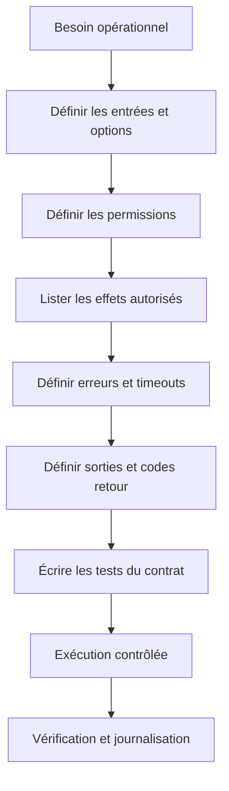

Pour un collecteur réseau, un contrat simple pourrait être : il lit un inventaire CSV de cibles autorisées, utilise des délais limités, ne change aucun état, conserve les résultats même si une cible est inaccessible, enregistre les heures en UTC et renvoie un code non nul si la collecte est incomplète. L'utilisateur reçoit un résumé distinguant « collecte terminée sans erreur », « collecte partiellement réussie » et « aucune donnée exploitable ». Ce vocabulaire est plus précis que le simple statut « succès ».

Le contrat doit aussi être stable. Si une nouvelle version renomme une colonne, modifie une unité ou change le sens d'un code retour, les scripts qui consomment ces résultats peuvent casser. Numérote les versions de schéma lorsque des consommateurs externes dépendent du format. Écris un exemple d'entrée, un exemple de sortie et une définition des statuts ; ces exemples deviennent des tests de référence.

### B. Choisir entre Python et Bash selon la tâche

Bash est adapté à l'assemblage de commandes système, à la gestion de petits flux de fichiers et à des tâches d'orchestration simples sur les environnements Unix. Python est plus adapté lorsque la logique devient complexe, que les données doivent être validées ou transformées, que plusieurs API sont utilisées, ou que les tests nécessitent des fonctions indépendantes. Il n'existe pas de règle absolue, mais un script shell contenant beaucoup de parsing, de logique conditionnelle et de gestion d'états devient souvent plus difficile à comprendre et à tester.

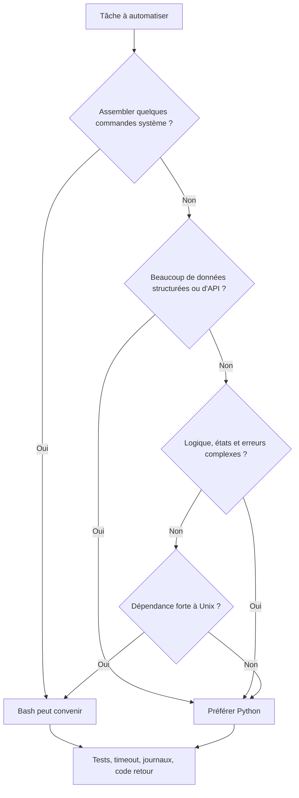

Une approche hybride est parfois utile : Bash prépare l'environnement et appelle une application Python qui réalise la logique métier. Dans ce cas, les frontières doivent être claires. Le shell se charge de l'environnement, de l'activation éventuelle d'un environnement virtuel et de l'appel du programme ; Python valide les entrées, traite les données et produit une sortie structurée. Évite de dupliquer la même logique dans deux langages.

Exemple Bash minimal :

```bash
#!/usr/bin/env bash
set -Eeuo pipefail

usage() {
  printf 'Usage: %s INVENTAIRE.csv SORTIE.jsonl\n' "$0" >&2
}

if [[ $# -ne 2 ]]; then
  usage
  exit 2
fi

inventory=$1
output=$2

if [[ ! -r "$inventory" ]]; then
  printf 'Erreur: inventaire illisible: %s\n' "$inventory" >&2
  exit 2
fi

mkdir -p "$(dirname "$output")"
python3 collect.py --inventory "$inventory" --output "$output"
```

L'option set -Eeuo pipefail aide à détecter certaines erreurs : une commande en échec, une variable non définie ou l'échec d'un élément dans un pipeline. Elle ne rend pas magiquement le shell infaillible. Les commandes qui peuvent légitimement échouer doivent être traitées explicitement, les fichiers temporaires doivent être nettoyés et les comportements conditionnels doivent être testés. Un script court doit rester lisible plutôt que de cacher toute sa logique derrière une combinaison compacte de symboles.

### C. Traiter les arguments comme des données non fiables

Un paramètre transmis à la ligne de commande peut être vide, mal formé, trop long ou conçu pour détourner l'exécution. Ne construis pas une commande système en concaténant une chaîne fournie par l'utilisateur. En Python, préfère subprocess.run avec une liste d'arguments et shell=False. Il faut aussi limiter le répertoire de travail, l'environnement transmis au processus et sa durée d'exécution.

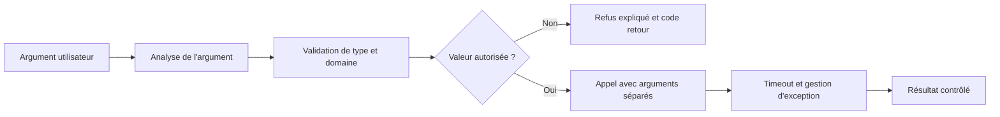

Un exemple classique est une option qui attend un nom d'hôte. Le script doit vérifier que la valeur correspond à un nom accepté ou à une entrée connue de l'inventaire. Il ne doit pas permettre à ce paramètre de devenir une option imprévue pour la commande sous-jacente. Dans un environnement sensible, l'inventaire doit être la source d'autorité : l'utilisateur choisit une cible existante plutôt que de fournir arbitrairement une adresse à contacter.

```python
import subprocess

def read_local_interface_state():
    """Exemple pédagogique en lecture seule sur la machine locale."""
    result = subprocess.run(
        ["ip", "-brief", "address"],
        capture_output=True,
        text=True,
        timeout=5,
        check=False,
        shell=False,
    )
    if result.returncode != 0:
        raise RuntimeError(
            f"Commande locale en échec, code={result.returncode}"
        )
    return result.stdout
```

L'exemple ne se connecte pas à un équipement distant : il illustre uniquement les propriétés de l'appel local. Dans un outil réel, la connexion distante passerait par une bibliothèque adaptée ou par une commande préalablement approuvée. Le script ne devrait jamais transformer une entrée en commande arbitraire.

Une exception doit être transformée en diagnostic utile à la frontière du programme. Il ne faut ni l'ignorer ni afficher tout un environnement contenant potentiellement des secrets. Un message adapté identifie l'opération, la cible logique et le type de problème, sans enregistrer un mot de passe, un jeton ou un contenu sensible.

### D. Gérer le cycle de vie d'un processus

Un processus peut réussir, échouer, rester bloqué, être interrompu ou terminer avec une sortie qui ne respecte pas le format attendu. Lorsqu'un programme Python appelle une commande externe, trois paramètres sont importants : le timeout, la vérification du code retour et la lecture de la sortie standard et de la sortie d'erreur. Il faut définir une stratégie différente pour un échec attendu et pour une anomalie qui invalide toute l'exécution.

```mermaid
stateDiagram-v2
    [*] --> Prepare: valider les arguments
    Prepare --> Running: lancer le processus
    Running --> Success: code retour 0 et sortie valide
    Running --> Failed: code retour non nul
    Running --> TimedOut: durée maximale atteinte
    Running --> Interrupted: interruption contrôlée
    Failed --> Record: enregistrer l'erreur
    TimedOut --> Terminate: arrêter si possible
    Terminate --> Record
    Interrupted --> Cleanup: nettoyer les temporaires
    Success --> Verify: vérifier les postconditions
    Verify --> Complete: sortie cohérente
    Record --> Complete: statut partiel ou échec
    Cleanup --> Complete
    Complete --> [*]
```

Pour une collecte sur plusieurs cibles, une cible inaccessible est souvent une erreur partielle, pas une raison de perdre tous les résultats précédents. En revanche, si l'inventaire est invalide ou si le fichier de sortie ne peut pas être sécurisé, il peut être préférable d'arrêter le traitement entier. Cette distinction doit faire partie du contrat et être représentée par un code retour.

La durée maximale dépend de l'opération. Une commande locale de lecture peut nécessiter quelques secondes ; une sauvegarde ou une exportation contrôlée peut exiger davantage. Le timeout ne doit pas être arbitrairement énorme. Il faut aussi tenir compte du temps total : dix mille cibles avec un timeout de trente secondes peuvent provoquer une exécution très longue si elles sont contactées de façon séquentielle.

```python
import subprocess

def execute_read_only(args, timeout_seconds=8):
    try:
        result = subprocess.run(
            args, capture_output=True, text=True,
            timeout=timeout_seconds, check=False, shell=False
        )
    except subprocess.TimeoutExpired:
        return {
            "status": "timeout",
            "return_code": None,
            "stdout": "",
            "error": f"Durée maximale de {timeout_seconds}s dépassée",
        }
    except OSError as exc:
        return {
            "status": "launch_error",
            "return_code": None,
            "stdout": "",
            "error": f"Impossible de lancer le processus: {type(exc).__name__}",
        }

    if result.returncode != 0:
        return {
            "status": "command_error",
            "return_code": result.returncode,
            "stdout": result.stdout,
            "error": result.stderr[-1000:],
        }

    return {
        "status": "ok",
        "return_code": 0,
        "stdout": result.stdout,
        "error": "",
    }
```

Le code limite la taille du fragment d'erreur conservé, mais cela ne constitue pas une politique complète de nettoyage des données. Une sortie système peut contenir des secrets ; un outil réel doit masquer les valeurs sensibles avant journalisation. Les sorties externes sont des données non fiables et doivent être analysées dans un cadre défini. N'exécute jamais automatiquement une commande parce qu'elle apparaît dans la sortie d'un programme.

### E. Écrire un script idempotent

Une opération est idempotente si la répétition de la même demande dans le même état aboutit au même résultat final, sans répéter inutilement les effets. Lire l'état d'une interface est généralement idempotent. Ajouter systématiquement une règle sans vérifier son existence ne l'est pas. Créer un utilisateur à chaque exécution, envoyer plusieurs notifications identiques ou empiler des règles de pare-feu sont des exemples de problèmes de répétition.

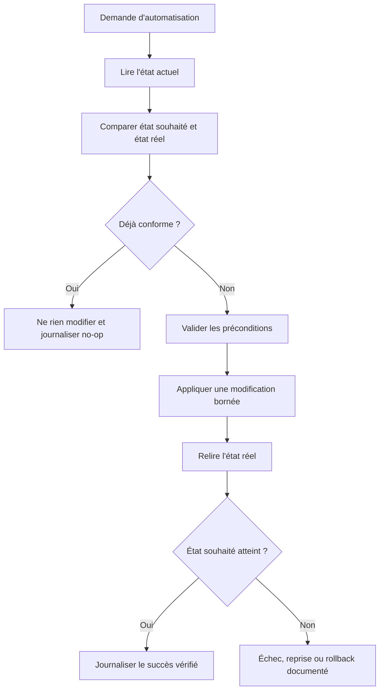

Une bonne automatisation exprime l'état souhaité, lit l'état actuel, calcule la différence, applique seulement les changements nécessaires puis relit l'état réel. Cette approche limite les effets de bord et facilite la reprise après une interruption. En complément, utilise si possible une clé d'idempotence pour les API, ou un identifiant d'opération permettant de reconnaître une demande déjà traitée.

Les opérations d'écriture doivent être encore plus prudentes. Pour une modification réseau, enregistre la configuration avant le changement, vérifie la cible et l'environnement, utilise une fenêtre approuvée, limite le nombre d'équipements touchés et définis un rollback. La première version de l'exercice doit rester en simulation : produire un plan des changements sans les appliquer.

```python
def plan_desired_state(current, desired):
    """Construit un plan descriptif sans modifier l'équipement."""
    plan = []
    for key, desired_value in desired.items():
        current_value = current.get(key)
        if current_value == desired_value:
            plan.append({
                "key": key, "action": "no_op",
                "reason": "déjà conforme",
            })
        else:
            plan.append({
                "key": key, "action": "change_required",
                "current": current_value, "desired": desired_value,
            })
    return plan

current = {"ntp_server": "192.0.2.10", "logging": True}
desired = {"ntp_server": "192.0.2.10", "logging": True}
print(plan_desired_state(current, desired))
```

L'adresse utilisée dans l'exemple est une adresse de documentation. Le programme ne se connecte à aucun équipement : il illustre seulement la comparaison entre état actuel et état désiré. Avant de convertir un plan en action réelle, il faudrait une API limitée, une validation de politique, des tests et une procédure de récupération adaptée.

### F. Construire un inventaire fiable et une sortie stable

Un inventaire permet de borner les cibles, leurs propriétaires, leur environnement et les méthodes de connexion autorisées. Il ne doit pas être traité comme un simple fichier improvisé. Définis les colonnes, vérifie les doublons, refuse les cibles inconnues et indique comment les changements de l'inventaire sont approuvés.

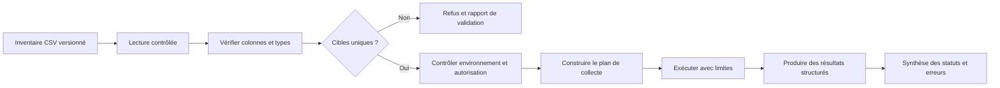

Pour chaque cible, un enregistrement utile peut contenir son identifiant logique, l'environnement, le propriétaire, la méthode de connexion autorisée, un timeout spécifique si nécessaire, la date de dernière vérification et le statut de l'inventaire. N'enregistre pas de mot de passe dans le CSV. Les secrets doivent être fournis par un mécanisme dédié au moment de l'exécution et le script doit éviter de les exposer dans les arguments visibles par d'autres processus.

Les sorties structurées sont plus simples à traiter que des lignes de texte ad hoc. JSON Lines (un objet JSON par ligne) permet d'ajouter progressivement les résultats et de conserver les enregistrements déjà collectés si un incident survient. CSV est pratique pour l'analyse tabulaire, mais exige un contrat sur l'encodage, le séparateur, les colonnes, les types et le traitement des valeurs manquantes. Le fichier doit être écrit de manière à ne pas présenter un résultat partiel comme un résultat final validé.

```python
import json
from datetime import datetime, timezone

def make_result(target, status, details=None, error=None):
    return {
        "schema_version": 1,
        "observed_at": datetime.now(timezone.utc).isoformat(),
        "target_id": target,
        "status": status,
        "details": details or {},
        "error": error,
    }

sample = make_result(
    target="lab-switch-01",
    status="unreachable",
    details={"attempts": 2},
    error="timeout",
)
print(json.dumps(sample, ensure_ascii=False))
```

La valeur target_id doit être un identifiant logique autorisé. L'objet details ne devrait contenir que des champs documentés ; l'objet error doit éviter d'enregistrer une sortie brute qui contiendrait des secrets. Le champ schema_version permet d'introduire des évolutions de format de façon contrôlée. Si une nouvelle version change le type ou le sens d'un champ, les consommateurs doivent pouvoir détecter la différence au lieu d'interpréter la donnée incorrectement.

Une stratégie de fichier temporaire suivie d'un renommage peut éviter que les lecteurs utilisent un fichier à moitié écrit. Pour un flux JSON Lines de grande taille, il est parfois préférable d'écrire chaque résultat au fur et à mesure puis de produire un manifeste final indiquant le nombre de cibles prévues, le nombre de résultats, les échecs et l'état global.

### G. Utiliser une API avec une politique de retries maîtrisée

Les scripts d'exploitation communiquent souvent avec des API. Il faut gérer l'authentification, les codes HTTP, les délais, la pagination, les limites de débit et les formats de réponse. Un code HTTP de réussite ne garantit pas que la réponse contient tous les champs attendus. Il peut aussi être dangereux de relancer sans réfléchir une requête qui modifie l'état.

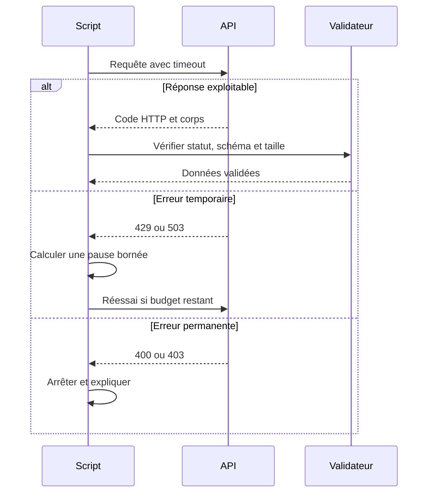

Les retries doivent viser les erreurs réellement transitoires. Une erreur de permission ne se corrigera pas en répétant la requête. Une erreur de validation nécessite souvent de corriger les données. Pour certaines erreurs temporaires, applique un nombre maximal de tentatives et un délai progressif. Ajoute un peu d'aléa pour éviter que plusieurs clients réessaient exactement au même moment. Si l'API fournit un délai de reprise explicite, respecte-le dans les limites de la politique.

Pour les écritures, vérifie si l'opération est idempotente ou si l'API prend en charge une clé d'idempotence. Une requête peut avoir été appliquée côté serveur alors que la réponse se perd sur le réseau. La répéter sans protection peut créer un doublon. Pour une demande de création, cherche un identifiant stable ou relis l'état avant de décider si une nouvelle tentative est autorisée.

```python
import random
import time
import requests

RETRYABLE = {429, 500, 502, 503, 504}

def get_json_with_retries(url, headers, attempts=4, timeout=5):
    last_reason = "aucune tentative"
    for number in range(attempts):
        try:
            response = requests.get(url, headers=headers, timeout=timeout)
        except requests.Timeout:
            last_reason = "timeout"
        except requests.ConnectionError:
            last_reason = "erreur de connexion"
        else:
            if response.status_code == 200:
                try:
                    return response.json()
                except ValueError as exc:
                    raise RuntimeError("Réponse JSON invalide") from exc
            if response.status_code not in RETRYABLE:
                response.raise_for_status()
            last_reason = f"HTTP {response.status_code}"

        if number < attempts - 1:
            time.sleep(min(8, (2 ** number) + random.random()))

    raise RuntimeError(
        f"API indisponible après {attempts} tentatives: {last_reason}"
    )
```

Ce helper est un exemple pédagogique qui récupère des données ; il ne gère pas toutes les politiques d'une API réelle. En production, il faut valider le domaine de destination, utiliser la vérification TLS normale, contrôler le schéma JSON et la taille du corps, protéger les secrets, respecter les en-têtes de limite de débit et s'assurer qu'une redirection ne conduit pas à une destination interdite. Le helper ne doit pas être utilisé tel quel pour des requêtes de modification d'état.

### H. Protéger les secrets et réduire les permissions

Un script n'a pas besoin de connaître tous les secrets de l'organisation. Il doit accéder uniquement aux informations nécessaires à sa tâche. Les clés API ne doivent pas être codées en dur dans les fichiers versionnés, écrites dans des journaux, imprimées dans les messages d'erreur ou passées dans des arguments visibles par d'autres processus. Une variable d'environnement peut convenir à certains contextes, mais un gestionnaire de secrets et une identité de service dédiée sont préférables lorsqu'ils sont disponibles.

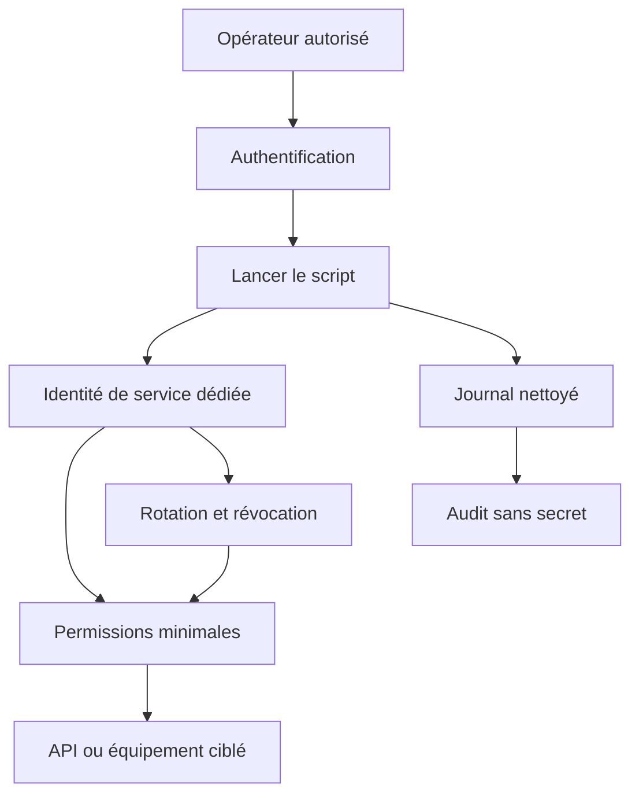

Une séparation utile consiste à distinguer l'identité de lecture de l'identité d'écriture. Un collecteur n'a pas à posséder les droits de changer une configuration réseau. Un outil qui génère un plan de changement doit pouvoir exécuter ses tests sans disposer des permissions nécessaires à l'application du plan. Si une action modifiante est nécessaire, place-la derrière un mode explicitement activé, des droits distincts et une procédure d'approbation.

Les secrets ont un cycle de vie : création, distribution, utilisation, rotation, révocation et suppression. La rotation doit être testée avant d'être imposée, sinon un secret renouvelé peut interrompre les collectes. Un script doit se comporter de façon prévisible si l'identité est expirée : afficher un état d'authentification en échec et arrêter les appels concernés, sans tenter de contourner le contrôle.

### I. Utiliser Bash en sécurité et sans fragilité

Bash convient aux petits wrappers, mais l'expansion des variables, les espaces, les motifs de fichiers et les codes retours peuvent provoquer des erreurs inattendues. Utilise des guillemets autour des variables lorsqu'elles représentent un seul argument, privilégie les tableaux pour construire des listes de paramètres, évite l'évaluation dynamique et ne construis pas un script avec une commande copiée depuis une source non fiable.

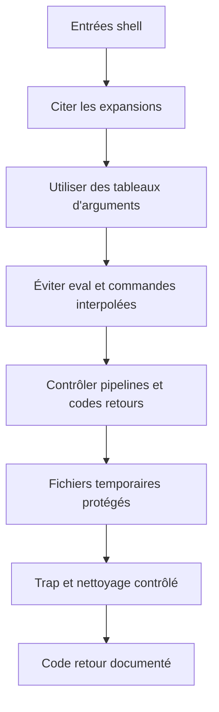

Un exemple de construction des arguments sans concaténation :

```bash
#!/usr/bin/env bash
set -Eeuo pipefail

target="lab-switch-01"
timeout_seconds=5

args=(--target "$target" --timeout "$timeout_seconds" --readonly)

printf 'Exécution prévue pour %s\n' "$target"
printf 'Argument: <%s>\n' "${args[@]}"

# En laboratoire uniquement, vérifier d'abord l'aide du programme :
# ./collector --help
# Puis utiliser l'inventaire de test approuvé.
```

Le tableau conserve chaque argument séparément et supporte les espaces dans les valeurs. Dans une commande réelle, vérifie encore que chaque option correspond à un comportement autorisé. Un nom d'option comme readonly ne constitue pas à lui seul une garantie ; le programme doit réellement appliquer cette restriction.

Les fichiers temporaires doivent être placés dans un emplacement approprié, avec des permissions restrictives, et supprimés lorsqu'ils ne sont plus nécessaires. Un trap peut assurer un nettoyage lors d'une sortie normale ou de certains signaux, mais un arrêt brutal peut encore laisser un fichier. Prévois une politique de durée de vie et évite les noms prévisibles dans un répertoire partagé.

### J. Définir une stratégie de concurrence et de débit

La collecte parallèle peut réduire la durée totale, mais augmente le nombre de connexions simultanées et la pression sur les systèmes ciblés. Il ne faut pas lancer une tâche par cible sans limite. Le niveau de concurrence doit être borné, adapté à la taille de l'inventaire et soumis aux règles de l'organisation. Certains équipements supportent peu de sessions de gestion ; des appels massifs peuvent eux-mêmes créer un incident.

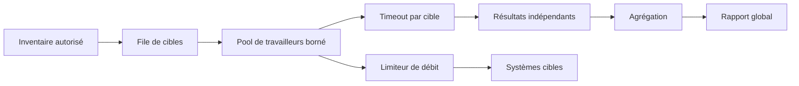

Une première version séquentielle est souvent préférable parce qu'elle facilite la lecture des journaux et le contrôle de charge. Lorsque la durée devient un problème mesuré, ajoute un parallélisme borné et teste le résultat. Contrôle la simultanéité, le débit global, les retries et le comportement lorsque plusieurs cibles tombent en panne ensemble. Si une API limite les appels par minute, le programme doit respecter ce budget au lieu de le contourner.

Le parallélisme ne doit pas modifier l'exactitude du rapport. Chaque tâche doit produire son résultat associé à un identifiant de cible, même si elle se termine dans un ordre différent. Le résumé doit comparer le nombre de cibles prévues au nombre de résultats générés, puis distinguer les réussites, erreurs, timeouts et cibles ignorées selon une règle documentée.

### K. Tester sans joindre un équipement réel

Un test unitaire vérifie une petite fonction isolée. Un test d'intégration contrôle plusieurs composants ensemble. Un test de bout en bout observe la chaîne entière dans un environnement contrôlé. Une automatisation réseau ne devrait pas nécessiter l'accès à un vrai commutateur pour vérifier chaque branche de son code.

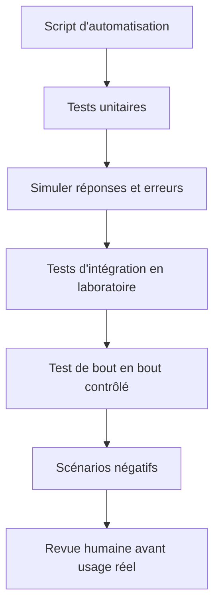

Injecte les dépendances dans les fonctions : au lieu de coder directement une connexion réseau dans chaque partie du script, isole le client, la source des données, l'horloge et la sortie. Les tests peuvent ainsi fournir un client simulé qui retourne une réponse normale, un timeout, un refus d'accès ou un contenu invalide. Ce principe rend les tests reproductibles et aide à vérifier que les erreurs sont traitées sans qu'un système externe soit nécessaire.

Les scénarios indispensables comprennent une entrée valide, une entrée vide, une cible inconnue, une réponse tronquée, un code retour non nul, un timeout, une interruption, un fichier de sortie inaccessible, un inventaire dupliqué et un secret présent dans une sortie à masquer. Pour une action d'écriture, ajoute des tests qui vérifient la simulation, l'absence d'effet si les préconditions ne sont pas remplies, la détection d'un état déjà conforme et le déclenchement de la procédure de reprise en cas d'échec.

```python
def classify_result(result):
    if result.get("status") == "ok":
        return "success"
    if result.get("status") == "timeout":
        return "partial_failure"
    if result.get("status") in {"launch_error", "command_error"}:
        return "failure"
    return "unknown"

def test_classify_result():
    assert classify_result({"status": "ok"}) == "success"
    assert classify_result({"status": "timeout"}) == "partial_failure"
    assert classify_result({"status": "command_error"}) == "failure"
    assert classify_result({"status": "other"}) == "unknown"
```

Ce test encode explicitement le contrat de statuts. Lorsque le contrat évolue, le test doit évoluer lui aussi. Un code retour du programme principal pourrait valoir zéro lorsque toutes les cibles ont été collectées, un code différent pour un succès partiel, et un autre code pour une erreur de configuration ou de préparation. Les codes exacts sont à définir, documenter et garder stables.

### L. Concevoir la journalisation pour le diagnostic

Un journal utile indique quoi, quand, où et avec quel résultat. Les enregistrements doivent aider à reconstruire l'exécution sans exposer les secrets. Les champs courants incluent un identifiant de lancement, l'identifiant logique de la cible, l'opération, l'heure UTC, la durée, le statut, le code retour et un motif d'erreur normalisé.

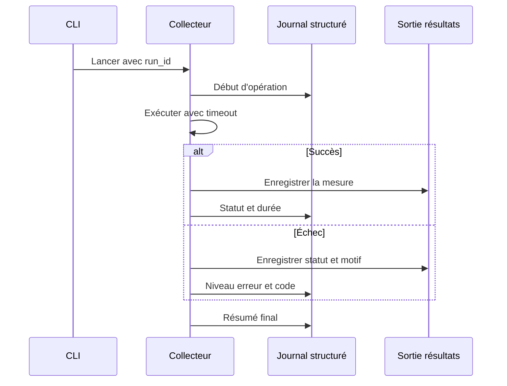

Évite un journal constitué uniquement de messages tels que « ça n'a pas marché ». Ajoute un code d'erreur stable et une catégorie. À l'inverse, évite de consigner la réponse complète d'une API ou une commande secrète. Les messages devraient permettre de savoir quelle opération a échoué sans répéter l'ensemble des données sensibles impliquées.

L'heure doit conserver le fuseau et les durées doivent être mesurées de façon cohérente. Le journal ne doit pas être l'unique preuve du résultat fonctionnel : il décrit ce que le script a observé et fait, tandis que la validation des postconditions confirme si le système ciblé a obtenu l'état souhaité. Garde le rapport d'exécution et les mesures métier reliés par un identifiant commun.

### M. Planifier une automatisation qui ne surprend pas

Une tâche planifiée peut fonctionner manuellement mais échouer sous un ordonnanceur : chemin courant différent, environnement virtuel non activé, variables d'environnement absentes, droits différents, fuseau non attendu ou répertoire non accessible. Tout ce qui est implicite doit être remplacé par une configuration claire. Le script doit résoudre les chemins de manière prévisible, vérifier les dépendances et produire un statut exploitable.

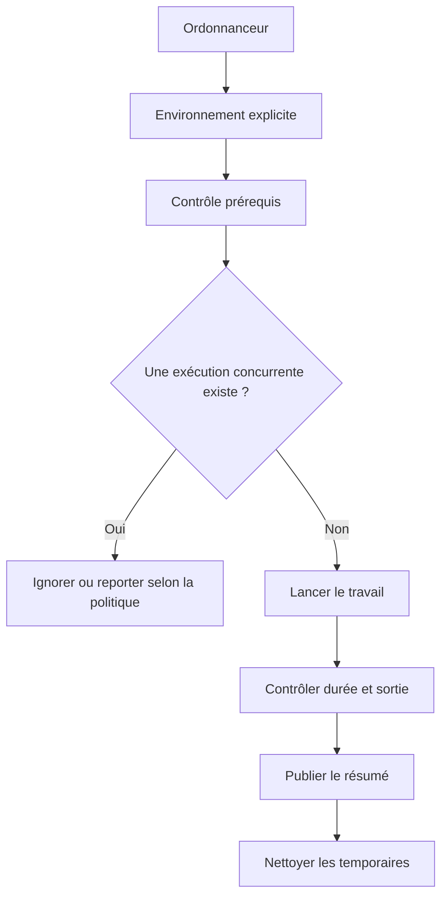

Prévois une protection contre les exécutions concurrentes si deux lancements pourraient traiter les mêmes ressources. Un verrou doit avoir une stratégie de récupération lorsqu'un ancien processus s'est interrompu ; il ne faut pas effacer arbitrairement un verrou qui pourrait correspondre à une exécution encore active. Définis aussi ce que l'ordonnanceur doit faire lorsqu'une exécution échoue : réessayer selon une politique, prévenir un opérateur, ou attendre la fenêtre suivante.

Utilise un environnement virtuel Python et verrouille les dépendances de manière reproductible. Enregistre la version du script et la configuration non secrète dans le résumé. Lorsque la tâche collecte des données de télémétrie, précise la période couverte et le taux de couverture. Si la tâche est interrompue, le rapport doit indiquer si les résultats sont complets ou partiels.

### N. Intégrer les scripts à une chaîne de validation

Les scripts d'exploitation doivent être traités comme du code maintenu. Le dépôt versionné permet de relire les différences, de retrouver l'auteur et de revenir à une révision précédente. Une chaîne de validation peut vérifier le format, le typage, les tests unitaires, les dépendances et certaines règles de sécurité avant qu'une nouvelle version soit autorisée.

```mermaid
flowchart LR
    CHANGE["Modification du script"] --> FORMAT["Formatage et lint"]
    FORMAT --> TEST["Tests unitaires"]
    TEST --> SECURITY["Vérification secrets et dépendances"]
    SECURITY --> REVIEW["Revue du diff"]
    REVIEW --> BUILD["Construire artefact versionné"]
    BUILD --> LAB["Test en laboratoire"]
    LAB --> APPROVE["Validation de déploiement"]
    APPROVE --> RELEASE["Publication contrôlée"]
```

La chaîne de validation ne prouve pas que tous les comportements sont corrects. Elle réduit des catégories d'erreurs connues et assure que les contrôles sont exécutés de manière répétable. Les tests en laboratoire doivent ensuite vérifier les interactions avec les systèmes concernés. Avant d'autoriser un changement, examine les paramètres par défaut, les permissions nécessaires, les effets de bord, la stratégie de rollback et les journaux produits.

Ne mets jamais un véritable secret dans un test ou dans un exemple pédagogique. Utilise des valeurs synthétiques, les secrets de test fournis par un environnement isolé ou des mocks. Vérifie que le dépôt ne contient ni jeton, ni clé privée, ni export de configuration sensible. La révocation d'un secret publié ne suffit pas toujours : vérifie l'historique, les artefacts de CI et les logs dans lesquels il aurait pu être copié.

### O. Étude de cas complète : collecteur réseau avec résultats partiels

Une équipe souhaite collecter les versions, l'état opérationnel et l'utilisation de quelques interfaces sur une liste d'équipements de laboratoire. Le premier script ouvre une connexion, lit les données et affiche un résumé. Mais une cible indisponible bloque la boucle, et le fichier final ne distingue pas les résultats absents des résultats valides. La solution doit rester en lecture seule et ne pas perdre les observations déjà reçues.

Le contrat exige un identifiant de lancement, un inventaire validé, un timeout par cible, une limite de tentatives, des erreurs structurées, un fichier de résultat documenté et un code de sortie qui indique si la collecte est complète. Le propriétaire du laboratoire choisit le nombre maximal de connexions simultanées. Les secrets sont récupérés depuis un mécanisme autorisé et n'apparaissent pas dans le fichier de sortie.

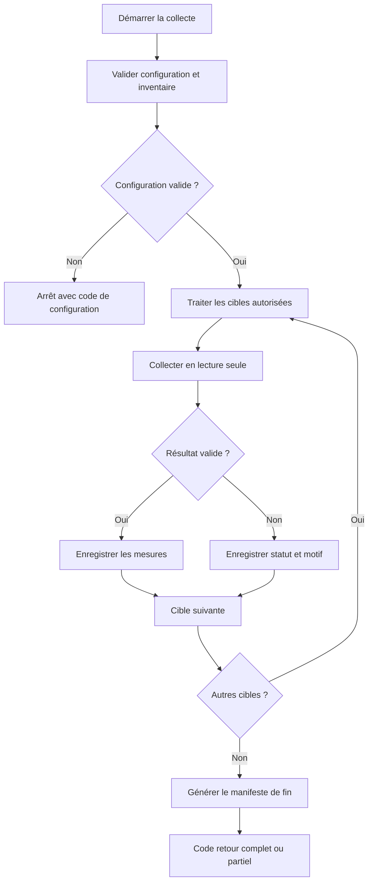

Le collecteur doit garder une distinction claire entre les opérations de contrôle et les opérations métier. Un échec d'authentification est différent d'un timeout ; un timeout est différent d'une réponse invalide ; une réponse valide mais incomplète est différente d'un état d'interface réellement dégradé. Cette taxonomie permet de décider si une répétition est utile ou si l'erreur nécessite une intervention.

Le manifeste de fin peut contenir le nombre de cibles attendues, le nombre de cibles traitées, le nombre de succès, le nombre de timeouts, le nombre d'erreurs de configuration ou d'accès, la durée totale et le statut de complétude. Le consommateur ne doit pas supposer que toutes les cibles ont réussi simplement parce que le fichier existe. Une collecte partielle peut être exploitable pour un diagnostic mais insuffisante pour calculer une comparaison qui nécessite une couverture complète.

Pour rendre l'outil réversible, commence par une version qui ne fait que lire. Si une modification de configuration est ajoutée plus tard, conserve-la comme action distincte, avec un mode simulation par défaut, une approbation claire et un contrôle de postconditions. Le fait qu'un script lise les mêmes données que celles nécessaires à une modification n'autorise pas automatiquement le script à écrire sur les équipements.

### P. Défi de tests : construire une matrice de scénarios

Pour améliorer la confiance dans l'automatisation, établis une matrice de tests avant de connecter l'outil au laboratoire. Chaque ligne comprend une condition de départ, un résultat attendu et la preuve permettant de l'observer. Les tests doivent couvrir les conditions normales, les erreurs ponctuelles et les erreurs qui affectent toute l'exécution.

| Scénario | Résultat attendu | Critère de réussite |
|---|---|---|
| Inventaire valide et toutes les cibles répondent | Collecte complète | Chaque cible a un résultat valide |
| Une cible expire | Collecte partielle | Les autres résultats sont conservés |
| Inventaire absent | Arrêt avant connexion | Code de configuration et diagnostic |
| Cible inconnue | Refus explicite | Aucun accès réseau vers la cible |
| Réponse mal formée | Statut data_error | Sortie mise en quarantaine |
| Clé API absente | Échec d'authentification | Pas de retries sans fin |
| API limite le débit | Reprise bornée | Pause et compteur de tentatives |
| Fichier de sortie inaccessible | Échec global contrôlé | Pas de rapport de succès trompeur |
| Deux lancements simultanés | Verrou ou comportement explicite | Pas de double modification |
| Processus interrompu | Nettoyage et statut incomplet | Temporaires gérés |
| Données déjà conformes | No-op | Aucun changement inutile |
| Test en simulation | Plan uniquement | Aucun changement sur la cible |

Les critères doivent être définis avant l'exécution des tests, afin de ne pas déclarer un succès après avoir modifié les attentes pour qu'elles correspondent aux résultats. Pour les échecs partiels, vérifie aussi que le résumé est cohérent : le nombre total de cibles doit correspondre au total des états finaux, sans doublons ni lignes silencieusement perdues.

Un test de performance doit être réalisé en laboratoire avec une taille d'inventaire représentative, mais ne doit pas devenir un test de charge improvisé contre une infrastructure partagée. Fixe une limite de concurrence, observe le temps total, la mémoire, le volume de journaux et la pression exercée sur les cibles. Toute augmentation de concurrence doit être mesurée, validée et réversible.

### Q. Rapport d'exécution : rendre le résultat interprétable

À la fin de la collecte, l'opérateur doit voir ce qui est terminé et ce qui ne l'est pas. Un rapport bien construit contient un identifiant de lancement, la version du programme, l'environnement, l'heure de début et de fin, le nombre de cibles prévues, le nombre de résultats, les statuts par catégorie, les avertissements et les limites de couverture. Il indique également où se trouvent les résultats détaillés.

Exemple de rapport pédagogique :

```text
Run ID              : COLLECT-LAB-2026-042
Mode                : lecture seule
Inventaire attendu  : 12 cibles
Cibles traitées     : 12
Succès              : 9
Timeouts            : 2
Erreur de schéma    : 1
Statut global       : collecte partielle
Durée totale        : 00:00:38
Effets de configuration : aucun
Prochaine étape     : vérifier les 3 cibles non collectées
```

Les valeurs sont fictives. Un rapport ne doit affirmer qu'un contrôle de sécurité a réussi que s'il a effectivement été exécuté. Il doit aider à prendre la prochaine décision. Si une seule cible échoue, le propriétaire peut décider de relancer uniquement cette cible après avoir vérifié la cause. Si la collecte est partielle sur la majorité de l'inventaire, le problème peut concerner l'authentification, le réseau de gestion ou la configuration globale. Si des données sont mal formées, ne relance pas aveuglément sans inspecter le producteur ou le schéma attendu.

### R. Synthèse et critères de maîtrise

Un script d'automatisation fiable a un objectif défini, un contrat d'entrées et de sorties, des permissions minimales, des timeouts et des tentatives bornées, des erreurs observables, un format de résultat stable et des tests qui ne dépendent pas inutilement d'un équipement réel. Il évite les chaînes de commandes construites à partir d'entrées non fiables et distingue les succès complets des résultats partiels.

L'idempotence, les modes de simulation et la vérification de l'état souhaité permettent de contrôler les effets. Les journaux et les manifestes facilitent la reconstitution d'une exécution. La planification et l'intégration continue réduisent les différences entre exécution manuelle et exploitation régulière. La sécurité ne se limite pas à cacher les secrets : elle comprend aussi le périmètre d'accès, les permissions, les effets autorisés, l'approbation, la traçabilité et le retour arrière.

La progression doit rester prudente. Commence par une collecte en lecture seule. Teste les erreurs. Mesure les durées. Vérifie que les statuts sont fidèles. Ajoute ensuite les fonctionnalités une par une, avec une comparaison avant/après et une procédure de restauration testée. Une automatisation utile ne masque pas ses limites : elle expose la couverture de ses résultats, indique les opérations non terminées et laisse à l'opérateur les décisions dont le risque dépasse son autorisation.

## Défi final corrigé — collecteur réseau répétable et sûr

### Énoncé

Écris un petit collecteur qui lit une liste d'équipements, exécute une commande de lecture, enregistre un résultat horodaté et continue lorsqu'un seul équipement est indisponible. La solution doit prévoir un délai maximal, une erreur explicite, des journaux sans secret et une sortie exploitable par une autre étape AIOps.

### Cycle de traitement

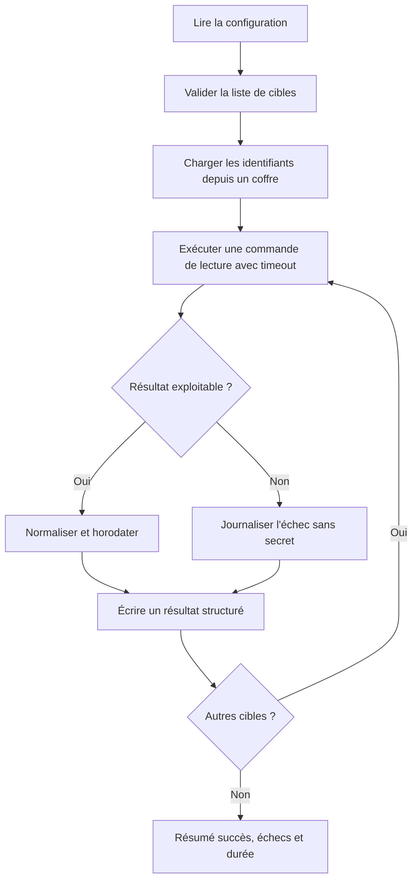

### Proposition de correction

Un collecteur doit séparer configuration, connexion, extraction et persistance. Chaque étape doit être testable indépendamment. Ne place jamais les mots de passe dans le code, les arguments de processus ou les messages de log. L'identité utilisée par le script doit être en lecture seule lorsque la tâche ne nécessite aucune modification de configuration.

Le squelette suivant illustre le contrat de sortie et le traitement des erreurs. La fonction `collect_device` reste un adaptateur à implémenter avec la bibliothèque du fournisseur d'équipements utilisé dans ton laboratoire.

```python
from datetime import datetime, timezone
import json
import logging

logging.basicConfig(level=logging.INFO, format="%(asctime)s %(levelname)s %(message)s")

def result_record(device, status, data=None, error=None):
    return {
        "device": device,
        "timestamp": datetime.now(timezone.utc).isoformat(),
        "status": status,
        "data": data,
        "error": error,
    }

def run_collection(devices, collect_device, output_path):
    records = []
    for device in devices:
        try:
            # L'adaptateur doit imposer un timeout et ne faire que de la lecture.
            data = collect_device(device, timeout=10)
            records.append(result_record(device, "ok", data=data))
        except TimeoutError:
            logging.warning("Timeout de collecte pour %s", device)
            records.append(result_record(device, "error", error="timeout"))
        except Exception as exc:
            # Ne pas inclure d'identifiants ni de configuration secrète dans le log.
            logging.exception("Échec de collecte pour %s", device)
            records.append(result_record(device, "error", error=type(exc).__name__))

    with open(output_path, "w", encoding="utf-8") as stream:
        json.dump(records, stream, ensure_ascii=False, indent=2)
    return records
```

Le collecteur est idempotent du point de vue du réseau parce qu'il ne modifie aucun équipement. Pour la persistance, choisis une stratégie explicite : fichier horodaté pour un exercice local, stockage append-only ou base avec clé de déduplication pour un service permanent. Un échec ne doit pas disparaître dans une simple instruction `continue` ; il doit être conservé comme donnée de qualité.

### Vérifications de laboratoire

Teste une cible valide, une cible qui expire, une cible qui retourne des données mal formées et une liste vide. Vérifie que toutes les lignes possèdent un horodatage UTC et que le processus renvoie un résumé cohérent. La réussite ne signifie pas « aucune erreur » : elle signifie que les succès et les échecs sont détectables et correctement représentés.

### Barème d'autoévaluation

- Le script a un timeout par cible et ne bloque pas indéfiniment.
- Les erreurs sont structurées et ne contiennent pas de secrets.
- Une cible indisponible ne fait pas perdre les résultats des autres cibles.
- Le format de sortie est stable et documenté.
- Le comportement est reproductible et vérifiable par des tests.

## 11. Checklist et à retenir

- [ ] L'objectif métier et le service concerné sont explicites et mesurables.
- [ ] Chaque observation conserve provenance, horodatage, unité et qualité.
- [ ] La méthode a été comparée à une baseline simple.
- [ ] Les tests couvrent cas normaux, données manquantes et échecs.
- [ ] Les résultats sont ventilés par criticité et catégorie pertinente.
- [ ] Les permissions sont minimales et les secrets absents des journaux.
- [ ] Les décisions relient preuves, version, approbation et résultat.
- [ ] Chaque action risquée a préconditions, périmètre limité et rollback.
- [ ] Les mesures évaluent le service et les erreurs opérationnelles.
- [ ] Une procédure décrit abstention, escalade, suspension et revue.

### À retenir
Le but d'une démarche AIOps n'est pas d'automatiser chaque décision, mais de rendre les opérations plus rapides, cohérentes et vérifiables. Pour Automatisation avec Python et Bash, la qualité dépend des données, de l'adéquation de la technique, d'une évaluation honnête et de la vérification du résultat. Un système capable de reconnaître ses limites, de bloquer une action risquée et de transmettre un dossier de preuve peut être plus utile qu'un système qui agit toujours sans expliquer ses erreurs.

taux de réussite, timeouts par cible, durée par opération, tentatives et reprises, actions vérifiées après exécution sont des mesures candidates, mais chacune doit être associée à un objectif, un propriétaire et une action lorsqu'elle franchit une limite. Le nombre de modèles ou d'alertes traitées n'est pas en soi une mesure de valeur. La boucle d'amélioration est complète quand les résultats confirment ou réfutent les hypothèses, les incidents sont documentés et les contrôles évoluent selon les erreurs observées. Écrire des scripts robustes et idempotents pour l'exploitation et la collecte réseau. Le maintien dans le temps implique de réviser les sources, tester la reprise et retirer une méthode quand ses limites dépassent son bénéfice.

## 12. Références

- https://docs.python.org/3/library/subprocess.html
- https://docs.python.org/3/library/logging.html
- https://opentelemetry.io/docs/ — documentation sur l'observabilité et la télémétrie.
- https://www.nist.gov/itl/ai-risk-management-framework — cadre de gestion des risques de l'IA.
