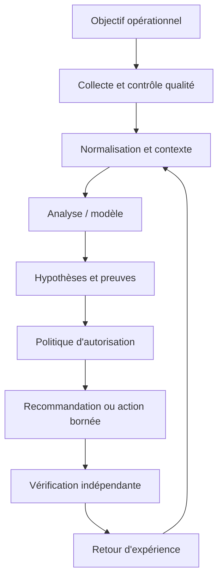
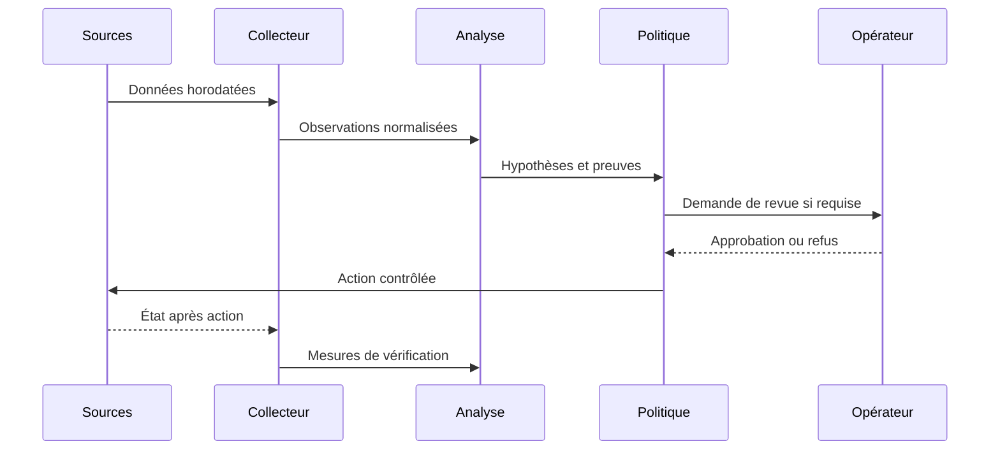
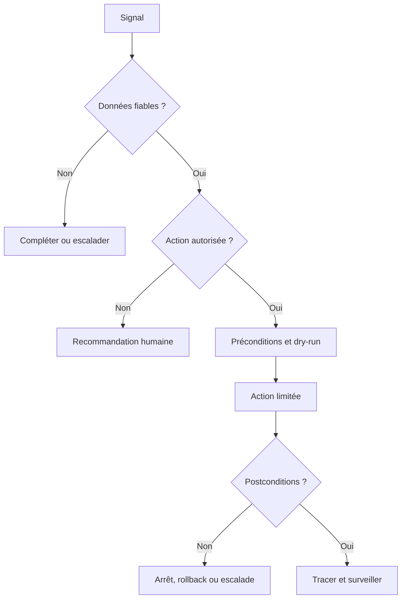

# Streaming Telemetry (gNMI, gRPC) — Intermédiaire

> **Mise en contexte :** le polling toutes les cinq minutes manque des microcongestions, mais l'augmentation de la fréquence peut surcharger l'infrastructure de collecte. Le but est d'améliorer les opérations de manière mesurable, vérifiable et proportionnée au risque. Les exemples sont pédagogiques : les tester dans un laboratoire et adapter identités, versions, capacités et permissions avant tout usage réel.

## Sommaire
1. Introduction et objectifs
2. Concepts clés
3. Architecture de référence
4. Pipeline et algorithmes
5. Étude de cas détaillée
6. Implémentation et TP
7. Sécurité et gouvernance
8. Pièges à éviter
9. Diagnostic et dépannage
10. Exercices corrigés
11. Checklist et à retenir
12. Références

## 1. Introduction et objectifs

concevoir une collecte en flux qui respecte les capacités, la qualité, les limites de débit et la sécurité. Le scénario de départ est concret : le polling toutes les cinq minutes manque des microcongestions, mais l'augmentation de la fréquence peut surcharger l'infrastructure de collecte. Les équipes doivent agir rapidement, alors que les observations peuvent être contradictoires, les horloges décalées et les interventions porteuses de risques. La solution doit distinguer un signal, une hypothèse, une décision et une preuve de résultat. Une alerte n'est pas automatiquement un incident confirmé, un score n'est pas une preuve de causalité, et l'exécution d'une commande ne prouve pas le rétablissement du service.

Les outils utiles sont gNMI, gRPC, OpenConfig, collecteurs, TLS et backpressure. Ils ne doivent pas tous être déployés simplement parce qu'ils existent. Chaque composant doit répondre à une exigence identifiée et avoir un propriétaire. Une première version en lecture seule est souvent préférable : elle permet de mesurer les performances, de comprendre les erreurs et de définir les conditions minimales avant d'accorder une capacité d'action. L'automatisation se justifie lorsque son gain est mesurable et que la réponse aux échecs est maîtrisée.

À la fin du cours, l'apprenant doit savoir expliquer les concepts, décrire l'architecture, concevoir un essai reproductible, choisir des métriques adaptées, analyser les erreurs et défendre ses limites. Il doit aussi être capable de documenter quand la méthode ne doit pas être utilisée, quand l'incertitude impose une abstention et quand une approbation humaine est obligatoire.

### Objectifs pédagogiques
- Définir une question opérationnelle mesurable.
- Identifier les données, leur provenance et leur fraîcheur.
- Construire une architecture d'analyse et de vérification.
- Comparer la méthode à une baseline simple.
- Limiter privilèges et rayon d'impact.
- Documenter l'incertitude, l'escalade et le retour arrière.

## 2. Concepts clés

### 1. gNMI
gNMI est une interface de gestion réseau fondée sur gRPC qui expose notamment Get, Set et Subscribe.

Dans une exploitation réelle, gNMI doit répondre à une question opérationnelle clairement formulée. gNMI est une interface de gestion réseau fondée sur gRPC qui expose notamment Get, Set et Subscribe. L'équipe désigne la source de vérité, le propriétaire, la fréquence de mise à jour et le périmètre d'utilisation avant de rendre un résultat visible aux opérateurs. Pour le scénario « le polling toutes les cinq minutes manque des microcongestions, mais l'augmentation de la fréquence peut surcharger l'infrastructure de collecte », cela évite de transformer une intuition en instruction. Il faut aussi préciser quand le système doit s'abstenir, demander des données supplémentaires ou transférer le dossier à une personne responsable.

La mise en œuvre de gNMI se découpe en étapes testables : validation des entrées, contrôle des sources, traitement des valeurs absentes, journalisation et vérification des sorties. L'outil gNMI peut contribuer au processus, mais sa présence ne garantit pas sa fiabilité. Les erreurs doivent rester explicites au lieu d'être converties en valeurs par défaut silencieuses. Une exécution fiable distingue succès, échec, état partiel et état impossible à déterminer, et conserve la version de code ou de modèle qui a produit la sortie.

L'évaluation de gNMI couvre les cas habituels, les cas limites, les données manquantes et les situations inédites. Il faut mesurer latence de bout en bout et segmenter les résultats par site, plateforme ou criticité. Une moyenne globale peut masquer une défaillance rare mais grave ; garder des exemples concrets aide à comprendre faux positifs et faux négatifs. Après tout changement de données, d'algorithme ou de dépendance, rejouer un corpus de référence et vérifier que le comportement attendu persiste.

Aucune approche liée à gNMI n'est universellement meilleure. Une règle peut être plus simple à expliquer, un modèle peut capter des interactions, et une génération de texte peut accélérer une synthèse tout en introduisant des erreurs plausibles. Le choix dépend du coût des erreurs, des données, de la latence, de l'explicabilité et de la maintenance. Une baseline et un mode manuel doivent rester disponibles lorsque les observations sont incomplètes ou la méthode n'atteint plus le niveau de qualité attendu.

### 2. gRPC et Protobuf
gRPC transporte des appels RPC avec des messages typés ; les erreurs, versions et schémas doivent être gérés.

Dans une exploitation réelle, gRPC et Protobuf doit répondre à une question opérationnelle clairement formulée. gRPC transporte des appels RPC avec des messages typés ; les erreurs, versions et schémas doivent être gérés. L'équipe désigne la source de vérité, le propriétaire, la fréquence de mise à jour et le périmètre d'utilisation avant de rendre un résultat visible aux opérateurs. Pour le scénario « le polling toutes les cinq minutes manque des microcongestions, mais l'augmentation de la fréquence peut surcharger l'infrastructure de collecte », cela évite de transformer une intuition en instruction. Il faut aussi préciser quand le système doit s'abstenir, demander des données supplémentaires ou transférer le dossier à une personne responsable.

La mise en œuvre de gRPC et Protobuf se découpe en étapes testables : validation des entrées, contrôle des sources, traitement des valeurs absentes, journalisation et vérification des sorties. L'outil gRPC peut contribuer au processus, mais sa présence ne garantit pas sa fiabilité. Les erreurs doivent rester explicites au lieu d'être converties en valeurs par défaut silencieuses. Une exécution fiable distingue succès, échec, état partiel et état impossible à déterminer, et conserve la version de code ou de modèle qui a produit la sortie.

L'évaluation de gRPC et Protobuf couvre les cas habituels, les cas limites, les données manquantes et les situations inédites. Il faut mesurer débit d'événements et segmenter les résultats par site, plateforme ou criticité. Une moyenne globale peut masquer une défaillance rare mais grave ; garder des exemples concrets aide à comprendre faux positifs et faux négatifs. Après tout changement de données, d'algorithme ou de dépendance, rejouer un corpus de référence et vérifier que le comportement attendu persiste.

### 3. Modes Subscribe
Les modes ponctuel, polling et streaming ont des caractéristiques différentes de latence et de charge.

Dans une exploitation réelle, Modes Subscribe doit répondre à une question opérationnelle clairement formulée. Les modes ponctuel, polling et streaming ont des caractéristiques différentes de latence et de charge. L'équipe désigne la source de vérité, le propriétaire, la fréquence de mise à jour et le périmètre d'utilisation avant de rendre un résultat visible aux opérateurs. Pour le scénario « le polling toutes les cinq minutes manque des microcongestions, mais l'augmentation de la fréquence peut surcharger l'infrastructure de collecte », cela évite de transformer une intuition en instruction. Il faut aussi préciser quand le système doit s'abstenir, demander des données supplémentaires ou transférer le dossier à une personne responsable.

La mise en œuvre de Modes Subscribe se découpe en étapes testables : validation des entrées, contrôle des sources, traitement des valeurs absentes, journalisation et vérification des sorties. L'outil OpenConfig peut contribuer au processus, mais sa présence ne garantit pas sa fiabilité. Les erreurs doivent rester explicites au lieu d'être converties en valeurs par défaut silencieuses. Une exécution fiable distingue succès, échec, état partiel et état impossible à déterminer, et conserve la version de code ou de modèle qui a produit la sortie.

L'évaluation de Modes Subscribe couvre les cas habituels, les cas limites, les données manquantes et les situations inédites. Il faut mesurer reconnexions et messages invalides et segmenter les résultats par site, plateforme ou criticité. Une moyenne globale peut masquer une défaillance rare mais grave ; garder des exemples concrets aide à comprendre faux positifs et faux négatifs. Après tout changement de données, d'algorithme ou de dépendance, rejouer un corpus de référence et vérifier que le comportement attendu persiste.

### 4. Chemins et modèles
Les chemins de données identifient les éléments de télémétrie ; les capacités, unités et versions dépendent de la plateforme.

Dans une exploitation réelle, Chemins et modèles doit répondre à une question opérationnelle clairement formulée. Les chemins de données identifient les éléments de télémétrie ; les capacités, unités et versions dépendent de la plateforme. L'équipe désigne la source de vérité, le propriétaire, la fréquence de mise à jour et le périmètre d'utilisation avant de rendre un résultat visible aux opérateurs. Pour le scénario « le polling toutes les cinq minutes manque des microcongestions, mais l'augmentation de la fréquence peut surcharger l'infrastructure de collecte », cela évite de transformer une intuition en instruction. Il faut aussi préciser quand le système doit s'abstenir, demander des données supplémentaires ou transférer le dossier à une personne responsable.

La mise en œuvre de Chemins et modèles se découpe en étapes testables : validation des entrées, contrôle des sources, traitement des valeurs absentes, journalisation et vérification des sorties. L'outil collecteurs peut contribuer au processus, mais sa présence ne garantit pas sa fiabilité. Les erreurs doivent rester explicites au lieu d'être converties en valeurs par défaut silencieuses. Une exécution fiable distingue succès, échec, état partiel et état impossible à déterminer, et conserve la version de code ou de modèle qui a produit la sortie.

L'évaluation de Chemins et modèles couvre les cas habituels, les cas limites, les données manquantes et les situations inédites. Il faut mesurer pertes de données et segmenter les résultats par site, plateforme ou criticité. Une moyenne globale peut masquer une défaillance rare mais grave ; garder des exemples concrets aide à comprendre faux positifs et faux négatifs. Après tout changement de données, d'algorithme ou de dépendance, rejouer un corpus de référence et vérifier que le comportement attendu persiste.

Aucune approche liée à Chemins et modèles n'est universellement meilleure. Une règle peut être plus simple à expliquer, un modèle peut capter des interactions, et une génération de texte peut accélérer une synthèse tout en introduisant des erreurs plausibles. Le choix dépend du coût des erreurs, des données, de la latence, de l'explicabilité et de la maintenance. Une baseline et un mode manuel doivent rester disponibles lorsque les observations sont incomplètes ou la méthode n'atteint plus le niveau de qualité attendu.

### 5. Collecteur
Un collecteur gère connexion, normalisation, mise en file, reconnexion et export des observations.

Dans une exploitation réelle, Collecteur doit répondre à une question opérationnelle clairement formulée. Un collecteur gère connexion, normalisation, mise en file, reconnexion et export des observations. L'équipe désigne la source de vérité, le propriétaire, la fréquence de mise à jour et le périmètre d'utilisation avant de rendre un résultat visible aux opérateurs. Pour le scénario « le polling toutes les cinq minutes manque des microcongestions, mais l'augmentation de la fréquence peut surcharger l'infrastructure de collecte », cela évite de transformer une intuition en instruction. Il faut aussi préciser quand le système doit s'abstenir, demander des données supplémentaires ou transférer le dossier à une personne responsable.

La mise en œuvre de Collecteur se découpe en étapes testables : validation des entrées, contrôle des sources, traitement des valeurs absentes, journalisation et vérification des sorties. L'outil TLS et backpressure peut contribuer au processus, mais sa présence ne garantit pas sa fiabilité. Les erreurs doivent rester explicites au lieu d'être converties en valeurs par défaut silencieuses. Une exécution fiable distingue succès, échec, état partiel et état impossible à déterminer, et conserve la version de code ou de modèle qui a produit la sortie.

L'évaluation de Collecteur couvre les cas habituels, les cas limites, les données manquantes et les situations inédites. Il faut mesurer profondeur de file et délai de consommation et segmenter les résultats par site, plateforme ou criticité. Une moyenne globale peut masquer une défaillance rare mais grave ; garder des exemples concrets aide à comprendre faux positifs et faux négatifs. Après tout changement de données, d'algorithme ou de dépendance, rejouer un corpus de référence et vérifier que le comportement attendu persiste.

### 6. Backpressure
Le backpressure limite les files lorsque les données arrivent plus vite qu'elles ne sont consommées.

Dans une exploitation réelle, Backpressure doit répondre à une question opérationnelle clairement formulée. Le backpressure limite les files lorsque les données arrivent plus vite qu'elles ne sont consommées. L'équipe désigne la source de vérité, le propriétaire, la fréquence de mise à jour et le périmètre d'utilisation avant de rendre un résultat visible aux opérateurs. Pour le scénario « le polling toutes les cinq minutes manque des microcongestions, mais l'augmentation de la fréquence peut surcharger l'infrastructure de collecte », cela évite de transformer une intuition en instruction. Il faut aussi préciser quand le système doit s'abstenir, demander des données supplémentaires ou transférer le dossier à une personne responsable.

La mise en œuvre de Backpressure se découpe en étapes testables : validation des entrées, contrôle des sources, traitement des valeurs absentes, journalisation et vérification des sorties. L'outil gNMI peut contribuer au processus, mais sa présence ne garantit pas sa fiabilité. Les erreurs doivent rester explicites au lieu d'être converties en valeurs par défaut silencieuses. Une exécution fiable distingue succès, échec, état partiel et état impossible à déterminer, et conserve la version de code ou de modèle qui a produit la sortie.

L'évaluation de Backpressure couvre les cas habituels, les cas limites, les données manquantes et les situations inédites. Il faut mesurer latence de bout en bout et segmenter les résultats par site, plateforme ou criticité. Une moyenne globale peut masquer une défaillance rare mais grave ; garder des exemples concrets aide à comprendre faux positifs et faux négatifs. Après tout changement de données, d'algorithme ou de dépendance, rejouer un corpus de référence et vérifier que le comportement attendu persiste.

### 7. Sécurité du transport
TLS, identités, permissions minimales et rotation des certificats protègent la collecte et les opérations.

Dans une exploitation réelle, Sécurité du transport doit répondre à une question opérationnelle clairement formulée. TLS, identités, permissions minimales et rotation des certificats protègent la collecte et les opérations. L'équipe désigne la source de vérité, le propriétaire, la fréquence de mise à jour et le périmètre d'utilisation avant de rendre un résultat visible aux opérateurs. Pour le scénario « le polling toutes les cinq minutes manque des microcongestions, mais l'augmentation de la fréquence peut surcharger l'infrastructure de collecte », cela évite de transformer une intuition en instruction. Il faut aussi préciser quand le système doit s'abstenir, demander des données supplémentaires ou transférer le dossier à une personne responsable.

La mise en œuvre de Sécurité du transport se découpe en étapes testables : validation des entrées, contrôle des sources, traitement des valeurs absentes, journalisation et vérification des sorties. L'outil gRPC peut contribuer au processus, mais sa présence ne garantit pas sa fiabilité. Les erreurs doivent rester explicites au lieu d'être converties en valeurs par défaut silencieuses. Une exécution fiable distingue succès, échec, état partiel et état impossible à déterminer, et conserve la version de code ou de modèle qui a produit la sortie.

L'évaluation de Sécurité du transport couvre les cas habituels, les cas limites, les données manquantes et les situations inédites. Il faut mesurer débit d'événements et segmenter les résultats par site, plateforme ou criticité. Une moyenne globale peut masquer une défaillance rare mais grave ; garder des exemples concrets aide à comprendre faux positifs et faux négatifs. Après tout changement de données, d'algorithme ou de dépendance, rejouer un corpus de référence et vérifier que le comportement attendu persiste.

Aucune approche liée à Sécurité du transport n'est universellement meilleure. Une règle peut être plus simple à expliquer, un modèle peut capter des interactions, et une génération de texte peut accélérer une synthèse tout en introduisant des erreurs plausibles. Le choix dépend du coût des erreurs, des données, de la latence, de l'explicabilité et de la maintenance. Une baseline et un mode manuel doivent rester disponibles lorsque les observations sont incomplètes ou la méthode n'atteint plus le niveau de qualité attendu.

## 3. Architecture de référence

Une architecture fiable sépare la collecte, la normalisation, l'analyse, la politique d'autorisation et la vérification. Un détecteur ne doit pas être relié directement à une commande privilégiée : la moindre fausse alerte pourrait déclencher une intervention inappropriée. Entre proposition et exécution, un point de décision doit examiner qualité des données, confiance, criticité, cible, préconditions et nécessité d'une revue.



Chaque observation conserve source, horodatage, unité, cible, fraîcheur et état de qualité. Le résultat de l'analyse référence sa version et ses entrées. La décision expose actions permises, préconditions, approbations, quotas et conditions d'arrêt. La sortie finale indique les preuves exigées avant de déclarer le succès, ainsi que les situations qui imposent une escalade.



### Décision sous incertitude

La sécurité liée à Séparation entre analyse et exécution doit être conçue en amont : privilèges minimaux, protection des secrets, audit, séparation de l'analyse et de l'exécution, et règles d'escalade. Le piège principal ici est de s'abonner à trop de chemins à très haute fréquence. Les données externes doivent rester des données, jamais une autorité qui redéfinit les permissions. Pour une opération à fort impact, il faut des préconditions vérifiables, une approbation adaptée et un retour arrière testé, même lorsque le score du modèle semble très élevé.

Quand Données manquantes produit un résultat inattendu, commencer par l'heure, la source, l'unité, la cible, la fraîcheur, la version et le code d'erreur. Comparer l'observation brute à sa représentation transformée, puis chercher une modification récente. Tester une hypothèse à la fois et consigner la preuve du résultat sans copier de secrets dans le ticket. Une fois la cause confirmée, ajouter un test de régression et vérifier qu'il échoue avant le correctif et passe après celui-ci.

À l'échelle, Mode dégradé doit gérer des volumes et versions hétérogènes sans perdre de traçabilité. Borner la concurrence, isoler les erreurs par cible, limiter les files et surveiller les retards protègent l'aval. La reprise d'une panne peut elle-même provoquer une surcharge si toutes les sources se reconnectent simultanément. Le système doit pouvoir réduire sa fréquence ou revenir à une méthode simple, tout en signalant explicitement ce mode dégradé au lieu d'afficher un faux état normal.



## 4. Pipeline et algorithmes

Le pipeline décrit ici est une chaîne de responsabilités, pas nécessairement six services séparés. Chaque étape doit avoir des entrées et sorties définies, des tests et une méthode de gestion des erreurs. Les données sont validées avant l'analyse, le contexte est enrichi avant l'interprétation, et la politique est consultée avant une action. Cette séquence permet de démarrer en mode observation et d'augmenter l'autonomie uniquement lorsque les critères sont prouvés.

### Étape 1 — Découvrir les capacités
Vérifier modèles, chemins, versions et types de souscription pris en charge.

La mise en œuvre de Découvrir les capacités se découpe en étapes testables : validation des entrées, contrôle des sources, traitement des valeurs absentes, journalisation et vérification des sorties. L'outil gNMI peut contribuer au processus, mais sa présence ne garantit pas sa fiabilité. Les erreurs doivent rester explicites au lieu d'être converties en valeurs par défaut silencieuses. Une exécution fiable distingue succès, échec, état partiel et état impossible à déterminer, et conserve la version de code ou de modèle qui a produit la sortie.

Quand Découvrir les capacités produit un résultat inattendu, commencer par l'heure, la source, l'unité, la cible, la fraîcheur, la version et le code d'erreur. Comparer l'observation brute à sa représentation transformée, puis chercher une modification récente. Tester une hypothèse à la fois et consigner la preuve du résultat sans copier de secrets dans le ticket. Une fois la cause confirmée, ajouter un test de régression et vérifier qu'il échoue avant le correctif et passe après celui-ci.

### Étape 2 — Sélectionner les signaux
Choisir fréquence et granularité selon le phénomène à observer.

La mise en œuvre de Sélectionner les signaux se découpe en étapes testables : validation des entrées, contrôle des sources, traitement des valeurs absentes, journalisation et vérification des sorties. L'outil gRPC peut contribuer au processus, mais sa présence ne garantit pas sa fiabilité. Les erreurs doivent rester explicites au lieu d'être converties en valeurs par défaut silencieuses. Une exécution fiable distingue succès, échec, état partiel et état impossible à déterminer, et conserve la version de code ou de modèle qui a produit la sortie.

Quand Sélectionner les signaux produit un résultat inattendu, commencer par l'heure, la source, l'unité, la cible, la fraîcheur, la version et le code d'erreur. Comparer l'observation brute à sa représentation transformée, puis chercher une modification récente. Tester une hypothèse à la fois et consigner la preuve du résultat sans copier de secrets dans le ticket. Une fois la cause confirmée, ajouter un test de régression et vérifier qu'il échoue avant le correctif et passe après celui-ci.

### Étape 3 — Établir la connexion
Configurer authentification, TLS, timeouts et reconnexion.

La mise en œuvre de Établir la connexion se découpe en étapes testables : validation des entrées, contrôle des sources, traitement des valeurs absentes, journalisation et vérification des sorties. L'outil OpenConfig peut contribuer au processus, mais sa présence ne garantit pas sa fiabilité. Les erreurs doivent rester explicites au lieu d'être converties en valeurs par défaut silencieuses. Une exécution fiable distingue succès, échec, état partiel et état impossible à déterminer, et conserve la version de code ou de modèle qui a produit la sortie.

Quand Établir la connexion produit un résultat inattendu, commencer par l'heure, la source, l'unité, la cible, la fraîcheur, la version et le code d'erreur. Comparer l'observation brute à sa représentation transformée, puis chercher une modification récente. Tester une hypothèse à la fois et consigner la preuve du résultat sans copier de secrets dans le ticket. Une fois la cause confirmée, ajouter un test de régression et vérifier qu'il échoue avant le correctif et passe après celui-ci.

### Étape 4 — Normaliser les événements
Préserver timestamps, unités, cible, chemin et identifiant de source.

La mise en œuvre de Normaliser les événements se découpe en étapes testables : validation des entrées, contrôle des sources, traitement des valeurs absentes, journalisation et vérification des sorties. L'outil collecteurs peut contribuer au processus, mais sa présence ne garantit pas sa fiabilité. Les erreurs doivent rester explicites au lieu d'être converties en valeurs par défaut silencieuses. Une exécution fiable distingue succès, échec, état partiel et état impossible à déterminer, et conserve la version de code ou de modèle qui a produit la sortie.

Quand Normaliser les événements produit un résultat inattendu, commencer par l'heure, la source, l'unité, la cible, la fraîcheur, la version et le code d'erreur. Comparer l'observation brute à sa représentation transformée, puis chercher une modification récente. Tester une hypothèse à la fois et consigner la preuve du résultat sans copier de secrets dans le ticket. Une fois la cause confirmée, ajouter un test de régression et vérifier qu'il échoue avant le correctif et passe après celui-ci.

### Étape 5 — Réguler le flux
Borner buffering et rendre les pertes, retards et déconnexions mesurables.

La mise en œuvre de Réguler le flux se découpe en étapes testables : validation des entrées, contrôle des sources, traitement des valeurs absentes, journalisation et vérification des sorties. L'outil TLS et backpressure peut contribuer au processus, mais sa présence ne garantit pas sa fiabilité. Les erreurs doivent rester explicites au lieu d'être converties en valeurs par défaut silencieuses. Une exécution fiable distingue succès, échec, état partiel et état impossible à déterminer, et conserve la version de code ou de modèle qui a produit la sortie.

Quand Réguler le flux produit un résultat inattendu, commencer par l'heure, la source, l'unité, la cible, la fraîcheur, la version et le code d'erreur. Comparer l'observation brute à sa représentation transformée, puis chercher une modification récente. Tester une hypothèse à la fois et consigner la preuve du résultat sans copier de secrets dans le ticket. Une fois la cause confirmée, ajouter un test de régression et vérifier qu'il échoue avant le correctif et passe après celui-ci.

### Étape 6 — Vérifier la qualité
Comparer le flux à des lectures de référence et surveiller fraîcheur et coût.

La mise en œuvre de Vérifier la qualité se découpe en étapes testables : validation des entrées, contrôle des sources, traitement des valeurs absentes, journalisation et vérification des sorties. L'outil gNMI peut contribuer au processus, mais sa présence ne garantit pas sa fiabilité. Les erreurs doivent rester explicites au lieu d'être converties en valeurs par défaut silencieuses. Une exécution fiable distingue succès, échec, état partiel et état impossible à déterminer, et conserve la version de code ou de modèle qui a produit la sortie.

Quand Vérifier la qualité produit un résultat inattendu, commencer par l'heure, la source, l'unité, la cible, la fraîcheur, la version et le code d'erreur. Comparer l'observation brute à sa représentation transformée, puis chercher une modification récente. Tester une hypothèse à la fois et consigner la preuve du résultat sans copier de secrets dans le ticket. Une fois la cause confirmée, ajouter un test de régression et vérifier qu'il échoue avant le correctif et passe après celui-ci.

### Pseudocode défensif
```text
observations = collecter()
si qualité(observations) insuffisante:
    signaler les données manquantes et escalader
sinon:
    contexte = enrichir(observations, inventaire, changements, dépendances)
    hypothèses = analyser(contexte)
    vérifier la provenance de chaque preuve
    si preuve insuffisante ou action hors politique:
        recommander sans exécuter
    sinon:
        préparer diff, préconditions, approbations et rollback
        appliquer sur un petit périmètre
        mesurer les postconditions indépendantes
        restaurer ou escalader si non conforme
        journaliser version, preuves, décision et résultat
```

Ce pseudocode explique la logique et n'est pas une bibliothèque prête pour la production. Chaque étape exige des tests, des permissions appropriées et un mode de reprise explicite. Un système fiable ne remplace pas l'incertitude par une valeur par défaut ; il la rend visible et réduit son autonomie lorsque les preuves sont incomplètes.

## 5. Étude de cas détaillée

### Situation et impact
le polling toutes les cinq minutes manque des microcongestions, mais l'augmentation de la fréquence peut surcharger l'infrastructure de collecte. L'équipe commence par établir le périmètre, l'impact utilisateur, la chronologie et la criticité des actifs. Sa première question n'est pas « quel modèle est à la mode ? », mais « quelle décision doit devenir meilleure, et quelle preuve permettra de le démontrer ? ». Cette formulation évite la dérive du périmètre et fixe un critère d'arrêt si la solution n'apporte pas de valeur.

### Phase 1 — Établir les faits
Conserver les données brutes en lecture seule et noter les sources, timestamps, versions et transformations. Vérifier les changements récents et la qualité de collecte. Les valeurs absentes demeurent absentes ; elles ne sont pas remplacées par zéro. L'impact métier est mesuré séparément de l'état d'un équipement. Les contradictions entre systèmes sont documentées au lieu d'être résolues par intuition.

### Phase 2 — Comparer les hypothèses
Décrire au moins deux explications si les preuves ne permettent pas de conclure directement. Pour chacune, noter les observations favorables, les contre-indices et le test qui peut la distinguer. La priorité dépend de l'impact, de la plausibilité et du coût du test. Une ressemblance avec un incident historique ne suffit pas : versions, topologie, capacité et fenêtre de charge peuvent changer l'explication.

### Phase 3 — Préparer une réponse proportionnée
Privilégier les contrôles non destructifs. Si une modification devient nécessaire, préciser cible, diff, préconditions, impact, fenêtre, critères d'arrêt et rollback. Une revue indépendante s'impose lorsque le rayon d'impact est grand. Le plan doit permettre de refuser une action lorsque les preuves ne sont pas suffisantes.

### Phase 4 — Vérifier
Après action, contrôler mesures indépendantes : fonctionnement du service, latence, erreurs, connectivité, état de configuration ou autre indicateur pertinent. Une seule valeur favorable ne prouve pas un rétablissement durable. Lorsque les postconditions échouent, arrêter, restaurer selon le plan ou escalader. Le compte rendu distingue ce qui a été tenté, observé, confirmé et laissé inconnu.

### Phase 5 — Tirer des leçons
Comparer les hypothèses initiales aux preuves finales. Ajouter tests de régression, sources manquantes et contrôles à améliorer. Une règle ou un modèle mis à jour passe par une revue et une expérimentation contrôlée avant généralisation. Les conclusions non confirmées ne deviennent pas automatiquement de nouvelles étiquettes d'entraînement.

### Conditions de clôture
La clôture exige soit une preuve de rétablissement, soit une déclaration explicite que le service reste dégradé. Le dossier conserve sources, versions, actions, approbations, résultats et suivis. La cause racine n'est déclarée confirmée que si les preuves le permettent. Une conclusion honnêtement partielle est préférable à une explication catégorique impossible à reproduire.

## 6. Implémentation et TP

Exécuter les travaux pratiques dans un laboratoire isolé ou sur des systèmes autorisés. Noter les versions, dépendances, données et critères de réussite. Le résultat doit pouvoir être reproduit par un autre opérateur ; un succès affiché par l'outil ne remplace pas le contrôle de l'état réel.

### TP 1 — Interroger les capacités d'un équipement de laboratoire.
**Procédure.** Interroger les capacités d'un équipement de laboratoire. Utiliser une cible limitée, capturer l'état initial et ne changer qu'un paramètre à la fois. Relier le travail au concept « gNMI » : gNMI est une interface de gestion réseau fondée sur gRPC qui expose notamment Get, Set et Subscribe. Conserver commande, entrée, version et sortie.

**Contrôle.** Reproduire le résultat, puis tester une erreur contrôlée, une donnée manquante et une dépendance indisponible. Vérifier l'état effectif, les effets secondaires et la procédure de reprise. Si le résultat ne peut pas être déterminé, signaler cet état plutôt que le considérer comme une réussite. Décrire ce qui est démontré et les limites qui subsistent avant un déploiement plus large.

### TP 2 — Choisir quelques compteurs utiles à un problème défini.
**Procédure.** Choisir quelques compteurs utiles à un problème défini. Utiliser une cible limitée, capturer l'état initial et ne changer qu'un paramètre à la fois. Relier le travail au concept « gRPC et Protobuf » : gRPC transporte des appels RPC avec des messages typés ; les erreurs, versions et schémas doivent être gérés. Conserver commande, entrée, version et sortie.

**Contrôle.** Reproduire le résultat, puis tester une erreur contrôlée, une donnée manquante et une dépendance indisponible. Vérifier l'état effectif, les effets secondaires et la procédure de reprise. Si le résultat ne peut pas être déterminé, signaler cet état plutôt que le considérer comme une réussite. Décrire ce qui est démontré et les limites qui subsistent avant un déploiement plus large.

### TP 3 — Configurer une souscription de télémétrie en flux.
**Procédure.** Configurer une souscription de télémétrie en flux. Utiliser une cible limitée, capturer l'état initial et ne changer qu'un paramètre à la fois. Relier le travail au concept « Modes Subscribe » : Les modes ponctuel, polling et streaming ont des caractéristiques différentes de latence et de charge. Conserver commande, entrée, version et sortie.

**Contrôle.** Reproduire le résultat, puis tester une erreur contrôlée, une donnée manquante et une dépendance indisponible. Vérifier l'état effectif, les effets secondaires et la procédure de reprise. Si le résultat ne peut pas être déterminé, signaler cet état plutôt que le considérer comme une réussite. Décrire ce qui est démontré et les limites qui subsistent avant un déploiement plus large.

### TP 4 — Préserver chemins, unités, timestamps et cibles.
**Procédure.** Préserver chemins, unités, timestamps et cibles. Utiliser une cible limitée, capturer l'état initial et ne changer qu'un paramètre à la fois. Relier le travail au concept « Chemins et modèles » : Les chemins de données identifient les éléments de télémétrie ; les capacités, unités et versions dépendent de la plateforme. Conserver commande, entrée, version et sortie.

**Contrôle.** Reproduire le résultat, puis tester une erreur contrôlée, une donnée manquante et une dépendance indisponible. Vérifier l'état effectif, les effets secondaires et la procédure de reprise. Si le résultat ne peut pas être déterminé, signaler cet état plutôt que le considérer comme une réussite. Décrire ce qui est démontré et les limites qui subsistent avant un déploiement plus large.

### TP 5 — Mesurer débit, taille des messages, retard et perte.
**Procédure.** Mesurer débit, taille des messages, retard et perte. Utiliser une cible limitée, capturer l'état initial et ne changer qu'un paramètre à la fois. Relier le travail au concept « Collecteur » : Un collecteur gère connexion, normalisation, mise en file, reconnexion et export des observations. Conserver commande, entrée, version et sortie.

**Contrôle.** Reproduire le résultat, puis tester une erreur contrôlée, une donnée manquante et une dépendance indisponible. Vérifier l'état effectif, les effets secondaires et la procédure de reprise. Si le résultat ne peut pas être déterminé, signaler cet état plutôt que le considérer comme une réussite. Décrire ce qui est démontré et les limites qui subsistent avant un déploiement plus large.

### TP 6 — Simuler une interruption et vérifier reconnexion et trous de données.
**Procédure.** Simuler une interruption et vérifier reconnexion et trous de données. Utiliser une cible limitée, capturer l'état initial et ne changer qu'un paramètre à la fois. Relier le travail au concept « Backpressure » : Le backpressure limite les files lorsque les données arrivent plus vite qu'elles ne sont consommées. Conserver commande, entrée, version et sortie.

**Contrôle.** Reproduire le résultat, puis tester une erreur contrôlée, une donnée manquante et une dépendance indisponible. Vérifier l'état effectif, les effets secondaires et la procédure de reprise. Si le résultat ne peut pas être déterminé, signaler cet état plutôt que le considérer comme une réussite. Décrire ce qui est démontré et les limites qui subsistent avant un déploiement plus large.

### TP 7 — Ajouter monitoring, limites de buffering et règles de reprise.
**Procédure.** Ajouter monitoring, limites de buffering et règles de reprise. Utiliser une cible limitée, capturer l'état initial et ne changer qu'un paramètre à la fois. Relier le travail au concept « Sécurité du transport » : TLS, identités, permissions minimales et rotation des certificats protègent la collecte et les opérations. Conserver commande, entrée, version et sortie.

**Contrôle.** Reproduire le résultat, puis tester une erreur contrôlée, une donnée manquante et une dépendance indisponible. Vérifier l'état effectif, les effets secondaires et la procédure de reprise. Si le résultat ne peut pas être déterminé, signaler cet état plutôt que le considérer comme une réussite. Décrire ce qui est démontré et les limites qui subsistent avant un déploiement plus large.

### Exemple technique
```text
gnmic subscribe --address 192.0.2.10:57400 \
  --username "$GNMI_USER" --password "$GNMI_PASSWORD" \
  --path '/interfaces/interface/state/counters' \
  --mode stream --stream-mode sample --sample-interval 10s \
  --tls-ca /etc/gnmi/ca.pem

# Vérifier les options de la version installée, le certificat et les chemins réellement supportés.
```
Ce fragment est un point de départ pédagogique, pas une configuration universelle. Les versions, options et capacités peuvent varier : lire la documentation officielle et tester en laboratoire. Ne pas coder de secrets en dur. Tout changement réel exige un périmètre limité, une autorisation appropriée et une vérification post-action.

### Livrables
- Un fichier versionné décrivant entrée, sortie et dépendances.
- Un journal corrélé à la cible et à la version, sans secrets.
- Des tests positifs et négatifs, dont données manquantes et échec d'accès.
- Des critères d'arrêt et un rollback testé.
- Une note de résultats, hypothèses et limites.

## 7. Sécurité et gouvernance

### 1. Qualité et provenance
Chaque observation conserve source, horodatage, unité et fraîcheur. Traduire ce principe en contrôle observable, propriétaire, fréquence de revue et preuve de passage. Une politique sans test dépend de la mémoire ; un test sans propriétaire n'est plus maintenu lorsque l'équipe change. Relancer la revue après un changement majeur de données, d'équipement, de modèle ou de finalité.

La gouvernance de Qualité et provenance précise qui peut créer, modifier, approuver, consulter et retirer la logique. Le propriétaire connaît le but, les limites, le budget d'erreur et les critères de suspension. Les décisions doivent être retraçables jusqu'aux données, paramètres et versions utilisés. Une règle sans propriétaire finit par dépendre de la mémoire des personnes ; une métrique sans décision associée devient décorative. La revue doit être planifiée et déclenchée de nouveau après un changement majeur de contexte.

### 2. Identités
Les comptes de service ont le minimum de permissions nécessaires. Traduire ce principe en contrôle observable, propriétaire, fréquence de revue et preuve de passage. Une politique sans test dépend de la mémoire ; un test sans propriétaire n'est plus maintenu lorsque l'équipe change. Relancer la revue après un changement majeur de données, d'équipement, de modèle ou de finalité.

La gouvernance de Identités précise qui peut créer, modifier, approuver, consulter et retirer la logique. Le propriétaire connaît le but, les limites, le budget d'erreur et les critères de suspension. Les décisions doivent être retraçables jusqu'aux données, paramètres et versions utilisés. Une règle sans propriétaire finit par dépendre de la mémoire des personnes ; une métrique sans décision associée devient décorative. La revue doit être planifiée et déclenchée de nouveau après un changement majeur de contexte.

### 3. Traçabilité
Version, preuves, décision, approbation, cible et résultat restent corrélés. Traduire ce principe en contrôle observable, propriétaire, fréquence de revue et preuve de passage. Une politique sans test dépend de la mémoire ; un test sans propriétaire n'est plus maintenu lorsque l'équipe change. Relancer la revue après un changement majeur de données, d'équipement, de modèle ou de finalité.

La gouvernance de Traçabilité précise qui peut créer, modifier, approuver, consulter et retirer la logique. Le propriétaire connaît le but, les limites, le budget d'erreur et les critères de suspension. Les décisions doivent être retraçables jusqu'aux données, paramètres et versions utilisés. Une règle sans propriétaire finit par dépendre de la mémoire des personnes ; une métrique sans décision associée devient décorative. La revue doit être planifiée et déclenchée de nouveau après un changement majeur de contexte.

### 4. Revue humaine
Le réviseur dispose de temps, preuves et autorité pour refuser. Traduire ce principe en contrôle observable, propriétaire, fréquence de revue et preuve de passage. Une politique sans test dépend de la mémoire ; un test sans propriétaire n'est plus maintenu lorsque l'équipe change. Relancer la revue après un changement majeur de données, d'équipement, de modèle ou de finalité.

La gouvernance de Revue humaine précise qui peut créer, modifier, approuver, consulter et retirer la logique. Le propriétaire connaît le but, les limites, le budget d'erreur et les critères de suspension. Les décisions doivent être retraçables jusqu'aux données, paramètres et versions utilisés. Une règle sans propriétaire finit par dépendre de la mémoire des personnes ; une métrique sans décision associée devient décorative. La revue doit être planifiée et déclenchée de nouveau après un changement majeur de contexte.

### 5. Gestion du risque
Chaque mode d'échec a prévention, détection, réponse et propriétaire. Traduire ce principe en contrôle observable, propriétaire, fréquence de revue et preuve de passage. Une politique sans test dépend de la mémoire ; un test sans propriétaire n'est plus maintenu lorsque l'équipe change. Relancer la revue après un changement majeur de données, d'équipement, de modèle ou de finalité.

La gouvernance de Gestion du risque précise qui peut créer, modifier, approuver, consulter et retirer la logique. Le propriétaire connaît le but, les limites, le budget d'erreur et les critères de suspension. Les décisions doivent être retraçables jusqu'aux données, paramètres et versions utilisés. Une règle sans propriétaire finit par dépendre de la mémoire des personnes ; une métrique sans décision associée devient décorative. La revue doit être planifiée et déclenchée de nouveau après un changement majeur de contexte.

### 6. Réversibilité
Retrait, suspension et retour à une version saine sont testés. Traduire ce principe en contrôle observable, propriétaire, fréquence de revue et preuve de passage. Une politique sans test dépend de la mémoire ; un test sans propriétaire n'est plus maintenu lorsque l'équipe change. Relancer la revue après un changement majeur de données, d'équipement, de modèle ou de finalité.

La gouvernance de Réversibilité précise qui peut créer, modifier, approuver, consulter et retirer la logique. Le propriétaire connaît le but, les limites, le budget d'erreur et les critères de suspension. Les décisions doivent être retraçables jusqu'aux données, paramètres et versions utilisés. Une règle sans propriétaire finit par dépendre de la mémoire des personnes ; une métrique sans décision associée devient décorative. La revue doit être planifiée et déclenchée de nouveau après un changement majeur de contexte.

## 8. Pièges à éviter

### Piège 1 — s'abonner à trop de chemins à très haute fréquence
Ce défaut peut produire un faux diagnostic, une action inutile ou une perte de confiance. Les signes précoces peuvent être une source contradictoire, une hausse d'erreurs, un écart entre sites ou l'absence de preuve. Pour ce cours, le risque « s'abonner à trop de chemins à très haute fréquence » doit être associé à un test négatif explicite et à une réponse déterminée lorsque le garde-fou échoue.

La prévention s'appuie sur « gNMI ». gNMI est une interface de gestion réseau fondée sur gRPC qui expose notamment Get, Set et Subscribe. Un avertissement n'est utile que s'il change la décision, bloque une action risquée ou déclenche une revue. La checklist de déploiement doit préciser qui observe le signal, quel seuil est acceptable et qui peut suspendre la méthode. Il faut documenter aussi les défaillances que le contrôle ne couvre pas.

### Piège 2 — supposer que tous les équipements offrent les mêmes chemins
Ce défaut peut produire un faux diagnostic, une action inutile ou une perte de confiance. Les signes précoces peuvent être une source contradictoire, une hausse d'erreurs, un écart entre sites ou l'absence de preuve. Pour ce cours, le risque « supposer que tous les équipements offrent les mêmes chemins » doit être associé à un test négatif explicite et à une réponse déterminée lorsque le garde-fou échoue.

La prévention s'appuie sur « gRPC et Protobuf ». gRPC transporte des appels RPC avec des messages typés ; les erreurs, versions et schémas doivent être gérés. Un avertissement n'est utile que s'il change la décision, bloque une action risquée ou déclenche une revue. La checklist de déploiement doit préciser qui observe le signal, quel seuil est acceptable et qui peut suspendre la méthode. Il faut documenter aussi les défaillances que le contrôle ne couvre pas.

### Piège 3 — perdre les unités ou timestamps lors de la normalisation
Ce défaut peut produire un faux diagnostic, une action inutile ou une perte de confiance. Les signes précoces peuvent être une source contradictoire, une hausse d'erreurs, un écart entre sites ou l'absence de preuve. Pour ce cours, le risque « perdre les unités ou timestamps lors de la normalisation » doit être associé à un test négatif explicite et à une réponse déterminée lorsque le garde-fou échoue.

La prévention s'appuie sur « Modes Subscribe ». Les modes ponctuel, polling et streaming ont des caractéristiques différentes de latence et de charge. Un avertissement n'est utile que s'il change la décision, bloque une action risquée ou déclenche une revue. La checklist de déploiement doit préciser qui observe le signal, quel seuil est acceptable et qui peut suspendre la méthode. Il faut documenter aussi les défaillances que le contrôle ne couvre pas.

### Piège 4 — traiter une déconnexion comme une valeur normale
Ce défaut peut produire un faux diagnostic, une action inutile ou une perte de confiance. Les signes précoces peuvent être une source contradictoire, une hausse d'erreurs, un écart entre sites ou l'absence de preuve. Pour ce cours, le risque « traiter une déconnexion comme une valeur normale » doit être associé à un test négatif explicite et à une réponse déterminée lorsque le garde-fou échoue.

La prévention s'appuie sur « Chemins et modèles ». Les chemins de données identifient les éléments de télémétrie ; les capacités, unités et versions dépendent de la plateforme. Un avertissement n'est utile que s'il change la décision, bloque une action risquée ou déclenche une revue. La checklist de déploiement doit préciser qui observe le signal, quel seuil est acceptable et qui peut suspendre la méthode. Il faut documenter aussi les défaillances que le contrôle ne couvre pas.

### Piège 5 — laisser les files grandir sans limite
Ce défaut peut produire un faux diagnostic, une action inutile ou une perte de confiance. Les signes précoces peuvent être une source contradictoire, une hausse d'erreurs, un écart entre sites ou l'absence de preuve. Pour ce cours, le risque « laisser les files grandir sans limite » doit être associé à un test négatif explicite et à une réponse déterminée lorsque le garde-fou échoue.

La prévention s'appuie sur « Collecteur ». Un collecteur gère connexion, normalisation, mise en file, reconnexion et export des observations. Un avertissement n'est utile que s'il change la décision, bloque une action risquée ou déclenche une revue. La checklist de déploiement doit préciser qui observe le signal, quel seuil est acceptable et qui peut suspendre la méthode. Il faut documenter aussi les défaillances que le contrôle ne couvre pas.

### Piège 6 — accepter des certificats expirés ou droits excessifs
Ce défaut peut produire un faux diagnostic, une action inutile ou une perte de confiance. Les signes précoces peuvent être une source contradictoire, une hausse d'erreurs, un écart entre sites ou l'absence de preuve. Pour ce cours, le risque « accepter des certificats expirés ou droits excessifs » doit être associé à un test négatif explicite et à une réponse déterminée lorsque le garde-fou échoue.

La prévention s'appuie sur « Backpressure ». Le backpressure limite les files lorsque les données arrivent plus vite qu'elles ne sont consommées. Un avertissement n'est utile que s'il change la décision, bloque une action risquée ou déclenche une revue. La checklist de déploiement doit préciser qui observe le signal, quel seuil est acceptable et qui peut suspendre la méthode. Il faut documenter aussi les défaillances que le contrôle ne couvre pas.

### Piège 7 — confondre fréquence d'émission et latence de bout en bout
Ce défaut peut produire un faux diagnostic, une action inutile ou une perte de confiance. Les signes précoces peuvent être une source contradictoire, une hausse d'erreurs, un écart entre sites ou l'absence de preuve. Pour ce cours, le risque « confondre fréquence d'émission et latence de bout en bout » doit être associé à un test négatif explicite et à une réponse déterminée lorsque le garde-fou échoue.

La prévention s'appuie sur « Sécurité du transport ». TLS, identités, permissions minimales et rotation des certificats protègent la collecte et les opérations. Un avertissement n'est utile que s'il change la décision, bloque une action risquée ou déclenche une revue. La checklist de déploiement doit préciser qui observe le signal, quel seuil est acceptable et qui peut suspendre la méthode. Il faut documenter aussi les défaillances que le contrôle ne couvre pas.

## 9. Diagnostic et dépannage

### Aucun résultat
Vérifier accès, période, filtres, identité et version du schéma. Dans le contexte de Streaming Telemetry (gNMI, gRPC), examiner d'abord le risque « s'abonner à trop de chemins à très haute fréquence ». Comparer observation brute et donnée transformée, retracer la version utilisée et vérifier les modifications récentes. Construire deux hypothèses alternatives et effectuer un test non destructif qui permet de les départager. Éviter les changements simultanés. Si les preuves restent incomplètes, garder l'incertitude visible et utiliser le mode sûr.

### Résultats variables
Comparer dataset, code, paramètres, dépendances et transformations. Dans le contexte de Streaming Telemetry (gNMI, gRPC), examiner d'abord le risque « supposer que tous les équipements offrent les mêmes chemins ». Comparer observation brute et donnée transformée, retracer la version utilisée et vérifier les modifications récentes. Construire deux hypothèses alternatives et effectuer un test non destructif qui permet de les départager. Éviter les changements simultanés. Si les preuves restent incomplètes, garder l'incertitude visible et utiliser le mode sûr.

### Trop d'alertes
Inspecter duplications, saisonnalité, baseline et seuils. Dans le contexte de Streaming Telemetry (gNMI, gRPC), examiner d'abord le risque « perdre les unités ou timestamps lors de la normalisation ». Comparer observation brute et donnée transformée, retracer la version utilisée et vérifier les modifications récentes. Construire deux hypothèses alternatives et effectuer un test non destructif qui permet de les départager. Éviter les changements simultanés. Si les preuves restent incomplètes, garder l'incertitude visible et utiliser le mode sûr.

### Incident manqué
Reconstituer l'information disponible au moment de la décision. Dans le contexte de Streaming Telemetry (gNMI, gRPC), examiner d'abord le risque « traiter une déconnexion comme une valeur normale ». Comparer observation brute et donnée transformée, retracer la version utilisée et vérifier les modifications récentes. Construire deux hypothèses alternatives et effectuer un test non destructif qui permet de les départager. Éviter les changements simultanés. Si les preuves restent incomplètes, garder l'incertitude visible et utiliser le mode sûr.

### Action sans effet
Mesurer les postconditions indépendantes et chercher les effets secondaires. Dans le contexte de Streaming Telemetry (gNMI, gRPC), examiner d'abord le risque « laisser les files grandir sans limite ». Comparer observation brute et donnée transformée, retracer la version utilisée et vérifier les modifications récentes. Construire deux hypothèses alternatives et effectuer un test non destructif qui permet de les départager. Éviter les changements simultanés. Si les preuves restent incomplètes, garder l'incertitude visible et utiliser le mode sûr.

### Qualité en baisse
Rechercher dérive, migration, changement de capacité ou de version. Dans le contexte de Streaming Telemetry (gNMI, gRPC), examiner d'abord le risque « accepter des certificats expirés ou droits excessifs ». Comparer observation brute et donnée transformée, retracer la version utilisée et vérifier les modifications récentes. Construire deux hypothèses alternatives et effectuer un test non destructif qui permet de les départager. Éviter les changements simultanés. Si les preuves restent incomplètes, garder l'incertitude visible et utiliser le mode sûr.

## 10. Exercices corrigés

### Exercice 1 — gNMI
**Énoncé.** Pour le scénario « le polling toutes les cinq minutes manque des microcongestions, mais l'augmentation de la fréquence peut surcharger l'infrastructure de collecte », l'équipe veut généraliser une méthode qui utilise gNMI. Quelle preuve doit-elle recueillir avant l'étape « Découvrir les capacités » et comment prévenir « s'abonner à trop de chemins à très haute fréquence » ?

**Correction détaillée.** Définir le résultat attendu et le coût de l'erreur. Vérifier la provenance, la fraîcheur et la disponibilité temporelle des entrées. Construire un essai reproductible et le comparer à une baseline. Vérifier modèles, chemins, versions et types de souscription pris en charge. Analyser les erreurs par catégorie d'actifs, puis fixer des seuils et une revue adaptée au risque. Le déploiement commence sur un périmètre limité et possède une restauration testée. Si les preuves sont insuffisantes, la bonne décision est d'observer, de demander une donnée complémentaire ou d'escalader.

**Pourquoi un raccourci échoue.** Un exemple favorable ne prouve pas un gain durable. Une métrique globale masque des cas critiques et une collecte lacunaire peut cacher les erreurs. La version et les conditions doivent rester disponibles pour reproduire le résultat. L'exercice est réussi si une autre personne peut expliquer le choix, ses limites et le mécanisme de retrait.

### Exercice 2 — gRPC et Protobuf
**Énoncé.** Pour le scénario « le polling toutes les cinq minutes manque des microcongestions, mais l'augmentation de la fréquence peut surcharger l'infrastructure de collecte », l'équipe veut généraliser une méthode qui utilise gRPC et Protobuf. Quelle preuve doit-elle recueillir avant l'étape « Sélectionner les signaux » et comment prévenir « supposer que tous les équipements offrent les mêmes chemins » ?

**Correction détaillée.** Définir le résultat attendu et le coût de l'erreur. Vérifier la provenance, la fraîcheur et la disponibilité temporelle des entrées. Construire un essai reproductible et le comparer à une baseline. Choisir fréquence et granularité selon le phénomène à observer. Analyser les erreurs par catégorie d'actifs, puis fixer des seuils et une revue adaptée au risque. Le déploiement commence sur un périmètre limité et possède une restauration testée. Si les preuves sont insuffisantes, la bonne décision est d'observer, de demander une donnée complémentaire ou d'escalader.

**Pourquoi un raccourci échoue.** Un exemple favorable ne prouve pas un gain durable. Une métrique globale masque des cas critiques et une collecte lacunaire peut cacher les erreurs. La version et les conditions doivent rester disponibles pour reproduire le résultat. L'exercice est réussi si une autre personne peut expliquer le choix, ses limites et le mécanisme de retrait.

### Exercice 3 — Modes Subscribe
**Énoncé.** Pour le scénario « le polling toutes les cinq minutes manque des microcongestions, mais l'augmentation de la fréquence peut surcharger l'infrastructure de collecte », l'équipe veut généraliser une méthode qui utilise Modes Subscribe. Quelle preuve doit-elle recueillir avant l'étape « Établir la connexion » et comment prévenir « perdre les unités ou timestamps lors de la normalisation » ?

**Correction détaillée.** Définir le résultat attendu et le coût de l'erreur. Vérifier la provenance, la fraîcheur et la disponibilité temporelle des entrées. Construire un essai reproductible et le comparer à une baseline. Configurer authentification, TLS, timeouts et reconnexion. Analyser les erreurs par catégorie d'actifs, puis fixer des seuils et une revue adaptée au risque. Le déploiement commence sur un périmètre limité et possède une restauration testée. Si les preuves sont insuffisantes, la bonne décision est d'observer, de demander une donnée complémentaire ou d'escalader.

**Pourquoi un raccourci échoue.** Un exemple favorable ne prouve pas un gain durable. Une métrique globale masque des cas critiques et une collecte lacunaire peut cacher les erreurs. La version et les conditions doivent rester disponibles pour reproduire le résultat. L'exercice est réussi si une autre personne peut expliquer le choix, ses limites et le mécanisme de retrait.

### Exercice 4 — Chemins et modèles
**Énoncé.** Pour le scénario « le polling toutes les cinq minutes manque des microcongestions, mais l'augmentation de la fréquence peut surcharger l'infrastructure de collecte », l'équipe veut généraliser une méthode qui utilise Chemins et modèles. Quelle preuve doit-elle recueillir avant l'étape « Normaliser les événements » et comment prévenir « traiter une déconnexion comme une valeur normale » ?

**Correction détaillée.** Définir le résultat attendu et le coût de l'erreur. Vérifier la provenance, la fraîcheur et la disponibilité temporelle des entrées. Construire un essai reproductible et le comparer à une baseline. Préserver timestamps, unités, cible, chemin et identifiant de source. Analyser les erreurs par catégorie d'actifs, puis fixer des seuils et une revue adaptée au risque. Le déploiement commence sur un périmètre limité et possède une restauration testée. Si les preuves sont insuffisantes, la bonne décision est d'observer, de demander une donnée complémentaire ou d'escalader.

**Pourquoi un raccourci échoue.** Un exemple favorable ne prouve pas un gain durable. Une métrique globale masque des cas critiques et une collecte lacunaire peut cacher les erreurs. La version et les conditions doivent rester disponibles pour reproduire le résultat. L'exercice est réussi si une autre personne peut expliquer le choix, ses limites et le mécanisme de retrait.

### Exercice 5 — Collecteur
**Énoncé.** Pour le scénario « le polling toutes les cinq minutes manque des microcongestions, mais l'augmentation de la fréquence peut surcharger l'infrastructure de collecte », l'équipe veut généraliser une méthode qui utilise Collecteur. Quelle preuve doit-elle recueillir avant l'étape « Réguler le flux » et comment prévenir « laisser les files grandir sans limite » ?

**Correction détaillée.** Définir le résultat attendu et le coût de l'erreur. Vérifier la provenance, la fraîcheur et la disponibilité temporelle des entrées. Construire un essai reproductible et le comparer à une baseline. Borner buffering et rendre les pertes, retards et déconnexions mesurables. Analyser les erreurs par catégorie d'actifs, puis fixer des seuils et une revue adaptée au risque. Le déploiement commence sur un périmètre limité et possède une restauration testée. Si les preuves sont insuffisantes, la bonne décision est d'observer, de demander une donnée complémentaire ou d'escalader.

**Pourquoi un raccourci échoue.** Un exemple favorable ne prouve pas un gain durable. Une métrique globale masque des cas critiques et une collecte lacunaire peut cacher les erreurs. La version et les conditions doivent rester disponibles pour reproduire le résultat. L'exercice est réussi si une autre personne peut expliquer le choix, ses limites et le mécanisme de retrait.

## 11. Checklist et à retenir

- [ ] L'objectif métier et le service sont écrits et mesurables.
- [ ] Chaque observation conserve provenance, heure, unité et qualité.
- [ ] La méthode est comparée à une baseline.
- [ ] Les tests incluent données manquantes et échecs de dépendance.
- [ ] Les résultats sont segmentés par criticité et type de cible.
- [ ] Les droits sont minimaux et les secrets absents des logs.
- [ ] La décision relie preuves, version, approbation et résultat.
- [ ] Toute action risquée a préconditions, périmètre et rollback.
- [ ] Les indicateurs mesurent le service, pas seulement le modèle.
- [ ] La procédure couvre abstention, escalade, suspension et revue.

### À retenir
Le but de Streaming Telemetry (gNMI, gRPC) n'est pas d'automatiser toutes les décisions, mais de rendre l'exploitation plus rapide, cohérente et vérifiable. Une solution utile s'appuie sur des données explicites, une technique adaptée, une évaluation honnête et des postconditions mesurées. Elle sait signaler ses limites, bloquer une action risquée et transmettre les preuves qui permettent à une autre personne de reprendre l'analyse.

Les mesures possibles comprennent latence de bout en bout, débit d'événements, reconnexions et messages invalides, pertes de données, profondeur de file et délai de consommation. Chacune doit être associée à un objectif, un responsable et une action lorsque la limite est dépassée. Le nombre de modèles ou d'alertes traitées ne prouve pas la valeur opérationnelle. Il faut confirmer ou réfuter les hypothèses avec les résultats, documenter les erreurs et améliorer les tests. concevoir une collecte en flux qui respecte les capacités, la qualité, les limites de débit et la sécurité Le maintien dans le temps exige de réviser les sources, vérifier la reprise et retirer une méthode dont les limites dépassent le bénéfice.

## 12. Références

- https://openconfig.net/rpc/
- https://github.com/openconfig/reference/blob/master/rpc/gnmi/gnmi-specification.md
- https://opentelemetry.io/docs/
- https://opentelemetry.io/docs/ — concepts d'observabilité et de télémétrie.
- https://www.nist.gov/itl/ai-risk-management-framework — cadre de gestion des risques de l'IA.
