# Streaming Telemetry (gNMI, gRPC) — Intermédiaire

> **Mise en contexte :** le polling toutes les cinq minutes manque des microcongestions, mais l'augmentation de la fréquence peut surcharger l'infrastructure de collecte. Le but est d'améliorer les opérations de manière mesurable, vérifiable et proportionnée au risque. Les exemples sont pédagogiques : les tester dans un laboratoire et adapter identités, versions, capacités et permissions avant tout usage réel.

## Sommaire
1. Introduction et objectifs
2. Concepts clés
3. Architecture de référence
4. Pipeline et algorithmes
5. Étude de cas détaillée
6. Implémentation et TP
7. Sécurité et gouvernance
8. Pièges à éviter
9. Diagnostic et dépannage
10. Exercices corrigés
11. Checklist et à retenir
12. Références

## 1. Introduction et objectifs

concevoir une collecte en flux qui respecte les capacités, la qualité, les limites de débit et la sécurité. Le scénario de départ est concret : le polling toutes les cinq minutes manque des microcongestions, mais l'augmentation de la fréquence peut surcharger l'infrastructure de collecte. Les équipes doivent agir rapidement, alors que les observations peuvent être contradictoires, les horloges décalées et les interventions porteuses de risques. La solution doit distinguer un signal, une hypothèse, une décision et une preuve de résultat. Une alerte n'est pas automatiquement un incident confirmé, un score n'est pas une preuve de causalité, et l'exécution d'une commande ne prouve pas le rétablissement du service.

Les outils utiles sont gNMI, gRPC, OpenConfig, collecteurs, TLS et backpressure. Ils ne doivent pas tous être déployés simplement parce qu'ils existent. Chaque composant doit répondre à une exigence identifiée et avoir un propriétaire. Une première version en lecture seule est souvent préférable : elle permet de mesurer les performances, de comprendre les erreurs et de définir les conditions minimales avant d'accorder une capacité d'action. L'automatisation se justifie lorsque son gain est mesurable et que la réponse aux échecs est maîtrisée.

À la fin du cours, l'apprenant doit savoir expliquer les concepts, décrire l'architecture, concevoir un essai reproductible, choisir des métriques adaptées, analyser les erreurs et défendre ses limites. Il doit aussi être capable de documenter quand la méthode ne doit pas être utilisée, quand l'incertitude impose une abstention et quand une approbation humaine est obligatoire.

### Objectifs pédagogiques
- Définir une question opérationnelle mesurable.
- Identifier les données, leur provenance et leur fraîcheur.
- Construire une architecture d'analyse et de vérification.
- Comparer la méthode à une baseline simple.
- Limiter privilèges et rayon d'impact.
- Documenter l'incertitude, l'escalade et le retour arrière.

## 2. Concepts clés

### 1. gNMI
gNMI est une interface de gestion réseau fondée sur gRPC qui expose notamment Get, Set et Subscribe.

Dans une exploitation réelle, gNMI doit répondre à une question opérationnelle clairement formulée. gNMI est une interface de gestion réseau fondée sur gRPC qui expose notamment Get, Set et Subscribe. L'équipe désigne la source de vérité, le propriétaire, la fréquence de mise à jour et le périmètre d'utilisation avant de rendre un résultat visible aux opérateurs. Pour le scénario « le polling toutes les cinq minutes manque des microcongestions, mais l'augmentation de la fréquence peut surcharger l'infrastructure de collecte », cela évite de transformer une intuition en instruction. Il faut aussi préciser quand le système doit s'abstenir, demander des données supplémentaires ou transférer le dossier à une personne responsable.

La mise en œuvre de gNMI se découpe en étapes testables : validation des entrées, contrôle des sources, traitement des valeurs absentes, journalisation et vérification des sorties. L'outil gNMI peut contribuer au processus, mais sa présence ne garantit pas sa fiabilité. Les erreurs doivent rester explicites au lieu d'être converties en valeurs par défaut silencieuses. Une exécution fiable distingue succès, échec, état partiel et état impossible à déterminer, et conserve la version de code ou de modèle qui a produit la sortie.

L'évaluation de gNMI couvre les cas habituels, les cas limites, les données manquantes et les situations inédites. Il faut mesurer latence de bout en bout et segmenter les résultats par site, plateforme ou criticité. Une moyenne globale peut masquer une défaillance rare mais grave ; garder des exemples concrets aide à comprendre faux positifs et faux négatifs. Après tout changement de données, d'algorithme ou de dépendance, rejouer un corpus de référence et vérifier que le comportement attendu persiste.

Aucune approche liée à gNMI n'est universellement meilleure. Une règle peut être plus simple à expliquer, un modèle peut capter des interactions, et une génération de texte peut accélérer une synthèse tout en introduisant des erreurs plausibles. Le choix dépend du coût des erreurs, des données, de la latence, de l'explicabilité et de la maintenance. Une baseline et un mode manuel doivent rester disponibles lorsque les observations sont incomplètes ou la méthode n'atteint plus le niveau de qualité attendu.

### 2. gRPC et Protobuf
gRPC transporte des appels RPC avec des messages typés ; les erreurs, versions et schémas doivent être gérés.

Dans une exploitation réelle, gRPC et Protobuf doit répondre à une question opérationnelle clairement formulée. gRPC transporte des appels RPC avec des messages typés ; les erreurs, versions et schémas doivent être gérés. L'équipe désigne la source de vérité, le propriétaire, la fréquence de mise à jour et le périmètre d'utilisation avant de rendre un résultat visible aux opérateurs. Pour le scénario « le polling toutes les cinq minutes manque des microcongestions, mais l'augmentation de la fréquence peut surcharger l'infrastructure de collecte », cela évite de transformer une intuition en instruction. Il faut aussi préciser quand le système doit s'abstenir, demander des données supplémentaires ou transférer le dossier à une personne responsable.

La mise en œuvre de gRPC et Protobuf se découpe en étapes testables : validation des entrées, contrôle des sources, traitement des valeurs absentes, journalisation et vérification des sorties. L'outil gRPC peut contribuer au processus, mais sa présence ne garantit pas sa fiabilité. Les erreurs doivent rester explicites au lieu d'être converties en valeurs par défaut silencieuses. Une exécution fiable distingue succès, échec, état partiel et état impossible à déterminer, et conserve la version de code ou de modèle qui a produit la sortie.

L'évaluation de gRPC et Protobuf couvre les cas habituels, les cas limites, les données manquantes et les situations inédites. Il faut mesurer débit d'événements et segmenter les résultats par site, plateforme ou criticité. Une moyenne globale peut masquer une défaillance rare mais grave ; garder des exemples concrets aide à comprendre faux positifs et faux négatifs. Après tout changement de données, d'algorithme ou de dépendance, rejouer un corpus de référence et vérifier que le comportement attendu persiste.

### 3. Modes Subscribe
Les modes ponctuel, polling et streaming ont des caractéristiques différentes de latence et de charge.

Dans une exploitation réelle, Modes Subscribe doit répondre à une question opérationnelle clairement formulée. Les modes ponctuel, polling et streaming ont des caractéristiques différentes de latence et de charge. L'équipe désigne la source de vérité, le propriétaire, la fréquence de mise à jour et le périmètre d'utilisation avant de rendre un résultat visible aux opérateurs. Pour le scénario « le polling toutes les cinq minutes manque des microcongestions, mais l'augmentation de la fréquence peut surcharger l'infrastructure de collecte », cela évite de transformer une intuition en instruction. Il faut aussi préciser quand le système doit s'abstenir, demander des données supplémentaires ou transférer le dossier à une personne responsable.

La mise en œuvre de Modes Subscribe se découpe en étapes testables : validation des entrées, contrôle des sources, traitement des valeurs absentes, journalisation et vérification des sorties. L'outil OpenConfig peut contribuer au processus, mais sa présence ne garantit pas sa fiabilité. Les erreurs doivent rester explicites au lieu d'être converties en valeurs par défaut silencieuses. Une exécution fiable distingue succès, échec, état partiel et état impossible à déterminer, et conserve la version de code ou de modèle qui a produit la sortie.

L'évaluation de Modes Subscribe couvre les cas habituels, les cas limites, les données manquantes et les situations inédites. Il faut mesurer reconnexions et messages invalides et segmenter les résultats par site, plateforme ou criticité. Une moyenne globale peut masquer une défaillance rare mais grave ; garder des exemples concrets aide à comprendre faux positifs et faux négatifs. Après tout changement de données, d'algorithme ou de dépendance, rejouer un corpus de référence et vérifier que le comportement attendu persiste.

### 4. Chemins et modèles
Les chemins de données identifient les éléments de télémétrie ; les capacités, unités et versions dépendent de la plateforme.

Dans une exploitation réelle, Chemins et modèles doit répondre à une question opérationnelle clairement formulée. Les chemins de données identifient les éléments de télémétrie ; les capacités, unités et versions dépendent de la plateforme. L'équipe désigne la source de vérité, le propriétaire, la fréquence de mise à jour et le périmètre d'utilisation avant de rendre un résultat visible aux opérateurs. Pour le scénario « le polling toutes les cinq minutes manque des microcongestions, mais l'augmentation de la fréquence peut surcharger l'infrastructure de collecte », cela évite de transformer une intuition en instruction. Il faut aussi préciser quand le système doit s'abstenir, demander des données supplémentaires ou transférer le dossier à une personne responsable.

La mise en œuvre de Chemins et modèles se découpe en étapes testables : validation des entrées, contrôle des sources, traitement des valeurs absentes, journalisation et vérification des sorties. L'outil collecteurs peut contribuer au processus, mais sa présence ne garantit pas sa fiabilité. Les erreurs doivent rester explicites au lieu d'être converties en valeurs par défaut silencieuses. Une exécution fiable distingue succès, échec, état partiel et état impossible à déterminer, et conserve la version de code ou de modèle qui a produit la sortie.

L'évaluation de Chemins et modèles couvre les cas habituels, les cas limites, les données manquantes et les situations inédites. Il faut mesurer pertes de données et segmenter les résultats par site, plateforme ou criticité. Une moyenne globale peut masquer une défaillance rare mais grave ; garder des exemples concrets aide à comprendre faux positifs et faux négatifs. Après tout changement de données, d'algorithme ou de dépendance, rejouer un corpus de référence et vérifier que le comportement attendu persiste.

Aucune approche liée à Chemins et modèles n'est universellement meilleure. Une règle peut être plus simple à expliquer, un modèle peut capter des interactions, et une génération de texte peut accélérer une synthèse tout en introduisant des erreurs plausibles. Le choix dépend du coût des erreurs, des données, de la latence, de l'explicabilité et de la maintenance. Une baseline et un mode manuel doivent rester disponibles lorsque les observations sont incomplètes ou la méthode n'atteint plus le niveau de qualité attendu.

### 5. Collecteur
Un collecteur gère connexion, normalisation, mise en file, reconnexion et export des observations.

Dans une exploitation réelle, Collecteur doit répondre à une question opérationnelle clairement formulée. Un collecteur gère connexion, normalisation, mise en file, reconnexion et export des observations. L'équipe désigne la source de vérité, le propriétaire, la fréquence de mise à jour et le périmètre d'utilisation avant de rendre un résultat visible aux opérateurs. Pour le scénario « le polling toutes les cinq minutes manque des microcongestions, mais l'augmentation de la fréquence peut surcharger l'infrastructure de collecte », cela évite de transformer une intuition en instruction. Il faut aussi préciser quand le système doit s'abstenir, demander des données supplémentaires ou transférer le dossier à une personne responsable.

La mise en œuvre de Collecteur se découpe en étapes testables : validation des entrées, contrôle des sources, traitement des valeurs absentes, journalisation et vérification des sorties. L'outil TLS et backpressure peut contribuer au processus, mais sa présence ne garantit pas sa fiabilité. Les erreurs doivent rester explicites au lieu d'être converties en valeurs par défaut silencieuses. Une exécution fiable distingue succès, échec, état partiel et état impossible à déterminer, et conserve la version de code ou de modèle qui a produit la sortie.

L'évaluation de Collecteur couvre les cas habituels, les cas limites, les données manquantes et les situations inédites. Il faut mesurer profondeur de file et délai de consommation et segmenter les résultats par site, plateforme ou criticité. Une moyenne globale peut masquer une défaillance rare mais grave ; garder des exemples concrets aide à comprendre faux positifs et faux négatifs. Après tout changement de données, d'algorithme ou de dépendance, rejouer un corpus de référence et vérifier que le comportement attendu persiste.

### 6. Backpressure
Le backpressure limite les files lorsque les données arrivent plus vite qu'elles ne sont consommées.

Dans une exploitation réelle, Backpressure doit répondre à une question opérationnelle clairement formulée. Le backpressure limite les files lorsque les données arrivent plus vite qu'elles ne sont consommées. L'équipe désigne la source de vérité, le propriétaire, la fréquence de mise à jour et le périmètre d'utilisation avant de rendre un résultat visible aux opérateurs. Pour le scénario « le polling toutes les cinq minutes manque des microcongestions, mais l'augmentation de la fréquence peut surcharger l'infrastructure de collecte », cela évite de transformer une intuition en instruction. Il faut aussi préciser quand le système doit s'abstenir, demander des données supplémentaires ou transférer le dossier à une personne responsable.

La mise en œuvre de Backpressure se découpe en étapes testables : validation des entrées, contrôle des sources, traitement des valeurs absentes, journalisation et vérification des sorties. L'outil gNMI peut contribuer au processus, mais sa présence ne garantit pas sa fiabilité. Les erreurs doivent rester explicites au lieu d'être converties en valeurs par défaut silencieuses. Une exécution fiable distingue succès, échec, état partiel et état impossible à déterminer, et conserve la version de code ou de modèle qui a produit la sortie.

L'évaluation de Backpressure couvre les cas habituels, les cas limites, les données manquantes et les situations inédites. Il faut mesurer latence de bout en bout et segmenter les résultats par site, plateforme ou criticité. Une moyenne globale peut masquer une défaillance rare mais grave ; garder des exemples concrets aide à comprendre faux positifs et faux négatifs. Après tout changement de données, d'algorithme ou de dépendance, rejouer un corpus de référence et vérifier que le comportement attendu persiste.

### 7. Sécurité du transport
TLS, identités, permissions minimales et rotation des certificats protègent la collecte et les opérations.

Dans une exploitation réelle, Sécurité du transport doit répondre à une question opérationnelle clairement formulée. TLS, identités, permissions minimales et rotation des certificats protègent la collecte et les opérations. L'équipe désigne la source de vérité, le propriétaire, la fréquence de mise à jour et le périmètre d'utilisation avant de rendre un résultat visible aux opérateurs. Pour le scénario « le polling toutes les cinq minutes manque des microcongestions, mais l'augmentation de la fréquence peut surcharger l'infrastructure de collecte », cela évite de transformer une intuition en instruction. Il faut aussi préciser quand le système doit s'abstenir, demander des données supplémentaires ou transférer le dossier à une personne responsable.

La mise en œuvre de Sécurité du transport se découpe en étapes testables : validation des entrées, contrôle des sources, traitement des valeurs absentes, journalisation et vérification des sorties. L'outil gRPC peut contribuer au processus, mais sa présence ne garantit pas sa fiabilité. Les erreurs doivent rester explicites au lieu d'être converties en valeurs par défaut silencieuses. Une exécution fiable distingue succès, échec, état partiel et état impossible à déterminer, et conserve la version de code ou de modèle qui a produit la sortie.

L'évaluation de Sécurité du transport couvre les cas habituels, les cas limites, les données manquantes et les situations inédites. Il faut mesurer débit d'événements et segmenter les résultats par site, plateforme ou criticité. Une moyenne globale peut masquer une défaillance rare mais grave ; garder des exemples concrets aide à comprendre faux positifs et faux négatifs. Après tout changement de données, d'algorithme ou de dépendance, rejouer un corpus de référence et vérifier que le comportement attendu persiste.

Aucune approche liée à Sécurité du transport n'est universellement meilleure. Une règle peut être plus simple à expliquer, un modèle peut capter des interactions, et une génération de texte peut accélérer une synthèse tout en introduisant des erreurs plausibles. Le choix dépend du coût des erreurs, des données, de la latence, de l'explicabilité et de la maintenance. Une baseline et un mode manuel doivent rester disponibles lorsque les observations sont incomplètes ou la méthode n'atteint plus le niveau de qualité attendu.

## 3. Architecture de référence

Une architecture fiable sépare la collecte, la normalisation, l'analyse, la politique d'autorisation et la vérification. Un détecteur ne doit pas être relié directement à une commande privilégiée : la moindre fausse alerte pourrait déclencher une intervention inappropriée. Entre proposition et exécution, un point de décision doit examiner qualité des données, confiance, criticité, cible, préconditions et nécessité d'une revue.

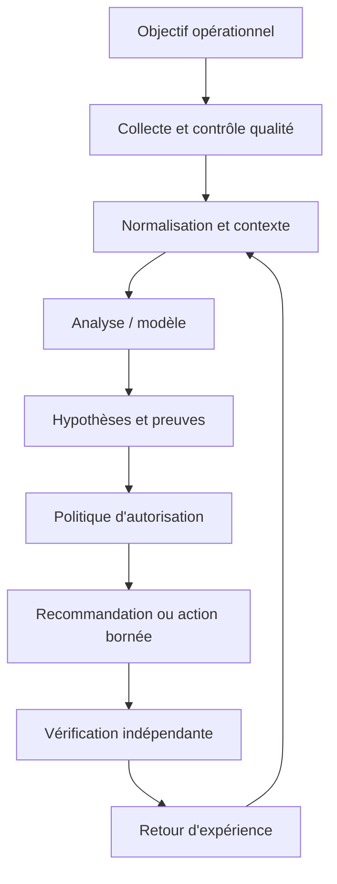

Chaque observation conserve source, horodatage, unité, cible, fraîcheur et état de qualité. Le résultat de l'analyse référence sa version et ses entrées. La décision expose actions permises, préconditions, approbations, quotas et conditions d'arrêt. La sortie finale indique les preuves exigées avant de déclarer le succès, ainsi que les situations qui imposent une escalade.

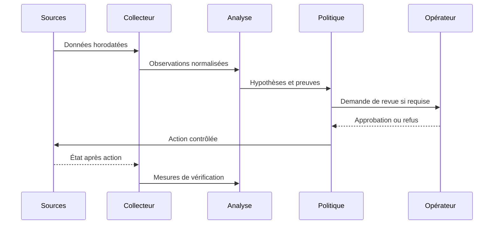

### Décision sous incertitude

La sécurité liée à Séparation entre analyse et exécution doit être conçue en amont : privilèges minimaux, protection des secrets, audit, séparation de l'analyse et de l'exécution, et règles d'escalade. Le piège principal ici est de s'abonner à trop de chemins à très haute fréquence. Les données externes doivent rester des données, jamais une autorité qui redéfinit les permissions. Pour une opération à fort impact, il faut des préconditions vérifiables, une approbation adaptée et un retour arrière testé, même lorsque le score du modèle semble très élevé.

Quand Données manquantes produit un résultat inattendu, commencer par l'heure, la source, l'unité, la cible, la fraîcheur, la version et le code d'erreur. Comparer l'observation brute à sa représentation transformée, puis chercher une modification récente. Tester une hypothèse à la fois et consigner la preuve du résultat sans copier de secrets dans le ticket. Une fois la cause confirmée, ajouter un test de régression et vérifier qu'il échoue avant le correctif et passe après celui-ci.

À l'échelle, Mode dégradé doit gérer des volumes et versions hétérogènes sans perdre de traçabilité. Borner la concurrence, isoler les erreurs par cible, limiter les files et surveiller les retards protègent l'aval. La reprise d'une panne peut elle-même provoquer une surcharge si toutes les sources se reconnectent simultanément. Le système doit pouvoir réduire sa fréquence ou revenir à une méthode simple, tout en signalant explicitement ce mode dégradé au lieu d'afficher un faux état normal.

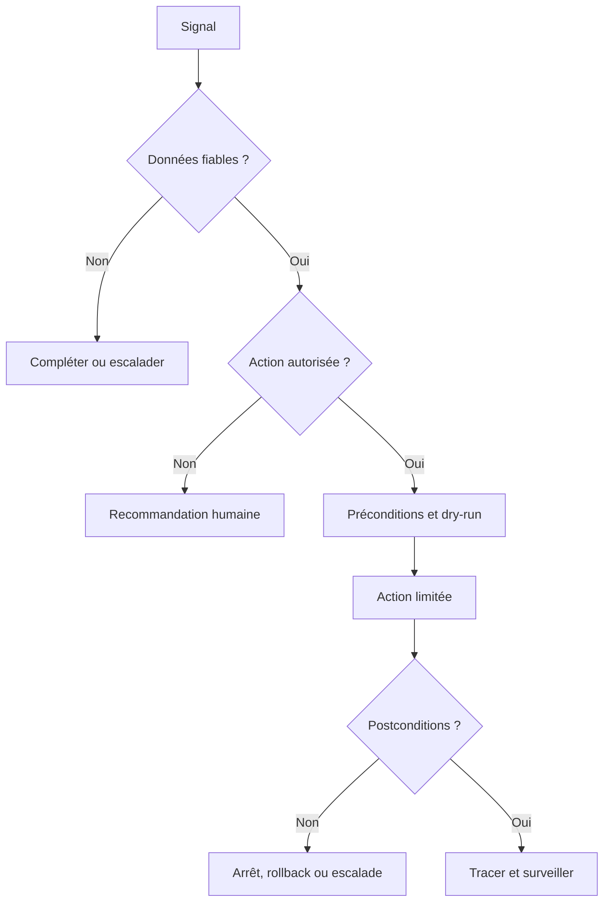

## 4. Pipeline et algorithmes

Le pipeline décrit ici est une chaîne de responsabilités, pas nécessairement six services séparés. Chaque étape doit avoir des entrées et sorties définies, des tests et une méthode de gestion des erreurs. Les données sont validées avant l'analyse, le contexte est enrichi avant l'interprétation, et la politique est consultée avant une action. Cette séquence permet de démarrer en mode observation et d'augmenter l'autonomie uniquement lorsque les critères sont prouvés.

### Étape 1 — Découvrir les capacités
Vérifier modèles, chemins, versions et types de souscription pris en charge.

La mise en œuvre de Découvrir les capacités se découpe en étapes testables : validation des entrées, contrôle des sources, traitement des valeurs absentes, journalisation et vérification des sorties. L'outil gNMI peut contribuer au processus, mais sa présence ne garantit pas sa fiabilité. Les erreurs doivent rester explicites au lieu d'être converties en valeurs par défaut silencieuses. Une exécution fiable distingue succès, échec, état partiel et état impossible à déterminer, et conserve la version de code ou de modèle qui a produit la sortie.

Quand Découvrir les capacités produit un résultat inattendu, commencer par l'heure, la source, l'unité, la cible, la fraîcheur, la version et le code d'erreur. Comparer l'observation brute à sa représentation transformée, puis chercher une modification récente. Tester une hypothèse à la fois et consigner la preuve du résultat sans copier de secrets dans le ticket. Une fois la cause confirmée, ajouter un test de régression et vérifier qu'il échoue avant le correctif et passe après celui-ci.

### Étape 2 — Sélectionner les signaux
Choisir fréquence et granularité selon le phénomène à observer.

La mise en œuvre de Sélectionner les signaux se découpe en étapes testables : validation des entrées, contrôle des sources, traitement des valeurs absentes, journalisation et vérification des sorties. L'outil gRPC peut contribuer au processus, mais sa présence ne garantit pas sa fiabilité. Les erreurs doivent rester explicites au lieu d'être converties en valeurs par défaut silencieuses. Une exécution fiable distingue succès, échec, état partiel et état impossible à déterminer, et conserve la version de code ou de modèle qui a produit la sortie.

Quand Sélectionner les signaux produit un résultat inattendu, commencer par l'heure, la source, l'unité, la cible, la fraîcheur, la version et le code d'erreur. Comparer l'observation brute à sa représentation transformée, puis chercher une modification récente. Tester une hypothèse à la fois et consigner la preuve du résultat sans copier de secrets dans le ticket. Une fois la cause confirmée, ajouter un test de régression et vérifier qu'il échoue avant le correctif et passe après celui-ci.

### Étape 3 — Établir la connexion
Configurer authentification, TLS, timeouts et reconnexion.

La mise en œuvre de Établir la connexion se découpe en étapes testables : validation des entrées, contrôle des sources, traitement des valeurs absentes, journalisation et vérification des sorties. L'outil OpenConfig peut contribuer au processus, mais sa présence ne garantit pas sa fiabilité. Les erreurs doivent rester explicites au lieu d'être converties en valeurs par défaut silencieuses. Une exécution fiable distingue succès, échec, état partiel et état impossible à déterminer, et conserve la version de code ou de modèle qui a produit la sortie.

Quand Établir la connexion produit un résultat inattendu, commencer par l'heure, la source, l'unité, la cible, la fraîcheur, la version et le code d'erreur. Comparer l'observation brute à sa représentation transformée, puis chercher une modification récente. Tester une hypothèse à la fois et consigner la preuve du résultat sans copier de secrets dans le ticket. Une fois la cause confirmée, ajouter un test de régression et vérifier qu'il échoue avant le correctif et passe après celui-ci.

### Étape 4 — Normaliser les événements
Préserver timestamps, unités, cible, chemin et identifiant de source.

La mise en œuvre de Normaliser les événements se découpe en étapes testables : validation des entrées, contrôle des sources, traitement des valeurs absentes, journalisation et vérification des sorties. L'outil collecteurs peut contribuer au processus, mais sa présence ne garantit pas sa fiabilité. Les erreurs doivent rester explicites au lieu d'être converties en valeurs par défaut silencieuses. Une exécution fiable distingue succès, échec, état partiel et état impossible à déterminer, et conserve la version de code ou de modèle qui a produit la sortie.

Quand Normaliser les événements produit un résultat inattendu, commencer par l'heure, la source, l'unité, la cible, la fraîcheur, la version et le code d'erreur. Comparer l'observation brute à sa représentation transformée, puis chercher une modification récente. Tester une hypothèse à la fois et consigner la preuve du résultat sans copier de secrets dans le ticket. Une fois la cause confirmée, ajouter un test de régression et vérifier qu'il échoue avant le correctif et passe après celui-ci.

### Étape 5 — Réguler le flux
Borner buffering et rendre les pertes, retards et déconnexions mesurables.

La mise en œuvre de Réguler le flux se découpe en étapes testables : validation des entrées, contrôle des sources, traitement des valeurs absentes, journalisation et vérification des sorties. L'outil TLS et backpressure peut contribuer au processus, mais sa présence ne garantit pas sa fiabilité. Les erreurs doivent rester explicites au lieu d'être converties en valeurs par défaut silencieuses. Une exécution fiable distingue succès, échec, état partiel et état impossible à déterminer, et conserve la version de code ou de modèle qui a produit la sortie.

Quand Réguler le flux produit un résultat inattendu, commencer par l'heure, la source, l'unité, la cible, la fraîcheur, la version et le code d'erreur. Comparer l'observation brute à sa représentation transformée, puis chercher une modification récente. Tester une hypothèse à la fois et consigner la preuve du résultat sans copier de secrets dans le ticket. Une fois la cause confirmée, ajouter un test de régression et vérifier qu'il échoue avant le correctif et passe après celui-ci.

### Étape 6 — Vérifier la qualité
Comparer le flux à des lectures de référence et surveiller fraîcheur et coût.

La mise en œuvre de Vérifier la qualité se découpe en étapes testables : validation des entrées, contrôle des sources, traitement des valeurs absentes, journalisation et vérification des sorties. L'outil gNMI peut contribuer au processus, mais sa présence ne garantit pas sa fiabilité. Les erreurs doivent rester explicites au lieu d'être converties en valeurs par défaut silencieuses. Une exécution fiable distingue succès, échec, état partiel et état impossible à déterminer, et conserve la version de code ou de modèle qui a produit la sortie.

Quand Vérifier la qualité produit un résultat inattendu, commencer par l'heure, la source, l'unité, la cible, la fraîcheur, la version et le code d'erreur. Comparer l'observation brute à sa représentation transformée, puis chercher une modification récente. Tester une hypothèse à la fois et consigner la preuve du résultat sans copier de secrets dans le ticket. Une fois la cause confirmée, ajouter un test de régression et vérifier qu'il échoue avant le correctif et passe après celui-ci.

### Pseudocode défensif
```text
observations = collecter()
si qualité(observations) insuffisante:
    signaler les données manquantes et escalader
sinon:
    contexte = enrichir(observations, inventaire, changements, dépendances)
    hypothèses = analyser(contexte)
    vérifier la provenance de chaque preuve
    si preuve insuffisante ou action hors politique:
        recommander sans exécuter
    sinon:
        préparer diff, préconditions, approbations et rollback
        appliquer sur un petit périmètre
        mesurer les postconditions indépendantes
        restaurer ou escalader si non conforme
        journaliser version, preuves, décision et résultat
```

Ce pseudocode explique la logique et n'est pas une bibliothèque prête pour la production. Chaque étape exige des tests, des permissions appropriées et un mode de reprise explicite. Un système fiable ne remplace pas l'incertitude par une valeur par défaut ; il la rend visible et réduit son autonomie lorsque les preuves sont incomplètes.

## 5. Étude de cas détaillée

### Situation et impact
le polling toutes les cinq minutes manque des microcongestions, mais l'augmentation de la fréquence peut surcharger l'infrastructure de collecte. L'équipe commence par établir le périmètre, l'impact utilisateur, la chronologie et la criticité des actifs. Sa première question n'est pas « quel modèle est à la mode ? », mais « quelle décision doit devenir meilleure, et quelle preuve permettra de le démontrer ? ». Cette formulation évite la dérive du périmètre et fixe un critère d'arrêt si la solution n'apporte pas de valeur.

### Phase 1 — Établir les faits
Conserver les données brutes en lecture seule et noter les sources, timestamps, versions et transformations. Vérifier les changements récents et la qualité de collecte. Les valeurs absentes demeurent absentes ; elles ne sont pas remplacées par zéro. L'impact métier est mesuré séparément de l'état d'un équipement. Les contradictions entre systèmes sont documentées au lieu d'être résolues par intuition.

### Phase 2 — Comparer les hypothèses
Décrire au moins deux explications si les preuves ne permettent pas de conclure directement. Pour chacune, noter les observations favorables, les contre-indices et le test qui peut la distinguer. La priorité dépend de l'impact, de la plausibilité et du coût du test. Une ressemblance avec un incident historique ne suffit pas : versions, topologie, capacité et fenêtre de charge peuvent changer l'explication.

### Phase 3 — Préparer une réponse proportionnée
Privilégier les contrôles non destructifs. Si une modification devient nécessaire, préciser cible, diff, préconditions, impact, fenêtre, critères d'arrêt et rollback. Une revue indépendante s'impose lorsque le rayon d'impact est grand. Le plan doit permettre de refuser une action lorsque les preuves ne sont pas suffisantes.

### Phase 4 — Vérifier
Après action, contrôler mesures indépendantes : fonctionnement du service, latence, erreurs, connectivité, état de configuration ou autre indicateur pertinent. Une seule valeur favorable ne prouve pas un rétablissement durable. Lorsque les postconditions échouent, arrêter, restaurer selon le plan ou escalader. Le compte rendu distingue ce qui a été tenté, observé, confirmé et laissé inconnu.

### Phase 5 — Tirer des leçons
Comparer les hypothèses initiales aux preuves finales. Ajouter tests de régression, sources manquantes et contrôles à améliorer. Une règle ou un modèle mis à jour passe par une revue et une expérimentation contrôlée avant généralisation. Les conclusions non confirmées ne deviennent pas automatiquement de nouvelles étiquettes d'entraînement.

### Conditions de clôture
La clôture exige soit une preuve de rétablissement, soit une déclaration explicite que le service reste dégradé. Le dossier conserve sources, versions, actions, approbations, résultats et suivis. La cause racine n'est déclarée confirmée que si les preuves le permettent. Une conclusion honnêtement partielle est préférable à une explication catégorique impossible à reproduire.

## 6. Implémentation et TP

Exécuter les travaux pratiques dans un laboratoire isolé ou sur des systèmes autorisés. Noter les versions, dépendances, données et critères de réussite. Le résultat doit pouvoir être reproduit par un autre opérateur ; un succès affiché par l'outil ne remplace pas le contrôle de l'état réel.

### TP 1 — Interroger les capacités d'un équipement de laboratoire.
**Procédure.** Interroger les capacités d'un équipement de laboratoire. Utiliser une cible limitée, capturer l'état initial et ne changer qu'un paramètre à la fois. Relier le travail au concept « gNMI » : gNMI est une interface de gestion réseau fondée sur gRPC qui expose notamment Get, Set et Subscribe. Conserver commande, entrée, version et sortie.

**Contrôle.** Reproduire le résultat, puis tester une erreur contrôlée, une donnée manquante et une dépendance indisponible. Vérifier l'état effectif, les effets secondaires et la procédure de reprise. Si le résultat ne peut pas être déterminé, signaler cet état plutôt que le considérer comme une réussite. Décrire ce qui est démontré et les limites qui subsistent avant un déploiement plus large.

### TP 2 — Choisir quelques compteurs utiles à un problème défini.
**Procédure.** Choisir quelques compteurs utiles à un problème défini. Utiliser une cible limitée, capturer l'état initial et ne changer qu'un paramètre à la fois. Relier le travail au concept « gRPC et Protobuf » : gRPC transporte des appels RPC avec des messages typés ; les erreurs, versions et schémas doivent être gérés. Conserver commande, entrée, version et sortie.

**Contrôle.** Reproduire le résultat, puis tester une erreur contrôlée, une donnée manquante et une dépendance indisponible. Vérifier l'état effectif, les effets secondaires et la procédure de reprise. Si le résultat ne peut pas être déterminé, signaler cet état plutôt que le considérer comme une réussite. Décrire ce qui est démontré et les limites qui subsistent avant un déploiement plus large.

### TP 3 — Configurer une souscription de télémétrie en flux.
**Procédure.** Configurer une souscription de télémétrie en flux. Utiliser une cible limitée, capturer l'état initial et ne changer qu'un paramètre à la fois. Relier le travail au concept « Modes Subscribe » : Les modes ponctuel, polling et streaming ont des caractéristiques différentes de latence et de charge. Conserver commande, entrée, version et sortie.

**Contrôle.** Reproduire le résultat, puis tester une erreur contrôlée, une donnée manquante et une dépendance indisponible. Vérifier l'état effectif, les effets secondaires et la procédure de reprise. Si le résultat ne peut pas être déterminé, signaler cet état plutôt que le considérer comme une réussite. Décrire ce qui est démontré et les limites qui subsistent avant un déploiement plus large.

### TP 4 — Préserver chemins, unités, timestamps et cibles.
**Procédure.** Préserver chemins, unités, timestamps et cibles. Utiliser une cible limitée, capturer l'état initial et ne changer qu'un paramètre à la fois. Relier le travail au concept « Chemins et modèles » : Les chemins de données identifient les éléments de télémétrie ; les capacités, unités et versions dépendent de la plateforme. Conserver commande, entrée, version et sortie.

**Contrôle.** Reproduire le résultat, puis tester une erreur contrôlée, une donnée manquante et une dépendance indisponible. Vérifier l'état effectif, les effets secondaires et la procédure de reprise. Si le résultat ne peut pas être déterminé, signaler cet état plutôt que le considérer comme une réussite. Décrire ce qui est démontré et les limites qui subsistent avant un déploiement plus large.

### TP 5 — Mesurer débit, taille des messages, retard et perte.
**Procédure.** Mesurer débit, taille des messages, retard et perte. Utiliser une cible limitée, capturer l'état initial et ne changer qu'un paramètre à la fois. Relier le travail au concept « Collecteur » : Un collecteur gère connexion, normalisation, mise en file, reconnexion et export des observations. Conserver commande, entrée, version et sortie.

**Contrôle.** Reproduire le résultat, puis tester une erreur contrôlée, une donnée manquante et une dépendance indisponible. Vérifier l'état effectif, les effets secondaires et la procédure de reprise. Si le résultat ne peut pas être déterminé, signaler cet état plutôt que le considérer comme une réussite. Décrire ce qui est démontré et les limites qui subsistent avant un déploiement plus large.

### TP 6 — Simuler une interruption et vérifier reconnexion et trous de données.
**Procédure.** Simuler une interruption et vérifier reconnexion et trous de données. Utiliser une cible limitée, capturer l'état initial et ne changer qu'un paramètre à la fois. Relier le travail au concept « Backpressure » : Le backpressure limite les files lorsque les données arrivent plus vite qu'elles ne sont consommées. Conserver commande, entrée, version et sortie.

**Contrôle.** Reproduire le résultat, puis tester une erreur contrôlée, une donnée manquante et une dépendance indisponible. Vérifier l'état effectif, les effets secondaires et la procédure de reprise. Si le résultat ne peut pas être déterminé, signaler cet état plutôt que le considérer comme une réussite. Décrire ce qui est démontré et les limites qui subsistent avant un déploiement plus large.

### TP 7 — Ajouter monitoring, limites de buffering et règles de reprise.
**Procédure.** Ajouter monitoring, limites de buffering et règles de reprise. Utiliser une cible limitée, capturer l'état initial et ne changer qu'un paramètre à la fois. Relier le travail au concept « Sécurité du transport » : TLS, identités, permissions minimales et rotation des certificats protègent la collecte et les opérations. Conserver commande, entrée, version et sortie.

**Contrôle.** Reproduire le résultat, puis tester une erreur contrôlée, une donnée manquante et une dépendance indisponible. Vérifier l'état effectif, les effets secondaires et la procédure de reprise. Si le résultat ne peut pas être déterminé, signaler cet état plutôt que le considérer comme une réussite. Décrire ce qui est démontré et les limites qui subsistent avant un déploiement plus large.

### Exemple technique
```text
gnmic subscribe --address 192.0.2.10:57400 \
  --username "$GNMI_USER" --password "$GNMI_PASSWORD" \
  --path '/interfaces/interface/state/counters' \
  --mode stream --stream-mode sample --sample-interval 10s \
  --tls-ca /etc/gnmi/ca.pem

# Vérifier les options de la version installée, le certificat et les chemins réellement supportés.
```
Ce fragment est un point de départ pédagogique, pas une configuration universelle. Les versions, options et capacités peuvent varier : lire la documentation officielle et tester en laboratoire. Ne pas coder de secrets en dur. Tout changement réel exige un périmètre limité, une autorisation appropriée et une vérification post-action.

### Livrables
- Un fichier versionné décrivant entrée, sortie et dépendances.
- Un journal corrélé à la cible et à la version, sans secrets.
- Des tests positifs et négatifs, dont données manquantes et échec d'accès.
- Des critères d'arrêt et un rollback testé.
- Une note de résultats, hypothèses et limites.

## 7. Sécurité et gouvernance

### 1. Qualité et provenance
Chaque observation conserve source, horodatage, unité et fraîcheur. Traduire ce principe en contrôle observable, propriétaire, fréquence de revue et preuve de passage. Une politique sans test dépend de la mémoire ; un test sans propriétaire n'est plus maintenu lorsque l'équipe change. Relancer la revue après un changement majeur de données, d'équipement, de modèle ou de finalité.

La gouvernance de Qualité et provenance précise qui peut créer, modifier, approuver, consulter et retirer la logique. Le propriétaire connaît le but, les limites, le budget d'erreur et les critères de suspension. Les décisions doivent être retraçables jusqu'aux données, paramètres et versions utilisés. Une règle sans propriétaire finit par dépendre de la mémoire des personnes ; une métrique sans décision associée devient décorative. La revue doit être planifiée et déclenchée de nouveau après un changement majeur de contexte.

### 2. Identités
Les comptes de service ont le minimum de permissions nécessaires. Traduire ce principe en contrôle observable, propriétaire, fréquence de revue et preuve de passage. Une politique sans test dépend de la mémoire ; un test sans propriétaire n'est plus maintenu lorsque l'équipe change. Relancer la revue après un changement majeur de données, d'équipement, de modèle ou de finalité.

La gouvernance de Identités précise qui peut créer, modifier, approuver, consulter et retirer la logique. Le propriétaire connaît le but, les limites, le budget d'erreur et les critères de suspension. Les décisions doivent être retraçables jusqu'aux données, paramètres et versions utilisés. Une règle sans propriétaire finit par dépendre de la mémoire des personnes ; une métrique sans décision associée devient décorative. La revue doit être planifiée et déclenchée de nouveau après un changement majeur de contexte.

### 3. Traçabilité
Version, preuves, décision, approbation, cible et résultat restent corrélés. Traduire ce principe en contrôle observable, propriétaire, fréquence de revue et preuve de passage. Une politique sans test dépend de la mémoire ; un test sans propriétaire n'est plus maintenu lorsque l'équipe change. Relancer la revue après un changement majeur de données, d'équipement, de modèle ou de finalité.

La gouvernance de Traçabilité précise qui peut créer, modifier, approuver, consulter et retirer la logique. Le propriétaire connaît le but, les limites, le budget d'erreur et les critères de suspension. Les décisions doivent être retraçables jusqu'aux données, paramètres et versions utilisés. Une règle sans propriétaire finit par dépendre de la mémoire des personnes ; une métrique sans décision associée devient décorative. La revue doit être planifiée et déclenchée de nouveau après un changement majeur de contexte.

### 4. Revue humaine
Le réviseur dispose de temps, preuves et autorité pour refuser. Traduire ce principe en contrôle observable, propriétaire, fréquence de revue et preuve de passage. Une politique sans test dépend de la mémoire ; un test sans propriétaire n'est plus maintenu lorsque l'équipe change. Relancer la revue après un changement majeur de données, d'équipement, de modèle ou de finalité.

La gouvernance de Revue humaine précise qui peut créer, modifier, approuver, consulter et retirer la logique. Le propriétaire connaît le but, les limites, le budget d'erreur et les critères de suspension. Les décisions doivent être retraçables jusqu'aux données, paramètres et versions utilisés. Une règle sans propriétaire finit par dépendre de la mémoire des personnes ; une métrique sans décision associée devient décorative. La revue doit être planifiée et déclenchée de nouveau après un changement majeur de contexte.

### 5. Gestion du risque
Chaque mode d'échec a prévention, détection, réponse et propriétaire. Traduire ce principe en contrôle observable, propriétaire, fréquence de revue et preuve de passage. Une politique sans test dépend de la mémoire ; un test sans propriétaire n'est plus maintenu lorsque l'équipe change. Relancer la revue après un changement majeur de données, d'équipement, de modèle ou de finalité.

La gouvernance de Gestion du risque précise qui peut créer, modifier, approuver, consulter et retirer la logique. Le propriétaire connaît le but, les limites, le budget d'erreur et les critères de suspension. Les décisions doivent être retraçables jusqu'aux données, paramètres et versions utilisés. Une règle sans propriétaire finit par dépendre de la mémoire des personnes ; une métrique sans décision associée devient décorative. La revue doit être planifiée et déclenchée de nouveau après un changement majeur de contexte.

### 6. Réversibilité
Retrait, suspension et retour à une version saine sont testés. Traduire ce principe en contrôle observable, propriétaire, fréquence de revue et preuve de passage. Une politique sans test dépend de la mémoire ; un test sans propriétaire n'est plus maintenu lorsque l'équipe change. Relancer la revue après un changement majeur de données, d'équipement, de modèle ou de finalité.

La gouvernance de Réversibilité précise qui peut créer, modifier, approuver, consulter et retirer la logique. Le propriétaire connaît le but, les limites, le budget d'erreur et les critères de suspension. Les décisions doivent être retraçables jusqu'aux données, paramètres et versions utilisés. Une règle sans propriétaire finit par dépendre de la mémoire des personnes ; une métrique sans décision associée devient décorative. La revue doit être planifiée et déclenchée de nouveau après un changement majeur de contexte.

## 8. Pièges à éviter

### Piège 1 — s'abonner à trop de chemins à très haute fréquence
Ce défaut peut produire un faux diagnostic, une action inutile ou une perte de confiance. Les signes précoces peuvent être une source contradictoire, une hausse d'erreurs, un écart entre sites ou l'absence de preuve. Pour ce cours, le risque « s'abonner à trop de chemins à très haute fréquence » doit être associé à un test négatif explicite et à une réponse déterminée lorsque le garde-fou échoue.

La prévention s'appuie sur « gNMI ». gNMI est une interface de gestion réseau fondée sur gRPC qui expose notamment Get, Set et Subscribe. Un avertissement n'est utile que s'il change la décision, bloque une action risquée ou déclenche une revue. La checklist de déploiement doit préciser qui observe le signal, quel seuil est acceptable et qui peut suspendre la méthode. Il faut documenter aussi les défaillances que le contrôle ne couvre pas.

### Piège 2 — supposer que tous les équipements offrent les mêmes chemins
Ce défaut peut produire un faux diagnostic, une action inutile ou une perte de confiance. Les signes précoces peuvent être une source contradictoire, une hausse d'erreurs, un écart entre sites ou l'absence de preuve. Pour ce cours, le risque « supposer que tous les équipements offrent les mêmes chemins » doit être associé à un test négatif explicite et à une réponse déterminée lorsque le garde-fou échoue.

La prévention s'appuie sur « gRPC et Protobuf ». gRPC transporte des appels RPC avec des messages typés ; les erreurs, versions et schémas doivent être gérés. Un avertissement n'est utile que s'il change la décision, bloque une action risquée ou déclenche une revue. La checklist de déploiement doit préciser qui observe le signal, quel seuil est acceptable et qui peut suspendre la méthode. Il faut documenter aussi les défaillances que le contrôle ne couvre pas.

### Piège 3 — perdre les unités ou timestamps lors de la normalisation
Ce défaut peut produire un faux diagnostic, une action inutile ou une perte de confiance. Les signes précoces peuvent être une source contradictoire, une hausse d'erreurs, un écart entre sites ou l'absence de preuve. Pour ce cours, le risque « perdre les unités ou timestamps lors de la normalisation » doit être associé à un test négatif explicite et à une réponse déterminée lorsque le garde-fou échoue.

La prévention s'appuie sur « Modes Subscribe ». Les modes ponctuel, polling et streaming ont des caractéristiques différentes de latence et de charge. Un avertissement n'est utile que s'il change la décision, bloque une action risquée ou déclenche une revue. La checklist de déploiement doit préciser qui observe le signal, quel seuil est acceptable et qui peut suspendre la méthode. Il faut documenter aussi les défaillances que le contrôle ne couvre pas.

### Piège 4 — traiter une déconnexion comme une valeur normale
Ce défaut peut produire un faux diagnostic, une action inutile ou une perte de confiance. Les signes précoces peuvent être une source contradictoire, une hausse d'erreurs, un écart entre sites ou l'absence de preuve. Pour ce cours, le risque « traiter une déconnexion comme une valeur normale » doit être associé à un test négatif explicite et à une réponse déterminée lorsque le garde-fou échoue.

La prévention s'appuie sur « Chemins et modèles ». Les chemins de données identifient les éléments de télémétrie ; les capacités, unités et versions dépendent de la plateforme. Un avertissement n'est utile que s'il change la décision, bloque une action risquée ou déclenche une revue. La checklist de déploiement doit préciser qui observe le signal, quel seuil est acceptable et qui peut suspendre la méthode. Il faut documenter aussi les défaillances que le contrôle ne couvre pas.

### Piège 5 — laisser les files grandir sans limite
Ce défaut peut produire un faux diagnostic, une action inutile ou une perte de confiance. Les signes précoces peuvent être une source contradictoire, une hausse d'erreurs, un écart entre sites ou l'absence de preuve. Pour ce cours, le risque « laisser les files grandir sans limite » doit être associé à un test négatif explicite et à une réponse déterminée lorsque le garde-fou échoue.

La prévention s'appuie sur « Collecteur ». Un collecteur gère connexion, normalisation, mise en file, reconnexion et export des observations. Un avertissement n'est utile que s'il change la décision, bloque une action risquée ou déclenche une revue. La checklist de déploiement doit préciser qui observe le signal, quel seuil est acceptable et qui peut suspendre la méthode. Il faut documenter aussi les défaillances que le contrôle ne couvre pas.

### Piège 6 — accepter des certificats expirés ou droits excessifs
Ce défaut peut produire un faux diagnostic, une action inutile ou une perte de confiance. Les signes précoces peuvent être une source contradictoire, une hausse d'erreurs, un écart entre sites ou l'absence de preuve. Pour ce cours, le risque « accepter des certificats expirés ou droits excessifs » doit être associé à un test négatif explicite et à une réponse déterminée lorsque le garde-fou échoue.

La prévention s'appuie sur « Backpressure ». Le backpressure limite les files lorsque les données arrivent plus vite qu'elles ne sont consommées. Un avertissement n'est utile que s'il change la décision, bloque une action risquée ou déclenche une revue. La checklist de déploiement doit préciser qui observe le signal, quel seuil est acceptable et qui peut suspendre la méthode. Il faut documenter aussi les défaillances que le contrôle ne couvre pas.

### Piège 7 — confondre fréquence d'émission et latence de bout en bout
Ce défaut peut produire un faux diagnostic, une action inutile ou une perte de confiance. Les signes précoces peuvent être une source contradictoire, une hausse d'erreurs, un écart entre sites ou l'absence de preuve. Pour ce cours, le risque « confondre fréquence d'émission et latence de bout en bout » doit être associé à un test négatif explicite et à une réponse déterminée lorsque le garde-fou échoue.

La prévention s'appuie sur « Sécurité du transport ». TLS, identités, permissions minimales et rotation des certificats protègent la collecte et les opérations. Un avertissement n'est utile que s'il change la décision, bloque une action risquée ou déclenche une revue. La checklist de déploiement doit préciser qui observe le signal, quel seuil est acceptable et qui peut suspendre la méthode. Il faut documenter aussi les défaillances que le contrôle ne couvre pas.

## 9. Diagnostic et dépannage

### Aucun résultat
Vérifier accès, période, filtres, identité et version du schéma. Dans le contexte de Streaming Telemetry (gNMI, gRPC), examiner d'abord le risque « s'abonner à trop de chemins à très haute fréquence ». Comparer observation brute et donnée transformée, retracer la version utilisée et vérifier les modifications récentes. Construire deux hypothèses alternatives et effectuer un test non destructif qui permet de les départager. Éviter les changements simultanés. Si les preuves restent incomplètes, garder l'incertitude visible et utiliser le mode sûr.

### Résultats variables
Comparer dataset, code, paramètres, dépendances et transformations. Dans le contexte de Streaming Telemetry (gNMI, gRPC), examiner d'abord le risque « supposer que tous les équipements offrent les mêmes chemins ». Comparer observation brute et donnée transformée, retracer la version utilisée et vérifier les modifications récentes. Construire deux hypothèses alternatives et effectuer un test non destructif qui permet de les départager. Éviter les changements simultanés. Si les preuves restent incomplètes, garder l'incertitude visible et utiliser le mode sûr.

### Trop d'alertes
Inspecter duplications, saisonnalité, baseline et seuils. Dans le contexte de Streaming Telemetry (gNMI, gRPC), examiner d'abord le risque « perdre les unités ou timestamps lors de la normalisation ». Comparer observation brute et donnée transformée, retracer la version utilisée et vérifier les modifications récentes. Construire deux hypothèses alternatives et effectuer un test non destructif qui permet de les départager. Éviter les changements simultanés. Si les preuves restent incomplètes, garder l'incertitude visible et utiliser le mode sûr.

### Incident manqué
Reconstituer l'information disponible au moment de la décision. Dans le contexte de Streaming Telemetry (gNMI, gRPC), examiner d'abord le risque « traiter une déconnexion comme une valeur normale ». Comparer observation brute et donnée transformée, retracer la version utilisée et vérifier les modifications récentes. Construire deux hypothèses alternatives et effectuer un test non destructif qui permet de les départager. Éviter les changements simultanés. Si les preuves restent incomplètes, garder l'incertitude visible et utiliser le mode sûr.

### Action sans effet
Mesurer les postconditions indépendantes et chercher les effets secondaires. Dans le contexte de Streaming Telemetry (gNMI, gRPC), examiner d'abord le risque « laisser les files grandir sans limite ». Comparer observation brute et donnée transformée, retracer la version utilisée et vérifier les modifications récentes. Construire deux hypothèses alternatives et effectuer un test non destructif qui permet de les départager. Éviter les changements simultanés. Si les preuves restent incomplètes, garder l'incertitude visible et utiliser le mode sûr.

### Qualité en baisse
Rechercher dérive, migration, changement de capacité ou de version. Dans le contexte de Streaming Telemetry (gNMI, gRPC), examiner d'abord le risque « accepter des certificats expirés ou droits excessifs ». Comparer observation brute et donnée transformée, retracer la version utilisée et vérifier les modifications récentes. Construire deux hypothèses alternatives et effectuer un test non destructif qui permet de les départager. Éviter les changements simultanés. Si les preuves restent incomplètes, garder l'incertitude visible et utiliser le mode sûr.

## 10. Exercices corrigés

### Exercice 1 — gNMI
**Énoncé.** Pour le scénario « le polling toutes les cinq minutes manque des microcongestions, mais l'augmentation de la fréquence peut surcharger l'infrastructure de collecte », l'équipe veut généraliser une méthode qui utilise gNMI. Quelle preuve doit-elle recueillir avant l'étape « Découvrir les capacités » et comment prévenir « s'abonner à trop de chemins à très haute fréquence » ?

**Correction détaillée.** Définir le résultat attendu et le coût de l'erreur. Vérifier la provenance, la fraîcheur et la disponibilité temporelle des entrées. Construire un essai reproductible et le comparer à une baseline. Vérifier modèles, chemins, versions et types de souscription pris en charge. Analyser les erreurs par catégorie d'actifs, puis fixer des seuils et une revue adaptée au risque. Le déploiement commence sur un périmètre limité et possède une restauration testée. Si les preuves sont insuffisantes, la bonne décision est d'observer, de demander une donnée complémentaire ou d'escalader.

**Pourquoi un raccourci échoue.** Un exemple favorable ne prouve pas un gain durable. Une métrique globale masque des cas critiques et une collecte lacunaire peut cacher les erreurs. La version et les conditions doivent rester disponibles pour reproduire le résultat. L'exercice est réussi si une autre personne peut expliquer le choix, ses limites et le mécanisme de retrait.

### Exercice 2 — gRPC et Protobuf
**Énoncé.** Pour le scénario « le polling toutes les cinq minutes manque des microcongestions, mais l'augmentation de la fréquence peut surcharger l'infrastructure de collecte », l'équipe veut généraliser une méthode qui utilise gRPC et Protobuf. Quelle preuve doit-elle recueillir avant l'étape « Sélectionner les signaux » et comment prévenir « supposer que tous les équipements offrent les mêmes chemins » ?

**Correction détaillée.** Définir le résultat attendu et le coût de l'erreur. Vérifier la provenance, la fraîcheur et la disponibilité temporelle des entrées. Construire un essai reproductible et le comparer à une baseline. Choisir fréquence et granularité selon le phénomène à observer. Analyser les erreurs par catégorie d'actifs, puis fixer des seuils et une revue adaptée au risque. Le déploiement commence sur un périmètre limité et possède une restauration testée. Si les preuves sont insuffisantes, la bonne décision est d'observer, de demander une donnée complémentaire ou d'escalader.

**Pourquoi un raccourci échoue.** Un exemple favorable ne prouve pas un gain durable. Une métrique globale masque des cas critiques et une collecte lacunaire peut cacher les erreurs. La version et les conditions doivent rester disponibles pour reproduire le résultat. L'exercice est réussi si une autre personne peut expliquer le choix, ses limites et le mécanisme de retrait.

### Exercice 3 — Modes Subscribe
**Énoncé.** Pour le scénario « le polling toutes les cinq minutes manque des microcongestions, mais l'augmentation de la fréquence peut surcharger l'infrastructure de collecte », l'équipe veut généraliser une méthode qui utilise Modes Subscribe. Quelle preuve doit-elle recueillir avant l'étape « Établir la connexion » et comment prévenir « perdre les unités ou timestamps lors de la normalisation » ?

**Correction détaillée.** Définir le résultat attendu et le coût de l'erreur. Vérifier la provenance, la fraîcheur et la disponibilité temporelle des entrées. Construire un essai reproductible et le comparer à une baseline. Configurer authentification, TLS, timeouts et reconnexion. Analyser les erreurs par catégorie d'actifs, puis fixer des seuils et une revue adaptée au risque. Le déploiement commence sur un périmètre limité et possède une restauration testée. Si les preuves sont insuffisantes, la bonne décision est d'observer, de demander une donnée complémentaire ou d'escalader.

**Pourquoi un raccourci échoue.** Un exemple favorable ne prouve pas un gain durable. Une métrique globale masque des cas critiques et une collecte lacunaire peut cacher les erreurs. La version et les conditions doivent rester disponibles pour reproduire le résultat. L'exercice est réussi si une autre personne peut expliquer le choix, ses limites et le mécanisme de retrait.

### Exercice 4 — Chemins et modèles
**Énoncé.** Pour le scénario « le polling toutes les cinq minutes manque des microcongestions, mais l'augmentation de la fréquence peut surcharger l'infrastructure de collecte », l'équipe veut généraliser une méthode qui utilise Chemins et modèles. Quelle preuve doit-elle recueillir avant l'étape « Normaliser les événements » et comment prévenir « traiter une déconnexion comme une valeur normale » ?

**Correction détaillée.** Définir le résultat attendu et le coût de l'erreur. Vérifier la provenance, la fraîcheur et la disponibilité temporelle des entrées. Construire un essai reproductible et le comparer à une baseline. Préserver timestamps, unités, cible, chemin et identifiant de source. Analyser les erreurs par catégorie d'actifs, puis fixer des seuils et une revue adaptée au risque. Le déploiement commence sur un périmètre limité et possède une restauration testée. Si les preuves sont insuffisantes, la bonne décision est d'observer, de demander une donnée complémentaire ou d'escalader.

**Pourquoi un raccourci échoue.** Un exemple favorable ne prouve pas un gain durable. Une métrique globale masque des cas critiques et une collecte lacunaire peut cacher les erreurs. La version et les conditions doivent rester disponibles pour reproduire le résultat. L'exercice est réussi si une autre personne peut expliquer le choix, ses limites et le mécanisme de retrait.

### Exercice 5 — Collecteur
**Énoncé.** Pour le scénario « le polling toutes les cinq minutes manque des microcongestions, mais l'augmentation de la fréquence peut surcharger l'infrastructure de collecte », l'équipe veut généraliser une méthode qui utilise Collecteur. Quelle preuve doit-elle recueillir avant l'étape « Réguler le flux » et comment prévenir « laisser les files grandir sans limite » ?

**Correction détaillée.** Définir le résultat attendu et le coût de l'erreur. Vérifier la provenance, la fraîcheur et la disponibilité temporelle des entrées. Construire un essai reproductible et le comparer à une baseline. Borner buffering et rendre les pertes, retards et déconnexions mesurables. Analyser les erreurs par catégorie d'actifs, puis fixer des seuils et une revue adaptée au risque. Le déploiement commence sur un périmètre limité et possède une restauration testée. Si les preuves sont insuffisantes, la bonne décision est d'observer, de demander une donnée complémentaire ou d'escalader.

**Pourquoi un raccourci échoue.** Un exemple favorable ne prouve pas un gain durable. Une métrique globale masque des cas critiques et une collecte lacunaire peut cacher les erreurs. La version et les conditions doivent rester disponibles pour reproduire le résultat. L'exercice est réussi si une autre personne peut expliquer le choix, ses limites et le mécanisme de retrait.

## Atelier approfondi — fiabiliser une chaîne de télémétrie

Cette partie approfondit un objectif précis : construire un flux de télémétrie qui soit exploitable par des outils d'observabilité et par des traitements AIOps, même lorsque les équipements, les réseaux d'administration et les consommateurs rencontrent des difficultés. Un collecteur qui reçoit des messages sans les perdre semble fonctionner ; pourtant, il peut publier des mesures trop tard, mélanger les horodatages, écraser des unités ou masquer les périodes sans données. La qualité ne se résume donc pas au nombre de messages reçus.

Le fil rouge est une infrastructure composée de routeurs, de commutateurs et de liens WAN. Les équipements publient des mesures via gNMI sur gRPC. Un collecteur maintient les souscriptions, normalise les notifications, contrôle la qualité, écrit dans un système de transport puis alimente des tableaux de bord et des moteurs AIOps. Le même modèle s'applique à des systèmes applicatifs ou à des services cloud, même si les protocoles d'entrée diffèrent.

Les exemples restent illustratifs : les capacités gNMI, les chemins, les modes de souscription et les options de sécurité dépendent de la plateforme et de sa version. Il faut vérifier les capacités réelles de chaque équipement au lieu de supposer qu'un chemin présent sur un modèle de données sera nécessairement publié par tous les constructeurs.

### 1. Concevoir la chaîne de bout en bout

Distinguez le plan de contrôle du flux de données. Le plan de contrôle inventorie les équipements, vérifie les capacités, crée les souscriptions, renouvelle les sessions et pilote leur cycle de vie. Le flux de données transporte les notifications et les métadonnées. Cette séparation permet de diagnostiquer indépendamment une souscription mal construite et un consommateur lent.

Le collecteur ne doit pas être imaginé comme une simple boucle qui ouvre un canal et écrit chaque message dans une base. Une chaîne fiable comporte une identité d'actif stable, une configuration versionnée, un registre des souscriptions, un client gRPC, une file bornée, un normaliseur, des contrôles de qualité, un système de transport, un consommateur et des indicateurs de santé. Les responsabilités doivent rester testables et les erreurs de chaque étape doivent être visibles.

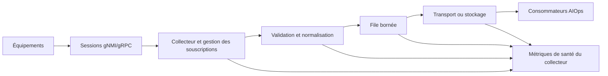

Tracez le parcours d'une mesure en utilisant des identifiants corrélables. L'identifiant de l'actif doit rester stable même si son nom DNS change. La source indique le chemin et la session qui ont produit la valeur. L'horodatage de l'équipement, l'heure de réception et l'heure de traitement sont trois données distinctes. La version de configuration et l'identifiant de souscription rendent possible une enquête après modification. N'ajoutez pas un identifiant aléatoire à chaque étape sans conserver les relations : la corrélation doit rester possible lorsque l'événement est transformé, réémis ou rejoué.

Une architecture en plusieurs services ne doit pas rendre les erreurs impossibles à localiser. Pour chaque frontière, définissez le contrat d'entrée, le contrat de sortie, le délai attendu, la limite de taille, le comportement si la dépendance devient indisponible et l'indicateur qui permet de constater la défaillance. Un message rejeté doit produire une raison mesurable ; un message retardé doit rester distinguable d'un message perdu ; un message dupliqué doit être reconnu ou être traité par une logique tolérante aux doublons.

### 2. Inventorier les capacités avant de s'abonner

gNMI fournit une interface de gestion et de télémétrie fondée sur gRPC et des modèles de données structurés. Les opérations courantes incluent la lecture de capacités, la récupération de valeurs et l'établissement de souscriptions. Une session réussie ne prouve pas que tous les chemins demandés sont pris en charge ni que toutes les options sont acceptées. Les versions de logiciels, les modèles implémentés, les encodages, les modes de publication et certaines extensions peuvent différer.

L'inventaire des capacités doit donc être un processus distinct de la création de la souscription. Il faut vérifier le modèle de données ou le chemin exposé, les encodages annoncés, les versions pertinentes, les permissions et les paramètres compatibles. En cas d'absence d'une capacité, la politique peut ignorer le chemin non essentiel, sélectionner une solution compatible ou marquer le profil de l'équipement comme partiellement compatible. Elle ne doit pas créer silencieusement un tableau de bord qui semble complet alors que plusieurs signaux sont absents.

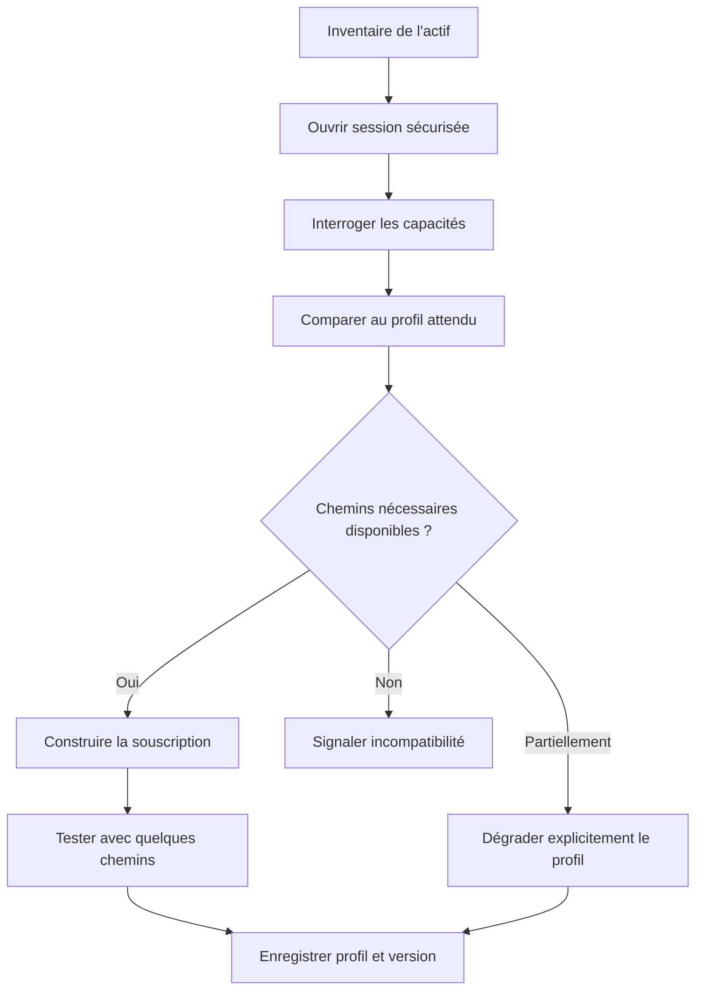

Conservez un profil d'équipement lisible : fournisseur, modèle, version logicielle, identifiant stable, chemins pris en charge, encodages, fréquence minimale acceptable, limites connues, certificat utilisé et date de vérification. Ce profil évite de répéter des essais à chaque redémarrage du collecteur. Il doit néanmoins expirer ou être revalidé après une mise à niveau de l'équipement, car une capacité observée plusieurs mois plus tôt ne prouve pas la situation actuelle.

Un profil ne doit pas devenir une liste de chemins copiée sans justification. Reliez chaque souscription à une question opérationnelle. Pour détecter la saturation d'un lien, sélectionnez des compteurs pertinents, une cadence adaptée et les informations nécessaires pour identifier l'interface. Un abonnement large sur toute l'arborescence peut consommer de la bande passante et de la capacité de traitement sans ajouter de valeur. Commencez par une petite sélection, mesurez son effet, puis étendez-la selon le besoin.

### 3. Choisir le mode, les chemins et la fréquence

Une souscription périodique est utile pour suivre une mesure à intervalles réguliers, tandis qu'une publication sur changement peut être adaptée à des états qui changent peu mais doivent être signalés rapidement. Des modes ponctuels ou limités peuvent servir à initialiser un état, effectuer une interrogation spécifique ou synchroniser un consommateur. Le comportement exact, y compris la manière dont l'état initial est transmis, doit être vérifié dans la spécification et l'implémentation concernées.

Une fréquence élevée n'est pas automatiquement synonyme de meilleure observabilité. Une collecte trop dense peut surcharger le plan d'administration, augmenter les messages à parser, amplifier les coûts de stockage et remplir les files quand le consommateur ralentit. Une fréquence trop faible peut masquer un pic court ou retarder la détection. Le choix doit découler du phénomène visé et du délai d'action acceptable.

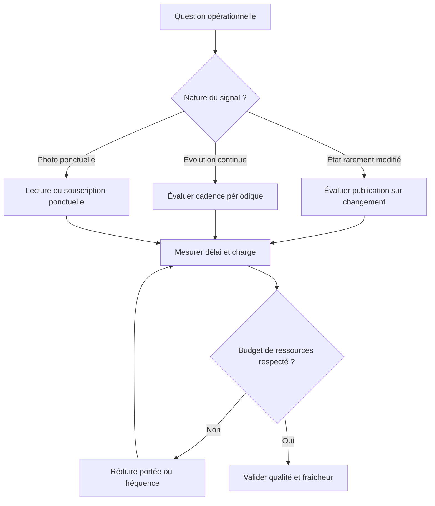

Les chemins doivent être précis et documentés. Une mesure sans identifiant de cible ou de port est difficile à exploiter lorsque l'équipement comporte de nombreuses interfaces. Préservez la hiérarchie du chemin, les clés de table, le nom du capteur et les métadonnées utiles. Si vous aplatissez le chemin en une chaîne unique, adoptez un format réversible et non ambigu. La suppression de tous les attributs pour gagner quelques caractères peut fusionner deux valeurs distinctes.

Pour estimer le volume, multipliez le nombre d'actifs par le nombre de séries, par le nombre moyen d'échantillons par seconde, puis par une taille moyenne raisonnable. Le résultat n'est qu'un ordre de grandeur : les notifications, les métadonnées, les tailles variables, les reconnectages et les valeurs initiales modifient le débit réel. Mesurez les volumes sur un échantillon représentatif. En cas de croissance, il faut savoir si elle vient d'une nouvelle cible, d'une fréquence modifiée, d'une explosion de cardinalité ou d'un changement de format.

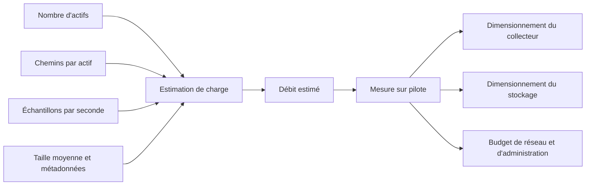

La fréquence devrait parfois varier selon le contexte. Un compteur de trafic peut être publié toutes les quelques secondes pour les liens critiques, alors qu'un état logiciel rarement modifié peut être collecté sur changement ou à une cadence plus large. Une cadence adaptative peut réduire la charge lorsque tout est stable et augmenter temporairement la collecte en cas de signal suspect, mais cette logique ajoute de la complexité et peut créer des angles morts. Elle doit être bornée, observable et conçue pour éviter qu'une boucle d'alerte provoque une collecte si intensive qu'elle dégrade elle-même le système.

### 4. Normaliser sans perdre le sens des données

La normalisation ne consiste pas à transformer chaque notification en dictionnaire avec trois clés génériques. Elle doit préserver le sens du signal : cible, chemin, valeur typée, unité, horodatage source, horodatage de réception, mode de collecte, étiquette de qualité et version de schéma. Lorsque le protocole représente les nombres comme des entiers, des nombres flottants ou des structures, conservez leur sémantique. Convertir toutes les valeurs en chaînes empêche certains contrôles et favorise les erreurs silencieuses.

Le modèle canonique doit aussi distinguer les mesures, les états et les événements de qualité. Un compteur de paquets est une mesure cumulative ; l'état administratif d'une interface est une valeur discrète ; une reconnexion du collecteur est un événement opérationnel ; une absence d'échantillons est une information de qualité. Ces types ne doivent pas être mélangés dans une table sans indication de leur nature. Les consommateurs peuvent ensuite construire des vues cohérentes sans devoir deviner le type de chaque champ.

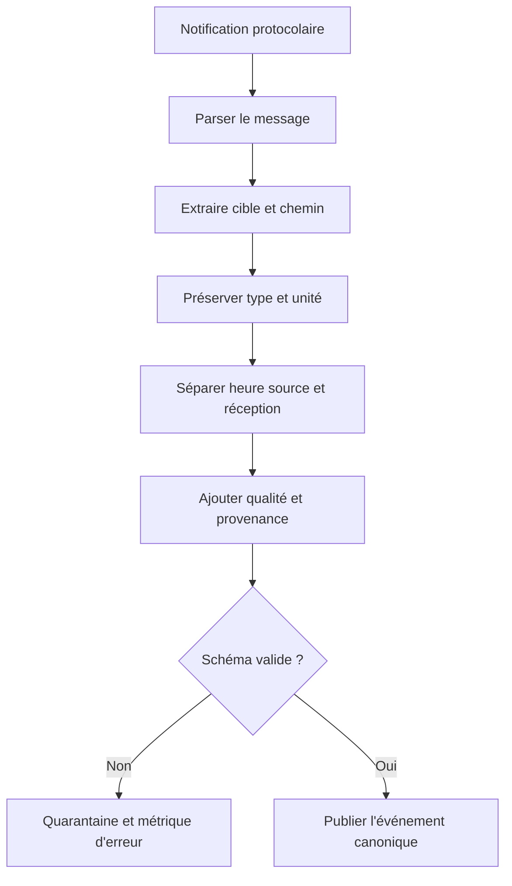

Définissez une politique pour les valeurs nulles, absentes, supprimées et inconnues. Une absence dans une notification ne signifie pas toujours que la valeur précédente est devenue nulle. Selon le contexte et l'opération, le message peut représenter une mise à jour partielle ou une suppression. Le consommateur doit comprendre les règles du protocole et les traduire dans une sémantique explicite. Une série dont la valeur n'a pas été mise à jour peut conserver un état précédent tout en ayant une fraîcheur qui diminue ; il ne faut pas afficher cette ancienne valeur comme si elle venait d'être mesurée.

Si plusieurs producteurs publient le même signal, la provenance devient importante. Préservez la source, l'identifiant de session ou le collecteur qui a reçu l'événement, et définissez si les producteurs sont redondants, complémentaires ou concurrents. Une valeur provenant d'une source secondaire ne devrait pas écraser systématiquement une valeur plus fraîche d'une source prioritaire. Il peut être nécessaire d'appliquer une règle de sélection fondée sur la cible, la fraîcheur, la qualité et la priorité configurée.

### 5. Horodatages, ordre des messages et latence de bout en bout

Dans une chaîne de télémétrie, l'heure de mesure, l'heure d'arrivée au collecteur, l'heure de normalisation et l'heure d'écriture sont différentes. La différence entre l'événement et sa réception mesure un retard apparent, sous réserve que les horloges soient suffisamment synchronisées. La différence entre réception et publication aide à localiser la latence interne du collecteur. L'heure du consommateur indique si le transport et la lecture ajoutent un délai.

Ne remplacez pas l'horodatage de la source par l'heure locale au moment du traitement : vous perdriez la possibilité de mesurer le retard et d'ordonner correctement les observations. Enregistrez séparément les horodatages disponibles. Le protocole et l'équipement déterminent la signification exacte de l'heure source ; documentez-la avant d'en tirer des conclusions. Une dérive d'horloge peut faire paraître un événement futur ou très ancien.

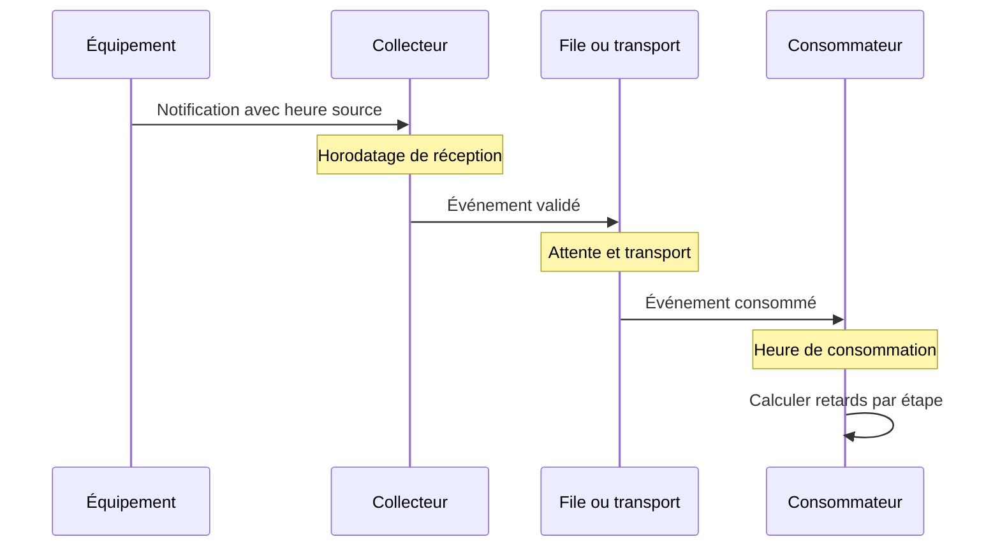

Une série désordonnée est possible en cas de reconnexion, de parallélisme, de mise en file ou de reprise après une interruption. Définissez si le consommateur accepte le désordre, réordonne dans une fenêtre limitée ou rejette les événements trop anciens. La fenêtre de réordonnancement crée un compromis : attendre davantage améliore l'ordre, mais augmente la latence. Une fenêtre trop courte peut couper des événements retardés ; une fenêtre trop longue peut rendre le tableau de bord inutilement lent.

Les métriques de latence devraient être distribuées par étape et par catégorie de source. Une moyenne seule peut masquer une minorité de notifications extrêmement retardées. Suivez des percentiles, des maxima bornés ou des histogrammes, en indiquant la méthode de calcul et la fenêtre. Comparez aussi le retard et la couverture : une collecte peut avoir une latence faible sur les messages qu'elle reçoit mais perdre les messages pendant une interruption.

### 6. Backpressure, tampons et reprise

La backpressure apparaît lorsque le débit entrant dépasse le débit que le consommateur ou le stockage peut traiter. Sans limite, les files peuvent grossir jusqu'à épuiser la mémoire ou le disque. Avec une politique de rejet agressive, des données peuvent être perdues sans que l'utilisateur le remarque. Une conception correcte choisit des limites, des priorités et une stratégie explicite lorsque la capacité est dépassée.

Estimez la capacité en fonction du débit maximal observé, de la taille moyenne ou p95 des messages, de la durée d'indisponibilité que le tampon doit absorber et de la mémoire disponible. Un tampon de cinq minutes ne protège pas contre une panne de deux heures. Un tampon disque peut étendre la tolérance, mais introduit des limites de capacité, de permissions, de corruption et de récupération. Le système doit compter les événements abandonnés, les rejets et les saturations, au lieu de n'afficher qu'une profondeur de file instantanée.

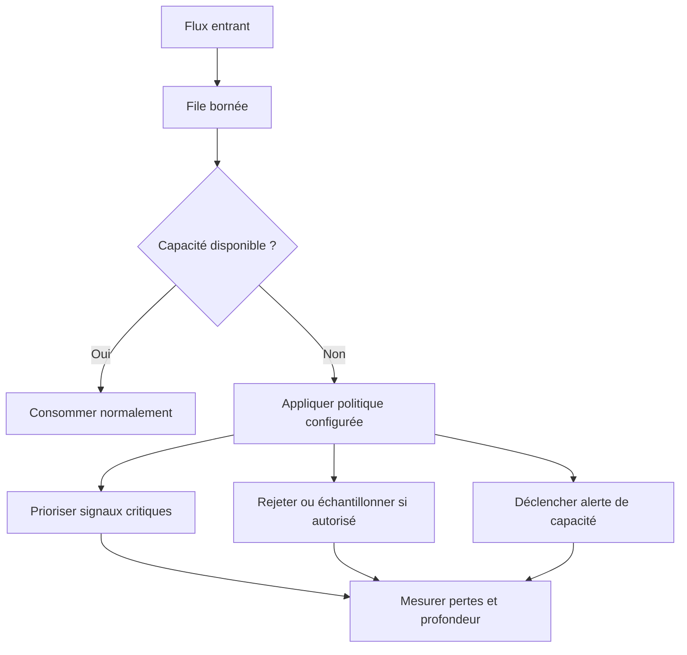

La politique de saturation dépend du type de télémétrie. Pour certaines mesures périodiques, un échantillonnage ou une agrégation peut être acceptable, à condition de conserver les extrêmes utiles et d'enregistrer qu'une réduction a été appliquée. Pour les changements d'état, jeter arbitrairement une transition peut être plus dangereux. Les événements de qualité et de reconnexion sont eux-mêmes critiques pour comprendre les trous de données. La politique doit donc agir en fonction de la nature des événements plutôt que traiter toutes les lignes de la même manière.

Les reconnexions doivent être progressives. Une panne d'administration peut faire tomber des centaines de sessions au même moment ; une boucle de reconnexion immédiate provoque une tempête de demandes et retarde le retour à la normale. Utilisez un délai avec recul progressif et une variation aléatoire entre clients, respectez les limites de l'équipement et définissez une limite maximale. Une fois la session rétablie, marquez le début et la fin de l'interruption et vérifiez si le flux a été repris ou s'il existe un trou impossible à reconstruire.

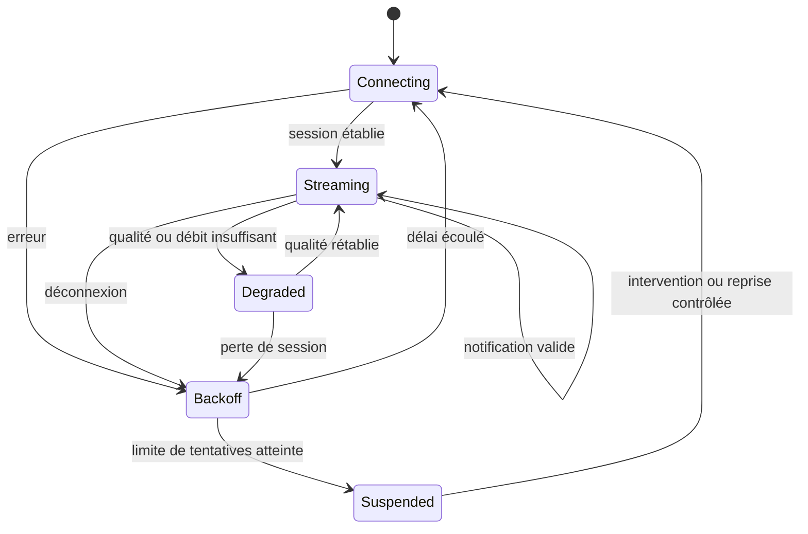

La reprise après interruption demande une règle claire. Certains flux ne garantissent pas la restitution de toutes les valeurs survenues pendant que le collecteur était déconnecté. À la reconnexion, une lecture de l'état courant peut rétablir la situation présente sans reconstruire l'historique manquant. Il faut alors marquer la période comme lacunaire plutôt que fabriquer une continuité. Pour les compteurs, une différence entre deux états peut parfois reconstruire un delta agrégé, mais elle ne restitue pas la distribution temporelle des événements survenus pendant le trou.

### 7. Détecter les pertes sans confondre compteur et identité

Le nombre de messages reçus à lui seul ne démontre pas qu'aucune télémétrie n'a été perdue. Il faut comparer le flux observé à un attendu : nombre de cibles actives, souscriptions, cadence prévue, dernière réception par chemin et indicateur de reconnexion. Lorsque le protocole ou la source permet d'identifier une séquence ou un compteur, ces informations peuvent aider à repérer des discontinuités ; ne supposez toutefois pas qu'un identifiant de message universel existe dans toutes les implémentations.

Une absence de publication doit être interprétée selon le mode de souscription. Sur un chemin configuré pour publier uniquement lors d'un changement, aucune notification pendant une longue période peut être normale. Pour une cadence périodique, le même silence peut indiquer une perte, une session interrompue, un chemin supprimé ou un équipement bloqué. Le détecteur de fraîcheur doit donc connaître le contrat de publication de chaque souscription.

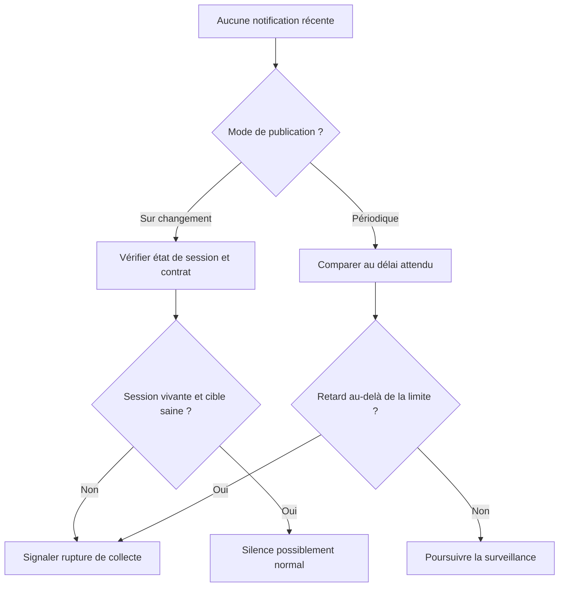

Le taux de couverture peut être défini comme le nombre de fenêtres ou d'échantillons reçus divisé par le nombre attendu, mais il faut expliquer comment la population attendue est calculée. Si un équipement a été volontairement retiré, il ne doit pas continuer à apparaître comme une source censée publier. Si une souscription a échoué, le dénominateur doit montrer ce défaut plutôt que réduire artificiellement l'attendu. Séparez l'état « non applicable », « non souscrit », « souscription en échec », « en retard » et « valeur absente ».

Quand un trou est constaté, enregistrez son intervalle, sa cause connue ou inconnue, les actifs et chemins concernés, le délai de reprise et la stratégie de récupération. L'équipe AIOps peut alors distinguer « valeur normale » de « valeur non disponible ». Cette sémantique est capitale : une série silencieuse ne doit pas être transformée en zéro, et un tableau de bord ne devrait pas tracer une ligne continue si cette continuité masque des échantillons absents.

### 8. Cardinalité, étiquettes et coûts de stockage

La cardinalité est le nombre de combinaisons distinctes de séries produites par les dimensions et étiquettes choisies. Ajouter l'identifiant d'interface, le site, la direction, la classe de service et la souscription peut multiplier le volume de séries. Ajouter un identifiant de session renouvelé à chaque reconnexion peut créer des séries presque uniques et fragmenter l'historique. Les dimensions sont utiles si elles permettent une question opérationnelle ; elles sont coûteuses si elles ne servent à aucune requête, analyse ou politique.

Définissez les étiquettes à partir d'un modèle contrôlé : identifiant stable de l'actif, chemin ou famille de signal, rôle, site et unité lorsque cela est nécessaire. Évitez les valeurs arbitrairement uniques telles que des messages d'erreur libres, des identifiants de requête ou des horodatages bruts dans les étiquettes. Ces attributs peuvent être conservés dans des logs ou dans le corps d'un événement, où ils n'entraînent pas nécessairement la création d'une série distincte à chaque valeur.

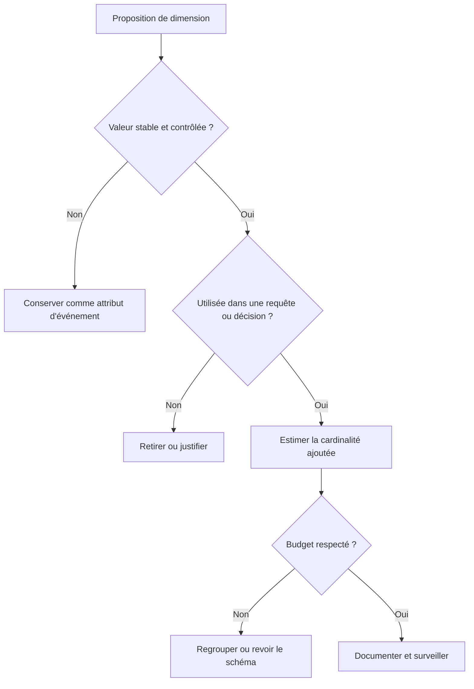

Estimez le coût de stockage avant de généraliser une souscription. Le volume dépend du nombre de séries, de la cadence, de la durée de rétention, de la compression, des index et du nombre de copies. Les événements bruts sont parfois conservés moins longtemps que les agrégats utiles à des tendances plus longues. La stratégie de rétention doit préserver suffisamment d'éléments pour enquêter sur les incidents et reproduire l'évaluation d'un détecteur, sans stocker indéfiniment toutes les données à forte fréquence.

Le filtrage doit être explicite et réversible. On peut agréger certaines mesures fréquentes, réduire la cadence pour les signaux de faible criticité ou conserver les valeurs extrêmes dans des fenêtres compactées. Mais il faut noter le niveau d'agrégation et le caractère incomplet de la donnée. Un consommateur qui ignore qu'il reçoit des moyennes d'une minute ne doit pas les interpréter comme des mesures instantanées. Conservez le contrat de données avec le schéma et la configuration de collecte.

### 9. Observabilité du collecteur lui-même

Un collecteur est un service de production ; son état doit être mesuré avec autant de soin que les équipements qu'il surveille. Les indicateurs utiles incluent le nombre de sessions connectées, le taux d'erreur d'ouverture de session, le nombre de souscriptions actives, le dernier message reçu par souscription, le débit entrant et sortant, le retard, la taille des files, les rejets, la mémoire, le stockage tampon et les durées de reconnexion.

Il faut aussi distinguer les indicateurs de cause et les indicateurs de conséquence. Une file qui croît est un symptôme ; la cause peut être un consommateur ralenti, une base indisponible, une explosion de cardinalité ou une hausse du débit entrant. La mesure du débit de sortie, du temps d'écriture, du nombre de messages invalides et de la pression CPU aide à localiser le goulet. Sans cette instrumentation, l'équipe peut ne voir que les retards en aval et accuser à tort les équipements.

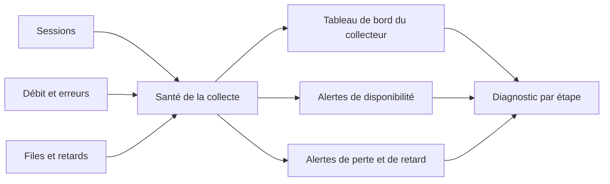

La surveillance doit éviter l'auto-référence infinie. Si chaque erreur d'exportation provoque un événement dans le même canal qui est en panne, l'équipe peut perdre exactement le signal dont elle a besoin. Prévoyez une voie de santé plus simple, des journaux locaux limités et une politique pour les alertes essentielles. Les journaux doivent être bornés, les secrets masqués et les messages répétés regroupés pour ne pas produire une deuxième panne par saturation des logs.

Établissez des objectifs de service pour la chaîne : par exemple la part des souscriptions attendues qui sont actives, la part des mesures qui arrivent dans un délai donné, le taux de valeurs rejetées, la durée de récupération après rupture et la proportion de signaux avec une provenance exploitable. Choisissez les objectifs en fonction du besoin réel et des capacités disponibles. Ils doivent être mesurés régulièrement et associés à une action, et non rester des chiffres décoratifs dans un tableau de bord.

### 10. Protéger le canal et les données

Une session gRPC doit être protégée selon le modèle de sécurité pris en charge par les équipements et les exigences de l'organisation. Vérifiez la validation des certificats, le nom attendu du pair, les dates de validité, la rotation, le stockage des clés privées et le comportement à l'expiration. Désactiver la validation TLS pour « faire marcher le test » transforme un problème de configuration en faiblesse durable si le réglage est conservé en production. Les identifiants ne doivent pas apparaître dans le code, les arguments de commande, les traces ou les rapports.

Les permissions doivent respecter le moindre privilège. Un collecteur en lecture de télémétrie ne devrait pas recevoir par défaut le droit de modifier la configuration des équipements. Séparez les identités par environnement et, lorsque c'est pertinent, par périmètre de confiance. Les comptes, certificats et jetons doivent être renouvelables et révocables sans réécrire tout le code de collecte. Documentez le comportement attendu si les identifiants deviennent invalides : alerte de sécurité, absence de publication et reprise contrôlée, plutôt qu'une tentative de repli vers une connexion non protégée.

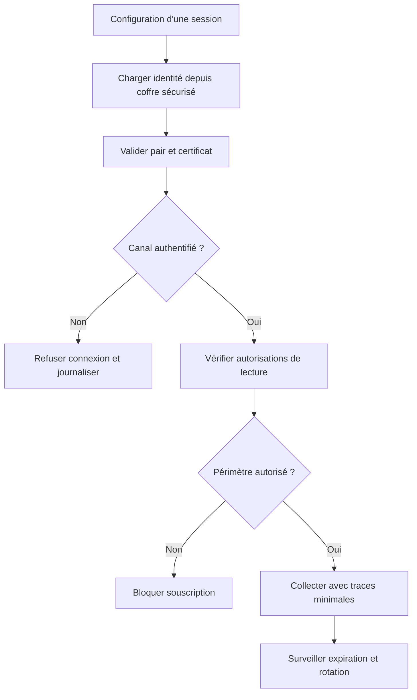

Les événements de télémétrie peuvent révéler des informations sur la topologie, le volume d'activité, les versions logicielles ou certains comportements utilisateurs. Limitez l'accès selon le besoin, définissez une durée de rétention, chiffrer les données selon l'architecture choisie et masquez les attributs sensibles lorsque leur conservation n'est pas nécessaire. Les logs d'erreur doivent éviter de recopier intégralement une configuration ou un message contenant des secrets.

Enfin, traitez la télémétrie comme une donnée d'entrée, non comme une instruction. Un champ ou un nom d'équipement contrôlé par une source externe peut contenir une chaîne inattendue. N'utilisez pas les valeurs d'une notification pour construire une commande shell, une requête non paramétrée ou une URL de gestion sans validation. Les chemins et les clés doivent être analysés selon le schéma attendu, les tailles doivent être limitées et les messages invalides placés en quarantaine.

### 11. Mettre à niveau un schéma de données sans interrompre les consommateurs

La normalisation évolue avec les besoins. Une nouvelle version peut ajouter une unité explicite, renommer un champ, distinguer l'heure de réception de l'heure source ou préciser la qualité d'une mesure. Les producteurs et consommateurs ne seront pas forcément déployés au même instant. Utilisez un schéma versionné, documentez les champs obligatoires et facultatifs et définissez les règles de compatibilité.

Privilégiez l'ajout de champs facultatifs ou une période de transition lorsque cela permet aux anciens consommateurs de continuer à fonctionner. Si un champ change de sémantique, son nom seul ne suffit pas à signaler la modification : ajoutez une version ou un nouveau champ, puis migrez progressivement. Évitez de remplacer silencieusement des secondes par des millisecondes, ou une valeur en octets par une valeur en bits, tout en gardant le même nom. Ces changements peuvent produire des anomalies à grande échelle, difficiles à distinguer d'une évolution réelle de l'infrastructure.

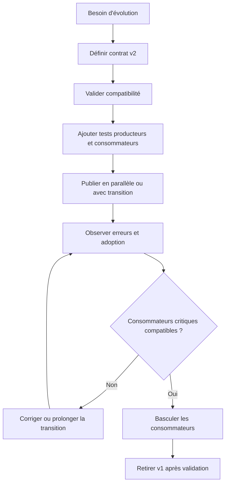

Les tests de contrat doivent inclure des messages normaux, des champs optionnels absents, des types inattendus, des chemins inconnus et des horodatages invalides. Un consommateur devrait échouer de façon contrôlée lorsque le schéma est incompatible, avec une erreur visible et une mise en quarantaine, plutôt que d'émettre des valeurs arbitraires. Pour les nouvelles unités, incluez des tests qui vérifient les conversions et évitent les multiplications ou divisions répétées à chaque étage.

Un schéma canonique ne doit pas essayer de tout uniformiser au prix de l'information. Conservez suffisamment de détails source pour permettre de comprendre les particularités d'un équipement ou de retrouver une notification d'origine. Il peut être utile de publier un modèle commun pour les requêtes de base et d'avoir un champ d'extensions contrôlées pour les attributs spécifiques. Chaque extension doit cependant être documentée et sa cardinalité surveillée afin que les exceptions n'envahissent pas le contrat général.

### 12. Tests de charge, de panne et de reprise

Un collecteur qui fonctionne pendant cinq minutes en laboratoire n'a pas démontré sa fiabilité en charge. Simulez plusieurs dizaines ou centaines de sessions selon la taille visée, un débit variable, des messages de taille différente, des indisponibilités du stockage et des reconnectages simultanés. Mesurez la latence de bout en bout, la mémoire maximale, la profondeur des files, les erreurs, les pertes et le temps de retour à un état stable.

Les tests doivent inclure une panne de dépendance et non seulement un arrêt propre. Le stockage peut ralentir avant de devenir indisponible ; les certificats peuvent expirer ; le DNS peut être temporairement inaccessible ; un seul équipement peut envoyer des notifications invalides ; le réseau de gestion peut se partitionner. Pour chaque scénario, vérifiez si le collecteur continue à traiter les autres équipements, si les files sont bornées et si les alertes de santé apparaissent par une voie encore disponible.

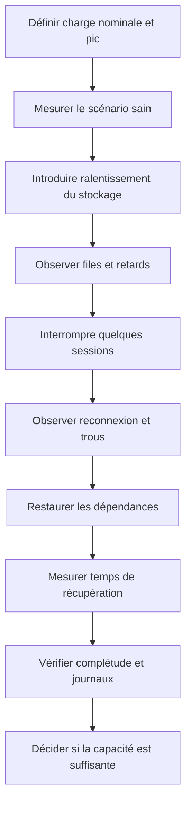

Évitez les essais sur l'infrastructure de production sans autorisation explicite et sans périmètre contrôlé. Le test de charge doit être réalisé sur un banc, une simulation ou un environnement autorisé. Si des mesures réelles sont nécessaires, préparez la durée, les limites, le propriétaire, l'arrêt immédiat et la procédure de retour arrière. Un test qui sature le canal d'administration est lui-même un changement risqué.

Le rapport de test doit contenir le scénario, la version du collecteur, les paramètres, le volume offert, la distribution des tailles, la durée, les erreurs observées, le niveau maximal des files, les pertes et les conditions de réussite. Un résultat sans environnement ni configuration ne se reproduit pas. Gardez les données de test séparées des observations de production pour éviter qu'elles alimentent par erreur les baselines et les détecteurs.

### 13. Exemple de configuration et de pseudo-code défensif

Une configuration de souscription devrait décrire l'objectif, l'actif, le chemin, le mode, l'intervalle éventuel, la priorité, le délai attendu, la règle de qualité et la politique de reprise. Les valeurs ci-dessous sont illustratives et doivent être adaptées à la capacité annoncée par l'équipement. La présence d'une configuration valide côté collecteur ne garantit pas que le serveur gNMI accepte tous les paramètres.

```yaml
subscription:
  id: wan-interface-counters
  target: router-site-a
  paths:
    - path: /interfaces/interface/state/counters
      purpose: "Suivre l'utilisation et les erreurs des interfaces"
      expected_unit: "compteur selon le champ"
  mode: STREAM
  sample_interval_ms: 10000
  priority: critical
  expected_freshness_seconds: 35
  quality_policy:
    reject_invalid_types: true
    preserve_source_timestamp: true
    distinguish_missing_from_zero: true
  recovery:
    exponential_backoff: true
    max_attempts_before_alarm: 8
    never_disable_tls_verification: true
```

Le collecteur devrait valider la configuration avant d'ouvrir des sessions. Vérifiez que l'identifiant est unique, que le chemin est non vide, que l'intervalle est compatible avec les limites locales, que le profil cible existe et que les champs obligatoires sont renseignés. Une configuration invalide devrait être rejetée au démarrage avec un diagnostic précis. La modifier implicitement pour « trouver quelque chose qui marche » masque la cause et rend les environnements différents.

```python
from dataclasses import dataclass
from typing import Optional


@dataclass(frozen=True)
class TelemetrySample:
    target: str
    path: str
    source_timestamp_ns: Optional[int]
    received_timestamp_ns: int
    value: object
    unit: Optional[str]


def validate_sample(sample: TelemetrySample) -> list[str]:
    errors = []
    if not sample.target.strip():
        errors.append("target_missing")
    if not sample.path.startswith("/"):
        errors.append("path_not_absolute")
    if sample.received_timestamp_ns <= 0:
        errors.append("received_timestamp_invalid")
    if sample.source_timestamp_ns is not None and sample.source_timestamp_ns <= 0:
        errors.append("source_timestamp_invalid")
    if sample.value is None:
        errors.append("value_missing")
    return errors
```

Ce fragment illustre uniquement une validation de forme. Il ne vérifie pas que l'horloge source est synchronisée, que le chemin est pris en charge, que l'unité correspond au signal ou que la valeur est physiquement plausible. Ces contrôles ont besoin d'un registre de capacités, d'un schéma ou de règles métier. Préservez la distinction entre invalidité structurelle et valeur simplement inhabituelle : une valeur extrême peut être l'information que l'on cherche, tandis qu'une chaîne dans un champ numérique peut être une erreur de schéma.

La validation doit être testée avec des cas représentatifs et ne doit pas interrompre le traitement de toutes les sessions lorsqu'un seul message est mauvais. Selon la criticité, rejetez l'événement, placez-le en quarantaine et augmentez un compteur d'erreur. Les files de quarantaine doivent elles-mêmes être bornées et protégées ; sinon, un équipement malformé peut épuiser le stockage. Le rapport d'erreurs doit préserver une référence d'origine et un motif, tout en évitant d'exposer des données sensibles.

### 14. Organiser un laboratoire reproductible

Le laboratoire doit isoler chaque problème. Commencez avec un équipement de test ou un simulateur qui supporte les chemins nécessaires, puis ajoutez progressivement une seconde source, un transport et un consommateur. Capturez une baseline connue avant de provoquer des erreurs. Chaque expérience doit préciser la condition initiale, le changement réalisé, le résultat attendu et les éléments qui serviront de preuve.

Première expérience : validez les capacités et ouvrez une souscription courte sur quelques chemins. Deuxième expérience : augmentez progressivement le nombre de chemins et estimez le débit. Troisième expérience : ralentissez le consommateur et observez la file. Quatrième expérience : interrompez la session et contrôlez les délais de reconnexion. Cinquième expérience : simulez des valeurs invalides ou des horodatages manquants. Sixième expérience : vérifiez qu'une panne de stockage ne conduit ni à une croissance infinie des files ni à une perte silencieuse.

```mermaid
flowchart LR
    A["Profil de test figé"] --> B["Capacités et souscription"]
    B --> C["Flux nominal mesuré"]
    C --> D["Charge plus élevée"]
    D --> E["Consommateur ralenti"]
    E --> F["Interruption de session"]
    F --> G["Données invalides"]
    G --> H["Récupération contrôlée"]
    H --> I["Rapport et décision"]
```

Pour le scénario de saturation, vérifiez simultanément quatre grandeurs : débit entrant, débit sortant, profondeur de file et durée d'attente. La profondeur seule peut être trompeuse : une file importante qui se vide régulièrement peut être moins risquée qu'une petite file dont la progression est constante. Calculez approximativement le temps de vidage après le rétablissement, et observez si la reprise ajoute une charge qui retarde les données nouvelles. Un collecteur peut avoir besoin de limiter le rejeu pour réserver une capacité minimale au flux courant.

Pour l'interruption, capturez les dernières heures source avant la panne, le moment où la session est reconnue comme perdue, le début de la reconnexion, le premier message reçu après reprise et l'état réconcilié. Déterminez si les valeurs manquantes peuvent être reconstituées ou si elles doivent être signalées comme un trou. Documentez aussi ce que voit l'utilisateur dans le tableau de bord : une interruption ne doit pas apparaître comme une valeur stable lorsque la source est silencieuse.

À la fin du laboratoire, le rapport doit permettre à un autre ingénieur de reproduire l'expérience. Gardez les paramètres, les profils de capacité, les versions, les résultats et les écarts. Ne présentez pas une réussite obtenue sur deux actifs comme une preuve de capacité pour des milliers de sessions. Expliquez quelle partie a été testée, ce qui demeure inconnu et quelle étape supplémentaire est nécessaire avant un déploiement plus large.

### 15. Incidents fréquents et arbre de diagnostic

Un flux absent peut venir d'un échec d'authentification, d'un chemin non pris en charge, d'une souscription mal formée, d'un mode de publication incorrect, d'une session établie mais jamais alimentée, d'un filtre du collecteur ou d'un consommateur qui ne lit plus la file. La première question doit porter sur le dernier point de la chaîne où une preuve de présence existe. Ne modifiez pas au hasard plusieurs paramètres en espérant faire réapparaître des données.

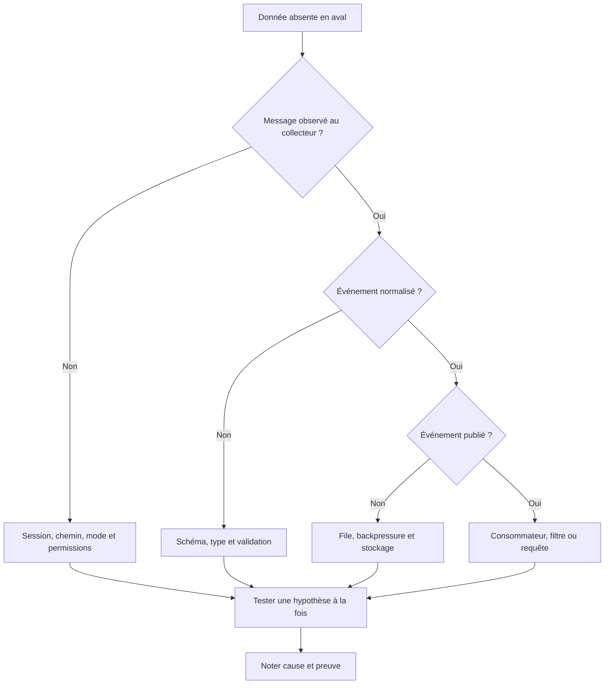

Si les valeurs arrivent mais semblent incorrectes, vérifiez d'abord l'unité, la sémantique du compteur, les horodatages et le chemin complet. Une valeur très grande peut être un compteur cumulatif et non un taux instantané ; un taux doit être calculé à partir de différences et de temps écoulé, avec une gestion explicite des redémarrages et des remises à zéro. Ne comparez pas des mesures exprimées dans des unités différentes sous une même étiquette.

Si les sessions se réinitialisent fréquemment, examinez les logs de transport, le temps d'attente, les limites du serveur, l'authentification, le réseau d'administration et les paramètres de keepalive pris en charge. Évitez d'augmenter sans justification les délais de timeout : cela peut cacher une panne prolongée. Les délais et les tentatives doivent être compatibles avec l'objectif de fraîcheur et avec la capacité de l'équipement.

Si la télémétrie est en retard, identifiez la première étape où la durée s'accumule. Une heure source décalée peut simuler une forte latence ; un consommateur en retard ne signifie pas que l'équipement a publié lentement. Comparez les horodatages disponibles, la progression des files et les latences par étape. Un tableau de bord qui ne montre que « retard total » ne facilite pas la localisation de la cause.

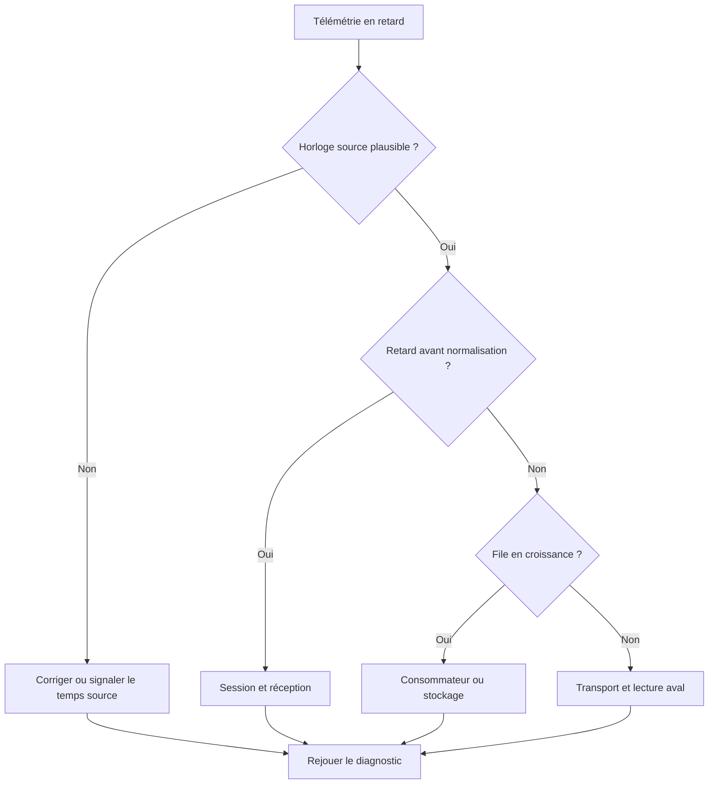

### 16. Gouvernance opérationnelle et critères de mise en production

Le passage en production doit être conditionné par des critères explicites. La collecte doit réussir sur les modèles et versions ciblés ; les chemins essentiels doivent être disponibles ; la qualité, la fraîcheur et le débit doivent être mesurés ; la sécurité des sessions doit être vérifiée ; les pannes et reprises doivent avoir été testées ; les coûts et la rétention doivent rester dans le budget. Les responsables doivent accepter les limites connues, notamment les types de données qui peuvent être perdus lors d'une interruption.

Le déploiement progressif limite l'impact des erreurs. Commencez par un groupe pilote, comparez le débit attendu et observé, mesurez les erreurs et examinez les données au niveau des consommateurs. Ajoutez ensuite de nouvelles familles d'actifs. Chaque étape doit avoir un critère de passage ou un motif de retour arrière. Une montée en charge réussie doit aussi vérifier que les équipements eux-mêmes ne subissent pas une pression excessive sur le plan d'administration.

```mermaid
flowchart TD
    A["Prêt en laboratoire"] --> B["Pilote sur périmètre limité"]
    B --> C["Comparer objectifs et mesures"]
    C --> D{"Qualité, sécurité et charge acceptables ?"}
    D -- "Non" --> E["Arrêter l'extension et corriger"]
    E --> B
    D -- "Oui" --> F["Étendre par groupe contrôlé"]
    F --> G["Contrôle après chaque étape"]
    G --> H{"Régression détectée ?"}
    H -- "Oui" --> I["Revenir à la version précédente"]
    H -- "Non" --> J["Documenter la mise en service"]
```

Établissez un propriétaire pour le profil de collecte, la configuration de souscription, le schéma canonique, les alertes du collecteur, la rétention et les comptes techniques. La responsabilité doit être claire même lorsque plusieurs équipes interviennent. Une modification de cadence peut augmenter le coût de stockage ; une modification de schéma peut casser un moteur AIOps ; une rotation de certificat peut interrompre des milliers de sessions. Chaque changement doit être testé au niveau des systèmes qui en dépendent.

La procédure d'exploitation doit inclure le diagnostic d'une session en échec, le retrait temporaire d'un équipement, le remplacement d'un certificat, la récupération après indisponibilité du transport et la validation de l'intégrité des séries après reprise. Les procédures doivent expliquer comment constater le retour à la normale, non seulement comment redémarrer un service. Le redémarrage peut rétablir une session sans réparer le problème de fond ; surveillez les indicateurs après l'intervention et conservez les preuves pour analyse.

### 17. Projet de synthèse et critères d'acceptation

Le projet consiste à proposer un collecteur qui suit un groupe défini d'équipements, publie un ensemble réduit de mesures utiles et permet d'observer sa propre santé. Le dossier doit contenir un inventaire de capacités, le contrat de données, les chemins retenus et leur justification, le mode de souscription, le budget de débit, la stratégie de reprise, la politique des files, les indicateurs de qualité et les limites de stockage.

Le résultat doit comprendre un schéma de flux, un extrait de configuration, une validation des événements, un tableau d'indicateurs du collecteur, les scénarios de test et un rapport de qualité. Une capture d'écran seule ne suffit pas. Le rapport doit expliquer les preuves et les limites de ce qui a été observé, avec une distinction entre un test réussi, une hypothèse plausible et un comportement qui n'a pas pu être testé.

```mermaid
flowchart TD
    A["Définir le périmètre et les objectifs"] --> B["Interroger les capacités"]
    B --> C["Sélectionner chemins et fréquence"]
    C --> D["Normaliser et valider"]
    D --> E["Mesurer débit, retard et couverture"]
    E --> F["Tester backpressure et reconnexion"]
    F --> G["Vérifier sécurité et rétention"]
    G --> H["Produire le dossier de preuves"]
    H --> I{"Critères d'acceptation satisfaits ?"}
    I -- "Non" --> J["Corriger ou réduire le périmètre"]
    J --> C
    I -- "Oui" --> K["Pilote limité et surveillé"]
```

Les critères d'acceptation doivent décrire une limite mesurable plutôt que « cela fonctionne ». Exemples : la proportion minimale de souscriptions attendues qui restent actives, la proportion d'événements reçus dans le délai cible, l'absence de croissance infinie des files sous charge définie, la durée maximale acceptable de reprise, la traçabilité des trous de données et la confirmation que les certificats invalides bloquent la connexion. Les valeurs exactes doivent dépendre de la criticité et des capacités observées.

Un projet réussi ne promet pas que chaque valeur sera toujours disponible. Il garantit plutôt que la disponibilité, la fraîcheur, les limites et l'incertitude sont mesurables ; que les trous ne sont pas maquillés ; que les erreurs se diagnostiquent ; que les accès sont limités ; et que les consommateurs AIOps savent distinguer les observations normales des états indéterminés. Une bonne chaîne ne masque pas ses défauts : elle les rend visibles suffisamment tôt pour que l'équipe puisse agir.

### Grille d'autoévaluation de l'atelier

- [ ] Les capacités de chaque profil d'équipement sont vérifiées avant le déploiement.
- [ ] Les modes, chemins, fréquences et budgets de collecte ont une justification.
- [ ] La normalisation préserve cible, chemin, type, unité, provenance et horodatages.
- [ ] Les valeurs absentes, nulles, supprimées et invalides sont distinguées.
- [ ] La latence source, collecteur, transport et consommateur peut être mesurée séparément.
- [ ] Les files sont bornées et la stratégie de saturation est explicite.
- [ ] Les reconnexions sont progressives, observées et testées.
- [ ] Les trous de données et les limites de récupération sont documentés.
- [ ] La cardinalité, le stockage et la rétention sont budgétés.
- [ ] Le collecteur expose ses sessions, erreurs, files, retards et pertes.
- [ ] Les certificats, identités et permissions respectent le moindre privilège.
- [ ] Le contrat de données est versionné et les migrations sont testées.
- [ ] La charge, les pannes et le retour à la normale ont été exercés en environnement autorisé.
- [ ] Le mode observation et les critères de retour arrière sont disponibles.
- [ ] Les consommateurs AIOps reçoivent des indicateurs explicites de qualité.

## Défi final corrigé — construire un collecteur de télémétrie exploitable

### Énoncé

Un polling périodique ne voit pas des microcongestions de quelques secondes. Mets en place une collecte continue des compteurs d'interface, avec gNMI Subscribe, contrôle de qualité, stockage horodaté et alerte sur variation persistante. Le collecteur doit détecter les ruptures de flux, les timestamps invalides et les réinitialisations de compteurs.

### Parcours des données

```mermaid
sequenceDiagram
  participant D as Équipement gNMI
  participant C as Collecteur
  participant Q as Contrôle qualité
  participant TS as Stockage temporel
  participant A as Détection
  D-->>C: Subscribe et updates
  C->>Q: Valeur, chemin, timestamp, qualité
  Q-->>C: Accepter, marquer ou rejeter
  C->>TS: Écrire donnée normalisée
  TS->>A: Fenêtre de données récentes
  A->>A: Comparer baseline, débit et pertes
  A-->>C: Événement avec preuves
```

### Exemple de modèle d'événement normalisé

```python
from datetime import datetime, timezone

def normalize_update(device, path, value, source_timestamp):
    ts = datetime.fromtimestamp(
        source_timestamp / 1_000_000_000,
        tz=timezone.utc,
    )
    return {
        "device": device,
        "path": path,
        "value": value,
        "timestamp": ts.isoformat(),
        "received_at": datetime.now(timezone.utc).isoformat(),
        "quality": "valid" if value is not None else "missing",
    }
```

Le convertisseur doit respecter l'unité de temps documentée par le client et le format exact des notifications gNMI utilisées. Les champs timestamp et received_at sont distincts : le premier décrit l'heure de mesure, le second l'heure d'arrivée au collecteur. Cette différence aide à repérer la latence de transport et les données tardives.

### Proposition de correction

Déclare les chemins d'abonnement, le mode de souscription, la fréquence ou la politique d'échantillonnage, les limites de buffer et la stratégie de reconnexion. Les modes gNMI ONCE, POLL et STREAM ne répondent pas au même besoin. Une souscription continue réduit le délai de détection, mais elle exige de contrôler le débit de messages, les files, les reconnexions et la perte d'événements.

Normalise les unités, associe chaque valeur à l'équipement et au chemin YANG, conserve l'horodatage source et identifie les redémarrages qui remettent un compteur à zéro. Ne calcule pas un débit en divisant une différence de compteur par une durée si le compteur a décru ou si les horodatages ne sont pas valides. Dans ce cas, marque l'intervalle comme incomplet et ne crée pas une valeur plausible artificielle.

La détection s'appuie sur des fenêtres et des règles adaptées aux métriques. Toute alerte contient la série concernée, la période, la qualité, la baseline et le seuil déclenché. Simule une coupure de session gNMI, une valeur manquante, un timestamp en retard et un reboot d'équipement. Le système doit reprendre la collecte et signaler les trous sans les présenter comme des périodes saines.

### Barème d'autoévaluation

- Le choix entre STREAM, POLL et ONCE est justifié.
- Les horodatages mesure/réception restent distincts.
- Les réinitialisations de compteurs et trous de collecte sont détectés.
- Le collecteur reconnait les données tardives et reprend après coupure.
- Les alertes sont traçables jusqu'aux chemins et valeurs sources.

## 11. Checklist et à retenir

- [ ] L'objectif métier et le service sont écrits et mesurables.
- [ ] Chaque observation conserve provenance, heure, unité et qualité.
- [ ] La méthode est comparée à une baseline.
- [ ] Les tests incluent données manquantes et échecs de dépendance.
- [ ] Les résultats sont segmentés par criticité et type de cible.
- [ ] Les droits sont minimaux et les secrets absents des logs.
- [ ] La décision relie preuves, version, approbation et résultat.
- [ ] Toute action risquée a préconditions, périmètre et rollback.
- [ ] Les indicateurs mesurent le service, pas seulement le modèle.
- [ ] La procédure couvre abstention, escalade, suspension et revue.

### À retenir
Le but de Streaming Telemetry (gNMI, gRPC) n'est pas d'automatiser toutes les décisions, mais de rendre l'exploitation plus rapide, cohérente et vérifiable. Une solution utile s'appuie sur des données explicites, une technique adaptée, une évaluation honnête et des postconditions mesurées. Elle sait signaler ses limites, bloquer une action risquée et transmettre les preuves qui permettent à une autre personne de reprendre l'analyse.

Les mesures possibles comprennent latence de bout en bout, débit d'événements, reconnexions et messages invalides, pertes de données, profondeur de file et délai de consommation. Chacune doit être associée à un objectif, un responsable et une action lorsque la limite est dépassée. Le nombre de modèles ou d'alertes traitées ne prouve pas la valeur opérationnelle. Il faut confirmer ou réfuter les hypothèses avec les résultats, documenter les erreurs et améliorer les tests. concevoir une collecte en flux qui respecte les capacités, la qualité, les limites de débit et la sécurité Le maintien dans le temps exige de réviser les sources, vérifier la reprise et retirer une méthode dont les limites dépassent le bénéfice.

## 12. Références

- https://openconfig.net/rpc/
- https://github.com/openconfig/reference/blob/master/rpc/gnmi/gnmi-specification.md
- https://opentelemetry.io/docs/
- https://opentelemetry.io/docs/ — concepts d'observabilité et de télémétrie.
- https://www.nist.gov/itl/ai-risk-management-framework — cadre de gestion des risques de l'IA.
