# Outils (Ansible, Nornir) — Débutant

> **Mise en contexte :** ce cours étudie le problème suivant : une équipe gère plusieurs familles d'équipements ; les commandes manuelles sont peu reproductibles et l'inventaire contient parfois des données obsolètes. L'objectif est d'améliorer les opérations de manière mesurable, vérifiable et proportionnée au risque. Les exemples doivent être adaptés et testés en laboratoire avant toute utilisation sur une infrastructure réelle.

## Sommaire

1. Introduction et objectifs
2. Concepts clés
3. Architecture de référence
4. Pipeline et algorithmes
5. Étude de cas
6. Implémentation guidée et laboratoire
7. Sécurité et gouvernance
8. Pièges à éviter
9. Diagnostic et dépannage
10. Exercices corrigés
11. Checklist et à retenir
12. Références

## 1. Introduction et objectifs

L'AIOps applique l'analyse de données et l'automatisation aux opérations informatiques afin de rendre la détection, le diagnostic et la résolution plus cohérents. Pour **Outils (Ansible, Nornir)**, l'enjeu est de structurer un dépôt de gestion de réseau avec ansible, nornir, inventaires et tests.. Le besoin est concret : les équipes doivent agir rapidement, mais les observations peuvent être contradictoires, les horloges décalées et les interventions porteuses de risques. La solution doit ainsi distinguer un signal, une hypothèse, une décision et une preuve de résultat.

Le scénario de départ est : une équipe gère plusieurs familles d'équipements ; les commandes manuelles sont peu reproductibles et l'inventaire contient parfois des données obsolètes. Il illustre que des outils techniquement capables ne suffisent pas. La qualité dépend de données fiables, d'une question mesurable, d'une référence de comparaison et d'une procédure de reprise. Le système doit savoir reconnaître une donnée absente, exposer ses limites et demander de l'aide. L'automatisation n'est pas un objectif en soi : elle est justifiée uniquement si elle améliore un résultat opérationnel sans déplacer le risque vers les utilisateurs ou l'équipe d'astreinte.

Les outils possibles comprennent Ansible, Nornir, Netmiko, Git, inventaires, Vault. Ils ne doivent pas tous être déployés dans le même projet. Chaque composant doit répondre à un besoin identifié et avoir un propriétaire. Une architecture réduite, testée et bien observée est préférable à un assemblage complexe dont personne ne peut expliquer les erreurs. La première version peut rester en lecture seule ; l'autorité d'agir se développe seulement après des essais reproductibles, une mesure des erreurs et une validation de la procédure de retour arrière.

### Objectifs pédagogiques
- Décrire les concepts principaux et leurs limites.
- Définir les sources de données, la qualité attendue et les propriétaires.
- Décrire le chemin entre observation, analyse, décision, action et vérification.
- Mesurer les erreurs et comparer la solution à une baseline.
- Protéger les accès et documenter une stratégie d'escalade et de reprise.

### Vocabulaire opérationnel
Une **observation** est une mesure ou un événement provenant d'une source identifiée. Un **signal** est une interprétation d'observations dans un contexte. Une **hypothèse** est une explication testable. Une **décision** sélectionne une action ou une abstention. Une **postcondition** est un état vérifiable qui doit être vrai après une intervention. Ces mots ne sont pas interchangeables. Une alerte n'est pas automatiquement un incident confirmé, un score ne constitue pas une preuve de cause racine et l'exécution d'une commande ne prouve pas que le service est rétabli.

## 2. Concepts clés

### 1. Inventaire

L'inventaire décrit cibles, groupes, plateformes, variables et propriétaires ; il doit être vérifié et versionné.

Sur le terrain, Inventaire doit être relié à une question opérationnelle et à une décision possible. L'inventaire décrit cibles, groupes, plateformes, variables et propriétaires ; il doit être vérifié et versionné. Il faut nommer la source de vérité, le propriétaire, la fréquence de mise à jour et le périmètre d'utilisation avant d'automatiser. Pour le scénario « une équipe gère plusieurs familles d'équipements ; les commandes manuelles sont peu reproductibles et l'inventaire contient parfois des données obsolètes », cette précision empêche de transformer une intuition en commande. Elle permet aussi de définir quand il faut s'abstenir, demander davantage de données ou transmettre le dossier à une personne responsable.

La mise en œuvre de Inventaire gagne à être découpée en contrôles testables. Vérifier d'abord le format et la provenance des entrées, puis les hypothèses, les valeurs manquantes et les versions. L'outil Ansible peut contribuer à cette étape, mais sa présence ne garantit pas la qualité. Les erreurs doivent rester explicites au lieu d'être converties silencieusement en valeurs par défaut. Une exécution fiable sait différencier une réussite, un échec, un résultat partiel et un état impossible à déterminer.

L'évaluation de Inventaire doit inclure les cas courants, les cas limites et les exemples difficiles. La mesure doit inclure taux de réussite par plateforme, tout en examinant les différences selon la criticité et le type de cible. Un score moyen peut masquer une défaillance rare mais coûteuse ; il faut donc conserver des exemples concrets, mesurer faux positifs et faux négatifs et expliquer le coût de chaque erreur. Après une évolution de données, de code ou de modèle, les mêmes tests doivent être rejoués pour vérifier que le comportement attendu persiste.

Aucune technique associée à Inventaire n'est universellement préférable. Une règle peut être plus explicable, un modèle peut capter davantage de variables, et un système génératif peut accélérer la synthèse sans garantir la vérité. Le choix doit tenir compte des données, de la latence, du coût d'erreur, de l'explicabilité et de la maintenance. La baseline et le mode manuel doivent rester disponibles pour les périodes où les observations sont incomplètes ou que le système n'a plus la qualité attendue.

### 2. Ansible

Ansible exécute des playbooks et modules ; sur le réseau, collections et plugins de connexion doivent correspondre à la plateforme.

Sur le terrain, Ansible doit être relié à une question opérationnelle et à une décision possible. Ansible exécute des playbooks et modules ; sur le réseau, collections et plugins de connexion doivent correspondre à la plateforme. Il faut nommer la source de vérité, le propriétaire, la fréquence de mise à jour et le périmètre d'utilisation avant d'automatiser. Pour le scénario « une équipe gère plusieurs familles d'équipements ; les commandes manuelles sont peu reproductibles et l'inventaire contient parfois des données obsolètes », cette précision empêche de transformer une intuition en commande. Elle permet aussi de définir quand il faut s'abstenir, demander davantage de données ou transmettre le dossier à une personne responsable.

La mise en œuvre de Ansible gagne à être découpée en contrôles testables. Vérifier d'abord le format et la provenance des entrées, puis les hypothèses, les valeurs manquantes et les versions. L'outil Nornir peut contribuer à cette étape, mais sa présence ne garantit pas la qualité. Les erreurs doivent rester explicites au lieu d'être converties silencieusement en valeurs par défaut. Une exécution fiable sait différencier une réussite, un échec, un résultat partiel et un état impossible à déterminer.

L'évaluation de Ansible doit inclure les cas courants, les cas limites et les exemples difficiles. La mesure doit inclure échecs de connexion, tout en examinant les différences selon la criticité et le type de cible. Un score moyen peut masquer une défaillance rare mais coûteuse ; il faut donc conserver des exemples concrets, mesurer faux positifs et faux négatifs et expliquer le coût de chaque erreur. Après une évolution de données, de code ou de modèle, les mêmes tests doivent être rejoués pour vérifier que le comportement attendu persiste.

### 3. Nornir

Nornir est un cadre Python orienté inventaire et tâches, utile pour composer des fonctions et borner la concurrence.

Sur le terrain, Nornir doit être relié à une question opérationnelle et à une décision possible. Nornir est un cadre Python orienté inventaire et tâches, utile pour composer des fonctions et borner la concurrence. Il faut nommer la source de vérité, le propriétaire, la fréquence de mise à jour et le périmètre d'utilisation avant d'automatiser. Pour le scénario « une équipe gère plusieurs familles d'équipements ; les commandes manuelles sont peu reproductibles et l'inventaire contient parfois des données obsolètes », cette précision empêche de transformer une intuition en commande. Elle permet aussi de définir quand il faut s'abstenir, demander davantage de données ou transmettre le dossier à une personne responsable.

La mise en œuvre de Nornir gagne à être découpée en contrôles testables. Vérifier d'abord le format et la provenance des entrées, puis les hypothèses, les valeurs manquantes et les versions. L'outil Netmiko peut contribuer à cette étape, mais sa présence ne garantit pas la qualité. Les erreurs doivent rester explicites au lieu d'être converties silencieusement en valeurs par défaut. Une exécution fiable sait différencier une réussite, un échec, un résultat partiel et un état impossible à déterminer.

L'évaluation de Nornir doit inclure les cas courants, les cas limites et les exemples difficiles. La mesure doit inclure durée par cible, tout en examinant les différences selon la criticité et le type de cible. Un score moyen peut masquer une défaillance rare mais coûteuse ; il faut donc conserver des exemples concrets, mesurer faux positifs et faux négatifs et expliquer le coût de chaque erreur. Après une évolution de données, de code ou de modèle, les mêmes tests doivent être rejoués pour vérifier que le comportement attendu persiste.

### 4. Idempotence

Une tâche idempotente converge vers l'état cible sans répéter un effet si l'état est déjà correct.

Sur le terrain, Idempotence doit être relié à une question opérationnelle et à une décision possible. Une tâche idempotente converge vers l'état cible sans répéter un effet si l'état est déjà correct. Il faut nommer la source de vérité, le propriétaire, la fréquence de mise à jour et le périmètre d'utilisation avant d'automatiser. Pour le scénario « une équipe gère plusieurs familles d'équipements ; les commandes manuelles sont peu reproductibles et l'inventaire contient parfois des données obsolètes », cette précision empêche de transformer une intuition en commande. Elle permet aussi de définir quand il faut s'abstenir, demander davantage de données ou transmettre le dossier à une personne responsable.

La mise en œuvre de Idempotence gagne à être découpée en contrôles testables. Vérifier d'abord le format et la provenance des entrées, puis les hypothèses, les valeurs manquantes et les versions. L'outil Git peut contribuer à cette étape, mais sa présence ne garantit pas la qualité. Les erreurs doivent rester explicites au lieu d'être converties silencieusement en valeurs par défaut. Une exécution fiable sait différencier une réussite, un échec, un résultat partiel et un état impossible à déterminer.

L'évaluation de Idempotence doit inclure les cas courants, les cas limites et les exemples difficiles. La mesure doit inclure écarts post-déploiement, tout en examinant les différences selon la criticité et le type de cible. Un score moyen peut masquer une défaillance rare mais coûteuse ; il faut donc conserver des exemples concrets, mesurer faux positifs et faux négatifs et expliquer le coût de chaque erreur. Après une évolution de données, de code ou de modèle, les mêmes tests doivent être rejoués pour vérifier que le comportement attendu persiste.

Aucune technique associée à Idempotence n'est universellement préférable. Une règle peut être plus explicable, un modèle peut capter davantage de variables, et un système génératif peut accélérer la synthèse sans garantir la vérité. Le choix doit tenir compte des données, de la latence, du coût d'erreur, de l'explicabilité et de la maintenance. La baseline et le mode manuel doivent rester disponibles pour les périodes où les observations sont incomplètes ou que le système n'a plus la qualité attendue.

### 5. Concurrence

La parallélisation accélère l'exécution mais peut surcharger équipements, serveurs d'authentification et liens.

Sur le terrain, Concurrence doit être relié à une question opérationnelle et à une décision possible. La parallélisation accélère l'exécution mais peut surcharger équipements, serveurs d'authentification et liens. Il faut nommer la source de vérité, le propriétaire, la fréquence de mise à jour et le périmètre d'utilisation avant d'automatiser. Pour le scénario « une équipe gère plusieurs familles d'équipements ; les commandes manuelles sont peu reproductibles et l'inventaire contient parfois des données obsolètes », cette précision empêche de transformer une intuition en commande. Elle permet aussi de définir quand il faut s'abstenir, demander davantage de données ou transmettre le dossier à une personne responsable.

La mise en œuvre de Concurrence gagne à être découpée en contrôles testables. Vérifier d'abord le format et la provenance des entrées, puis les hypothèses, les valeurs manquantes et les versions. L'outil inventaires peut contribuer à cette étape, mais sa présence ne garantit pas la qualité. Les erreurs doivent rester explicites au lieu d'être converties silencieusement en valeurs par défaut. Une exécution fiable sait différencier une réussite, un échec, un résultat partiel et un état impossible à déterminer.

L'évaluation de Concurrence doit inclure les cas courants, les cas limites et les exemples difficiles. La mesure doit inclure rollbacks par changement, tout en examinant les différences selon la criticité et le type de cible. Un score moyen peut masquer une défaillance rare mais coûteuse ; il faut donc conserver des exemples concrets, mesurer faux positifs et faux négatifs et expliquer le coût de chaque erreur. Après une évolution de données, de code ou de modèle, les mêmes tests doivent être rejoués pour vérifier que le comportement attendu persiste.

### 6. Secrets

Les credentials doivent provenir d'un stockage protégé et être limités en portée.

Sur le terrain, Secrets doit être relié à une question opérationnelle et à une décision possible. Les credentials doivent provenir d'un stockage protégé et être limités en portée. Il faut nommer la source de vérité, le propriétaire, la fréquence de mise à jour et le périmètre d'utilisation avant d'automatiser. Pour le scénario « une équipe gère plusieurs familles d'équipements ; les commandes manuelles sont peu reproductibles et l'inventaire contient parfois des données obsolètes », cette précision empêche de transformer une intuition en commande. Elle permet aussi de définir quand il faut s'abstenir, demander davantage de données ou transmettre le dossier à une personne responsable.

La mise en œuvre de Secrets gagne à être découpée en contrôles testables. Vérifier d'abord le format et la provenance des entrées, puis les hypothèses, les valeurs manquantes et les versions. L'outil Vault peut contribuer à cette étape, mais sa présence ne garantit pas la qualité. Les erreurs doivent rester explicites au lieu d'être converties silencieusement en valeurs par défaut. Une exécution fiable sait différencier une réussite, un échec, un résultat partiel et un état impossible à déterminer.

L'évaluation de Secrets doit inclure les cas courants, les cas limites et les exemples difficiles. La mesure doit inclure taux de réussite par plateforme, tout en examinant les différences selon la criticité et le type de cible. Un score moyen peut masquer une défaillance rare mais coûteuse ; il faut donc conserver des exemples concrets, mesurer faux positifs et faux négatifs et expliquer le coût de chaque erreur. Après une évolution de données, de code ou de modèle, les mêmes tests doivent être rejoués pour vérifier que le comportement attendu persiste.

### 7. Validation pré/post

L'état initial, le changement appliqué et les postconditions doivent être reliés et audités.

Sur le terrain, Validation pré/post doit être relié à une question opérationnelle et à une décision possible. L'état initial, le changement appliqué et les postconditions doivent être reliés et audités. Il faut nommer la source de vérité, le propriétaire, la fréquence de mise à jour et le périmètre d'utilisation avant d'automatiser. Pour le scénario « une équipe gère plusieurs familles d'équipements ; les commandes manuelles sont peu reproductibles et l'inventaire contient parfois des données obsolètes », cette précision empêche de transformer une intuition en commande. Elle permet aussi de définir quand il faut s'abstenir, demander davantage de données ou transmettre le dossier à une personne responsable.

La mise en œuvre de Validation pré/post gagne à être découpée en contrôles testables. Vérifier d'abord le format et la provenance des entrées, puis les hypothèses, les valeurs manquantes et les versions. L'outil Ansible peut contribuer à cette étape, mais sa présence ne garantit pas la qualité. Les erreurs doivent rester explicites au lieu d'être converties silencieusement en valeurs par défaut. Une exécution fiable sait différencier une réussite, un échec, un résultat partiel et un état impossible à déterminer.

L'évaluation de Validation pré/post doit inclure les cas courants, les cas limites et les exemples difficiles. La mesure doit inclure échecs de connexion, tout en examinant les différences selon la criticité et le type de cible. Un score moyen peut masquer une défaillance rare mais coûteuse ; il faut donc conserver des exemples concrets, mesurer faux positifs et faux négatifs et expliquer le coût de chaque erreur. Après une évolution de données, de code ou de modèle, les mêmes tests doivent être rejoués pour vérifier que le comportement attendu persiste.

Aucune technique associée à Validation pré/post n'est universellement préférable. Une règle peut être plus explicable, un modèle peut capter davantage de variables, et un système génératif peut accélérer la synthèse sans garantir la vérité. Le choix doit tenir compte des données, de la latence, du coût d'erreur, de l'explicabilité et de la maintenance. La baseline et le mode manuel doivent rester disponibles pour les périodes où les observations sont incomplètes ou que le système n'a plus la qualité attendue.

## 3. Architecture de référence

Une architecture exploitable sépare au minimum la production des données, leur normalisation, le calcul analytique, la politique d'autorisation et la vérification. Il est risqué de relier directement un détecteur à une commande privilégiée : une fausse alerte devient alors une action potentiellement dommageable. Entre la proposition et l'exécution, il faut un point de décision explicite qui examine la qualité de données, la confiance, la criticité, le périmètre autorisé, le plan de reprise et la nécessité d'une approbation humaine. La boucle se ferme uniquement quand l'état du service est observé après l'intervention.

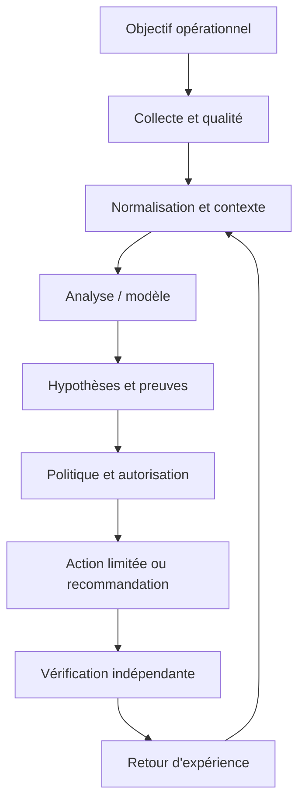

Le premier contrat concerne la donnée : source, horodatage, unité, cible, fraîcheur et état de qualité sont conservés. Le contrat du modèle ou de la règle précise la version, les entrées attendues, les métriques de validation et les limites. Le contrat de décision énumère les actions permises, les préconditions, les approbations, les quotas et les conditions d'arrêt. Le contrat de sortie indique enfin la preuve requise pour déclarer un rétablissement. Ces frontières permettent de tester chaque partie indépendamment, de corriger un composant sans dissimuler l'origine de l'erreur et d'auditer une action plusieurs semaines plus tard.

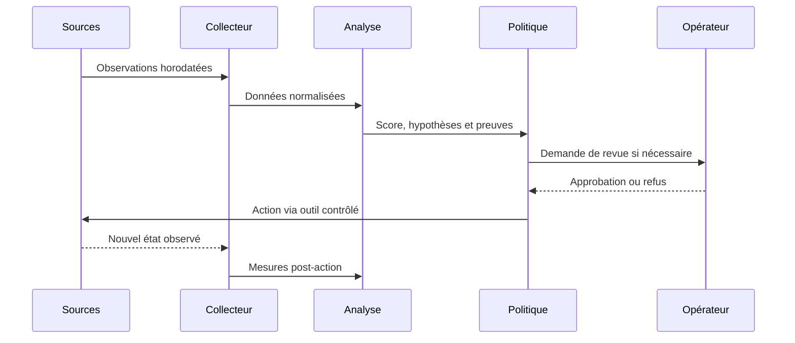

### Frontières de sécurité et mode dégradé

Le contrôle de sécurité lié à Séparation analyse/exécution doit être conçu dès le départ. Appliquer le moindre privilège, protéger les secrets, tracer les décisions et séparer analyse et exécution. Le piège à surveiller est : déployer sur tout l'inventaire sans essai. Lorsque des données externes entrent dans le pipeline, elles ne doivent pas modifier les règles d'accès ni fournir des instructions privilégiées. Toute action à fort impact exige des préconditions compréhensibles, une approbation adaptée et une façon testée de revenir vers un état sûr.

Si Données manquantes produit un résultat incohérent, commencer par vérifier horloge, source, unité, cible, fraîcheur, version et erreur d'accès. Comparer une observation brute avec sa valeur transformée, puis rechercher les modifications récentes. Pour le scénario étudié, un contrôle utile consiste à tester une seule hypothèse à la fois et à conserver la preuve du résultat. Ne pas recopier de secrets dans le ticket. Une fois le défaut confirmé, ajouter un test de régression afin que la même anomalie ne revienne pas avec une mise à jour.

À l'échelle, Résilience du pipeline doit gérer des volumes, équipements et versions hétérogènes sans perdre de traçabilité. Borner la concurrence, isoler les erreurs par cible, limiter le buffering et mesurer les files protège le système aval. La reprise d'une panne peut elle-même provoquer une surcharge si toutes les cibles se reconnectent simultanément. Une architecture robuste sait réduire la fréquence ou revenir à une méthode plus simple, tout en signalant explicitement cette dégradation au lieu d'afficher une apparence de fonctionnement normal.

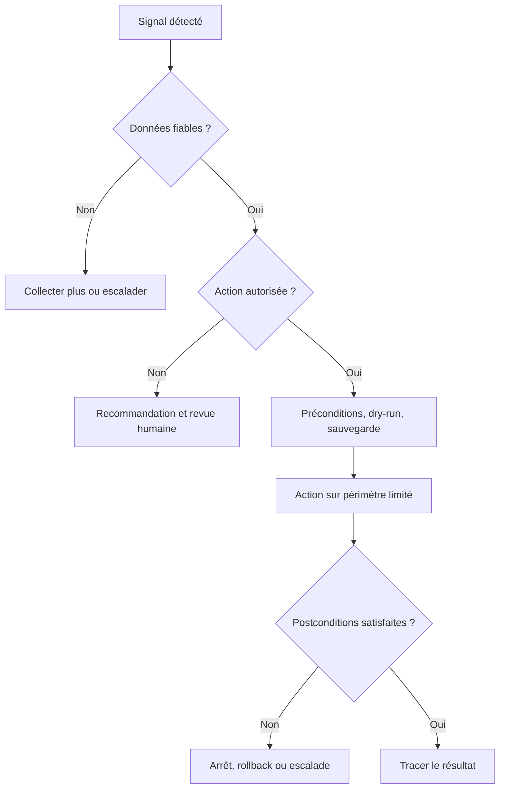

## 4. Pipeline et algorithmes

Le pipeline présenté ici est une chaîne de responsabilités, pas nécessairement un ensemble de microservices séparés. Une petite mise en œuvre peut héberger plusieurs étapes dans un seul processus, à condition de conserver des contrats clairs, des tests et des journaux. L'ordre importe : la qualité est vérifiée avant le calcul, le contexte avant l'interprétation et l'autorisation avant l'exécution. Cette discipline rend possible le fonctionnement en mode observation au départ puis, si les critères le justifient, une automatisation graduée.

### Étape 1 — Construire
Normaliser noms, groupes, plateforme et environnement.

La mise en œuvre de Construire gagne à être découpée en contrôles testables. Vérifier d'abord le format et la provenance des entrées, puis les hypothèses, les valeurs manquantes et les versions. L'outil Ansible peut contribuer à cette étape, mais sa présence ne garantit pas la qualité. Les erreurs doivent rester explicites au lieu d'être converties silencieusement en valeurs par défaut. Une exécution fiable sait différencier une réussite, un échec, un résultat partiel et un état impossible à déterminer.

Si Construire produit un résultat incohérent, commencer par vérifier horloge, source, unité, cible, fraîcheur, version et erreur d'accès. Comparer une observation brute avec sa valeur transformée, puis rechercher les modifications récentes. Pour le scénario étudié, un contrôle utile consiste à tester une seule hypothèse à la fois et à conserver la preuve du résultat. Ne pas recopier de secrets dans le ticket. Une fois le défaut confirmé, ajouter un test de régression afin que la même anomalie ne revienne pas avec une mise à jour.

### Étape 2 — Vérifier l'accès
Tester empreintes, comptes, privilèges et timeouts.

La mise en œuvre de Vérifier l'accès gagne à être découpée en contrôles testables. Vérifier d'abord le format et la provenance des entrées, puis les hypothèses, les valeurs manquantes et les versions. L'outil Nornir peut contribuer à cette étape, mais sa présence ne garantit pas la qualité. Les erreurs doivent rester explicites au lieu d'être converties silencieusement en valeurs par défaut. Une exécution fiable sait différencier une réussite, un échec, un résultat partiel et un état impossible à déterminer.

Si Vérifier l'accès produit un résultat incohérent, commencer par vérifier horloge, source, unité, cible, fraîcheur, version et erreur d'accès. Comparer une observation brute avec sa valeur transformée, puis rechercher les modifications récentes. Pour le scénario étudié, un contrôle utile consiste à tester une seule hypothèse à la fois et à conserver la preuve du résultat. Ne pas recopier de secrets dans le ticket. Une fois le défaut confirmé, ajouter un test de régression afin que la même anomalie ne revienne pas avec une mise à jour.

### Étape 3 — Écrire la tâche
Séparer variables, logique et sélection de cibles.

La mise en œuvre de Écrire la tâche gagne à être découpée en contrôles testables. Vérifier d'abord le format et la provenance des entrées, puis les hypothèses, les valeurs manquantes et les versions. L'outil Netmiko peut contribuer à cette étape, mais sa présence ne garantit pas la qualité. Les erreurs doivent rester explicites au lieu d'être converties silencieusement en valeurs par défaut. Une exécution fiable sait différencier une réussite, un échec, un résultat partiel et un état impossible à déterminer.

Si Écrire la tâche produit un résultat incohérent, commencer par vérifier horloge, source, unité, cible, fraîcheur, version et erreur d'accès. Comparer une observation brute avec sa valeur transformée, puis rechercher les modifications récentes. Pour le scénario étudié, un contrôle utile consiste à tester une seule hypothèse à la fois et à conserver la preuve du résultat. Ne pas recopier de secrets dans le ticket. Une fois le défaut confirmé, ajouter un test de régression afin que la même anomalie ne revienne pas avec une mise à jour.

### Étape 4 — Tester
Utiliser mocks, laboratoire et tests de non-régression.

La mise en œuvre de Tester gagne à être découpée en contrôles testables. Vérifier d'abord le format et la provenance des entrées, puis les hypothèses, les valeurs manquantes et les versions. L'outil Git peut contribuer à cette étape, mais sa présence ne garantit pas la qualité. Les erreurs doivent rester explicites au lieu d'être converties silencieusement en valeurs par défaut. Une exécution fiable sait différencier une réussite, un échec, un résultat partiel et un état impossible à déterminer.

Si Tester produit un résultat incohérent, commencer par vérifier horloge, source, unité, cible, fraîcheur, version et erreur d'accès. Comparer une observation brute avec sa valeur transformée, puis rechercher les modifications récentes. Pour le scénario étudié, un contrôle utile consiste à tester une seule hypothèse à la fois et à conserver la preuve du résultat. Ne pas recopier de secrets dans le ticket. Une fois le défaut confirmé, ajouter un test de régression afin que la même anomalie ne revienne pas avec une mise à jour.

### Étape 5 — Déployer
Limiter les cibles simultanées et arrêter sur seuil d'erreur.

La mise en œuvre de Déployer gagne à être découpée en contrôles testables. Vérifier d'abord le format et la provenance des entrées, puis les hypothèses, les valeurs manquantes et les versions. L'outil inventaires peut contribuer à cette étape, mais sa présence ne garantit pas la qualité. Les erreurs doivent rester explicites au lieu d'être converties silencieusement en valeurs par défaut. Une exécution fiable sait différencier une réussite, un échec, un résultat partiel et un état impossible à déterminer.

Si Déployer produit un résultat incohérent, commencer par vérifier horloge, source, unité, cible, fraîcheur, version et erreur d'accès. Comparer une observation brute avec sa valeur transformée, puis rechercher les modifications récentes. Pour le scénario étudié, un contrôle utile consiste à tester une seule hypothèse à la fois et à conserver la preuve du résultat. Ne pas recopier de secrets dans le ticket. Une fois le défaut confirmé, ajouter un test de régression afin que la même anomalie ne revienne pas avec une mise à jour.

### Étape 6 — Vérifier
Relire l'état et conserver diff, version et reprise.

La mise en œuvre de Vérifier gagne à être découpée en contrôles testables. Vérifier d'abord le format et la provenance des entrées, puis les hypothèses, les valeurs manquantes et les versions. L'outil Vault peut contribuer à cette étape, mais sa présence ne garantit pas la qualité. Les erreurs doivent rester explicites au lieu d'être converties silencieusement en valeurs par défaut. Une exécution fiable sait différencier une réussite, un échec, un résultat partiel et un état impossible à déterminer.

Si Vérifier produit un résultat incohérent, commencer par vérifier horloge, source, unité, cible, fraîcheur, version et erreur d'accès. Comparer une observation brute avec sa valeur transformée, puis rechercher les modifications récentes. Pour le scénario étudié, un contrôle utile consiste à tester une seule hypothèse à la fois et à conserver la preuve du résultat. Ne pas recopier de secrets dans le ticket. Une fois le défaut confirmé, ajouter un test de régression afin que la même anomalie ne revienne pas avec une mise à jour.

### Pseudocode de décision défensive
```text
observations = collecter()
si qualite(observations) insuffisante:
    journaliser("données insuffisantes")
    demander_verification_humaine()
sinon:
    contexte = enrichir(observations, inventaire, changements, dépendances)
    hypotheses = analyser(contexte)
    preuves = verifier_provenance(hypotheses)
    si preuves insuffisantes ou action hors politique:
        recommander_sans_executer()
    sinon:
        plan = preparer_diff_preconditions_et_rollback()
        si validation(plan) et approbations(plan):
            appliquer_sur_perimetre_limite(plan)
            resultat = mesurer_postconditions()
            si resultat non conforme: rollback_ou_escalade()
            tracer(version, preuves, action, resultat)
```

Ce pseudocode sert à expliquer le flux de décision ; il ne constitue pas une bibliothèque prête pour la production. Chaque fonction doit être implémentée, testée et protégée. Le comportement doit être prévisible lorsque les données manquent, qu'un service externe ne répond pas ou que le résultat demeure ambigu. Une bonne conception ne remplace pas l'incertitude par une valeur par défaut. Elle la rend visible, limite l'impact et garde une voie de reprise.

## 5. Étude de cas détaillée

### Situation et impact
une équipe gère plusieurs familles d'équipements ; les commandes manuelles sont peu reproductibles et l'inventaire contient parfois des données obsolètes. L'équipe réunit responsable de service, ingénieur réseau, administrateur système et propriétaire de l'automatisation. Avant d'agir, elle définit l'impact observé, la fenêtre de temps, les actifs concernés et les services prioritaires. La première question n'est pas « quel modèle utiliser ? », mais « quelle décision doit être améliorée et quelle preuve montrera que le changement a servi son objectif ? ». Cette formulation fixe le périmètre et donne un critère d'arrêt si la solution n'apporte pas de valeur démontrable.

### Phase 1 — Établir les faits
Les observations doivent garder les heures originales et les identifiants de source. L'équipe vérifie la qualité de collecte, les changements récents, les dépendances et l'expérience utilisateur. Les valeurs manquantes sont identifiées explicitement plutôt que remplacées silencieusement par zéro. Les symptômes sont séparés des causes supposées, et les sources qui se contredisent sont enregistrées dans le dossier. La preuve de départ sert de référence pour vérifier si une intervention améliore réellement la situation et permet à un autre opérateur de reproduire l'analyse.

### Phase 2 — Poser plusieurs hypothèses
Quand plusieurs causes sont possibles, l'équipe note au minimum deux hypothèses, les observations qui les soutiennent, les éléments qui les contredisent et les tests qui peuvent les différencier. La priorité combine probabilité, impact et coût d'un test. Une hypothèse populaire n'est pas nécessairement correcte : un cas qui ressemble à un incident passé peut différer par la capacité, le routage, la version de logiciel ou la période de charge. Les hypothèses restent des hypothèses jusqu'à ce qu'une preuve suffisante permette de les confirmer.

### Phase 3 — Choisir une réponse proportionnée
Commencer par les vérifications non destructives : comparer l'état, consulter les changements, tester la connectivité ou inspecter une dépendance. Si une modification est nécessaire, définir précisément la cible, la commande ou le changement attendu, les préconditions, les critères d'arrêt et le rollback. Une revue indépendante s'impose lorsque le rayon d'impact est élevé. Le plan doit permettre à l'opérateur de comprendre pourquoi l'action est proposée et dans quelles circonstances il doit la refuser.

### Phase 4 — Vérifier les postconditions
La validation repose sur des mesures indépendantes du simple statut de commande : latence, erreurs, connectivité, état de configuration ou indicateur du service. La fenêtre d'observation doit éviter de confondre un échantillon favorable avec un rétablissement durable. Si les conditions ne sont pas satisfaites, appliquer la règle d'arrêt prévue et lancer un rollback ou une escalade. Le compte rendu distingue l'action exécutée, l'effet mesuré, les effets secondaires et les informations qui restent inconnues.

### Phase 5 — Capitaliser avec prudence
Le post-mortem compare les hypothèses initiales avec les preuves finales, relève les signaux manquants et ajoute des tests de régression. Une règle ou un modèle amélioré passe en revue et en essai contrôlé avant généralisation. Il faut éviter de réentraîner automatiquement sur des conclusions incertaines ou des tickets contenant uniquement des suppositions. Le retour d'expérience doit décrire les situations où la méthode a échoué autant que les cas où elle a réussi.

### Critères de clôture
La clôture exige une preuve de rétablissement, ou une déclaration explicite que le service reste dégradé. Le dossier réunit sources, versions, changement exact, approbation, résultats et suivi. La cause racine n'est marquée comme confirmée que si les observations la soutiennent suffisamment. En l'absence de preuve, une conclusion partielle est plus utile qu'un récit catégorique. La qualité se mesure au diagnostic reproductible, au risque contrôlé et à la possibilité d'améliorer le système à partir des erreurs observées.

## 6. Implémentation guidée et laboratoire

Le laboratoire doit être exécuté dans un environnement isolé ou sur des systèmes explicitement autorisés. Avant de commencer, noter les versions, dépendances, données d'entrée et condition de réussite. Ne pas copier les exemples sur un réseau de production sans adapter les identifiants, certificats, permissions et tests de restauration. Le livrable final doit être compréhensible par une autre personne, ré-exécutable et accompagné d'une liste claire de ses limites.

### TP 1 — Créer un dépôt avec inventaire de laboratoire.
**Procédure.** Créer un dépôt avec inventaire de laboratoire. Commencer par une cible de laboratoire minimale et capturer l'état de départ. Relier ce travail au concept « Inventaire » : L'inventaire décrit cibles, groupes, plateformes, variables et propriétaires ; il doit être vérifié et versionné. Conserver la commande, les entrées, le résultat et la version des outils. Ne changer qu'une variable à la fois pour pouvoir attribuer un écart à sa cause.

**Critère de réussite.** Un autre opérateur doit pouvoir reproduire le résultat et identifier la preuve attendue. Tester aussi un échec contrôlé, une valeur manquante ou une dépendance indisponible. Si le résultat n'est pas déterminable, garder cet état explicite ; ne pas le convertir en succès. Vérifier les postconditions réelles, les effets secondaires et la procédure de reprise. Documenter ce qui a été démontré, ce qui reste une hypothèse et quelle amélioration serait nécessaire avant un usage à plus grande échelle.

### TP 2 — Définir des groupes par site et plateforme.
**Procédure.** Définir des groupes par site et plateforme. Commencer par une cible de laboratoire minimale et capturer l'état de départ. Relier ce travail au concept « Ansible » : Ansible exécute des playbooks et modules ; sur le réseau, collections et plugins de connexion doivent correspondre à la plateforme. Conserver la commande, les entrées, le résultat et la version des outils. Ne changer qu'une variable à la fois pour pouvoir attribuer un écart à sa cause.

**Critère de réussite.** Un autre opérateur doit pouvoir reproduire le résultat et identifier la preuve attendue. Tester aussi un échec contrôlé, une valeur manquante ou une dépendance indisponible. Si le résultat n'est pas déterminable, garder cet état explicite ; ne pas le convertir en succès. Vérifier les postconditions réelles, les effets secondaires et la procédure de reprise. Documenter ce qui a été démontré, ce qui reste une hypothèse et quelle amélioration serait nécessaire avant un usage à plus grande échelle.

### TP 3 — Stocker les secrets hors du dépôt.
**Procédure.** Stocker les secrets hors du dépôt. Commencer par une cible de laboratoire minimale et capturer l'état de départ. Relier ce travail au concept « Nornir » : Nornir est un cadre Python orienté inventaire et tâches, utile pour composer des fonctions et borner la concurrence. Conserver la commande, les entrées, le résultat et la version des outils. Ne changer qu'une variable à la fois pour pouvoir attribuer un écart à sa cause.

**Critère de réussite.** Un autre opérateur doit pouvoir reproduire le résultat et identifier la preuve attendue. Tester aussi un échec contrôlé, une valeur manquante ou une dépendance indisponible. Si le résultat n'est pas déterminable, garder cet état explicite ; ne pas le convertir en succès. Vérifier les postconditions réelles, les effets secondaires et la procédure de reprise. Documenter ce qui a été démontré, ce qui reste une hypothèse et quelle amélioration serait nécessaire avant un usage à plus grande échelle.

### TP 4 — Écrire une tâche en lecture seule pour collecter l'état.
**Procédure.** Écrire une tâche en lecture seule pour collecter l'état. Commencer par une cible de laboratoire minimale et capturer l'état de départ. Relier ce travail au concept « Idempotence » : Une tâche idempotente converge vers l'état cible sans répéter un effet si l'état est déjà correct. Conserver la commande, les entrées, le résultat et la version des outils. Ne changer qu'une variable à la fois pour pouvoir attribuer un écart à sa cause.

**Critère de réussite.** Un autre opérateur doit pouvoir reproduire le résultat et identifier la preuve attendue. Tester aussi un échec contrôlé, une valeur manquante ou une dépendance indisponible. Si le résultat n'est pas déterminable, garder cet état explicite ; ne pas le convertir en succès. Vérifier les postconditions réelles, les effets secondaires et la procédure de reprise. Documenter ce qui a été démontré, ce qui reste une hypothèse et quelle amélioration serait nécessaire avant un usage à plus grande échelle.

### TP 5 — Limiter une exécution Nornir à un groupe avec concurrence bornée.
**Procédure.** Limiter une exécution Nornir à un groupe avec concurrence bornée. Commencer par une cible de laboratoire minimale et capturer l'état de départ. Relier ce travail au concept « Concurrence » : La parallélisation accélère l'exécution mais peut surcharger équipements, serveurs d'authentification et liens. Conserver la commande, les entrées, le résultat et la version des outils. Ne changer qu'une variable à la fois pour pouvoir attribuer un écart à sa cause.

**Critère de réussite.** Un autre opérateur doit pouvoir reproduire le résultat et identifier la preuve attendue. Tester aussi un échec contrôlé, une valeur manquante ou une dépendance indisponible. Si le résultat n'est pas déterminable, garder cet état explicite ; ne pas le convertir en succès. Vérifier les postconditions réelles, les effets secondaires et la procédure de reprise. Documenter ce qui a été démontré, ce qui reste une hypothèse et quelle amélioration serait nécessaire avant un usage à plus grande échelle.

### TP 6 — Ajouter des tests unitaires ou des mocks.
**Procédure.** Ajouter des tests unitaires ou des mocks. Commencer par une cible de laboratoire minimale et capturer l'état de départ. Relier ce travail au concept « Secrets » : Les credentials doivent provenir d'un stockage protégé et être limités en portée. Conserver la commande, les entrées, le résultat et la version des outils. Ne changer qu'une variable à la fois pour pouvoir attribuer un écart à sa cause.

**Critère de réussite.** Un autre opérateur doit pouvoir reproduire le résultat et identifier la preuve attendue. Tester aussi un échec contrôlé, une valeur manquante ou une dépendance indisponible. Si le résultat n'est pas déterminable, garder cet état explicite ; ne pas le convertir en succès. Vérifier les postconditions réelles, les effets secondaires et la procédure de reprise. Documenter ce qui a été démontré, ce qui reste une hypothèse et quelle amélioration serait nécessaire avant un usage à plus grande échelle.

### TP 7 — Tester sur une cible puis élargir progressivement.
**Procédure.** Tester sur une cible puis élargir progressivement. Commencer par une cible de laboratoire minimale et capturer l'état de départ. Relier ce travail au concept « Validation pré/post » : L'état initial, le changement appliqué et les postconditions doivent être reliés et audités. Conserver la commande, les entrées, le résultat et la version des outils. Ne changer qu'une variable à la fois pour pouvoir attribuer un écart à sa cause.

**Critère de réussite.** Un autre opérateur doit pouvoir reproduire le résultat et identifier la preuve attendue. Tester aussi un échec contrôlé, une valeur manquante ou une dépendance indisponible. Si le résultat n'est pas déterminable, garder cet état explicite ; ne pas le convertir en succès. Vérifier les postconditions réelles, les effets secondaires et la procédure de reprise. Documenter ce qui a été démontré, ce qui reste une hypothèse et quelle amélioration serait nécessaire avant un usage à plus grande échelle.

### Exemple de code ou de configuration

```yaml
- name: Inventorier le laboratoire sans changement
  hosts: lab_switches
  gather_facts: false
  serial: 1
  tasks:
    - name: Afficher la cible
      ansible.builtin.debug:
        msg: "Cible de laboratoire : {{ inventory_hostname }}"
      changed_when: false

# Pour des équipements réels : collection adaptée, secrets protégés,
# tests par plateforme et vérification de l'état après action.
```

Ce fragment est un point de départ pédagogique. Les versions, options CLI, capacités matérielles et schémas changent ; vérifier la documentation liée et tester dans un laboratoire. Le fragment n'inclut pas toute la configuration nécessaire à un déploiement réel. Les secrets ne doivent pas être ajoutés au code, et les exemples qui peuvent modifier un système doivent recevoir approbations, limites de portée et vérification post-action. Un parseur qui accepte la syntaxe ne certifie ni la conformité ni la disponibilité.

### Livrables attendus
- Un fichier versionné qui décrit entrées, sorties et dépendances.
- Un journal lié à la cible et à la version, sans secret.
- Des tests positifs, négatifs et de panne de dépendance.
- Des critères d'arrêt et une procédure de reprise testée.
- Une note décrivant les résultats et les limites.

## 7. Sécurité et gouvernance

### 1. Qualité et provenance
Chaque observation garde source, heure, unité et état de fraîcheur. Pour le contexte étudié, ce principe doit être traduit en contrôle observable, propriétaire, fréquence de revue et preuve de passage. Une politique sans test dépend de la mémoire des personnes ; un test sans propriétaire cesse d'être maintenu lorsque l'équipe change. La revue doit donc être planifiée et relancée après un changement majeur de données, de matériel, de finalité ou de modèle.

La gouvernance de Qualité et provenance définit qui peut créer, modifier, approuver, consulter et retirer la logique associée. Le propriétaire doit connaître l'objectif, les limites, les dépendances, le budget d'erreur et les critères de suspension. Les décisions doivent être retraçables jusqu'aux données et versions utilisées. Une règle sans propriétaire finit par dépendre de la mémoire de l'équipe ; un propriétaire sans mesure ne peut pas démontrer qu'elle fonctionne. La revue doit être planifiée et relancée à chaque changement majeur de données, d'équipement ou de finalité.

### 2. Identités et permissions
Les comptes d'automatisation reçoivent uniquement les privilèges nécessaires. Pour le contexte étudié, ce principe doit être traduit en contrôle observable, propriétaire, fréquence de revue et preuve de passage. Une politique sans test dépend de la mémoire des personnes ; un test sans propriétaire cesse d'être maintenu lorsque l'équipe change. La revue doit donc être planifiée et relancée après un changement majeur de données, de matériel, de finalité ou de modèle.

La gouvernance de Identités et permissions définit qui peut créer, modifier, approuver, consulter et retirer la logique associée. Le propriétaire doit connaître l'objectif, les limites, les dépendances, le budget d'erreur et les critères de suspension. Les décisions doivent être retraçables jusqu'aux données et versions utilisées. Une règle sans propriétaire finit par dépendre de la mémoire de l'équipe ; un propriétaire sans mesure ne peut pas démontrer qu'elle fonctionne. La revue doit être planifiée et relancée à chaque changement majeur de données, d'équipement ou de finalité.

### 3. Traçabilité
La version, les preuves, la décision, l'approbateur et le résultat sont corrélés. Pour le contexte étudié, ce principe doit être traduit en contrôle observable, propriétaire, fréquence de revue et preuve de passage. Une politique sans test dépend de la mémoire des personnes ; un test sans propriétaire cesse d'être maintenu lorsque l'équipe change. La revue doit donc être planifiée et relancée après un changement majeur de données, de matériel, de finalité ou de modèle.

La gouvernance de Traçabilité définit qui peut créer, modifier, approuver, consulter et retirer la logique associée. Le propriétaire doit connaître l'objectif, les limites, les dépendances, le budget d'erreur et les critères de suspension. Les décisions doivent être retraçables jusqu'aux données et versions utilisées. Une règle sans propriétaire finit par dépendre de la mémoire de l'équipe ; un propriétaire sans mesure ne peut pas démontrer qu'elle fonctionne. La revue doit être planifiée et relancée à chaque changement majeur de données, d'équipement ou de finalité.

### 4. Revue humaine
Le réviseur doit posséder preuves, temps et autorité pour refuser. Pour le contexte étudié, ce principe doit être traduit en contrôle observable, propriétaire, fréquence de revue et preuve de passage. Une politique sans test dépend de la mémoire des personnes ; un test sans propriétaire cesse d'être maintenu lorsque l'équipe change. La revue doit donc être planifiée et relancée après un changement majeur de données, de matériel, de finalité ou de modèle.

La gouvernance de Revue humaine définit qui peut créer, modifier, approuver, consulter et retirer la logique associée. Le propriétaire doit connaître l'objectif, les limites, les dépendances, le budget d'erreur et les critères de suspension. Les décisions doivent être retraçables jusqu'aux données et versions utilisées. Une règle sans propriétaire finit par dépendre de la mémoire de l'équipe ; un propriétaire sans mesure ne peut pas démontrer qu'elle fonctionne. La revue doit être planifiée et relancée à chaque changement majeur de données, d'équipement ou de finalité.

### 5. Mesure du risque
Chaque mode d'échec doit avoir prévention, détection, réponse et responsable. Pour le contexte étudié, ce principe doit être traduit en contrôle observable, propriétaire, fréquence de revue et preuve de passage. Une politique sans test dépend de la mémoire des personnes ; un test sans propriétaire cesse d'être maintenu lorsque l'équipe change. La revue doit donc être planifiée et relancée après un changement majeur de données, de matériel, de finalité ou de modèle.

La gouvernance de Mesure du risque définit qui peut créer, modifier, approuver, consulter et retirer la logique associée. Le propriétaire doit connaître l'objectif, les limites, les dépendances, le budget d'erreur et les critères de suspension. Les décisions doivent être retraçables jusqu'aux données et versions utilisées. Une règle sans propriétaire finit par dépendre de la mémoire de l'équipe ; un propriétaire sans mesure ne peut pas démontrer qu'elle fonctionne. La revue doit être planifiée et relancée à chaque changement majeur de données, d'équipement ou de finalité.

### 6. Réversibilité
La suspension du modèle et le retour à une version saine sont testés. Pour le contexte étudié, ce principe doit être traduit en contrôle observable, propriétaire, fréquence de revue et preuve de passage. Une politique sans test dépend de la mémoire des personnes ; un test sans propriétaire cesse d'être maintenu lorsque l'équipe change. La revue doit donc être planifiée et relancée après un changement majeur de données, de matériel, de finalité ou de modèle.

La gouvernance de Réversibilité définit qui peut créer, modifier, approuver, consulter et retirer la logique associée. Le propriétaire doit connaître l'objectif, les limites, les dépendances, le budget d'erreur et les critères de suspension. Les décisions doivent être retraçables jusqu'aux données et versions utilisées. Une règle sans propriétaire finit par dépendre de la mémoire de l'équipe ; un propriétaire sans mesure ne peut pas démontrer qu'elle fonctionne. La revue doit être planifiée et relancée à chaque changement majeur de données, d'équipement ou de finalité.

## 8. Pièges à éviter

### Piège 1 — Déployer sur tout l'inventaire sans essai

Ce piège peut produire un faux diagnostic, une action superflue ou une perte de confiance. Le signal précurseur est parfois subtil : incohérence entre sources, hausse d'erreurs, impossibilité d'expliquer la sortie ou comportement différent selon les sites. L'équipe doit rendre le signal mesurable, désigner qui réagit et préciser si l'action automatique se bloque ou si le traitement continue en mode dégradé.

La prévention doit être reliée à « Inventaire ». L'inventaire décrit cibles, groupes, plateformes, variables et propriétaires ; il doit être vérifié et versionné. Définir un test négatif qui fait apparaître le défaut et vérifier que la réponse attendue réduit le risque. Un garde-fou ne doit pas être un simple avertissement que les opérateurs apprennent à ignorer. En revue, demander quelle preuve montre que le contrôle fonctionne, quelle défaillance il couvre et quelle autre défaillance demeure possible.

### Piège 2 — Placer des mots de passe en clair dans Git

Ce piège peut produire un faux diagnostic, une action superflue ou une perte de confiance. Le signal précurseur est parfois subtil : incohérence entre sources, hausse d'erreurs, impossibilité d'expliquer la sortie ou comportement différent selon les sites. L'équipe doit rendre le signal mesurable, désigner qui réagit et préciser si l'action automatique se bloque ou si le traitement continue en mode dégradé.

La prévention doit être reliée à « Ansible ». Ansible exécute des playbooks et modules ; sur le réseau, collections et plugins de connexion doivent correspondre à la plateforme. Définir un test négatif qui fait apparaître le défaut et vérifier que la réponse attendue réduit le risque. Un garde-fou ne doit pas être un simple avertissement que les opérateurs apprennent à ignorer. En revue, demander quelle preuve montre que le contrôle fonctionne, quelle défaillance il couvre et quelle autre défaillance demeure possible.

### Piège 3 — Supposer que tous modules possèdent check mode

Ce piège peut produire un faux diagnostic, une action superflue ou une perte de confiance. Le signal précurseur est parfois subtil : incohérence entre sources, hausse d'erreurs, impossibilité d'expliquer la sortie ou comportement différent selon les sites. L'équipe doit rendre le signal mesurable, désigner qui réagit et préciser si l'action automatique se bloque ou si le traitement continue en mode dégradé.

La prévention doit être reliée à « Nornir ». Nornir est un cadre Python orienté inventaire et tâches, utile pour composer des fonctions et borner la concurrence. Définir un test négatif qui fait apparaître le défaut et vérifier que la réponse attendue réduit le risque. Un garde-fou ne doit pas être un simple avertissement que les opérateurs apprennent à ignorer. En revue, demander quelle preuve montre que le contrôle fonctionne, quelle défaillance il couvre et quelle autre défaillance demeure possible.

### Piège 4 — Saturer les équipements avec la concurrence

Ce piège peut produire un faux diagnostic, une action superflue ou une perte de confiance. Le signal précurseur est parfois subtil : incohérence entre sources, hausse d'erreurs, impossibilité d'expliquer la sortie ou comportement différent selon les sites. L'équipe doit rendre le signal mesurable, désigner qui réagit et préciser si l'action automatique se bloque ou si le traitement continue en mode dégradé.

La prévention doit être reliée à « Idempotence ». Une tâche idempotente converge vers l'état cible sans répéter un effet si l'état est déjà correct. Définir un test négatif qui fait apparaître le défaut et vérifier que la réponse attendue réduit le risque. Un garde-fou ne doit pas être un simple avertissement que les opérateurs apprennent à ignorer. En revue, demander quelle preuve montre que le contrôle fonctionne, quelle défaillance il couvre et quelle autre défaillance demeure possible.

### Piège 5 — Ignorer les versions des collections

Ce piège peut produire un faux diagnostic, une action superflue ou une perte de confiance. Le signal précurseur est parfois subtil : incohérence entre sources, hausse d'erreurs, impossibilité d'expliquer la sortie ou comportement différent selon les sites. L'équipe doit rendre le signal mesurable, désigner qui réagit et préciser si l'action automatique se bloque ou si le traitement continue en mode dégradé.

La prévention doit être reliée à « Concurrence ». La parallélisation accélère l'exécution mais peut surcharger équipements, serveurs d'authentification et liens. Définir un test négatif qui fait apparaître le défaut et vérifier que la réponse attendue réduit le risque. Un garde-fou ne doit pas être un simple avertissement que les opérateurs apprennent à ignorer. En revue, demander quelle preuve montre que le contrôle fonctionne, quelle défaillance il couvre et quelle autre défaillance demeure possible.

### Piège 6 — Faire confiance à un inventaire obsolète

Ce piège peut produire un faux diagnostic, une action superflue ou une perte de confiance. Le signal précurseur est parfois subtil : incohérence entre sources, hausse d'erreurs, impossibilité d'expliquer la sortie ou comportement différent selon les sites. L'équipe doit rendre le signal mesurable, désigner qui réagit et préciser si l'action automatique se bloque ou si le traitement continue en mode dégradé.

La prévention doit être reliée à « Secrets ». Les credentials doivent provenir d'un stockage protégé et être limités en portée. Définir un test négatif qui fait apparaître le défaut et vérifier que la réponse attendue réduit le risque. Un garde-fou ne doit pas être un simple avertissement que les opérateurs apprennent à ignorer. En revue, demander quelle preuve montre que le contrôle fonctionne, quelle défaillance il couvre et quelle autre défaillance demeure possible.

### Piège 7 — Ne pas vérifier l'état après exécution

Ce piège peut produire un faux diagnostic, une action superflue ou une perte de confiance. Le signal précurseur est parfois subtil : incohérence entre sources, hausse d'erreurs, impossibilité d'expliquer la sortie ou comportement différent selon les sites. L'équipe doit rendre le signal mesurable, désigner qui réagit et préciser si l'action automatique se bloque ou si le traitement continue en mode dégradé.

La prévention doit être reliée à « Validation pré/post ». L'état initial, le changement appliqué et les postconditions doivent être reliés et audités. Définir un test négatif qui fait apparaître le défaut et vérifier que la réponse attendue réduit le risque. Un garde-fou ne doit pas être un simple avertissement que les opérateurs apprennent à ignorer. En revue, demander quelle preuve montre que le contrôle fonctionne, quelle défaillance il couvre et quelle autre défaillance demeure possible.

## 9. Diagnostic et dépannage

### Aucun résultat n'est produit
Vérifier accès source, période de sélection, identité, filtres et version du schéma. Dans le cadre de Outils (Ansible, Nornir), vérifier en particulier ce risque : déployer sur tout l'inventaire sans essai. Comparer les observations brutes à leur représentation transformée, retrouver la version du pipeline et noter si une modification récente correspond au début du problème. Formuler au moins deux explications alternatives et choisir un test à faible risque qui permet de les distinguer. Ne pas effectuer plusieurs changements simultanément, car cela rendrait l'analyse ambiguë. Si les preuves restent insuffisantes, rendre cette incertitude visible et utiliser le mode sûr.

### Les résultats varient
Comparer données, code, versions, transformations et paramètres sur un cas fixe. Dans le cadre de Outils (Ansible, Nornir), vérifier en particulier ce risque : placer des mots de passe en clair dans Git. Comparer les observations brutes à leur représentation transformée, retrouver la version du pipeline et noter si une modification récente correspond au début du problème. Formuler au moins deux explications alternatives et choisir un test à faible risque qui permet de les distinguer. Ne pas effectuer plusieurs changements simultanément, car cela rendrait l'analyse ambiguë. Si les preuves restent insuffisantes, rendre cette incertitude visible et utiliser le mode sûr.

### Trop d'alertes
Inspecter doublons, saisonnalité, baseline, seuil et qualité du contexte avant de supprimer des alertes. Dans le cadre de Outils (Ansible, Nornir), vérifier en particulier ce risque : supposer que tous modules possèdent check mode. Comparer les observations brutes à leur représentation transformée, retrouver la version du pipeline et noter si une modification récente correspond au début du problème. Formuler au moins deux explications alternatives et choisir un test à faible risque qui permet de les distinguer. Ne pas effectuer plusieurs changements simultanément, car cela rendrait l'analyse ambiguë. Si les preuves restent insuffisantes, rendre cette incertitude visible et utiliser le mode sûr.

### Un incident passe inaperçu
Reconstituer les informations disponibles au moment de décider et rechercher un seuil trop permissif ou une source absente. Dans le cadre de Outils (Ansible, Nornir), vérifier en particulier ce risque : saturer les équipements avec la concurrence. Comparer les observations brutes à leur représentation transformée, retrouver la version du pipeline et noter si une modification récente correspond au début du problème. Formuler au moins deux explications alternatives et choisir un test à faible risque qui permet de les distinguer. Ne pas effectuer plusieurs changements simultanément, car cela rendrait l'analyse ambiguë. Si les preuves restent insuffisantes, rendre cette incertitude visible et utiliser le mode sûr.

### L'action n'améliore pas le service
Vérifier postconditions indépendantes et effets secondaires, puis appliquer arrêt ou rollback selon le plan. Dans le cadre de Outils (Ansible, Nornir), vérifier en particulier ce risque : ignorer les versions des collections. Comparer les observations brutes à leur représentation transformée, retrouver la version du pipeline et noter si une modification récente correspond au début du problème. Formuler au moins deux explications alternatives et choisir un test à faible risque qui permet de les distinguer. Ne pas effectuer plusieurs changements simultanément, car cela rendrait l'analyse ambiguë. Si les preuves restent insuffisantes, rendre cette incertitude visible et utiliser le mode sûr.

### La qualité diminue avec le temps
Rechercher dérive, changement de capacité, topologie, population ou version et réévaluer. Dans le cadre de Outils (Ansible, Nornir), vérifier en particulier ce risque : faire confiance à un inventaire obsolète. Comparer les observations brutes à leur représentation transformée, retrouver la version du pipeline et noter si une modification récente correspond au début du problème. Formuler au moins deux explications alternatives et choisir un test à faible risque qui permet de les distinguer. Ne pas effectuer plusieurs changements simultanément, car cela rendrait l'analyse ambiguë. Si les preuves restent insuffisantes, rendre cette incertitude visible et utiliser le mode sûr.

## 10. Exercices corrigés

### Exercice 1 — Inventaire
**Énoncé.** Dans un environnement inspiré du scénario « une équipe gère plusieurs familles d'équipements ; les commandes manuelles sont peu reproductibles et l'inventaire contient parfois des données obsolètes », l'équipe veut généraliser une approche qui utilise « Inventaire ». Quelle preuve recueillir avant l'étape « Construire », et comment réduire le risque suivant : déployer sur tout l'inventaire sans essai ?

**Correction détaillée.** Définir d'abord le résultat attendu et le coût d'une erreur. Vérifier que les entrées proviennent d'une source autorisée et qu'elles sont fraîches, cohérentes et disponibles au moment de la décision. Construire un essai reproductible, comparer à une baseline et analyser les erreurs par classe d'actif ou criticité. Normaliser noms, groupes, plateforme et environnement. L'extension du périmètre exige des seuils écrits, une revue adaptée au risque, un déploiement progressif et un retour arrière. Si la preuve ne permet pas de trancher, demander une vérification complémentaire ou garder la solution en observation plutôt que d'inventer une certitude.

**Pourquoi les raccourcis échouent.** Un résultat favorable sur un exemple ne démontre pas une performance durable. Un score moyen peut masquer les catégories vulnérables ; une absence d'erreur visible peut provenir d'une télémétrie incomplète. Conserver les cas difficiles, les conditions de test et les versions utilisées rend possible une revue indépendante. L'exercice est réussi lorsque le choix, ses limites et le mécanisme de retrait sont compris par une autre personne.

### Exercice 2 — Ansible
**Énoncé.** Dans un environnement inspiré du scénario « une équipe gère plusieurs familles d'équipements ; les commandes manuelles sont peu reproductibles et l'inventaire contient parfois des données obsolètes », l'équipe veut généraliser une approche qui utilise « Ansible ». Quelle preuve recueillir avant l'étape « Vérifier l'accès », et comment réduire le risque suivant : placer des mots de passe en clair dans Git ?

**Correction détaillée.** Définir d'abord le résultat attendu et le coût d'une erreur. Vérifier que les entrées proviennent d'une source autorisée et qu'elles sont fraîches, cohérentes et disponibles au moment de la décision. Construire un essai reproductible, comparer à une baseline et analyser les erreurs par classe d'actif ou criticité. Tester empreintes, comptes, privilèges et timeouts. L'extension du périmètre exige des seuils écrits, une revue adaptée au risque, un déploiement progressif et un retour arrière. Si la preuve ne permet pas de trancher, demander une vérification complémentaire ou garder la solution en observation plutôt que d'inventer une certitude.

**Pourquoi les raccourcis échouent.** Un résultat favorable sur un exemple ne démontre pas une performance durable. Un score moyen peut masquer les catégories vulnérables ; une absence d'erreur visible peut provenir d'une télémétrie incomplète. Conserver les cas difficiles, les conditions de test et les versions utilisées rend possible une revue indépendante. L'exercice est réussi lorsque le choix, ses limites et le mécanisme de retrait sont compris par une autre personne.

### Exercice 3 — Nornir
**Énoncé.** Dans un environnement inspiré du scénario « une équipe gère plusieurs familles d'équipements ; les commandes manuelles sont peu reproductibles et l'inventaire contient parfois des données obsolètes », l'équipe veut généraliser une approche qui utilise « Nornir ». Quelle preuve recueillir avant l'étape « Écrire la tâche », et comment réduire le risque suivant : supposer que tous modules possèdent check mode ?

**Correction détaillée.** Définir d'abord le résultat attendu et le coût d'une erreur. Vérifier que les entrées proviennent d'une source autorisée et qu'elles sont fraîches, cohérentes et disponibles au moment de la décision. Construire un essai reproductible, comparer à une baseline et analyser les erreurs par classe d'actif ou criticité. Séparer variables, logique et sélection de cibles. L'extension du périmètre exige des seuils écrits, une revue adaptée au risque, un déploiement progressif et un retour arrière. Si la preuve ne permet pas de trancher, demander une vérification complémentaire ou garder la solution en observation plutôt que d'inventer une certitude.

**Pourquoi les raccourcis échouent.** Un résultat favorable sur un exemple ne démontre pas une performance durable. Un score moyen peut masquer les catégories vulnérables ; une absence d'erreur visible peut provenir d'une télémétrie incomplète. Conserver les cas difficiles, les conditions de test et les versions utilisées rend possible une revue indépendante. L'exercice est réussi lorsque le choix, ses limites et le mécanisme de retrait sont compris par une autre personne.

### Exercice 4 — Idempotence
**Énoncé.** Dans un environnement inspiré du scénario « une équipe gère plusieurs familles d'équipements ; les commandes manuelles sont peu reproductibles et l'inventaire contient parfois des données obsolètes », l'équipe veut généraliser une approche qui utilise « Idempotence ». Quelle preuve recueillir avant l'étape « Tester », et comment réduire le risque suivant : saturer les équipements avec la concurrence ?

**Correction détaillée.** Définir d'abord le résultat attendu et le coût d'une erreur. Vérifier que les entrées proviennent d'une source autorisée et qu'elles sont fraîches, cohérentes et disponibles au moment de la décision. Construire un essai reproductible, comparer à une baseline et analyser les erreurs par classe d'actif ou criticité. Utiliser mocks, laboratoire et tests de non-régression. L'extension du périmètre exige des seuils écrits, une revue adaptée au risque, un déploiement progressif et un retour arrière. Si la preuve ne permet pas de trancher, demander une vérification complémentaire ou garder la solution en observation plutôt que d'inventer une certitude.

**Pourquoi les raccourcis échouent.** Un résultat favorable sur un exemple ne démontre pas une performance durable. Un score moyen peut masquer les catégories vulnérables ; une absence d'erreur visible peut provenir d'une télémétrie incomplète. Conserver les cas difficiles, les conditions de test et les versions utilisées rend possible une revue indépendante. L'exercice est réussi lorsque le choix, ses limites et le mécanisme de retrait sont compris par une autre personne.

### Exercice 5 — Concurrence
**Énoncé.** Dans un environnement inspiré du scénario « une équipe gère plusieurs familles d'équipements ; les commandes manuelles sont peu reproductibles et l'inventaire contient parfois des données obsolètes », l'équipe veut généraliser une approche qui utilise « Concurrence ». Quelle preuve recueillir avant l'étape « Déployer », et comment réduire le risque suivant : ignorer les versions des collections ?

**Correction détaillée.** Définir d'abord le résultat attendu et le coût d'une erreur. Vérifier que les entrées proviennent d'une source autorisée et qu'elles sont fraîches, cohérentes et disponibles au moment de la décision. Construire un essai reproductible, comparer à une baseline et analyser les erreurs par classe d'actif ou criticité. Limiter les cibles simultanées et arrêter sur seuil d'erreur. L'extension du périmètre exige des seuils écrits, une revue adaptée au risque, un déploiement progressif et un retour arrière. Si la preuve ne permet pas de trancher, demander une vérification complémentaire ou garder la solution en observation plutôt que d'inventer une certitude.

**Pourquoi les raccourcis échouent.** Un résultat favorable sur un exemple ne démontre pas une performance durable. Un score moyen peut masquer les catégories vulnérables ; une absence d'erreur visible peut provenir d'une télémétrie incomplète. Conserver les cas difficiles, les conditions de test et les versions utilisées rend possible une revue indépendante. L'exercice est réussi lorsque le choix, ses limites et le mécanisme de retrait sont compris par une autre personne.


## Atelier approfondi — choisir et exploiter les outils d'automatisation réseau

Cet atelier complète les bases d'Ansible et de Nornir par une méthode de travail reproductible. L'objectif n'est pas de lancer une commande sur chaque appareil aussi vite que possible. Il est de transformer un inventaire fiable en opérations contrôlées, de limiter le risque d'un changement incorrect et de prouver l'état obtenu. Un outil d'automatisation est une partie du système d'exploitation réseau : sa configuration, ses dépendances, ses identités, ses résultats et ses procédures de reprise doivent être maintenus comme du code.

Les exemples sont conçus pour un environnement de laboratoire. Les noms d'équipements, les adresses de documentation et les politiques sont fictifs. Commence par la collecte en lecture seule et la simulation. N'applique pas de playbook ou de script sur une infrastructure réelle sans autorisation, sauvegarde, analyse d'impact, fenêtre de changement et procédure de retour arrière testée.

### A. Choisir un outil selon le problème à résoudre

Ansible et Nornir peuvent tous deux aider à automatiser un parc, mais leurs modèles de travail ne sont pas identiques. Ansible organise généralement les opérations autour d'inventaires, de tâches, de rôles et de playbooks déclaratifs. Son approche est pratique pour décrire un état souhaité, réutiliser des rôles et faire relire un changement dans un dépôt. Nornir est un framework Python qui fournit une structure d'inventaire et d'exécution, particulièrement adaptée aux équipes qui souhaitent composer leurs opérations en Python et intégrer facilement des bibliothèques réseau spécialisées.

Le choix dépend du profil de la tâche, du niveau de personnalisation requis, des connecteurs disponibles, de la culture de l'équipe, de la gestion des secrets, de la qualité des tests et de la capacité à maintenir les dépendances. Il ne faut pas choisir un outil uniquement parce qu'il est populaire. Il faut commencer par définir les résultats mesurables : durée d'un audit, taux d'échec, reproductibilité, qualité des rapports et temps nécessaire pour diagnostiquer un incident.

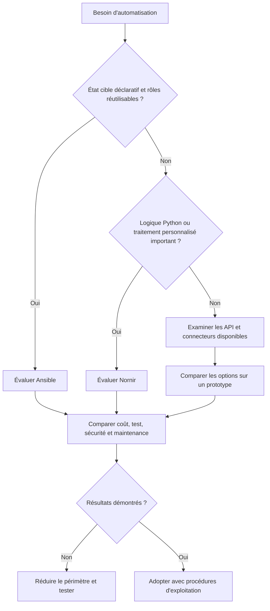

Une équipe peut aussi combiner les deux outils : par exemple, Ansible pour certains changements déclaratifs et Python/Nornir pour des collectes ou vérifications spécialisées. Une telle combinaison doit toutefois avoir une raison explicite. Multiplier les outils accroît les dépendances, les systèmes de secrets, les formats de sortie, les conventions et les compétences à maintenir. Chaque frontière entre composants doit définir le format des données, les codes de statut et la responsabilité en cas d'échec.

| Critère | Ansible | Nornir | Question à vérifier |
|---|---|---|---|
| Modèle de travail | Playbooks, tâches, rôles, inventaires | Objets Python, tâches et plugins | Quel modèle l'équipe comprend-elle le mieux ? |
| Logique personnalisée | Modules, filtres, plugins et rôles | Fonctions et bibliothèques Python | Quelle quantité de logique spécifique est nécessaire ? |
| Réutilisation | Rôles et collections | Packages et fonctions | Comment versionner et tester les composants ? |
| Exécution parallèle | Contrôlée par les paramètres d'exécution | Contrôlée dans le modèle Nornir | Quelle charge le parc peut-il supporter ? |
| Simulation | Dépend de la prise en charge du module et du playbook | À construire et à tester selon les fonctions utilisées | La simulation couvre-t-elle réellement tous les effets ? |
| Résultats | Événements de tâches structurés | Résultats Python personnalisables | Comment distinguer succès, échec et inconnu ? |
| Maintenabilité | Très bonne pour un modèle déclaratif clair | Souple, mais le code doit être organisé | Les nouveaux membres peuvent-ils relire le changement ? |

Le tableau est un guide de décision, pas un classement universel. Les capacités dépendent des modules, plugins, plateformes, versions et collections installés. Une fonction disponible dans un environnement ne sera pas forcément disponible ailleurs. Vérifie les versions réelles et consulte la documentation du composant exact avant de dépendre d'une option ou d'un mode de simulation.

### B. Définir un contrat commun pour tous les outils

Quel que soit l'outil retenu, une opération doit posséder un objectif, une portée, des préconditions, un résultat attendu, une limite de temps, une identité responsable, un plan de reprise et un format de rapport. Sans contrat commun, les tâches Ansible et Nornir peuvent produire des résultats difficilement comparables ou donner un sens différent au mot « succès ».

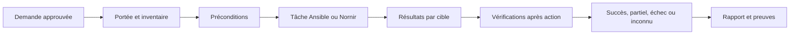

Un résultat doit être attaché à un identifiant stable de cible. Il devrait indiquer la version de l'outil, la tâche exécutée, l'horodatage, la durée, le statut, le code d'erreur normalisé et l'identifiant de la demande de changement. En cas d'échec, il faut pouvoir répondre à la question : l'opération n'a-t-elle jamais démarré, a-t-elle échoué avant le changement, a-t-elle peut-être changé l'état ou a-t-elle réussi mais échoué à vérifier le résultat ?

Les statuts doivent différencier au minimum réussite confirmée, échec confirmé, réussite partielle et état inconnu. Un équipement inaccessible n'est pas conforme par défaut. Une tâche qui a produit une configuration sans avoir relu l'état réel n'est pas équivalente à une tâche dont les postconditions sont vérifiées. Si le format de sortie est traité par un système de supervision, garde les noms des statuts stables et documente les évolutions.

### C. Construire un inventaire de confiance

L'inventaire est une source de vérité sur les cibles, leurs propriétés et leur périmètre d'autorisation. Il peut contenir des identifiants logiques, une plateforme, une version logicielle, une région, un groupe fonctionnel, un propriétaire, une méthode de connexion et une criticité. Il ne devrait pas contenir de mot de passe ou de jeton en clair.

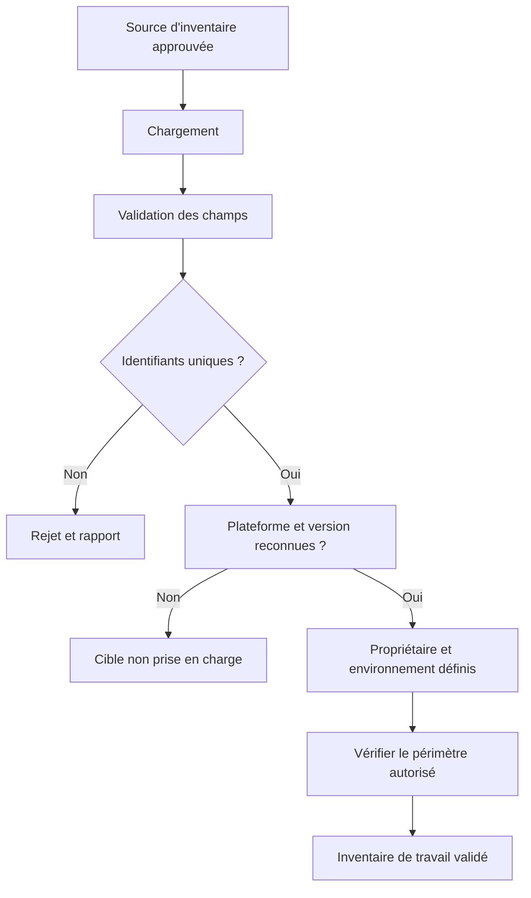

Un inventaire manuel peut commencer avec un CSV versionné, puis être intégré à une source dynamique lorsque les besoins augmentent. Une source dynamique n'est pas automatiquement fiable : elle peut être en retard, contenir des doublons, avoir des groupes mal définis ou exposer des ressources qui ne doivent pas être gérées par le job. Il faut toujours contrôler l'origine des données et leur fraîcheur.

Exemple de CSV pédagogique :

```csv
host,platform,environment,site,owner,role,enabled
lab-sw-01,ios_like,lab,douala,netops,switch,true
lab-rtr-01,nx_like,lab,douala,netops,router,true
lab-fw-01,firewall_lab,lab,douala,security,firewall,true
```

Les identifiants sont fictifs. Avant de traiter une ligne, vérifie que la plateforme figure dans une liste autorisée, que l'environnement correspond à celui sélectionné et que le propriétaire est défini. Ne laisse pas une valeur arbitraire dans la colonne platform choisir librement un exécuteur ou un plugin. Une plateforme inconnue doit produire un statut explicitement « non prise en charge » et être exclue des opérations modifiantes.

Évite de traiter l'adresse IP comme l'unique identité de la cible. Les adresses peuvent changer et être réutilisées. Un identifiant logique permet d'associer l'historique à une ressource tout en gardant l'adresse comme un attribut modifiable. Enregistre la provenance et l'heure de dernière synchronisation afin qu'une opération puisse bloquer si son inventaire est trop ancien pour le risque considéré.

### D. Organiser le dépôt et rendre la configuration relisible

Un dépôt clair aide à séparer les paramètres, les inventaires, les rôles, les tâches, les tests et les rapports. Les secrets n'ont pas leur place dans les fichiers versionnés. Les environnements doivent avoir des configurations explicites, et la valeur par défaut devrait être un mode de lecture ou de simulation lorsque c'est possible.

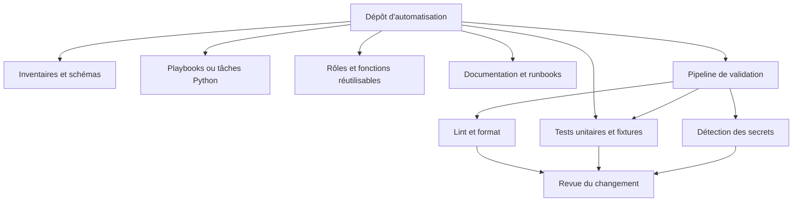

Une structure de départ possible :

```text
network-automation/
  README.md
  requirements.txt
  ansible.cfg
  inventories/
    lab/
      hosts.yml
      group_vars/
    staging/
      hosts.yml
  playbooks/
    collect_state.yml
    validate_policy.yml
    apply_change.yml
  roles/
    collect_facts/
    baseline_config/
  nornir_jobs/
    inventory.py
    tasks.py
    runner.py
  tests/
    fixtures/
    test_inventory.py
    test_result_schema.py
  schemas/
    target-inventory.schema.json
    result.schema.json
  reports/
    .gitkeep
```

Cette structure est une proposition, pas une obligation. Il faut l'ajuster au nombre de plateformes et aux conventions de l'équipe. Évite les copies de tâches qui dérivent entre elles ; place les logiques communes dans des rôles ou fonctions et documente les exceptions. La cohérence est plus importante qu'une architecture compliquée.

Les rapports volumineux ou sensibles ne doivent pas forcément être versionnés avec le code. Pour les artefacts qui doivent être conservés, définis un stockage, des permissions, une durée de rétention et une politique de masquage. Le dépôt devrait garder les tests et les exemples synthétiques, afin que les développeurs puissent reproduire les validations sans connaître les secrets de l'environnement réel.

### E. Séparer la collecte, la planification et le changement

Une collecte lit l'état ; une planification compare l'état observé à une cible ; une application modifie l'état ; une vérification relit le système. Il est dangereux de mélanger ces étapes dans un gros script où la lecture d'une donnée déclenche implicitement une écriture. La séparation facilite la revue, les tests, la reprise et la réduction des permissions.

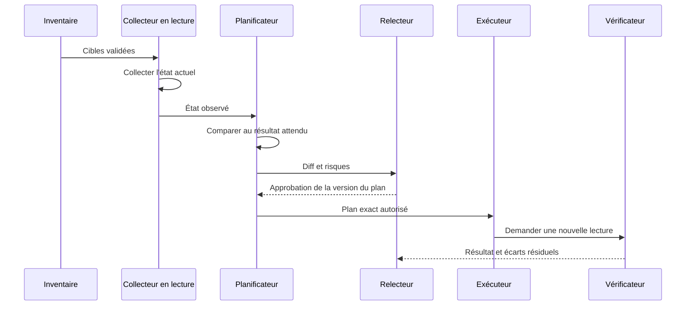

Un job de collecte ne devrait pas disposer des droits de modification. Le planificateur peut travailler sans accès en écriture au réseau. Le service qui applique le changement reçoit uniquement un plan approuvé et une identité disposant de droits limités. Le vérificateur doit s'appuyer sur des observations pertinentes, idéalement indépendantes du code qui a effectué le changement.

Cette séparation permet aussi de faire du mode « plan seulement » en continu. Le système peut comparer le plan actuel à l'intention, publier les écarts et demander une revue, sans appliquer quoi que ce soit. Le fait de produire un diff propre ne signifie pas qu'il est sans danger : une règle supprimée ou déplacée peut avoir des effets importants sur un flux existant.

### F. Utiliser Ansible de manière déclarative

Ansible est souvent efficace lorsque l'objectif peut être décrit comme un état souhaité. Les tâches devraient s'appuyer sur des modules qui comprennent l'état de la cible plutôt que lancer systématiquement des commandes brutes. Lorsqu'un module ne connaît pas la sémantique du système cible, il faut compenser par des contrôles explicites et ne pas supposer qu'un mode check est disponible.

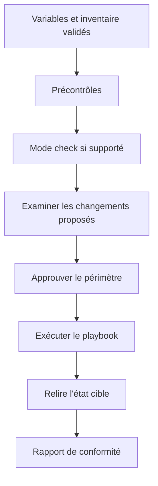

Exemple de playbook de collecte qui ne modifie pas la configuration :

```yaml
- name: Collecter un état réseau de laboratoire
  hosts: lab_switches
  gather_facts: false
  serial: 2
  tasks:
    - name: Vérifier que l'identifiant de cible est défini
      ansible.builtin.assert:
        that:
          - inventory_hostname is defined
          - inventory_hostname | length > 0
        fail_msg: "Identifiant de cible absent"

    - name: Afficher un marqueur de collecte
      ansible.builtin.debug:
        msg:
          target: "{{ inventory_hostname }}"
          mode: "read_only_lab"
```

Ce playbook illustre la structure et la validation d'un inventaire ; il n'interroge pas réellement l'état d'un équipement. Pour la collecte réelle, utilise les modules ou collections supportés par la plateforme, valide leur version, limite les permissions et vérifie le schéma de sortie. N'utilise pas ansible.builtin.debug comme preuve d'une collecte réseau : il affiche seulement les valeurs données au playbook.

Le mode check d'Ansible est une aide utile, mais il n'est pas équivalent à une simulation complète pour chaque module. Certains modules ne sont pas pris en charge, certains états dépendent du système réel, et les tâches reposant sur des commandes brutes peuvent avoir des résultats insuffisants. Lis la documentation du module utilisé, teste son comportement dans le laboratoire et exige une validation indépendante après l'application.

### G. Organiser Nornir et les tâches Python

Nornir fournit un modèle Python pour les inventaires et l'exécution des tâches. Il convient lorsque les opérations demandent un traitement personnalisé, l'appel de bibliothèques spécialisées ou la composition de résultats. La qualité dépend de la structure du code : chaque tâche doit avoir une responsabilité simple, les exceptions doivent être représentées, et l'exécution sur plusieurs cibles doit avoir une limite de concurrence maîtrisée.

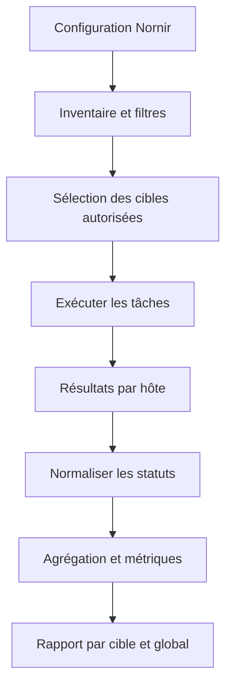

Exemple de fonction de normalisation des résultats, indépendante de Nornir pour faciliter les tests :

```python
from dataclasses import dataclass
from typing import Any

@dataclass
class OperationResult:
    target_id: str
    status: str
    duration_ms: int
    details: dict[str, Any]
    error_code: str | None = None

VALID_STATUSES = {"success", "partial", "failed", "unknown"}

def normalize_result(target_id, raw_status, duration_ms, details=None, error=None):
    status_map = {
        "ok": "success",
        "changed": "success",
        "timeout": "partial",
        "failed": "failed",
        "unreachable": "unknown",
    }
    status = status_map.get(raw_status, "unknown")
    if status not in VALID_STATUSES:
        status = "unknown"
    return OperationResult(
        target_id=str(target_id),
        status=status,
        duration_ms=max(0, int(duration_ms)),
        details=details if isinstance(details, dict) else {},
        error_code=error,
    )
```

Ce code sert d'exemple de normalisation, pas de remplacement de l'objet résultat natif d'une version particulière de Nornir. Le mapping réel doit être écrit en fonction des plugins utilisés et de leurs statuts. Une cible inaccessible est présentée comme inconnue plutôt que conforme. Une réponse brute ne doit pas être acceptée sans vérifier son type et ses champs.

Garde les fonctions indépendantes du transport lorsque c'est possible. La logique métier peut recevoir une structure déjà collectée et en dériver un résultat attendu ; le module de connexion reste responsable de l'accès à l'équipement. Cela simplifie les tests unitaires, permet de simuler les réponses et évite d'avoir besoin d'un vrai équipement pour tester les règles de décision.

### H. Contrôler la concurrence, le temps et le budget de reprise

Le parallélisme peut accélérer une collecte, mais chaque connexion consomme des ressources côté contrôleur et côté cible. Une trop grande concurrence peut saturer le plan de gestion, déclencher une limitation de débit ou rendre les résultats moins fiables. Le degré de concurrence doit être choisi par mesure et limité par un paramètre explicite.

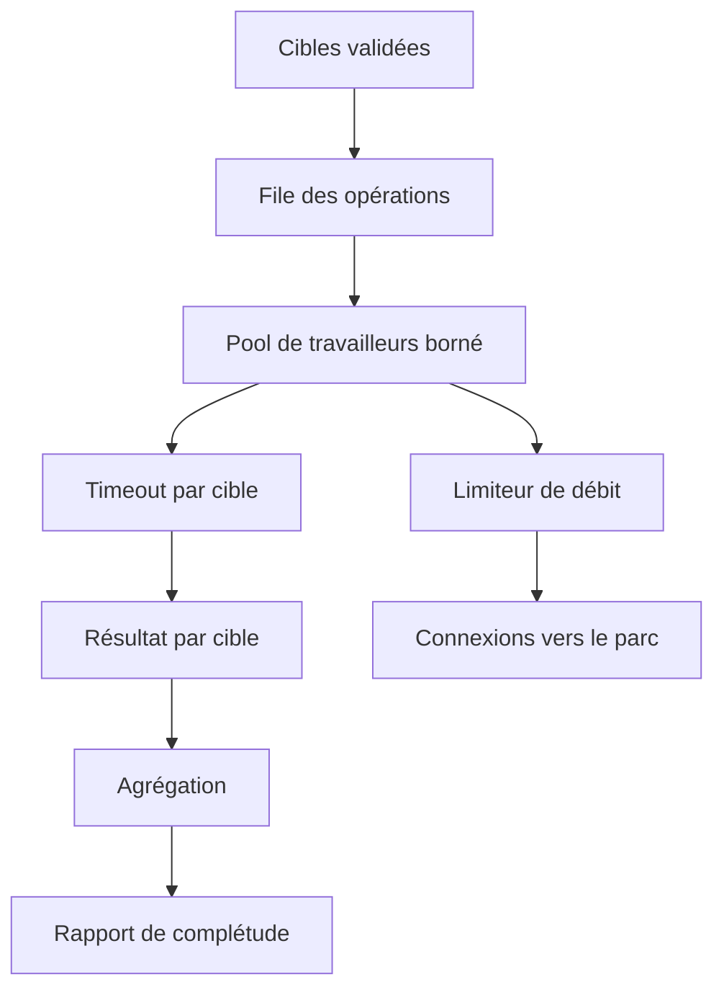

Les tentatives supplémentaires doivent être réservées aux erreurs transitoires. Un refus d'accès ne sera généralement pas corrigé par dix nouvelles tentatives. Chaque cible dispose d'un timeout, d'un nombre maximal d'essais et, si nécessaire, d'une pause progressive. Le budget total du job doit inclure les reprises afin qu'un petit nombre de systèmes en panne ne bloque pas indéfiniment le traitement du reste du parc.

Il faut aussi considérer les opérations concurrentes sur une même ressource. Deux jobs de configuration qui s'exécutent au même moment peuvent écraser mutuellement leurs changements. Pour les tâches modifiantes, définis un verrou par cible ou un mécanisme de réservation, une règle de priorité et une procédure de reprise lorsque le job s'arrête. Le verrou n'est pas une autorisation : les contrôles d'accès doivent toujours être appliqués.

Les résultats doivent être conservés même si le job est partiellement en échec. Le rapport global indique le nombre de cibles attendues, terminées, réussies, partiellement traitées et inconnues. Ne déduis pas la réussite globale du seul code retour d'une sous-tâche. Un code de sortie doit suivre le contrat du job et permettre à l'ordonnanceur de distinguer un succès complet d'une collecte partielle.

### I. Gérer les secrets, les identités et les permissions

Un outil qui automatise le réseau peut avoir accès à des ressources sensibles. Ne stocke pas les mots de passe dans l'inventaire, les playbooks, les notebooks, les fichiers de test ou les messages d'erreur. Utilise un gestionnaire de secrets ou un mécanisme approuvé, une identité de service dédiée et des permissions minimales. La lecture de l'état doit être séparée des droits de configuration lorsque les outils le permettent.

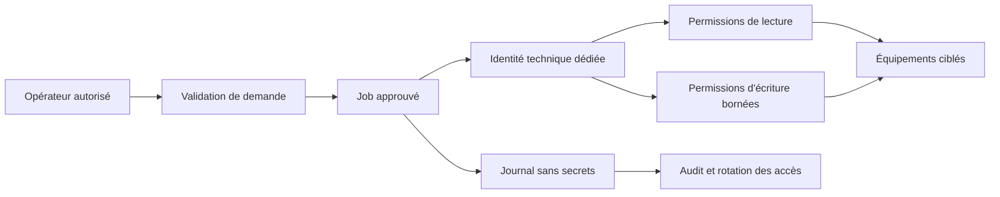

Les identités différentes permettent de réduire le risque d'un script compromis. Le compte de collecte n'a pas besoin de modifier les configurations. Le compte utilisé pour un changement peut être distinct et activé uniquement lorsque le job est approuvé. La séparation n'est efficace que si les identifiants ne peuvent pas être récupérés par le collecteur ou un utilisateur non autorisé.

La rotation des secrets doit être testée pour éviter les interruptions imprévues. Les erreurs d'authentification doivent être visibles sans afficher les identifiants. Si un secret est potentiellement exposé, révoque-le, vérifie les journaux et artefacts de CI, et détermine si des accès ont été effectués. Un secret retiré du dernier commit peut toujours exister dans l'historique et les copies.

### J. Tester l'idempotence et le comportement réel des modules

Une opération idempotente peut être rejouée sans créer de changements supplémentaires une fois l'état cible atteint. En automatisation réseau, cette propriété est essentielle pour les jobs planifiés et les reprises après panne. Elle dépend du module, du système cible et de la manière dont la tâche décrit l'état attendu ; elle ne doit pas être supposée.

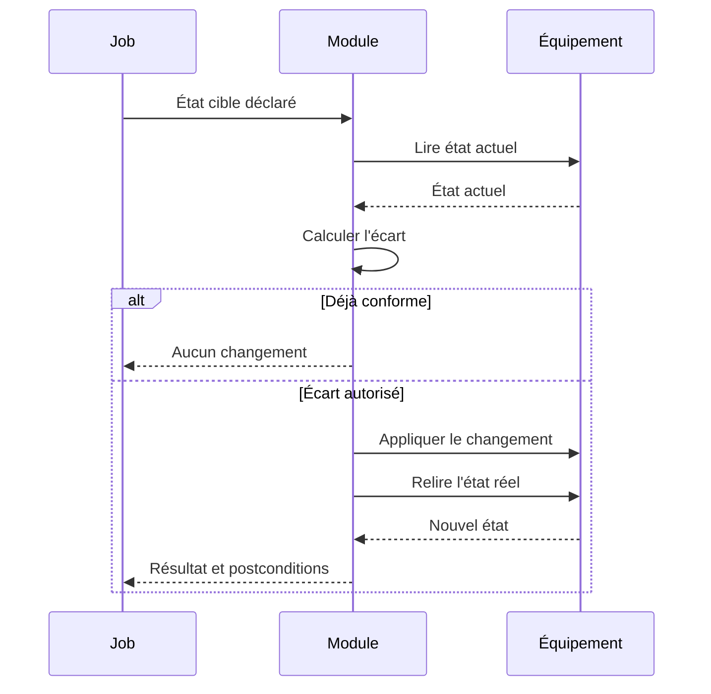

Un test utile exécute deux fois la même tâche sur le même état de laboratoire. Le premier passage peut annoncer un changement ; le second devrait annoncer qu'aucun changement supplémentaire n'est nécessaire, si le module est réellement déclaratif et si l'état n'a pas évolué. Si le second passage change encore la cible, enquête : la comparaison peut être instable, l'ordre de configuration peut varier ou la tâche peut effectuer des effets secondaires.

Il faut tester les cas où le module ne peut pas lire l'état, où l'état renvoyé ne correspond pas au schéma attendu ou où la commande de modification réussit mais la vérification échoue. Le résultat ne doit pas être simplement « tâche terminée ». Il doit inclure un statut qui indique si l'état final a été observé et si les propriétés attendues sont satisfaites.

Les tests doivent couvrir les limites de chaque plateforme. Un module peut être déclaré compatible avec une technologie sans prendre en charge toutes les fonctions d'une version donnée. Vérifie les exigences de connexion, les versions de collections, la syntaxe attendue et les contraintes de simulation. Si un module ne prend pas en charge la vérification nécessaire, ajoute une collecte indépendante ou bloque l'automatisation d'écriture.

### K. Écrire des tests indépendants des équipements

Les fonctions de validation, de normalisation et de comparaison de configuration se testent sans connexion réseau. Prépare des fixtures représentant l'état souhaité, un état conforme, une dérive connue, une donnée absente et une réponse corrompue. Le test doit vérifier non seulement la sortie de la fonction, mais aussi que le statut ne peut pas devenir « conforme » si une donnée nécessaire manque.

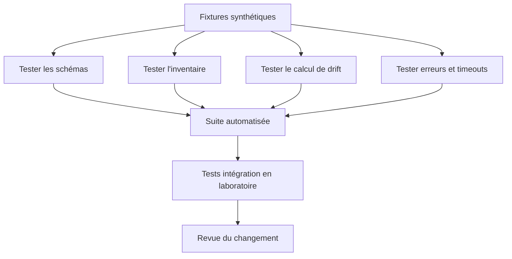

Un exemple Python de comparaison entre état attendu et état observé :

```python
def compare_state(expected, observed):
    missing = sorted(set(expected) - set(observed))
    unexpected = sorted(set(observed) - set(expected))
    differences = {
        key: {
            "expected": expected[key],
            "observed": observed[key],
        }
        for key in expected.keys() & observed.keys()
        if expected[key] != observed[key]
    }

    if missing:
        status = "unknown"
    elif differences or unexpected:
        status = "non_compliant"
    else:
        status = "compliant"

    return {
        "status": status,
        "missing": missing,
        "unexpected": unexpected,
        "differences": differences,
    }

expected = {"ntp": "ntp.lab.example", "logging": True}
observed = {"ntp": "ntp.lab.example", "logging": False}
print(compare_state(expected, observed))
```

Ce code compare des dictionnaires synthétiques, pas une configuration réseau complète. Dans un vrai système, les valeurs peuvent avoir des représentations différentes qui sont pourtant équivalentes, ou des champs en lecture seule qui changent d'eux-mêmes. Définis donc une normalisation et un schéma par type de ressource avant la comparaison. Les règles d'équivalence doivent être documentées et testées ; il ne faut pas ignorer arbitrairement des différences parce qu'elles gênent le rapport.

Les tests d'intégration utilisent ensuite une maquette ou un environnement dédié, avec une portée réduite et des secrets réservés au test. Ils vérifient l'authentification, les capacités du module, le comportement de la plateforme, la lecture de l'état réel et le rollback. Un test en production n'est pas une alternative à un environnement de test simplement parce qu'il est plus représentatif.

### L. Faire de la simulation une véritable étape de décision

Le mode check ou dry-run est utile mais ne remplace pas toutes les autres validations. Le niveau de simulation dépend du module, de la plateforme, de la qualité de l'inventaire et des appels exécutés. Un playbook peut afficher une intention de changement sans savoir si la plateforme acceptera chaque opération, et un script Python peut annoncer un plan sans avoir simulé les effets secondaires.

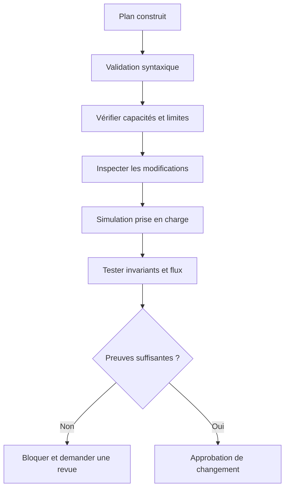

Une simulation de qualité devrait montrer les cibles concernées, les modifications prévues, les règles supprimées, les risques connus et les éléments qui n'ont pas pu être simulés. Les zones inconnues doivent être signalées. Si le module ne supporte pas le mode check, n'appelle pas le résultat « dry-run réussi » simplement parce que la tâche a été limitée à quelques commandes de lecture.

Le plan d'une modification de réseau doit aussi être confronté au contexte actuel. Si le service est en panne, si l'inventaire vient de changer ou si une autre intervention est en cours, les hypothèses de simulation peuvent ne plus être vraies. Avant l'application, revalide les préconditions essentielles et vérifie que l'approbation se rapporte toujours au plan exact.

### M. Déployer par lots et prévoir le retour arrière

Une stratégie de déploiement par lots réduit l'étendue d'un incident potentiel. Le premier lot doit être limité et représentatif, mais ne doit pas contenir d'emblée tous les systèmes critiques. Après chaque lot, contrôle les indicateurs prévus, l'accessibilité de gestion, les tests de flux et les alertes. Poursuis seulement si les critères de progression sont respectés.

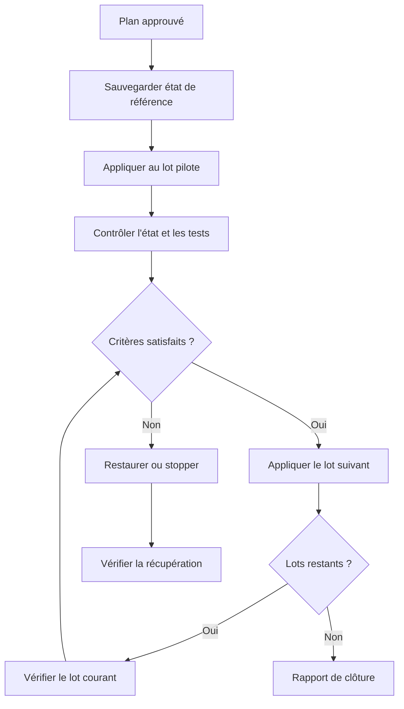

Le plan de rollback doit préciser le propriétaire, la version de la configuration de référence, les conditions d'activation et la façon de confirmer que le service est restauré. Évite une restauration aveugle qui écraserait des changements légitimes intervenus après la sauvegarde. Si le contexte a changé, compare les états et fais approuver une reprise adaptée.

Pour les changements critiques, assure-toi que l'accès de gestion restera possible ou qu'une voie de récupération séparée est disponible. Un script qui peut couper la connexion qui le contrôle a besoin d'une stratégie explicite : mécanisme natif de confirmation, console hors bande, timer de restauration ou étape intermédiaire sur un équipement pilote selon les capacités. Les mécanismes concrets varient par plateforme ; ils doivent être testés dans la maquette.

### N. Détecter la dérive avec une classification utile

La conformité réseau est un état évalué avec des preuves, pas une simple réussite de tâche. Trois résultats doivent être séparés : conforme, non conforme et inconnu. Conforme signifie que les propriétés requises ont été observées et vérifiées ; non conforme signifie qu'une différence a été démontrée ; inconnu signifie que les données ou les capacités ne permettent pas de conclure.

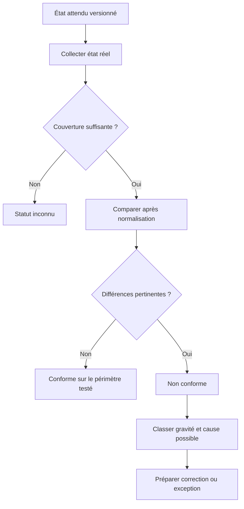

Le rapport de dérive doit identifier la ressource, la version de l'intention, les propriétés différentes, l'heure de collecte, la provenance, la gravité et la prochaine étape. Si l'état réel n'est pas observable, l'écart ne peut pas être classé comme inexistant. Il faut mesurer la couverture de collecte et montrer les ressources non vérifiables.

Le système ne doit pas automatiquement écraser toute différence. Un changement manuel peut être une intervention d'urgence approuvée, un nouvel état légitime à déclarer ou une erreur à corriger. Le contrôleur rassemble les faits, consulte l'historique des changements et propose la prochaine action. La correction automatique n'est acceptable que pour les catégories d'écarts explicitement approuvées, dans un périmètre borné et avec un mécanisme de reprise testé.

### O. Utiliser des exceptions temporaires et auditables

Dans un environnement réel, des exceptions peuvent être nécessaires : migration d'un service, dépendance transitoire, équipement ancien ou test ponctuel. Pour éviter qu'elles deviennent invisibles, exige un identifiant, une justification, un propriétaire, une portée minimale, une date d'expiration, un niveau de risque et une preuve de retrait.

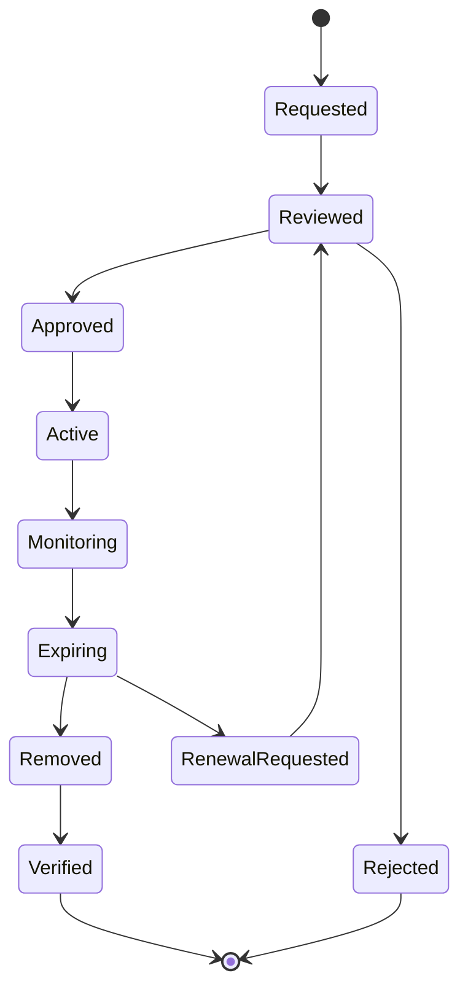

Une exception expirée doit cesser d'être considérée comme valide. Si le besoin persiste, une nouvelle demande doit justifier la durée supplémentaire et être revue. L'extension d'échéance ne doit pas être automatique sans limite. La revue doit également vérifier que l'exception n'autorise pas plus de ressources ou de protocoles que nécessaire.

Les rapports de conformité doivent indiquer quelles exceptions expliquent les écarts et quand elles expirent. Lorsqu'une politique dépend d'une exception, le retrait peut provoquer une interruption ; la procédure doit donc préciser les tests à réaliser et l'approbation requise. Le but est de rendre l'exception gouvernable, pas de la supprimer sans comprendre son impact.

### P. Rédiger un rapport de changement exploitable

Le rapport final doit relier la demande métier, la version d'intention, le plan généré, l'approbation, la liste des cibles, les opérations exécutées, les statuts, les tests après changement et les écarts restants. Un identifiant de demande commun permet de naviguer entre les journaux sans copier des informations sensibles dans tous les systèmes.

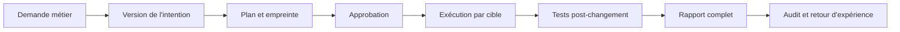

Le résumé doit dire ce qui est vérifié, ce qui a échoué et ce qui reste inconnu. Un rapport qui affirme « le déploiement a réussi » uniquement parce que le programme s'est terminé sans exception peut être dangereux. L'application peut avoir eu lieu sur une partie du parc, une cible peut être restée inaccessible et une propriété requise peut encore manquer.

```json
{
  "report_version": 1,
  "run_id": "network-job-lab-008",
  "intent_id": "guest-isolation",
  "intent_version": 3,
  "environment": "lab",
  "targets_expected": 8,
  "targets_observed": 7,
  "targets_compliant": 5,
  "targets_non_compliant": 1,
  "targets_unknown": 2,
  "change_applied": true,
  "postchecks_passed": false,
  "overall_status": "partial_failure",
  "next_step": "investigate_unverified_targets"
}
```

Les nombres sont fictifs. Le modèle illustre qu'un changement peut avoir été appliqué et que des vérifications peuvent néanmoins échouer. La taxonomie réelle doit définir si les catégories sont disjointes et comment la cible absente est comptée, afin d'éviter les totaux incohérents. Les résultats détaillés doivent être stockés dans un emplacement autorisé, avec un contrôle d'accès et une rétention adaptée.

### Q. Mesurer la qualité de l'automatisation

La qualité ne se mesure pas uniquement au temps nécessaire pour pousser une configuration. Les indicateurs peuvent inclure la proportion de cibles vérifiées, le taux de réussite des postconditions, les écarts résiduels, les actions annulées, les échecs de connexion, le nombre de changements bloqués en simulation et le temps de récupération après un changement incorrect.

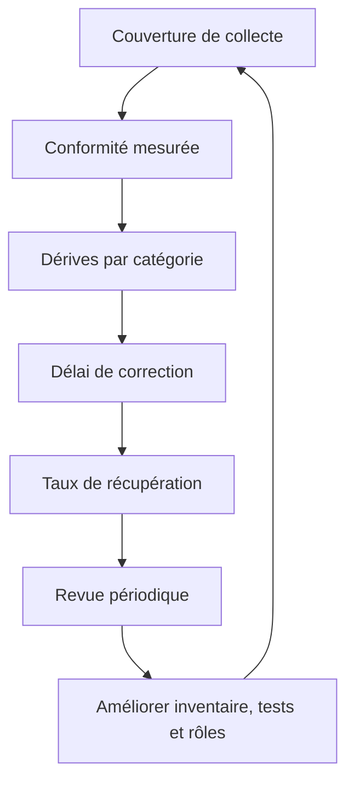

Une amélioration apparente peut être trompeuse si le système commence à ignorer les cibles qui échouent. Affiche toujours la couverture et le nombre de statuts inconnus. Une réduction du nombre de changements ne signifie pas nécessairement une meilleure sécurité : elle peut simplement montrer que les règles ne sont plus appliquées ou que les demandes sont bloquées sans résolution.

Définis les métriques avant le pilote. Chaque indicateur doit avoir une définition, une source, une période, un propriétaire et une action lorsque son seuil est dépassé. Les résultats doivent être comparés sur des périodes et des périmètres équivalents. Pour un petit échantillon, affiche les nombres absolus et ne présente pas un pourcentage comme une garantie.

### R. Étude de cas — harmoniser une politique sur plusieurs plateformes

Une organisation de laboratoire possède deux familles d'équipements de commutation et un pare-feu. Elle veut empêcher les postes invités d'initier des connexions vers un service de paiement, tout en préservant le DNS autorisé et les accès de maintenance légitimes. Les capacités de segmentation et de vérification diffèrent suivant les plateformes.

La première étape est d'identifier la source fiable de l'inventaire et de confirmer les appartenances aux groupes. La deuxième est de formaliser l'intention en règles et en invariants. La troisième consiste à vérifier les capacités de chaque équipement et à produire une traduction candidate. La quatrième est de créer une matrice de tests incluant les flux interdits. La cinquième est de simuler, faire relire, approuver puis déployer un lot pilote. Après l'application, on relit l'état réel et on vérifie les flux.

```mermaid
flowchart TD
    BIZ["Objectif : isoler le segment invité"] --> INV["Inventaire de confiance"]
    INV --> INTENT["Intention formalisée"]
    INTENT --> CAP["Vérification des capacités"]
    CAP --> PLAN["Traduction par plateforme"]
    PLAN --> TESTS["Tests autorisés et interdits"]
    TESTS --> DRY["Simulation et diff"]
    DRY --> APPROVE["Approbation"]
    APPROVE --> PILOT["Pilote sur périmètre réduit"]
    PILOT --> VERIFY["Read-back et tests de flux"]
    VERIFY --> GO{"Invariants vérifiés ?"}
    GO -- Non --> STOP["Stopper et restaurer selon le plan"]
    GO -- Oui --> NEXT["Étendre progressivement"]
```

Si une plateforme ne sait pas appliquer un contrôle nécessaire, le système ne doit pas inventer une règle ou prétendre que l'intention complète est garantie. Il peut bloquer le changement et proposer une solution de substitution documentée. Si une cible ne répond pas, son état demeure inconnu. Si les tests négatifs ne peuvent pas être exécutés, la conformité reste partiellement vérifiée.

La clôture de changement doit fournir le plan approuvé, l'empreinte de la configuration candidate, les résultats de tests, la couverture de collecte, les écarts résiduels, l'identité de l'approbateur et la méthode de rollback. Ce dossier rend la décision compréhensible et permet de comparer le résultat avec les futures révisions de politique.

### S. Revue de conception — questions à poser avant chaque déploiement

Avant une modification, pose les questions suivantes et conserve les réponses dans le dossier de changement. Est-ce que l'intention est exprimée en propriétés qui se testent ? L'inventaire est-il frais ? Les cibles ont-elles les capacités requises ? Le plan contient-il des suppressions inattendues ? Les tests positifs comme négatifs sont-ils prêts ? Le mécanisme de simulation couvre-t-il vraiment le module utilisé ? Les changements sont-ils approuvés pour cette version précise ? L'accès au plan de gestion peut-il être conservé ou restauré ? Le résultat final sera-t-il observé ? Les statuts inconnus restent-ils visibles ?

```mermaid
flowchart TD
    Q["Revue avant déploiement"] --> I{"Intention testable ?"}
    I -- Non --> BLOCK["Bloquer"]
    I -- Oui --> CAP{"Capacités suffisantes ?"}
    CAP -- Non --> BLOCK
    CAP -- Oui --> TEST{"Tests et simulation disponibles ?"}
    TEST -- Non --> BLOCK
    TEST -- Oui --> RB{"Rollback préparé ?"}
    RB -- Non --> BLOCK
    RB -- Oui --> APPROVAL{"Approbation liée au plan ?"}
    APPROVAL -- Non --> BLOCK
    APPROVAL -- Oui --> DEPLOY["Déploiement limité et vérifié"]
```

Cette revue doit empêcher les changements dont les préconditions sont inconnues, et non simplement remplir un formulaire. Un refus doit expliquer quelle preuve manque et ce qui permettrait de poursuivre. La personne qui approuve doit pouvoir comprendre l'impact attendu et le coût potentiel de l'échec.

Après le déploiement, la revue s'intéresse aux faits : le résultat a-t-il été mesuré, combien de cibles sont vérifiables, quels écarts restent, la procédure de retour arrière a-t-elle été nécessaire, et quels tests doivent être ajoutés ? Le rapport doit nourrir l'amélioration du dépôt et de l'inventaire.

### T. Synthèse de l'atelier

L'automatisation réseau à l'aide d'Ansible et Nornir doit rester contrôlable, même lorsque le parc est hétérogène. L'inventaire indique quelles ressources peuvent être ciblées ; le contrat de tâche décrit le résultat attendu ; les contrôles préalables vérifient les entrées et les capacités ; l'exécution est bornée ; les résultats sont normalisés ; les postconditions prouvent l'état obtenu. La collecte, la planification, l'application et la vérification doivent rester des étapes distinguables.

Un outil n'est fiable que s'il distingue le succès d'un état inconnu, limite la concurrence, évite les effets non idempotents, protège les secrets et fournit un rapport reproductible. La simulation et les tests sont utiles mais dépendent de la prise en charge réelle des modules et équipements. Toute action modifiante nécessite un périmètre autorisé, une approbation appropriée, une méthode de reprise et une vérification après action.

Au niveau débutant, construis d'abord un job de lecture seule, valide son inventaire, teste ses réponses simulées, puis compare l'état observé à un état cible. Une fois cette chaîne fiable, ajoute un déploiement de laboratoire progressivement. Ne considère pas la vitesse d'exécution comme la seule mesure de succès : l'objectif est de rendre les opérations plus répétables, explicables et sûres.


## Défi final corrigé — inventaire et déploiement réseau contrôlé

### Énoncé

Tu dois recueillir les versions et l'état des interfaces sur vingt équipements, puis pousser une bannière commune sur cinq commutateurs de laboratoire. Le collecteur doit tolérer une panne d'équipement, mais le changement doit s'arrêter si un précontrôle échoue. Propose une solution Ansible pour la configuration et explique où Nornir peut compléter le workflow.

### Séquence de travail

```mermaid
flowchart TD
  A["Inventaire explicite"] --> B["Contrôle d'accès et connectivité"]
  B --> C["Collecte en lecture seule"]
  C --> D["Rapport de précontrôle"]
  D --> E{"Toutes les cibles autorisées ?"}
  E -- "Non" --> F["Exclure et signaler les cibles"]
  E -- "Oui" --> G["Plan de changement"]
  G --> H["Approbation du périmètre"]
  H --> I["Déploiement limité et idempotent"]
  I --> J["Read-back et comparaison"]
  J --> K["Rapport et rollback si nécessaire"]
```

### Exemple Ansible

```yaml
- name: Précontrôle avant changement limité
  hosts: lab_switches
  gather_facts: false
  serial: 1
  any_errors_fatal: true
  tasks:
    - name: Vérifier que la cible est joignable
      ansible.netcommon.cli_command:
        command: show version
      register: version_output
      changed_when: false

    - name: Vérifier un identifiant attendu du laboratoire
      ansible.builtin.assert:
        that:
          - version_output.stdout is defined
          - version_output.stdout | length > 0
        fail_msg: "Précontrôle incomplet : aucune sortie exploitable"

    - name: Déployer uniquement après précontrôle
      ansible.netcommon.cli_config:
        lines:
          - "banner motd ^CAccès réservé au laboratoire^C"
```

Adapte les collections, le transport et la syntaxe à la plateforme cible. Ce playbook illustre la structure et ne doit pas être lancé sur un parc réel sans validation du pilote, du mode de configuration et de la stratégie de rollback.

### Proposition de correction

L'inventaire est la source de vérité pour les noms, groupes, familles d'OS, adresses et paramètres non secrets. Les identifiants restent dans un coffre ou le mécanisme sécurisé de l'environnement d'exécution. Les tâches de collecte sont en lecture seule et marquées comme non modificatrices. Nornir peut être utile lorsque le traitement en Python, l'orchestration de tâches et la concurrence par équipement doivent être personnalisés ; Ansible reste souvent plus lisible pour des états déclaratifs et des playbooks partagés.

Le changement doit commencer sur un équipement de laboratoire, puis sur un petit lot, avec un contrôle de diff et une fenêtre d'intervention. Utilise un compte doté de droits minimaux, un timeout, une journalisation structurée et un résultat de validation distinct du simple résultat de connexion. Si le précontrôle échoue, aucun changement ne doit être tenté sur la cible concernée.

### Contrôles demandés

Vérifie une cible valide, une cible inaccessible, une cible de mauvaise famille et un playbook rejoué deux fois. Le second passage doit annoncer aucun changement si l'état cible est déjà présent. Prévois un rollback basé sur l'état sauvegardé ou le mécanisme supporté par la plateforme.

### Barème d'autoévaluation

- Inventaire maintenable et secrets séparés du dépôt.
- Collecte et changement séparés.
- Concurrence et arrêt contrôlés.
- Idempotence vérifiée par une seconde exécution.
- Précontrôle, read-back et retour arrière prévus.

## 11. Checklist et à retenir

- [ ] L'objectif métier et le service concerné sont explicites et mesurables.
- [ ] Chaque observation conserve provenance, horodatage, unité et qualité.
- [ ] La méthode a été comparée à une baseline simple.
- [ ] Les tests couvrent cas normaux, données manquantes et échecs.
- [ ] Les résultats sont ventilés par criticité et catégorie pertinente.
- [ ] Les permissions sont minimales et les secrets absents des journaux.
- [ ] Les décisions relient preuves, version, approbation et résultat.
- [ ] Chaque action risquée a préconditions, périmètre limité et rollback.
- [ ] Les mesures évaluent le service et les erreurs opérationnelles.
- [ ] Une procédure décrit abstention, escalade, suspension et revue.

### À retenir
Le but d'une démarche AIOps n'est pas d'automatiser chaque décision, mais de rendre les opérations plus rapides, cohérentes et vérifiables. Pour Outils (Ansible, Nornir), la qualité dépend des données, de l'adéquation de la technique, d'une évaluation honnête et de la vérification du résultat. Un système capable de reconnaître ses limites, de bloquer une action risquée et de transmettre un dossier de preuve peut être plus utile qu'un système qui agit toujours sans expliquer ses erreurs.

taux de réussite par plateforme, échecs de connexion, durée par cible, écarts post-déploiement, rollbacks par changement sont des mesures candidates, mais chacune doit être associée à un objectif, un propriétaire et une action lorsqu'elle franchit une limite. Le nombre de modèles ou d'alertes traitées n'est pas en soi une mesure de valeur. La boucle d'amélioration est complète quand les résultats confirment ou réfutent les hypothèses, les incidents sont documentés et les contrôles évoluent selon les erreurs observées. Structurer un dépôt de gestion de réseau avec Ansible, Nornir, inventaires et tests. Le maintien dans le temps implique de réviser les sources, tester la reprise et retirer une méthode quand ses limites dépassent son bénéfice.

## 12. Références

- https://docs.ansible.com/projects/ansible/latest/network/getting_started/
- https://nornir.readthedocs.io/
- https://opentelemetry.io/docs/ — documentation sur l'observabilité et la télémétrie.
- https://www.nist.gov/itl/ai-risk-management-framework — cadre de gestion des risques de l'IA.
