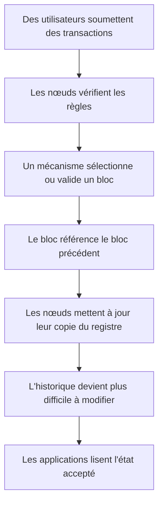
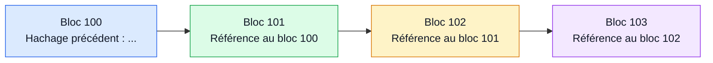
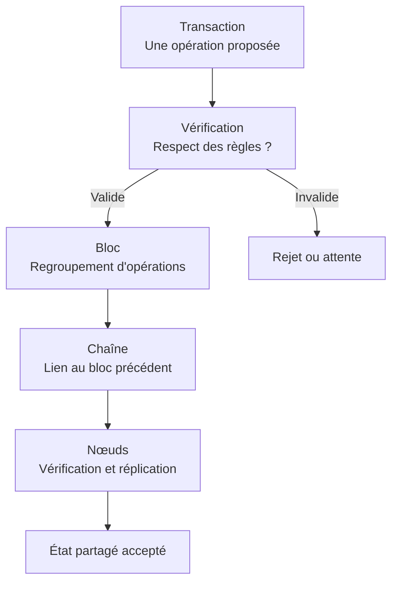
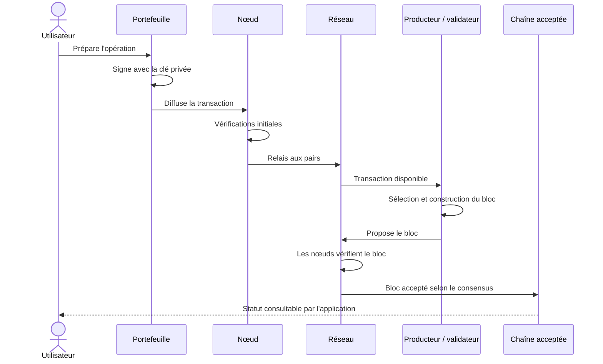
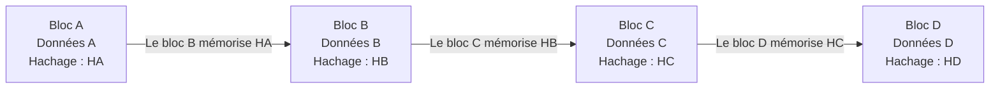
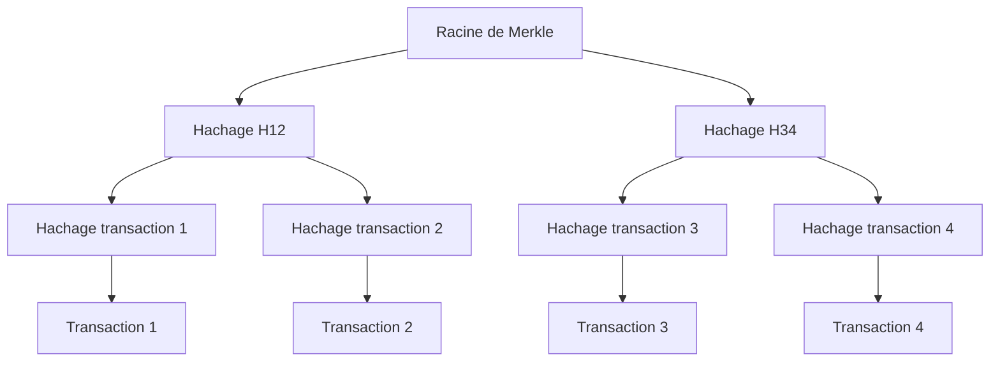
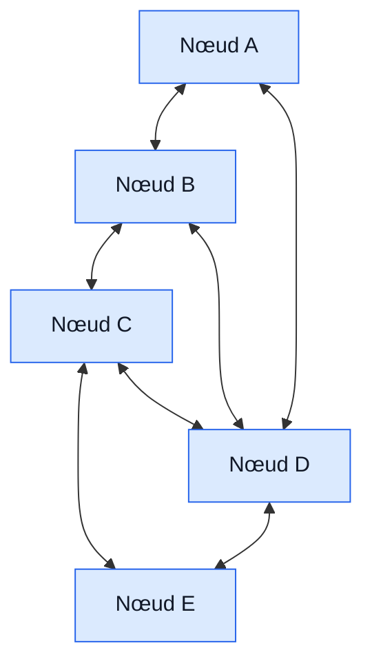
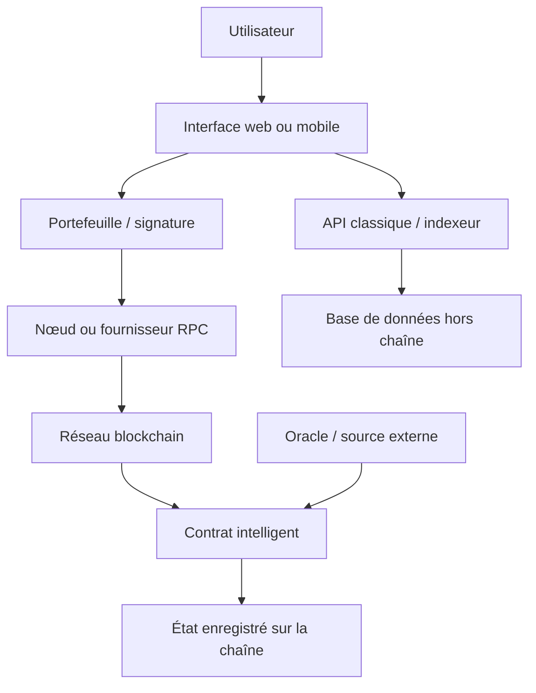
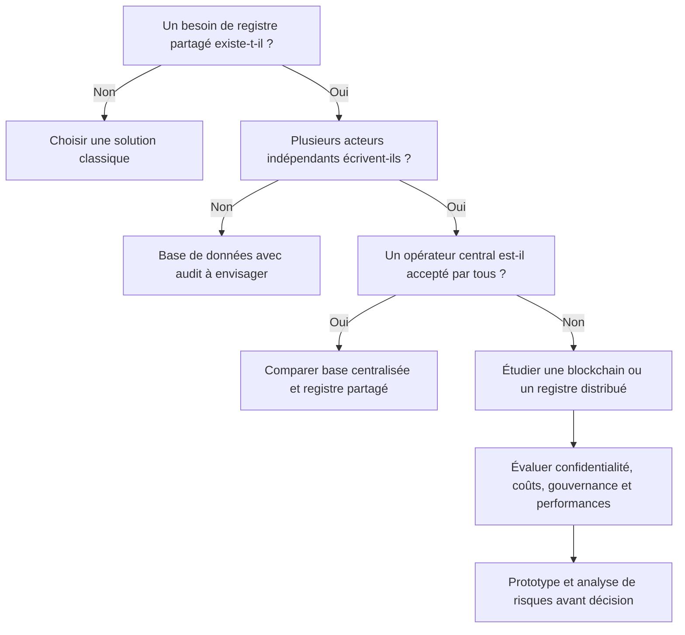

# Qu'est-ce que la blockchain ? — Niveau débutant

> **Parcours pédagogique :** Débutant → Intermédiaire → Expert  
> **Module :** Blockchain & Web3  
> **Niveau :** Débutant  
> **Durée indicative :** 2 h 30 à 3 h 30, exercices compris

## Sommaire

1. Mise en contexte : pourquoi parler de blockchain ?
2. Objectifs pédagogiques et prérequis
3. Définir une blockchain
4. Le problème de confiance
5. Transaction, bloc, chaîne et nœud
6. Le parcours d'une transaction
7. Hachage et chaînage cryptographique
8. Réseau distribué et décentralisation
9. Consensus
10. Immuabilité et limites
11. Types de blockchains
12. Bitcoin et Ethereum
13. Contrats intelligents et applications décentralisées
14. Ce que la blockchain n'est pas
15. Avantages, coûts et limites
16. Sécurité et menaces
17. Cas d'usage réalistes
18. Atelier pratique
19. Exercices corrigés
20. Mini-projet
21. Glossaire
22. Synthèse et préparation de la suite

## 1. Mise en contexte : pourquoi parler de blockchain ?

Imaginez une entreprise qui vend du matériel informatique. Chaque vente doit être enregistrée : date, référence, quantité, montant et état de la livraison. Au départ, le responsable conserve un fichier sur son ordinateur. Si cet ordinateur tombe en panne, le registre risque d'être perdu. Si plusieurs employés modifient des copies différentes, les versions peuvent diverger. Si quelqu'un change discrètement une ligne, il devient difficile de savoir quelle version est correcte.

Une solution classique consiste à placer le fichier sur un serveur central, à contrôler les droits d'accès, à effectuer des sauvegardes et à journaliser les modifications. C'est souvent une excellente solution. Elle repose cependant sur une organisation qui contrôle le serveur et sur des procédures : les utilisateurs doivent pouvoir croire que le système applique les règles, que les administrateurs respectent leurs responsabilités et que les sauvegardes sont fiables.

La blockchain propose une autre approche pour certains contextes : tenir un registre numérique dont les participants conservent des copies, dont les nouvelles entrées sont ordonnées selon des règles communes et dont l'historique est rendu difficile à modifier sans que la modification soit détectée ou acceptée par le réseau. Au lieu de faire confiance uniquement à un propriétaire central, les participants s'appuient sur des mécanismes cryptographiques, un protocole et un mécanisme de consensus.

Cette description ne signifie pas que toute blockchain est parfaitement décentralisée, invulnérable ou adaptée à toutes les applications. Une blockchain est un compromis technique, économique et organisationnel. Elle peut être utile lorsque plusieurs acteurs doivent partager un historique commun sans vouloir confier toute l'autorité à une seule organisation. Elle peut être moins adaptée lorsqu'une base de données classique répond déjà au besoin avec davantage de simplicité, de confidentialité et de performance.

> **Mise en contexte :** la question centrale n'est pas « comment utiliser la blockchain ? », mais « quel problème de coordination et de confiance cherche-t-on à résoudre ? »

Avant de choisir cette technologie, il faut identifier les acteurs, les données, les règles de validation, les droits de modification, les besoins de confidentialité et le coût acceptable. Si une seule organisation est responsable du service et que les autres utilisateurs lui font confiance, une base de données traditionnelle peut être plus pertinente. Si plusieurs organisations indépendantes doivent partager un registre et vérifier les mêmes règles, une blockchain peut mériter une étude.

### Exemple : suivre un équipement

Un ordinateur portable est fabriqué, expédié, réceptionné par un distributeur, vendu à une entreprise puis réparé. Plusieurs organisations interviennent, chacune possédant son propre système d'information. Un registre partagé pourrait enregistrer les événements « expédié », « reçu », « vendu » et « réparé ». Les acteurs autorisés pourraient vérifier que l'historique n'a pas été modifié unilatéralement après coup.

Attention : la blockchain ne garantit pas qu'une personne a réellement réceptionné l'ordinateur ni que la déclaration « réparé » est vraie. Elle peut protéger l'intégrité de l'enregistrement après son ajout, mais la qualité de l'information initiale dépend des personnes, capteurs et procédures qui l'ont fournie. C'est le problème résumé par l'expression « garbage in, garbage out » : une information fausse entrée dans un système peut rester fausse même si elle est conservée de manière robuste.

## 2. Objectifs pédagogiques et prérequis

Aucun prérequis en programmation, cryptographie ou finance n'est nécessaire. Il suffit de savoir ce qu'est un fichier, une application et un réseau informatique. Les notions techniques seront introduites progressivement.

À la fin de ce cours, vous serez capable de :

1. définir une blockchain avec des mots simples et précis ;
2. expliquer pourquoi un registre partagé peut nécessiter des règles de confiance ;
3. distinguer une transaction, un bloc, une chaîne, un nœud et un réseau ;
4. décrire le parcours général d'une transaction ;
5. expliquer le rôle d'un hachage cryptographique dans le chaînage des blocs ;
6. distinguer réplication, décentralisation et consensus ;
7. expliquer pourquoi l'immuabilité est relative et non magique ;
8. différencier une blockchain publique d'un réseau privé ou permissionné ;
9. identifier les différences générales entre Bitcoin et Ethereum ;
10. reconnaître les promesses exagérées et les limites pratiques ;
11. simuler sur papier un petit registre partagé ;
12. déterminer si une situation donnée justifie ou non une blockchain.

### Vocabulaire de départ

Un **registre** est un ensemble structuré d'enregistrements. Une **transaction** est une opération soumise à des règles de validation. Un **nœud** est un participant informatique qui exécute certaines fonctions du protocole. Un **hachage** est une empreinte calculée à partir de données. Le **consensus** est le mécanisme qui permet au réseau de s'accorder sur l'ordre ou l'état accepté. Ces termes seront détaillés dans les sections suivantes.

## 3. Définir une blockchain

Une **blockchain**, ou chaîne de blocs, est un registre numérique dans lequel des données sont regroupées en blocs liés cryptographiquement, puis répliquées et validées par un réseau selon des règles de protocole.

Cette définition contient plusieurs éléments importants :

- **Registre numérique :** les informations sont enregistrées sous forme de données informatiques.
- **Blocs :** les données sont regroupées en ensembles appelés blocs.
- **Lien cryptographique :** un bloc contient généralement l'empreinte du bloc précédent, ce qui relie l'historique.
- **Réplication :** plusieurs nœuds conservent ou reconstruisent une partie importante des mêmes données.
- **Règles communes :** les participants vérifient les opérations selon un protocole.
- **Consensus :** dans les systèmes qui doivent choisir entre plusieurs historiques possibles, un mécanisme détermine quelle chaîne ou quel état est accepté.

Toutes les blockchains ne fonctionnent pas de la même manière. Certaines sont ouvertes à tous, d'autres limitent les participants. Certaines utilisent une preuve de travail, d'autres une preuve d'enjeu ou d'autres mécanismes de consensus. Certaines sont conçues pour une monnaie numérique, d'autres pour exécuter des programmes, tracer des actifs ou coordonner des organisations.

### Schéma conceptuel

Ce schéma est volontairement simplifié. Selon le protocole, les transactions peuvent être vérifiées plusieurs fois, les blocs peuvent être proposés par des validateurs et la finalité peut être immédiate, probabiliste ou dépendre d'étapes supplémentaires. Le point essentiel est que l'enregistrement n'est pas simplement une ligne ajoutée par un utilisateur dans un fichier personnel : il doit respecter les règles du système partagé.

### Blockchain et base de données : quelle différence ?

Une base de données est un système de stockage et de gestion des données. Une blockchain est une forme particulière de registre distribué avec un mécanisme d'organisation de l'historique et des règles de validation. Les deux catégories ne s'opposent pas systématiquement : une application blockchain utilise souvent des bases de données ordinaires pour les profils, les recherches, les caches, les journaux d'application ou les fichiers volumineux.

Une base de données relationnelle classique peut proposer des transactions atomiques, des journaux, des sauvegardes, des contrôles d'accès et des traces d'audit. Elle peut être très fiable et sécurisée. La blockchain se distingue surtout par la façon dont plusieurs participants vérifient et partagent l'historique et par la manière dont le protocole arbitre les mises à jour. Elle n'est pas automatiquement plus rapide, plus confidentielle ou plus sûre qu'une base classique.

### Une analogie utile, mais imparfaite

Imaginez un cahier de comptes dont plusieurs personnes possèdent une copie. Quand une nouvelle opération est proposée, chacun vérifie qu'elle respecte les règles. Les opérations acceptées sont regroupées sur une nouvelle page. Cette page contient une empreinte de la page précédente. Si quelqu'un change une ancienne page, son empreinte change et les liens avec les pages suivantes ne correspondent plus.

Cette analogie permet de comprendre la réplication, les règles communes et le chaînage. Elle ne décrit pas toute la réalité : les systèmes informatiques utilisent des structures de données, des signatures numériques, des réseaux de communication et des algorithmes de consensus beaucoup plus précis. Les copies ne sont pas nécessairement parfaitement synchronisées à chaque instant.

## 4. Le problème de confiance

### 4.1 Le registre centralisé

Dans une architecture centralisée, une organisation ou un service contrôle le registre de référence. Les clients envoient leurs demandes au serveur, qui vérifie les droits et écrit les changements. Cette architecture est fréquente dans les banques, les systèmes de gestion, les plateformes de commerce et les applications d'entreprise.

Ses avantages sont nombreux : responsabilité claire, administration relativement simple, performances élevées, gestion des accès centralisée et possibilité de corriger les erreurs selon une procédure connue. L'organisation peut imposer une politique de sauvegarde, révoquer un compte compromis et appliquer les obligations légales.

Le risque principal n'est pas nécessairement une faiblesse technique. Il peut s'agir d'un point de contrôle unique, d'une panne, d'une erreur d'administration, d'un abus de privilèges ou d'un désaccord entre les organisations qui utilisent le registre. Si plusieurs acteurs ne veulent pas qu'un concurrent soit seul responsable de la version officielle, le modèle centralisé peut créer un problème de gouvernance.

### 4.2 Le registre partagé

Supposons que trois entreprises indépendantes échangent des composants. Chacune enregistre les expéditions et les réceptions dans son système. En cas de désaccord, les historiques peuvent différer : l'expéditeur déclare avoir envoyé dix pièces, le transporteur en a enregistré neuf et le destinataire affirme en avoir reçu huit.

Une base de données commune exploitée par un tiers pourrait résoudre le problème. Mais les entreprises doivent alors choisir ce tiers, déterminer ses responsabilités et accepter ses règles. Cette solution peut être la meilleure. Une blockchain devient intéressante seulement si le partage du contrôle, l'auditabilité et l'application commune de règles apportent une valeur suffisante pour compenser les coûts et la complexité.

### 4.3 La confiance n'est pas supprimée : elle est déplacée

Il est fréquent d'entendre que la blockchain « supprime la confiance ». Cette formule est trompeuse. Les utilisateurs doivent toujours faire confiance à certains éléments : le logiciel qu'ils exécutent, la sécurité de leur appareil, la protection de leurs clés, les règles du protocole, les personnes qui publient les données et parfois les opérateurs qui construisent ou maintiennent l'infrastructure.

La technologie permet plutôt de réduire la dépendance à un opérateur unique pour certaines décisions. Au lieu de demander à un seul propriétaire de confirmer chaque modification, les participants peuvent vérifier cryptographiquement les données et appliquer des règles communes. La confiance devient plus distribuée et plus explicite, mais elle ne disparaît pas.

### 4.4 Les questions à poser

Avant d'envisager une blockchain, posez-vous les questions suivantes :

- Plusieurs organisations indépendantes doivent-elles écrire dans le même registre ?
- Existe-t-il un opérateur central que tous acceptent comme autorité ?
- Les participants doivent-ils vérifier l'historique sans dépendre exclusivement d'un tiers ?
- Les règles de validation peuvent-elles être définies clairement ?
- Les données doivent-elles rester publiques, privées ou accessibles seulement à certains membres ?
- Le système peut-il tolérer une latence plus élevée et des coûts de coordination supplémentaires ?
- Comment traiter les erreurs, les litiges, les obligations de suppression et les mises à jour réglementaires ?

Si les réponses indiquent qu'un seul administrateur fiable peut gérer les données efficacement, une base de données traditionnelle est probablement un meilleur point de départ.

## 5. Transaction, bloc, chaîne et nœud

### 5.1 La transaction

Une transaction est une opération soumise au système. Dans un réseau de monnaie numérique, elle peut demander de transférer une valeur d'une adresse à une autre. Dans une application de traçabilité, elle peut représenter un événement. Dans un système d'exécution de programmes, elle peut demander l'appel d'une fonction.

Une transaction peut contenir ou référencer des données, une signature, des paramètres et des informations permettant au protocole de vérifier qu'elle est autorisée. Son format exact dépend de la blockchain.

Une transaction envoyée n'est pas nécessairement acceptée. Elle peut être mal formée, non signée, invalide, en conflit avec une autre opération ou trop coûteuse à traiter. Elle peut rester en attente, être abandonnée ou être incluse dans un bloc puis ne plus faire partie de l'historique canonique dans certains protocoles avant la finalité.

### 5.2 Le bloc

Un bloc est un conteneur de données. Dans de nombreux protocoles, il comprend une partie d'en-tête et un ensemble de transactions ou d'éléments de registre. L'en-tête peut contenir le hachage du bloc précédent, une racine cryptographique représentant les transactions et d'autres paramètres propres au protocole.

Le bloc n'est pas une boîte magique qui rend automatiquement les données vraies. Il regroupe les opérations retenues selon les règles du système. Les nœuds doivent encore vérifier les conditions applicables : signatures, soldes ou entrées disponibles, règles de consensus, limites de ressources et cohérence de l'état.

### 5.3 La chaîne

La chaîne résulte du lien entre les blocs. Si le bloc B référence l'empreinte du bloc A, et que le bloc C référence celle de B, les blocs forment un historique chaîné.

Ce lien rend la modification rétroactive détectable : modifier le contenu d'un bloc change son hachage, de sorte que le bloc suivant ne référence plus la bonne empreinte. Mais cette détection n'empêche pas à elle seule un attaquant de tenter de recalculer les blocs suivants ou de proposer une autre histoire. La résistance à une réécriture dépend aussi du mécanisme de consensus, de la distribution des participants et des hypothèses de sécurité du protocole.

### 5.4 Le nœud

Un nœud est un programme ou un appareil participant au réseau. Selon son rôle, il peut conserver l'historique, vérifier les transactions, relayer les messages, proposer des blocs, participer au consensus ou fournir des données aux applications.

Tous les nœuds ne possèdent pas nécessairement les mêmes responsabilités ni les mêmes données. Un nœud complet peut vérifier les règles et conserver une grande partie de l'historique. Un nœud léger peut s'appuyer sur des preuves ou sur d'autres nœuds pour certaines informations. Un validateur ou un producteur de blocs remplit un rôle particulier défini par le protocole.

Il est incorrect d'affirmer que chaque ordinateur du monde conserve toujours une copie complète de toutes les données. La topologie, les exigences matérielles et les modèles de participation varient selon la blockchain.

### 5.5 Le registre et l'état

L'historique des transactions et l'état courant sont deux notions liées mais différentes. L'historique décrit les opérations acceptées. L'état représente le résultat de leur application : par exemple, les soldes courants, les propriétaires enregistrés ou les variables d'un contrat intelligent.

Une application peut rejouer les transactions valides pour reconstruire l'état, ou utiliser des structures optimisées qui permettent d'accéder plus rapidement aux informations. Lorsqu'on consulte un solde, le nœud ne relit pas nécessairement chaque transaction depuis le début ; il utilise son état calculé et ses structures de données.

### 5.6 Résumé visuel

## 6. Le parcours d'une transaction

Le parcours exact varie d'une blockchain à l'autre. Voici un modèle général utile pour débuter.

### Étape 1 : l'utilisateur prépare une opération

L'utilisateur utilise un portefeuille, une application ou un outil pour créer une transaction. Le portefeuille prépare les données nécessaires : destinataire, montant ou paramètres, réseau cible et autres champs exigés par le protocole.

Le portefeuille est une interface qui aide à gérer des clés et à construire des opérations. Il ne contient pas nécessairement les pièces numériques elles-mêmes comme un objet physique. Sur de nombreux réseaux, les actifs et l'état sont enregistrés par le protocole ; le portefeuille permet à l'utilisateur de prouver qu'il est autorisé à effectuer une opération.

### Étape 2 : l'utilisateur signe

Dans les systèmes utilisant des signatures numériques, le portefeuille signe les données pertinentes avec une clé privée. Les nœuds peuvent vérifier la signature à l'aide de la clé publique ou d'un mécanisme dérivé prévu par le protocole.

La signature permet de vérifier qu'une opération a été autorisée par le détenteur de la clé correspondante et que les données signées n'ont pas été modifiées sans invalider la signature. Elle ne prouve pas automatiquement l'identité civile de la personne. Elle prouve une relation cryptographique avec une clé. Si une clé est volée, l'attaquant peut parfois produire des signatures techniquement valides.

**Règle de sécurité :** une clé privée ou une phrase de récupération ne doit jamais être partagée avec une personne qui prétend simplement « vérifier » un portefeuille. Une transaction signée peut être irréversible ou très difficile à annuler.

### Étape 3 : la transaction est diffusée

Le portefeuille transmet la transaction à un nœud, souvent via un fournisseur RPC ou un nœud local. Ce nœud peut vérifier sa forme et certaines règles de base, puis la relayer à d'autres nœuds.

Le réseau de diffusion est pair-à-pair dans de nombreuses blockchains : les nœuds échangent des messages sans passer systématiquement par un serveur central unique. Toutefois, les utilisateurs peuvent dépendre d'un fournisseur RPC, d'une interface ou d'un service d'accès particulier. La décentralisation réelle de l'expérience utilisateur dépend aussi de l'architecture utilisée autour du protocole.

### Étape 4 : les nœuds vérifient les règles

Les nœuds vérifient différents éléments selon le protocole : format, signature, autorisation, frais, absence de conflit avec les règles de dépense, limites de ressources et cohérence de l'opération. Une transaction invalide ne devrait pas être acceptée dans un bloc valide.

Les vérifications peuvent être réparties dans le temps. Un nœud peut effectuer des contrôles préliminaires lors de la réception, puis vérifier à nouveau les transactions lors de la validation d'un bloc. Un portefeuille qui affiche « transaction envoyée » indique généralement que l'opération a été transmise, pas qu'elle est définitivement enregistrée.

### Étape 5 : la transaction attend son inclusion

Dans certains systèmes, les transactions valides sont conservées temporairement dans une mémoire d'attente, souvent appelée mempool. Les producteurs de blocs ou validateurs sélectionnent ensuite les transactions selon les règles du protocole. Les priorités peuvent dépendre des frais, de la politique du producteur et d'autres critères.

Une transaction peut rester en attente si les frais sont insuffisants, si le réseau est congestionné ou si les conditions de l'opération ne sont pas réunies. Certains protocoles n'utilisent pas de mempool de la même façon ; le terme décrit un modèle fréquent, pas une règle universelle.

### Étape 6 : un bloc est proposé et vérifié

Un participant autorisé selon le mécanisme de consensus propose ou produit un bloc. Les autres nœuds vérifient le bloc, ses transactions et les règles de consensus. Ils ne doivent pas simplement croire le producteur : ils vérifient que le bloc respecte le protocole.

Si le bloc est invalide, les nœuds conformes aux règles ne devraient pas l'accepter. Si le bloc est valide, il peut être intégré à l'historique reconnu par le réseau. Dans certains systèmes, plusieurs blocs concurrents peuvent temporairement exister ; le consensus détermine progressivement ou explicitement l'historique retenu.

### Étape 7 : la transaction obtient des confirmations ou une finalité

Une transaction incluse dans un bloc peut être considérée comme confirmée. Dans les systèmes à finalité probabiliste, l'ajout de blocs ultérieurs rend généralement une réorganisation de plus en plus coûteuse ou improbable, sous certaines hypothèses. Dans les systèmes à finalité explicite, des conditions du protocole permettent d'indiquer qu'un bloc ne doit plus être réorganisé dans le fonctionnement normal.

Le nombre de confirmations nécessaire dépend du réseau, de la valeur de l'opération, du modèle de menace et du niveau de risque acceptable. Il n'existe pas de nombre universel adapté à toutes les blockchains et à toutes les transactions.

### Pourquoi le statut affiché peut-il être trompeur ?

Une interface peut afficher « envoyé », « en attente », « inclus », « confirmé », « finalisé » ou « échec ». Ces états ne sont pas synonymes. L'utilisateur doit comprendre le statut réel et le modèle de finalité du réseau. Une application sérieuse ne devrait pas présenter une transaction simplement diffusée comme irrévocablement finalisée.

Une transaction incluse peut également exécuter un contrat intelligent qui échoue. Selon la blockchain, la transaction peut être enregistrée et des frais peuvent être prélevés même si l'opération applicative n'aboutit pas comme prévu. Le détail dépend du modèle d'exécution.

## 7. Hachage et chaînage cryptographique

### 7.1 La fonction de hachage

Une fonction de hachage prend une entrée de taille variable et calcule une empreinte de taille fixe. Dans les systèmes adaptés à la sécurité, une bonne fonction de hachage vise plusieurs propriétés importantes :

- **Résistance à la préimage :** à partir d'une empreinte, il doit être impraticable de retrouver une entrée correspondante.
- **Résistance à la seconde préimage :** connaissant une entrée, il doit être impraticable de trouver une autre entrée produisant la même empreinte.
- **Résistance aux collisions :** il doit être impraticable de trouver deux entrées différentes ayant la même empreinte.

Ces propriétés sont formulées dans un modèle cryptographique et ne signifient pas qu'une fonction est mathématiquement impossible à casser. La sécurité dépend de l'algorithme choisi, de ses paramètres, de son implémentation et de l'évolution des capacités d'attaque.

Un hachage n'est pas un chiffrement. Le chiffrement vise à rendre un contenu illisible sans la clé appropriée. Le hachage produit une empreinte destinée notamment à vérifier l'intégrité ou à indexer des données. Il ne cache pas automatiquement les données d'origine.

### 7.2 Un exemple simple

Prenons le texte « Commande 104 : deux ordinateurs ». Une fonction de hachage déterministe calcule une empreinte à partir de cette chaîne. Si le texte devient « Commande 104 : trois ordinateurs », l'empreinte devrait être différente. Même une petite modification des données entraîne normalement une empreinte sans ressemblance évidente avec la précédente.

L'objectif pédagogique n'est pas de mémoriser une empreinte particulière, mais de comprendre le principe : les données sont représentées par une valeur calculée. Si les données changent, la valeur calculée change avec une probabilité extrêmement élevée pour un algorithme cryptographique robuste.

### 7.3 Le lien entre deux blocs

Un bloc contient généralement le hachage de l'en-tête du bloc précédent. Le hachage dépend du contenu de cet en-tête, qui peut lui-même représenter les transactions et d'autres éléments. Modifier un ancien bloc change donc son empreinte et rend incorrecte la référence conservée par le bloc suivant.

Supposons que quelqu'un modifie les données du bloc B. Son hachage HB devient HB'. Le bloc C contient encore l'ancienne référence HB : la chaîne ne correspond plus. Pour rendre l'historique cohérent, l'attaquant devrait reconstruire les blocs suivants et convaincre le réseau d'accepter l'histoire modifiée. Selon le protocole, cela peut exiger une quantité importante de ressources, un contrôle suffisant du consensus ou une compromission de la gouvernance.

### 7.4 Le chaînage ne suffit pas à lui seul

Une suite de fichiers contenant chacun le hachage du fichier précédent peut être construite sur un ordinateur personnel. Cette suite permet de détecter certaines modifications, mais elle ne devient pas automatiquement une blockchain distribuée et décentralisée. Si une seule personne contrôle tous les fichiers et peut recalculer toutes les empreintes, elle peut reconstruire une chaîne cohérente après modification.

Pour obtenir les propriétés recherchées par une blockchain, le chaînage doit être associé à des mécanismes de validation, à une réplication par plusieurs participants et à un consensus adapté. La résistance à la réécriture ne vient pas uniquement du fait que les blocs sont reliés : elle dépend de l'ensemble du système.

### 7.5 Arbres de Merkle

Certaines blockchains organisent les hachages des transactions dans un arbre de Merkle. Les transactions sont hachées, puis les empreintes sont combinées par paires jusqu'à obtenir une empreinte racine. Cette racine peut être incluse dans l'en-tête du bloc et représente cryptographiquement l'ensemble des transactions selon la construction utilisée.

Une telle structure permet de produire des preuves d'inclusion sans transmettre nécessairement toutes les transactions. Un client peut recevoir une transaction et les hachages nécessaires pour vérifier qu'elle contribue à la racine attendue. Cette technique est utile pour les clients légers et pour l'efficacité des vérifications.

Toutes les blockchains n'utilisent pas exactement le même type d'arbre ni la même construction. Le terme « racine de Merkle » désigne une technique courante, mais les structures précises dépendent du protocole.

## 8. Réseau distribué, réplication et décentralisation

Ces trois notions sont liées, mais elles ne veulent pas dire la même chose.

### 8.1 Distribué

Un système est distribué lorsque ses fonctions sont réparties entre plusieurs machines ou processus qui communiquent par un réseau. La distribution peut améliorer la disponibilité et permettre de répartir les tâches. Pourtant, un système distribué peut être contrôlé par une seule entreprise. Un service cloud composé de nombreux serveurs reste souvent sous l'autorité d'un seul opérateur.

### 8.2 Répliqué

La réplication consiste à conserver plusieurs copies de données. Elle peut permettre de récupérer les données en cas de panne et de rapprocher les utilisateurs de leurs données. Une base de données centralisée au niveau de la gouvernance peut parfaitement être répliquée sur plusieurs serveurs.

### 8.3 Décentralisé

La décentralisation concerne la répartition du contrôle, de la prise de décision et des possibilités de participation. Elle ne se mesure pas simplement au nombre de serveurs. Si une seule entreprise contrôle les clés d'administration, les logiciels, les mises à jour et les validateurs, l'architecture peut rester fortement centralisée même si les machines sont nombreuses.

Pour évaluer une blockchain, il faut examiner qui peut exécuter un nœud, qui peut proposer ou valider des blocs, qui contrôle les clés importantes, qui décide des mises à jour et quelles conséquences aurait la disparition d'un acteur majeur.

### 8.4 Le consensus

Dans un réseau où plusieurs participants peuvent proposer des informations, des désaccords peuvent apparaître. Deux blocs différents peuvent être proposés à peu près au même moment. Certains messages peuvent arriver en retard. Des nœuds peuvent tomber en panne ou se comporter de manière malveillante. Le consensus définit les règles permettant aux participants de converger vers un historique ou un état accepté.

Le consensus ne signifie pas que tous les participants discutent jusqu'à être tous d'accord au sens humain. Il s'agit d'un mécanisme informatique et économique précisément défini. Les protocoles peuvent avoir des hypothèses différentes sur le nombre d'acteurs malveillants tolérés, la disponibilité du réseau et le type de finalité offert.

### 8.5 Pourquoi les copies peuvent-elles temporairement différer ?

Les réseaux informatiques ont des délais de transmission. Un nœud peut recevoir un bloc avant un autre nœud. Un producteur peut publier un bloc alors qu'un autre producteur publie presque simultanément un bloc concurrent. Pendant un court moment, certaines parties du réseau peuvent avoir des vues différentes.

Le protocole définit la façon de résoudre cette situation. Il peut choisir une chaîne selon une règle de poids, attendre des votes ou appliquer un mécanisme de finalité. La cohérence finale dépend des règles et des hypothèses du système, pas d'une synchronisation magique de toutes les machines.

Ce dessin illustre des connexions entre pairs, pas la topologie exacte d'un réseau réel. Les nœuds peuvent avoir un nombre variable de connexions, être accessibles derrière des routeurs ou utiliser des mécanismes de découverte de pairs. Le fait qu'un réseau soit pair-à-pair ne signifie pas que tous les nœuds sont identiques.

## 9. Consensus : comment les participants s'accordent

Le consensus est l'un des composants les plus importants d'une blockchain. Il détermine comment les participants choisissent l'historique valide lorsque plusieurs propositions existent ou lorsque certains participants ne respectent pas les règles.

### 9.1 Preuve de travail

Dans un système à preuve de travail, les producteurs cherchent une solution à un problème cryptographique dont la difficulté est réglée par le protocole. Le calcul exige des ressources informatiques et énergétiques. Les autres nœuds peuvent vérifier rapidement que la solution satisfait les conditions.

La preuve de travail rend coûteuse la production d'une chaîne concurrente suffisamment puissante. Elle ne rend pas une réorganisation mathématiquement impossible. La sécurité dépend notamment de la distribution de la puissance de calcul, des incitations économiques, des règles de sélection de chaîne et de la capacité des nœuds à vérifier les blocs.

### 9.2 Preuve d'enjeu

Dans un système à preuve d'enjeu, la participation à la validation dépend généralement d'une mise économique, appelée enjeu ou stake, et des règles du protocole. Les validateurs peuvent proposer ou attester des blocs. Certains comportements fautifs peuvent entraîner des pénalités, y compris la perte d'une partie de la mise dans les protocoles qui prévoient ce mécanisme.

La preuve d'enjeu n'est pas simplement « choisir le plus riche ». Les protocoles utilisent des règles de sélection, des attestations, des mécanismes de pénalité et des procédures de finalité. Leur sécurité dépend des hypothèses sur les participants, les clés, les incitations et les attaques possibles.

### 9.3 Il n'existe pas un consensus universel

Les blockchains peuvent employer d'autres mécanismes, notamment des protocoles de type Byzantine Fault Tolerance dans certains réseaux permissionnés. Ces systèmes peuvent offrir des propriétés de finalité différentes et s'appuyer sur un ensemble de validateurs identifié ou autorisé.

Il faut éviter de résumer toutes les blockchains à « des mineurs qui calculent ». Cette description correspond à certains systèmes à preuve de travail, pas à l'ensemble des architectures.

| Aspect | Preuve de travail | Preuve d'enjeu |
|---|---|---|
| Ressource centrale | Puissance de calcul et énergie | Enjeu économique et règles de validation |
| Production des blocs | Recherche d'une preuve valide | Sélection et attestations de validateurs |
| Pénalités | Coût du matériel, de l'énergie et du capital | Pénalités de protocole possibles |
| Finalité | Souvent probabiliste dans les systèmes classiques | Peut inclure des mécanismes explicites de finalité |
| Risques | Concentration du calcul, coûts énergétiques, réorganisation | Concentration de l'enjeu, compromission de clés, attaques de protocole |

Ce tableau reste général. Une comparaison rigoureuse nécessite de considérer un protocole précis, ses paramètres, ses règles de mise à jour et son historique d'exploitation.

## 10. Immuabilité : ce que le mot signifie vraiment

Le terme **immuable** est souvent utilisé pour dire qu'un historique blockchain ne peut pas être modifié. Il faut le comprendre avec prudence.

Dans une blockchain bien conçue, les liens cryptographiques rendent les modifications rétroactives détectables. Le consensus et les coûts associés peuvent rendre une réécriture impraticable dans les conditions normales de sécurité du réseau. Mais aucune propriété ne doit être considérée indépendamment de ses hypothèses.

Un réseau peut subir une attaque, une erreur de logiciel, une défaillance de gouvernance ou une réorganisation. Les participants peuvent aussi décider collectivement d'une mise à jour ou d'une intervention exceptionnelle. Dans une blockchain permissionnée, un petit ensemble d'opérateurs peut parfois contrôler le fonctionnement ou la gouvernance plus directement que dans un réseau public.

L'immuabilité est donc mieux décrite comme une **résistance à la modification non autorisée de l'historique**, obtenue par des mécanismes cryptographiques, économiques et organisationnels. Elle n'est pas une garantie universelle qu'aucune donnée ne changera jamais.

### Donnée immuable ne signifie pas donnée correcte

Si un utilisateur enregistre une fausse date, la blockchain peut conserver fidèlement cette fausse date. Si un capteur est compromis, les valeurs enregistrées peuvent être erronées. Si un actif physique est associé à la mauvaise identité numérique, la chaîne ne corrige pas automatiquement cette erreur.

La qualité d'un système de traçabilité dépend aussi de l'authentification des acteurs, des contrôles à l'entrée, de la sécurité des capteurs et des procédures de correction. Une blockchain peut rendre les corrections visibles plutôt que d'effacer silencieusement l'historique, mais elle ne remplace pas le contrôle de la réalité.

### Comment corriger une erreur ?

Dans de nombreux systèmes, on ne supprime pas simplement une transaction déjà finalisée. On ajoute une nouvelle opération qui corrige ou annule l'effet métier de la précédente, selon les règles de l'application. L'historique conserve ainsi la trace de l'erreur et de sa correction.

Cela peut être utile pour l'audit, mais compliqué pour les données personnelles, les obligations de suppression ou les erreurs sensibles. Une architecture doit décider à l'avance quelles informations peuvent être publiées, lesquelles doivent rester hors chaîne et comment appliquer les règles légales.

## 11. Blockchain publique, privée, permissionnée et consortium

Les termes décrivent des dimensions différentes et ne forment pas toujours des catégories parfaitement exclusives.

### 11.1 Blockchain publique

Une blockchain publique permet généralement à toute personne de consulter les données publiques et, selon les règles du réseau, de soumettre des transactions ou d'exécuter un nœud. Le droit de proposer ou de valider des blocs peut toutefois être soumis à des conditions techniques ou économiques.

Les avantages peuvent inclure la vérifiabilité ouverte, un écosystème large et la possibilité d'interagir sans demander l'autorisation d'un administrateur unique. Les inconvénients peuvent inclure une transparence importante, des frais variables, une latence, une gouvernance complexe et des contraintes de confidentialité.

**Publique ne signifie pas que toutes les données sont anonymes ou secrètes.** Certaines données peuvent être encodées, chiffrées ou stockées hors chaîne. Toutefois, les données réellement publiées peuvent être copiées et analysées par des tiers. Il ne faut pas publier un secret en supposant qu'il restera secret parce qu'il est présenté sous une forme technique.

### 11.2 Blockchain privée

Une blockchain privée limite généralement l'accès à un groupe contrôlé par une organisation. Elle peut être utile pour partager un registre entre services internes ou filiales, lorsque l'organisation souhaite utiliser un modèle de données chaînées et des contrôles de validation particuliers.

Mais si une seule organisation contrôle les nœuds et les mises à jour, la blockchain ne fournit pas nécessairement les mêmes propriétés de décentralisation qu'un réseau public. Une base de données avec journal d'audit peut être plus simple. Il faut justifier le choix par les exigences réelles, et non par le seul effet de mode.

### 11.3 Blockchain permissionnée

Dans un réseau permissionné, certaines fonctions sont réservées aux participants autorisés : lire les données, soumettre des transactions, valider des blocs ou administrer le réseau. Les autorisations peuvent être différentes selon les rôles.

Le modèle permissionné facilite parfois la gouvernance, la conformité et la confidentialité. Il impose en contrepartie des procédures d'identification, de gestion des membres et de révocation. La sécurité dépend de la manière dont les permissions sont attribuées et contrôlées.

### 11.4 Consortium

Un consortium regroupe plusieurs organisations qui partagent la gouvernance du réseau. Par exemple, plusieurs entreprises de logistique peuvent décider ensemble des règles de validation et de gestion des membres.

Le consortium ne supprime pas les conflits de gouvernance. Il faut définir qui peut proposer une modification, combien d'acteurs doivent l'approuver, comment réagir lorsqu'un membre quitte le réseau et qui prend en charge l'exploitation. Une blockchain de consortium peut être pertinente si les membres ont besoin d'un historique commun et d'une responsabilité partagée.

| Question | Publique | Privée / permissionnée | Consortium |
|---|---|---|---|
| Qui peut participer ? | Selon les règles publiques du protocole | Membres autorisés | Organisations participantes |
| Gouvernance | Communauté, acteurs économiques et protocole | Une organisation ou un groupe restreint | Partagée entre organisations |
| Transparence | Souvent élevée pour les données publiées | Contrôlée par les permissions | Définie par les accords |
| Performances | Dépendent du réseau et de sa charge | Peuvent être optimisées pour le groupe | Dépendent du protocole et des membres |
| Difficulté majeure | Confidentialité, coûts, gouvernance ouverte | Concentration du contrôle | Coordination, conflits et sortie des membres |

Aucune catégorie n'est automatiquement meilleure. Le choix dépend du problème, des participants, de la confidentialité, des performances attendues et du modèle de gouvernance.

## 12. Bitcoin, Ethereum et les différentes finalités d'usage

Bitcoin et Ethereum sont deux projets importants, mais ils n'ont pas exactement le même objectif.

### 12.1 Bitcoin : un registre de valeur numérique

Bitcoin est conçu autour d'un système de monnaie numérique pair-à-pair et d'un registre permettant de vérifier les dépenses selon les règles du protocole. Son fonctionnement s'appuie notamment sur la preuve de travail et sur une structure de transactions et de sorties dépensables.

Pour un débutant, l'idée principale est qu'un transfert ne repose pas seulement sur une ligne écrite par une banque dans une base centrale. Le protocole vérifie les règles de dépense, les signatures et la validité des transactions selon le modèle de Bitcoin.

Bitcoin est aussi un écosystème économique et social, avec des portefeuilles, des services d'échange, des opérateurs, des développeurs et des utilisateurs. La sécurité du protocole ne garantit pas la sécurité de tous ces services. Une plateforme d'échange peut être compromise même si le protocole lui-même n'a pas été cassé.

### 12.2 Ethereum : une plateforme d'exécution

Ethereum est une blockchain qui permet d'exécuter des programmes appelés contrats intelligents. Ces programmes peuvent maintenir un état et appliquer des règles lors de transactions. Le réseau dispose d'un environnement d'exécution et d'un mécanisme de frais pour limiter l'utilisation des ressources.

Cette capacité permet de développer des jetons, des échanges décentralisés, des systèmes de gouvernance et d'autres applications. Elle introduit également des risques logiciels : une erreur dans un contrat intelligent peut entraîner des pertes ou des comportements inattendus. Un contrat déployé sur une blockchain peut être difficile à corriger, surtout si son architecture n'a pas prévu de mécanisme de mise à niveau sûr.

Ethereum a évolué vers un mécanisme de consensus à preuve d'enjeu. Il faut distinguer le protocole Ethereum lui-même, les applications construites dessus et les services tiers qui permettent d'y accéder.

### 12.3 Pourquoi ne pas tout construire sur une blockchain ?

Un système de paiement, une application de messagerie, un jeu ou un site de réservation n'a pas nécessairement besoin d'une blockchain. La blockchain peut introduire des coûts, des délais, des exigences de gestion de clés et des difficultés de correction. Les applications traditionnelles peuvent être plus performantes et plus simples à administrer.

La bonne question consiste à identifier la fonction qui exige un registre partagé vérifiable. Le reste de l'application peut utiliser des serveurs et des bases de données classiques. Les systèmes hybrides sont courants : la blockchain conserve des preuves ou des opérations importantes, tandis que les données volumineuses et les interfaces sont gérées hors chaîne.

## 13. Contrats intelligents, jetons et applications décentralisées

Ces notions seront approfondies dans les cours intermédiaires, mais il est utile de les situer dès maintenant.

### 13.1 Contrat intelligent

Un contrat intelligent est un programme déployé dans un environnement blockchain qui s'exécute lorsque les conditions prévues par le protocole sont réunies. Il peut gérer un état, vérifier des conditions et produire des effets sur le registre.

Le mot « contrat » ne signifie pas nécessairement qu'il s'agit d'un contrat juridique complet. Un programme peut appliquer une règle informatique sans comprendre l'intention humaine ni résoudre tous les litiges. Les questions juridiques dépendent du contexte, de la juridiction et des accords entre les parties.

### 13.2 Jeton

Un jeton est une représentation numérique gérée par un protocole ou un contrat. Il peut représenter une unité échangeable, un droit, un objet numérique ou un autre type de valeur selon le système. La signification économique ou juridique du jeton ne découle pas automatiquement de son existence technique.

Il faut distinguer la capacité du système à enregistrer une propriété numérique et le droit réel associé. Un jeton présenté comme représentant un bien ne garantit pas à lui seul que son détenteur dispose d'un droit juridiquement reconnu sur le bien physique.

### 13.3 Application décentralisée

Une application décentralisée, souvent appelée DApp, utilise généralement des contrats intelligents ou une blockchain pour certaines fonctions centrales. Son interface peut cependant être hébergée sur un serveur classique, et elle peut dépendre d'un fournisseur RPC, d'un service d'indexation, d'un oracle ou d'autres infrastructures.

Une DApp n'est donc pas automatiquement entièrement décentralisée. Il faut examiner chaque composant : interface, données, exécution, clés d'administration, infrastructure et gouvernance.

### 13.4 Oracle

Un oracle fournit à un contrat intelligent des informations provenant de l'extérieur du réseau : prix, données météorologiques, résultats sportifs ou événements du monde réel. La blockchain ne peut pas vérifier directement toute information extérieure. Elle doit s'appuyer sur une source ou un mécanisme d'oracle.

Un oracle peut devenir un point de risque. Si la source est incorrecte, manipulée ou indisponible, le contrat peut exécuter une action basée sur une information fausse. La blockchain protège certaines propriétés du traitement une fois la donnée introduite, mais ne garantit pas que la source externe est honnête.

### Vue d'ensemble d'une application blockchain

Ce schéma montre qu'une application peut mélanger des composants décentralisés et des composants classiques. L'interface et l'indexeur peuvent être indisponibles alors que la blockchain continue de fonctionner. Inversement, une interface peut rester accessible mais ne plus pouvoir soumettre de transactions si le réseau ou le fournisseur RPC est indisponible.

## 14. Ce que la blockchain n'est pas

Pour éviter les malentendus, retenez les distinctions suivantes.

- **Elle n'est pas automatiquement anonyme.** De nombreux réseaux publics exposent les adresses et les transactions. Même si une adresse ne contient pas directement un nom civil, l'analyse des flux et le rapprochement avec des informations externes peuvent permettre d'identifier certaines activités.
- **Elle n'est pas automatiquement privée.** Publier une donnée sur une chaîne publique peut la rendre accessible durablement. Le chiffrement et les contrôles d'accès doivent être conçus séparément.
- **Elle n'est pas une garantie de vérité.** Elle peut conserver une information de manière robuste sans prouver que cette information décrit correctement le monde réel.
- **Elle n'est pas invulnérable.** Les logiciels, les clés, les contrats intelligents, les ponts entre réseaux, les interfaces et les opérateurs peuvent être attaqués.
- **Elle n'est pas forcément décentralisée.** Un réseau peut avoir beaucoup de nœuds tout en dépendant de quelques acteurs pour la validation, l'infrastructure ou la gouvernance.
- **Elle n'est pas toujours rapide ou peu coûteuse.** Le débit, la latence, les frais et la capacité de stockage dépendent du protocole et de la charge.
- **Elle ne remplace pas universellement les bases de données.** Une base de données bien administrée peut être plus adaptée pour gérer des comptes, rechercher des données, traiter de gros volumes et corriger des erreurs.
- **Elle n'est pas une monnaie en soi.** Certaines blockchains disposent d'un actif natif utilisé pour les frais ou les incitations, mais la technologie peut également servir à gérer d'autres types d'enregistrements.
- **Son impact environnemental dépend de son fonctionnement.** Les systèmes à preuve de travail peuvent consommer beaucoup d'énergie pour leur sécurité, tandis que d'autres mécanismes ont des profils énergétiques différents.
- **Elle n'élimine pas les obligations légales.** Les règles de protection des données, de lutte contre la fraude, de fiscalité, de propriété et de responsabilité continuent de s'appliquer selon le contexte.

## 15. Avantages, coûts et limites

### 15.1 Avantages possibles

**Historique vérifiable.** Les participants peuvent vérifier certaines propriétés des données et détecter des modifications incompatibles avec les empreintes ou les règles du protocole.

**Partage entre organisations.** Un registre commun peut réduire les divergences entre systèmes lorsque plusieurs acteurs doivent travailler sur le même historique.

**Règles programmables.** Dans les blockchains qui prennent en charge les contrats intelligents, certaines règles peuvent être appliquées de manière déterministe lors de l'exécution.

**Résilience distribuée.** La présence de plusieurs nœuds peut éviter qu'une panne d'un seul serveur mette nécessairement fin à l'accès au registre, à condition que le réseau dispose de participants et de ressources suffisants.

**Auditabilité.** Les opérations et leurs relations peuvent être examinées par les participants autorisés ou, dans certains réseaux publics, par toute personne. Cette auditabilité peut améliorer la traçabilité, mais elle peut aussi créer des risques de confidentialité.

### 15.2 Coûts et contraintes

**Complexité opérationnelle.** Il faut gérer les nœuds, les clés, les mises à jour, la supervision, les sauvegardes et les incidents. La distribution ne supprime pas l'exploitation : elle la transforme.

**Latence et débit.** Les transactions doivent respecter les règles de validation et de consensus. Le système peut traiter moins d'opérations ou les finaliser plus lentement qu'une base de données optimisée pour un opérateur unique.

**Frais.** Les frais peuvent dépendre de la congestion, des ressources consommées ou du modèle économique. Ils doivent être intégrés dans le calcul du coût total.

**Confidentialité.** Les données publiques peuvent être analysées. Les informations sensibles doivent être minimisées, chiffrées lorsque cela convient ou conservées hors chaîne avec un modèle d'accès approprié.

**Gestion des erreurs.** Une opération finalisée peut être difficile à annuler. Les procédures de correction doivent être conçues dès le départ.

**Gouvernance.** Les changements de protocole, les incidents et les désaccords peuvent nécessiter des décisions collectives difficiles. Un réseau permissionné doit également gérer les membres et leurs droits.

**Dépendances externes.** Les oracles, interfaces, fournisseurs RPC, services de stockage et plateformes d'échange peuvent constituer des points de défaillance ou de contrôle.

### 15.3 Comparer le coût total

Ne comparez pas seulement le prix d'une transaction. Prenez en compte le développement initial, l'infrastructure et la supervision, les frais de transaction et de stockage, les audits de sécurité, la gestion des clés et des accès, la conformité, la formation, les procédures de reprise, les coûts de migration et les dépendances à des fournisseurs externes.

Une solution blockchain peut réduire certains coûts de rapprochement entre organisations, mais augmenter les coûts de développement, d'exploitation et de gestion du risque. Il faut mesurer le résultat sur le cycle de vie complet, pas seulement sur une démonstration.

### 15.4 La scalabilité

La scalabilité désigne la capacité à absorber davantage d'utilisateurs, de données ou d'opérations sans dégrader excessivement les performances et les coûts. Les blockchains publiques doivent coordonner des participants qui ne se font pas nécessairement confiance. Cette coordination impose des limites techniques.

Des approches différentes existent : optimiser le protocole de base, regrouper les transactions, utiliser des solutions de seconde couche, déplacer les données volumineuses hors chaîne ou spécialiser certains réseaux. Chaque approche déplace des compromis entre sécurité, disponibilité, décentralisation, coûts et complexité.

## 16. Sécurité : menaces et idées reçues

La sécurité d'une solution blockchain doit être étudiée à plusieurs niveaux. Le protocole peut être robuste tandis que le portefeuille d'un utilisateur est compromis. Un contrat intelligent peut contenir une faille même si le consensus fonctionne correctement.

### 16.1 Vol de clés

La clé privée ou la phrase de récupération donne souvent le pouvoir de signer des opérations. Si un attaquant obtient cette clé, il peut effectuer des opérations que le réseau considérera comme autorisées. La blockchain ne peut pas déterminer automatiquement que la signature vient d'un voleur plutôt que du propriétaire.

Mesures de base : protéger les secrets, vérifier les demandes de signature, utiliser des portefeuilles adaptés au risque, conserver des sauvegardes sûres et ne jamais saisir une phrase de récupération dans un site dont la légitimité n'a pas été vérifiée.

### 16.2 Hameçonnage et interfaces malveillantes

Un faux site peut imiter une application connue et demander à l'utilisateur de signer une transaction dangereuse. Le protocole vérifie la signature et les règles techniques, pas le fait que l'utilisateur a compris l'intention commerciale de la transaction.

Les utilisateurs doivent vérifier le domaine, les autorisations demandées, le contenu de la transaction et la réputation du service. Les organisations doivent former les utilisateurs et concevoir des interfaces qui expliquent clairement les actions importantes.

### 16.3 Failles de contrats intelligents

Un contrat peut présenter une erreur de logique, un contrôle d'accès insuffisant, un problème de calcul, une mauvaise gestion des appels externes ou une hypothèse économique incorrecte. Le code peut être exécuté exactement comme écrit tout en produisant un résultat dangereux.

Les pratiques de sécurité comprennent la revue du code, les tests unitaires et d'intégration, l'analyse statique, les tests de propriétés, les audits indépendants et une conception qui limite l'impact d'une défaillance. Aucun audit ne garantit l'absence de toutes les vulnérabilités.

### 16.4 Concentration du réseau

Un réseau peut devenir vulnérable si une part importante de ses ressources de validation dépend d'un petit nombre d'acteurs ou de fournisseurs. La concentration peut provenir du matériel, des pools, des services cloud, des clés d'administration ou des infrastructures de connexion.

La décentralisation doit donc être évaluée concrètement : diversité des opérateurs, distribution géographique, indépendance des logiciels, possibilité d'exécuter un nœud et répartition des pouvoirs de gouvernance.

### 16.5 Attaques économiques et réorganisations

Certains mécanismes de consensus dépendent d'incitations économiques et de la distribution des ressources. Une concentration suffisante de ressources ou une défaillance de plusieurs acteurs peut permettre des comportements qui perturbent l'historique. Les détails diffèrent selon la preuve de travail, la preuve d'enjeu et les réseaux permissionnés.

Il faut éviter les affirmations absolues telles que « une blockchain ne peut jamais être modifiée ». Une analyse de sécurité doit préciser le protocole, les hypothèses, le coût de l'attaque, les conséquences et les mécanismes de récupération.

### 16.6 Disponibilité des services

Même si la blockchain continue de fonctionner, une application peut être indisponible si son interface, son indexeur ou son fournisseur RPC tombe en panne. Une architecture sérieuse identifie ces dépendances et prévoit des solutions de secours.

### 16.7 Liste de vérification pour un débutant

- Vérifier que l'application et le réseau ciblés sont ceux attendus.
- Ne jamais divulguer sa clé privée ou sa phrase de récupération.
- Lire la demande de signature et éviter les autorisations illimitées non nécessaires.
- Vérifier l'adresse du destinataire et le réseau sélectionné.
- Comprendre que les transferts peuvent être irréversibles.
- Se méfier des promesses de rendement garanti.
- Distinguer la sécurité du protocole de celle du portefeuille et du service.
- Conserver les informations nécessaires pour suivre une transaction sans exposer ses secrets.

## 17. Cas d'usage réalistes et cas où elle est inutile

### 17.1 Traçabilité entre organisations

Plusieurs entreprises peuvent partager les événements d'une chaîne logistique : expédition, réception, inspection et transfert de responsabilité. Une blockchain peut aider à établir un historique commun, surtout lorsque les participants ne veulent pas confier le registre à un seul acteur.

Elle ne garantit pas la véracité de chaque événement. Des signatures, des contrôles physiques, des capteurs fiables et des procédures de litige restent nécessaires.

### 17.2 Certification et preuve d'existence

Un système peut publier une empreinte d'un document pour démontrer ultérieurement qu'une version précise existait à un moment donné, sous réserve des garanties du système utilisé. Le document lui-même peut rester hors chaîne. Cette approche limite la quantité de données publiées.

Il faut toutefois vérifier la méthode de génération de l'empreinte, la protection du document et le sens juridique de la preuve. Une empreinte ne prouve pas à elle seule qui a créé le document ni si son contenu est vrai.

### 17.3 Coordination de plusieurs organisations

Des organisations peuvent avoir besoin d'un registre commun pour suivre les étapes d'un processus ou appliquer des règles communes. Une blockchain de consortium peut être envisagée lorsque la gouvernance partagée est un besoin réel.

La conception doit préciser qui peut lire, écrire, valider, corriger et administrer les données. Sans règles de gouvernance, la technologie ne résout pas les conflits entre partenaires.

### 17.4 Actifs numériques et programmes automatisés

Les contrats intelligents peuvent gérer des jetons et appliquer des règles de transfert ou d'accès. Ils permettent de programmer certains comportements sur une infrastructure commune. Mais la sécurité du code, les risques économiques, les droits juridiques et les dépendances externes doivent être analysés.

### 17.5 Cas où une blockchain est probablement superflue

- Un carnet personnel auquel une seule personne écrit.
- Un inventaire interne contrôlé par une seule entreprise qui accepte d'être responsable de la base.
- Un système qui exige un débit très élevé et des modifications fréquentes sans besoin d'historique distribué.
- Un service qui doit supprimer rapidement des données personnelles et n'a pas besoin de publier des preuves permanentes.
- Un projet où aucun participant ne veut exploiter de nœud ni assumer les coûts de gouvernance.
- Un produit qui ajoute « blockchain » uniquement pour paraître innovant, sans avantage mesurable.

### Arbre de décision simplifié

Cet arbre ne remplace pas une étude d'architecture. Il sert à éviter de partir de la technologie avant d'avoir défini le besoin.

## 18. Atelier guidé : simuler un registre partagé

Cet atelier peut être réalisé sur papier ou dans un tableur. Aucun portefeuille, aucune cryptomonnaie et aucun réseau public ne sont nécessaires. Le but est de comprendre le mécanisme, pas de construire une blockchain sécurisée.

### 18.1 Scénario

Trois personnes, Amina, Boris et Chloé, gèrent un registre de prêt de matériel. Elles veulent enregistrer les événements suivants :

1. Amina remet un ordinateur portable à Boris.
2. Boris remet l'ordinateur à Chloé pour une réparation.
3. Chloé rend l'ordinateur à Amina.
4. Amina déclare que l'ordinateur est disponible.

Chaque événement comporte un numéro, un acteur, une action, une date et une référence à l'événement précédent. Les participants conservent une copie du registre et appliquent les mêmes règles : un événement doit être identifié, les champs obligatoires doivent être présents et l'acteur doit avoir le droit de déclarer l'action.

### 18.2 Construire le registre initial

Écrivez une première entrée :

| Champ | Valeur illustrative |
|---|---|
| Numéro | 1 |
| Acteur | Amina |
| Événement | Remise à Boris |
| Référence précédente | Aucun événement |
| Empreinte simulée | H1 |

Ajoutez une deuxième entrée avec une référence à H1, puis une troisième qui référence l'empreinte de la deuxième entrée. Dans un véritable système, les empreintes seraient calculées par une fonction de hachage. Dans cet atelier, H1, H2 et H3 ne sont que des étiquettes explicatives.

### 18.3 Simuler la modification

Modifiez l'événement numéro 2 : remplacez « remise à Chloé pour réparation » par « conservé par Boris ». Dans un vrai système utilisant un hachage, cette modification changerait l'empreinte de l'entrée 2. L'entrée 3 continuerait de référencer l'ancienne empreinte. La chaîne deviendrait incohérente.

La leçon à retenir : le lien entre les entrées permet de détecter une modification si les empreintes de référence sont vérifiées. Mais si Boris contrôle seul toutes les copies et peut recalculer les empreintes, il peut reconstruire un registre cohérent. C'est pourquoi la réplication indépendante et le consensus comptent autant que le chaînage.

### 18.4 Ajouter plusieurs copies

Dessinez trois copies du registre, une pour chaque participant. Lorsqu'un nouvel événement est proposé, chaque participant vérifie qu'il respecte les règles avant de l'ajouter à sa copie. Imaginez qu'une personne soit hors ligne pendant plusieurs heures. À son retour, elle doit récupérer les événements manquants et vérifier leur cohérence selon les règles convenues.

Cette simulation ne constitue pas un protocole de consensus complet. Elle montre simplement que le registre partagé nécessite des règles d'acceptation et un mécanisme de coordination. Dans un vrai réseau, les procédures sont formalisées par un protocole et exécutées par les logiciels.

### 18.5 Analyse de l'atelier

Répondez aux questions suivantes :

1. Qui a le droit de déclarer qu'un ordinateur a été remis ?
2. Comment les autres participants vérifient-ils que l'événement est réel ?
3. Que se passe-t-il si une personne est hors ligne pendant plusieurs heures ?
4. Comment gérer une erreur de saisie sans effacer l'historique ?
5. Qui peut ajouter un nouvel utilisateur ?
6. Quels renseignements ne devraient pas être publics ?
7. Une base de données commune avec journal d'audit aurait-elle suffi ?
8. Quel avantage concret la blockchain apporterait-elle ici ?

La dernière question est la plus importante. Il ne faut pas conclure que la blockchain est nécessaire simplement parce que l'atelier peut être présenté sous forme de chaîne de blocs.

## 19. Exercices corrigés

### Exercice 1 — Définir la blockchain

**Question :** choisissez la définition la plus complète.

A. Un fichier chiffré qui ne peut jamais être modifié.  
B. Un registre numérique dont les données sont regroupées en blocs liés cryptographiquement et validées selon les règles d'un réseau.  
C. Une monnaie numérique.  
D. Une base de données obligatoirement publique.

**Réponse : B.**

**Correction :** une blockchain est un type de registre numérique. Elle n'est pas nécessairement une monnaie, n'est pas obligatoirement publique et ne chiffre pas automatiquement toutes ses données. Le chaînage cryptographique et les règles du réseau contribuent à protéger l'intégrité de l'historique, mais ne garantissent pas une impossibilité absolue de modification.

### Exercice 2 — Transaction et bloc

**Question :** une transaction est envoyée à un nœud. Peut-on conclure qu'elle est définitivement enregistrée ?

**Réponse : non.**

**Correction :** la diffusion signifie que l'opération a été transmise. Elle doit encore être vérifiée et incluse selon les règles du réseau. Selon le protocole, il peut ensuite falloir attendre des confirmations ou une finalité. Une interface doit distinguer ces états.

### Exercice 3 — Comprendre le hachage

**Question :** pourquoi modifier une transaction d'un ancien bloc peut-il rendre la chaîne incohérente ?

**Réponse :** le contenu modifié produit une autre empreinte. Le bloc suivant référence l'empreinte précédente. La référence ne correspond donc plus à la nouvelle empreinte. Il faudrait reconstruire les références suivantes et faire accepter l'historique modifié selon le mécanisme de consensus.

**Point important :** le hachage rend la modification détectable, mais ne remplace pas le consensus.

### Exercice 4 — Réplication et décentralisation

**Question :** une entreprise possède cinquante serveurs qui répliquent la même base. Le système est-il nécessairement décentralisé ?

**Réponse : non.**

**Correction :** les serveurs peuvent tous être contrôlés par la même entreprise. La réplication répartit les copies, tandis que la décentralisation concerne également la répartition du contrôle et de la prise de décision.

### Exercice 5 — Immuabilité et vérité

**Question :** une entreprise inscrit dans une blockchain qu'un colis a été livré, mais le colis n'a jamais été livré. La blockchain peut-elle empêcher cette fausse déclaration ?

**Réponse : pas automatiquement.**

**Correction :** le protocole peut vérifier que la déclaration respecte les règles techniques et qu'elle a été signée par une clé autorisée. Il ne peut pas nécessairement vérifier l'événement physique. Il faut des procédures, des preuves ou des sources fiables pour relier l'enregistrement au monde réel.

### Exercice 6 — Choisir une architecture

**Question :** une petite entreprise veut gérer les congés de dix employés. Un administrateur unique est responsable du système et doit pouvoir corriger les erreurs. Faut-il nécessairement une blockchain ?

**Réponse : non.**

**Correction :** une application classique avec une base de données, des rôles, un journal d'audit et des sauvegardes répond probablement mieux au besoin. La blockchain ajouterait des coûts et de la complexité sans avantage clair.

### Exercice 7 — Identifier les risques

**Question :** un utilisateur signe une transaction sur un faux site qui imite son portefeuille. Le consensus de la blockchain peut-il reconnaître automatiquement la fraude ?

**Réponse : généralement non.**

**Correction :** si la signature est valide et que la transaction respecte le protocole, le réseau peut l'accepter. La protection dépend notamment de la sécurité de l'interface, de la compréhension de la demande de signature et des mécanismes de récupération disponibles.

### Exercice 8 — Vrai ou faux

1. Une blockchain publique rend toutes les transactions anonymes.
2. Les nœuds vérifient les règles du protocole.
3. Une blockchain peut conserver une donnée fausse.
4. Toutes les blockchains utilisent la preuve de travail.
5. Une base de données traditionnelle peut être répliquée sur plusieurs serveurs.
6. Une transaction diffusée est nécessairement finalisée.

**Réponses :** 1. Faux ; 2. Vrai ; 3. Vrai ; 4. Faux ; 5. Vrai ; 6. Faux.

**Explications :** les adresses publiques peuvent être analysées ; les nœuds conformes vérifient les règles ; la blockchain protège l'enregistrement, pas la vérité de l'entrée ; les mécanismes de consensus varient ; la réplication est courante dans les bases traditionnelles ; la diffusion précède généralement l'inclusion et la finalité.

### Exercice 9 — Analyser un projet

**Situation :** quatre hôpitaux souhaitent partager un historique d'accès à des équipements médicaux. Aucun ne veut qu'un seul hôpital puisse modifier seul les événements. Les données d'identification des patients doivent rester confidentielles.

**Question :** une blockchain pourrait-elle être étudiée ? Quels points doivent être résolus avant un prototype ?

**Correction indicative :** oui, un registre partagé permissionné pourrait être étudié si la gouvernance commune est réellement nécessaire. Il faut toutefois comparer cette option à une base de données fédérée avec journaux d'audit. Les données personnelles sensibles ne doivent pas être publiées directement sur une chaîne publique. Il faut définir les rôles, les droits de lecture et d'écriture, la minimisation des données, la conservation, les procédures de correction, la conformité juridique, les clés, les audits, la disponibilité et la gestion des incidents. Le projet doit démontrer un avantage mesurable avant de retenir la blockchain.

### Exercice 10 — Expliquer en une minute

**Question :** expliquez la blockchain à une personne non technique en cinq phrases maximum.

**Exemple de réponse :** une blockchain est un registre numérique partagé entre plusieurs participants. Les opérations sont vérifiées selon des règles communes et regroupées dans des blocs. Chaque bloc référence cryptographiquement le précédent, ce qui rend les changements rétroactifs détectables. Le réseau utilise un mécanisme de consensus pour décider quel historique est accepté. Cette technologie peut être utile lorsque plusieurs acteurs ont besoin d'un registre commun, mais elle n'est pas nécessaire pour toutes les applications et ne garantit pas que les informations enregistrées sont vraies.

## 20. Mini-projet de conception

### Énoncé

Vous travaillez comme technicien ou analyste dans une entreprise qui veut suivre des équipements informatiques entre un fournisseur, un transporteur et plusieurs agences. Le responsable propose immédiatement d'utiliser une blockchain. Votre mission est de rédiger une courte note de cadrage avant de choisir une technologie.

Votre note doit répondre aux questions suivantes :

1. Quel problème métier doit être résolu ?
2. Quels acteurs écrivent les événements et lesquels les consultent ?
3. Existe-t-il déjà un système central fiable ?
4. Quelles informations sont sensibles ?
5. Comment vérifier qu'un événement physique est réel ?
6. Qui peut corriger une erreur et comment la correction sera-t-elle auditée ?
7. Quels niveaux de disponibilité, de performance et de coût sont requis ?
8. Quels avantages mesurables justifieraient une blockchain ?
9. Quels critères conduiraient à préférer une base de données traditionnelle ?
10. Comment tester le prototype sans utiliser de données sensibles ?

### Exemple de note de cadrage

**Besoin :** partager un historique d'événements logistiques entre trois organisations qui ne souhaitent pas qu'une seule d'entre elles contrôle seule le registre de référence.

**Acteurs :** fournisseur, transporteur, agences réceptrices et équipe d'audit. Chaque acteur dispose d'un rôle défini.

**Données :** identifiant d'équipement, statut, date, référence de document et signature de l'acteur. Les coordonnées personnelles et les informations commerciales sensibles sont conservées hors chaîne lorsque cela est nécessaire.

**Vérification :** chaque événement doit être signé par un acteur autorisé et accompagné d'une preuve opérationnelle adaptée. Les règles d'accès sont définies avant le développement.

**Architecture à comparer :** base de données partagée avec journal d'audit, registre distribué permissionné et éventuellement architecture hybride.

**Critères de décision :** coût total, temps de traitement, capacité à auditer les événements, gestion des litiges, confidentialité, facilité de correction, résilience et gouvernance.

**Prototype :** générer des événements fictifs, simuler plusieurs organisations, tester les droits d'accès et mesurer les performances. Aucune donnée personnelle réelle ne doit être utilisée dans la première démonstration.

**Conclusion :** la blockchain n'est retenue que si le prototype montre qu'un registre partagé avec gouvernance distribuée répond mieux au besoin que les solutions classiques.

### Critères d'évaluation

| Critère | Points |
|---|---:|
| Problème métier clairement défini | 2 |
| Acteurs et responsabilités identifiés | 2 |
| Confidentialité et sécurité prises en compte | 2 |
| Comparaison honnête avec une base classique | 2 |
| Critères mesurables et plan de prototype | 2 |
| **Total** | **10** |

Une bonne réponse ne cherche pas à prouver que la blockchain est toujours la meilleure solution. Elle démontre la capacité à choisir une architecture en fonction du problème.

## 21. Glossaire essentiel

**Adresse :** identifiant utilisé par un protocole ou une application pour référencer un compte, une destination ou une ressource. Sa forme dépend du réseau.

**Bloc :** ensemble structuré de données et de métadonnées validé selon les règles du protocole.

**Blockchain :** registre numérique composé de blocs liés cryptographiquement et géré selon les règles d'un réseau.

**Clé privée :** secret cryptographique permettant notamment de produire une signature. Elle doit être protégée.

**Clé publique :** valeur cryptographique utilisée notamment pour vérifier une signature ou dériver des identifiants selon le protocole.

**Consensus :** mécanisme qui permet aux participants d'accepter un historique ou un état commun selon des règles et des hypothèses précises.

**Contrat intelligent :** programme exécuté dans un environnement blockchain selon les règles du protocole.

**Décentralisation :** répartition du contrôle et de la prise de décision entre plusieurs acteurs indépendants.

**Empreinte / hachage :** résultat d'une fonction de hachage appliquée à des données.

**Finalité :** propriété ou étape indiquant qu'un bloc ou une opération est considéré comme final selon le protocole.

**Immuabilité :** terme souvent utilisé pour décrire la résistance à la modification rétroactive non autorisée ; il ne signifie pas impossibilité absolue de changement.

**Mempool :** espace d'attente utilisé par de nombreux nœuds pour conserver temporairement les transactions qui n'ont pas encore été incluses dans un bloc.

**Nœud :** programme ou machine qui participe au réseau et exécute certaines fonctions du protocole.

**Oracle :** mécanisme qui apporte à un contrat intelligent des données provenant de l'extérieur de la blockchain.

**Permissionné :** dont certaines actions sont réservées aux participants autorisés.

**Preuve de travail :** mécanisme de consensus qui utilise un travail de calcul vérifiable pour contribuer à la sélection des blocs.

**Preuve d'enjeu :** famille de mécanismes de consensus dans lesquels l'enjeu économique et les règles de validation jouent un rôle important.

**Réplication :** conservation de plusieurs copies des données.

**Signature numérique :** mécanisme cryptographique permettant de vérifier qu'une opération a été signée avec la clé privée correspondante et que les données signées n'ont pas été modifiées.

**Transaction :** opération soumise au protocole et traitée selon ses règles.

**Web3 :** terme générique utilisé pour désigner des applications et services qui s'appuient notamment sur des blockchains, des actifs numériques et des mécanismes de contrôle par clés. Le terme recouvre des architectures très différentes et ne garantit pas à lui seul la décentralisation.

## 22. Synthèse et préparation du cours suivant

Une blockchain est un registre numérique dont les données sont organisées en blocs liés cryptographiquement. Les transactions sont soumises à des règles, diffusées aux nœuds, vérifiées puis intégrées à un historique selon un mécanisme de consensus. La réplication permet à plusieurs participants de conserver ou de reconstruire une vue commune. Le chaînage rend les modifications rétroactives détectables, tandis que le consensus et les hypothèses de sécurité rendent certaines réécritures plus ou moins difficiles.

La blockchain ne supprime pas tous les besoins de confiance. Elle déplace une partie de la confiance vers les règles du protocole, la cryptographie, les logiciels, la distribution des participants et la gouvernance. Elle ne garantit pas la vérité des données, l'anonymat, la confidentialité ou l'absence de vulnérabilités. Les clés, les interfaces, les contrats intelligents et les services externes restent des éléments critiques.

Les points essentiels à retenir :

- une transaction est une opération proposée, pas nécessairement une opération finalisée ;
- un bloc regroupe des données et référence généralement le bloc précédent ;
- un hachage aide à détecter une modification, mais ne remplace pas le consensus ;
- un réseau distribué n'est pas automatiquement décentralisé ;
- les mécanismes de consensus varient d'une blockchain à l'autre ;
- l'immuabilité doit être comprise comme une résistance à la modification, avec des hypothèses précises ;
- les blockchains publiques, privées, permissionnées et de consortium répondent à des modèles de participation différents ;
- Bitcoin et Ethereum illustrent des objectifs techniques distincts ;
- les bases de données classiques restent adaptées à de nombreux besoins ;
- le choix d'une blockchain doit être justifié par un besoin métier et des critères mesurables.

### Préparation du cours suivant : Histoire (Bitcoin, Ethereum)

Le prochain cours expliquera comment les idées de monnaie numérique, de cryptographie, de réseaux pair-à-pair et de registres distribués ont évolué jusqu'à Bitcoin, puis comment Ethereum a élargi les possibilités avec les contrats intelligents. Pour le suivre, retenez les distinctions entre registre, transaction, bloc, nœud et consensus. Vous n'avez pas besoin de connaître les détails mathématiques des fonctions de hachage ou les mécanismes avancés de validation à ce stade.

**Auto-évaluation finale :** si vous pouvez expliquer pourquoi une blockchain lie les blocs, pourquoi plusieurs nœuds vérifient les règles, pourquoi une transaction n'est pas forcément finalisée dès son envoi et pourquoi une base de données classique peut parfois être préférable, vous avez acquis les fondations attendues pour ce premier cours.
