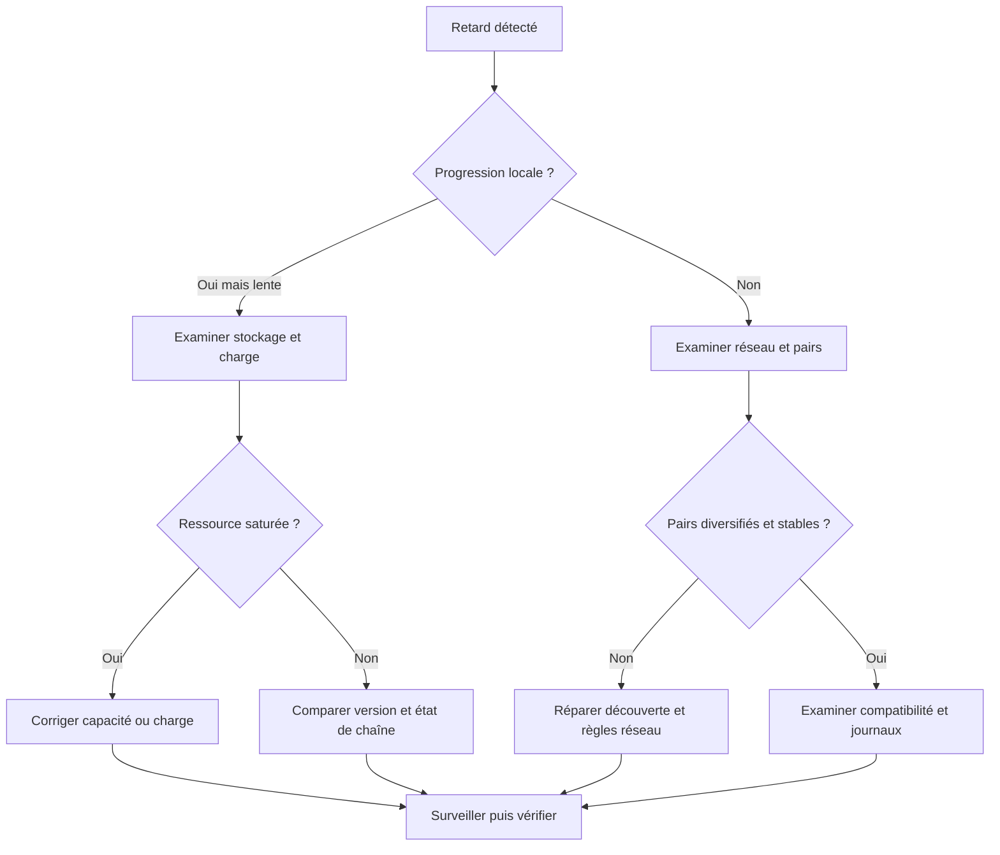
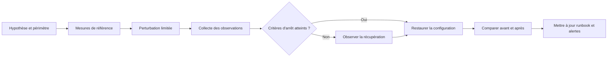

# Réseau P2P et nœuds

## Encadré de mise en contexte

Une blockchain ne fonctionne pas comme un site web classique où tous les utilisateurs consultent nécessairement le même serveur central. Dans un réseau pair-à-pair (P2P), des ordinateurs appelés nœuds échangent des informations directement avec leurs pairs. Les nœuds reçoivent des transactions et des blocs, vérifient les données selon le protocole, puis les relaient s'ils remplissent les conditions requises. Chaque nœud conserve une vue locale du réseau et peut observer les messages à des moments différents.

Le P2P est essentiel à la résistance aux pannes et à l'ouverture d'une blockchain publique, mais il ne garantit pas automatiquement la décentralisation. Si les participants dépendent de quelques fournisseurs d'accès, de quelques services RPC ou de quelques centres de données, l'architecture peut être plus centralisée en pratique qu'elle ne le semble sur un schéma. De même, un nœud ne participe pas nécessairement à tous les rôles du réseau : certains vérifient complètement les données, d'autres allègent leur stockage, d'autres proposent des blocs ou servent des requêtes aux applications.

Cette leçon explique le réseau P2P, les rôles des nœuds, la découverte des pairs, la propagation des transactions et des blocs, les problèmes de connectivité, les risques de sécurité et les outils de diagnostic. Elle prépare également à comprendre les contrats intelligents : une application blockchain dépend souvent de plusieurs couches, du portefeuille au fournisseur RPC, en passant par les nœuds et le réseau de consensus.

## Objectifs d'apprentissage

À la fin de la leçon, tu sauras :

- expliquer la différence entre un réseau client-serveur et un réseau pair-à-pair ;
- décrire le rôle d'un nœud et distinguer nœud complet, nœud d'archive, validateur, mineur et fournisseur RPC ;
- expliquer comment les pairs sont découverts et les connexions établies ;
- suivre le trajet d'une transaction et d'un bloc à travers le réseau ;
- comprendre les mempools, les relais et les différences de politique entre les nœuds ;
- identifier les effets de la latence, de la perte de paquets, de la partition réseau et de la censure ;
- expliquer pourquoi plus de nœuds ne garantit pas toujours plus de décentralisation ;
- appliquer une méthode de diagnostic sur une panne de synchronisation ;
- analyser les dépendances réseau d'une application blockchain.

## 1. Client-serveur et pair-à-pair

Dans un modèle client-serveur traditionnel, un client envoie une requête à un serveur central ou à un ensemble coordonné de serveurs. Le serveur traite la requête et renvoie une réponse. Cette architecture convient à de nombreux services : boutique en ligne, application bancaire, site de documentation ou plateforme pédagogique. Elle est souvent plus simple à administrer et peut offrir de bonnes performances.

Dans un modèle pair-à-pair, les participants échangent des données entre eux et peuvent remplir des fonctions similaires. Il n'existe pas nécessairement un unique serveur dont dépend tout le réseau. Les participants peuvent relayer des messages, partager les blocs et aider les nouveaux nœuds à rejoindre le système. Certaines applications P2P restent hybrides et utilisent des services centralisés pour la découverte, la coordination ou l'interface utilisateur.

~~~mermaid
flowchart TD
    subgraph CS["Modèle client-serveur"]
        C1["Client A"] --> S["Serveur central"]
        C2["Client B"] --> S
        C3["Client C"] --> S
    end
    subgraph PP["Modèle pair-à-pair"]
        P1["Pair A"] <--> P2["Pair B"]
        P2 <--> P3["Pair C"]
        P1 <--> P4["Pair D"]
        P3 <--> P4
    end
~~~

Une blockchain publique peut combiner plusieurs modèles. Les nœuds P2P se relaient des données, mais les portefeuilles mobiles peuvent interroger un fournisseur RPC centralisé. Un explorateur de blocs peut indexer les données sur ses propres serveurs. Un site DApp peut être livré par une infrastructure web classique même si ses contrats sont déployés sur une chaîne publique.

La bonne question n'est donc pas seulement « la blockchain est-elle décentralisée ? », mais « quelles parties de l'usage dépendent de quelles entités et quelles alternatives sont disponibles ? ».

## 2. Qu'est-ce qu'un nœud ?

Un nœud est un logiciel qui participe au réseau et applique un ensemble de fonctions définies par son implémentation et sa configuration. Selon le protocole, il peut recevoir des données, vérifier des blocs, conserver l'historique, fournir des réponses à des applications ou participer directement au consensus. Tous les nœuds ne remplissent pas nécessairement les mêmes rôles.

### 2.1 Nœud complet

Un nœud complet vérifie les règles du protocole en utilisant les données nécessaires à la validation. Il ne se contente pas de faire confiance à la réponse d'un autre serveur pour chaque affirmation importante sur la chaîne. Dans Bitcoin, un nœud complet peut valider les blocs et maintenir l'ensemble des UTXO actuellement dépensables. Dans Ethereum, un nœud usuel combine un client d'exécution et un client de consensus pour suivre la chaîne avec les fonctions correspondant au rôle choisi.

La validation indépendante aide l'utilisateur à réduire sa dépendance à un fournisseur unique. Elle demande cependant des ressources : processeur, mémoire, stockage, bande passante, temps d'initialisation et maintenance. Les exigences varient avec le protocole et sa configuration.

### 2.2 Nœud d'archive

Un nœud d'archive conserve des données historiques supplémentaires qui ne sont pas nécessaires au fonctionnement courant d'un nœud complet dans sa configuration standard. Dans Ethereum, cela peut inclure des états historiques permettant de répondre à des requêtes sur des états anciens. Le coût de stockage et les besoins opérationnels peuvent être sensiblement plus élevés.

Le terme « archive » ne signifie pas automatiquement que le nœud détient toutes les données imaginables ou qu'il est le seul à pouvoir prouver la validité. Il décrit un profil de données et de requêtes. La manière de conserver l'historique dépend des clients et des évolutions du protocole.

### 2.3 Nœud léger

Un client léger cherche à vérifier certaines informations en téléchargeant moins de données que le nœud complet. Il peut s'appuyer sur des en-têtes, des preuves cryptographiques ou des mécanismes de confiance limités pour vérifier des affirmations. Il est pratique pour les appareils disposant de ressources modestes, mais les garanties dépendent du protocole, du client et de la preuve réellement vérifiée.

« Léger » ne signifie pas « incapable de vérifier quoi que ce soit », mais il ne signifie pas non plus « identique à un nœud complet ». Il faut savoir quelles données sont vérifiées localement et quelles réponses dépendent d'autres participants.

### 2.4 Mineur et validateur

Un mineur participe à la production de blocs dans un réseau de preuve de travail. Un validateur participe aux fonctions de consensus dans un réseau de preuve d'enjeu. Ces rôles peuvent nécessiter des nœuds particuliers, des clés dédiées et des exigences de disponibilité. Un ordinateur qui exécute simplement un nœud complet n'est pas automatiquement un mineur ou un validateur.

Le protocole sépare la validation des règles de la production de blocs. Un nœud peut rejeter un bloc invalide même s'il a été produit par un mineur très puissant ou un validateur ayant une mise importante.

### 2.5 Fournisseur RPC

Les applications utilisent souvent une interface de type RPC pour interroger le réseau ou soumettre une transaction. RPC signifie appel de procédure à distance : le logiciel envoie une requête structurée à un service qui répond par des données ou un résultat. Un fournisseur RPC peut servir un grand nombre d'applications, héberger des nœuds et gérer une couche d'API.

RPC n'est pas synonyme de blockchain ni de consensus. Si une DApp ne peut plus joindre son fournisseur RPC, cela ne prouve pas que la blockchain est en panne. L'application peut essayer un autre fournisseur ou un nœud exploité par l'utilisateur. En revanche, si toutes les interfaces utilisées dépendent du même fournisseur, une panne de celui-ci devient un point de défaillance majeur de l'expérience.

## 3. La topologie du réseau et les pairs

Un pair est un participant auquel un nœud est connecté et avec lequel il peut échanger des messages. Un nœud ne se connecte pas nécessairement à tous les nœuds du réseau : cela serait coûteux et peu efficace quand le réseau grandit. Il maintient plutôt un nombre limité de connexions et utilise celles-ci pour découvrir d'autres pairs ou relayer des données.

Une topologie P2P peut changer au cours du temps. Des nœuds apparaissent et disparaissent, changent d'adresse, redémarrent ou sont séparés du réseau. Le logiciel doit trouver des pairs utilisables et éviter de dépendre d'une seule connexion. Plusieurs connexions indépendantes peuvent réduire certains risques, sans les supprimer.

~~~mermaid
flowchart LR
    A["Nœud local"] --- B["Pair 1"]
    A --- C["Pair 2"]
    A --- D["Pair 3"]
    B --- E["Autre pair"]
    C --- F["Autre pair"]
    D --- E
    E --- F
~~~

### 3.1 Découverte des pairs

Les mécanismes de découverte dépendent du réseau et du client. Ils peuvent inclure des adresses de pairs connues, des nœuds d'amorçage, des bases locales apprises lors de sessions précédentes, des protocoles de découverte ou des adresses fournies par des opérateurs. Certains clients doivent traverser des routeurs ou des pare-feu qui compliquent les connexions entrantes.

Les nœuds d'amorçage facilitent la découverte initiale, mais ne sont pas nécessairement des serveurs centraux qui contrôlent toutes les transactions. Un système bien conçu dispose d'autres moyens d'apprendre des pairs et de se reconnecter. Toutefois, une dépendance trop forte à quelques points de découverte peut rendre l'entrée dans le réseau plus fragile ou faciliter certaines tentatives d'isolement.

### 3.2 Connexions entrantes et sortantes

Une connexion sortante est initiée par le nœud local vers un pair distant. Une connexion entrante est initiée par un autre participant vers le nœud local, lorsque la configuration et le réseau le permettent. Les routeurs NAT et les pare-feu peuvent empêcher les connexions entrantes sans configuration spécifique.

Un nœud qui n'accepte pas de connexion entrante peut tout de même participer au réseau par ses connexions sortantes. Mais, dans certains modèles, accepter des connexions entrantes améliore la capacité d'autres pairs à découvrir et à utiliser ce nœud. La disponibilité doit être évaluée en tenant compte du rôle de la machine, du réseau et de la politique de sécurité.

### 3.3 Résilience et diversité des pairs

Le nombre de connexions n'est pas la seule mesure utile. Si dix connexions mènent toutes au même fournisseur, au même hébergeur ou au même réseau autonome, leur diversité est limitée. Une panne ou une politique de censure commune peut affecter toutes ces connexions.

La diversité se mesure en pratique selon plusieurs dimensions : fournisseurs d'accès, zones géographiques, hébergeurs, implémentations clientes, versions, opérateurs et chemins réseau. Il faut cependant éviter de créer des connexions excessives ou d'ouvrir des ports sans raison ; la sécurité et les limites de ressources restent importantes.

## 4. Comment une transaction circule

Lorsqu'un utilisateur crée une transaction, son portefeuille construit une représentation conforme au protocole et la signe avec le moyen d'autorisation approprié. Il transmet ensuite la transaction à un nœud, souvent par RPC ou par une connexion P2P. Le nœud vérifie plusieurs conditions avant de la relayer ou de la conserver comme transaction en attente.

~~~mermaid
sequenceDiagram
    participant W as Portefeuille
    participant A as Nœud A
    participant B as Nœud B
    participant C as Nœud C
    participant P as Producteur de bloc
    W->>A: Transaction signée
    A->>A: Vérification initiale
    A->>B: Relais à un pair
    B->>C: Relais à un autre pair
    C->>P: Transaction disponible
    P->>P: Sélection selon ses règles
    P-->>A: Bloc avec transaction
~~~

### 4.1 Mempool ou ensemble des transactions en attente

Dans Bitcoin, le terme mempool désigne l'ensemble local des transactions valides selon les contrôles et politiques d'un nœud qui n'ont pas encore été confirmées dans la chaîne suivie. Il n'existe pas un mempool universel identique chez tous les participants. Deux nœuds peuvent avoir reçu des transactions différentes, appliquer des politiques de relais différentes ou avoir des ressources disponibles différentes.

Dans Ethereum, les clients conservent également des transactions en attente, mais les détails et les politiques varient selon les clients et leur mode d'exploitation. Des transactions qui utilisent le même nonce peuvent être en concurrence ou se remplacer selon les règles et politiques. Le vocabulaire et les détails internes doivent être adaptés au protocole au lieu de supposer que toutes les chaînes ont la même structure.

### 4.2 Relais et politiques locales

Un nœud peut refuser de relayer une transaction qui pourrait être valide dans certaines conditions de consensus, parce qu'elle ne respecte pas ses politiques locales de relais, de frais ou de ressources. Cette distinction est importante : les règles de consensus déterminent ce qui est acceptable dans un bloc final, alors que les politiques de relais déterminent ce que le nœud accepte de propager avant l'inclusion.

Les politiques locales servent notamment à limiter le spam, la consommation de ressources et les transactions que le nœud ne veut pas conserver. Elles peuvent différer entre versions et opérateurs. Le fait qu'une transaction ne soit pas visible dans l'interface d'un nœud ne permet donc pas de conclure qu'elle est invalide pour tous les nœuds.

### 4.3 Censure et transaction qui n'arrive pas

Une transaction peut ne pas parvenir à un producteur de bloc parce que le nœud auquel elle a été envoyée ne l'a pas relayée, qu'une connexion est cassée, qu'un fournisseur RPC l'a rejetée, que les frais sont insuffisants selon les politiques courantes ou que les producteurs l'ont omise. Le diagnostic doit suivre la transaction étape par étape : est-elle bien signée ? a-t-elle été acceptée par le premier nœud ? est-elle visible auprès de plusieurs nœuds indépendants ? est-elle admissible et compétitive pour l'inclusion ?

La censure peut être un comportement intentionnel, mais tous les retards ou rejets ne sont pas de la censure. Les frais, le format, les dépendances, les ressources et les pannes ordinaires peuvent expliquer une absence d'inclusion. Une conclusion de censure exige un ensemble de preuves et une définition claire de l'acteur censurant.

## 5. Comment un bloc circule

Un producteur propose un bloc et le diffuse à ses pairs. Les nœuds qui le reçoivent le vérifient selon leurs règles et, s'il est valide et pertinent pour leur chaîne suivie, peuvent le relayer. Les mécanismes de propagation cherchent à limiter la quantité de données retransmises inutilement et à réduire le délai pendant lequel le réseau dispose de vues différentes.

~~~mermaid
flowchart TD
    P["Producteur propose un bloc"] --> A["Premier groupe de pairs"]
    A --> B["Nœuds vérifient le bloc"]
    B --> C["Relais vers d'autres pairs"]
    C --> D["Le réseau apprend le bloc"]
    D --> E["Les nœuds appliquent les règles de sélection"]
    E --> F["La vue locale de la chaîne converge"]
~~~

Si un bloc arrive avant son parent, le nœud peut le conserver comme bloc dont la dépendance manque, ou demander les données manquantes. Si le bloc est incomplet, mal formé ou invalide, le comportement exact dépend du client et du contexte, mais il ne doit pas être accepté comme bloc valide. Si deux blocs valides sont concurrents, la règle de consensus détermine la branche suivie.

### 5.1 Pourquoi la propagation rapide compte

Si la plupart des nœuds apprennent rapidement le nouveau bloc, ils ont moins de temps pour construire des branches concurrentes à partir de l'ancien parent. Dans les réseaux PoW, une propagation lente peut accroître le nombre de blocs concurrents et affecter l'efficacité des mineurs. Dans les réseaux PoS, la disponibilité et la latence des messages peuvent affecter la participation des validateurs, les attestations et parfois la progression vers la finalité.

La rapidité ne doit pas être obtenue au prix d'une validation aveugle. Les nœuds peuvent utiliser des optimisations de propagation, mais la validité des données reste essentielle. Les mécanismes de compression ou de transmission partielle doivent être utilisés selon les règles du protocole et les implémentations conformes.

## 6. Synchronisation d'un nouveau nœud

Un nouveau nœud doit apprendre suffisamment de données pour suivre l'historique et appliquer les règles de la chaîne. Le processus peut être long et gourmand en stockage. Les méthodes d'initialisation varient : certains nœuds vérifient l'historique depuis le point de départ, d'autres utilisent des méthodes de synchronisation accélérée ou des instantanés qui sont ensuite vérifiés selon les garanties disponibles.

Un instantané est un point de départ pratique, mais il ne faut pas confondre sa réception avec une validation indépendante complète. L'opérateur doit comprendre ce qui a été vérifié localement et ce qui dépend de la source de l'instantané. Pour un environnement qui exige un niveau élevé de confiance, la procédure d'initialisation et la vérification des données doivent être documentées.

~~~mermaid
flowchart TD
    A["Installer le client"] --> B["Charger la configuration réseau"]
    B --> C["Découvrir les pairs"]
    C --> D["Échanger des informations sur les blocs"]
    D --> E["Télécharger les données nécessaires"]
    E --> F["Vérifier les blocs et transitions"]
    F --> G["Atteindre la tête de chaîne suivie"]
    G --> H["Surveiller la synchronisation en continu"]
~~~

### 6.1 Stockage, élagage et archive

Un nœud élagué peut supprimer certaines données historiques complètes qu'il n'a plus besoin de conserver pour son fonctionnement courant, tout en maintenant suffisamment d'état et de données pour continuer à valider et servir certaines requêtes. Un nœud d'archive vise au contraire à conserver des données historiques plus riches. Les termes exacts et les fonctions dépendent du protocole.

L'élagage peut réduire les besoins de disque, mais il peut limiter les requêtes historiques qu'un opérateur peut servir. Une entreprise qui souhaite analyser des transactions anciennes ou reconstruire des états doit choisir le profil adapté. Le plus petit stockage n'est pas toujours le meilleur choix ; il doit correspondre à l'objectif de l'application.

## 7. Protocoles réseau, versions et compatibilité

Les clients doivent convenir de formats de messages, de règles de découverte, de procédures de négociation et de versions de protocole. Une incompatibilité peut empêcher un nœud de se connecter ou de comprendre certaines données. Une version ancienne peut être incapable de suivre un réseau après une mise à niveau majeure ; une version défectueuse peut au contraire accepter ou rejeter incorrectement des objets.

Les opérateurs devraient suivre les annonces officielles des clients et les fenêtres de mise à niveau, tester les changements et maintenir une procédure de retour à un état opérationnel sûr. Dans les réseaux à consensus, la mise à jour du logiciel est un sujet de sécurité : exécuter des versions incompatibles peut contribuer à une divergence ou à une perte de service.

Les ports, les API et les interfaces d'administration doivent être exposés selon le principe du moindre privilège. Un port P2P accessible au public ne devrait pas donner accès à une API administrative non protégée. Il faut séparer, lorsque c'est possible, les interfaces publiques de communication avec les pairs et les interfaces de contrôle utilisées par les opérateurs ou applications.

## 8. Menaces réseau

### 8.1 Nœuds Sybil

Une attaque Sybil consiste à créer ou contrôler de nombreuses identités apparentes afin d'influencer la perception d'un participant. Dans un réseau ouvert, une identité de pair ne correspond pas nécessairement à une personne ou à un opérateur indépendant. Afficher « mille pairs connectés » n'est donc pas automatiquement la preuve de mille acteurs indépendants.

Les protocoles utilisent diverses méthodes pour limiter l'impact de telles attaques ou maintenir leurs garanties malgré un ensemble de pairs non fiables. L'opérateur doit comprendre comment son client choisit ses pairs, s'il peut utiliser des connexions diversifiées et quelles informations il vérifie par cryptographie plutôt que d'accepter le nombre de pairs comme mesure de confiance.

### 8.2 Attaque d'éclipse

Une attaque d'éclipse cherche à isoler un nœud de ses pairs honnêtes en contrôlant ou influençant les connexions qu'il utilise. Le nœud peut alors observer un sous-ensemble manipulé du réseau et recevoir des informations incomplètes ou retardées. Selon le protocole et le contexte, cela peut affecter la disponibilité, la perception de la chaîne ou certaines décisions applicatives.

La défense dépend du client et du modèle de menace : diversité des pairs, bonnes pratiques de réseau, gestion des adresses, connexions sortantes multiples, surveillance des changements anormaux et comparaison avec des sources indépendantes. Aucun conseil générique ne remplace l'analyse des protections réellement mises en œuvre par le client.

### 8.3 Déni de service et spam

Un attaquant peut envoyer de nombreuses requêtes ou messages afin de consommer le processeur, la mémoire, le disque ou la bande passante d'un nœud. Les limites de ressources, les mécanismes de priorité, les politiques de relais et la surveillance servent à réduire ces risques. Mais une limitation trop stricte peut aussi empêcher le service légitime d'une application.

Il faut distinguer un problème de charge, une panne matérielle, une attaque volontaire et un comportement normal lors d'une forte activité. Les métriques — latence, débit réseau, taille des files d'attente, consommation mémoire, erreurs de protocole et temps de synchronisation — aident à prendre une décision fondée sur des faits.

### 8.4 Censure par l'infrastructure

Même si les règles de consensus sont ouvertes, les fournisseurs d'accès, les hébergeurs, les points RPC, les indexeurs, les portefeuilles et les interfaces web peuvent filtrer ou bloquer des demandes. Une DApp peut être inaccessible parce que son nom de domaine a expiré, son fournisseur RPC est indisponible ou son interface est hébergée sur un service centralisé.

Il faut donc cartographier les dépendances. L'accès au consensus, la diffusion des transactions, l'interface de l'utilisateur et l'indexation sont des couches différentes. Une stratégie de résilience peut prévoir plusieurs fournisseurs, un nœud personnel, des interfaces alternatives ou une procédure de consultation directe, mais chaque alternative doit être configurée et testée.

## 9. Sécurité opérationnelle d'un nœud

Un nœud est un service réseau exposé à des données non fiables. Il doit être maintenu comme tout autre système important : mises à jour, surveillance, contrôle des accès, sauvegarde des configurations, sécurité du système d'exploitation, gestion des disques et procédures d'incident.

Les clés de consensus ou de production de blocs doivent être séparées des données et services ordinaires lorsque l'architecture le permet. Un nœud complet utilisé pour vérifier les données n'a pas besoin de détenir automatiquement des clés de validateur. La séparation réduit les conséquences d'une compromission d'un composant web ou d'un poste utilisateur.

Les journaux doivent être suffisants pour le diagnostic, mais leur conservation doit respecter les exigences de confidentialité et de sécurité. Une API d'administration accessible publiquement peut être plus dangereuse qu'un port P2P. Il faut contrôler qui peut envoyer des transactions, accéder aux métriques sensibles, déclencher des opérations ou modifier la configuration.

### 9.1 Surveillance minimale

Une supervision opérationnelle peut suivre :

- le nombre de pairs connectés et leur stabilité ;
- l'état de synchronisation et l'écart avec la tête de chaîne connue ;
- la hauteur ou le slot observé ;
- les erreurs de validation et les déconnexions ;
- le temps CPU, la mémoire, le stockage et la bande passante ;
- les files d'attente de transactions et les retards de propagation ;
- la version du client et l'état des mises à niveau.

Ces métriques doivent être interprétées ensemble. Un nœud peut être connecté à de nombreux pairs mais rester bloqué sur un état ancien. Un processus peut être vivant tout en étant incapable de synchroniser correctement. Un seul indicateur vert ne constitue pas une preuve de santé.

## 10. Étude de cas : une DApp inaccessible

Un utilisateur ouvre une DApp et voit le message « réseau indisponible ». Le site web se charge normalement, mais les soldes n'apparaissent pas et les transactions ne sont pas soumises. Il est tentant de conclure immédiatement que la blockchain s'est arrêtée.

Un diagnostic utile suit les couches :

1. Le site web et ses scripts sont-ils accessibles ?
2. Le portefeuille est-il connecté au bon réseau ?
3. Le fournisseur RPC répond-il aux requêtes simples ?
4. Le point RPC est-il synchronisé ou renvoie-t-il des données périmées ?
5. La transaction est-elle construite avec le bon identifiant de réseau et les bons paramètres ?
6. Le nœud accepte-t-il la transaction, et donne-t-il un identifiant de transaction ?
7. L'identifiant est-il visible via une seconde source indépendante ?
8. La chaîne produit-elle de nouveaux blocs et le consensus progresse-t-il ?

Si le fournisseur RPC principal ne répond plus mais qu'un autre service fonctionne, le problème est probablement au niveau du fournisseur ou du chemin réseau, pas nécessairement au niveau du consensus. Si les nœuds indépendants cessent de progresser ou rapportent des erreurs de consensus, l'enquête doit être élargie. Le vocabulaire précis évite les fausses alertes et accélère la résolution.

## 11. Propagation efficace et validation indépendante

La propagation des blocs et transactions doit équilibrer vitesse, bande passante et sécurité. Envoyer systématiquement toutes les données volumineuses à tous les pairs serait coûteux. Les protocoles peuvent utiliser des annonces, des identifiants de transactions et des mécanismes de récupération de données que les pairs n'ont pas encore reçues. Les détails varient selon les clients et évoluent avec les versions.

Un nœud doit éviter de considérer une annonce de bloc comme une preuve de validité. Il peut demander l'en-tête et le corps, vérifier la continuité du parent, contrôler les engagements cryptographiques et appliquer les règles de consensus. La validation locale reste essentielle même lorsque le pair qui relaie les données est réputé.

~~~mermaid
sequenceDiagram
    participant A as Pair A
    participant B as Nœud local
    participant C as Pair C
    A->>B: Annonce d'un bloc connu par hash
    B->>B: Vérifier parent et données déjà présentes
    B->>A: Demander les données manquantes
    A-->>B: En-tête et corps du bloc
    B->>B: Vérifier engagements et règles
    B->>C: Relayer si admissible
~~~

### Transactions remplaçables et dépendances

Les transactions en attente peuvent entrer en concurrence. Dans Bitcoin, une transaction qui dépense un UTXO peut être en conflit avec une autre transaction qui dépense le même UTXO. Dans Ethereum, les transactions d'un même compte utilisent des nonces et peuvent être remplacées selon des conditions de client et de réseau. Il faut comprendre le modèle du protocole avant d'expliquer pourquoi une transaction n'est plus visible.

Les dépendances de transactions compliquent aussi la propagation. Une transaction peut dépenser une sortie créée par une transaction non confirmée ; si la transaction parent n'est pas relayée, la transaction enfant peut être considérée différemment selon la politique du nœud. Une analyse ne doit donc pas se limiter au hash d'une transaction isolée sans examiner ses parents, ses conflits et les règles locales de mempool.

## 12. Sync, snapshots et confiance initiale

Un nouveau nœud doit établir un état local qui correspond à l'historique accepté. Le mode de synchronisation influence le temps d'initialisation, le stockage requis et les données vérifiées localement. Une synchronisation complète depuis le point de départ offre un modèle de vérification différent d'une méthode accélérée qui utilise un instantané ou certaines hypothèses de confiance.

Un snapshot est une copie d'un état à une hauteur donnée. Il peut accélérer un déploiement, surtout lorsque l'historique est volumineux. Mais le fait de télécharger un snapshot n'est pas automatiquement équivalent à avoir validé toute l'histoire depuis le bloc de genèse. Il faut comprendre si le snapshot est vérifié cryptographiquement, comment le parent ou la racine est contrôlé et quelles étapes restent à accomplir.

~~~mermaid
flowchart TD
    A["Choisir le mode de synchronisation"] --> B{"Validation complète ou mode accéléré ?"}
    B -->|Complète| C["Télécharger et vérifier l'historique"]
    B -->|Accélérée| D["Charger un état/snapshot selon la procédure"]
    D --> E["Vérifier les engagements disponibles"]
    E --> F["Poursuivre la synchronisation et les contrôles prévus"]
    C --> G["Comparer la tête locale aux pairs"]
    F --> G
    G --> H["Surveiller la progression"]
~~~

### Stockage et reprise

Avant une synchronisation, dimensionne le volume de données, le débit disponible, l'espace disque temporaire et la durée de récupération. Le disque doit disposer de marge suffisante pour les écritures et les opérations de maintenance. Une base saturée peut bloquer la synchronisation même si le client et le réseau fonctionnent correctement.

Pour une reprise, conserve d'abord les journaux et la configuration, puis identifie le type de panne. Une base corrompue peut nécessiter une réparation ou une resynchronisation selon la documentation du client. Un problème DNS ou de pare-feu ne sera pas résolu en supprimant la base. Une bonne procédure choisit l'action après avoir identifié la couche affectée.

## 13. Défenses contre l'éclipse et les dépendances réseau

Une attaque d'éclipse vise à isoler un nœud en influençant ses connexions et les informations qu'il reçoit. Le nœud peut continuer à répondre, mais sa vue du réseau peut être incomplète ou retardée. La défense ne consiste pas uniquement à augmenter le nombre de connexions ; il faut tenir compte de leur diversité et du mécanisme de découverte.

Les mesures possibles dépendent du client : connexions sortantes diversifiées, découverte de pairs à partir de plusieurs sources, conservation d'adresses apprises, limitation de la dépendance à un ensemble unique et comparaison périodique avec des sources indépendantes. Les paramètres doivent suivre les recommandations du client ; augmenter arbitrairement les connexions peut créer d'autres problèmes de ressources.

### Diversité et points communs

Si tous les pairs utilisent le même hébergeur ou passent par la même infrastructure, une panne ou un filtrage à cet endroit peut les affecter en même temps. La diversité doit être évaluée selon l'opérateur, le fournisseur réseau, l'hébergement, la version du client et le chemin de communication. Il faut éviter de conclure qu'il y a une diversité réelle à partir de plusieurs adresses IP seulement.

Les services RPC ont une couche de confiance distincte du P2P. Deux endpoints qui appartiennent au même fournisseur peuvent partager des dépendances et un retard commun. Pour une décision critique, vérifie si le fournisseur est réellement indépendant et si la réponse inclut les informations nécessaires pour déterminer la hauteur ou le bloc concerné.

## 14. Runbook P2P : diagnostiquer une propagation anormale

Lorsque les transactions ou blocs semblent manquer, le diagnostic doit distinguer le trajet local, les pairs, le fournisseur RPC, les politiques de relais et le consensus.

| Symptôme | Vérifications initiales | Hypothèses possibles |
|---|---|---|
| Aucun pair | DNS, pare-feu, ports et découverte | Réseau ou configuration locale |
| Pair connecté, tête figée | Hauteur, erreurs de validation et disque | Synchronisation ou problème de client |
| Transaction vue par un seul nœud | Hash, format, politique de relais et conflits | Transaction non relayée ou fournisseur isolé |
| Explorateur en retard | Comparer la hauteur et le bloc parent | Indexation ou cache |
| Blocs concurrents courts | Parent commun et durée de l'écart | Propagation normale ou latence |
| De nombreux pairs chutent ensemble | Hébergeur, route et versions | Dépendance commune ou incident plus large |

~~~mermaid
flowchart TD
    A["Symptôme signalé"] --> B["Identifier le composant et le réseau"]
    B --> C["Tester localement DNS, TCP, stockage et client"]
    C --> D["Comparer un second nœud / RPC"]
    D --> E{"Même anomalie indépendante ?"}
    E -->|Non| F["Investiguer fournisseur ou poste local"]
    E -->|Oui| G["Collecter données réseau et consensus"]
    F --> H["Documenter et surveiller"]
    G --> H
~~~

Ne lance pas de test intrusif sur des systèmes qui ne t'appartiennent pas. Les commandes réseau doivent être limitées aux hôtes autorisés et les ports testés doivent correspondre à la configuration réelle. Le résultat d'un test TCP ne démontre pas la validité des blocs ; il indique uniquement la capacité à établir une connexion à l'endroit testé.

Un compte rendu de diagnostic doit indiquer la date, l'hôte, le réseau, le résultat observé, la commande ou méthode utilisée, les sources comparées et le niveau de certitude. Cette discipline aide à éviter de transformer une panne de fournisseur en fausse alerte de consensus.

## 15. TP guidé A : mesurer la connectivité sans altérer le réseau

### Objectif

Apprendre à distinguer un problème de connectivité d'un problème de consensus. Le TP utilise des commandes de diagnostic ordinaires et ne requiert pas l'installation d'un nœud.

### Étape 1 — Vérifier la connectivité de base

Sous Windows PowerShell, teste la résolution DNS du fournisseur ou du serveur de laboratoire choisi :

~~~powershell
Resolve-DnsName example.com
~~~

Remplace le nom par celui de l'hôte que tu es autorisé à diagnostiquer. Le résultat vérifie la résolution DNS, pas l'état de la blockchain.

### Étape 2 — Tester une connexion TCP

Utilise Test-NetConnection vers un hôte et un port que tu es autorisé à tester :

~~~powershell
Test-NetConnection example.com -Port 443
~~~

Un échec peut indiquer un problème de DNS, de routage, de pare-feu, de port ou de service. Il ne prouve pas à lui seul qu'un réseau blockchain a cessé de fonctionner.

### Étape 3 — Comparer deux fournisseurs indépendants

Si tu disposes de deux endpoints de lecture autorisés pour un réseau de test, interroge-les pour obtenir une information simple comme la hauteur de bloc. Compare les résultats et l'heure de la requête. Ne place jamais un secret d'API dans un dépôt public et n'exécute pas de transaction sur le réseau principal dans le cadre de ce TP.

### Étape 4 — Rédiger le diagnostic

Note l'adresse de l'hôte, le type de requête, le résultat, l'heure, l'état DNS/TCP et les écarts observés entre fournisseurs. Conclus en séparant les faits confirmés et les hypothèses. Le rapport ne doit pas déclarer une panne du consensus sur la seule base d'un endpoint qui ne répond pas.

## 16. TP guidé B : cartographier les dépendances d'une DApp

Dessine les composants suivants : navigateur, portefeuille, interface web, fournisseur RPC, nœud complet, réseau P2P, consensus, contrat intelligent et indexeur. Connecte-les selon le parcours d'une lecture et d'une transaction.

~~~mermaid
flowchart TD
    U["Navigateur et utilisateur"] --> UI["Interface de la DApp"]
    U --> W["Portefeuille"]
    UI --> RPC["Fournisseur RPC"]
    W --> RPC
    RPC --> N["Nœud blockchain"]
    N --> P2P["Réseau P2P"]
    P2P --> CONS["Consensus et blocs"]
    CONS --> SC["Contrat intelligent exécuté"]
    N --> IDX["Indexeur / API analytique"]
    IDX --> UI
~~~

### Travail demandé

Pour chaque connexion, précise si elle dépend d'un fournisseur centralisé, d'une connexion P2P, d'un secret ou d'une preuve cryptographique. Ensuite, simule trois pannes : interface web indisponible, fournisseur RPC indisponible et retard de consensus. Pour chacune, identifie ce qui continue à fonctionner et les solutions de reprise possibles.

**Corrigé indicatif :** l'interface peut être hébergée de façon centralisée alors que le contrat est sur une chaîne publique. Le portefeuille signe localement, mais peut dépendre d'un RPC pour diffuser la transaction. Un nœud personnel ou un fournisseur alternatif peut réduire la dépendance RPC. La panne de l'interface peut être contournée uniquement si une interface fiable alternative est disponible ; la transaction ne doit pas être signée à l'aveugle. Un retard de consensus affecte la confirmation et la finalité même si le site et le RPC restent accessibles.

## 17. Étude de cas : la transaction n'apparaît pas partout

Un utilisateur affirme avoir envoyé une transaction. Son portefeuille affiche un hash, mais un explorateur ne la trouve pas et un second fournisseur la voit comme en attente. Ce scénario n'indique pas immédiatement une attaque. Il faut reconstruire le trajet de la transaction et vérifier si les sources utilisent le même réseau.

### Arbre de diagnostic

~~~mermaid
flowchart TD
    A["Le portefeuille donne-t-il un hash ?"] -->|Non| B["Vérifier signature, réseau et erreur locale"]
    A -->|Oui| C["Vérifier le chain ID et décoder le hash"]
    C --> D["Interroger plusieurs nœuds indépendants"]
    D --> E{"La transaction est-elle connue ?"}
    E -->|Oui| F["Examiner statut, nonce/inputs et inclusion"]
    E -->|Non| G["Vérifier relais, format et politique locale"]
    F --> H["Suivre confirmation ou reçu"]
    G --> H
~~~

### Informations à recueillir

Récupère le hash, le réseau, l'adresse expéditrice, l'heure de soumission, le compte utilisé et le message d'erreur du portefeuille. Ne demande jamais à l'utilisateur une clé privée pour diagnostiquer un problème. Compare ensuite les données de deux fournisseurs dont l'indépendance est connue. Si la transaction n'est pas connue de plusieurs nœuds, elle peut n'avoir jamais été diffusée correctement, avoir été rejetée ou être perdue par certains services.

Les détails diffèrent selon Bitcoin et Ethereum. Bitcoin permet de vérifier les entrées et sorties UTXO, les conflits de dépenses et les règles de mempool. Ethereum exige notamment d'examiner le nonce du compte, les frais, le réseau et les transactions éventuellement remplacées. La procédure doit donc suivre la chaîne précise, et non appliquer des étapes abstraites sans tenir compte du protocole.

## 18. Dépendances communes et fausse diversité

Deux nœuds ne sont pas forcément indépendants parce qu'ils utilisent des IP différentes. Ils peuvent être hébergés par le même fournisseur cloud, partager une version de client, utiliser le même service de bootstrap ou dépendre d'une seule route réseau. La diversité réelle est une propriété de l'exploitation, de la connectivité et des implémentations.

Une architecture pour un service critique peut comparer :
- les opérateurs et fournisseurs d'hébergement ;
- les régions et réseaux autonomes ;
- les implémentations clientes et versions ;
- les mécanismes de découverte de pairs ;
- les endpoints RPC et leurs dépendances ;
- la méthode de synchronisation et les sources d'instantanés.

~~~mermaid
flowchart TD
    A["Nœuds d'observation"] --> B["Même fournisseur cloud ?"]
    A --> C["Même client / même version ?"]
    A --> D["Même source RPC amont ?"]
    B --> E["Identifier les dépendances communes"]
    C --> E
    D --> E
    E --> F["Diversifier ou documenter le risque restant"]
~~~

### Diversifier sans multiplier le risque

Le but n'est pas d'ajouter des connexions au hasard. Des connexions excessives peuvent augmenter la consommation mémoire, le trafic et l'exposition. Il faut suivre les recommandations du client et choisir des sources réellement indépendantes pour les décisions où cela fait une différence.

Pour les opérations critiques, la DApp peut utiliser un nœud complet géré en interne comme source primaire de vérification tout en conservant un fournisseur externe comme chemin de reprise. Il faut toutefois prévoir ce qui se passe si les sources diffèrent : vérifier le réseau, la hauteur, le hash du parent et le statut finalisé, plutôt que de choisir arbitrairement la réponse qui paraît la plus favorable.

## 19. Mesures de santé et objectifs opérationnels

La santé d'un nœud ne se résume pas à son processus actif. Un nœud peut être vivant mais en retard, manquer d'espace disque, perdre ses pairs ou ne pas suivre les mises à jour du protocole. La supervision doit lier chaque indicateur à une action de diagnostic.

| Mesure | Signal possible | Contrôle suivant |
|---|---|---|
| Hauteur ou slot stagnant | Synchronisation bloquée ou réseau lent | Comparer plusieurs sources |
| Nombre de pairs en baisse | Connectivité, découverte ou incident distant | Vérifier routes et journaux |
| Espace disque proche de la limite | Le client ne peut plus écrire l'état | Vérifier capacité et rétention |
| Erreurs de validation | Données invalides, bug ou incompatibilité | Conserver le bloc et la version client |
| Latence RPC élevée | Fournisseur saturé ou réseau instable | Comparer un endpoint indépendant |
| Version trop ancienne | Risque d'incompatibilité | Suivre la procédure officielle de mise à jour |

Les objectifs de service doivent préciser la fraîcheur maximale des données, le délai d'alerte et le temps de reprise. Un seul chiffre « uptime » peut masquer le fait que l'application répond avec un état ancien. La supervision doit donc tester aussi la progression et la cohérence, pas seulement le port ouvert.

Un exercice de reprise régulier aide l'équipe à vérifier les sauvegardes de configuration, la méthode de resynchronisation, les ressources nécessaires et les contacts d'escalade. La procédure doit être testée dans un environnement de laboratoire avant d'être nécessaire en production.

## 20. Mesurer la diversité réelle du réseau

Un réseau P2P peut afficher de nombreux pairs alors qu'une part importante dépend de quelques fournisseurs ou d'une même famille de clients. Une mesure utile doit tenir compte de l'indépendance organisationnelle, de la localisation réseau, de la version logicielle et des chemins de découverte. Le nombre brut de connexions est une mesure partielle.

~~~mermaid
flowchart TD
    A["Liste de pairs"] --> B["Grouper par hébergeur et réseau"]
    A --> C["Comparer versions de clients"]
    A --> D["Identifier sources de découverte"]
    B --> E["Évaluer les dépendances communes"]
    C --> E
    D --> E
    E --> F["Documenter les limites et mesures de résilience"]
~~~

### Exemple

Une entreprise configure deux endpoints RPC, mais les deux sont hébergés par le même fournisseur qui indexe les données à partir d'une seule région. Le changement d'URL ne garantit donc pas une reprise indépendante. Un vrai plan de résilience devrait préciser les fournisseurs, leurs garanties, le réseau utilisé et la procédure pour vérifier que les réponses n'ont pas divergé.

Cette diversification ne nécessite pas de créer une quantité excessive de connexions P2P. Elle exige d'abord de cartographier les dépendances et de décider quels risques l'architecture doit réduire. Les paramètres de connexion doivent ensuite respecter les recommandations du client et les limites de l'infrastructure.

## 21. Exercice de reprise après une mise à jour de client

Une mise à jour peut corriger un bug ou suivre une nouvelle règle du protocole, mais elle peut aussi révéler une incompatibilité entre opérateurs si tous ne la déploient pas au même moment. La procédure de mise à jour doit préciser quelle version est requise, comment le changement est testé, quelle sauvegarde de configuration est faite et comment vérifier la synchronisation après redémarrage.

Le plan de test comprend :
1. relever la version courante et le dernier bloc accepté ;
2. lire les notes de version et vérifier le réseau ciblé ;
3. tester la nouvelle version dans un environnement non productif ;
4. sauvegarder la configuration et les données nécessaires à la reprise ;
5. appliquer la mise à jour selon la procédure officielle ;
6. vérifier les pairs, la progression et les erreurs de validation ;
7. comparer la tête avec une source indépendante.

### Critères de réussite

Le nœud doit suivre le bon réseau, progresser et ne pas rapporter de nouvelles erreurs de validation. Un processus démarré ne suffit pas. Si le nœud reste en retard, vérifie le stockage, les pairs et les journaux avant de supprimer les données. Une resynchronisation peut être coûteuse et ne corrigera pas une mauvaise configuration réseau.

Le rapport final doit distinguer une mise à jour réussie, une panne locale et un incident plus large. Conserve les journaux et le hash des blocs observés afin qu'un autre opérateur puisse reproduire le diagnostic.

## 22. Exploitation avancée : observer un réseau sans confondre symptômes et causes

Un tableau de bord P2P doit expliquer le comportement du nœud, pas seulement afficher un nombre de connexions. Un nœud connecté à vingt pairs dépendant tous du même opérateur, de la même région et de la même version de client peut être moins robuste qu'un nœud connecté à huit pairs réellement diversifiés. Le nombre de pairs n'indique pas si les blocs sont valides, si le nœud est à jour, ni s'il relaie correctement les transactions.

### 22.1 Construire une observation à plusieurs dimensions

Sépare les signaux en quatre familles. La connectivité décrit le transport : pairs entrants et sortants, échecs de connexion, durée des sessions et latence. La propagation décrit la diffusion : délai entre la première observation locale et l'observation de messages comparables, taux de transactions relayées et fréquence des annonces de blocs. La synchronisation décrit l'état de la chaîne : hauteur locale, hauteur de pairs de référence, progression du téléchargement, retard du consensus et éventuelles réorganisations. La diversité décrit la concentration des dépendances : versions de clients, fournisseurs réseau, régions, opérateurs et points d'entrée.

Aucun indicateur ne doit être interprété seul. Une faible activité de transactions peut simplement refléter une période calme. Une hausse de latence peut provenir du chemin réseau plutôt que du logiciel. Un retard de hauteur peut être normal au démarrage, mais inquiétant s'il augmente continuellement après la fin attendue de la synchronisation. Les métriques doivent inclure une fenêtre temporelle, un état attendu et un contexte de déploiement.

| Signal | Ce qu'il peut indiquer | Ce qu'il ne prouve pas |
|---|---|---|
| Nombre de pairs stable | Les sessions se maintiennent | La diversité ou la qualité des pairs |
| Hauteur locale en retard | Le nœud ne suit pas la référence | Une panne P2P certaine |
| Transactions vues tardivement | Propagation lente ou mempools différents | Une censure certaine |
| Déconnexions répétées | Pare-feu, limites, surcharge ou pairs instables | Une attaque sans autre indice |
| Versions homogènes | Déploiement contrôlé ou dépendance commune | Une diversité effective |

### 22.2 Corréler les événements dans le temps

Lorsqu'un problème est signalé, conserve une chronologie : heure du premier symptôme, version du client, changements récents, distribution des pairs, état de synchronisation et premiers tests reproductibles. Les journaux horodatés doivent être corrélés avec les métriques système et réseau. Vérifie aussi la synchronisation de l'horloge : comparer deux journaux qui dérivent de plusieurs minutes peut fabriquer une fausse séquence causale.

Ne collecte pas seulement les lignes d'erreur. Une absence de message peut signifier que le niveau de journalisation est insuffisant, que le composant n'a pas atteint le code concerné, ou que l'événement se déroule dans une autre couche. Pour chaque hypothèse, définis une observation qui la renforcerait et une observation qui la contredirait. Cette discipline évite de redémarrer un nœud à répétition alors que le véritable problème est un filtre réseau ou une source de données mal configurée.

### 22.3 Runbook : le nœud accumule du retard

1. **Qualifier l'impact.** Distingue une interface de lecture indisponible, un nœud qui ne suit plus la tête de chaîne et un nœud qui ne reçoit simplement pas une transaction particulière.
2. **Établir la référence.** Compare hauteur, finalité ou point de contrôle selon le réseau avec plusieurs sources indépendantes. Ne traite pas un explorateur isolé comme un oracle absolu.
3. **Vérifier les ressources.** Observe disque libre, latence d'E/S, mémoire, CPU, descripteurs de fichiers et redémarrages. Une synchronisation peut ralentir sans erreur P2P si le stockage est saturé.
4. **Vérifier le chemin réseau.** Confirme que les ports nécessaires sont autorisés, que les connexions sortantes ne sont pas systématiquement rejetées et que DNS et découverte fonctionnent.
5. **Examiner la diversité des pairs.** Une liste courte, concentrée ou composée de versions incompatibles peut expliquer un progrès intermittent.
6. **Modifier une variable à la fois.** Évite d'augmenter simultanément les limites, de changer le pare-feu et de remplacer la base locale : la cause du résultat serait impossible à isoler.
7. **Valider le retour à la normale.** Vérifie que le retard cesse d'augmenter, que le nœud atteint la référence attendue et qu'il reste stable sur une durée définie.

## 23. Défense pratique : réduire les risques sans prétendre éliminer les attaques

Les attaques P2P exploitent souvent une dépendance trop forte à peu d'interlocuteurs, une configuration trop permissive ou une confusion entre données reçues et données validées. La défense consiste à réduire l'exposition, diversifier les chemins d'information, surveiller les écarts et préserver la capacité à reconstruire un état de confiance.

### 23.1 Éclipse, sybil et concentration

Dans une attaque d'éclipse, l'attaquant tente de contrôler les connexions utiles d'une victime pour lui présenter une vue isolée ou retardée. Dans une attaque sybil, un adversaire crée de nombreuses identités réseau apparentes. Le nombre d'identifiants n'est donc pas un indicateur suffisant de diversité. Les défenses peuvent inclure des limites de concentration, un choix prudent des pairs, des sources de référence indépendantes, des connexions sortantes diversifiées et des alertes en cas de changement anormal de composition.

Ces mesures dépendent du protocole et du client. Elles ne justifient pas de forcer une liste d'adresses inconnues trouvées sur Internet. Un pair peut être lent, obsolète, malveillant ou simplement inaccessible. Avant de figer une liste statique, documente son propriétaire, sa disponibilité, sa procédure de remplacement et le risque de concentration qu'elle crée.

### 23.2 Réduire la surface d'attaque du serveur

Un nœud de production ne doit pas exposer automatiquement toutes ses interfaces d'administration au réseau public. Les interfaces RPC, consoles de débogage, métriques privées et services de gestion doivent être limitées aux réseaux et identités nécessaires. Le port P2P public, lorsqu'il est requis, ne doit pas entraîner l'exposition du port d'administration. Utilise un pare-feu avec une politique explicite, des comptes de service à privilèges limités, des mises à jour vérifiées et un accès opérateur journalisé.

Les fichiers contenant des clés, secrets ou jetons d'accès ne doivent pas être inclus dans les journaux, rapports d'incident ni dépôts de configuration. Si l'architecture utilise un service d'exécution séparé du nœud P2P, protège aussi le canal entre ces composants : une séparation logique dans un diagramme ne garantit pas à elle seule une séparation réseau.

### 23.3 Une procédure de changement sûre

Avant une mise à jour de client, note la version actuelle, le point de restauration documenté, la configuration active, l'espace disque disponible et le comportement attendu au redémarrage. Lis les notes de version et identifie les changements de protocole ou de format de base. Dans un réseau de test, reproduis l'installation, la migration et le contrôle de santé. En production, procède par étapes si l'architecture le permet et maintiens un retour arrière réaliste.

Un retour arrière n'est pas toujours un simple remplacement du binaire : une nouvelle version peut avoir migré des données, modifié un format de stockage ou changé les paramètres compatibles. Il faut savoir si l'ancien logiciel peut relire la base mise à jour. Si ce n'est pas sûr, le plan de reprise peut consister à restaurer un snapshot vérifié ou à reconstruire un nœud plutôt qu'à rétrograder à chaud.

## 24. Atelier de laboratoire : produire un diagnostic reproductible

L'atelier se déroule sur un nœud de test ou une instance autorisée. N'ajoute pas de pairs inconnus et ne coupe pas le réseau principal pour simuler une panne.

### Travail demandé

- Décris le rôle du nœud et les services qui doivent être joignables.
- Relève la version du client, l'heure système, la hauteur locale et l'état de synchronisation.
- Mesure la connectivité sur une période définie sans confondre nombre de pairs et diversité.
- Vérifie les ports documentés, les règles de pare-feu et les interfaces d'administration exposées.
- Compare les informations du nœud avec deux sources indépendantes, en notant les limites de chacune.
- Écris deux hypothèses concurrentes sur le retard éventuel, puis précise la mesure qui permettrait de les départager.

| Champ | Valeur à renseigner | Pourquoi |
|---|---|---|
| Heure et version | Valeurs capturées au début du test | Reproduire le contexte |
| Rôle du nœud | Archive, full, validateur ou rôle pertinent | Définir le comportement attendu |
| Hauteur et finalité | Valeurs du client et références externes | Quantifier le retard |
| Pairs entrants/sortants | Séries temporelles, pas une photo isolée | Distinguer fluctuation et panne |
| Ressources | CPU, mémoire, disque, E/S | Identifier une saturation |
| Changements récents | Déploiement, pare-feu, fournisseur, configuration | Construire la chronologie |
| Hypothèse prioritaire | Cause probable et preuves | Éviter les changements au hasard |
| Test de confirmation | Action limitée et réversible | Réduire l'incertitude |
| Critère de clôture | Stabilité définie et absence de régression | Prouver le rétablissement |

### Correction attendue

Un bon rapport ne se contente pas d'écrire « le P2P ne marche pas ». Il précise le symptôme observé, sa durée, sa portée, les éléments collectés et ce qui demeure incertain. Il distingue le fait — par exemple, la hauteur locale n'a pas changé pendant dix minutes — de l'interprétation — le nœud pourrait être bloqué par le réseau ou par le stockage. Il donne une action prioritaire, un critère de succès et une procédure de retour arrière.

Une conclusion prudente peut être plus utile qu'une certitude injustifiée : « La connectivité reste stable, mais le retard augmente. Les erreurs d'E/S et la saturation du volume sont corrélées à la baisse de progression. Le prochain test compare les performances du stockage sur l'instance de laboratoire, sans modifier les pairs. » Cette conclusion est précise, vérifiable et révisable si de nouvelles preuves apparaissent.

## 25. Tester la résilience avec des pannes contrôlées

Une architecture est plus facile à défendre lorsque son comportement en panne est connu. Un test de résilience ne consiste pas à couper des connexions au hasard sur un réseau utilisé par des tiers. Il s'effectue dans un environnement de laboratoire, avec une hypothèse, une durée, une limite d'impact et une procédure de retour à l'état initial. L'objectif est de mesurer la réaction du système lorsque l'une de ses dépendances se dégrade.

### 25.1 Préparer l'expérience

Avant le test, écris les conditions de départ : version du client, hauteur et état de synchronisation, nombre et type de pairs, ressources système, latence de référence et temps nécessaire au rétablissement. Choisis une seule perturbation. Par exemple, simule une latence supplémentaire sur un lien isolé, arrête proprement un pair de laboratoire, limite temporairement la bande passante d'une instance ou redémarre un client de test selon sa documentation. N'applique jamais ces actions à l'infrastructure principale sans autorisation explicite et procédure de changement.

Définis ensuite les critères d'arrêt. Arrête l'expérience si le nœud cesse de progresser au-delà du seuil accepté, si les ressources se dégradent anormalement ou si la perturbation atteint une cible non prévue. Une expérience sans limite de durée peut devenir une panne auto-infligée.

### 25.2 Scénarios et preuves attendues

| Perturbation en laboratoire | Mesure prioritaire | Résultat attendu |
|---|---|---|
| Perte d'un pair | Nombre de pairs restants et délai de reconnexion | Reconnexion ou remplacement dans la fenêtre prévue |
| Latence accrue | Retard de propagation et évolution de la hauteur | Dégradation mesurée, puis retour au niveau normal |
| Débit limité | Progression de synchronisation et files d'attente | Ralentissement explicable sans corruption d'état |
| Redémarrage du client | Durée de reprise et cohérence locale | Reprise conforme à la documentation |
| Source de découverte indisponible | Capacité à conserver ou remplacer des pairs | Perte limitée, alerte visible |
| Pair avec version incompatible | Journaux et comportement de négociation | Échec isolé, sans blocage durable du nœud |

La preuve ne se résume pas à une capture d'écran. Conserve les mesures avant, pendant et après l'expérience, les heures exactes, la version de configuration et les événements pertinents. Compare le résultat avec une référence. Si le comportement réel diverge de l'attendu, note la divergence au lieu de modifier le critère de réussite a posteriori.

### 25.3 Faire la différence entre récupération et retour à la normale

Un nœud peut recommencer à produire des réponses sans avoir fini de se synchroniser. Il peut accepter les requêtes RPC tout en servant une hauteur ancienne, ou afficher un nombre de pairs normal tout en dépendant de connexions concentrées. Le critère de récupération doit donc couvrir plusieurs dimensions : disponibilité, progression, cohérence de la tête de chaîne, stabilité des sessions et absence de nouvelles erreurs pendant une fenêtre définie.

La procédure de reprise doit indiquer quand l'opérateur peut remettre le nœud derrière un répartiteur de charge, quand il faut le retirer du service et quelles lectures peuvent rester disponibles en mode dégradé. Si l'application dépend de plusieurs nœuds, évite de faire confiance à une seule instance tout juste redémarrée. Compare son état à d'autres instances et n'autorise sa remise en service que lorsque les critères objectifs sont satisfaits.

### 25.4 Exemple de compte rendu final

Un rapport utile mentionne l'objectif, le périmètre, la perturbation choisie, le résultat observé, le temps de récupération, les signaux qui ont permis le diagnostic, les limites du test et l'action de suivi. Il précise ce qui n'a pas été testé. Une expérience simulant la perte d'un pair ne démontre pas la résistance à une attaque sybil ; une expérience de latence ne garantit pas le comportement sous saturation du disque.

Termine par une décision vérifiable : accepter le comportement tel qu'il est documenté, augmenter la surveillance, réduire une dépendance, corriger une configuration ou ouvrir une tâche d'ingénierie. L'apprentissage est maximal quand le test améliore aussi le runbook et les seuils d'alerte. Une expérience n'est pas réussie simplement parce que le service a survécu ; elle doit avoir réduit une incertitude et rendu la reprise plus prévisible.

## 26. Dix questions d'entraînement avec corrigé

### Question 1
Quelle est la différence entre client-serveur et P2P ?

**Corrigé :** Le modèle client-serveur repose sur un serveur ou ensemble coordonné de serveurs qui répond aux clients. Le P2P fait échanger des données entre pairs et ne requiert pas un unique serveur central pour tout le réseau.

### Question 2
Un nœud complet est-il automatiquement un validateur ?

**Corrigé :** Non. Il peut vérifier les données et suivre la chaîne sans participer à la production de blocs ni au consensus en tant que validateur ou mineur.

### Question 3
Tous les nœuds ont-ils le même mempool ?

**Corrigé :** Non. Les transactions reçues, les politiques de relais, les ressources et les délais peuvent différer.

### Question 4
Pourquoi la découverte de pairs est-elle importante ?

**Corrigé :** Elle permet au nœud de trouver des participants pour échanger les données. Des mécanismes de découverte trop centralisés peuvent créer des points de fragilité ou faciliter l'isolement.

### Question 5
Une transaction absente du mempool d'un nœud est-elle invalide ?

**Corrigé :** Pas nécessairement. Elle peut ne pas lui être parvenue, être exclue par une politique locale ou être remplacée, sans que cela détermine à lui seul sa validité au consensus.

### Question 6
Qu'est-ce qu'une attaque d'éclipse ?

**Corrigé :** Une tentative d'isoler un nœud en influençant ses connexions et les informations qu'il reçoit, afin de lui donner une vue manipulée ou incomplète du réseau.

### Question 7
Pourquoi plus de connexions ne garantit-il pas toujours une meilleure décentralisation ?

**Corrigé :** Les connexions peuvent dépendre du même hébergeur, fournisseur ou opérateur. Il faut regarder leur diversité et les dépendances communes.

### Question 8
Un fournisseur RPC en panne signifie-t-il que le consensus est arrêté ?

**Corrigé :** Non. Le fournisseur peut être indisponible alors que les nœuds et le consensus continuent. Il faut tester des sources indépendantes.

### Question 9
Pourquoi le logiciel d'un nœud doit-il être mis à jour ?

**Corrigé :** Pour corriger des bugs, suivre les mises à jour de protocole et maintenir la compatibilité. Les mises à jour doivent être planifiées et testées, car une incompatibilité peut aussi causer une panne.

### Question 10
Quelle est la première étape d'un diagnostic réseau sérieux ?

**Corrigé :** Identifier précisément la couche et le symptôme, collecter des données reproductibles et comparer des sources indépendantes avant de conclure à une panne de consensus ou à une attaque.

## 27. Challenge final : un nœud ne se synchronise plus

### Scénario

Ton équipe exploite un nœud de lecture utilisé par une application interne. Le processus est actif, mais la hauteur de bloc affichée n'augmente plus. Le nombre de pairs a baissé et les requêtes RPC renvoient parfois des réponses anciennes. Un collègue propose de supprimer immédiatement les données et de tout resynchroniser.

### Travail demandé

Rédige un plan de réponse de 500 à 700 mots qui :

- commence par des contrôles non destructifs ;
- sépare les hypothèses réseau, stockage, client, RPC et consensus ;
- décrit les journaux et métriques à conserver ;
- propose des tests de comparaison avec une autre source ;
- précise dans quelles conditions une resynchronisation peut être envisagée ;
- inclut des mesures de prévention pour éviter de reproduire la panne.

### Correction proposée

La première étape n'est pas de supprimer les données. Il faut conserver l'état observé, l'heure, la version exacte du client, les paramètres de lancement, le niveau de synchronisation, le dernier bloc connu et les erreurs des journaux. Il faut vérifier l'espace disque, l'état du système de fichiers, l'utilisation CPU et mémoire, la résolution DNS, les connexions TCP, les pare-feu et les journaux du client. Un processus actif ne prouve pas que le nœud progresse.

Ensuite, il faut séparer plusieurs hypothèses. Si le nœud n'a plus de pairs, examiner la découverte, la configuration réseau et les connexions entrantes/sortantes. Si les pairs restent connectés mais que la hauteur reste stable, vérifier les erreurs de validation, le téléchargement des données, l'espace disque et la version du logiciel. Si seul le RPC renvoie des données anciennes alors que le nœud progresse, le problème peut être dans le service API ou un cache. Enfin, consulter des sources indépendantes pour déterminer si la chaîne elle-même connaît un arrêt de production ou de finalité.

Avant une opération de réparation, effectuer des sauvegardes des fichiers de configuration et des données nécessaires à l'investigation. Ne jamais supprimer une base ou réinitialiser un service sans avoir vérifié les procédures du client et les exigences de reprise. Une resynchronisation peut être envisagée si l'état local est corrompu ou si la procédure officielle le recommande, mais elle doit être planifiée en fonction du temps, de la bande passante et de la capacité de stockage. Un instantané de source fiable doit être évalué selon les garanties de vérification disponibles.

Pour la prévention, définir des alertes sur la stagnation de la hauteur, la réduction des pairs, la saturation disque, les erreurs de validation et les temps de réponse RPC. Documenter une procédure de diagnostic, tester les mises à jour en amont, diversifier les fournisseurs d'observation et maintenir un nœud de secours si le service est critique. La décision de supprimer ou reconstruire la base doit être justifiée par des faits, pas par la seule impression que le processus est bloqué.

## Glossaire

**Attaque d'éclipse :** tentative d'isoler un nœud des pairs honnêtes en influençant ses connexions.

**Client léger :** logiciel qui vérifie une partie des informations en téléchargeant moins de données qu'un nœud complet, selon les garanties du protocole.

**Fournisseur RPC :** service qui expose des méthodes permettant aux applications d'interroger un réseau ou de soumettre des transactions.

**Mempool :** ensemble local des transactions en attente connues d'un nœud ; il n'est pas identique partout.

**Mineur :** participant à la production de blocs par preuve de travail.

**Nœud :** logiciel qui participe au réseau en recevant, vérifiant, conservant ou relayant des données.

**Nœud d'archive :** nœud qui conserve des données historiques supplémentaires pour les requêtes associées.

**Nœud complet :** nœud qui valide les règles du protocole en utilisant les données nécessaires à ses fonctions.

**Pair :** participant distant avec lequel un nœud échange des messages.

**P2P :** architecture pair-à-pair où les participants échangent directement des données.

**RPC :** mécanisme d'appel à distance permettant à un programme de demander des opérations ou des données à un service.

**Sybil :** attaque qui utilise de nombreuses identités apparentes contrôlées de façon coordonnée.

**Validateur :** participant qui remplit un rôle dans le consensus d'une chaîne à preuve d'enjeu.

## Pour aller plus loin

- Guide Bitcoin pour développeurs, section réseau : https://developer.bitcoin.org/devguide/p2p_network.html
- Documentation Bitcoin Core : https://bitcoincore.org/en/doc/
- Documentation Ethereum sur les nœuds et clients : https://ethereum.org/developers/docs/nodes-and-clients/
- Documentation Ethereum sur les réseaux : https://ethereum.org/developers/docs/networks/
- Documentation Ethereum sur JSON-RPC : https://ethereum.org/developers/docs/apis/json-rpc/

Les détails de découverte, de relais et de synchronisation dépendent de la version du client. Pour un déploiement réel, consulter la documentation de la version exacte et tester la procédure de reprise dans un environnement sans risque avant de l'utiliser en production.
