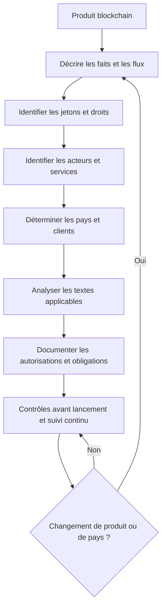
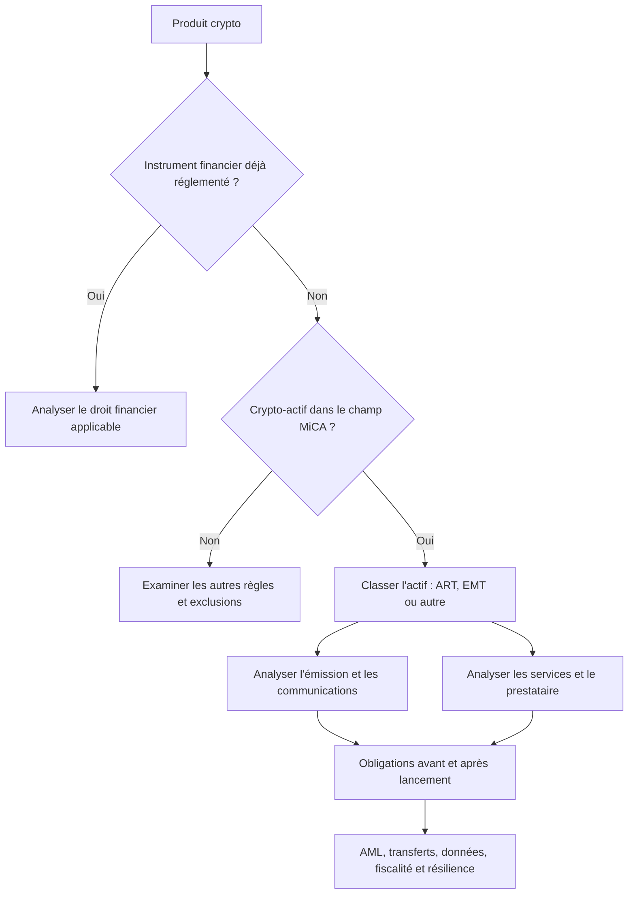
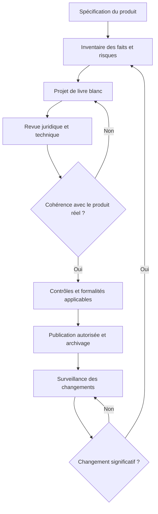

# Réglementation blockchain : MiCA, SEC et conformité des actifs numériques

## Encadré de mise en contexte

Un projet blockchain ne vit jamais uniquement dans son code. Dès qu’il émet un jeton, reçoit des fonds, conserve des actifs pour des clients, organise une place de marché, rémunère des contributeurs, promet une stabilité de prix ou cible des utilisateurs dans plusieurs pays, il entre potentiellement dans un ensemble de règles juridiques, financières, fiscales et opérationnelles. La difficulté n’est pas seulement de trouver une loi qui mentionne la blockchain. Il faut identifier les activités réellement exercées, les personnes qui les exercent, les droits attachés aux jetons, les pays concernés, les catégories de clients, les flux de fonds et les promesses faites au public.

Ce cours compare deux cadres importants mais très différents : le règlement européen sur les marchés de crypto-actifs, généralement appelé MiCA, et le droit fédéral américain des valeurs mobilières, dont l’application aux crypto-actifs relève notamment de la Securities and Exchange Commission, ou SEC. MiCA établit un cadre dédié à plusieurs catégories de crypto-actifs et de prestataires dans l’Union européenne. Le régime américain repose davantage sur plusieurs textes, autorités, doctrines juridiques et faits propres à chaque émission ou opération. Il n’existe donc pas une règle universelle qui permettrait de classer automatiquement chaque jeton comme « autorisé », « interdit », « utility token » ou « security ».

La réglementation évolue. Dans ce cours, les références temporelles sont situées au 29 octobre 2026. Le règlement MiCA est un texte en vigueur, mais ses mesures techniques, les règles nationales pertinentes, les registres et les positions des autorités doivent être consultés dans leur version officielle la plus récente. Aux États-Unis, l’interprétation publiée par la SEC le 17 mars 2026 et les FAQ de son personnel mises à jour le 28 septembre 2026 éclairent l’analyse des crypto-actifs sans transformer toute déclaration administrative en loi. La proposition de règle « Regulation Crypto Assets » publiée en août 2026 doit être traitée comme une proposition, et non comme une exemption déjà disponible.

Ce support est pédagogique. Il ne constitue ni un avis juridique, ni une analyse fiscale individualisée, ni une recommandation d’investissement. Une entreprise doit faire examiner sa situation par des professionnels compétents dans les juridictions visées. Le bon réflexe n’est pas de copier une conclusion juridique tirée d’un exemple, mais de reproduire une méthode d’analyse documentée, prudente et vérifiable.

## Objectifs d’apprentissage et prérequis

À la fin du parcours, l’apprenant doit pouvoir décrire la logique générale de MiCA, distinguer les catégories de jetons couvertes par ce règlement, expliquer pourquoi un livre blanc n’est pas automatiquement une approbation réglementaire, repérer les activités qui peuvent exiger une autorisation de prestataire de services sur crypto-actifs et distinguer ces obligations des règles de lutte contre le blanchiment, de protection des données ou de fiscalité.

L’apprenant devra également comprendre comment la SEC examine une émission ou une transaction au regard du droit des valeurs mobilières, expliquer le rôle du test issu de l’affaire Howey sans le transformer en formule mécanique, reconnaître la différence entre un jeton et le contrat d’investissement qui peut entourer sa vente, et identifier les risques de qualification pour une vente de jetons, un staking, un airdrop, un NFT fractionné, un protocole de finance décentralisée ou une organisation autonome décentralisée.

Enfin, le parcours vise une compétence opérationnelle : construire une fiche de qualification, tenir un registre des hypothèses, produire un dossier de preuves et savoir quand suspendre le lancement afin d’obtenir une analyse spécialisée.

Prérequis conseillés : notions de blockchain, de portefeuille, de clé privée, de smart contract, de jeton fongible et de stablecoin ; compréhension élémentaire des entreprises, de la vente de services et des marchés financiers ; capacité à lire une documentation technique et à comparer des sources officielles. Il n’est pas nécessaire d’être avocat, mais il faut accepter qu’une conclusion juridique puisse rester conditionnelle lorsqu’il manque des faits.

## 1. Le principe central : la réglementation suit les activités, les droits et les faits

Une blockchain est une infrastructure technique. Une loi vise généralement des personnes, des activités, des instruments, des transactions, des risques ou des relations économiques. Le simple fait d’utiliser une blockchain ne suffit donc pas à répondre à la question de la réglementation applicable. Deux applications construites sur le même réseau peuvent recevoir des traitements juridiques différents si l’une permet seulement de consulter des données publiques et l’autre conserve l’argent des clients, échange des crypto-actifs, distribue des rendements ou organise une offre de titres.

Pour conduire une première analyse, il faut distinguer au moins six dimensions. La première est la nature de l’actif : unité de paiement, droit d’accès à un service, droit sur un actif, part économique, créance, objet de collection ou représentation numérique d’un instrument financier. La deuxième est la transaction : vente initiale, échange secondaire, transfert, prêt, staking, remboursement, distribution gratuite ou dépôt de liquidité. La troisième est l’intervenant : émetteur, offreur, opérateur de plateforme, dépositaire, conseiller, intermédiaire, fournisseur de logiciel, gouvernance communautaire ou utilisateur agissant pour son propre compte. La quatrième est la géographie : lieu d’établissement du prestataire, pays du client, ciblage commercial, lieu de distribution et présence d’une offre au public. La cinquième est la structure économique : qui reçoit les fonds, qui contrôle les clés, qui prend les décisions, qui promet une performance et qui supporte les pertes. La sixième est le moment : une qualification ou une exemption applicable lors d’une vente initiale peut ne pas répondre à toutes les obligations d’un marché secondaire ou d’un service ultérieur.

La qualification d’un jeton ne doit pas être déduite uniquement de son nom. Appeler un actif « utility token », « gouvernance », « community coin », « récompense », « NFT », « points », « monnaie d’application » ou « actif décentralisé » ne décide pas de son statut juridique. Il faut étudier les droits inscrits dans les contrats, les documents commerciaux, les conditions d’utilisation, la distribution, les promesses de l’équipe, la manière dont le public comprend l’offre et la réalité opérationnelle. Un document marketing qui promet une hausse de valeur grâce aux efforts d’une équipe peut créer un risque qui n’apparaît pas dans le code du jeton. Inversement, le fait qu’un jeton soit transférable ne signifie pas automatiquement qu’il s’agit d’une valeur mobilière.

Il faut aussi séparer quatre questions souvent confondues. Premièrement, l’actif relève-t-il d’une catégorie réglementée ? Deuxièmement, l’opération ou l’offre est-elle autorisée, exemptée ou soumise à un document d’information ? Troisièmement, le prestataire qui exécute l’opération doit-il obtenir une autorisation ou une inscription ? Quatrièmement, quelles obligations continues s’appliquent après le lancement ? Répondre à la première question ne résout pas les trois autres.

Une méthode professionnelle commence par les faits, poursuit avec la qualification et se termine par une décision documentée. Les faits incertains doivent être marqués comme hypothèses. Les conclusions doivent être datées, attribuées à un responsable et réexaminées si le produit, la clientèle ou les pays ciblés changent. C’est particulièrement important dans les projets qui passent d’un prototype fermé à un lancement public, puis à une plateforme offrant garde, échange, prêts ou accès à des produits tiers.

### Schéma 1 — De la technologie au contrôle réglementaire

## 2. Cartographier les actifs, les acteurs et les flux

Avant de lire un règlement, construisez un inventaire concret du produit. Chaque jeton doit avoir une fiche séparée, même lorsque plusieurs actifs sont déployés dans le même contrat. La fiche indique son nom, son adresse de contrat, son réseau, son mécanisme d’émission, son offre maximale éventuelle, ses droits, sa transférabilité, les règles de remboursement, les restrictions techniques, les personnes qui peuvent modifier le contrat et les documents dans lesquels il est décrit. Pour un actif représentant un droit sur une réserve ou un actif externe, la fiche doit indiquer qui détient réellement cette réserve, selon quel contrat, avec quels droits de contrôle, dans quelle juridiction et avec quels mécanismes de vérification.

La cartographie des acteurs évite une autre erreur fréquente : supposer que l’organisation qui développe le logiciel est toujours la seule partie importante. Le lancement peut impliquer une société émettrice, une fondation, une DAO, une équipe de développeurs, un opérateur de site, un teneur de marché, un dépositaire, un fournisseur d’identité, un prestataire de paiement, une plateforme d’échange, un auditeur de smart contract et plusieurs partenaires de distribution. Les responsabilités ne sont pas toujours transférées à l’entité qui apparaît dans le pied de page du site. L’analyse doit préciser qui contracte avec l’utilisateur, qui contrôle le service, qui reçoit les fonds, qui peut interrompre une opération et qui répond aux plaintes.

La cartographie des flux doit suivre la valeur depuis son entrée jusqu’à sa sortie. Par exemple, dans une vente de jetons, qui reçoit les euros ou dollars ? Sont-ils placés sur un compte séparé ? Qui peut les déplacer ? Que se passe-t-il si le lancement échoue ? Le client reçoit-il un remboursement, un jeton, un NFT, un droit futur ou seulement une créance contre une société ? Une réserve de stablecoin est-elle détenue pour le compte des détenteurs ou constitue-t-elle un actif général de l’entreprise ? Les frais sont-ils conservés par une société, distribués aux détenteurs de jetons ou versés à un trésor communautaire ? Ces questions sont aussi importantes que la structure du contrat intelligent.

La documentation des promesses commerciales est un élément distinct du relevé de code. Conservez les versions successives du site, du livre blanc, des présentations, des publications des fondateurs et des campagnes d’influence. Une équipe peut affirmer dans un document juridique qu’elle ne promet aucun rendement, puis publier sur les réseaux sociaux que les acheteurs vont « profiter de la croissance de l’écosystème ». Ces éléments contradictoires compliquent la qualification et peuvent créer un risque de communication trompeuse. Un processus sérieux prévoit donc une validation juridique des communications publiques, notamment avant une vente, une cotation, un changement de tokenomics ou une annonce de partenariat.

La documentation technique doit également indiquer les fonctions privilégiées. Un propriétaire de contrat peut-il geler les fonds, bloquer une adresse, modifier les frais, augmenter l’offre, remplacer l’implémentation ou contrôler le mécanisme de remboursement ? Une clé multisignature réduit-elle le risque d’une personne seule, ou l’équipe peut-elle toujours modifier seule les paramètres ? Existe-t-il un délai de timelock permettant aux utilisateurs de sortir avant une modification ? Le contrôle technique ne suffit pas à conclure qu’une réglementation s’applique, mais il aide à comprendre le fonctionnement réel et la responsabilité des personnes impliquées.

Une bonne fiche d’inventaire contient ainsi trois couches : ce qui est écrit dans le code, ce qui est promis dans les documents et ce qui se produit réellement en production. Les différences entre ces trois couches doivent être expliquées. Un mécanisme décrit comme « non dépositaire » est difficile à défendre si une équipe possède seule la clé qui peut déplacer les actifs des utilisateurs.

## 3. Vue d’ensemble de MiCA

MiCA est le règlement européen 2023/1114 sur les marchés de crypto-actifs. Il a pour objectif de créer un cadre harmonisé pour certains crypto-actifs qui ne sont pas déjà couverts par des législations financières européennes spécifiques, ainsi que pour les personnes qui émettent ces actifs ou fournissent certains services autour d’eux. Parce qu’il s’agit d’un règlement de l’Union, il s’applique directement dans les États membres, sous réserve de son champ d’application, des dispositions pertinentes et des mécanismes nationaux de supervision. Des normes techniques, actes délégués, orientations et règles nationales complètent le cadre.

Les règles MiCA relatives aux jetons se référant à des actifs et aux jetons de monnaie électronique ont commencé à s’appliquer le 30 juin 2024. Le cadre général du règlement, notamment une grande partie des obligations relatives aux prestataires de services sur crypto-actifs, s’applique depuis le 30 décembre 2024. Il ne faut pas traduire cela par « tout projet blockchain doit recevoir une licence MiCA ». Certains actifs sont exclus du champ d’application, certaines activités ne sont pas des services réglementés, et les obligations diffèrent selon la catégorie de l’actif et le rôle de l’intervenant. Mais lorsqu’une activité couverte est exercée, le fait qu’elle soit automatisée par un smart contract n’est pas, à lui seul, une garantie d’exemption.

MiCA s’inscrit dans un ensemble plus large. Le règlement sur les transferts de fonds et certains transferts de crypto-actifs, souvent associé à la Travel Rule, impose des obligations d’information aux acteurs concernés. Les règles de lutte contre le blanchiment et le financement du terrorisme doivent aussi être étudiées séparément. DORA traite de la résilience opérationnelle numérique des entités financières qui entrent dans son champ. Le RGPD s’applique aux traitements de données à caractère personnel pertinents. Les règles fiscales, les sanctions financières, le droit des consommateurs, les règles de paiement et les textes sur les instruments financiers peuvent également s’appliquer. MiCA ne remplace donc pas toutes les autres obligations.

### 3.1. Ce que MiCA cherche à protéger

Le cadre vise notamment l’information des détenteurs, l’intégrité des marchés, la stabilité financière dans certaines activités, la bonne conduite des prestataires, la gouvernance des émetteurs et la supervision. Le règlement cherche à réduire les situations où un client achète un actif sans information suffisante, où les fonds ou crypto-actifs sont mal protégés, où une plateforme mélange les actifs des clients et ceux de l’entreprise, où un opérateur manipule artificiellement le marché ou où une réserve servant de soutien à un stablecoin est insuffisante ou difficile à contrôler.

La protection ne signifie pas que l’État garantit la valeur du jeton. Un livre blanc conforme ne garantit pas la rentabilité. Une autorisation d’un prestataire ne rend pas chaque actif coté sûr. Un mécanisme de réserve ne supprime pas le risque de contrepartie, le risque de liquidité, le risque technique ou la possibilité d’une perte. L’apprenant doit savoir expliquer cette limite aux utilisateurs : conformité, solvabilité, sécurité technique et intérêt économique sont des dimensions différentes qui se recoupent sans être identiques.

### 3.2. Ce que MiCA ne couvre pas automatiquement

Les instruments financiers déjà soumis à MiFID II et à d’autres textes financiers ne deviennent pas des crypto-actifs MiCA simplement parce qu’ils sont représentés sur une blockchain. Les dépôts, certains produits d’assurance, les fonds et d’autres instruments visés par les textes financiers peuvent relever d’un régime différent. Les activités exclusivement réalisées à titre personnel ou certaines opérations entre particuliers sans intermédiaire peuvent être traitées différemment, mais les limites doivent être vérifiées au regard des faits. Les NFT qui sont réellement uniques et non fongibles peuvent se trouver hors du champ du règlement ; cette exclusion n’est toutefois pas une exemption générale pour tout jeton appelé NFT. Les émissions en série, les collections fractionnées ou les droits économiques standardisés peuvent nécessiter une analyse plus poussée.

Le bon réflexe consiste à lire les exclusions pertinentes de MiCA et les considérants qui les expliquent, mais à ne pas s’arrêter au mot « NFT », « DeFi » ou « décentralisé ». L’analyse porte sur les caractéristiques et la réalité du produit. Une plateforme présentée comme entièrement décentralisée peut conserver un opérateur capable de décider des listings, de percevoir les frais, de contrôler l’accès ou de mettre en œuvre les transactions. Ce contrôle peut être pertinent pour déterminer si une activité est exercée par une personne ou une organisation identifiable.

### Schéma 2 — Les principaux niveaux du droit européen

## 4. Les catégories principales de crypto-actifs sous MiCA

MiCA distingue notamment les jetons se référant à des actifs, les jetons de monnaie électronique et les autres crypto-actifs relevant de son champ, dont les utility tokens dans certains cas. Cette classification est importante parce que les exigences d’émission, de réserve, de gouvernance, d’information et de supervision ne sont pas les mêmes.

### 4.1. Jeton se référant à des actifs : ART

Un asset-referenced token, ou ART, cherche à maintenir une valeur stable en se référant à une autre valeur ou à un droit, ou à une combinaison de valeurs ou de droits, incluant potentiellement plusieurs monnaies officielles. La structure peut se référer à un panier de devises, des marchandises, des actifs ou une combinaison autorisée de références. L’élément déterminant n’est pas le nom choisi par le projet, mais le mécanisme de stabilisation et la référence décrite.

L’émetteur d’un ART est soumis à des obligations spécifiques, qui peuvent notamment concerner l’autorisation, la gouvernance, le livre blanc, les réserves, la gestion des actifs de réserve, les droits des détenteurs, les mécanismes de plainte, la continuité et les mesures de résolution. Les conditions précises dépendent de la catégorie, de la structure et des dispositions applicables. Les ART considérés comme significatifs peuvent être soumis à une supervision renforcée au niveau européen et à des obligations supplémentaires.

Un projet qui promet qu’un jeton représentera un panier d’actifs doit pouvoir démontrer comment ce panier est constitué, où les actifs sont conservés, comment leur valeur est calculée, quels événements permettent le remboursement, qui vérifie les réserves et ce qui arrive en cas de faillite d’un dépositaire ou d’un émetteur. Si la réserve est investie dans des actifs illiquides tandis que les détenteurs peuvent demander un remboursement rapide, l’émetteur peut être exposé à un risque de liquidité qui ne disparaît pas parce que les jetons se règlent sur une blockchain.

### 4.2. Jeton de monnaie électronique : EMT

Un e-money token, ou EMT, vise à maintenir une valeur stable en se référant à la valeur d’une seule monnaie officielle. Un jeton qui se présente comme équivalent à un euro ou à un dollar peut donc déclencher des questions spécifiques, sans qu’il suffise d’ajouter une mention « stablecoin » dans le code pour déterminer son statut. L’identité de l’émetteur, les droits contractuels, les réserves et les possibilités de remboursement comptent.

Sous MiCA, les EMT sont étroitement liés au cadre de la monnaie électronique. L’émission doit respecter les conditions applicables, notamment quant au statut de l’émetteur autorisé et aux droits des détenteurs. Les obligations portent entre autres sur le livre blanc, les communications, le remboursement à la valeur nominale dans les conditions prévues, la sauvegarde des fonds reçus et l’interdiction de rémunération dans les situations couvertes par le règlement. Il faut vérifier le texte exact et les règles complémentaires plutôt que de se contenter d’une synthèse commerciale.

L’existence d’une réserve de 100 % ne répond pas à toutes les questions. Il faut encore identifier la nature des actifs de réserve, leur ségrégation, leur accessibilité en cas d’insolvabilité, la fréquence des contrôles, les risques opérationnels, les droits de remboursement et les règles de distribution. Le détenteur doit comprendre auprès de quelle entité il détient une créance et sous quelles conditions il peut obtenir la monnaie officielle.

### 4.3. Autres crypto-actifs : jetons utilitaires et actifs similaires

Les crypto-actifs relevant de MiCA mais qui ne sont ni ART ni EMT peuvent inclure des jetons destinés à donner accès à un bien ou à un service fourni par leur émetteur. Un utility token peut servir à payer une fonctionnalité, accéder à un contenu, consommer une ressource informatique ou participer à un service numérique. Cette description fonctionnelle ne doit pas être confondue avec une exemption automatique vis-à-vis du droit des valeurs mobilières d’un autre pays. Un jeton d’usage au sens commercial peut encore soulever des questions si sa vente s’accompagne d’une promesse d’investissement ou si ses droits constituent juridiquement un instrument financier.

Les obligations MiCA relatives aux autres crypto-actifs diffèrent de celles des ART et EMT. Elles peuvent notamment requérir la préparation, la notification ou la publication d’un livre blanc, la conformité des communications, l’équité dans le traitement des détenteurs et l’absence de communication trompeuse. Des exceptions ou régimes particuliers peuvent s’appliquer en fonction de l’offre, des caractéristiques du jeton, de son admission à la négociation ou de la catégorie de personne qui l’émet. Une équipe doit vérifier les articles concernés au lieu d’extrapoler les règles d’une catégorie à une autre.

### 4.4. Tableau de comparaison pratique

| Question | ART | EMT | Autres crypto-actifs couverts |
|---|---|---|---|
| Référence de valeur | Une ou plusieurs valeurs, droits ou combinaisons, selon le mécanisme | Une seule monnaie officielle | Peut ne viser aucune stabilité de valeur |
| Problème central | Réserve, stabilisation, gouvernance et remboursement | Monnaie officielle, émetteur autorisé et remboursement | Information, offre, admission et conduite de marché |
| Obligations d’émission | Régime spécialisé, potentiellement autorisation et réserve | Cadre étroitement lié à la monnaie électronique | Livre blanc et obligations adaptées à la catégorie |
| Risque pour le détenteur | Rupture de référence, liquidité, réserve et contreparties | Rupture opérationnelle, droit de remboursement et risque de l’émetteur | Volatilité, projet, liquidité, code, droits et communication |
| Vérification essentielle | Composition et accès à la réserve | Droit et capacité de remboursement à valeur nominale | Droits réels, offre, documentation et services associés |

Ce tableau est pédagogique et non exhaustif. Les textes, les exceptions et les mesures complémentaires priment sur une simplification. Il ne faut jamais classer un actif seulement à partir d’une colonne de ce tableau sans examiner son contrat, son usage et son émetteur.

## 5. Le livre blanc MiCA et la communication au public

Le livre blanc sur un crypto-actif est un document d’information qui décrit notamment l’émetteur ou l’offreur, le projet, les caractéristiques de l’actif, les droits et obligations, la technologie sous-jacente, les risques et les aspects pertinents de l’offre ou de l’admission à la négociation. Sa fonction est de permettre au lecteur de comprendre ce qui est proposé et les principaux risques, pas de prouver que le projet est rentable.

Une confusion importante doit être évitée : l’inscription d’un livre blanc dans un registre ou sa notification à une autorité ne veut pas dire que l’autorité a examiné et approuvé son contenu. L’ESMA précise, par exemple, que les livres blancs présents dans son registre intérimaire ne sont pas examinés ni approuvés par une autorité compétente d’un État membre et que la responsabilité du contenu appartient à l’offreur ou à l’émetteur. Les projets ne doivent donc pas utiliser la présence d’un document dans un registre comme un label de sécurité ou une recommandation officielle.

Les informations du livre blanc doivent être cohérentes avec le produit réel. Si le document dit que les utilisateurs ont le droit de remboursement, ce droit doit exister dans les documents contractuels et pouvoir être exercé. Si une réserve est annoncée, il faut expliquer sa nature, sa gestion, les risques, les rapports de vérification et les limites. Si l’actif peut être transféré mais pas dans certains pays ou à certains types de portefeuille, les restrictions doivent être décrites de façon intelligible. Une explication qui omet les restrictions essentielles peut donner une image trompeuse du produit.

La communication commerciale constitue un flux d’information parallèle. Une publicité, une publication sur les réseaux sociaux, une vidéo, un dossier destiné à un influenceur ou une interface de vente peuvent contribuer à la compréhension du public. Il ne suffit pas d’écrire « ceci n’est pas un conseil financier » en bas d’une page pour neutraliser une promesse irréaliste de gains. Les messages doivent être exacts, clairs, non trompeurs et cohérents avec le livre blanc et les conditions contractuelles. Ils ne doivent pas masquer les risques dans un texte minuscule ni présenter une autorisation ou une notification comme une garantie.

Un contrôle avant publication doit examiner les rendements annoncés, les comparaisons de prix, les références à des partenaires, les données sur les réserves, le caractère expérimental du code, les limites de liquidité, les frais et les conditions de retrait. Chaque déclaration mesurable devrait avoir une preuve et une date. Une publicité qui mentionne « réserve totalement couverte » doit s’appuyer sur une méthodologie précise, un périmètre clair et une information actualisée. Une campagne qui promet « rendement garanti » doit être considérée comme un signal critique à examiner, particulièrement si le risque est en réalité supporté par l’acheteur.

Le processus de révision doit prévoir un propriétaire du document, une date de version, la liste des approbateurs et un archivage des versions publiées. La conformité ne doit pas se limiter à corriger le livre blanc au lancement. Lorsqu’un mécanisme change, par exemple le droit de remboursement, l’adresse du contrat, les droits de gouvernance ou la composition de la réserve, l’équipe doit vérifier si la documentation, les communications et les notifications doivent être mises à jour.

### Schéma 3 — Cycle de publication documentaire

## 6. Les prestataires de services sur crypto-actifs (CASP)

MiCA encadre certaines personnes ou entreprises qui fournissent des services sur crypto-actifs à des clients. Le terme couramment utilisé est CASP, pour crypto-asset service provider. Une activité peut relever de ce régime lorsqu’elle comporte, par exemple, la conservation et l’administration de crypto-actifs pour le compte de clients, l’exploitation d’une plateforme de négociation, l’échange de crypto-actifs contre des fonds ou d’autres crypto-actifs, l’exécution d’ordres, la réception et transmission d’ordres, le placement de crypto-actifs, le transfert de crypto-actifs pour le compte de clients, le conseil ou la gestion de portefeuille dans les conditions prévues par le règlement.

Il est essentiel de lire les définitions du règlement pour déterminer quelle activité exacte est fournie. Deux plateformes qui affichent le même écran peuvent fournir des services différents selon qu’elles exécutent elles-mêmes les transactions, transmettent des ordres à un tiers, détiennent les clés, gèrent les portefeuilles, décident de l’allocation des actifs ou se limitent à diffuser des informations. Les contrats, les flux techniques et les pratiques réelles doivent être comparés à la définition légale du service.

L’autorisation n’est pas simplement une formalité de formulaire. Le cadre peut exiger une personne morale établie dans l’Union, une gouvernance adéquate, des dirigeants honorables et compétents, des fonds propres minimaux en fonction des services, des procédures de gestion des risques, des contrôles internes, des mesures de sauvegarde des actifs des clients, des mécanismes de traitement des plaintes, une politique de conflits d’intérêts et une organisation qui permet au superviseur de comprendre l’activité. La portée des exigences varie selon les services et doit être vérifiée directement dans le texte et les actes complémentaires.

Une autorisation valable dans un État membre peut ouvrir, via les procédures de notification prévues, une possibilité de fournir des services dans d’autres États de l’Union. Ce mécanisme de passeport ne signifie pas qu’une entreprise peut s’installer n’importe où et commencer immédiatement toute activité sans formalités. Il faut vérifier le périmètre exact de l’autorisation, le processus de notification, les pays visés, les langues, les règles de commercialisation et les obligations locales applicables à l’activité.

MiCA prévoit une transition pour certains prestataires déjà actifs sous le droit national avant la date d’application. Cette disposition n’est pas une autorisation universelle pour toute nouvelle entreprise. La durée transitoire et ses conditions ont été différentes selon les États et le régime concerné. La limite prévue dans le règlement a atteint au plus tard le 1er juillet 2026 pour le régime général de transition des prestataires visés, sous réserve des détails des dispositions applicables et des décisions nationales antérieures. À la date de référence du présent cours, une entreprise ne doit donc pas supposer qu’elle peut encore exploiter un service uniquement sur la base d’un ancien statut national : elle doit vérifier son autorisation et le registre officiel à jour.

Une liste sur un site commercial, une annonce de cotation ou un message sur les réseaux sociaux ne remplace pas la vérification du registre du superviseur compétent. Pour un partenaire, il faut contrôler l’identité juridique, la raison sociale, le numéro d’autorisation, les services autorisés, le statut actuel, les pays concernés et les éventuelles restrictions ou alertes. Les homonymes et les copies de sites existent ; la vérification doit partir d’une source officielle.

## 7. Obligations opérationnelles et protection des clients

Les exigences opérationnelles ne sont pas un supplément de communication. Elles touchent la manière dont une entreprise exerce ses services chaque jour. Les prestataires doivent comprendre quels actifs appartiennent aux clients, lesquels appartiennent à l’entreprise, qui peut les déplacer, comment les ordres sont exécutés, comment les plaintes sont traitées, comment les conflits sont identifiés et ce qui se passe si une panne, une compromission ou une insolvabilité survient.

### 7.1. Conservation et administration des actifs

La conservation pour le compte de clients implique des risques techniques et juridiques spécifiques. Le prestataire doit savoir quels actifs il détient, sous quel type de portefeuille, avec quelles clés, quels droits de contrôle et quelle capacité de restitution. Une adresse blockchain visible ne suffit pas à démontrer qu’un actif est sauvegardé de manière appropriée. Il faut aussi considérer les clés privées, les procédures de récupération, la séparation des tâches, les signatures multiples, la sécurité physique, les fournisseurs externes, les plans de continuité et l’accès des administrateurs.

La séparation des actifs des clients et des actifs propres est un principe essentiel de gestion du risque. Un tableur interne qui associe le nom d’un client à une adresse partagée n’offre pas nécessairement une protection juridique contre les créanciers. Il faut vérifier les exigences légales et contractuelles relatives à la ségrégation et à la restitution. Les rapprochements doivent confronter les soldes du registre interne aux données de chaîne et aux actifs effectivement sous contrôle. Les écarts doivent être expliqués rapidement, documentés et escaladés.

### 7.2. Plateformes d’échange et exécution des ordres

Une plateforme doit savoir décrire sa méthode de négociation, sa gestion des ordres, les frais, l’accès, les critères d’admission, les règles de suspension, les mécanismes de gestion des conflits et le traitement des erreurs. Les conflits peuvent apparaître lorsqu’un opérateur est simultanément plateforme, teneur de marché, émetteur d’un actif listé et bénéficiaire d’une commission. Il faut définir des contrôles empêchant qu’un intérêt commercial interne influence le traitement des clients à leur détriment.

Les contrôles d’accès aux listings et aux retraits doivent tenir compte des risques de fraude, de manipulation, d’exploitation de vulnérabilités et de perte de clés. La suspension d’un actif doit suivre une procédure documentée, avec des critères définis et une communication claire aux utilisateurs. Une interruption d’accès peut avoir des conséquences financières importantes ; la procédure doit distinguer un incident technique, une suspicion de fraude, une obligation légale et un risque de marché.

### 7.3. Plaintes, transparence et traitement des incidents

Un processus de plaintes doit être accessible, traçable et compréhensible. Les utilisateurs doivent savoir où déposer une plainte, quels éléments fournir, quel service la reçoit et comment le dossier est suivi. Les délais et modalités précis doivent être conformes au droit applicable. Un support qui répond uniquement par des messages automatisés sans voie d’escalade peut aggraver le problème et créer une mauvaise preuve de traitement. La conservation des échanges doit respecter les règles de protection des données et les obligations de conservation applicables.

Les incidents de sécurité ou d’exploitation doivent être classés selon leur gravité, leur impact client, leur portée et leurs implications réglementaires. Le plan doit préciser qui prend la décision, qui informe la direction, qui coordonne avec le prestataire externe, quels éléments techniques sont préservés, quand les retraits ou les échanges doivent être suspendus et comment les utilisateurs seront informés. Toute communication doit éviter les spéculations présentées comme des faits. Il faut annoncer ce qui est établi, ce qui est encore investigué et quand une prochaine mise à jour est prévue.

### 7.4. Conflits d’intérêts et gouvernance

Les conflits ne se limitent pas aux transactions personnelles des salariés. Ils peuvent résulter de la rémunération des dirigeants, de l’ordre des listings, de la priorité donnée aux ordres, des partenariats rémunérés, de l’utilisation de données internes, de la relation entre un dépositaire et un émetteur ou de l’attribution de jetons à des personnes liées au projet. Une politique utile identifie les conflits réels et potentiels, les personnes concernées, les mesures d’atténuation, les décisions indépendantes et les situations où une activité doit être refusée.

La gouvernance opérationnelle doit être cohérente avec la structure réelle. Il ne suffit pas de désigner un responsable de conformité dans un organigramme si cette personne n’a pas accès aux documents, au budget, aux incidents ou aux dirigeants. Les responsabilités doivent être explicites, les délégations documentées et les décisions critiques conservées. Les conseils d’administration et les dirigeants doivent comprendre les risques au lieu de considérer la conformité comme une tâche purement administrative.

## 8. Intégrité des marchés, information privilégiée et manipulation

MiCA comporte des règles relatives à l’abus de marché pour les crypto-actifs entrant dans son champ. Ces règles visent notamment les opérations d’initiés, la divulgation illicite d’informations privilégiées et les manipulations de marché. L’existence d’une blockchain publique rend certaines transactions visibles, mais cette visibilité ne supprime ni les asymétries d’information ni les comportements abusifs.

Une information peut être pertinente si elle est suffisamment précise, non publique et susceptible d’influencer de manière sensible le prix d’un crypto-actif concerné. Les exemples possibles comprennent une faille critique non divulguée, une décision de cotation ou de retrait, une perte d’une réserve, un problème de remboursement, une acquisition, un changement réglementaire concernant l’émetteur ou un incident qui affecte l’offre. La qualification dépend des règles et des circonstances ; tout événement important n’est pas automatiquement une information privilégiée, mais l’équipe doit avoir un processus permettant de l’évaluer.

La manipulation de marché peut prendre plusieurs formes : opérations fictives donnant l’impression d’une activité réelle, ordres introduits pour tromper les autres participants, diffusion d’informations fausses, coordination destinée à artificiellement soutenir un prix ou dissimulation d’un conflit d’intérêts. Les mécanismes exacts de surveillance doivent tenir compte du mode de négociation et de la liquidité de l’actif. Les petits marchés, les pools peu profonds et les jetons contrôlés par un nombre limité de portefeuilles peuvent être particulièrement vulnérables à des mouvements importants.

La surveillance ne doit pas se limiter à analyser le carnet d’ordres. Elle peut nécessiter d’examiner les annonces, les relations entre portefeuilles, les activités d’initiés, les comportements de plusieurs comptes et les informations disponibles publiquement. Les signaux d’alerte ne prouvent pas à eux seuls une infraction ; ils déclenchent une analyse, une conservation de preuves et, selon la situation, une escalade interne ou une notification réglementaire. Les équipes doivent pouvoir distinguer un mouvement naturel de marché, une opération abusive et une activité suspecte qui exige davantage d’informations.

Une politique d’information interne devrait définir les personnes qui peuvent accéder à des informations sensibles, les règles de confidentialité, les périodes durant lesquelles les transactions personnelles sont restreintes, les procédures d’annonce et le contrôle des publications. Les règles applicables aux opérations personnelles et les obligations de conservation doivent être déterminées selon les textes pertinents. Il est imprudent d’importer mécaniquement une politique conçue pour un marché de titres classique sans l’adapter aux caractéristiques d’un actif numérique et de son marché.

## 9. Autorités, supervision, sanctions et transition européenne

MiCA est appliqué par les autorités compétentes des États membres, avec des rôles européens importants pour l’ESMA et l’EBA dans leurs champs respectifs. La répartition exacte des compétences varie selon la catégorie de crypto-actif et la règle concernée. Les autorités nationales examinent notamment les demandes d’autorisation, la conformité des prestataires et les manquements de leurs ressorts. Les organismes européens élaborent des normes techniques, orientations, registres et outils de convergence selon les mandats prévus par le droit.

Un projet ne doit pas considérer une autorité comme un partenaire commercial chargé de valider sa technologie. Les autorités peuvent demander des informations, contrôler les déclarations, imposer des mesures correctrices et prendre des sanctions selon les pouvoirs établis par le texte et le droit national. Les obligations de coopération, d’archivage et de reporting doivent être intégrées dans la conception du service. Attendre l’arrivée d’une demande de superviseur pour construire un inventaire de clients, de transactions, de clés et d’incidents peut rendre impossible une réponse fiable.

Les mesures de supervision peuvent inclure, selon le cas, une demande d’information, une injonction de mettre fin à une pratique, une restriction d’activité, une suspension, un retrait d’autorisation ou une sanction financière. Il faut consulter les articles applicables et les règles nationales pour connaître l’outil disponible et les garanties procédurales. Une sanction n’est pas automatiquement due au seul fait d’une panne technique ; le risque juridique dépend des obligations en cause, des faits, de la gravité, de la coopération et des dispositions applicables.

Le régime transitoire mérite une attention particulière. MiCA a permis, sous conditions, à certains prestataires qui fournissaient déjà des services conformément au droit national avant le 30 décembre 2024 de continuer temporairement leur activité. Les États membres ont exercé des choix prévus par le règlement, ce qui a créé des calendriers et des conditions différents. Pour les prestataires visés par le régime, le terme maximal prévu a été fixé au 1er juillet 2026, ou jusqu’à la décision sur la demande lorsque le texte et la situation l’exigent, dans les conditions prévues. Au 29 octobre 2026, une société ne peut pas présumer qu’un régime transitoire général reste disponible. Elle doit vérifier le statut concret de son autorisation, les décisions du superviseur et le registre publié.

La présence dans un registre ESMA demande également une lecture attentive. Le registre peut recenser des prestataires autorisés, des émetteurs ou des livres blancs en fonction de la catégorie. Il faut regarder la date de mise à jour, la catégorie exacte et l’avertissement qui accompagne les informations. Le registre d’un livre blanc n’a pas la même signification qu’une autorisation de CASP. L’utilisateur final doit lui aussi comprendre qu’une inscription n’est pas une assurance de rendement ni une garantie du remboursement de tous les actifs.

## 10. Règles complémentaires européennes : transferts, AML, données, résilience et fiscalité

### 10.1. Travel Rule et informations accompagnant les transferts

Le règlement européen 2023/1113 encadre les informations qui accompagnent certains transferts de fonds et de crypto-actifs, notamment dans le contexte des obligations de traçabilité. Ce régime est distinct de MiCA même si un prestataire autorisé au titre de MiCA peut également être concerné. Il faut préciser les données à collecter, les vérifications attendues, la transmission au prestataire destinataire, la gestion des informations manquantes et les procédures applicables aux transferts impliquant des portefeuilles auto-hébergés lorsque les règles pertinentes le prévoient.

La Travel Rule n’est pas un mécanisme qui « rend toutes les transactions blockchain publiques et identifiées ». Les données demandées et la manière de les traiter dépendent du type de transfert, des parties, des règles et de leurs obligations. Une adresse blockchain ne révèle pas systématiquement à elle seule l’identité du détenteur. Les prestataires concernés doivent toutefois avoir des procédures adaptées pour recueillir et traiter les informations prévues par le règlement, sans inventer de données ni confondre une adresse avec une identité civile vérifiée.

### 10.2. Lutte contre le blanchiment et financement du terrorisme

La réglementation AML/CFT cherche à limiter l’utilisation du système financier pour dissimuler l’origine de fonds, financer des activités interdites ou contourner des sanctions. Elle implique généralement une approche fondée sur les risques, une connaissance du client lorsque requise, une surveillance des transactions, des procédures d’escalade, des signalements aux autorités compétentes et un contrôle des bénéficiaires effectifs des personnes morales dans les situations pertinentes. Les obligations exactes varient selon l’activité, la juridiction et les textes applicables.

Le KYC ne doit pas être confondu avec une simple collecte de photos d’identité. Un processus utile vérifie l’identité selon le niveau de risque, comprend l’objet de la relation, évalue les facteurs de risque, suit les changements et permet de détecter des opérations inhabituelles. La surveillance des transactions ne doit pas transformer chaque transfert vers un protocole de confidentialité en preuve d’une infraction. Il faut un traitement fondé sur des facteurs objectifs, documenté et conforme aux règles de protection des données et aux garanties applicables.

### 10.3. Données personnelles et RGPD

La blockchain rend certains traitements difficiles à inverser. Or, le RGPD impose des principes comme la limitation des finalités, la minimisation des données, la sécurité, la transparence, la limitation de conservation et les droits des personnes dans les conditions prévues. Enregistrer directement sur une chaîne publique un nom, une adresse de portefeuille explicitement liée à une identité ou un document personnel peut créer un risque important. Le fait qu’une donnée soit hachée ne signifie pas automatiquement qu’elle est anonyme ; elle peut rester une donnée personnelle si elle peut être reliée à une personne par des moyens raisonnables.

Une architecture prudente garde généralement les données identifiantes hors chaîne lorsque c’est possible, limite les données publiées à ce qui est strictement nécessaire et utilise des références ou preuves cryptographiques lorsque cela convient. Les métadonnées hors chaîne doivent elles-mêmes être protégées et avoir une base juridique de traitement. Les équipes doivent documenter les rôles de responsable du traitement et de sous-traitant, les destinataires, les transferts internationaux et les durées de conservation pertinentes. Les choix techniques doivent être évalués au début du projet, car effacer une donnée publiée de manière immuable peut être impossible en pratique.

### 10.4. Résilience opérationnelle numérique et prestataires externes

DORA est le règlement européen sur la résilience opérationnelle numérique du secteur financier. Lorsqu’une entité crypto entre dans son champ, elle peut devoir gérer le risque informatique, les incidents, les tests de résilience, les dépendances à des prestataires TIC et les clauses contractuelles associées. Il faut vérifier le statut de chaque entité et le texte applicable plutôt que d’affirmer que tout développeur ou tout protocole décentralisé est soumis de la même manière.

La dépendance à un fournisseur cloud, à un service de gestion de clés, à un oracle, à une API de blockchain, à un fournisseur d’identité ou à une infrastructure de signature doit être visible dans le registre de risques. Une panne d’un prestataire externe peut rendre les retraits, l’identification ou le règlement impossibles. Les contrats devraient préciser les responsabilités, les niveaux de service, l’accès aux données, la localisation, l’assistance en cas d’incident, l’audit et les conditions de sortie. Le plan de continuité doit inclure une solution réaliste, pas seulement une clause affirmant que le fournisseur « fera ses meilleurs efforts ».

### 10.5. Fiscalité et déclarations

La conformité fiscale ne se résume pas à déclarer une plus-value lors de la vente d’un jeton. Selon le pays et les faits, peuvent être pertinents les échanges entre actifs, la rémunération en jetons, les récompenses de staking, l’activité professionnelle, les distributions, les revenus de réserve, la TVA, les retenues à la source, les obligations comptables et les déclarations d’informations. Une opération qui n’entraîne pas de conversion en monnaie officielle peut quand même recevoir un traitement fiscal. Les règles de valorisation, de date, de coût d’acquisition et de conservation des justificatifs doivent être établies selon la juridiction.

Dans l’Union européenne, DAC8 introduit un cadre de déclaration fiscale d’informations sur certains crypto-actifs avec une mise en œuvre à partir de 2026 selon les dispositions et transpositions concernées. Les obligations exactes doivent être vérifiées auprès des autorités fiscales compétentes. Un projet doit définir les données nécessaires, leur qualité, la responsabilité de la déclaration et les droits des utilisateurs. Une approche documentée est préférable à la promesse marketing selon laquelle les transactions « restent anonymes » ou que les revenus « échappent automatiquement à l’impôt ».

## 11. Le cadre américain : ce que la SEC réglemente et ce qu’elle ne remplace pas

Aux États-Unis, la SEC administre notamment les lois fédérales sur les valeurs mobilières. Elle n’est pas l’unique autorité pouvant intervenir dans l’écosystème crypto. La CFTC peut avoir un rôle au titre des matières premières et des produits dérivés ; FinCEN administre certaines obligations liées à la lutte contre le blanchiment et aux services monétaires ; les autorités étatiques peuvent imposer leurs propres règles de licence ou de protection du consommateur ; le Trésor, les services fiscaux et d’autres autorités peuvent aussi intervenir selon les faits. Une conclusion sur la compétence de la SEC n’épuise donc pas l’analyse américaine.

La question essentielle en droit des valeurs mobilières est de déterminer si l’actif ou la transaction entre dans le champ d’un texte pertinent. Il faut distinguer la valeur mobilière elle-même, le contrat d’investissement ou l’arrangement économique associé à sa vente, les intermédiaires qui facilitent l’opération et les plateformes qui négocient ou conservent l’actif. Un jeton peut être l’objet d’une transaction qui constitue un contrat d’investissement sans que l’analyse puisse se réduire à une propriété abstraite du code du jeton. Le contexte de la vente, les promesses, la structure économique, le contrôle du projet et les attentes suscitées auprès des acheteurs peuvent être déterminants.

Les lois américaines sur les valeurs mobilières imposent souvent l’enregistrement d’une offre et d’une vente de titres, sauf si une exemption est disponible. Des obligations supplémentaires peuvent concerner les courtiers, bourses, systèmes de négociation, conseillers, fonds, dépositaires et agents de transfert selon l’activité réelle. Une entreprise ne doit pas supposer qu’une exemption à l’enregistrement de l’offre l’exempte automatiquement de toutes les obligations applicables à l’intermédiation ou au marché secondaire.

L’analyse américaine est particulièrement sensible aux déclarations faites aux acheteurs. Des promesses relatives aux futurs développements, à l’effort central d’une équipe, aux inscriptions futures, à un revenu attendu ou à l’augmentation d’une valeur peuvent peser dans l’analyse d’un contrat d’investissement. Le fait de présenter un jeton comme étant « utile aujourd’hui » ne fait pas disparaître les déclarations relatives à l’investissement lorsque celles-ci ont constitué une partie importante de la vente. À l’inverse, aucune phrase unique ni aucun indicateur technique ne décide toujours du statut de l’actif dans toutes les circonstances.

Le cours examine ci-après le test de Howey, les orientations SEC disponibles au 29 octobre 2026, puis les principaux risques d’offres, de trading, de garde, de staking, d’airdrop et de finance décentralisée.

## 12. Le test de Howey : méthode, limites et application aux crypto-actifs

Le test connu sous le nom de Howey provient d’un arrêt de la Cour suprême des États-Unis de 1946. Dans son contexte d’origine, la Cour a expliqué la notion de « investment contract » à l’aide d’une analyse économique de l’arrangement présenté aux investisseurs. Les formulations modernes décrivent généralement quatre éléments liés : un investissement d’argent, dans une entreprise commune, avec une attente raisonnable de profits, tirés des efforts essentiels de tiers. Ce résumé est utile pédagogiquement, mais le droit doit être appliqué en tenant compte de la jurisprudence, des faits et des textes pertinents.

Le premier élément ne doit pas être réduit à un paiement en dollars. Dans des situations crypto, une personne peut fournir une autre valeur ou apporter un actif ; il faut étudier la nature de l’opération et la jurisprudence applicable. Le deuxième élément, l’entreprise commune, exige une analyse juridique et factuelle. La façon dont les fonds sont regroupés, les intérêts partagés, le sort des contributions et le lien entre les participants peuvent être pertinents. Le troisième élément ne consiste pas seulement à savoir si l’acheteur espère gagner de l’argent : il faut étudier si cette attente est raisonnable au regard de l’ensemble de l’offre et du contexte. Le quatrième élément concerne le rôle des efforts d’autrui qui sont essentiels à la réussite économique attendue, ce qui exige d’examiner qui développe, gère, commercialise, maintient ou fait fonctionner le projet.

Il serait erroné d’utiliser le test comme un questionnaire mécanique dont un projet pourrait retirer un seul élément par une modification de vocabulaire. Les tribunaux examinent l’arrangement dans son ensemble. Une offre peut être présentée d’une manière différente selon qu’il s’agit d’un lancement initial, d’un achat secondaire après une phase de développement, d’une transaction de consommation ou d’un service qui promet une participation aux revenus. Il faut également considérer quelles déclarations ont été faites avant l’achat et quels efforts restent attendus des promoteurs.

Dans un projet de jeton de gouvernance, par exemple, l’équipe peut prétendre que le droit de vote donne une utilité immédiate. Pourtant, si le lancement a mis l’accent sur les profits attendus de l’équipe, sur sa gestion de la trésorerie et sur l’augmentation de valeur grâce à des développements futurs, cette utilité ne met pas fin à l’analyse. Les droits techniques, les droits contractuels et les messages publics doivent être lus ensemble.

Il faut distinguer une décision de justice, une interprétation de la Commission, une déclaration du personnel, une proposition de règle et un article de commentaire. Ces sources n’ont pas le même statut juridique. Un article résumant une position ne doit pas remplacer le texte original. Une FAQ du personnel peut être utile à l’analyse, mais elle peut préciser qu’elle reflète uniquement les vues du personnel et n’a pas force de loi. Une proposition de règle peut être modifiée, retirée ou ne jamais être adoptée dans sa forme proposée.

### 12.1. Exemple : un jeton de réseau en phase initiale

Une startup vend un jeton avant que son réseau ne fonctionne. Dans ses présentations, elle explique que les fonds serviront à recruter des développeurs, à construire l’infrastructure, à signer des partenaires et à obtenir des inscriptions sur des plateformes. Elle insiste sur le potentiel d’augmentation de prix lorsque ces étapes seront atteintes. Même si le jeton doit plus tard payer des frais de réseau, l’acheteur initial peut être sensible principalement aux efforts futurs de l’équipe. Ce scénario doit faire l’objet d’une analyse américaine sérieuse avant l’offre.

### 12.2. Exemple : une utilisation établie sans promesse d’investissement

Une application fonctionnelle vend un jeton de crédit utilisable immédiatement pour consommer une ressource déterminée. Le prix, les droits, les conditions d’utilisation et les communications n’annoncent pas un profit ni une hausse garantie. Le jeton n’accorde pas de part de capital ni de droit sur les revenus. Ces faits peuvent réduire certains signaux de risque par rapport à une vente fondée sur le financement d’efforts futurs, mais ils ne créent pas une exemption automatique. Il faut toujours examiner les conditions réelles, les caractéristiques du produit, la façon de le distribuer et les règles applicables.

La leçon pratique est que le document de qualification doit citer les faits qui soutiennent chaque conclusion, identifier les éléments contradictoires et exposer ce qui doit changer si le modèle évolue. Écrire simplement « ne constitue pas une security » en tête d’un site ne remplace pas une analyse rigoureuse.

## 13. Les orientations SEC de 2026 : interprétation, FAQ et proposition de règle

Le contexte américain a évolué en 2026. Le 17 mars 2026, la SEC a publié une interprétation sur l’application des lois fédérales sur les valeurs mobilières aux crypto-actifs, en coordination avec la CFTC selon les éléments publiés. Cette interprétation fournit une taxonomie et explique notamment comment un crypto-actif qui n’est pas lui-même une valeur mobilière peut être associé à un contrat d’investissement dans certaines circonstances, et comment cette association peut évoluer lorsque les engagements et les efforts pertinents changent. Il faut lire le document original pour connaître les définitions et limites exactes.

Les ressources SEC publiées en avril 2026 décrivent plusieurs catégories utilisées dans cette approche, notamment les digital commodities, digital collectibles, digital tools, stablecoins et digital securities. Ces catégories ne doivent pas être utilisées comme de simples étiquettes marketing. Le contenu des droits, le fonctionnement du système, la structure de l’offre et les transactions restent essentiels. Par exemple, un objet numérique conçu comme un objet de collection peut soulever une analyse différente d’un jeton représentant des actions, mais le fractionnement ou la vente accompagnée de droits d’investissement peuvent changer la situation.

Les FAQ du personnel de la Division of Corporation Finance ont été mises à jour le 28 septembre 2026. Elles indiquent expressément qu’elles représentent les vues du personnel, qu’elles ne sont ni une règle ni une déclaration de la Commission, qu’elles n’ont pas été approuvées ou désapprouvées par celle-ci et qu’elles n’ont pas force de loi. Elles peuvent être pertinentes pour comprendre l’approche administrative, mais elles ne doivent pas être citées comme si elles créaient de nouvelles obligations ou modifiaient une loi.

La SEC a également publié en août 2026 une proposition de règle appelée « Regulation Crypto Assets », dossier S7-2026-27. La proposition vise notamment un régime adapté pour certaines offres liées à des contrats d’investissement, et décrit des exemptions potentielles sous certaines conditions. Les documents de proposition indiquaient une période de commentaires arrivant à échéance le 20 octobre 2026. Au 29 octobre 2026, l’existence de la proposition ne suffit pas à conclure qu’une exemption est en vigueur. Une entreprise doit vérifier si une règle finale a été adoptée, sa date d’effet et ses conditions avant de s’y appuyer. Les seuils présentés dans la proposition ne doivent pas être utilisés comme des seuils légaux déjà applicables sans cette vérification.

Une méthode de conformité américaine tient donc un registre des sources en indiquant leur type et leur date : texte législatif, règlement adopté, arrêt judiciaire, interprétation de la Commission, FAQ du personnel, proposition de règle, formulaire ou avis officiel. Une note doit préciser si une source est contraignante, interprétative ou proposée. Cette discipline évite d’annoncer à la direction ou aux clients qu’une exemption est disponible alors qu’elle n’existe qu’au stade d’un projet.

### 13.1. L’actif lui-même et la transaction

L’un des points importants de l’approche interprétative est de ne pas confondre le jeton avec le contrat d’investissement associé à une opération. Un actif peut être transféré et utilisé sur un réseau, tandis qu’une offre particulière de cet actif a impliqué des promesses et des efforts dont l’analyse diffère. Lorsque les obligations de l’équipe ont été exécutées, abandonnées ou devenues impossibles à réaliser, la relation entre l’actif et le contrat d’investissement peut demander une réévaluation. Cela ne signifie pas que chaque jeton devient automatiquement libre de toute règle, ni que toutes les ventes secondaires ont le même statut.

La qualification doit être attachée à une opération précise : qui vend, à qui, à quel moment, avec quelles représentations, pour quel usage, avec quel niveau de contrôle et sous quel régime de distribution ? Les résultats de cette analyse peuvent différer entre une prévente aux financeurs initiaux, une distribution au public, une opération entre utilisateurs et la cotation sur une plateforme. Les droits attachés au jeton restent essentiels, mais le contexte de l’opération ne peut pas être ignoré.

### 13.2. Pourquoi la prudence reste nécessaire

La taxonomie de 2026 n’annule pas toutes les obligations américaines. Même lorsqu’un crypto-actif lui-même n’est pas classé comme valeur mobilière, les services qui l’entourent peuvent déclencher des obligations de courtage, de plateforme, de garde, de transfert de fonds, de sanctions ou d’autres textes. Un produit dérivé sur un actif peut recevoir un traitement différent de l’actif au comptant. Une transaction peut être soumise à des lois anti-fraude indépendamment de la classification principale. Les règles étatiques et les obligations de protection du consommateur ne disparaissent pas non plus.

Une entreprise ne doit pas présenter une ressource éducative SEC comme une autorisation individuelle. Une analyse sérieuse identifie les faits, les textes, les acteurs, les pays, les activités et les questions non résolues. Si l’offre touche à l’épargne du public, à un marché secondaire, à une promesse de profit, à la conservation de fonds ou à des produits dérivés, une revue juridique spécialisée est particulièrement importante avant la commercialisation.

## 14. Enregistrement des offres, exemptions et activités de marché aux États-Unis

Si une offre implique une valeur mobilière, il faut déterminer si l’offre et la vente doivent être enregistrées ou si une exemption disponible s’applique. L’enregistrement implique généralement des obligations d’information, de dépôt et de responsabilité qui doivent être préparées bien avant le lancement. Les exemptions sont des régimes avec des conditions, pas une phrase de non-responsabilité. Elles peuvent limiter les personnes susceptibles d’investir, la sollicitation, les montants, le type d’émetteur, les obligations de divulgation ou les possibilités de revente.

Les entreprises invoquent parfois Regulation D, Regulation S ou Regulation Crowdfunding sans vérifier si leur situation correspond aux exigences détaillées. Les conditions précises peuvent dépendre des catégories d’investisseurs, des démarches de vérification, des restrictions de revente, des documents requis, de la sollicitation publique et du lieu de résidence des participants. Une exemption qui concerne l’offre ne donne pas nécessairement le droit d’exploiter une bourse, d’agir comme courtier ou de conserver des actifs pour des clients. La vérification doit se faire par activité et par opération.

Les marchés secondaires soulèvent leurs propres questions. Une plateforme qui met en relation des acheteurs et des vendeurs de valeurs mobilières peut relever des règles sur les bourses ou des systèmes de négociation alternatifs, selon sa structure et son fonctionnement. Une personne rémunérée pour solliciter ou faciliter des opérations peut potentiellement soulever des questions de courtier. Une entreprise qui détient les titres ou enregistre les changements de propriété peut également toucher à des activités réglementées. Le fait que les transactions soient exécutées par des smart contracts ou des ordres signés cryptographiquement ne règle pas la qualification.

Les contrats avec les partenaires doivent refléter les responsabilités réelles. Une startup ne doit pas supposer qu’un fournisseur technique prendra en charge la conformité réglementaire de l’émetteur. Si un courtier ou une plateforme autorisée intervient, il faut vérifier sa compétence, son statut, le périmètre de ses services et la répartition des responsabilités. Il faut également s’assurer que la documentation commerciale ne décrit pas une prestation réglementée qui n’est pas réellement fournie par le partenaire.

Les propositions de régime adaptés aux crypto-actifs doivent être suivies comme telles. Une note de conformité ne doit pas indiquer « nous sommes exemptés sous S7-2026-27 » sur la seule base d’une proposition publiée en août 2026. Il faut vérifier les dernières publications officielles, le statut de l’adoption, le texte final éventuel, la date d’entrée en vigueur et les conditions. Jusqu’à confirmation, le modèle doit être analysé selon le droit en vigueur et les exemptions effectivement disponibles, et non selon le résultat espéré d’une procédure réglementaire.

## 15. Staking, prêts, rendements, airdrops et NFT : analyse par activité

Les produits crypto combinent souvent plusieurs fonctions et ne peuvent pas être classés de façon fiable à partir d’un seul mot. Les sections suivantes donnent des méthodes de repérage, pas des conclusions universelles.

### 15.1. Staking

Le staking peut désigner différentes opérations. Dans un réseau à preuve d’enjeu, un participant peut immobiliser des actifs ou les déléguer pour contribuer à la validation. Un service centralisé peut collecter des actifs de clients, contrôler les clés, mutualiser les positions, décider de la stratégie, retenir des frais et promettre un rendement. Ces structures ne sont pas équivalentes. Les droits du client, la garde, le rôle du prestataire, la source des récompenses, les risques de slashing, les délais de retrait et les déclarations relatives au rendement doivent être décrits.

Aux États-Unis, il ne faut pas conclure que le staking est toujours un titre ou jamais un titre. L’analyse peut dépendre de la façon dont les services sont proposés, de la présence d’une mise en commun, des promesses d’efforts et de rendement, ainsi que des faits de la transaction. L’interprétation SEC de 2026 et ses FAQ doivent être examinées dans leur périmètre exact. En Europe, il faut déterminer si un prestataire fournit un service couvert par MiCA, s’il détient les actifs et si d’autres textes s’appliquent. Les obligations fiscales doivent être examinées séparément.

### 15.2. Prêts et dépôts crypto

Un produit qui reçoit des crypto-actifs et promet de les restituer avec un rendement soulève des questions de droit financier, de prêt, de dépôt, de valeurs mobilières ou de protection des consommateurs selon la juridiction et la structure. La publicité qui décrit un rendement comme garanti ou « sans risque » est particulièrement problématique si l’entreprise prête les actifs à des tiers, les réinvestit, les utilise comme collatéral ou supporte un risque de défaut. L’utilisateur doit comprendre si son actif est ségrégué ou prêté, s’il peut exiger un retrait, à quel rang il se situe en cas d’insolvabilité et quels événements peuvent retarder le remboursement.

La distinction entre un protocole qui exécute automatiquement une règle de prêt et une société qui commercialise un produit de rendement demeure importante. Il faut identifier qui détient la gouvernance, qui peut mettre à jour le code, qui perçoit les frais, qui contrôle les interfaces et qui fait des promesses au client. Une interface sans garde directe peut tout de même faciliter un service ou une offre réglementée dans certaines circonstances.

### 15.3. Airdrops

Un airdrop peut être une distribution gratuite, une récompense d’utilisation, une mesure de gouvernance, une incitation commerciale ou un élément d’une stratégie de distribution. Le mot « gratuit » ne décide pas de tous les aspects juridiques. Les participants peuvent avoir fourni de la valeur auparavant, effectuer des actions requises, accorder des droits ou recevoir des actifs dans le cadre d’une relation plus large. Les engagements du projet, le rôle de l’équipe, l’existence de restrictions, le ciblage et les conditions doivent être examinés.

Un airdrop distribué à des personnes dans plusieurs pays doit faire l’objet d’une vérification des restrictions géographiques, des sanctions, des mécanismes de réclamation, de l’identification lorsque requise et du traitement fiscal. Les équipes doivent éviter les listes de bénéficiaires opaques, documenter les critères de sélection et établir une procédure pour les réclamations frauduleuses. Une distribution qualifiée de gratuite ne rend pas automatiquement sans objet la réglementation de l’offre, les lois anti-fraude ou les obligations de sanctions.

### 15.4. NFT et objets numériques

Un NFT réellement unique représentant une œuvre ou un objet de collection peut recevoir un traitement différent d’un jeton fongible. Cependant, les labels ne suffisent pas. Une collection très standardisée, émise en masse, fractionnée en droits économiques ou commercialisée comme une participation aux profits peut nécessiter une analyse plus approfondie. Les droits de propriété intellectuelle, les droits d’accès, la licence d’utilisation et le droit de propriété sur le support doivent être distingués. Acheter un NFT ne transfère pas automatiquement le droit d’auteur sur l’œuvre liée.

Un projet doit aussi étudier la propriété de la ressource référencée. Si les métadonnées ou l’image sont stockées sur un serveur central, l’immutabilité du jeton ne garantit pas la disponibilité de l’œuvre. Il faut expliquer le mécanisme de stockage, le droit d’utilisation et les risques. La fractionnalisation peut transformer une expérience de collection en intérêt économique partageable ; elle ne doit jamais être présentée comme un simple changement technique sans revue des conséquences.

### 15.5. Finance décentralisée et gouvernance communautaire

DeFi décrit des mécanismes d’échange, de prêt, de liquidité ou de gestion exécutés en partie par des contrats intelligents. DAO décrit une structure de décision par vote ou par règles programmées. Ces termes ne suffisent pas à prouver qu’aucune personne ne fournit un service. Une équipe peut sélectionner les actifs, gérer l’interface, mettre à jour les contrats, contrôler le trésor, percevoir les frais, distribuer les récompenses ou décider des mesures de secours. L’analyse doit examiner les pouvoirs effectivement disponibles plutôt que la seule documentation du projet.

L’absence de société formellement enregistrée ne supprime pas toutes les obligations et n’élimine pas le risque de responsabilité. Les participants, les délégués, les multisigs, les fondations et les contributeurs peuvent jouer des rôles différents. Les questions de propriété, de gouvernance, de fiscalité, de responsabilité, de consommation et de droit des valeurs mobilières doivent être examinées selon la juridiction. Les interfaces frontales, les services d’indexation, les clés d’administration et les mécanismes de vote peuvent aussi fournir des preuves concrètes du niveau de contrôle.

## 16. Comparaison structurée : MiCA et SEC

Comparer MiCA et la SEC exige de résister à une fausse symétrie. MiCA est un règlement européen dédié à certains crypto-actifs et à plusieurs services associés. La SEC est une autorité américaine chargée d’appliquer les lois sur les valeurs mobilières dans son champ. MiCA ne correspond donc pas à une « version européenne de la SEC », et le statut d’un actif sous MiCA ne résout pas automatiquement sa qualification aux États-Unis.

| Dimension | Union européenne — MiCA | États-Unis — approche SEC |
|---|---|---|
| Source principale | Règlement 2023/1114 et mesures complémentaires | Lois fédérales sur les valeurs mobilières, jurisprudence et interprétations |
| Logique de base | Catégories de crypto-actifs et services définis par le règlement | Analyse des titres et transactions au regard des lois applicables, incluant l'investment contract |
| Stablecoins | Cadres spécifiques ART et EMT | Plusieurs lois et autorités peuvent intervenir selon l'actif, l'offre et le service |
| Prestataires | Autorisation MiCA pour les services couverts, sous réserve du champ et des exceptions | Statut d'intermédiaire, plateforme, dépositaire ou autre fonction à analyser séparément |
| Documents d'information | Livre blanc et obligations adaptées à la catégorie | Enregistrement de l'offre ou exemption applicable si l'offre implique un titre |
| Supervision | Autorités nationales, ESMA, EBA selon leurs mandats | SEC pour les valeurs mobilières, avec d'autres autorités selon les activités |
| Portée géographique | Union européenne selon les règles d'application et d'établissement | États-Unis et rattachements pertinents selon les lois et faits applicables |
| Ce qu'une conformité ne garantit pas | Ni rentabilité ni absence de risque technique | Ni rentabilité ni immunité vis-à-vis des autres régimes |

Une entreprise internationale doit réaliser une analyse par marché cible. Elle ne doit pas produire un mémorandum unique qui conclut « conforme UE/USA » sans définir les activités, les clients, les versions de produit et les faits considérés. Il est utile de maintenir un tableau de correspondance qui identifie les obligations communes et les divergences. Par exemple, une obligation de livre blanc européenne ne remplace pas un enregistrement ou une exemption aux États-Unis ; inversement, une analyse américaine de titre ne répond pas aux obligations d’un CASP européen.

La communication à la direction doit exprimer les limites. La qualification d’un jeton peut avoir un niveau de confiance élevé dans une situation simple et un niveau faible dans un lancement hybride avec staking, garde, gouvernance et distribution secondaire. Les questions qui restent ouvertes doivent être formulées précisément : « l’équipe contrôle-t-elle la clé d’urgence après le lancement ? », « les acheteurs reçoivent-ils une créance sur l’émetteur ? », « le site cible-t-il activement les résidents de tel pays ? », « l’autorisation du partenaire couvre-t-elle la conservation ? ». Une question précise permet un avis utile ; une demande abstraite d’« approbation de la blockchain » non.

## 17. Projets transfrontaliers et lancement depuis l'Afrique

Une entreprise qui développe un protocole au Cameroun ou dans un autre pays africain peut être concernée par des règles étrangères si son activité vise des clients, des marchés ou des services dans ces territoires. La localisation de l’équipe ne règle pas à elle seule la portée des règles. La géographie du client, la publicité, la langue, les moyens de paiement, la disponibilité du service, les contrats, l’établissement des prestataires et la distribution des actifs peuvent tous compter selon le texte examiné.

L’analyse doit commencer par une matrice pays-activité. Pour chaque pays, listez les utilisateurs visés, les services disponibles, les canaux de marketing, les devises utilisées, les partenaires, les règles de paiement, les restrictions de distribution, le régime d’actifs numériques, les exigences AML/CFT, la fiscalité et les licences possibles. Puis distinguez la présence technique de la sollicitation commerciale. Le fait qu’un site soit accessible dans un pays ne suffit pas toujours à trancher une question juridique, mais l’accès volontaire et la publicité ciblée peuvent devenir des éléments pertinents.

Il est important de consulter le droit local en vigueur et les autorités financières compétentes. Les règles concernant la monnaie, les paiements, les transferts internationaux, les changes, la collecte d’épargne et les services numériques peuvent être différentes des cadres européens et américains. Une entreprise ne doit pas supposer que le silence d’une loi intitulée « blockchain » autorise tous les services de paiement ou de conservation. L’analyse d’un actif crypto doit s’intégrer à l’analyse du système financier, de la fiscalité et du droit des affaires de son pays d’établissement.

L’approche la plus sûre pour un petit projet n’est pas de se déclarer mondial sans restrictions dès le premier jour. Elle consiste à définir le marché de lancement, les utilisateurs autorisés, les services offerts, les pays exclus si nécessaire et le processus qui permettra d’ajouter un marché après examen. Les mesures de restriction géographique et de vérification ne doivent pas être seulement des cases décoratives : leur efficacité doit être testée, documentée et révisée. Un VPN ou une adresse blockchain seule ne permet pas toujours d’identifier le pays d’une personne, et la conformité ne doit pas s’appuyer sur une hypothèse technique fragile.

Les équipes doivent également tenir compte des prestataires. Un fournisseur de paiement, un dépositaire, un exchange ou un prestataire d’identité peut imposer des conditions contractuelles et géographiques. Les partenariats doivent être contrôlés au regard de leur autorisation réelle et de la répartition des responsabilités. Les contrats doivent préciser quelles parties réalisent les vérifications, qui conserve les données, comment les incidents sont signalés, quels pays sont couverts et ce qui se passe si une autorisation est suspendue.

## 18. Mettre en place un programme de conformité proportionné

Un programme efficace commence par une responsabilité claire. Même une équipe réduite doit désigner la personne qui coordonne l’analyse juridique, la personne qui connaît les flux techniques, la personne responsable des communications publiques et celle qui gère les incidents. Une même personne peut porter plusieurs rôles au démarrage, mais les responsabilités doivent être explicites et les contrôles critiques ne doivent pas dépendre d’une connaissance informelle ou d’un canal de discussion inaccessible en cas de crise.

### 18.1. Registre des risques

Le registre de risques relie chaque risque à une activité, un scénario, une conséquence, une mesure de réduction, un propriétaire et une preuve. Une entrée ne doit pas seulement indiquer « risque réglementaire ». Elle doit préciser ce qui pourrait se produire, par exemple : « la plateforme conserve les clés des clients alors que son autorisation ne couvre pas la garde ». Les contrôles possibles peuvent inclure la suspension du service, un avis externe, la vérification du registre d’autorisation, des clauses avec un partenaire ou une modification de l’architecture.

Il faut distinguer le risque inhérent du risque résiduel. Le risque inhérent est celui qui existe avant les contrôles. Le risque résiduel reste après application des contrôles. Une entreprise ne devrait pas réduire artificiellement un risque à un niveau faible en inscrivant « politique en cours de rédaction ». Le contrôle doit exister, être appliqué, testé et documenté. Les mesures non réalisées doivent être marquées comme actions ouvertes avec une échéance et un décideur.

### 18.2. Dossier de qualification

Un dossier de qualification doit contenir au minimum une description fonctionnelle, le schéma des flux, l’inventaire des jetons, les contrats et documents publics, la liste des acteurs, les pays ciblés, les services, les droits des utilisateurs, les fonctions de contrôle technique, les qualifications envisagées, les sources officielles, les questions ouvertes et la décision de lancement. Chaque conclusion doit être reliée à des faits ou à une source. Si le produit change, l’équipe doit savoir quelles conclusions doivent être réexaminées.

Un bon dossier n’a pas besoin d’être excessivement long au départ, mais il doit être précis et versionné. Il est préférable d’exposer clairement une incertitude plutôt que de produire une note assurée qui ignore des faits contradictoires. Le document doit indiquer son périmètre : il couvre peut-être le jeton et la vente initiale, sans couvrir la garde, un marché secondaire futur, le prêt d’actifs ou la distribution dans de nouveaux pays.

### 18.3. Contrôle des partenaires et des fournisseurs

Le contrôle de partenaire doit commencer par l’identité juridique et le statut réglementaire. Vérifiez la raison sociale exacte, l’immatriculation, les dirigeants, les licences, le périmètre des services, les pays, les éventuelles restrictions, la propriété du site et les contacts officiels. N’utilisez pas seulement un logo, un contrat PDF ou une affirmation commerciale. Lorsque la sécurité du partenariat en dépend, conservez une copie horodatée de la page officielle pertinente et de la recherche effectuée.

Le contrôle technique doit examiner la sécurité, la continuité, les sous-traitants, les droits d’accès, les mécanismes d’audit, les délais d’incident, la réversibilité et la capacité à exporter les données nécessaires. Un fournisseur peut être parfaitement compétent techniquement mais ne pas être autorisé à offrir le service réglementé requis. À l’inverse, l’existence d’une licence ne garantit pas une infrastructure sans vulnérabilité. Les analyses juridiques, opérationnelles et techniques doivent rester complémentaires.

### 18.4. Surveillance continue

Les produits crypto changent rapidement. Une mise à jour de contrat, une nouvelle fonction de prêt, un mécanisme de frais, une cotation, une intégration avec un partenaire ou une campagne publicitaire peut modifier l’analyse. Le programme doit définir des événements déclencheurs de revue. La revue doit être réalisée avant le lancement de la nouvelle fonction lorsque c’est possible et non des mois après, lorsque des contrats, utilisateurs et flux ont déjà été activés.

La surveillance externe doit également suivre les textes adoptés, les normes techniques, les registres, les alertes de superviseurs, les décisions de justice et les propositions de règle pertinentes. Il est utile de maintenir un journal des changements réglementaires indiquant la date, la source officielle, la disposition concernée, les produits potentiellement touchés, la décision prise et la personne responsable. Une publication sur un réseau social ou un résumé d’actualité peut déclencher une veille, mais la décision doit être confirmée auprès de la source officielle.

## 19. Étude de cas — lancement de « BridgePay »

BridgePay est un cas fictif créé pour l’exercice. Une petite entreprise veut lancer une application qui permet aux utilisateurs de conserver un jeton BPT, de l’utiliser pour payer des frais sur une application partenaire, de l’échanger contre un stablecoin et de déléguer les BPT pour recevoir une récompense variable. Le projet prévoit une prévente publique, une réserve de trésorerie, une équipe qui publiera des mises à jour et une interface opérée par une société. Les dirigeants souhaitent servir des utilisateurs européens et américains dès le lancement, puis ajouter d’autres pays.

La première tâche consiste à éviter une qualification unique pour « l’application ». Il y a au moins quatre objets à examiner : le jeton BPT, la prévente, le service de conservation et d’échange, et le mécanisme de délégation rémunérée. Le stablecoin utilisé comme actif de règlement doit lui aussi être examiné, et les prestataires tiers qui le fournissent doivent être contrôlés. La qualification du jeton ne répond pas automatiquement aux obligations du service d’échange ou de conservation.

Pour le volet européen, l’équipe doit déterminer si BPT est un crypto-actif relevant de MiCA, s’il est un instrument financier exclu de ce champ ou s’il relève d’une autre catégorie. Elle doit examiner les caractéristiques de l’offre, la nécessité d’un livre blanc, les exceptions éventuellement disponibles, les communications commerciales et l’admission à la négociation. Si la société conserve des actifs ou organise un échange pour les clients, elle doit vérifier si elle fournit un service CASP et quelles autorisations et exigences sont applicables. Le produit de délégation nécessite une analyse indépendante de ses contrats et de la réalité du service. La composition de la trésorerie et le vocabulaire utilisé dans le marketing doivent être comparés aux engagements du livre blanc.

Pour les États-Unis, l’équipe doit étudier si les faits de la prévente peuvent caractériser une offre de valeurs mobilières ou un contrat d’investissement. Les présentations qui expliquent que la valeur augmentera grâce aux efforts de l’équipe, au développement de partenariats ou à la future liquidité sont des éléments à examiner. L’utilisation de BPT pour payer des frais n’élimine pas à elle seule cette analyse. Il faut aussi identifier les services de marché et de garde, et considérer si des lois fédérales, étatiques, AML ou de paiement s’appliquent. Les documents SEC de 2026 doivent être lus selon leur statut exact : interprétation, FAQ du personnel ou proposition de règle.

Le plan de lancement devrait être conditionnel. La société ne devrait pas ouvrir la prévente mondiale tant que le périmètre juridique, les pays, les documents d’offre, la conservation, les transferts et les rôles des partenaires ne sont pas clarifiés. Une alternative consiste à réduire le périmètre : fournir seulement un service non dépositaire réellement limité, supprimer temporairement la fonction de rendement, différer les pays non analysés ou utiliser un prestataire autorisé après vérification. Une modification de produit ne doit toutefois pas être choisie seulement pour contourner le mot « réglementé » ; elle doit modifier réellement les faits et être réévaluée juridiquement.

Les éléments de sortie de l’étude sont : une carte des flux, une fiche de jeton, une matrice des pays, une liste des services, les principales sources réglementaires, les documents à préparer, les questions ouvertes, les décisions de conception et une liste des conditions préalables au lancement. La direction doit recevoir une conclusion compréhensible, avec les risques majeurs, les preuves et les décisions requises, pas seulement un avis binaire « légal/illégal ».

## 20. Atelier pratique — qualifier un nouveau produit

L’exercice se déroule comme dans une équipe produit. L’apprenant reçoit les informations suivantes : une société veut vendre 2 millions de jetons ACCESS. Chaque jeton donne droit à un nombre d’unités de calcul dans une application hébergée. Les jetons ne donnent pas droit au capital ni aux revenus selon le projet de contrat. Le réseau est encore en développement. Le site indique cependant que les premiers acheteurs « pourraient bénéficier de l’adoption future » et qu’une partie des fonds servira à financer les intégrations et la croissance. La société veut proposer une conservation intégrée et permettre aux clients de s’échanger les jetons entre eux. Elle n’a encore identifié aucune autorité ni aucun pays de lancement prioritaire.

La première étape est la collecte des faits. Demandez une copie du contrat de jeton, de la documentation produit, des conditions d’utilisation, du plan de prévente, du plan de trésorerie, du site, des publications des fondateurs, des contrats de partenaires et des détails de conservation. Il faut aussi demander qui contrôle les clés, qui peut mettre à jour le contrat, qui fixe le prix, comment les jetons sont distribués, si des remboursements existent et si les acheteurs peuvent revendre les actifs. Les réponses ne doivent pas être remplacées par des suppositions.

La deuxième étape est la décomposition des services. L’offre de jetons, le service d’hébergement, la conservation et le marché secondaire peuvent avoir des qualifications différentes. Il faut distinguer les unités d’usage de la fonction de financement. Il faut aussi rechercher les droits qui ne figurent pas dans le résumé commercial : droit de remboursement, priorité sur les revenus, gouvernance, frais, restrictions et recours. Une application technique peut offrir un usage réel tout en étant vendue dans le cadre d’un investissement ; ces deux éléments peuvent coexister.

La troisième étape est la matrice de juridiction. Pour l’Union européenne, l’équipe examine MiCA, l’exclusion éventuelle des instruments financiers, les exigences de livre blanc, les règles d’offre et les services CASP éventuels. Pour les États-Unis, elle examine le droit des valeurs mobilières, l’approche Howey, les interprétations SEC récentes et les obligations relatives aux intermédiaires. Dans les deux cas, elle doit ajouter AML/CFT, sanctions, paiements, protection des consommateurs, données et fiscalité. Le résultat peut être une liste de questions à résoudre, pas nécessairement une conclusion définitive.

La quatrième étape est la recommandation produit. Si la fonction de conservation est trop complexe pour le lancement, elle peut être différée ou déléguée à un prestataire approprié. Si le jeton finance un développement futur, la structure de l’offre doit être examinée avant de vendre. Si le marketing crée une attente de bénéfice grâce aux efforts de l’équipe, il doit être révisé et non simplement complété par une mention de risque. La décision doit montrer pourquoi le changement réduit le risque et quelles obligations restent à traiter.

La cinquième étape est la validation. Préparez une synthèse d’une page pour la direction, un dossier de preuves, un tableau des questions ouvertes et un calendrier de décisions. Toute conclusion doit avoir un propriétaire. Toute action de conformité doit comporter une preuve de réalisation. Si une nouvelle fonction est ajoutée, la fiche est mise à jour avant sa mise en production.

### Modèle de fiche de qualification à remplir

| Champ | Réponse attendue |
|---|---|
| Produit et version | Nom, version, date, réseau et contrats concernés |
| Actif ou jeton | Droits, usage, transférabilité, émission, remboursement |
| Offre | Public visé, financement, prix, restrictions, communications |
| Acteurs | Émetteur, opérateur, gardien, plateforme, partenaires |
| Pays | Établissement, clients ciblés, marketing et disponibilité |
| Services | Garde, échange, transfert, conseil, gestion ou autre |
| Sources | Textes officiels, dates, statut et articles pertinents |
| Risques majeurs | Scénarios, impacts et preuves |
| Questions ouvertes | Formulation précise et responsable |
| Décision | Lancer, différer, limiter le périmètre ou solliciter un avis |
| Revue suivante | Événement déclencheur, date et propriétaire |

## 21. Erreurs fréquentes et comment les éviter

**Erreur 1 : « Notre jeton est un utility token, donc il n’est pas réglementé. »** Cette conclusion confond la fonctionnalité commerciale d’un jeton avec sa qualification juridique. La fonction d’usage peut être pertinente, mais les droits, les communications, la prévente, la gouvernance, l’offre et les services restent à examiner.

**Erreur 2 : « Nous ne détenons pas de monnaie fiduciaire, donc aucune autorisation n’est nécessaire. »** La réglementation peut viser les crypto-actifs eux-mêmes, la conservation, l’échange ou d’autres services même en l’absence de monnaie fiat. Il faut étudier chaque service réellement fourni.

**Erreur 3 : « Le smart contract est décentralisé, donc il n’existe pas d’opérateur. »** L’équipe peut conserver le contrôle du site, des clés, du paramétrage, de la gouvernance, des listings ou des frais. Le niveau de contrôle doit être établi à partir des faits.

**Erreur 4 : « Nous avons publié un livre blanc, donc l’autorité a approuvé le projet. »** Un livre blanc n’est pas un label de rentabilité. La notification ou la présence dans un registre n’équivaut pas à une approbation de contenu. L’ESMA publie précisément un avertissement concernant les livres blancs de son registre intérimaire.

**Erreur 5 : « MiCA remplace AML et la fiscalité. »** MiCA n’élimine pas les obligations relatives aux transferts, aux sanctions, aux données, aux impôts, aux consommateurs ou à la résilience. Le programme de conformité doit cartographier les textes complémentaires.

**Erreur 6 : « La SEC a dit en 2026 que tous les tokens de réseau ne sont pas des securities. »** Les publications SEC de 2026 ont clarifié certains aspects et proposé une taxonomie, mais la qualification reste dépendante des textes, des faits et de l’opération. Les catégories descriptives ne sont pas une immunité générale.

**Erreur 7 : « Une proposition de règle est déjà applicable. »** Une proposition peut présenter une future exemption ou des obligations envisagées, mais elle ne doit pas être utilisée comme règle définitive tant que son adoption et son entrée en vigueur ne sont pas confirmées. Il faut lire le document final éventuel et vérifier sa date d’effet.

**Erreur 8 : « Un prestataire qui possède une licence peut faire toutes les opérations. »** Une licence est limitée à un périmètre. Il faut vérifier le service autorisé, le pays, le statut actuel et les éventuelles conditions. Une autorisation de conservation ne garantit pas une autorisation de conseil ou de gestion de portefeuille.

**Erreur 9 : « Une annonce sur un réseau social suffit comme preuve. »** La preuve doit provenir, autant que possible, d’une source officielle et être datée. Les articles peuvent aider à découvrir une actualité, mais les conclusions de conformité doivent s’appuyer sur le texte, la décision, le registre ou la publication originale.

**Erreur 10 : « Si le produit n’a jamais été poursuivi, il est conforme. »** L’absence de sanction publique ne prouve pas que le produit répond aux obligations. La supervision peut être en cours, les faits inconnus ou les textes applicables. L’entreprise doit analyser ses propres risques avant de commercialiser.

## 22. Exercices corrigés

### Exercice A — Classer une stablecoin

Une équipe émet un jeton qui vise à maintenir une valeur proche d’un euro. Elle annonce que chaque jeton peut être remboursé pour un euro, mais les conditions donnent à l’entreprise la faculté de retarder les remboursements sans limite claire. La société détient la réserve sur un compte de trésorerie non séparé et propose le jeton à des utilisateurs européens.

**Question :** quelles sont les premières questions réglementaires à poser ?

**Correction :** il faut d’abord établir si le jeton répond à la définition d’un EMT et vérifier les exigences relatives à l’émetteur et aux droits de remboursement. L’engagement d’une valeur liée à une seule monnaie officielle est un signal important. Il faut obtenir l’identité juridique de l’émetteur, les contrats, la méthode de réserve, la ségrégation, les conditions de remboursement, le statut de l’établissement et le plan de liquidité. L’équipe doit ensuite vérifier les obligations MiCA et les textes complémentaires, notamment ceux qui concernent les transferts, AML/CFT et les communications. Il est impossible de conclure à la conformité à partir de la seule promesse « un jeton égale un euro ». L’absence de limite claire et la non-ségrégation annoncée sont des signaux de risque majeurs qui justifient de suspendre le lancement jusqu’à une revue compétente.

### Exercice B — Jeton de gouvernance et promesse de croissance

Une société vend un jeton de gouvernance avant que son protocole soit fonctionnel. Les acheteurs peuvent voter sur certains paramètres, mais la documentation commerciale affirme que les revenus du protocole vont croître lorsque l’équipe recrutera des partenaires et lancera de nouvelles fonctions. Une partie des fonds de la vente finance ces efforts.

**Question :** pourquoi l’utilité de gouvernance ne suffit-elle pas à clore l’analyse américaine ?

**Correction :** le jeton donne bien une fonction de vote, mais les acheteurs ont également été exposés à des promesses sur les efforts futurs de l’équipe et la croissance économique du projet. Ces faits peuvent être pertinents pour l’analyse d’un contrat d’investissement au regard de Howey et des orientations applicables. Il faut examiner l’ensemble de l’offre, les déclarations, les flux de fonds, les obligations et la nature des bénéfices attendus. La conclusion ne peut pas être déduite du mot « gouvernance » ni du fait que les votes sont exécutés par un smart contract. L’équipe doit faire examiner l’offre et ses options de distribution par un conseil compétent.

### Exercice C — Site d’échange sans garde

Une interface permet aux utilisateurs de connecter leur portefeuille et de passer des ordres exécutés par des contrats intelligents. L’équipe contrôle les mises à jour du contrat, les paires disponibles, la présentation du prix et une clé d’urgence. Elle prélève une commission sur chaque opération.

**Question :** le fait que les utilisateurs détiennent leurs clés signifie-t-il que l’interface est libre de toute règle ?

**Correction :** non. L’absence de garde directe est un fait pertinent, mais ce n’est pas une réponse complète. Il faut déterminer qui organise le service, qui contrôle les paramètres, qui choisit les actifs, qui perçoit les frais et qui peut suspendre les transactions. Pour l’Europe, il faut analyser les définitions et exclusions MiCA applicables aux services de plateforme, d’exécution ou d’autres activités. Pour les États-Unis, il faut examiner les règles de marché et d’intermédiation selon les actifs et les opérations. Le rôle du logiciel, le contrôle de l’équipe et les activités réellement fournies doivent être documentés.

### Exercice D — Registre et livre blanc

Un commercial affirme : « Notre white paper figure dans un registre ESMA, ce qui prouve que l’Europe a approuvé le projet. » Un client demande si cet argument est valable.

**Correction :** l’argument est trompeur. La présence d’un livre blanc dans le registre intérimaire de l’ESMA ne doit pas être présentée comme un examen ou une approbation du contenu par une autorité. Le règlement et les avertissements de l’ESMA doivent être consultés. Une entreprise devrait corriger le message, former les équipes commerciales et conserver la preuve de la correction. L’autorisation d’un prestataire est une catégorie d’information différente et ne doit pas être confondue avec la présence d’un livre blanc dans un registre.

### Exercice E — Proposition de règle américaine

La direction d’un projet affirme qu’une proposition SEC d’août 2026 permet déjà à tous les émetteurs de crypto-actifs de lever jusqu’à une certaine somme sans enregistrement.

**Correction :** une proposition publiée n’est pas automatiquement une règle adoptée. Il faut vérifier la publication officielle, le statut procédural, la période de commentaires, l’existence éventuelle d’un texte final et la date d’effet. Les seuils et conditions figurant dans le document proposé ne doivent pas être commercialisés comme des exemptions déjà disponibles. Pendant cette vérification, l’entreprise doit continuer d’analyser son offre au regard du droit en vigueur et des exemptions effectivement applicables.

## 23. Quiz de validation

**Question 1.** Pourquoi le nom « utility token » ne décide-t-il pas à lui seul du statut juridique ?

A. Parce que les noms de jetons sont toujours interdits.  
B. Parce que les droits, les communications, la transaction, les acteurs et le contexte doivent être examinés.  
C. Parce que seuls les NFT sont réglementés.  
D. Parce qu’une blockchain remplace la loi.

**Bonne réponse : B.** Le nom est descriptif, pas décisif. La fonction réelle et le contexte de l’offre importent.

**Question 2.** Quelle affirmation sur MiCA est correcte ?

A. Toute blockchain doit être autorisée par l’ESMA.  
B. Un livre blanc vaut garantie financière.  
C. MiCA établit un cadre pour certains crypto-actifs et services, avec des catégories, obligations et exclusions.  
D. MiCA supprime toutes les règles AML.

**Bonne réponse : C.** Le champ dépend des définitions et des faits. Les autres règles peuvent continuer à s’appliquer.

**Question 3.** Quelle est la différence essentielle entre ART et EMT ?

A. Un ART peut se référer à une ou plusieurs valeurs ou droits selon le mécanisme, tandis qu’un EMT vise une valeur stable liée à une seule monnaie officielle.  
B. Un EMT ne peut jamais être transféré.  
C. Un ART n’a aucune obligation de réserve.  
D. Les deux termes sont synonymes dans toutes les situations.

**Bonne réponse : A.** Les régimes sont spécialisés et les caractéristiques exactes doivent être vérifiées dans le texte.

**Question 4.** La publication d’un livre blanc sur un registre ESMA prouve-t-elle que son contenu est approuvé ?

A. Oui, toujours.  
B. Oui, s’il contient un audit de code.  
C. Non, la présence dans le registre n’équivaut pas à une approbation du contenu.  
D. Seulement si le jeton est stable.

**Bonne réponse : C.** Les documents officiels de l’ESMA précisent cette limite pour son registre intérimaire.

**Question 5.** Quel est le rôle du test de Howey dans l’analyse américaine ?

A. Mesurer le débit d’une blockchain.  
B. Examiner si l’arrangement ou la transaction répond à la notion de contrat d’investissement dans le contexte juridique pertinent.  
C. Certifier une réserve de stablecoin.  
D. Autoriser un CASP européen.

**Bonne réponse : B.** Il s’agit d’une analyse juridique de l’arrangement et des faits, pas d’un certificat technique.

**Question 6.** Les FAQ du personnel SEC ont-elles automatiquement force de loi ?

A. Oui, toutes les FAQ créent des obligations nouvelles.  
B. Non, leur statut doit être lu dans la publication, et les FAQ de septembre 2026 indiquent qu’elles reflètent les vues du personnel sans force de loi.  
C. Oui, dès qu’elles concernent la crypto.  
D. Non, elles ne doivent jamais être consultées.

**Bonne réponse : B.** Elles peuvent être utiles sans avoir le même statut qu’une loi ou une règle adoptée.

**Question 7.** Une proposition de règle publiée en août 2026 peut-elle être utilisée comme exemption déjà en vigueur sans autre vérification ?

A. Oui, parce que le numéro de dossier existe.  
B. Oui, si le site de la startup l’affirme.  
C. Non, il faut vérifier l’adoption finale et la date d’effet.  
D. Oui, pour les jetons de gouvernance uniquement.

**Bonne réponse : C.** Les propositions peuvent évoluer ou ne pas être adoptées sous leur forme initiale.

**Question 8.** Pourquoi le KYC et la Travel Rule doivent-ils être analysés séparément de MiCA ?

A. Parce que les transferts crypto n’ont jamais de données.  
B. Parce qu’ils proviennent de régimes juridiques distincts qui peuvent s’appliquer en parallèle.  
C. Parce que seul le vendeur d’un NFT est concerné.  
D. Parce que les données personnelles ne sont jamais protégées.

**Bonne réponse : B.** Les obligations doivent être cartographiées selon l’activité et la juridiction.

**Question 9.** Une interface non dépositaire est-elle automatiquement hors du champ des règles de marché ?

A. Oui, dans tous les pays.  
B. Non, il faut examiner le contrôle, le fonctionnement, les services et les actifs concernés.  
C. Oui, si elle utilise une multisignature.  
D. Non, parce que tout logiciel est une banque.

**Bonne réponse : B.** L’absence de garde est pertinente, mais elle ne règle pas toutes les questions.

**Question 10.** À quoi sert le registre des risques ?

A. À produire un document marketing.  
B. À relier un scénario concret à un impact, un contrôle, un responsable et une preuve.  
C. À remplacer l’analyse juridique.  
D. À garantir l’absence de sanctions.

**Bonne réponse : B.** Le registre rend la gestion des risques concrète, vérifiable et suivie.

## 24. Challenge final — préparer une décision de lancement

Vous êtes responsable de la conformité d’un projet fictif nommé Atlas Token. Le projet souhaite vendre un jeton qui permet d’accéder à une application de stockage distribué. L’application est en version bêta. L’équipe prévoit de financer les développements grâce à une vente initiale et annonce dans sa communication que « les premiers soutiens pourraient profiter de la croissance du réseau ». Le jeton peut être échangé par des utilisateurs, l’équipe contrôle une fonction de pause du contrat et une interface de marché prélève une commission. Une deuxième fonction, prévue dans six mois, permettra de déposer des jetons pour recevoir des récompenses variables. Le projet cible l’Union européenne et les États-Unis.

Votre mission est de livrer un dossier de décision, sans prononcer un « oui » ou un « non » non étayé. Le dossier doit contenir : une description factuelle du produit, une cartographie des acteurs et flux, un inventaire des droits, une matrice Europe/États-Unis, les sources officielles pertinentes, les questions à soumettre à un conseil juridique, les risques majeurs, les mesures immédiates, les conditions préalables au lancement et le mécanisme de revue future.

### Proposition de corrigé

**1. Résumé de la situation.** Atlas Token réunit plusieurs fonctions distinctes : une vente initiale destinée à financer un réseau en développement, un actif d’accès à un service, un marché secondaire facilité par une interface rémunérée et un mécanisme futur de récompenses. La fonction de pause suggère qu’un acteur peut interrompre certaines opérations ; il faut identifier qui contrôle cette capacité et dans quelles conditions. La communication sur les bénéfices de la croissance constitue un signal de risque à examiner avant la vente.

**2. Analyse MiCA.** La première étape consiste à déterminer si le jeton est un crypto-actif relevant de MiCA ou s’il peut entrer dans un régime d’instrument financier exclu. La fonction d’accès au stockage peut être pertinente, mais elle ne suffit pas à classer l’actif. L’équipe doit examiner le livre blanc, les exceptions possibles, l’offre au public, les communications et l’éventuelle admission à la négociation. L’interface doit être analysée au regard des services MiCA : l’absence de garde n’empêche pas une analyse de la plateforme, de la réception ou transmission d’ordres, de l’exécution ou d’autres activités. Le mécanisme de récompenses doit faire l’objet d’une revue séparée avant son lancement.

**3. Analyse américaine.** La vente initiale finance des efforts futurs, et le marketing évoque un bénéfice potentiel lié à la croissance du réseau. Ces faits doivent être analysés à la lumière de Howey et de l’interprétation SEC applicable. La fonctionnalité d’accès est un élément utile, mais elle n’annule pas automatiquement les attentes d’investissement créées par l’offre. Si le jeton ou la transaction est une valeur mobilière, l’équipe doit examiner l’enregistrement ou une exemption réellement disponible, les restrictions de revente et les conséquences pour l’interface de marché. Les règles américaines sur les intermédiaires et autres activités doivent être examinées selon les faits.

**4. Mesures avant lancement.** Suspendre la prévente jusqu’à la fin de l’analyse de qualification ; archiver les communications et les flux ; préciser les droits et limites du jeton ; valider le traitement des fonds ; déterminer qui contrôle la fonction de pause ; vérifier les partenaires ; et obtenir un avis juridique spécialisé sur les pays visés. Les équipes commerciales doivent retirer ou corriger toute promesse qui n’est pas étayée et attendre une revue de conformité pour les communications futures. Il ne faut pas « résoudre » le problème par une simple mention de non-responsabilité.

**5. Périmètre minimal possible.** Une voie de réduction du risque peut consister à limiter initialement la disponibilité géographique, différer le marché secondaire ou la fonction de récompenses, ou faire intervenir un prestataire dûment autorisé. Mais chaque modification doit correspondre à une réalité technique et contractuelle. La conformité doit être réévaluée après toute modification, et l’équipe doit vérifier que le périmètre réduit ne déclenche pas une autre obligation.

**6. Dossier de preuves.** Le dossier doit contenir le diagramme des flux, les contrats, l’adresse des contrats intelligents, les paramètres d’administration, les communications publiques, les contrats des partenaires, les vérifications de registres officiels, l’analyse juridique par pays et un journal des décisions. Le dossier doit être daté, versionné et accessible aux personnes responsables. Les conclusions doivent être accompagnées de leurs limites et des faits susceptibles de les modifier.

**7. Critères de décision.** Le lancement ne doit être approuvé que lorsque les questions critiques ont reçu une réponse suffisante, les formalités nécessaires ont été accomplies, les partenaires ont été vérifiés, les communications sont cohérentes et les contrôles opérationnels fonctionnent. Si une question déterminante reste ouverte, la décision appropriée peut être de différer ou de réduire le périmètre plutôt que de supposer qu’une absence de réponse signifie une absence d’obligation.

**8. Suivi continu.** Définir des déclencheurs de revue : nouvelle fonction, changement de contrat, nouveau pays, nouvelle classe de clients, cotation, modification de la tokenomics, campagne marketing significative, changement d’autorisation d’un partenaire, incident de sécurité ou publication réglementaire pertinente. Chaque déclencheur doit avoir un propriétaire et une preuve de traitement.

## 25. Méthode de lecture des sources officielles

L’apprenant doit apprendre à lire un texte officiel plutôt qu’à mémoriser des résumés. Commencez par identifier le titre du document, sa date, son statut juridique et la version applicable. Distinguez le texte initial d’une version consolidée. Vérifiez l’article qui définit le champ d’application, les définitions, les exclusions et les obligations précises. Les considérants aident à comprendre le contexte, mais les dispositions du règlement sont essentielles pour déterminer l’obligation. Lisez également les mesures déléguées et normes techniques pertinentes lorsque le règlement leur attribue un rôle.

Pour MiCA, commencez par le règlement européen 2023/1114 sur EUR-Lex. Ensuite, consultez le site de l’ESMA pour les orientations, les normes techniques, les registres et les mises à jour. Pour les ART et EMT, consultez les travaux et documents de l’EBA lorsque leur mandat est pertinent. Pour les transferts, consultez le règlement 2023/1113. Ne citez pas une ancienne page d’actualité comme si elle constituait le texte complet en vigueur.

Pour les États-Unis, la SEC publie des communiqués, interprétations, propositions, règles, FAQ et documents éducatifs. Chaque source doit être lue avec son propre statut. Le communiqué de presse résume généralement un document ; il ne doit pas être le seul support de la qualification. Les FAQ du personnel peuvent indiquer expressément qu’elles n’ont pas force de loi. Une proposition de règle identifie son statut et son calendrier de consultation. Pour une question importante, cherchez le document original, l’analyse publiée et toute modification ultérieure avant de rédiger une conclusion.

L’analyse devrait conserver une citation précise de l’article ou de la page pertinente, la date de consultation, la version utilisée et le fait qui rend la source pertinente. Un lien seul, sans explication du passage appliqué, n’est pas un raisonnement. Évitez aussi la fausse précision : si une situation dépend d’une appréciation ou d’un fait inconnu, il faut l’indiquer au lieu de transformer une hypothèse en certitude.

## 26. Glossaire de référence

**Actif numérique / crypto-actif :** représentation numérique de valeur ou de droits utilisant une technologie de registre distribué ou une technologie similaire, au sens des définitions applicables. La portée exacte dépend du texte juridique concerné.

**Admission à la négociation :** acceptation d’un actif pour qu’il puisse être échangé sur une plateforme ou un marché. L’analyse doit préciser qui demande l’admission, qui exploite le système et quels actifs sont concernés.

**Airdrop :** distribution de jetons à des adresses ou à des utilisateurs selon des critères déterminés. Le caractère gratuit en apparence n’écarte pas toutes les questions d’offre, de fiscalité, de sanctions ou de droit des valeurs mobilières.

**AML/CFT :** lutte contre le blanchiment de capitaux et le financement du terrorisme. Elle recouvre des obligations de prévention, de contrôle, de surveillance et de signalement selon les textes applicables.

**ART :** asset-referenced token, ou jeton se référant à des actifs au sens de MiCA. Sa stabilisation se fonde sur une ou plusieurs valeurs ou droits selon les conditions prévues par le règlement.

**CASP :** crypto-asset service provider, prestataire de services sur crypto-actifs au sens de MiCA. Le service exact doit être identifié pour déterminer les exigences d’autorisation.

**Contrat d’investissement :** notion juridique américaine, investment contract, analysée au regard de la jurisprudence et des circonstances. Le test de Howey est une référence importante.

**DAC8 :** directive européenne modifiant le cadre de coopération administrative fiscale en ce qui concerne les crypto-actifs. Les obligations applicables doivent être vérifiées selon les textes et la mise en œuvre pertinente.

**DORA :** règlement européen sur la résilience opérationnelle numérique du secteur financier, applicable aux entités qui entrent dans son champ et soumis à des exigences définies par le texte.

**EMT :** e-money token, ou jeton de monnaie électronique au sens de MiCA, qui vise une valeur stable se référant à une monnaie officielle unique.

**ESMA :** Autorité européenne des marchés financiers. Elle exerce les rôles attribués par le droit de l’Union, notamment concernant des mesures techniques, la convergence et certains registres.

**EBA :** Autorité bancaire européenne. Elle remplit les mandats qui lui sont attribués, notamment pour certains sujets liés aux ART et EMT.

**Howey :** référence à la décision de la Cour suprême des États-Unis utilisée pour analyser la notion d’investissement contractuel. Son application dépend de l’arrangement et des faits pertinents.

**Instrument financier :** catégorie juridique encadrée par des textes spécialisés. Un jeton qui représente un instrument financier peut relever d’un régime différent de celui de MiCA.

**KYC :** know your customer, mesures permettant de connaître et vérifier un client lorsque les textes applicables l’exigent.

**Livre blanc :** document d’information sur un crypto-actif et son offre, dont le contenu, les formalités et les effets dépendent du régime applicable. Sa présence dans un registre n’équivaut pas automatiquement à une approbation.

**MiCA :** règlement européen 2023/1114 sur les marchés de crypto-actifs.

**NFT :** jeton non fongible. Le nom technique ne garantit pas une exclusion réglementaire : les droits, l’unicité réelle, la standardisation, la fractionnalisation et la commercialisation doivent être examinés.

**Passeport européen :** mécanisme permettant, sous conditions et procédures prévues, à un prestataire autorisé dans un État membre de fournir certains services dans d’autres États membres.

**Réserve :** actifs détenus ou affectés pour soutenir un mécanisme de stabilité ou un engagement de remboursement. Il faut distinguer la valeur déclarée, l’existence des actifs, leur ségrégation, leur liquidité et les droits des détenteurs.

**SEC :** Securities and Exchange Commission, autorité américaine chargée notamment de l’application des lois fédérales sur les valeurs mobilières.

**Security / valeur mobilière :** qualification juridique américaine qui dépend des textes et des faits. Le mot ne peut pas être tranché uniquement à partir du nom du jeton.

**Stablecoin :** terme général utilisé pour un crypto-actif qui vise une stabilité de valeur. Il recouvre des modèles différents et ne correspond pas à une catégorie juridique unique dans tous les pays.

**Tokenomics :** conception économique d’un jeton : émission, distribution, incitations, frais, gouvernance, mécanismes de demande et d’offre. La tokenomics peut influencer les droits et les attentes des acheteurs.

**Travel Rule :** exigences relatives aux informations accompagnant certains transferts de fonds ou de crypto-actifs. Le champ et les données à transmettre dépendent du texte applicable.

**Utility token :** expression descriptive pour un jeton donnant accès à un bien ou service. Son utilisation commerciale ne suffit pas à exclure toute règle réglementaire.

## 27. Liste de contrôle de lancement

Avant d’ouvrir le produit au public, vérifiez les questions ci-dessous et conservez une preuve pour chacune.

- [ ] Le produit, les jetons, les droits et les services ont été décrits à partir de faits vérifiables.
- [ ] Les acteurs, les flux de valeur, les clés, les fonctions d’administration et les partenaires sont cartographiés.
- [ ] La qualification MiCA a été documentée, y compris les exclusions possibles et les catégories ART, EMT ou autres.
- [ ] Les obligations de livre blanc, d’offre et de communication ont été analysées.
- [ ] Les services CASP potentiels et le statut des prestataires ont été vérifiés dans les registres officiels.
- [ ] L’analyse américaine a examiné les offres, les transactions, Howey et les sources SEC dans leur statut juridique exact.
- [ ] Les règles relatives aux marchés secondaires, à la garde, aux transferts et aux intermédiaires ont été examinées.
- [ ] Les obligations AML/CFT, Travel Rule, sanctions, protection des données, fiscalité et résilience ont été cartographiées.
- [ ] Les déclarations marketing ont été vérifiées et archivées, et ne suggèrent pas une autorisation ou une garantie inexistante.
- [ ] Les plaintes, incidents, suspensions, restitutions et continuité ont des procédures testées.
- [ ] Les pays et types de clients visés sont explicitement définis.
- [ ] Les questions ouvertes ont un responsable, une échéance et une décision formalisée.
- [ ] Le mécanisme de revue continue a des déclencheurs liés aux changements de produit, aux partenaires et aux règles.

Une case cochée sans preuve ne constitue pas un contrôle fiable. La preuve peut être un document signé, un rapport de test, un extrait de registre officiel daté, un procès-verbal, une procédure testée ou un avis professionnel adapté au périmètre.

## 28. Références officielles et veille

Les ressources suivantes sont les points de départ officiels du cours. Vérifiez leurs versions et publications les plus récentes au moment d’une décision.

1. **Règlement MiCA (UE) 2023/1114 — EUR-Lex :** https://eur-lex.europa.eu/eli/reg/2023/1114/oj
2. **Présentation MiCA, mesures techniques et registre intérimaire — ESMA :** https://www.esma.europa.eu/esmas-activities/digital-finance-and-innovation/markets-crypto-assets-regulation-mica
3. **Règlement (UE) 2023/1113 sur les informations accompagnant les transferts de fonds et certains crypto-actifs — EUR-Lex :** https://eur-lex.europa.eu/eli/reg/2023/1113/oj
4. **Interprétation SEC du 17 mars 2026 sur l’application des lois fédérales sur les valeurs mobilières aux crypto-actifs :** https://www.sec.gov/newsroom/press-releases/2026-30-sec-clarifies-application-federal-securities-laws-crypto-assets
5. **FAQ du personnel de la Division of Corporation Finance sur les crypto-actifs, mises à jour le 28 septembre 2026 :** https://www.sec.gov/about/divisions-offices/division-corporation-finance/faqs-crypto-assets
6. **Ressource SEC sur les transactions impliquant des crypto-actifs, publiée le 22 avril 2026 :** https://www.sec.gov/resources-small-businesses/capital-raising-building-blocks/transactions-involving-crypto-assets
7. **Proposition SEC « Regulation Crypto Assets », dossier S7-2026-27, publiée en août 2026 :** https://www.sec.gov/rules-regulations/2026/08/s7-2026-27
8. **Page de la Crypto Task Force de la SEC :** https://www.sec.gov/featured-topics/crypto-task-force

La liste ne remplace pas une recherche juridique complète. Pour chaque produit et pays, ajoutez les textes nationaux, les décisions et les mesures complémentaires pertinentes. Le statut des propositions et les registres peuvent évoluer ; toute présentation de conformité doit être datée.

## Conclusion

La compétence réglementaire la plus utile dans la blockchain est la capacité à transformer un produit technique en une description concrète des droits, des flux, des responsabilités et des pays concernés. MiCA établit un cadre dédié à certains crypto-actifs et services dans l’Union européenne, tandis que l’analyse de la SEC relève des lois américaines sur les valeurs mobilières et du contexte de chaque offre ou transaction. Les deux systèmes exigent de dépasser les étiquettes commerciales et de vérifier les activités réelles.

Une équipe mature ne traite pas la conformité comme une formalité à ajouter après le développement. Elle construit le produit avec des documents cohérents, une gouvernance capable de prendre des décisions, des partenaires vérifiés, des procédures de sécurité et une capacité à détecter les changements qui exigent une nouvelle analyse. Elle sait distinguer le droit en vigueur des interprétations et des propositions, conserver les preuves et demander un avis spécialisé lorsque des questions déterminantes restent ouvertes.

Le résultat attendu n’est pas une promesse d’absence de risque. C’est un processus reproductible qui permet de comprendre les obligations, de prendre des décisions responsables, de limiter les surprises et de protéger les utilisateurs sans prétendre qu’une technologie ou un document suffit à lui seul à garantir la conformité.
