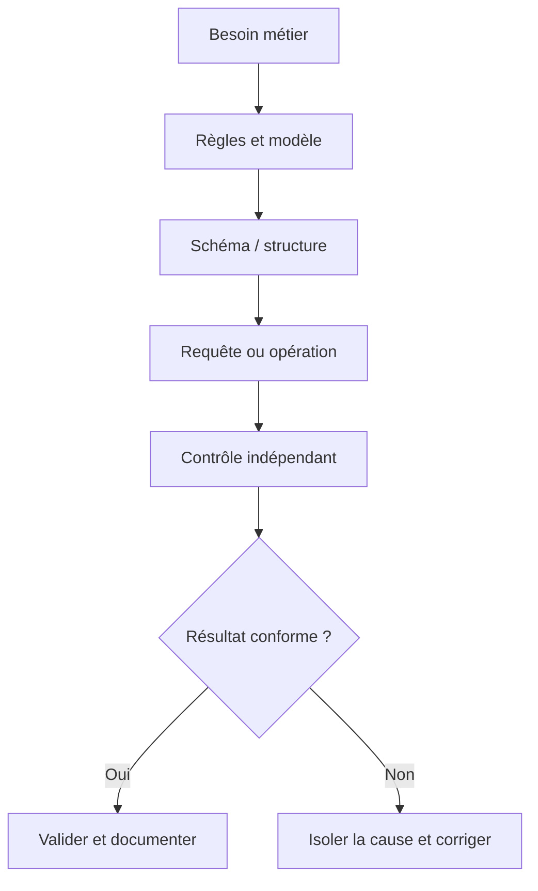
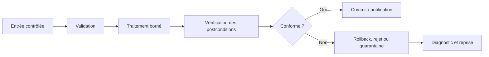
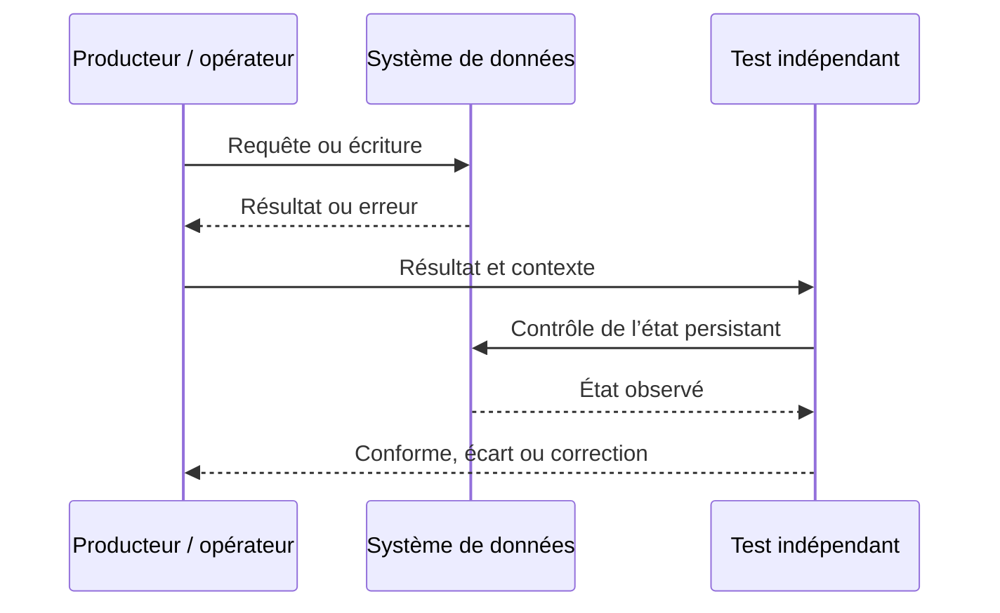
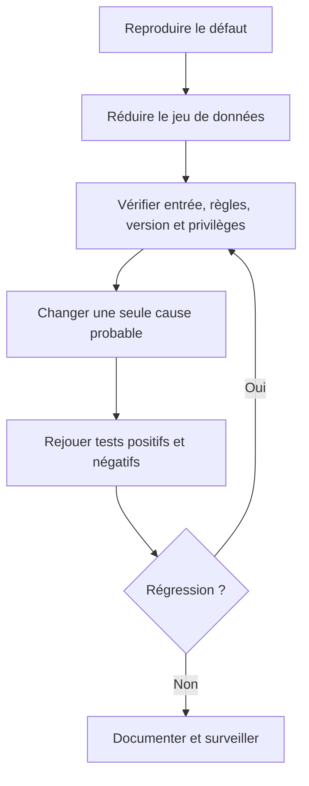

# Concepts des bases de données relationnelles — Débutant

> **Mise en contexte.** Comprendre comment tables, relations, clés, contraintes et transactions rendent les données cohérentes. Le but n'est pas seulement d'obtenir une sortie plausible, mais de construire une solution dont le sens métier est clair, le comportement vérifiable et les limites connues. Les exemples sont pédagogiques ; adaptez-les au moteur, à sa version, aux exigences de sécurité et aux règles de l'organisation. Utilisez un environnement isolé et des données synthétiques pour les premières manipulations. Ne stockez jamais de secrets dans les scripts, journaux ou captures partagées.

## Introduction et objectifs pédagogiques

À l'issue du cours, vous devez pouvoir expliquer la notion étudiée, reconnaître ses limites, produire un résultat correct et démontrer pourquoi il l'est. Le niveau débutant ne signifie pas apprendre des commandes par cœur ; il signifie être capable d'expliquer une règle, de choisir un exemple discriminant, de vérifier le résultat et de rendre la procédure reproductible.

Objectifs opérationnels : acquérir un vocabulaire commun ; comprendre les composants impliqués ; appliquer une méthode étape par étape ; analyser les erreurs ; vérifier l'état au-delà du code de retour ; documenter les hypothèses et préserver intégrité, sécurité et récupération. La réussite se mesure à la justesse et à la reproductibilité, non au nombre de lignes écrites.

## Prérequis et environnement

Aucun prérequis préalable n'est imposé dans cette chaîne Data. Avant de commencer, notez la version du moteur, le compte utilisé, le périmètre des données et la manière de réinitialiser le laboratoire. Séparez privilèges d'administration et privilèges applicatifs ; vérifiez la cible avant une commande destructive. Les noms d'objets, formats, encodages et paramètres peuvent différer entre environnements et doivent être documentés.

## Concepts clés développés

### 1. Base de données, SGBD et application

Une base organise l'information ; le SGBD contrôle stockage, accès, transactions, concurrence et récupération. L'application transmet des requêtes mais ne doit pas être la seule gardienne des règles d'intégrité. Distinguer base, instance, schéma logique, connexion et stockage physique aide à localiser un défaut.

**Mise en pratique.** Tracer une requête de l'application jusqu'à la table puis au résultat et identifier la couche responsable de l'authentification, des contraintes et des journaux. Pour appliquer cette notion de façon reproductible, formulez la règle avant de tester, choisissez un jeu court qui rend les différences visibles et consignez le résultat. N'ajustez pas la conclusion pour la faire correspondre aux données ; si le test échoue, documentez ce qu'il révèle et construisez un test plus discriminant.

**Risque à maîtriser.** Une erreur de connexion, une erreur SQL et une donnée métier fausse appellent des diagnostics différents. Cette erreur peut rester cachée avec les données habituelles. Construisez un test négatif qui prouve que le garde-fou agit et un test de non-régression qui protège la correction.

**Revue technique.** 1. Quel contrat métier est représenté ? 2. Quelle couche fait autorité ? 3. Quelle valeur frontière invaliderait une hypothèse naïve ? 4. Comment corriger un écart sans masquer sa cause ? Une réponse solide inclut une preuve vérifiable, la version de l'environnement et les limites de la conclusion.

### 2. Tables, lignes et colonnes

Une table représente une population d'entités ou de faits ; une ligne correspond à un enregistrement et une colonne porte un sens, un type et une règle d'absence. Les types reflètent le domaine : date pour une date, entier pour une quantité discrète et décimal précis pour un montant.

**Mise en pratique.** Définir nom, type, unité, obligation et exemple valide pour chaque colonne ; séparer les concepts de sens différent. Pour appliquer cette notion de façon reproductible, formulez la règle avant de tester, choisissez un jeu court qui rend les différences visibles et consignez le résultat. N'ajustez pas la conclusion pour la faire correspondre aux données ; si le test échoue, documentez ce qu'il révèle et construisez un test plus discriminant.

**Risque à maîtriser.** Un type texte universel accepte dates ou nombres invalides et rend les règles difficiles à imposer. Cette erreur peut rester cachée avec les données habituelles. Construisez un test négatif qui prouve que le garde-fou agit et un test de non-régression qui protège la correction.

**Revue technique.** 1. Quel contrat métier est représenté ? 2. Quelle couche fait autorité ? 3. Quelle valeur frontière invaliderait une hypothèse naïve ? 4. Comment corriger un écart sans masquer sa cause ? Une réponse solide inclut une preuve vérifiable, la version de l'environnement et les limites de la conclusion.

### 3. Clés primaires et identité

La clé primaire identifie une ligne de manière unique et non nulle. Une clé naturelle peut être lisible mais changer avec le métier ; une clé technique réduit ce couplage sans supprimer les règles d'unicité métier. Deux références d'article ne deviennent pas identiques parce que leurs identifiants internes diffèrent.

**Mise en pratique.** Choisir un identifiant stable et ajouter les contraintes d'unicité métier. Tester doublons, valeurs absentes et changement d'une valeur considérée identifiante. Pour appliquer cette notion de façon reproductible, formulez la règle avant de tester, choisissez un jeu court qui rend les différences visibles et consignez le résultat. N'ajustez pas la conclusion pour la faire correspondre aux données ; si le test échoue, documentez ce qu'il révèle et construisez un test plus discriminant.

**Risque à maîtriser.** Une clé artificielle ne remplace pas la règle qui interdit deux objets métier identiques. Cette erreur peut rester cachée avec les données habituelles. Construisez un test négatif qui prouve que le garde-fou agit et un test de non-régression qui protège la correction.

**Revue technique.** 1. Quel contrat métier est représenté ? 2. Quelle couche fait autorité ? 3. Quelle valeur frontière invaliderait une hypothèse naïve ? 4. Comment corriger un écart sans masquer sa cause ? Une réponse solide inclut une preuve vérifiable, la version de l'environnement et les limites de la conclusion.

### 4. Clés étrangères et intégrité

Une clé étrangère exige qu'une référence corresponde à une ligne autorisée. ON DELETE et ON UPDATE ont un sens métier : cascade, restriction et mise à NULL peuvent supprimer, interdire ou détacher l'information référencée.

**Mise en pratique.** Insérer une référence inconnue et tenter de supprimer un parent ; vérifier si le comportement correspond au cycle de vie de l'information. Pour appliquer cette notion de façon reproductible, formulez la règle avant de tester, choisissez un jeu court qui rend les différences visibles et consignez le résultat. N'ajustez pas la conclusion pour la faire correspondre aux données ; si le test échoue, documentez ce qu'il révèle et construisez un test plus discriminant.

**Risque à maîtriser.** Sans clé étrangère, les incohérences deviennent du nettoyage manuel et des erreurs tardives. Cette erreur peut rester cachée avec les données habituelles. Construisez un test négatif qui prouve que le garde-fou agit et un test de non-régression qui protège la correction.

**Revue technique.** 1. Quel contrat métier est représenté ? 2. Quelle couche fait autorité ? 3. Quelle valeur frontière invaliderait une hypothèse naïve ? 4. Comment corriger un écart sans masquer sa cause ? Une réponse solide inclut une preuve vérifiable, la version de l'environnement et les limites de la conclusion.

### 5. Contraintes métier

NOT NULL, UNIQUE, CHECK et clés étrangères transforment des règles en garanties du SGBD. Elles complètent l'interface puisque scripts, imports et tâches planifiées peuvent aussi écrire dans les tables. Une contrainte doit refléter une règle validée et non inventer une interdiction arbitraire.

**Mise en pratique.** Formuler une règle, préparer un exemple accepté et refusé puis tester les deux ; définir comment corriger une donnée source rejetée. Pour appliquer cette notion de façon reproductible, formulez la règle avant de tester, choisissez un jeu court qui rend les différences visibles et consignez le résultat. N'ajustez pas la conclusion pour la faire correspondre aux données ; si le test échoue, documentez ce qu'il révèle et construisez un test plus discriminant.

**Risque à maîtriser.** Une règle présente uniquement dans l'application peut être contournée ; une contrainte mal définie peut interdire une situation légitime. Cette erreur peut rester cachée avec les données habituelles. Construisez un test négatif qui prouve que le garde-fou agit et un test de non-régression qui protège la correction.

**Revue technique.** 1. Quel contrat métier est représenté ? 2. Quelle couche fait autorité ? 3. Quelle valeur frontière invaliderait une hypothèse naïve ? 4. Comment corriger un écart sans masquer sa cause ? Une réponse solide inclut une preuve vérifiable, la version de l'environnement et les limites de la conclusion.

### 6. NULL et absence d'information

NULL est généralement une information inconnue, absente ou sans objet ; il n'est ni zéro ni chaîne vide. SQL utilise une logique à trois valeurs, donc « colonne = NULL » n'est pas le test attendu. COUNT(*) et COUNT(colonne) ne traitent pas l'absence de la même manière.

**Mise en pratique.** Tester IS NULL, IS NOT NULL, COUNT(*) et COUNT(colonne) sur des lignes contenant des valeurs absentes. Pour appliquer cette notion de façon reproductible, formulez la règle avant de tester, choisissez un jeu court qui rend les différences visibles et consignez le résultat. N'ajustez pas la conclusion pour la faire correspondre aux données ; si le test échoue, documentez ce qu'il révèle et construisez un test plus discriminant.

**Risque à maîtriser.** Remplacer toute absence par zéro invente une mesure et peut fausser une décision. Cette erreur peut rester cachée avec les données habituelles. Construisez un test négatif qui prouve que le garde-fou agit et un test de non-régression qui protège la correction.

**Revue technique.** 1. Quel contrat métier est représenté ? 2. Quelle couche fait autorité ? 3. Quelle valeur frontière invaliderait une hypothèse naïve ? 4. Comment corriger un écart sans masquer sa cause ? Une réponse solide inclut une preuve vérifiable, la version de l'environnement et les limites de la conclusion.

### 7. Transactions et ACID

Une transaction regroupe les opérations qui doivent réussir ou échouer comme un ensemble cohérent. ACID désigne atomicité, cohérence, isolation et durabilité ; les garanties dépendent du moteur et de la configuration. Débiter un stock et inscrire un mouvement ne doivent pas laisser un état partiel.

**Mise en pratique.** Déclencher une erreur entre deux écritures et vérifier le rollback ; reproduire une mise à jour concurrente sur la même quantité. Pour appliquer cette notion de façon reproductible, formulez la règle avant de tester, choisissez un jeu court qui rend les différences visibles et consignez le résultat. N'ajustez pas la conclusion pour la faire correspondre aux données ; si le test échoue, documentez ce qu'il révèle et construisez un test plus discriminant.

**Risque à maîtriser.** Une transaction longue peut retenir des verrous ou des versions anciennes et bloquer d'autres opérations. Cette erreur peut rester cachée avec les données habituelles. Construisez un test négatif qui prouve que le garde-fou agit et un test de non-régression qui protège la correction.

**Revue technique.** 1. Quel contrat métier est représenté ? 2. Quelle couche fait autorité ? 3. Quelle valeur frontière invaliderait une hypothèse naïve ? 4. Comment corriger un écart sans masquer sa cause ? Une réponse solide inclut une preuve vérifiable, la version de l'environnement et les limites de la conclusion.

### 8. Modèle logique et stockage physique

Le modèle logique décrit tables, colonnes, clés et contraintes ; pages, fichiers et index relèvent du stockage physique. Une table n'est pas forcément un fichier texte et l'ordre des lignes n'est jamais garanti sans tri explicite.

**Mise en pratique.** Séparer règles métier et choix de stockage, puis mesurer le besoin d'index à partir de requêtes réelles. Pour appliquer cette notion de façon reproductible, formulez la règle avant de tester, choisissez un jeu court qui rend les différences visibles et consignez le résultat. N'ajustez pas la conclusion pour la faire correspondre aux données ; si le test échoue, documentez ce qu'il révèle et construisez un test plus discriminant.

**Risque à maîtriser.** Supposer que l'ordre physique détermine celui du résultat rend le comportement instable. Cette erreur peut rester cachée avec les données habituelles. Construisez un test négatif qui prouve que le garde-fou agit et un test de non-régression qui protège la correction.

**Revue technique.** 1. Quel contrat métier est représenté ? 2. Quelle couche fait autorité ? 3. Quelle valeur frontière invaliderait une hypothèse naïve ? 4. Comment corriger un écart sans masquer sa cause ? Une réponse solide inclut une preuve vérifiable, la version de l'environnement et les limites de la conclusion.

## Architectures et schémas de référence

Les diagrammes décrivent une méthode logique et ne remplacent pas un schéma de production complet. Celui-ci doit aussi préciser versions, capacité, réseau, authentification, droits, observabilité, sauvegarde et responsabilités. Le premier diagramme relie besoin et preuve, le deuxième rend visible la gestion de l'erreur, le troisième distingue émission et vérification, et le dernier propose un diagnostic reproductible.

## Méthode d'ingénierie : du besoin à une opération sûre

### 1. Définir le contrat
Écrivez le résultat attendu en termes observables : population, règles, état initial, état final et exceptions. Remplacez « cela doit fonctionner » par un test. Une demande peut contenir plusieurs contrats — cohérence, latence, confidentialité et récupération — qui doivent être évalués séparément.

### 2. Identifier composants et source de vérité
Déterminez quel composant reçoit l'entrée, lequel transforme, où l'état est persisté et qui consomme le résultat. Pour chaque interface, notez propriétaire, format, erreurs, limites, version et permissions. Vérifiez les données dans le système faisant autorité plutôt que seulement dans un écran ou un cache.

### 3. Construire un test discriminant
Choisissez un jeu réduit comprenant cas normal, frontière, absence, doublon ou valeur invalide selon le sujet. Un bon test distingue deux hypothèses plausibles. Si le même résultat découle des deux, améliorez le test avant de conclure.

### 4. Isoler une variable
Reproduisez le défaut, conservez les indices et changez une variable à la fois. Examinez configuration, version, données, identité, permissions, ordre d'exécution et transaction avant d'accuser le moteur. Changer plusieurs composants simultanément empêche d'attribuer la cause.

### 5. Vérifier les postconditions
Vérifiez état persistant, nombre d'éléments touchés, contraintes et effets de bord. Une commande sans erreur ne garantit pas que la bonne ligne a été modifiée. Une requête qui renvoie des lignes ne garantit pas qu'elle répond à la question métier.

### 6. Gérer rejets et reprises
Distinguez erreur d'entrée, violation de règle, refus d'autorisation, panne transitoire, conflit concurrent et risque de corruption. Ne rejouez pas aveuglément si la première opération a pu être validée. Les reprises doivent être bornées, sûres si répétées et traçables ; les rejets doivent garder leur motif.

### 7. Rendre le travail reproductible
Versionnez schéma, requêtes, jeux de test et documentation. Définissez préconditions et ordre d'application. Une autre personne doit pouvoir recréer l'environnement ; les modifications manuelles non tracées créent des écarts entre dépôt et réalité.

### 8. Contrôler droits et données
Utilisez privilège minimal, comptes dédiés et secrets injectés hors du code. Les journaux ne doivent pas exposer mots de passe, jetons ou données personnelles inutiles. Les exigences de confidentialité et de rétention doivent être confirmées pour le contexte réel.

### 9. Mesurer qualité et performance
Définissez source, période, population et propriétaire de chaque mesure. Vérifiez qualité en même temps que latence, coût et volume. Un gain de vitesse qui dégrade exactitude, traçabilité ou récupération n'est pas une amélioration complète.

### 10. Transformer l'incident en apprentissage
Consignez symptôme, cause confirmée, correction, risque résiduel et test de prévention. Une note qui ne garde que la commande finale n'aide pas à savoir si un prochain cas est comparable ni à prévenir la récidive.

## Atelier pratique guidé

### But
**Inventaire d'un atelier de maintenance.** Créer fournisseurs, articles et mouvements de stock. Un article ne peut pas référencer un fournisseur inexistant ; la quantité doit respecter la règle métier et les mouvements doivent conserver un historique.

### Déroulement
1. Préparer l'environnement isolé et vérifier cible, compte et version.
2. Formuler les règles puis les traduire en assertions explicites.
3. Construire jeu nominal et jeu d'exceptions.
4. Exécuter de façon limitée et enregistrer l'état avant/après.
5. Déclencher une erreur et confirmer que le contrôle agit.
6. Rejouer sur un environnement propre ou un état initial différent.
7. Faire vérifier le résultat par une autre personne.
8. Documenter les limites et travaux nécessaires avant un usage réel.

### Critères d'acceptation
Le laboratoire réussit si le résultat est correct, les erreurs prévues sont détectées, les cas limites examinés et la procédure répétable. Si un test échoue, indiquez le fait observé, l'hypothèse, la correction et la preuve que l'état final respecte le contrat. La remise doit inclure données d'essai, commandes ou requêtes, postcondition et limites de la conclusion.

## Étude de cas détaillée

### Situation : Le stock devient négatif après un import
Un import contient une référence inconnue et deux opérations concurrentes consomment le dernier exemplaire alors que chacune a lu une quantité positive.

### Diagnostic
Déterminez si le défaut est reproductible et s'il concerne toutes les entrées ou une population. Examinez source, format, règles, chemin d'écriture, transaction, permissions et méthode d'observation. Séparez les faits établis, les causes probables et les inconnues. Une hypothèse utile doit préciser quel test pourrait la réfuter.

### Correction proposée
Distinguer référence orpheline, concurrence et absence de contrainte. Utiliser clés étrangères, contraintes métier et transactions ; rendre l'écriture atomique et tester la concurrence. Examiner aussi les données déjà importées avant d'ajouter une contrainte.

### Preuve d'efficacité
Établissez une comparaison avant/après sur une population comparable. Ajoutez un test automatisable, vérifiez qu'il échoue avant correction et réussit après. Analysez les effets collatéraux et les données existantes, puis attribuez la surveillance à un responsable. Le correctif n'est accepté que s'il respecte les critères et que le risque résiduel a été évalué.

## Pièges à éviter

**1. Identité sans règle métier.** Le risque vient souvent d'un contrat implicite ou d'un test limité au cas nominal. Pour le prévenir, explicitez la règle, produisez un cas qui la met en difficulté et vérifiez la postcondition dans le système faisant autorité. Si le défaut apparaît, conservez l'indice, corrigez sa cause puis ajoutez un test de non-régression. Une correction manuelle sans trace ne protège pas la prochaine exécution.

**2. Types génériques qui acceptent toute valeur.** Le risque vient souvent d'un contrat implicite ou d'un test limité au cas nominal. Pour le prévenir, explicitez la règle, produisez un cas qui la met en difficulté et vérifiez la postcondition dans le système faisant autorité. Si le défaut apparaît, conservez l'indice, corrigez sa cause puis ajoutez un test de non-régression. Une correction manuelle sans trace ne protège pas la prochaine exécution.

**3. Références sans clés étrangères.** Le risque vient souvent d'un contrat implicite ou d'un test limité au cas nominal. Pour le prévenir, explicitez la règle, produisez un cas qui la met en difficulté et vérifiez la postcondition dans le système faisant autorité. Si le défaut apparaît, conservez l'indice, corrigez sa cause puis ajoutez un test de non-régression. Une correction manuelle sans trace ne protège pas la prochaine exécution.

**4. NULL confondu avec zéro.** Le risque vient souvent d'un contrat implicite ou d'un test limité au cas nominal. Pour le prévenir, explicitez la règle, produisez un cas qui la met en difficulté et vérifiez la postcondition dans le système faisant autorité. Si le défaut apparaît, conservez l'indice, corrigez sa cause puis ajoutez un test de non-régression. Une correction manuelle sans trace ne protège pas la prochaine exécution.

**5. Cascade non validée.** Le risque vient souvent d'un contrat implicite ou d'un test limité au cas nominal. Pour le prévenir, explicitez la règle, produisez un cas qui la met en difficulté et vérifiez la postcondition dans le système faisant autorité. Si le défaut apparaît, conservez l'indice, corrigez sa cause puis ajoutez un test de non-régression. Une correction manuelle sans trace ne protège pas la prochaine exécution.

**6. Transaction partiellement validée.** Le risque vient souvent d'un contrat implicite ou d'un test limité au cas nominal. Pour le prévenir, explicitez la règle, produisez un cas qui la met en difficulté et vérifiez la postcondition dans le système faisant autorité. Si le défaut apparaît, conservez l'indice, corrigez sa cause puis ajoutez un test de non-régression. Une correction manuelle sans trace ne protège pas la prochaine exécution.

**7. Ordre des résultats supposé stable.** Le risque vient souvent d'un contrat implicite ou d'un test limité au cas nominal. Pour le prévenir, explicitez la règle, produisez un cas qui la met en difficulté et vérifiez la postcondition dans le système faisant autorité. Si le défaut apparaît, conservez l'indice, corrigez sa cause puis ajoutez un test de non-régression. Une correction manuelle sans trace ne protège pas la prochaine exécution.

**8. Tests limités aux valeurs valides.** Le risque vient souvent d'un contrat implicite ou d'un test limité au cas nominal. Pour le prévenir, explicitez la règle, produisez un cas qui la met en difficulté et vérifiez la postcondition dans le système faisant autorité. Si le défaut apparaît, conservez l'indice, corrigez sa cause puis ajoutez un test de non-régression. Une correction manuelle sans trace ne protège pas la prochaine exécution.

## Diagnostic : fiches de vérification

### Diagnostic 1 — Base de données, SGBD et application

**Question :** le résultat est-il cohérent avec la règle et les données disponibles ? **Preuve :** Tracer une requête de l'application jusqu'à la table puis au résultat et identifier la couche responsable de l'authentification, des contraintes et des journaux. **Correction :** réduisez le cas à quelques lignes, vérifiez l'hypothèse puis reproduisez le défaut avant de modifier le système. Après correction, contrôlez les contraintes, les données existantes et les opérations voisines. Distinguez erreur d'entrée, règle de modèle, autorisation, concurrence et observabilité.

### Diagnostic 2 — Tables, lignes et colonnes

**Question :** le résultat est-il cohérent avec la règle et les données disponibles ? **Preuve :** Définir nom, type, unité, obligation et exemple valide pour chaque colonne ; séparer les concepts de sens différent. **Correction :** réduisez le cas à quelques lignes, vérifiez l'hypothèse puis reproduisez le défaut avant de modifier le système. Après correction, contrôlez les contraintes, les données existantes et les opérations voisines. Distinguez erreur d'entrée, règle de modèle, autorisation, concurrence et observabilité.

### Diagnostic 3 — Clés primaires et identité

**Question :** le résultat est-il cohérent avec la règle et les données disponibles ? **Preuve :** Choisir un identifiant stable et ajouter les contraintes d'unicité métier. Tester doublons, valeurs absentes et changement d'une valeur considérée identifiante. **Correction :** réduisez le cas à quelques lignes, vérifiez l'hypothèse puis reproduisez le défaut avant de modifier le système. Après correction, contrôlez les contraintes, les données existantes et les opérations voisines. Distinguez erreur d'entrée, règle de modèle, autorisation, concurrence et observabilité.

### Diagnostic 4 — Clés étrangères et intégrité

**Question :** le résultat est-il cohérent avec la règle et les données disponibles ? **Preuve :** Insérer une référence inconnue et tenter de supprimer un parent ; vérifier si le comportement correspond au cycle de vie de l'information. **Correction :** réduisez le cas à quelques lignes, vérifiez l'hypothèse puis reproduisez le défaut avant de modifier le système. Après correction, contrôlez les contraintes, les données existantes et les opérations voisines. Distinguez erreur d'entrée, règle de modèle, autorisation, concurrence et observabilité.

### Diagnostic 5 — Contraintes métier

**Question :** le résultat est-il cohérent avec la règle et les données disponibles ? **Preuve :** Formuler une règle, préparer un exemple accepté et refusé puis tester les deux ; définir comment corriger une donnée source rejetée. **Correction :** réduisez le cas à quelques lignes, vérifiez l'hypothèse puis reproduisez le défaut avant de modifier le système. Après correction, contrôlez les contraintes, les données existantes et les opérations voisines. Distinguez erreur d'entrée, règle de modèle, autorisation, concurrence et observabilité.

### Diagnostic 6 — NULL et absence d'information

**Question :** le résultat est-il cohérent avec la règle et les données disponibles ? **Preuve :** Tester IS NULL, IS NOT NULL, COUNT(*) et COUNT(colonne) sur des lignes contenant des valeurs absentes. **Correction :** réduisez le cas à quelques lignes, vérifiez l'hypothèse puis reproduisez le défaut avant de modifier le système. Après correction, contrôlez les contraintes, les données existantes et les opérations voisines. Distinguez erreur d'entrée, règle de modèle, autorisation, concurrence et observabilité.

### Diagnostic 7 — Transactions et ACID

**Question :** le résultat est-il cohérent avec la règle et les données disponibles ? **Preuve :** Déclencher une erreur entre deux écritures et vérifier le rollback ; reproduire une mise à jour concurrente sur la même quantité. **Correction :** réduisez le cas à quelques lignes, vérifiez l'hypothèse puis reproduisez le défaut avant de modifier le système. Après correction, contrôlez les contraintes, les données existantes et les opérations voisines. Distinguez erreur d'entrée, règle de modèle, autorisation, concurrence et observabilité.

### Diagnostic 8 — Modèle logique et stockage physique

**Question :** le résultat est-il cohérent avec la règle et les données disponibles ? **Preuve :** Séparer règles métier et choix de stockage, puis mesurer le besoin d'index à partir de requêtes réelles. **Correction :** réduisez le cas à quelques lignes, vérifiez l'hypothèse puis reproduisez le défaut avant de modifier le système. Après correction, contrôlez les contraintes, les données existantes et les opérations voisines. Distinguez erreur d'entrée, règle de modèle, autorisation, concurrence et observabilité.

## Exercices d'application avec corrigés

### Exercice 1 — Base de données, SGBD et application

**Énoncé.** Construisez un test qui révèle clairement cette propriété et proposez un cas où une approche simpliste échouerait. Expliquez quelle mesure ou assertion doit démontrer la correction.

**Corrigé détaillé.** Tracer une requête de l'application jusqu'à la table puis au résultat et identifier la couche responsable de l'authentification, des contraintes et des journaux. Une réponse acceptable énonce le contrat, utilise une entrée contrôlée, vérifie l'état obtenu et documente les limites. Elle traite le risque suivant : Une erreur de connexion, une erreur SQL et une donnée métier fausse appellent des diagnostics différents. Validez avec un cas positif, un négatif et un test après évolution du schéma ou des données. Une commande sans contrôle de son résultat n'est pas une preuve suffisante.

### Exercice 2 — Tables, lignes et colonnes

**Énoncé.** Construisez un test qui révèle clairement cette propriété et proposez un cas où une approche simpliste échouerait. Expliquez quelle mesure ou assertion doit démontrer la correction.

**Corrigé détaillé.** Définir nom, type, unité, obligation et exemple valide pour chaque colonne ; séparer les concepts de sens différent. Une réponse acceptable énonce le contrat, utilise une entrée contrôlée, vérifie l'état obtenu et documente les limites. Elle traite le risque suivant : Un type texte universel accepte dates ou nombres invalides et rend les règles difficiles à imposer. Validez avec un cas positif, un négatif et un test après évolution du schéma ou des données. Une commande sans contrôle de son résultat n'est pas une preuve suffisante.

### Exercice 3 — Clés primaires et identité

**Énoncé.** Construisez un test qui révèle clairement cette propriété et proposez un cas où une approche simpliste échouerait. Expliquez quelle mesure ou assertion doit démontrer la correction.

**Corrigé détaillé.** Choisir un identifiant stable et ajouter les contraintes d'unicité métier. Tester doublons, valeurs absentes et changement d'une valeur considérée identifiante. Une réponse acceptable énonce le contrat, utilise une entrée contrôlée, vérifie l'état obtenu et documente les limites. Elle traite le risque suivant : Une clé artificielle ne remplace pas la règle qui interdit deux objets métier identiques. Validez avec un cas positif, un négatif et un test après évolution du schéma ou des données. Une commande sans contrôle de son résultat n'est pas une preuve suffisante.

### Exercice 4 — Clés étrangères et intégrité

**Énoncé.** Construisez un test qui révèle clairement cette propriété et proposez un cas où une approche simpliste échouerait. Expliquez quelle mesure ou assertion doit démontrer la correction.

**Corrigé détaillé.** Insérer une référence inconnue et tenter de supprimer un parent ; vérifier si le comportement correspond au cycle de vie de l'information. Une réponse acceptable énonce le contrat, utilise une entrée contrôlée, vérifie l'état obtenu et documente les limites. Elle traite le risque suivant : Sans clé étrangère, les incohérences deviennent du nettoyage manuel et des erreurs tardives. Validez avec un cas positif, un négatif et un test après évolution du schéma ou des données. Une commande sans contrôle de son résultat n'est pas une preuve suffisante.

### Exercice 5 — Contraintes métier

**Énoncé.** Construisez un test qui révèle clairement cette propriété et proposez un cas où une approche simpliste échouerait. Expliquez quelle mesure ou assertion doit démontrer la correction.

**Corrigé détaillé.** Formuler une règle, préparer un exemple accepté et refusé puis tester les deux ; définir comment corriger une donnée source rejetée. Une réponse acceptable énonce le contrat, utilise une entrée contrôlée, vérifie l'état obtenu et documente les limites. Elle traite le risque suivant : Une règle présente uniquement dans l'application peut être contournée ; une contrainte mal définie peut interdire une situation légitime. Validez avec un cas positif, un négatif et un test après évolution du schéma ou des données. Une commande sans contrôle de son résultat n'est pas une preuve suffisante.

### Exercice 6 — NULL et absence d'information

**Énoncé.** Construisez un test qui révèle clairement cette propriété et proposez un cas où une approche simpliste échouerait. Expliquez quelle mesure ou assertion doit démontrer la correction.

**Corrigé détaillé.** Tester IS NULL, IS NOT NULL, COUNT(*) et COUNT(colonne) sur des lignes contenant des valeurs absentes. Une réponse acceptable énonce le contrat, utilise une entrée contrôlée, vérifie l'état obtenu et documente les limites. Elle traite le risque suivant : Remplacer toute absence par zéro invente une mesure et peut fausser une décision. Validez avec un cas positif, un négatif et un test après évolution du schéma ou des données. Une commande sans contrôle de son résultat n'est pas une preuve suffisante.

### Exercice 7 — Transactions et ACID

**Énoncé.** Construisez un test qui révèle clairement cette propriété et proposez un cas où une approche simpliste échouerait. Expliquez quelle mesure ou assertion doit démontrer la correction.

**Corrigé détaillé.** Déclencher une erreur entre deux écritures et vérifier le rollback ; reproduire une mise à jour concurrente sur la même quantité. Une réponse acceptable énonce le contrat, utilise une entrée contrôlée, vérifie l'état obtenu et documente les limites. Elle traite le risque suivant : Une transaction longue peut retenir des verrous ou des versions anciennes et bloquer d'autres opérations. Validez avec un cas positif, un négatif et un test après évolution du schéma ou des données. Une commande sans contrôle de son résultat n'est pas une preuve suffisante.

### Exercice 8 — Modèle logique et stockage physique

**Énoncé.** Construisez un test qui révèle clairement cette propriété et proposez un cas où une approche simpliste échouerait. Expliquez quelle mesure ou assertion doit démontrer la correction.

**Corrigé détaillé.** Séparer règles métier et choix de stockage, puis mesurer le besoin d'index à partir de requêtes réelles. Une réponse acceptable énonce le contrat, utilise une entrée contrôlée, vérifie l'état obtenu et documente les limites. Elle traite le risque suivant : Supposer que l'ordre physique détermine celui du résultat rend le comportement instable. Validez avec un cas positif, un négatif et un test après évolution du schéma ou des données. Une commande sans contrôle de son résultat n'est pas une preuve suffisante.

## Checklist de mise en œuvre

- [ ] Les clés identifient chaque ligne et restent stables.
- [ ] Les contraintes expriment des règles métier validées.
- [ ] Les relations sont protégées par des clés étrangères adaptées.
- [ ] Les types portent le sens et l'unité.
- [ ] Le sens de NULL est défini.
- [ ] Les opérations multi-étapes sont atomiques si nécessaire.
- [ ] Les suppressions sont testées.
- [ ] Les tests incluent valeurs invalides et concurrence.

Ajoutez les règles locales de sécurité, confidentialité, rétention et gestion des changements. Si une exigence n'est pas applicable, documentez le motif. Pour une opération risquée, faites vérifier le plan par une personne habilitée et définissez le chemin de récupération avant une exécution réelle.

## Synthèse — à retenir

La maîtrise technique exige des règles explicites, des preuves reproductibles et une compréhension des cas hors nominal. Le modèle ou la requête doit traduire une question métier ; l'entrée doit être contrôlée ; le résultat doit être vérifié à la granularité correcte ; les erreurs doivent rester visibles et avoir un propriétaire. La production impose enfin de traiter privilèges, volume, concurrence, mises à jour et récupération. Les exemples sont un point de départ et l'organisation doit confirmer les règles applicables à son moteur et son contexte.

## Références techniques

- https://www.postgresql.org/docs/current/ddl.html
- https://www.postgresql.org/docs/current/tutorial-transactions.html
- https://dev.mysql.com/doc/refman/8.4/en/innodb-transaction-model.html

Consultez la documentation correspondant à la version réellement utilisée avant de généraliser une commande ou un comportement.