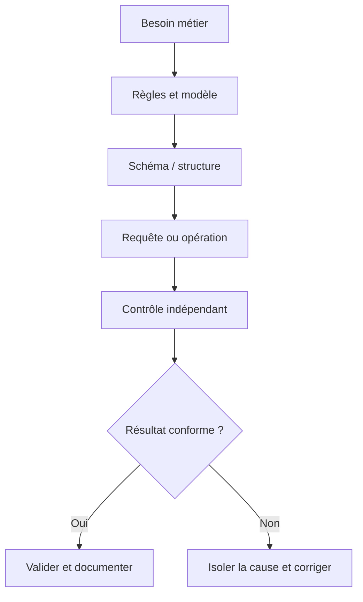
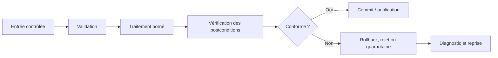
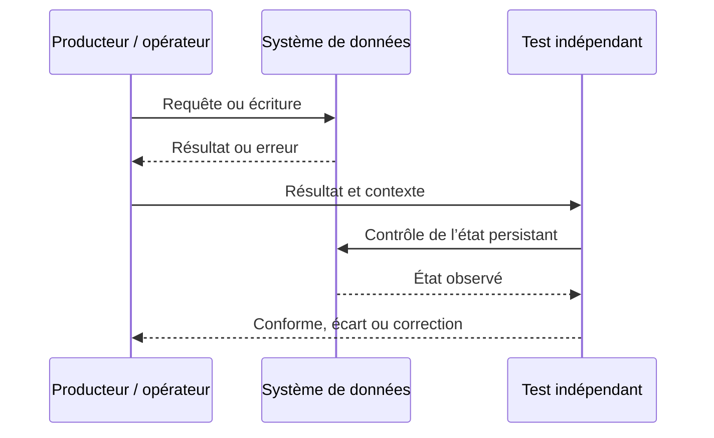
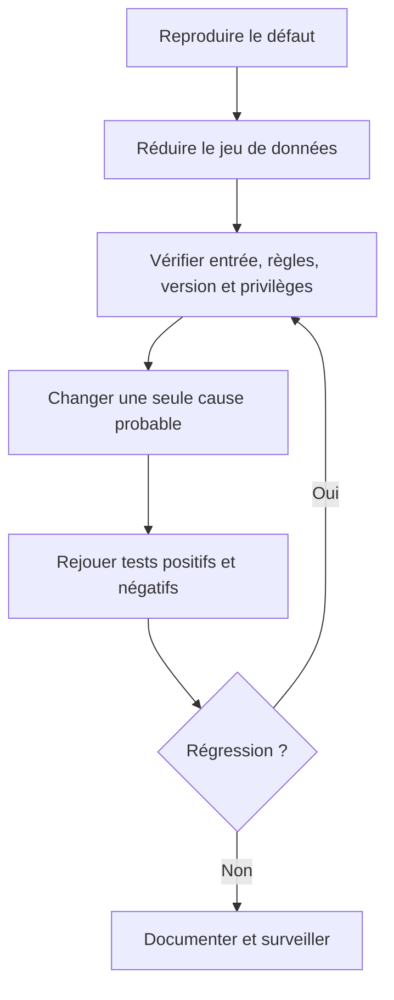

# Concepts des bases de données relationnelles — Expert

> **Mise en contexte.** Le niveau expert vous place face aux compromis d'architecture, à la haute disponibilité, à la capacité, aux migrations risquées, à la sécurité des données sensibles et aux incidents multi-composants. Vous devez pouvoir défendre une décision, montrer les preuves qui la soutiennent, anticiper les modes de panne et prévoir un mécanisme de retour à un état connu. Les exemples approfondissent les bases relationnelles et leurs conséquences opérationnelles. Les détails de syntaxe, de réplication et de récupération doivent être confirmés sur la version du moteur réellement exploité.

## Introduction et objectifs pédagogiques

À l'issue du cours, vous devez pouvoir expliquer la notion étudiée, reconnaître ses limites, produire un résultat correct et démontrer pourquoi il l'est. Le niveau expert ne signifie pas apprendre des commandes par cœur ; il signifie être capable d'expliquer une règle, de choisir un exemple discriminant, de vérifier le résultat et de rendre la procédure reproductible.

Objectifs opérationnels : acquérir un vocabulaire commun ; comprendre les composants impliqués ; appliquer une méthode étape par étape ; analyser les erreurs ; vérifier l'état au-delà du code de retour ; documenter les hypothèses et préserver intégrité, sécurité et récupération. La réussite se mesure à la justesse et à la reproductibilité, non au nombre de lignes écrites.

## Prérequis et environnement

Aucun prérequis préalable n'est imposé dans cette chaîne Data. Avant de commencer, notez la version du moteur, le compte utilisé, le périmètre des données et la manière de réinitialiser le laboratoire. Séparez privilèges d'administration et privilèges applicatifs ; vérifiez la cible avant une commande destructive. Les noms d'objets, formats, encodages et paramètres peuvent différer entre environnements et doivent être documentés.

## Concepts clés développés

### 1. Base de données, SGBD et application

Une base organise l'information ; le SGBD contrôle stockage, accès, transactions, concurrence et récupération. L'application transmet des requêtes mais ne doit pas être la seule gardienne des règles d'intégrité. Distinguer base, instance, schéma logique, connexion et stockage physique aide à localiser un défaut.

**Mise en pratique.** Tracer une requête de l'application jusqu'à la table puis au résultat et identifier la couche responsable de l'authentification, des contraintes et des journaux. Pour appliquer cette notion de façon reproductible, formulez la règle avant de tester, choisissez un jeu court qui rend les différences visibles et consignez le résultat. N'ajustez pas la conclusion pour la faire correspondre aux données ; si le test échoue, documentez ce qu'il révèle et construisez un test plus discriminant.

**Risque à maîtriser.** Une erreur de connexion, une erreur SQL et une donnée métier fausse appellent des diagnostics différents. Cette erreur peut rester cachée avec les données habituelles. Construisez un test négatif qui prouve que le garde-fou agit et un test de non-régression qui protège la correction.

**Revue technique.** 1. Quel contrat métier est représenté ? 2. Quelle couche fait autorité ? 3. Quelle valeur frontière invaliderait une hypothèse naïve ? 4. Comment corriger un écart sans masquer sa cause ? Une réponse solide inclut une preuve vérifiable, la version de l'environnement et les limites de la conclusion.

### 2. Tables, lignes et colonnes

Une table représente une population d'entités ou de faits ; une ligne correspond à un enregistrement et une colonne porte un sens, un type et une règle d'absence. Les types reflètent le domaine : date pour une date, entier pour une quantité discrète et décimal précis pour un montant.

**Mise en pratique.** Définir nom, type, unité, obligation et exemple valide pour chaque colonne ; séparer les concepts de sens différent. Pour appliquer cette notion de façon reproductible, formulez la règle avant de tester, choisissez un jeu court qui rend les différences visibles et consignez le résultat. N'ajustez pas la conclusion pour la faire correspondre aux données ; si le test échoue, documentez ce qu'il révèle et construisez un test plus discriminant.

**Risque à maîtriser.** Un type texte universel accepte dates ou nombres invalides et rend les règles difficiles à imposer. Cette erreur peut rester cachée avec les données habituelles. Construisez un test négatif qui prouve que le garde-fou agit et un test de non-régression qui protège la correction.

**Revue technique.** 1. Quel contrat métier est représenté ? 2. Quelle couche fait autorité ? 3. Quelle valeur frontière invaliderait une hypothèse naïve ? 4. Comment corriger un écart sans masquer sa cause ? Une réponse solide inclut une preuve vérifiable, la version de l'environnement et les limites de la conclusion.

### 3. Clés primaires et identité

La clé primaire identifie une ligne de manière unique et non nulle. Une clé naturelle peut être lisible mais changer avec le métier ; une clé technique réduit ce couplage sans supprimer les règles d'unicité métier. Deux références d'article ne deviennent pas identiques parce que leurs identifiants internes diffèrent.

**Mise en pratique.** Choisir un identifiant stable et ajouter les contraintes d'unicité métier. Tester doublons, valeurs absentes et changement d'une valeur considérée identifiante. Pour appliquer cette notion de façon reproductible, formulez la règle avant de tester, choisissez un jeu court qui rend les différences visibles et consignez le résultat. N'ajustez pas la conclusion pour la faire correspondre aux données ; si le test échoue, documentez ce qu'il révèle et construisez un test plus discriminant.

**Risque à maîtriser.** Une clé artificielle ne remplace pas la règle qui interdit deux objets métier identiques. Cette erreur peut rester cachée avec les données habituelles. Construisez un test négatif qui prouve que le garde-fou agit et un test de non-régression qui protège la correction.

**Revue technique.** 1. Quel contrat métier est représenté ? 2. Quelle couche fait autorité ? 3. Quelle valeur frontière invaliderait une hypothèse naïve ? 4. Comment corriger un écart sans masquer sa cause ? Une réponse solide inclut une preuve vérifiable, la version de l'environnement et les limites de la conclusion.

### 4. Clés étrangères et intégrité

Une clé étrangère exige qu'une référence corresponde à une ligne autorisée. ON DELETE et ON UPDATE ont un sens métier : cascade, restriction et mise à NULL peuvent supprimer, interdire ou détacher l'information référencée.

**Mise en pratique.** Insérer une référence inconnue et tenter de supprimer un parent ; vérifier si le comportement correspond au cycle de vie de l'information. Pour appliquer cette notion de façon reproductible, formulez la règle avant de tester, choisissez un jeu court qui rend les différences visibles et consignez le résultat. N'ajustez pas la conclusion pour la faire correspondre aux données ; si le test échoue, documentez ce qu'il révèle et construisez un test plus discriminant.

**Risque à maîtriser.** Sans clé étrangère, les incohérences deviennent du nettoyage manuel et des erreurs tardives. Cette erreur peut rester cachée avec les données habituelles. Construisez un test négatif qui prouve que le garde-fou agit et un test de non-régression qui protège la correction.

**Revue technique.** 1. Quel contrat métier est représenté ? 2. Quelle couche fait autorité ? 3. Quelle valeur frontière invaliderait une hypothèse naïve ? 4. Comment corriger un écart sans masquer sa cause ? Une réponse solide inclut une preuve vérifiable, la version de l'environnement et les limites de la conclusion.

### 5. Contraintes métier

NOT NULL, UNIQUE, CHECK et clés étrangères transforment des règles en garanties du SGBD. Elles complètent l'interface puisque scripts, imports et tâches planifiées peuvent aussi écrire dans les tables. Une contrainte doit refléter une règle validée et non inventer une interdiction arbitraire.

**Mise en pratique.** Formuler une règle, préparer un exemple accepté et refusé puis tester les deux ; définir comment corriger une donnée source rejetée. Pour appliquer cette notion de façon reproductible, formulez la règle avant de tester, choisissez un jeu court qui rend les différences visibles et consignez le résultat. N'ajustez pas la conclusion pour la faire correspondre aux données ; si le test échoue, documentez ce qu'il révèle et construisez un test plus discriminant.

**Risque à maîtriser.** Une règle présente uniquement dans l'application peut être contournée ; une contrainte mal définie peut interdire une situation légitime. Cette erreur peut rester cachée avec les données habituelles. Construisez un test négatif qui prouve que le garde-fou agit et un test de non-régression qui protège la correction.

**Revue technique.** 1. Quel contrat métier est représenté ? 2. Quelle couche fait autorité ? 3. Quelle valeur frontière invaliderait une hypothèse naïve ? 4. Comment corriger un écart sans masquer sa cause ? Une réponse solide inclut une preuve vérifiable, la version de l'environnement et les limites de la conclusion.

### 6. NULL et absence d'information

NULL est généralement une information inconnue, absente ou sans objet ; il n'est ni zéro ni chaîne vide. SQL utilise une logique à trois valeurs, donc « colonne = NULL » n'est pas le test attendu. COUNT(*) et COUNT(colonne) ne traitent pas l'absence de la même manière.

**Mise en pratique.** Tester IS NULL, IS NOT NULL, COUNT(*) et COUNT(colonne) sur des lignes contenant des valeurs absentes. Pour appliquer cette notion de façon reproductible, formulez la règle avant de tester, choisissez un jeu court qui rend les différences visibles et consignez le résultat. N'ajustez pas la conclusion pour la faire correspondre aux données ; si le test échoue, documentez ce qu'il révèle et construisez un test plus discriminant.

**Risque à maîtriser.** Remplacer toute absence par zéro invente une mesure et peut fausser une décision. Cette erreur peut rester cachée avec les données habituelles. Construisez un test négatif qui prouve que le garde-fou agit et un test de non-régression qui protège la correction.

**Revue technique.** 1. Quel contrat métier est représenté ? 2. Quelle couche fait autorité ? 3. Quelle valeur frontière invaliderait une hypothèse naïve ? 4. Comment corriger un écart sans masquer sa cause ? Une réponse solide inclut une preuve vérifiable, la version de l'environnement et les limites de la conclusion.

### 7. Transactions et ACID

Une transaction regroupe les opérations qui doivent réussir ou échouer comme un ensemble cohérent. ACID désigne atomicité, cohérence, isolation et durabilité ; les garanties dépendent du moteur et de la configuration. Débiter un stock et inscrire un mouvement ne doivent pas laisser un état partiel.

**Mise en pratique.** Déclencher une erreur entre deux écritures et vérifier le rollback ; reproduire une mise à jour concurrente sur la même quantité. Pour appliquer cette notion de façon reproductible, formulez la règle avant de tester, choisissez un jeu court qui rend les différences visibles et consignez le résultat. N'ajustez pas la conclusion pour la faire correspondre aux données ; si le test échoue, documentez ce qu'il révèle et construisez un test plus discriminant.

**Risque à maîtriser.** Une transaction longue peut retenir des verrous ou des versions anciennes et bloquer d'autres opérations. Cette erreur peut rester cachée avec les données habituelles. Construisez un test négatif qui prouve que le garde-fou agit et un test de non-régression qui protège la correction.

**Revue technique.** 1. Quel contrat métier est représenté ? 2. Quelle couche fait autorité ? 3. Quelle valeur frontière invaliderait une hypothèse naïve ? 4. Comment corriger un écart sans masquer sa cause ? Une réponse solide inclut une preuve vérifiable, la version de l'environnement et les limites de la conclusion.

### 8. Modèle logique et stockage physique

Le modèle logique décrit tables, colonnes, clés et contraintes ; pages, fichiers et index relèvent du stockage physique. Une table n'est pas forcément un fichier texte et l'ordre des lignes n'est jamais garanti sans tri explicite.

**Mise en pratique.** Séparer règles métier et choix de stockage, puis mesurer le besoin d'index à partir de requêtes réelles. Pour appliquer cette notion de façon reproductible, formulez la règle avant de tester, choisissez un jeu court qui rend les différences visibles et consignez le résultat. N'ajustez pas la conclusion pour la faire correspondre aux données ; si le test échoue, documentez ce qu'il révèle et construisez un test plus discriminant.

**Risque à maîtriser.** Supposer que l'ordre physique détermine celui du résultat rend le comportement instable. Cette erreur peut rester cachée avec les données habituelles. Construisez un test négatif qui prouve que le garde-fou agit et un test de non-régression qui protège la correction.

**Revue technique.** 1. Quel contrat métier est représenté ? 2. Quelle couche fait autorité ? 3. Quelle valeur frontière invaliderait une hypothèse naïve ? 4. Comment corriger un écart sans masquer sa cause ? Une réponse solide inclut une preuve vérifiable, la version de l'environnement et les limites de la conclusion.

## Architectures et schémas de référence

Les diagrammes décrivent une méthode logique et ne remplacent pas un schéma de production complet. Celui-ci doit aussi préciser versions, capacité, réseau, authentification, droits, observabilité, sauvegarde et responsabilités. Le premier diagramme relie besoin et preuve, le deuxième rend visible la gestion de l'erreur, le troisième distingue émission et vérification, et le dernier propose un diagnostic reproductible.

## Méthode d'ingénierie : du besoin à une opération sûre

### 1. Définir le contrat
Écrivez le résultat attendu en termes observables : population, règles, état initial, état final et exceptions. Remplacez « cela doit fonctionner » par un test. Une demande peut contenir plusieurs contrats — cohérence, latence, confidentialité et récupération — qui doivent être évalués séparément.

### 2. Identifier composants et source de vérité
Déterminez quel composant reçoit l'entrée, lequel transforme, où l'état est persisté et qui consomme le résultat. Pour chaque interface, notez propriétaire, format, erreurs, limites, version et permissions. Vérifiez les données dans le système faisant autorité plutôt que seulement dans un écran ou un cache.

### 3. Construire un test discriminant
Choisissez un jeu réduit comprenant cas normal, frontière, absence, doublon ou valeur invalide selon le sujet. Un bon test distingue deux hypothèses plausibles. Si le même résultat découle des deux, améliorez le test avant de conclure.

### 4. Isoler une variable
Reproduisez le défaut, conservez les indices et changez une variable à la fois. Examinez configuration, version, données, identité, permissions, ordre d'exécution et transaction avant d'accuser le moteur. Changer plusieurs composants simultanément empêche d'attribuer la cause.

### 5. Vérifier les postconditions
Vérifiez état persistant, nombre d'éléments touchés, contraintes et effets de bord. Une commande sans erreur ne garantit pas que la bonne ligne a été modifiée. Une requête qui renvoie des lignes ne garantit pas qu'elle répond à la question métier.

### 6. Gérer rejets et reprises
Distinguez erreur d'entrée, violation de règle, refus d'autorisation, panne transitoire, conflit concurrent et risque de corruption. Ne rejouez pas aveuglément si la première opération a pu être validée. Les reprises doivent être bornées, sûres si répétées et traçables ; les rejets doivent garder leur motif.

### 7. Rendre le travail reproductible
Versionnez schéma, requêtes, jeux de test et documentation. Définissez préconditions et ordre d'application. Une autre personne doit pouvoir recréer l'environnement ; les modifications manuelles non tracées créent des écarts entre dépôt et réalité.

### 8. Contrôler droits et données
Utilisez privilège minimal, comptes dédiés et secrets injectés hors du code. Les journaux ne doivent pas exposer mots de passe, jetons ou données personnelles inutiles. Les exigences de confidentialité et de rétention doivent être confirmées pour le contexte réel.

### 9. Mesurer qualité et performance
Définissez source, période, population et propriétaire de chaque mesure. Vérifiez qualité en même temps que latence, coût et volume. Un gain de vitesse qui dégrade exactitude, traçabilité ou récupération n'est pas une amélioration complète.

### 10. Transformer l'incident en apprentissage
Consignez symptôme, cause confirmée, correction, risque résiduel et test de prévention. Une note qui ne garde que la commande finale n'aide pas à savoir si un prochain cas est comparable ni à prévenir la récidive.

## Atelier pratique guidé

### But
**Inventaire d'un atelier de maintenance.** Créer fournisseurs, articles et mouvements de stock. Un article ne peut pas référencer un fournisseur inexistant ; la quantité doit respecter la règle métier et les mouvements doivent conserver un historique.

### Déroulement
1. Préparer l'environnement isolé et vérifier cible, compte et version.
2. Formuler les règles puis les traduire en assertions explicites.
3. Construire jeu nominal et jeu d'exceptions.
4. Exécuter de façon limitée et enregistrer l'état avant/après.
5. Déclencher une erreur et confirmer que le contrôle agit.
6. Rejouer sur un environnement propre ou un état initial différent.
7. Faire vérifier le résultat par une autre personne.
8. Documenter les limites et travaux nécessaires avant un usage réel.

### Critères d'acceptation
Le laboratoire réussit si le résultat est correct, les erreurs prévues sont détectées, les cas limites examinés et la procédure répétable. Si un test échoue, indiquez le fait observé, l'hypothèse, la correction et la preuve que l'état final respecte le contrat. La remise doit inclure données d'essai, commandes ou requêtes, postcondition et limites de la conclusion.

## Étude de cas détaillée

### Situation : Le stock devient négatif après un import
Un import contient une référence inconnue et deux opérations concurrentes consomment le dernier exemplaire alors que chacune a lu une quantité positive.

### Diagnostic
Déterminez si le défaut est reproductible et s'il concerne toutes les entrées ou une population. Examinez source, format, règles, chemin d'écriture, transaction, permissions et méthode d'observation. Séparez les faits établis, les causes probables et les inconnues. Une hypothèse utile doit préciser quel test pourrait la réfuter.

### Correction proposée
Distinguer référence orpheline, concurrence et absence de contrainte. Utiliser clés étrangères, contraintes métier et transactions ; rendre l'écriture atomique et tester la concurrence. Examiner aussi les données déjà importées avant d'ajouter une contrainte.

### Preuve d'efficacité
Établissez une comparaison avant/après sur une population comparable. Ajoutez un test automatisable, vérifiez qu'il échoue avant correction et réussit après. Analysez les effets collatéraux et les données existantes, puis attribuez la surveillance à un responsable. Le correctif n'est accepté que s'il respecte les critères et que le risque résiduel a été évalué.

## Pièges à éviter

**1. Identité sans règle métier.** Le risque vient souvent d'un contrat implicite ou d'un test limité au cas nominal. Pour le prévenir, explicitez la règle, produisez un cas qui la met en difficulté et vérifiez la postcondition dans le système faisant autorité. Si le défaut apparaît, conservez l'indice, corrigez sa cause puis ajoutez un test de non-régression. Une correction manuelle sans trace ne protège pas la prochaine exécution.

**2. Types génériques qui acceptent toute valeur.** Le risque vient souvent d'un contrat implicite ou d'un test limité au cas nominal. Pour le prévenir, explicitez la règle, produisez un cas qui la met en difficulté et vérifiez la postcondition dans le système faisant autorité. Si le défaut apparaît, conservez l'indice, corrigez sa cause puis ajoutez un test de non-régression. Une correction manuelle sans trace ne protège pas la prochaine exécution.

**3. Références sans clés étrangères.** Le risque vient souvent d'un contrat implicite ou d'un test limité au cas nominal. Pour le prévenir, explicitez la règle, produisez un cas qui la met en difficulté et vérifiez la postcondition dans le système faisant autorité. Si le défaut apparaît, conservez l'indice, corrigez sa cause puis ajoutez un test de non-régression. Une correction manuelle sans trace ne protège pas la prochaine exécution.

**4. NULL confondu avec zéro.** Le risque vient souvent d'un contrat implicite ou d'un test limité au cas nominal. Pour le prévenir, explicitez la règle, produisez un cas qui la met en difficulté et vérifiez la postcondition dans le système faisant autorité. Si le défaut apparaît, conservez l'indice, corrigez sa cause puis ajoutez un test de non-régression. Une correction manuelle sans trace ne protège pas la prochaine exécution.

**5. Cascade non validée.** Le risque vient souvent d'un contrat implicite ou d'un test limité au cas nominal. Pour le prévenir, explicitez la règle, produisez un cas qui la met en difficulté et vérifiez la postcondition dans le système faisant autorité. Si le défaut apparaît, conservez l'indice, corrigez sa cause puis ajoutez un test de non-régression. Une correction manuelle sans trace ne protège pas la prochaine exécution.

**6. Transaction partiellement validée.** Le risque vient souvent d'un contrat implicite ou d'un test limité au cas nominal. Pour le prévenir, explicitez la règle, produisez un cas qui la met en difficulté et vérifiez la postcondition dans le système faisant autorité. Si le défaut apparaît, conservez l'indice, corrigez sa cause puis ajoutez un test de non-régression. Une correction manuelle sans trace ne protège pas la prochaine exécution.

**7. Ordre des résultats supposé stable.** Le risque vient souvent d'un contrat implicite ou d'un test limité au cas nominal. Pour le prévenir, explicitez la règle, produisez un cas qui la met en difficulté et vérifiez la postcondition dans le système faisant autorité. Si le défaut apparaît, conservez l'indice, corrigez sa cause puis ajoutez un test de non-régression. Une correction manuelle sans trace ne protège pas la prochaine exécution.

**8. Tests limités aux valeurs valides.** Le risque vient souvent d'un contrat implicite ou d'un test limité au cas nominal. Pour le prévenir, explicitez la règle, produisez un cas qui la met en difficulté et vérifiez la postcondition dans le système faisant autorité. Si le défaut apparaît, conservez l'indice, corrigez sa cause puis ajoutez un test de non-régression. Une correction manuelle sans trace ne protège pas la prochaine exécution.

## Diagnostic : fiches de vérification

### Diagnostic 1 — Base de données, SGBD et application

**Question :** le résultat est-il cohérent avec la règle et les données disponibles ? **Preuve :** Tracer une requête de l'application jusqu'à la table puis au résultat et identifier la couche responsable de l'authentification, des contraintes et des journaux. **Correction :** réduisez le cas à quelques lignes, vérifiez l'hypothèse puis reproduisez le défaut avant de modifier le système. Après correction, contrôlez les contraintes, les données existantes et les opérations voisines. Distinguez erreur d'entrée, règle de modèle, autorisation, concurrence et observabilité.

### Diagnostic 2 — Tables, lignes et colonnes

**Question :** le résultat est-il cohérent avec la règle et les données disponibles ? **Preuve :** Définir nom, type, unité, obligation et exemple valide pour chaque colonne ; séparer les concepts de sens différent. **Correction :** réduisez le cas à quelques lignes, vérifiez l'hypothèse puis reproduisez le défaut avant de modifier le système. Après correction, contrôlez les contraintes, les données existantes et les opérations voisines. Distinguez erreur d'entrée, règle de modèle, autorisation, concurrence et observabilité.

### Diagnostic 3 — Clés primaires et identité

**Question :** le résultat est-il cohérent avec la règle et les données disponibles ? **Preuve :** Choisir un identifiant stable et ajouter les contraintes d'unicité métier. Tester doublons, valeurs absentes et changement d'une valeur considérée identifiante. **Correction :** réduisez le cas à quelques lignes, vérifiez l'hypothèse puis reproduisez le défaut avant de modifier le système. Après correction, contrôlez les contraintes, les données existantes et les opérations voisines. Distinguez erreur d'entrée, règle de modèle, autorisation, concurrence et observabilité.

### Diagnostic 4 — Clés étrangères et intégrité

**Question :** le résultat est-il cohérent avec la règle et les données disponibles ? **Preuve :** Insérer une référence inconnue et tenter de supprimer un parent ; vérifier si le comportement correspond au cycle de vie de l'information. **Correction :** réduisez le cas à quelques lignes, vérifiez l'hypothèse puis reproduisez le défaut avant de modifier le système. Après correction, contrôlez les contraintes, les données existantes et les opérations voisines. Distinguez erreur d'entrée, règle de modèle, autorisation, concurrence et observabilité.

### Diagnostic 5 — Contraintes métier

**Question :** le résultat est-il cohérent avec la règle et les données disponibles ? **Preuve :** Formuler une règle, préparer un exemple accepté et refusé puis tester les deux ; définir comment corriger une donnée source rejetée. **Correction :** réduisez le cas à quelques lignes, vérifiez l'hypothèse puis reproduisez le défaut avant de modifier le système. Après correction, contrôlez les contraintes, les données existantes et les opérations voisines. Distinguez erreur d'entrée, règle de modèle, autorisation, concurrence et observabilité.

### Diagnostic 6 — NULL et absence d'information

**Question :** le résultat est-il cohérent avec la règle et les données disponibles ? **Preuve :** Tester IS NULL, IS NOT NULL, COUNT(*) et COUNT(colonne) sur des lignes contenant des valeurs absentes. **Correction :** réduisez le cas à quelques lignes, vérifiez l'hypothèse puis reproduisez le défaut avant de modifier le système. Après correction, contrôlez les contraintes, les données existantes et les opérations voisines. Distinguez erreur d'entrée, règle de modèle, autorisation, concurrence et observabilité.

### Diagnostic 7 — Transactions et ACID

**Question :** le résultat est-il cohérent avec la règle et les données disponibles ? **Preuve :** Déclencher une erreur entre deux écritures et vérifier le rollback ; reproduire une mise à jour concurrente sur la même quantité. **Correction :** réduisez le cas à quelques lignes, vérifiez l'hypothèse puis reproduisez le défaut avant de modifier le système. Après correction, contrôlez les contraintes, les données existantes et les opérations voisines. Distinguez erreur d'entrée, règle de modèle, autorisation, concurrence et observabilité.

### Diagnostic 8 — Modèle logique et stockage physique

**Question :** le résultat est-il cohérent avec la règle et les données disponibles ? **Preuve :** Séparer règles métier et choix de stockage, puis mesurer le besoin d'index à partir de requêtes réelles. **Correction :** réduisez le cas à quelques lignes, vérifiez l'hypothèse puis reproduisez le défaut avant de modifier le système. Après correction, contrôlez les contraintes, les données existantes et les opérations voisines. Distinguez erreur d'entrée, règle de modèle, autorisation, concurrence et observabilité.

## Exercices d'application avec corrigés

### Exercice 1 — Base de données, SGBD et application

**Énoncé.** Construisez un test qui révèle clairement cette propriété et proposez un cas où une approche simpliste échouerait. Expliquez quelle mesure ou assertion doit démontrer la correction.

**Corrigé détaillé.** Tracer une requête de l'application jusqu'à la table puis au résultat et identifier la couche responsable de l'authentification, des contraintes et des journaux. Une réponse acceptable énonce le contrat, utilise une entrée contrôlée, vérifie l'état obtenu et documente les limites. Elle traite le risque suivant : Une erreur de connexion, une erreur SQL et une donnée métier fausse appellent des diagnostics différents. Validez avec un cas positif, un négatif et un test après évolution du schéma ou des données. Une commande sans contrôle de son résultat n'est pas une preuve suffisante.

### Exercice 2 — Tables, lignes et colonnes

**Énoncé.** Construisez un test qui révèle clairement cette propriété et proposez un cas où une approche simpliste échouerait. Expliquez quelle mesure ou assertion doit démontrer la correction.

**Corrigé détaillé.** Définir nom, type, unité, obligation et exemple valide pour chaque colonne ; séparer les concepts de sens différent. Une réponse acceptable énonce le contrat, utilise une entrée contrôlée, vérifie l'état obtenu et documente les limites. Elle traite le risque suivant : Un type texte universel accepte dates ou nombres invalides et rend les règles difficiles à imposer. Validez avec un cas positif, un négatif et un test après évolution du schéma ou des données. Une commande sans contrôle de son résultat n'est pas une preuve suffisante.

### Exercice 3 — Clés primaires et identité

**Énoncé.** Construisez un test qui révèle clairement cette propriété et proposez un cas où une approche simpliste échouerait. Expliquez quelle mesure ou assertion doit démontrer la correction.

**Corrigé détaillé.** Choisir un identifiant stable et ajouter les contraintes d'unicité métier. Tester doublons, valeurs absentes et changement d'une valeur considérée identifiante. Une réponse acceptable énonce le contrat, utilise une entrée contrôlée, vérifie l'état obtenu et documente les limites. Elle traite le risque suivant : Une clé artificielle ne remplace pas la règle qui interdit deux objets métier identiques. Validez avec un cas positif, un négatif et un test après évolution du schéma ou des données. Une commande sans contrôle de son résultat n'est pas une preuve suffisante.

### Exercice 4 — Clés étrangères et intégrité

**Énoncé.** Construisez un test qui révèle clairement cette propriété et proposez un cas où une approche simpliste échouerait. Expliquez quelle mesure ou assertion doit démontrer la correction.

**Corrigé détaillé.** Insérer une référence inconnue et tenter de supprimer un parent ; vérifier si le comportement correspond au cycle de vie de l'information. Une réponse acceptable énonce le contrat, utilise une entrée contrôlée, vérifie l'état obtenu et documente les limites. Elle traite le risque suivant : Sans clé étrangère, les incohérences deviennent du nettoyage manuel et des erreurs tardives. Validez avec un cas positif, un négatif et un test après évolution du schéma ou des données. Une commande sans contrôle de son résultat n'est pas une preuve suffisante.

### Exercice 5 — Contraintes métier

**Énoncé.** Construisez un test qui révèle clairement cette propriété et proposez un cas où une approche simpliste échouerait. Expliquez quelle mesure ou assertion doit démontrer la correction.

**Corrigé détaillé.** Formuler une règle, préparer un exemple accepté et refusé puis tester les deux ; définir comment corriger une donnée source rejetée. Une réponse acceptable énonce le contrat, utilise une entrée contrôlée, vérifie l'état obtenu et documente les limites. Elle traite le risque suivant : Une règle présente uniquement dans l'application peut être contournée ; une contrainte mal définie peut interdire une situation légitime. Validez avec un cas positif, un négatif et un test après évolution du schéma ou des données. Une commande sans contrôle de son résultat n'est pas une preuve suffisante.

### Exercice 6 — NULL et absence d'information

**Énoncé.** Construisez un test qui révèle clairement cette propriété et proposez un cas où une approche simpliste échouerait. Expliquez quelle mesure ou assertion doit démontrer la correction.

**Corrigé détaillé.** Tester IS NULL, IS NOT NULL, COUNT(*) et COUNT(colonne) sur des lignes contenant des valeurs absentes. Une réponse acceptable énonce le contrat, utilise une entrée contrôlée, vérifie l'état obtenu et documente les limites. Elle traite le risque suivant : Remplacer toute absence par zéro invente une mesure et peut fausser une décision. Validez avec un cas positif, un négatif et un test après évolution du schéma ou des données. Une commande sans contrôle de son résultat n'est pas une preuve suffisante.

### Exercice 7 — Transactions et ACID

**Énoncé.** Construisez un test qui révèle clairement cette propriété et proposez un cas où une approche simpliste échouerait. Expliquez quelle mesure ou assertion doit démontrer la correction.

**Corrigé détaillé.** Déclencher une erreur entre deux écritures et vérifier le rollback ; reproduire une mise à jour concurrente sur la même quantité. Une réponse acceptable énonce le contrat, utilise une entrée contrôlée, vérifie l'état obtenu et documente les limites. Elle traite le risque suivant : Une transaction longue peut retenir des verrous ou des versions anciennes et bloquer d'autres opérations. Validez avec un cas positif, un négatif et un test après évolution du schéma ou des données. Une commande sans contrôle de son résultat n'est pas une preuve suffisante.

### Exercice 8 — Modèle logique et stockage physique

**Énoncé.** Construisez un test qui révèle clairement cette propriété et proposez un cas où une approche simpliste échouerait. Expliquez quelle mesure ou assertion doit démontrer la correction.

**Corrigé détaillé.** Séparer règles métier et choix de stockage, puis mesurer le besoin d'index à partir de requêtes réelles. Une réponse acceptable énonce le contrat, utilise une entrée contrôlée, vérifie l'état obtenu et documente les limites. Elle traite le risque suivant : Supposer que l'ordre physique détermine celui du résultat rend le comportement instable. Validez avec un cas positif, un négatif et un test après évolution du schéma ou des données. Une commande sans contrôle de son résultat n'est pas une preuve suffisante.

## Checklist de mise en œuvre

- [ ] Les clés identifient chaque ligne et restent stables.
- [ ] Les contraintes expriment des règles métier validées.
- [ ] Les relations sont protégées par des clés étrangères adaptées.
- [ ] Les types portent le sens et l'unité.
- [ ] Le sens de NULL est défini.
- [ ] Les opérations multi-étapes sont atomiques si nécessaire.
- [ ] Les suppressions sont testées.
- [ ] Les tests incluent valeurs invalides et concurrence.

Ajoutez les règles locales de sécurité, confidentialité, rétention et gestion des changements. Si une exigence n'est pas applicable, documentez le motif. Pour une opération risquée, faites vérifier le plan par une personne habilitée et définissez le chemin de récupération avant une exécution réelle.

## Synthèse — à retenir

La maîtrise technique exige des règles explicites, des preuves reproductibles et une compréhension des cas hors nominal. Le modèle ou la requête doit traduire une question métier ; l'entrée doit être contrôlée ; le résultat doit être vérifié à la granularité correcte ; les erreurs doivent rester visibles et avoir un propriétaire. La production impose enfin de traiter privilèges, volume, concurrence, mises à jour et récupération. Les exemples sont un point de départ et l'organisation doit confirmer les règles applicables à son moteur et son contexte.

## Références techniques

- https://www.postgresql.org/docs/current/ddl.html
- https://www.postgresql.org/docs/current/tutorial-transactions.html
- https://dev.mysql.com/doc/refman/8.4/en/innodb-transaction-model.html

Consultez la documentation correspondant à la version réellement utilisée avant de généraliser une commande ou un comportement.

## Approfondissement expert : conception et exploitation

### 1. Choisir une stratégie de contrôle de concurrence

Quand une règle dépend de données que plusieurs transactions peuvent modifier, il faut éviter le schéma lecture-décision-écriture séparé. Le schéma classique lit une valeur, calcule en mémoire, puis écrit le résultat sans vérifier que la valeur n'a pas changé. Deux sessions peuvent alors appliquer une décision fondée sur le même état et écraser l'une l'autre. La correction consiste à placer la condition dans l'écriture, à verrouiller la ligne concernée, ou à utiliser une version optimiste. Le choix dépend du taux de contention et du coût métier d'un conflit. Une réservation de dernière place nécessite une garantie plus forte qu'une préférence d'affichage. Testez avec des sessions réellement concurrentes, pas deux appels successifs dans un script séquentiel.

### 2. Mettre en place une mise à jour conditionnelle

Une mise à jour conditionnelle encode le critère d'acceptation dans la commande elle-même. Pour débiter un stock, une instruction peut décrémenter la quantité seulement si elle est suffisante. Le nombre de lignes affectées devient une sortie métier : une ligne indique que la transition a été effectuée, zéro ligne indique que la précondition n'était plus vraie ou que la cible n'existait pas. L'application doit distinguer ces situations lorsque la réponse attendue diffère. Ne présumez pas qu'un résultat sans exception implique une opération réussie. Les paramètres doivent être liés, et les mises à jour qui font partie de la même décision doivent rester dans une transaction.

### 3. Comprendre les niveaux d'isolation dans un moteur précis

Les noms READ COMMITTED, REPEATABLE READ et SERIALIZABLE aident à parler des garanties, mais leurs effets concrets dépendent de l'implémentation. Documentez la base, sa version, le niveau effectif de la session et les mécanismes de verrouillage. Construisez des tests à deux transactions : lecture concurrente, modification puis relecture, vérification d'un quota, et mise à jour de la même ligne. Répétez-les sous chaque niveau retenu. Notez le résultat attendu et le résultat observé. Avec SERIALIZABLE, préparez une stratégie de reprise complète des transactions annulées. N'augmentez pas l'isolation pour compenser un modèle de données dont les invariants ne sont pas définis.

### 4. Gérer les conflits sans masquer les erreurs

Un conflit de concurrence n'est pas toujours une panne système. Dans une interface, il peut signifier qu'une autre personne a modifié la même fiche ; dans un service d'inscription, qu'il n'y a plus de place ; dans une API, qu'une version attendue est obsolète. Le système doit reconnaître le cas, choisir s'il faut recharger, notifier, rejouer ou refuser, puis retourner une réponse explicite. La relance doit être limitée, accompagnée d'un délai avec variation et réservée aux erreurs transitoires connues. Un retry illimité peut amplifier la saturation. Ne relancez jamais aveuglément une transaction qui déclenche un effet externe non idempotent.

### 5. Évaluer une clé métier composée

Une clé métier composée comme fournisseur et référence externe décrit parfois mieux l'unicité que l'identifiant technique. Elle doit être déclarée dans la base et reprise de façon identique dans les imports. La normalisation de la référence doit être explicite : espaces, casse, Unicode, caractères invisibles et règles propres au fournisseur peuvent créer des doublons apparents. Avant d'ajouter une contrainte, réalisez un rapport de collision et définissez la résolution avec le propriétaire de la donnée. Ne choisissez pas arbitrairement la ligne à conserver. Une clé technique stable reste utile pour les références internes, tandis que la contrainte métier empêche la duplication logique.

### 6. Choisir une politique de suppression

RESTRICT, NO ACTION, CASCADE, SET NULL et l'archivage fonctionnel répondent à des situations différentes. Avant de définir une cascade, établissez qui possède la donnée, quelles obligations de conservation s'appliquent et si une suppression doit effacer ou seulement rendre l'objet inactif. Une cascade peut être appropriée pour des détails strictement dépendants, mais dangereuse pour des factures, des événements ou des tentatives historiques. Documentez la stratégie dans le modèle, testez la suppression d'un parent avec des enfants et prévoyez une trace des décisions sensibles. Une contrainte qui bloque une suppression peut être une protection attendue, pas un obstacle à contourner.

### 7. Contrôler une migration de grande table

Une migration sur une table volumineuse doit examiner le temps d'exécution, les verrous, le volume d'écritures concurrentes, l'espace disque et le comportement en cas d'interruption. Préférez une évolution en phases : ajouter une structure compatible, déployer un code qui sait la lire et l'écrire, remplir les anciennes lignes par lots, comparer les résultats puis appliquer la contrainte finale. Les capacités exactes varient selon le moteur et la version ; reproduisez sur un volume représentatif. Chaque lot doit avoir une borne, un état de progression et une condition de reprise. Retirez l'ancienne structure seulement lorsque tous les consommateurs ont été migrés.

### 8. Faire un backfill déterministe

Un backfill calcule des valeurs dérivées ou migre les données historiques. Il doit éviter qu'une interruption conduise à ignorer des lignes ou à traiter certaines lignes plusieurs fois avec un effet différent. Sélectionnez des lots selon un ordre stable, rendez l'écriture répétable, enregistrez la progression et comparez les comptes avant et après. Prévoyez les données historiques invalides plutôt que de supposer qu'elles suivent le modèle courant. Un backfill ne doit pas inventer silencieusement des valeurs métier. Si la source est ambiguë, mettez les cas en quarantaine et demandez une décision explicite.

### 9. Diagnostiquer un plan d'exécution

Un plan montre comment le moteur envisage de lire, filtrer, joindre, trier et agréger les données. Comparez estimations et mesures, mais interprétez-les avec la distribution et la fraîcheur des statistiques. Un scan séquentiel n'est pas automatiquement mauvais : sur une table courte ou lorsque la plupart des lignes sont nécessaires, il peut être optimal. Un index ne corrige pas une mauvaise granularité, une fonction appliquée à la colonne filtrée ou un volume inutilement chargé. Mesurez d'abord la latence et le nombre de lignes, puis modifiez un facteur à la fois. Utilisez les variantes qui exécutent la requête avec prudence, particulièrement pour les commandes qui écrivent.

### 10. Examiner les index composites

L'ordre des colonnes influence l'utilité d'un index composite. Un index sur apprenant, état et date peut servir certaines requêtes filtrant d'abord par apprenant, mais il ne sera pas nécessairement optimal pour un rapport filtrant toutes les inscriptions par plage de dates. Construisez un inventaire des requêtes fréquentes et comparez leur plan, leur latence et leur nombre d'exécutions. Mesurez aussi le coût des insertions, mises à jour, sauvegardes et besoins mémoire. Supprimez les index redondants uniquement après avoir observé les usages et vérifié les contraintes qu'ils supportent. Une modification doit être réversible ou accompagnée d'un plan de restauration.

### 11. Reconnaître les effets de NULL

NULL signifie valeur absente ou inconnue selon le contrat de données ; ce n'est ni zéro ni chaîne vide. Les expressions et contraintes peuvent produire un résultat inconnu. Utilisez IS NULL pour tester l'absence et définissez si une unicité doit autoriser plusieurs lignes sans valeur. Les règles précises varient dans certains moteurs et types d'index. Une colonne optionnelle doit posséder une signification métier documentée. Si l'application convertit parfois une valeur inconnue en chaîne vide, les rapports et les contraintes peuvent perdre leur cohérence. Lors de la migration, examinez séparément les nulls, les chaînes vides, les valeurs invalides et les valeurs par défaut historiques.

### 12. Définir des frontières de transaction sûres

Une transaction doit englober les écritures qui ont besoin de réussir ou d'échouer ensemble, mais elle doit rester courte. Les appels réseau, les traitements humains et les calculs longs ne doivent généralement pas être réalisés en gardant des verrous ouverts. Préparez les données, démarrez la transaction, appliquez les contrôles atomiques, enregistrez le résultat et validez. Gérez toutes les sorties d'erreur et assurez-vous que la connexion ne retourne pas au pool avec une transaction ouverte. Mesurez la durée des transactions et la durée des verrous pour distinguer les problèmes de modèle, de volume et de cycle de vie des connexions.

### 13. Rendre les opérations répétables

Une requête HTTP ou une tâche asynchrone peut être répétée lorsque le client ne reçoit pas la réponse, lorsqu'un worker redémarre ou lorsqu'un message est relivré. Pour les actions de création, définissez une clé d'idempotence ou une contrainte naturelle et stockez le résultat de la demande dans la même transaction. Une relance doit retrouver le résultat initial au lieu de générer une deuxième réservation ou un deuxième paiement. L'identifiant de demande doit être lié au bon utilisateur et à la bonne action, et sa durée de conservation doit couvrir la fenêtre de reprise. Testez les répétitions séquentielles et concurrentes.

### 14. Contrôler les privilèges

Séparez autant que possible le compte runtime, le compte de migration, les lecteurs analytiques et les administrateurs. Le compte applicatif n'a pas besoin de modifier le schéma pour exécuter une lecture. Les secrets ne doivent pas apparaître dans les logs, les scripts versionnés ou les exemples pédagogiques. Une commande qui passe avec le superutilisateur ne prouve pas que les privilèges sont correctement configurés. Testez un scénario autorisé et un scénario interdit. Faites une revue périodique des comptes, des droits hérités et des accès temporaires, puis conservez une trace du changement.

### 15. Sauvegarde et preuve de restauration

Le test de restauration doit vérifier davantage que le démarrage du serveur. Il doit confirmer les données de référence, les extensions, les rôles, les permissions, les contraintes, les volumes et les règles métier. Mesurez le RTO et comparez le point de restauration avec le RPO. Si les archives de journaux sont nécessaires, vérifiez leur disponibilité et la procédure de récupération à un instant donné. Restaurez dans un environnement isolé et ne remplacez pas directement une base opérationnelle sans plan de bascule. Documentez les écarts et corrigez le runbook avant de déclarer l'exercice réussi.

### 16. Construire un diagnostic reproductible

Pour chaque incident, consignez l'heure, la version du moteur, l'identifiant de corrélation, le schéma pertinent, l'erreur exacte, la requête expurgée, les paramètres non sensibles, les lignes affectées et la postcondition observée. Réduisez le cas à une reproduction minimale ; changez un seul facteur à la fois. Vérifiez si le défaut est lié aux données, aux droits, à la transaction, au plan, au réseau ou à la version. La correction est validée par un test qui échouait avant et réussit après, et par un contrôle destiné à éviter la régression. Évitez les journaux complets contenant des données personnelles.

### 17. Atelier pratique supplémentaire

Sur une base locale, créez un quota et une table de réservations, puis simulez deux sessions qui tentent d'occuper la dernière place. Essayez d'abord une lecture suivie d'une écriture, observez le risque, puis comparez une mise à jour conditionnelle et un verrou explicite. Ajoutez un identifiant idempotent, coupez la réponse après la validation et rejouez la requête. Enfin, ajoutez une colonne dérivée et migrez les données par lots. Les livrables sont les scripts, les tests, les résultats observés, le plan de reprise et une note expliquant pourquoi le mécanisme choisi convient à la charge simulée.

### 18. Critères d'acceptation du niveau

La maîtrise expert est démontrée si l'apprenant peut expliquer un invariant et un contre-exemple, choisir une contrainte ou une transaction qui le protège, observer le résultat réel, tester deux écritures concurrentes, diagnostiquer une anomalie, mesurer une requête, faire évoluer le schéma de façon compatible et décrire une restauration. La réussite n'est pas fondée sur un simple code de retour. Elle exige des tests reproductibles, des contrôles de lignes affectées, une compréhension des différences entre moteurs et une communication claire des limites restantes.

## Architecture et exploitation expertes

### 1. Concevoir une architecture à partir des objectifs de service

Une architecture ne doit pas être choisie à partir d'un nom de technologie, mais des objectifs vérifiables. Clarifiez la charge de lecture et d'écriture, le volume courant et prévisible, la croissance, la distribution géographique, la tolérance à la panne, la perte de données admissible, le temps de reprise, les contraintes de confidentialité et le budget opérationnel. Traduisez ces objectifs en scénarios mesurables : perte d'une instance, perte d'une zone, erreur humaine, saturation de connexions, corruption logique, déploiement défectueux et hausse soudaine du trafic. Pour chacun, indiquez le signal de détection, le propriétaire, la décision et la preuve de retour à l'état normal.

### 2. Partitionner sans confondre partition et capacité infinie

Le partitionnement peut améliorer la maintenance, la localisation des données, l'élimination de partitions et certains accès. Il ajoute en revanche des contraintes sur les clés, les index, les requêtes globales, les migrations et les opérations de maintenance. Choisissez une clé de partition selon les filtres réels, la distribution et la capacité à traiter les données chaudes. Un partitionnement temporel facilite parfois la rétention, mais peut concentrer les écritures sur la partition courante. Il ne résout pas à lui seul la contention ou une requête qui parcourt toutes les partitions. Mesurez le comportement du routeur, le plan, la maintenance et les limites de la version.

### 3. Distinguer partitionnement, réplication et sharding

Le partitionnement organise une table en unités gérées par un même moteur selon les capacités du système. La réplication maintient des copies de données, souvent pour disponibilité ou lecture. Le sharding distribue des ensembles de données entre plusieurs nœuds responsables de partitions différentes. Ces techniques répondent à des problèmes distincts et peuvent se combiner. Une architecture distribuée introduit routage, cohérence, rééquilibrage, observabilité et opérations de panne supplémentaires. Avant de répartir les données, vérifiez qu'un schéma et des index adaptés, une mise en cache contrôlée, l'optimisation de requêtes et un meilleur dimensionnement ne résolvent pas le problème à moindre coût.

### 4. Haute disponibilité et réplication

Un réplica n'est pas nécessairement une sauvegarde. Une erreur logique propagée par réplication peut contaminer toutes les copies ; une suppression accidentelle n'est pas annulée par le fait d'avoir plusieurs nœuds. Comprenez le mode synchrone ou asynchrone, le délai de réplication, les conditions de promotion, le risque de split-brain et les garanties de confirmation d'écriture. Le basculement doit inclure la détection, l'élection ou la décision de promotion, le routage des clients, la vérification des données, la réconciliation et le retour au mode normal. Testez la panne réelle et les pannes partielles, pas seulement le redémarrage d'un processus.

### 5. Réplication et cohérence des lectures

Une lecture sur réplica peut être en retard sur une écriture récemment validée. Si l'application lit immédiatement une donnée sur un réplica asynchrone, l'utilisateur peut croire que son action a disparu. Définissez le niveau de cohérence requis par chemin fonctionnel : lecture après écriture, tableau analytique tolérant un délai, ou opération critique qui doit lire la source autoritaire. Les stratégies incluent une lecture temporaire sur le primaire, des marqueurs de progression ou un routage cohérent. Les détails dépendent de la technologie. Mesurez le retard de réplication et fournissez une politique lorsque le seuil est dépassé.

### 6. Maîtriser le risque de split-brain

Après une partition réseau, deux nœuds peuvent se croire primaires si la promotion n'est pas encadrée par un mécanisme de fencing ou de quorum. Les deux peuvent alors accepter des écritures incompatibles. L'architecture doit garantir qu'une seule autorité valide les écritures ou prévoir une règle de résolution explicitement assumée. Documentez le rôle du consensus, du témoin, des délais et des identifiants de génération. Testez une séparation réseau où un nœud reste joignable par certains clients seulement. La réussite du test doit prouver l'absence de double autorité, pas seulement la disponibilité d'une page de statut.

### 7. Sécurité avancée au niveau des données

La défense avancée combine authentification, privilèges minimaux, chiffrement en transit, protection des sauvegardes, rotation des secrets, séparation des environnements, audit et minimisation. Le chiffrement au repos ne corrige pas un compte applicatif trop privilégié, et le chiffrement des colonnes ne résout pas le problème d'une clé accessible au même périmètre que les données. Les rôles et mécanismes comme le contrôle d'accès par ligne (RLS) peuvent réduire l'exposition, mais leur présence doit être vérifiée pour chaque chemin d'accès, rôle propriétaire et opération privilégiée. Les tests incluent des tentatives d'accès négatives.

### 8. Contrats de données et frontières de service

Lorsque plusieurs services écrivent ou lisent le même schéma, l'équipe doit définir le contrat de propriété, la compatibilité des versions, le format des événements et la politique de dépréciation. Des services qui modifient directement les mêmes tables créent un couplage caché : une migration locale peut casser plusieurs consommateurs sans signal évident. Préférez une propriété claire, des interfaces stables, des changements compatibles et une observabilité des versions de clients. Si un accès partagé est nécessaire, documentez le contrat, les responsabilités et les fenêtres de changement.

### 9. Faire évoluer une table sans arrêt de service

Une migration experte prévoit la charge, les verrous, le comportement des nouvelles et anciennes versions, la reprise, la surveillance et le retrait différé. Pour une nouvelle représentation, ajoutez une colonne ou une table compatible, déployez les doubles lectures ou écritures nécessaires, remplissez progressivement, comparez, basculez puis retirez l'ancien chemin. La double écriture comporte son propre risque d'écart et doit être atomique ou réconciliable. Une migration n'est pas sûre parce qu'elle a réussi sur quelques milliers de lignes ; reproduisez les caractéristiques du volume et du trafic réels.

### 10. Capacité, saturation et contrôle du débit

Lorsque le pool de connexions est saturé, augmenter seulement sa taille peut aggraver l'utilisation mémoire et le nombre de requêtes concurrentes. Examinez durée des transactions, files d'attente, requêtes bloquées, CPU, mémoire, I/O, cache, temps de connexion et limite du pool côté application. Un système doit avoir un comportement en surcharge : délais explicites, rejet contrôlé, back-pressure et opérations prioritaires. Un profil de charge réaliste comprend des lectures chaudes et froides, des écritures, les requêtes longues, les pointes et les reprises après panne. Conservez les hypothèses et le profil utilisé pour chaque comparaison.

### 11. Traitement des incidents de cohérence

Pour un écart de données, gelez les changements à risque si nécessaire, identifiez la source de vérité, déterminez la fenêtre et le périmètre, préservez les journaux, puis calculez l'état attendu avant de corriger. Distinguez corruption physique, erreur logique, décalage de réplication, double traitement et mauvaise lecture de données valides. La réparation doit être idempotente, limitée et auditable. N'exécutez pas une correction massive avant d'en mesurer le nombre de lignes, de simuler sur copie et de définir un critère d'arrêt. Après correction, ajoutez une détection précoce et un test de non-régression.

### 12. Observabilité orientée service

Une métrique de base doit informer sur un objectif utilisateur : taux d'échec des réservations, latence p95/p99, erreurs de contrainte, nombre de conflits et âge des données sur réplica. Les indicateurs bas niveau expliquent la cause probable, mais ne remplacent pas les signaux métier. Reliez les traces par identifiant de corrélation, expurgez les paramètres sensibles et définissez des seuils qui correspondent à une action. Une alerte sans propriétaire, sans runbook et sans critère de rétablissement devient du bruit. Testez les alertes en injectant les pannes qu'elles sont supposées détecter.

### 13. Sauvegarde, restauration et corruption logique

Construisez plusieurs couches de protection : sauvegardes cohérentes, journaux nécessaires au PITR, copies protégées contre la suppression accidentelle, contrôles d'intégrité et exercices de restauration. Une sauvegarde récente peut être inutilisable si la clé de chiffrement ou les extensions manquent. Un réplica ne protège pas de toutes les erreurs logiques. Les objectifs RPO et RTO doivent être mesurés par scénario, pas copiés dans une présentation. Établissez qui peut restaurer, qui approuve la bascule, comment les écritures sont gelées et comment les systèmes dépendants sont réconciliés.

### 14. Tester les architectures avec des pannes contrôlées

Un test de panne doit être borné, autorisé et réalisé dans un environnement approprié. Définissez une hypothèse falsifiable, un signal attendu, un arrêt de sécurité et le critère de réussite. Coupez un nœud, retardez une réplique, interrompez un client après l'envoi d'une transaction ou saturer une ressource dans un laboratoire isolé. Observez le résultat métier, pas uniquement l'état de santé des processus. Mesurez le temps de détection et de reprise ; vérifiez les pertes, doublons et écarts. Les essais en production exigent une gouvernance spécifique et un périmètre de risque explicite.

### 15. Dossier de décision d'architecture

Une décision d'architecture utile décrit le contexte, les options examinées, les critères, les mesures, le compromis choisi, les risques acceptés, les déclencheurs de réévaluation et la procédure de retour arrière. Précisez les hypothèses de charge et les dépendances de version. Évitez les formules absolues : une solution adaptée à un trafic actuel peut devenir inadaptée si la distribution, la rétention ou la conformité change. Gardez le dossier proche du code ou du runbook afin qu'il soit mis à jour lors des changements. La capacité à expliquer pourquoi une option n'a pas été retenue est aussi importante que le choix lui-même.

### 16. Atelier expert : concevoir une continuité de service

Construisez un modèle de réservation en supposant une panne primaire, un retard du réplica, une connexion perdue après commit et une demande dupliquée. Définissez l'autorité d'écriture, la règle de lecture après écriture, la clé idempotente, le mécanisme de basculement et la vérification après reprise. Produisez un diagramme des états, des tests de panne, une mesure du RTO et un rapport d'écarts. La correction ne consiste pas à affirmer que le cluster est hautement disponible ; elle doit démontrer les garanties offertes et identifier celles qui ne peuvent pas être tenues dans certains scénarios.

### 17. Défi de sécurité : séparer les responsabilités

Définissez les rôles runtime, migration, reporting et administration. Créez une matrice permission-opération, appliquez les droits minimaux et testez les opérations autorisées et refusées. Vérifiez le comportement des vues, des fonctions, des propriétaires, des comptes de maintenance et des mécanismes de contrôle par ligne. Les tests doivent inclure l'accès direct depuis un autre chemin applicatif et l'usage d'un rôle élevé. Une politique n'est validée que lorsque le système refuse effectivement l'accès interdit.

### 18. Niveau de preuve attendu

Une décision experte repose sur un ensemble de preuves : test de concurrence, profil de charge, plan d'exécution, essai de migration, restauration chronométrée, simulation de basculement et revue de sécurité. Ces preuves doivent être versionnées, reproductibles, reliées à des hypothèses et associées à leurs limites. Un essai réussi sur une seule configuration ne garantit pas toutes les versions. Un résultat sans données d'entrée ou sans version ne peut pas être comparé correctement. Le dossier final présente les mesures, les échecs rencontrés, les corrections et les risques qui demeurent.

### 19. Diagramme de continuité de service

~~~~mermaid
flowchart TD
    A[Détection de la panne] --> B{Autorité d'écriture connue ?}
    B -- Oui --> C[Basculer selon le runbook]
    B -- Non --> D[Protéger les écritures et isoler les nœuds]
    C --> E[Vérifier intégrité et retard]
    D --> E
    E --> F[Tester le parcours métier]
    F --> G[Réconcilier les systèmes dépendants]
    G --> H[Clore avec preuves et actions]
~~~~

### 20. Diagramme des contrôles de sécurité

~~~~mermaid
flowchart LR
    A[Identité validée] --> B[Autorisation métier]
    B --> C[Privilèges DB minimaux]
    C --> D[Requête paramétrée]
    D --> E[Contrainte et transaction]
    E --> F[Audit expurgé]
    F --> G[Surveillance et revue]
~~~~

### 21. Exercice final expert avec correction

**Énoncé.** Une plateforme de formation utilise une base relationnelle primaire et un réplica de lecture. Les clients peuvent répéter leurs appels, une région peut devenir inaccessible, les données personnelles doivent être protégées et une migration de schéma doit se faire sans arrêt planifié. Proposez une architecture, des garanties et une série de tests qui démontrent le comportement.

**Correction attendue.** Le primaire ou le service qui détient l'autorité d'écriture doit être clairement identifié. La stratégie de basculement doit empêcher deux autorités concurrentes et définir comment le trafic est rerouté. Les chemins qui exigent la lecture après écriture doivent rester sur la source autoritaire ou utiliser un mécanisme de cohérence documenté. Chaque demande qui peut produire une réservation ou un effet financier porte une clé d'idempotence stockée dans la transaction. Les rôles runtime, migration et reporting sont séparés ; les secrets sont gérés en dehors du dépôt ; les journaux contiennent des identifiants de corrélation et pas de données personnelles inutiles.

La migration s'effectue par expansion, déploiement compatible, backfill borné, comparaison, bascule et contraction différée. Les tests couvrent les anciennes et nouvelles versions, les erreurs du backfill, les interruptions et le retour arrière. Les tests de disponibilité suppriment un nœud ou retardent la réplication dans un environnement isolé, chronomètrent la détection et la reprise et comparent les réservations finales à la source de vérité. L'exercice n'est accepté que si les objectifs RPO/RTO sont mesurés, les écarts réconciliés, les contrôles de sécurité exécutés et les limites documentées.
