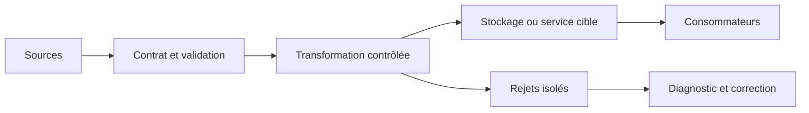
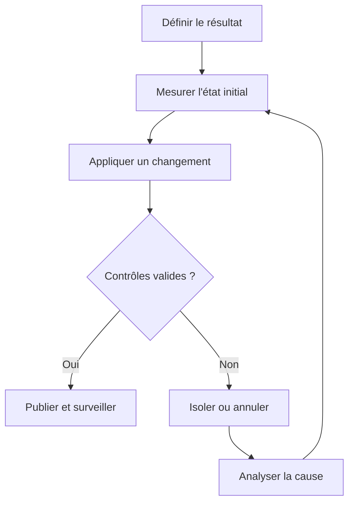
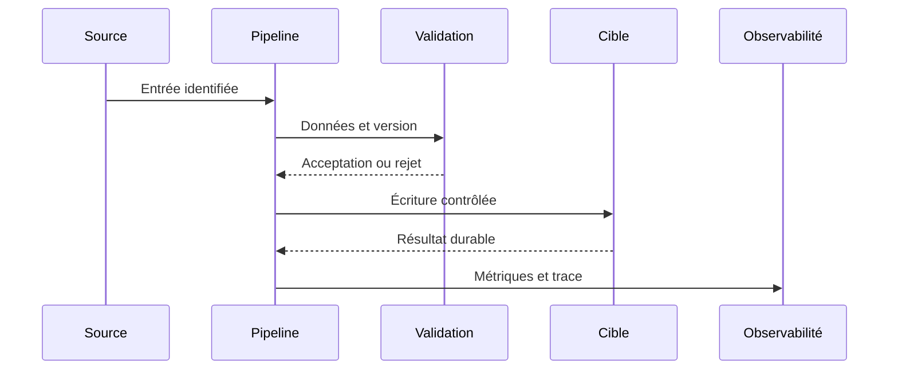
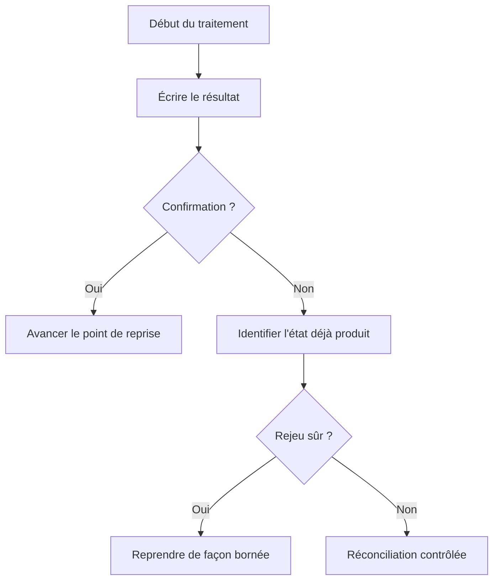
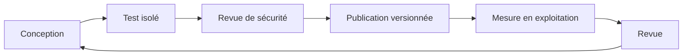

# Architecture Hadoop et Spark — Expert

> **Mise en contexte.** Ce cours approfondit architecture Hadoop/Spark et optimisation distribuée. Il vise une décision technique justifiable, testable et exploitable. Les exemples doivent être adaptés à la version du moteur et au contexte réel. Utilisez des données synthétiques, notez versions et paramètres, et préparez la restauration ou le retour arrière avant une opération risquée. N’insérez jamais de secret ou de donnée personnelle dans les commandes partagées.

## Introduction et objectifs pédagogiques

La compétence recherchée ne consiste pas à exécuter une recette, mais à expliquer pourquoi une solution répond au besoin et quelles limites elle conserve. Un résultat plausible sur le cas nominal n’est pas une preuve suffisante : les erreurs, l’ordre des événements, les données absentes, la concurrence et les changements de version doivent faire partie du raisonnement.

À l’issue du cours, vous devez pouvoir définir un contrat, identifier la source de vérité, comparer plusieurs approches, construire un test reproductible, interpréter une trace et expliquer une procédure de reprise. Vous devez également pouvoir différencier une garantie fournie par le système d’un comportement qui dépend d’un paramètre ou d’un choix applicatif. La validation attendue relie intention, entrée, état final et preuve.

Objectifs opérationnels : écrire les invariants métier, cartographier les composants, établir une baseline, mesurer les risques et les coûts, traiter les échecs explicitement, protéger les données, automatiser les assertions prioritaires et documenter les limites. Le cours fournit des méthodes de validation réutilisables ; les valeurs de configuration et les garanties précises doivent être confirmées dans la documentation de la version effectivement déployée.

## Prérequis et environnement

Révisez les notions de schéma, identifiant stable, transactions, journaux, droits d’accès et tests automatisés. Consignez la version des outils, extensions, ressources, configuration et mode de déploiement. Une syntaxe qui ressemble à celle d’un autre produit ne garantit ni une sémantique ni un niveau de fiabilité identiques.

Préparez un environnement isolé, un jeu synthétique et une procédure de nettoyage. Conservez la sortie de référence et les paramètres exacts. Pour toute action destructive, préparez la restauration avant de l’exécuter. Le code retour n’est qu’un signal : il doit être complété par des contrôles sur les lignes, clés, montants, versions, messages ou métriques qui prouvent l’invariant.

## Concepts clés développés

### 1. HDFS et tolérance

**Principe et choix.** HDFS répartit les blocs et utilise une politique de réplication ; il vise débit et tolérance aux pannes sur de grands fichiers. Avant d’implémenter, écrivez le contrat attendu en langage métier : quelles entités, quels consommateurs et quelle granularité sont concernés ? Distinguez une garantie nécessaire d’une simple préférence d’implémentation. Si plusieurs solutions sont disponibles, comparez-les sur les mêmes critères et mesurez ce qui change réellement. Une option technique est pertinente lorsqu’elle maintient le contrat et reste compréhensible pour l’équipe qui l’exploite.

**Risque et limite.** Millions de petits fichiers surchargent les métadonnées et sous-réplication réduit la résilience effective. Recherchez l’événement précis qui peut invalider le résultat : entrée inattendue, concurrence, changement de version, interruption entre deux étapes ou surcharge. Une conception fiable rend l’état visible et propose une action adaptée à chaque classe d’erreur. Il faut distinguer erreur temporaire, erreur permanente et résultat inconnu. Une reprise ne doit pas supposer que l’absence de réponse prouve que l’écriture n’a pas eu lieu.

**Preuve technique.** Mesurer blocs, capacité, répartition et comportement après perte d’un nœud. Établissez cette preuve avant l’essai. Utilisez des entrées connues, un résultat attendu et un contrôle de l’état réellement obtenu. Conservez version, paramètres, traces et métriques. Ajoutez un cas frontière et un cas qui doit être rejeté ; un test uniquement nominal laisse de côté les invariants les plus importants. Lorsque le résultat est quantitatif, définissez le dénominateur, la fenêtre et les unités pour que la mesure soit interprétable.

**Exemple contextualisé.** Compacter de petits événements peut améliorer la lecture sans changer leur sens métier. Commencez par un cas réduit, puis augmentez un seul facteur à la fois : volume, cardinalité, concurrence, retard, version ou droits. Comparez à une référence indépendante quand c’est possible. Si le résultat contredit l’hypothèse, conservez l’écart comme une information de diagnostic et révisez l’explication, plutôt que de changer le critère après l’observation.

**Décision d’ingénierie.** Comparez une variante simple et une variante traitant une contrainte supplémentaire. Évaluez latence, coût de stockage, charge de maintenance, privilèges requis, retour arrière et compétences nécessaires. La variante complexe n’est justifiée que si un indicateur démontre le besoin. Écrivez le seuil qui déclencherait son adoption et le signal qui imposerait de la revoir. Ce seuil rend la décision vérifiable plutôt que dépendante du goût personnel.

**Revue opérationnelle.** Demandez à un collègue de refaire l’essai à partir du compte rendu. Il doit pouvoir identifier les entrées, l’état final, le propriétaire de l’invariant et la trace à inspecter. S’il ne peut pas, la documentation ou la conception est incomplète. Un résultat exploitable peut être expliqué, surveillé, corrigé et transmis sans dépendre uniquement de la mémoire de son auteur.

### 2. YARN et ressources

**Principe et choix.** Le gestionnaire répartit conteneurs selon capacité, files et quotas ; nombre d’exécutants seul ne dit pas le parallélisme utile. Avant d’implémenter, écrivez le contrat attendu en langage métier : quelles entités, quels consommateurs et quelle granularité sont concernés ? Distinguez une garantie nécessaire d’une simple préférence d’implémentation. Si plusieurs solutions sont disponibles, comparez-les sur les mêmes critères et mesurez ce qui change réellement. Une option technique est pertinente lorsqu’elle maintient le contrat et reste compréhensible pour l’équipe qui l’exploite.

**Risque et limite.** Trop de mémoire par exécuteur réduit le nombre d’exécutants ; trop de tâches augmente le coût de planification. Recherchez l’événement précis qui peut invalider le résultat : entrée inattendue, concurrence, changement de version, interruption entre deux étapes ou surcharge. Une conception fiable rend l’état visible et propose une action adaptée à chaque classe d’erreur. Il faut distinguer erreur temporaire, erreur permanente et résultat inconnu. Une reprise ne doit pas supposer que l’absence de réponse prouve que l’écriture n’a pas eu lieu.

**Preuve technique.** Comparer attente file, CPU, mémoire, tâches actives et erreurs mémoire. Établissez cette preuve avant l’essai. Utilisez des entrées connues, un résultat attendu et un contrôle de l’état réellement obtenu. Conservez version, paramètres, traces et métriques. Ajoutez un cas frontière et un cas qui doit être rejeté ; un test uniquement nominal laisse de côté les invariants les plus importants. Lorsque le résultat est quantitatif, définissez le dénominateur, la fenêtre et les unités pour que la mesure soit interprétable.

**Exemple contextualisé.** Un skewed task ne s’améliore pas forcément en ajoutant exécutants si la clé dominante reste unique. Commencez par un cas réduit, puis augmentez un seul facteur à la fois : volume, cardinalité, concurrence, retard, version ou droits. Comparez à une référence indépendante quand c’est possible. Si le résultat contredit l’hypothèse, conservez l’écart comme une information de diagnostic et révisez l’explication, plutôt que de changer le critère après l’observation.

**Décision d’ingénierie.** Comparez une variante simple et une variante traitant une contrainte supplémentaire. Évaluez latence, coût de stockage, charge de maintenance, privilèges requis, retour arrière et compétences nécessaires. La variante complexe n’est justifiée que si un indicateur démontre le besoin. Écrivez le seuil qui déclencherait son adoption et le signal qui imposerait de la revoir. Ce seuil rend la décision vérifiable plutôt que dépendante du goût personnel.

**Revue opérationnelle.** Demandez à un collègue de refaire l’essai à partir du compte rendu. Il doit pouvoir identifier les entrées, l’état final, le propriétaire de l’invariant et la trace à inspecter. S’il ne peut pas, la documentation ou la conception est incomplète. Un résultat exploitable peut être expliqué, surveillé, corrigé et transmis sans dépendre uniquement de la mémoire de son auteur.

### 3. DAG et exécution paresseuse

**Principe et choix.** Transformations construisent le plan, une action déclenche calcul et le moteur optimise projection ou certaines opérations. Avant d’implémenter, écrivez le contrat attendu en langage métier : quelles entités, quels consommateurs et quelle granularité sont concernés ? Distinguez une garantie nécessaire d’une simple préférence d’implémentation. Si plusieurs solutions sont disponibles, comparez-les sur les mêmes critères et mesurez ce qui change réellement. Une option technique est pertinente lorsqu’elle maintient le contrat et reste compréhensible pour l’équipe qui l’exploite.

**Risque et limite.** Actions successives peuvent recalculer une chaîne coûteuse ; UDF opaque limite certaines optimisations. Recherchez l’événement précis qui peut invalider le résultat : entrée inattendue, concurrence, changement de version, interruption entre deux étapes ou surcharge. Une conception fiable rend l’état visible et propose une action adaptée à chaque classe d’erreur. Il faut distinguer erreur temporaire, erreur permanente et résultat inconnu. Une reprise ne doit pas supposer que l’absence de réponse prouve que l’écriture n’a pas eu lieu.

**Preuve technique.** Comparer plans logique/physique, stages et tâches puis réconcilier les résultats. Établissez cette preuve avant l’essai. Utilisez des entrées connues, un résultat attendu et un contrôle de l’état réellement obtenu. Conservez version, paramètres, traces et métriques. Ajoutez un cas frontière et un cas qui doit être rejeté ; un test uniquement nominal laisse de côté les invariants les plus importants. Lorsque le résultat est quantitatif, définissez le dénominateur, la fenêtre et les unités pour que la mesure soit interprétable.

**Exemple contextualisé.** Projeter les colonnes utiles avant shuffle évite de déplacer des champs inutiles. Commencez par un cas réduit, puis augmentez un seul facteur à la fois : volume, cardinalité, concurrence, retard, version ou droits. Comparez à une référence indépendante quand c’est possible. Si le résultat contredit l’hypothèse, conservez l’écart comme une information de diagnostic et révisez l’explication, plutôt que de changer le critère après l’observation.

**Décision d’ingénierie.** Comparez une variante simple et une variante traitant une contrainte supplémentaire. Évaluez latence, coût de stockage, charge de maintenance, privilèges requis, retour arrière et compétences nécessaires. La variante complexe n’est justifiée que si un indicateur démontre le besoin. Écrivez le seuil qui déclencherait son adoption et le signal qui imposerait de la revoir. Ce seuil rend la décision vérifiable plutôt que dépendante du goût personnel.

**Revue opérationnelle.** Demandez à un collègue de refaire l’essai à partir du compte rendu. Il doit pouvoir identifier les entrées, l’état final, le propriétaire de l’invariant et la trace à inspecter. S’il ne peut pas, la documentation ou la conception est incomplète. Un résultat exploitable peut être expliqué, surveillé, corrigé et transmis sans dépendre uniquement de la mémoire de son auteur.

### 4. Shuffle et skew

**Principe et choix.** Groupements et jointures redistribuent données et impliquent réseau, sérialisation, mémoire et disque ; distribution des clés gouverne la longue traîne. Avant d’implémenter, écrivez le contrat attendu en langage métier : quelles entités, quels consommateurs et quelle granularité sont concernés ? Distinguez une garantie nécessaire d’une simple préférence d’implémentation. Si plusieurs solutions sont disponibles, comparez-les sur les mêmes critères et mesurez ce qui change réellement. Une option technique est pertinente lorsqu’elle maintient le contrat et reste compréhensible pour l’équipe qui l’exploite.

**Risque et limite.** Augmenter partitions ne résout pas toujours une clé dominante ; salage incorrect change l’agrégation. Recherchez l’événement précis qui peut invalider le résultat : entrée inattendue, concurrence, changement de version, interruption entre deux étapes ou surcharge. Une conception fiable rend l’état visible et propose une action adaptée à chaque classe d’erreur. Il faut distinguer erreur temporaire, erreur permanente et résultat inconnu. Une reprise ne doit pas supposer que l’absence de réponse prouve que l’écriture n’a pas eu lieu.

**Preuve technique.** Mesurer shuffle, p50/p95 des tâches et distribution des clés. Établissez cette preuve avant l’essai. Utilisez des entrées connues, un résultat attendu et un contrôle de l’état réellement obtenu. Conservez version, paramètres, traces et métriques. Ajoutez un cas frontière et un cas qui doit être rejeté ; un test uniquement nominal laisse de côté les invariants les plus importants. Lorsque le résultat est quantitatif, définissez le dénominateur, la fenêtre et les unités pour que la mesure soit interprétable.

**Exemple contextualisé.** Traiter des clés très chaudes séparément puis réagréger sous une règle explicite. Commencez par un cas réduit, puis augmentez un seul facteur à la fois : volume, cardinalité, concurrence, retard, version ou droits. Comparez à une référence indépendante quand c’est possible. Si le résultat contredit l’hypothèse, conservez l’écart comme une information de diagnostic et révisez l’explication, plutôt que de changer le critère après l’observation.

**Décision d’ingénierie.** Comparez une variante simple et une variante traitant une contrainte supplémentaire. Évaluez latence, coût de stockage, charge de maintenance, privilèges requis, retour arrière et compétences nécessaires. La variante complexe n’est justifiée que si un indicateur démontre le besoin. Écrivez le seuil qui déclencherait son adoption et le signal qui imposerait de la revoir. Ce seuil rend la décision vérifiable plutôt que dépendante du goût personnel.

**Revue opérationnelle.** Demandez à un collègue de refaire l’essai à partir du compte rendu. Il doit pouvoir identifier les entrées, l’état final, le propriétaire de l’invariant et la trace à inspecter. S’il ne peut pas, la documentation ou la conception est incomplète. Un résultat exploitable peut être expliqué, surveillé, corrigé et transmis sans dépendre uniquement de la mémoire de son auteur.

### 5. Formats analytiques

**Principe et choix.** Parquet est colonnaire et ses métadonnées peuvent réduire lectures ; résultat dépend aussi des filtres et partitions. Avant d’implémenter, écrivez le contrat attendu en langage métier : quelles entités, quels consommateurs et quelle granularité sont concernés ? Distinguez une garantie nécessaire d’une simple préférence d’implémentation. Si plusieurs solutions sont disponibles, comparez-les sur les mêmes critères et mesurez ce qui change réellement. Une option technique est pertinente lorsqu’elle maintient le contrat et reste compréhensible pour l’équipe qui l’exploite.

**Risque et limite.** Partition haute cardinalité crée petits fichiers et Parquet seul n’apporte pas la transaction de table. Recherchez l’événement précis qui peut invalider le résultat : entrée inattendue, concurrence, changement de version, interruption entre deux étapes ou surcharge. Une conception fiable rend l’état visible et propose une action adaptée à chaque classe d’erreur. Il faut distinguer erreur temporaire, erreur permanente et résultat inconnu. Une reprise ne doit pas supposer que l’absence de réponse prouve que l’écriture n’a pas eu lieu.

**Preuve technique.** Comparer bytes lus, colonnes scannées, fichiers ouverts et exactitude après compaction. Établissez cette preuve avant l’essai. Utilisez des entrées connues, un résultat attendu et un contrôle de l’état réellement obtenu. Conservez version, paramètres, traces et métriques. Ajoutez un cas frontière et un cas qui doit être rejeté ; un test uniquement nominal laisse de côté les invariants les plus importants. Lorsque le résultat est quantitatif, définissez le dénominateur, la fenêtre et les unités pour que la mesure soit interprétable.

**Exemple contextualisé.** Filtrer tôt sur dates et projeter deux colonnes réduit le volume transféré. Commencez par un cas réduit, puis augmentez un seul facteur à la fois : volume, cardinalité, concurrence, retard, version ou droits. Comparez à une référence indépendante quand c’est possible. Si le résultat contredit l’hypothèse, conservez l’écart comme une information de diagnostic et révisez l’explication, plutôt que de changer le critère après l’observation.

**Décision d’ingénierie.** Comparez une variante simple et une variante traitant une contrainte supplémentaire. Évaluez latence, coût de stockage, charge de maintenance, privilèges requis, retour arrière et compétences nécessaires. La variante complexe n’est justifiée que si un indicateur démontre le besoin. Écrivez le seuil qui déclencherait son adoption et le signal qui imposerait de la revoir. Ce seuil rend la décision vérifiable plutôt que dépendante du goût personnel.

**Revue opérationnelle.** Demandez à un collègue de refaire l’essai à partir du compte rendu. Il doit pouvoir identifier les entrées, l’état final, le propriétaire de l’invariant et la trace à inspecter. S’il ne peut pas, la documentation ou la conception est incomplète. Un résultat exploitable peut être expliqué, surveillé, corrigé et transmis sans dépendre uniquement de la mémoire de son auteur.

### 6. Recalcul et idempotence

**Principe et choix.** Les tâches distribuées peuvent être reprises, ce qui est efficace pour transformations déterministes mais dangereux pour effets externes. Avant d’implémenter, écrivez le contrat attendu en langage métier : quelles entités, quels consommateurs et quelle granularité sont concernés ? Distinguez une garantie nécessaire d’une simple préférence d’implémentation. Si plusieurs solutions sont disponibles, comparez-les sur les mêmes critères et mesurez ce qui change réellement. Une option technique est pertinente lorsqu’elle maintient le contrat et reste compréhensible pour l’équipe qui l’exploite.

**Risque et limite.** Retry peut publier deux messages ou écritures ; checkpoint n’est pas une transaction métier globale. Recherchez l’événement précis qui peut invalider le résultat : entrée inattendue, concurrence, changement de version, interruption entre deux étapes ou surcharge. Une conception fiable rend l’état visible et propose une action adaptée à chaque classe d’erreur. Il faut distinguer erreur temporaire, erreur permanente et résultat inconnu. Une reprise ne doit pas supposer que l’absence de réponse prouve que l’écriture n’a pas eu lieu.

**Preuve technique.** Interrompre une tâche en test et vérifier clés, totaux et absence de doublons. Établissez cette preuve avant l’essai. Utilisez des entrées connues, un résultat attendu et un contrôle de l’état réellement obtenu. Conservez version, paramètres, traces et métriques. Ajoutez un cas frontière et un cas qui doit être rejeté ; un test uniquement nominal laisse de côté les invariants les plus importants. Lorsque le résultat est quantitatif, définissez le dénominateur, la fenêtre et les unités pour que la mesure soit interprétable.

**Exemple contextualisé.** Publier depuis un staging identifié puis valider atomiquement la sortie. Commencez par un cas réduit, puis augmentez un seul facteur à la fois : volume, cardinalité, concurrence, retard, version ou droits. Comparez à une référence indépendante quand c’est possible. Si le résultat contredit l’hypothèse, conservez l’écart comme une information de diagnostic et révisez l’explication, plutôt que de changer le critère après l’observation.

**Décision d’ingénierie.** Comparez une variante simple et une variante traitant une contrainte supplémentaire. Évaluez latence, coût de stockage, charge de maintenance, privilèges requis, retour arrière et compétences nécessaires. La variante complexe n’est justifiée que si un indicateur démontre le besoin. Écrivez le seuil qui déclencherait son adoption et le signal qui imposerait de la revoir. Ce seuil rend la décision vérifiable plutôt que dépendante du goût personnel.

**Revue opérationnelle.** Demandez à un collègue de refaire l’essai à partir du compte rendu. Il doit pouvoir identifier les entrées, l’état final, le propriétaire de l’invariant et la trace à inspecter. S’il ne peut pas, la documentation ou la conception est incomplète. Un résultat exploitable peut être expliqué, surveillé, corrigé et transmis sans dépendre uniquement de la mémoire de son auteur.

### 7. Optimisation mesurée

**Principe et choix.** Le goulot peut être source, CPU, shuffle, skew, stockage, garbage collection ou planification ; métriques doivent diriger le changement. Avant d’implémenter, écrivez le contrat attendu en langage métier : quelles entités, quels consommateurs et quelle granularité sont concernés ? Distinguez une garantie nécessaire d’une simple préférence d’implémentation. Si plusieurs solutions sont disponibles, comparez-les sur les mêmes critères et mesurez ce qui change réellement. Une option technique est pertinente lorsqu’elle maintient le contrat et reste compréhensible pour l’équipe qui l’exploite.

**Risque et limite.** Benchmark petit ou uniforme masque le skew réel ; cache peut accélérer artificiellement une deuxième exécution. Recherchez l’événement précis qui peut invalider le résultat : entrée inattendue, concurrence, changement de version, interruption entre deux étapes ou surcharge. Une conception fiable rend l’état visible et propose une action adaptée à chaque classe d’erreur. Il faut distinguer erreur temporaire, erreur permanente et résultat inconnu. Une reprise ne doit pas supposer que l’absence de réponse prouve que l’écriture n’a pas eu lieu.

**Preuve technique.** Garder paramètres, percentiles, tâches longues et coût sur plusieurs répétitions. Établissez cette preuve avant l’essai. Utilisez des entrées connues, un résultat attendu et un contrôle de l’état réellement obtenu. Conservez version, paramètres, traces et métriques. Ajoutez un cas frontière et un cas qui doit être rejeté ; un test uniquement nominal laisse de côté les invariants les plus importants. Lorsque le résultat est quantitatif, définissez le dénominateur, la fenêtre et les unités pour que la mesure soit interprétable.

**Exemple contextualisé.** Broadcast est pertinent si relation filtrée est réellement petite et tient en mémoire. Commencez par un cas réduit, puis augmentez un seul facteur à la fois : volume, cardinalité, concurrence, retard, version ou droits. Comparez à une référence indépendante quand c’est possible. Si le résultat contredit l’hypothèse, conservez l’écart comme une information de diagnostic et révisez l’explication, plutôt que de changer le critère après l’observation.

**Décision d’ingénierie.** Comparez une variante simple et une variante traitant une contrainte supplémentaire. Évaluez latence, coût de stockage, charge de maintenance, privilèges requis, retour arrière et compétences nécessaires. La variante complexe n’est justifiée que si un indicateur démontre le besoin. Écrivez le seuil qui déclencherait son adoption et le signal qui imposerait de la revoir. Ce seuil rend la décision vérifiable plutôt que dépendante du goût personnel.

**Revue opérationnelle.** Demandez à un collègue de refaire l’essai à partir du compte rendu. Il doit pouvoir identifier les entrées, l’état final, le propriétaire de l’invariant et la trace à inspecter. S’il ne peut pas, la documentation ou la conception est incomplète. Un résultat exploitable peut être expliqué, surveillé, corrigé et transmis sans dépendre uniquement de la mémoire de son auteur.

### 8. Gouvernance et coût

**Principe et choix.** Provenance, droits, rétention, fraîcheur et coût par exécution sont des propriétés de production. Avant d’implémenter, écrivez le contrat attendu en langage métier : quelles entités, quels consommateurs et quelle granularité sont concernés ? Distinguez une garantie nécessaire d’une simple préférence d’implémentation. Si plusieurs solutions sont disponibles, comparez-les sur les mêmes critères et mesurez ce qui change réellement. Une option technique est pertinente lorsqu’elle maintient le contrat et reste compréhensible pour l’équipe qui l’exploite.

**Risque et limite.** Données temporaires non nettoyées augmentent coûts et exposition ; job vert avec sortie vide reste un échec métier. Recherchez l’événement précis qui peut invalider le résultat : entrée inattendue, concurrence, changement de version, interruption entre deux étapes ou surcharge. Une conception fiable rend l’état visible et propose une action adaptée à chaque classe d’erreur. Il faut distinguer erreur temporaire, erreur permanente et résultat inconnu. Une reprise ne doit pas supposer que l’absence de réponse prouve que l’écriture n’a pas eu lieu.

**Preuve technique.** Tester droits, lineage, fraîcheur, complétude, coûts et alertes avant publication. Établissez cette preuve avant l’essai. Utilisez des entrées connues, un résultat attendu et un contrôle de l’état réellement obtenu. Conservez version, paramètres, traces et métriques. Ajoutez un cas frontière et un cas qui doit être rejeté ; un test uniquement nominal laisse de côté les invariants les plus importants. Lorsque le résultat est quantitatif, définissez le dénominateur, la fenêtre et les unités pour que la mesure soit interprétable.

**Exemple contextualisé.** Dataset certifié seulement après contrôle et budget attendu. Commencez par un cas réduit, puis augmentez un seul facteur à la fois : volume, cardinalité, concurrence, retard, version ou droits. Comparez à une référence indépendante quand c’est possible. Si le résultat contredit l’hypothèse, conservez l’écart comme une information de diagnostic et révisez l’explication, plutôt que de changer le critère après l’observation.

**Décision d’ingénierie.** Comparez une variante simple et une variante traitant une contrainte supplémentaire. Évaluez latence, coût de stockage, charge de maintenance, privilèges requis, retour arrière et compétences nécessaires. La variante complexe n’est justifiée que si un indicateur démontre le besoin. Écrivez le seuil qui déclencherait son adoption et le signal qui imposerait de la revoir. Ce seuil rend la décision vérifiable plutôt que dépendante du goût personnel.

**Revue opérationnelle.** Demandez à un collègue de refaire l’essai à partir du compte rendu. Il doit pouvoir identifier les entrées, l’état final, le propriétaire de l’invariant et la trace à inspecter. S’il ne peut pas, la documentation ou la conception est incomplète. Un résultat exploitable peut être expliqué, surveillé, corrigé et transmis sans dépendre uniquement de la mémoire de son auteur.

## Architecture et schémas de référence

Le premier schéma représente le passage de l’entrée à la publication. Attribuez à chaque bloc un propriétaire et un contrôle automatisable.



La boucle de contrôle distingue hypothèse, changement et preuve.



Le diagramme de séquence identifie la frontière où le résultat devient durable.



Le chemin d’erreur doit préciser comment reconnaître un effet déjà appliqué.



Le cycle complet relie conception et amélioration continue.



## Méthode d’ingénierie : du besoin à une opération sûre

### 1. Définir le contrat

Décrire effet attendu, préconditions, postconditions et invariant métier avant de choisir une option. Pour ce cours, consignez les hypothèses, les données, la version et les résultats. Si un paramètre est inconnu, expliquez comment le mesurer plutôt que d’inventer une valeur. Faits, hypothèses et décisions doivent rester distincts pour qu’un autre opérateur puisse refaire la validation.

### 2. Identifier la source de vérité

Lister systèmes faisant autorité, copies et transformations ; retracer le résultat jusqu’à son origine. Pour ce cours, consignez les hypothèses, les données, la version et les résultats. Si un paramètre est inconnu, expliquez comment le mesurer plutôt que d’inventer une valeur. Faits, hypothèses et décisions doivent rester distincts pour qu’un autre opérateur puisse refaire la validation.

### 3. Établir une baseline

Conserver version, paramètres, volume et sortie témoin pour comparer les mêmes conditions. Pour ce cours, consignez les hypothèses, les données, la version et les résultats. Si un paramètre est inconnu, expliquez comment le mesurer plutôt que d’inventer une valeur. Faits, hypothèses et décisions doivent rester distincts pour qu’un autre opérateur puisse refaire la validation.

### 4. Tester une hypothèse

Définir le signal qui confirmerait ou réfuterait la cause et isoler une variable. Pour ce cours, consignez les hypothèses, les données, la version et les résultats. Si un paramètre est inconnu, expliquez comment le mesurer plutôt que d’inventer une valeur. Faits, hypothèses et décisions doivent rester distincts pour qu’un autre opérateur puisse refaire la validation.

### 5. Traiter les cas négatifs

Inclure absence, doublons, limites, concurrence et interruption ; définir erreurs attendues. Pour ce cours, consignez les hypothèses, les données, la version et les résultats. Si un paramètre est inconnu, expliquez comment le mesurer plutôt que d’inventer une valeur. Faits, hypothèses et décisions doivent rester distincts pour qu’un autre opérateur puisse refaire la validation.

### 6. Planifier le rejeu

Décider comment reconnaître un effet déjà validé et réconcilier un état partiel. Pour ce cours, consignez les hypothèses, les données, la version et les résultats. Si un paramètre est inconnu, expliquez comment le mesurer plutôt que d’inventer une valeur. Faits, hypothèses et décisions doivent rester distincts pour qu’un autre opérateur puisse refaire la validation.

### 7. Sécuriser les traces

Conserver le contexte nécessaire sans secrets ou données personnelles inutiles. Pour ce cours, consignez les hypothèses, les données, la version et les résultats. Si un paramètre est inconnu, expliquez comment le mesurer plutôt que d’inventer une valeur. Faits, hypothèses et décisions doivent rester distincts pour qu’un autre opérateur puisse refaire la validation.

### 8. Automatiser l’assertion

Transformer les invariants en tests avec sortie lisible et propriétaire d’alerte. Pour ce cours, consignez les hypothèses, les données, la version et les résultats. Si un paramètre est inconnu, expliquez comment le mesurer plutôt que d’inventer une valeur. Faits, hypothèses et décisions doivent rester distincts pour qu’un autre opérateur puisse refaire la validation.

### 9. Mesurer le compromis

Quantifier latence, coût, volume, complexité, maintenance et effet sur les étapes voisines. Pour ce cours, consignez les hypothèses, les données, la version et les résultats. Si un paramètre est inconnu, expliquez comment le mesurer plutôt que d’inventer une valeur. Faits, hypothèses et décisions doivent rester distincts pour qu’un autre opérateur puisse refaire la validation.

### 10. Documenter la décision

Enregistrer alternatives, limites, version, retour arrière et seuils de révision. Pour ce cours, consignez les hypothèses, les données, la version et les résultats. Si un paramètre est inconnu, expliquez comment le mesurer plutôt que d’inventer une valeur. Faits, hypothèses et décisions doivent rester distincts pour qu’un autre opérateur puisse refaire la validation.

## Atelier pratique guidé

### But

Mettre en pratique diagnostiquer un job distribué avant d’augmenter le cluster dans une copie isolée. Le laboratoire ne modifie pas de données de production. La réussite est démontrée par les sorties et contrôles, pas seulement par l’exécution d’une commande.

### Commande ou point de départ

```
from pyspark.sql import functions as F
result = (events.filter(F.col("event_date") >= F.lit("2026-01-01"))
 .select("region", "event_id").groupBy("region")
 .agg(F.count("*").alias("events")))
result.explain("formatted")
```

Adaptez la syntaxe aux versions et droits réellement disponibles. Vérifiez la cible avant toute commande d’écriture ; si l’environnement ne correspond pas aux hypothèses, arrêtez-vous et consignez l’écart au lieu de l’ignorer.

### Déroulement

1. Tracer source, format, taille, partitions et transformations. Notez l’entrée, la version, le résultat observé et l’invariant vérifié. Si le résultat diffère, conservez la trace et stoppez les automatismes qui pourraient amplifier l’erreur. Comparez la sortie à la référence définie avant l’expérience.

2. Lire le DAG et identifier le stage où le coût diverge. Notez l’entrée, la version, le résultat observé et l’invariant vérifié. Si le résultat diffère, conservez la trace et stoppez les automatismes qui pourraient amplifier l’erreur. Comparez la sortie à la référence définie avant l’expérience.

3. Mesurer shuffle, tâches longues, spills mémoire et asymétrie des clés. Notez l’entrée, la version, le résultat observé et l’invariant vérifié. Si le résultat diffère, conservez la trace et stoppez les automatismes qui pourraient amplifier l’erreur. Comparez la sortie à la référence définie avant l’expérience.

4. Tester projection, filtrage précoce, partitionnement ou broadcast isolément. Notez l’entrée, la version, le résultat observé et l’invariant vérifié. Si le résultat diffère, conservez la trace et stoppez les automatismes qui pourraient amplifier l’erreur. Comparez la sortie à la référence définie avant l’expérience.

5. Comparer la même charge et configuration, en notant durée et coût. Notez l’entrée, la version, le résultat observé et l’invariant vérifié. Si le résultat diffère, conservez la trace et stoppez les automatismes qui pourraient amplifier l’erreur. Comparez la sortie à la référence définie avant l’expérience.

6. Vérifier résultat déterministe et absence d’effets secondaires lors du retry. Notez l’entrée, la version, le résultat observé et l’invariant vérifié. Si le résultat diffère, conservez la trace et stoppez les automatismes qui pourraient amplifier l’erreur. Comparez la sortie à la référence définie avant l’expérience.

### Critères d’acceptation

Le cas nominal doit être correct, le cas invalide doit être rejeté explicitement et une seconde exécution ne doit pas créer un nouvel effet métier non désiré. La procédure doit pouvoir être rejouée par un autre apprenant. Le rapport décrit les limites, risques résiduels et chemins de retour arrière. Un résultat simplement plausible mais non réconcilié ne suffit pas.

## Étude de cas détaillée

### Situation : Un job Spark termine parfois en deux heures et parfois en cinq ; quelques tâches prennent dix fois plus longtemps

La première réaction peut être de redémarrer, d’augmenter les ressources ou de corriger seulement les valeurs visibles. Ces gestes peuvent masquer le symptôme sans traiter la cause. L’analyse commence par une chronologie, une référence saine et une hypothèse qui peut être réfutée par un signal observable. Il faut établir le moment exact où l’état a divergé et identifier les changements intervenus dans cette fenêtre.

### Indices à examiner

- Millions de petits fichiers surchargent les métadonnées et sous-réplication réduit la résilience effective.
- Trop de mémoire par exécuteur réduit le nombre d’exécutants ; trop de tâches augmente le coût de planification.
- Actions successives peuvent recalculer une chaîne coûteuse ; UDF opaque limite certaines optimisations.
- Augmenter partitions ne résout pas toujours une clé dominante ; salage incorrect change l’agrégation.

Corrélez les indices sur une même fenêtre temporelle. Relevez les identifiants, versions, paramètres, opérations actives et erreurs. Une hypothèse doit prévoir un signal ; si celui-ci n’apparaît pas, révisez le diagnostic. Distinguez causes de données, de code, de configuration, de droits, de charge et de capacité. Une correction qui agit sur la mauvaise couche peut réduire temporairement le symptôme tout en augmentant la difficulté d’un futur diagnostic.

### Correction de référence

La correction doit commencer par un diagnostic ciblé plutôt que par un changement global. Comparez au moins deux solutions et retenez celle dont les garanties couvrent le contrat, sans imposer une complexité superflue. Appliquez-la sur une copie, mesurez l’état avant et après, puis rejouez un scénario proche de l’incident. Si plusieurs systèmes sont impliqués, définissez l’ordre de changement, le propriétaire et la réponse à une interruption intermédiaire.

### Preuve d’efficacité

Rejouez le même scénario avec la même entrée, puis ajoutez une limite et une interruption contrôlée. Comparez les résultats à une référence indépendante et mesurez les indicateurs pertinents. La correction est acceptable si l’invariant est préservé, si les traces permettent d’expliquer le résultat et si une autre personne peut refaire les contrôles. Les limites restantes doivent être consignées, même lorsque le test est réussi.

## Pièges à éviter

### Piège 1 — HDFS et tolérance

Millions de petits fichiers surchargent les métadonnées et sous-réplication réduit la résilience effective. Pour éviter le piège, écrivez l’attendu avant le changement, testez une entrée normale et une adversariale, puis examinez les traces. Une solution fragile ne fonctionne que lorsque volume et ordre sont favorables. Attribuez un propriétaire à la règle et prévoyez une réparation si l’écart est découvert après publication.

### Piège 2 — YARN et ressources

Trop de mémoire par exécuteur réduit le nombre d’exécutants ; trop de tâches augmente le coût de planification. Pour éviter le piège, écrivez l’attendu avant le changement, testez une entrée normale et une adversariale, puis examinez les traces. Une solution fragile ne fonctionne que lorsque volume et ordre sont favorables. Attribuez un propriétaire à la règle et prévoyez une réparation si l’écart est découvert après publication.

### Piège 3 — DAG et exécution paresseuse

Actions successives peuvent recalculer une chaîne coûteuse ; UDF opaque limite certaines optimisations. Pour éviter le piège, écrivez l’attendu avant le changement, testez une entrée normale et une adversariale, puis examinez les traces. Une solution fragile ne fonctionne que lorsque volume et ordre sont favorables. Attribuez un propriétaire à la règle et prévoyez une réparation si l’écart est découvert après publication.

### Piège 4 — Shuffle et skew

Augmenter partitions ne résout pas toujours une clé dominante ; salage incorrect change l’agrégation. Pour éviter le piège, écrivez l’attendu avant le changement, testez une entrée normale et une adversariale, puis examinez les traces. Une solution fragile ne fonctionne que lorsque volume et ordre sont favorables. Attribuez un propriétaire à la règle et prévoyez une réparation si l’écart est découvert après publication.

### Piège 5 — Formats analytiques

Partition haute cardinalité crée petits fichiers et Parquet seul n’apporte pas la transaction de table. Pour éviter le piège, écrivez l’attendu avant le changement, testez une entrée normale et une adversariale, puis examinez les traces. Une solution fragile ne fonctionne que lorsque volume et ordre sont favorables. Attribuez un propriétaire à la règle et prévoyez une réparation si l’écart est découvert après publication.

### Piège 6 — Recalcul et idempotence

Retry peut publier deux messages ou écritures ; checkpoint n’est pas une transaction métier globale. Pour éviter le piège, écrivez l’attendu avant le changement, testez une entrée normale et une adversariale, puis examinez les traces. Une solution fragile ne fonctionne que lorsque volume et ordre sont favorables. Attribuez un propriétaire à la règle et prévoyez une réparation si l’écart est découvert après publication.

### Piège 7 — Optimisation mesurée

Benchmark petit ou uniforme masque le skew réel ; cache peut accélérer artificiellement une deuxième exécution. Pour éviter le piège, écrivez l’attendu avant le changement, testez une entrée normale et une adversariale, puis examinez les traces. Une solution fragile ne fonctionne que lorsque volume et ordre sont favorables. Attribuez un propriétaire à la règle et prévoyez une réparation si l’écart est découvert après publication.

### Piège 8 — Gouvernance et coût

Données temporaires non nettoyées augmentent coûts et exposition ; job vert avec sortie vide reste un échec métier. Pour éviter le piège, écrivez l’attendu avant le changement, testez une entrée normale et une adversariale, puis examinez les traces. Une solution fragile ne fonctionne que lorsque volume et ordre sont favorables. Attribuez un propriétaire à la règle et prévoyez une réparation si l’écart est découvert après publication.

## Diagnostic : fiches de vérification

### Diagnostic 1 — HDFS et tolérance

**Symptôme.** Millions de petits fichiers surchargent les métadonnées et sous-réplication réduit la résilience effective.

**Vérifications.** Mesurer blocs, capacité, répartition et comportement après perte d’un nœud. Contrôlez aussi la version, les paramètres et la granularité du résultat. Un total global correct peut cacher un groupe incorrect, une ligne dupliquée ou une publication incomplète.

**Action prudente.** HDFS répartit les blocs et utilise une politique de réplication ; il vise débit et tolérance aux pannes sur de grands fichiers. Limitez la correction au périmètre démontré et conservez une procédure pour revenir à l’état précédent.

### Diagnostic 2 — YARN et ressources

**Symptôme.** Trop de mémoire par exécuteur réduit le nombre d’exécutants ; trop de tâches augmente le coût de planification.

**Vérifications.** Comparer attente file, CPU, mémoire, tâches actives et erreurs mémoire. Contrôlez aussi la version, les paramètres et la granularité du résultat. Un total global correct peut cacher un groupe incorrect, une ligne dupliquée ou une publication incomplète.

**Action prudente.** Le gestionnaire répartit conteneurs selon capacité, files et quotas ; nombre d’exécutants seul ne dit pas le parallélisme utile. Limitez la correction au périmètre démontré et conservez une procédure pour revenir à l’état précédent.

### Diagnostic 3 — DAG et exécution paresseuse

**Symptôme.** Actions successives peuvent recalculer une chaîne coûteuse ; UDF opaque limite certaines optimisations.

**Vérifications.** Comparer plans logique/physique, stages et tâches puis réconcilier les résultats. Contrôlez aussi la version, les paramètres et la granularité du résultat. Un total global correct peut cacher un groupe incorrect, une ligne dupliquée ou une publication incomplète.

**Action prudente.** Transformations construisent le plan, une action déclenche calcul et le moteur optimise projection ou certaines opérations. Limitez la correction au périmètre démontré et conservez une procédure pour revenir à l’état précédent.

### Diagnostic 4 — Shuffle et skew

**Symptôme.** Augmenter partitions ne résout pas toujours une clé dominante ; salage incorrect change l’agrégation.

**Vérifications.** Mesurer shuffle, p50/p95 des tâches et distribution des clés. Contrôlez aussi la version, les paramètres et la granularité du résultat. Un total global correct peut cacher un groupe incorrect, une ligne dupliquée ou une publication incomplète.

**Action prudente.** Groupements et jointures redistribuent données et impliquent réseau, sérialisation, mémoire et disque ; distribution des clés gouverne la longue traîne. Limitez la correction au périmètre démontré et conservez une procédure pour revenir à l’état précédent.

### Diagnostic 5 — Formats analytiques

**Symptôme.** Partition haute cardinalité crée petits fichiers et Parquet seul n’apporte pas la transaction de table.

**Vérifications.** Comparer bytes lus, colonnes scannées, fichiers ouverts et exactitude après compaction. Contrôlez aussi la version, les paramètres et la granularité du résultat. Un total global correct peut cacher un groupe incorrect, une ligne dupliquée ou une publication incomplète.

**Action prudente.** Parquet est colonnaire et ses métadonnées peuvent réduire lectures ; résultat dépend aussi des filtres et partitions. Limitez la correction au périmètre démontré et conservez une procédure pour revenir à l’état précédent.

### Diagnostic 6 — Recalcul et idempotence

**Symptôme.** Retry peut publier deux messages ou écritures ; checkpoint n’est pas une transaction métier globale.

**Vérifications.** Interrompre une tâche en test et vérifier clés, totaux et absence de doublons. Contrôlez aussi la version, les paramètres et la granularité du résultat. Un total global correct peut cacher un groupe incorrect, une ligne dupliquée ou une publication incomplète.

**Action prudente.** Les tâches distribuées peuvent être reprises, ce qui est efficace pour transformations déterministes mais dangereux pour effets externes. Limitez la correction au périmètre démontré et conservez une procédure pour revenir à l’état précédent.

### Diagnostic 7 — Optimisation mesurée

**Symptôme.** Benchmark petit ou uniforme masque le skew réel ; cache peut accélérer artificiellement une deuxième exécution.

**Vérifications.** Garder paramètres, percentiles, tâches longues et coût sur plusieurs répétitions. Contrôlez aussi la version, les paramètres et la granularité du résultat. Un total global correct peut cacher un groupe incorrect, une ligne dupliquée ou une publication incomplète.

**Action prudente.** Le goulot peut être source, CPU, shuffle, skew, stockage, garbage collection ou planification ; métriques doivent diriger le changement. Limitez la correction au périmètre démontré et conservez une procédure pour revenir à l’état précédent.

### Diagnostic 8 — Gouvernance et coût

**Symptôme.** Données temporaires non nettoyées augmentent coûts et exposition ; job vert avec sortie vide reste un échec métier.

**Vérifications.** Tester droits, lineage, fraîcheur, complétude, coûts et alertes avant publication. Contrôlez aussi la version, les paramètres et la granularité du résultat. Un total global correct peut cacher un groupe incorrect, une ligne dupliquée ou une publication incomplète.

**Action prudente.** Provenance, droits, rétention, fraîcheur et coût par exécution sont des propriétés de production. Limitez la correction au périmètre démontré et conservez une procédure pour revenir à l’état précédent.

## Exercices d’application avec corrigés

### Exercice 1 — HDFS et tolérance

**Énoncé.** Construisez un cas minimal qui démontre l’invariant. Incluez un exemple valide, une limite et une erreur attendue. Précisez les entrées, métriques et traces nécessaires avant de lancer l’expérience.

**Corrigé détaillé.** Commencez par la démarche suivante : HDFS répartit les blocs et utilise une politique de réplication ; il vise débit et tolérance aux pannes sur de grands fichiers. Le risque à traiter est : Millions de petits fichiers surchargent les métadonnées et sous-réplication réduit la résilience effective. La preuve doit établir que Mesurer blocs, capacité, répartition et comportement après perte d’un nœud. Comparez le résultat à une référence indépendante, consignez versions et paramètres et ajoutez un test qui empêche la régression. Une variante différente est acceptable si elle démontre le même invariant et explique ses compromis de coût, sécurité et maintenance.

### Exercice 2 — YARN et ressources

**Énoncé.** Construisez un cas minimal qui démontre l’invariant. Incluez un exemple valide, une limite et une erreur attendue. Précisez les entrées, métriques et traces nécessaires avant de lancer l’expérience.

**Corrigé détaillé.** Commencez par la démarche suivante : Le gestionnaire répartit conteneurs selon capacité, files et quotas ; nombre d’exécutants seul ne dit pas le parallélisme utile. Le risque à traiter est : Trop de mémoire par exécuteur réduit le nombre d’exécutants ; trop de tâches augmente le coût de planification. La preuve doit établir que Comparer attente file, CPU, mémoire, tâches actives et erreurs mémoire. Comparez le résultat à une référence indépendante, consignez versions et paramètres et ajoutez un test qui empêche la régression. Une variante différente est acceptable si elle démontre le même invariant et explique ses compromis de coût, sécurité et maintenance.

### Exercice 3 — DAG et exécution paresseuse

**Énoncé.** Construisez un cas minimal qui démontre l’invariant. Incluez un exemple valide, une limite et une erreur attendue. Précisez les entrées, métriques et traces nécessaires avant de lancer l’expérience.

**Corrigé détaillé.** Commencez par la démarche suivante : Transformations construisent le plan, une action déclenche calcul et le moteur optimise projection ou certaines opérations. Le risque à traiter est : Actions successives peuvent recalculer une chaîne coûteuse ; UDF opaque limite certaines optimisations. La preuve doit établir que Comparer plans logique/physique, stages et tâches puis réconcilier les résultats. Comparez le résultat à une référence indépendante, consignez versions et paramètres et ajoutez un test qui empêche la régression. Une variante différente est acceptable si elle démontre le même invariant et explique ses compromis de coût, sécurité et maintenance.

### Exercice 4 — Shuffle et skew

**Énoncé.** Construisez un cas minimal qui démontre l’invariant. Incluez un exemple valide, une limite et une erreur attendue. Précisez les entrées, métriques et traces nécessaires avant de lancer l’expérience.

**Corrigé détaillé.** Commencez par la démarche suivante : Groupements et jointures redistribuent données et impliquent réseau, sérialisation, mémoire et disque ; distribution des clés gouverne la longue traîne. Le risque à traiter est : Augmenter partitions ne résout pas toujours une clé dominante ; salage incorrect change l’agrégation. La preuve doit établir que Mesurer shuffle, p50/p95 des tâches et distribution des clés. Comparez le résultat à une référence indépendante, consignez versions et paramètres et ajoutez un test qui empêche la régression. Une variante différente est acceptable si elle démontre le même invariant et explique ses compromis de coût, sécurité et maintenance.

### Exercice 5 — Formats analytiques

**Énoncé.** Construisez un cas minimal qui démontre l’invariant. Incluez un exemple valide, une limite et une erreur attendue. Précisez les entrées, métriques et traces nécessaires avant de lancer l’expérience.

**Corrigé détaillé.** Commencez par la démarche suivante : Parquet est colonnaire et ses métadonnées peuvent réduire lectures ; résultat dépend aussi des filtres et partitions. Le risque à traiter est : Partition haute cardinalité crée petits fichiers et Parquet seul n’apporte pas la transaction de table. La preuve doit établir que Comparer bytes lus, colonnes scannées, fichiers ouverts et exactitude après compaction. Comparez le résultat à une référence indépendante, consignez versions et paramètres et ajoutez un test qui empêche la régression. Une variante différente est acceptable si elle démontre le même invariant et explique ses compromis de coût, sécurité et maintenance.

### Exercice 6 — Recalcul et idempotence

**Énoncé.** Construisez un cas minimal qui démontre l’invariant. Incluez un exemple valide, une limite et une erreur attendue. Précisez les entrées, métriques et traces nécessaires avant de lancer l’expérience.

**Corrigé détaillé.** Commencez par la démarche suivante : Les tâches distribuées peuvent être reprises, ce qui est efficace pour transformations déterministes mais dangereux pour effets externes. Le risque à traiter est : Retry peut publier deux messages ou écritures ; checkpoint n’est pas une transaction métier globale. La preuve doit établir que Interrompre une tâche en test et vérifier clés, totaux et absence de doublons. Comparez le résultat à une référence indépendante, consignez versions et paramètres et ajoutez un test qui empêche la régression. Une variante différente est acceptable si elle démontre le même invariant et explique ses compromis de coût, sécurité et maintenance.

### Exercice 7 — Optimisation mesurée

**Énoncé.** Construisez un cas minimal qui démontre l’invariant. Incluez un exemple valide, une limite et une erreur attendue. Précisez les entrées, métriques et traces nécessaires avant de lancer l’expérience.

**Corrigé détaillé.** Commencez par la démarche suivante : Le goulot peut être source, CPU, shuffle, skew, stockage, garbage collection ou planification ; métriques doivent diriger le changement. Le risque à traiter est : Benchmark petit ou uniforme masque le skew réel ; cache peut accélérer artificiellement une deuxième exécution. La preuve doit établir que Garder paramètres, percentiles, tâches longues et coût sur plusieurs répétitions. Comparez le résultat à une référence indépendante, consignez versions et paramètres et ajoutez un test qui empêche la régression. Une variante différente est acceptable si elle démontre le même invariant et explique ses compromis de coût, sécurité et maintenance.

### Exercice 8 — Gouvernance et coût

**Énoncé.** Construisez un cas minimal qui démontre l’invariant. Incluez un exemple valide, une limite et une erreur attendue. Précisez les entrées, métriques et traces nécessaires avant de lancer l’expérience.

**Corrigé détaillé.** Commencez par la démarche suivante : Provenance, droits, rétention, fraîcheur et coût par exécution sont des propriétés de production. Le risque à traiter est : Données temporaires non nettoyées augmentent coûts et exposition ; job vert avec sortie vide reste un échec métier. La preuve doit établir que Tester droits, lineage, fraîcheur, complétude, coûts et alertes avant publication. Comparez le résultat à une référence indépendante, consignez versions et paramètres et ajoutez un test qui empêche la régression. Une variante différente est acceptable si elle démontre le même invariant et explique ses compromis de coût, sécurité et maintenance.

## Revue approfondie des limites opérationnelles

### Analyse de limite 1 — HDFS et tolérance

Examinez ce qui arrive juste avant et après une panne. Décrivez l’état durable, l’identifiant de corrélation, les ressources retenues et le signal qui permet de savoir si l’opération a déjà eu lieu. Distinguez erreur définitive, erreur temporaire et résultat inconnu : ces états ne doivent pas partager aveuglément la même stratégie de reprise. Une procédure doit expliciter quand l’opération peut être rejouée et quand une réconciliation est nécessaire.

Analysez ensuite les effets d’échelle. Une solution correcte sur quelques lignes peut devenir inefficace lorsque volume, cardinalité, utilisateurs ou concurrence augmentent. Mesurez le facteur qui s’accumule et choisissez un seuil de capacité fondé sur un essai représentatif. Incluez écritures, stockage et maintenance ; un benchmark chaud sur petit volume ne décrit pas automatiquement la production. Conservez la distribution des mesures plutôt qu’une seule durée moyenne.

Enfin, transformez l’invariant en assertion automatisable et définissez un signal d’exploitation pour détecter une dérive lente. Le test doit échouer quand la règle est rompue et garder assez de contexte pour expliquer l’échec. L’alerte doit nommer son propriétaire et donner une procédure d’investigation qui n’expose pas de données sensibles. Consignez aussi les circonstances qui imposeraient de revoir l’architecture.

### Analyse de limite 2 — YARN et ressources

Examinez ce qui arrive juste avant et après une panne. Décrivez l’état durable, l’identifiant de corrélation, les ressources retenues et le signal qui permet de savoir si l’opération a déjà eu lieu. Distinguez erreur définitive, erreur temporaire et résultat inconnu : ces états ne doivent pas partager aveuglément la même stratégie de reprise. Une procédure doit expliciter quand l’opération peut être rejouée et quand une réconciliation est nécessaire.

Analysez ensuite les effets d’échelle. Une solution correcte sur quelques lignes peut devenir inefficace lorsque volume, cardinalité, utilisateurs ou concurrence augmentent. Mesurez le facteur qui s’accumule et choisissez un seuil de capacité fondé sur un essai représentatif. Incluez écritures, stockage et maintenance ; un benchmark chaud sur petit volume ne décrit pas automatiquement la production. Conservez la distribution des mesures plutôt qu’une seule durée moyenne.

Enfin, transformez l’invariant en assertion automatisable et définissez un signal d’exploitation pour détecter une dérive lente. Le test doit échouer quand la règle est rompue et garder assez de contexte pour expliquer l’échec. L’alerte doit nommer son propriétaire et donner une procédure d’investigation qui n’expose pas de données sensibles. Consignez aussi les circonstances qui imposeraient de revoir l’architecture.

### Analyse de limite 3 — DAG et exécution paresseuse

Examinez ce qui arrive juste avant et après une panne. Décrivez l’état durable, l’identifiant de corrélation, les ressources retenues et le signal qui permet de savoir si l’opération a déjà eu lieu. Distinguez erreur définitive, erreur temporaire et résultat inconnu : ces états ne doivent pas partager aveuglément la même stratégie de reprise. Une procédure doit expliciter quand l’opération peut être rejouée et quand une réconciliation est nécessaire.

Analysez ensuite les effets d’échelle. Une solution correcte sur quelques lignes peut devenir inefficace lorsque volume, cardinalité, utilisateurs ou concurrence augmentent. Mesurez le facteur qui s’accumule et choisissez un seuil de capacité fondé sur un essai représentatif. Incluez écritures, stockage et maintenance ; un benchmark chaud sur petit volume ne décrit pas automatiquement la production. Conservez la distribution des mesures plutôt qu’une seule durée moyenne.

Enfin, transformez l’invariant en assertion automatisable et définissez un signal d’exploitation pour détecter une dérive lente. Le test doit échouer quand la règle est rompue et garder assez de contexte pour expliquer l’échec. L’alerte doit nommer son propriétaire et donner une procédure d’investigation qui n’expose pas de données sensibles. Consignez aussi les circonstances qui imposeraient de revoir l’architecture.

### Analyse de limite 4 — Shuffle et skew

Examinez ce qui arrive juste avant et après une panne. Décrivez l’état durable, l’identifiant de corrélation, les ressources retenues et le signal qui permet de savoir si l’opération a déjà eu lieu. Distinguez erreur définitive, erreur temporaire et résultat inconnu : ces états ne doivent pas partager aveuglément la même stratégie de reprise. Une procédure doit expliciter quand l’opération peut être rejouée et quand une réconciliation est nécessaire.

Analysez ensuite les effets d’échelle. Une solution correcte sur quelques lignes peut devenir inefficace lorsque volume, cardinalité, utilisateurs ou concurrence augmentent. Mesurez le facteur qui s’accumule et choisissez un seuil de capacité fondé sur un essai représentatif. Incluez écritures, stockage et maintenance ; un benchmark chaud sur petit volume ne décrit pas automatiquement la production. Conservez la distribution des mesures plutôt qu’une seule durée moyenne.

Enfin, transformez l’invariant en assertion automatisable et définissez un signal d’exploitation pour détecter une dérive lente. Le test doit échouer quand la règle est rompue et garder assez de contexte pour expliquer l’échec. L’alerte doit nommer son propriétaire et donner une procédure d’investigation qui n’expose pas de données sensibles. Consignez aussi les circonstances qui imposeraient de revoir l’architecture.

### Analyse de limite 5 — Formats analytiques

Examinez ce qui arrive juste avant et après une panne. Décrivez l’état durable, l’identifiant de corrélation, les ressources retenues et le signal qui permet de savoir si l’opération a déjà eu lieu. Distinguez erreur définitive, erreur temporaire et résultat inconnu : ces états ne doivent pas partager aveuglément la même stratégie de reprise. Une procédure doit expliciter quand l’opération peut être rejouée et quand une réconciliation est nécessaire.

Analysez ensuite les effets d’échelle. Une solution correcte sur quelques lignes peut devenir inefficace lorsque volume, cardinalité, utilisateurs ou concurrence augmentent. Mesurez le facteur qui s’accumule et choisissez un seuil de capacité fondé sur un essai représentatif. Incluez écritures, stockage et maintenance ; un benchmark chaud sur petit volume ne décrit pas automatiquement la production. Conservez la distribution des mesures plutôt qu’une seule durée moyenne.

Enfin, transformez l’invariant en assertion automatisable et définissez un signal d’exploitation pour détecter une dérive lente. Le test doit échouer quand la règle est rompue et garder assez de contexte pour expliquer l’échec. L’alerte doit nommer son propriétaire et donner une procédure d’investigation qui n’expose pas de données sensibles. Consignez aussi les circonstances qui imposeraient de revoir l’architecture.

### Analyse de limite 6 — Recalcul et idempotence

Examinez ce qui arrive juste avant et après une panne. Décrivez l’état durable, l’identifiant de corrélation, les ressources retenues et le signal qui permet de savoir si l’opération a déjà eu lieu. Distinguez erreur définitive, erreur temporaire et résultat inconnu : ces états ne doivent pas partager aveuglément la même stratégie de reprise. Une procédure doit expliciter quand l’opération peut être rejouée et quand une réconciliation est nécessaire.

Analysez ensuite les effets d’échelle. Une solution correcte sur quelques lignes peut devenir inefficace lorsque volume, cardinalité, utilisateurs ou concurrence augmentent. Mesurez le facteur qui s’accumule et choisissez un seuil de capacité fondé sur un essai représentatif. Incluez écritures, stockage et maintenance ; un benchmark chaud sur petit volume ne décrit pas automatiquement la production. Conservez la distribution des mesures plutôt qu’une seule durée moyenne.

Enfin, transformez l’invariant en assertion automatisable et définissez un signal d’exploitation pour détecter une dérive lente. Le test doit échouer quand la règle est rompue et garder assez de contexte pour expliquer l’échec. L’alerte doit nommer son propriétaire et donner une procédure d’investigation qui n’expose pas de données sensibles. Consignez aussi les circonstances qui imposeraient de revoir l’architecture.

### Analyse de limite 7 — Optimisation mesurée

Examinez ce qui arrive juste avant et après une panne. Décrivez l’état durable, l’identifiant de corrélation, les ressources retenues et le signal qui permet de savoir si l’opération a déjà eu lieu. Distinguez erreur définitive, erreur temporaire et résultat inconnu : ces états ne doivent pas partager aveuglément la même stratégie de reprise. Une procédure doit expliciter quand l’opération peut être rejouée et quand une réconciliation est nécessaire.

Analysez ensuite les effets d’échelle. Une solution correcte sur quelques lignes peut devenir inefficace lorsque volume, cardinalité, utilisateurs ou concurrence augmentent. Mesurez le facteur qui s’accumule et choisissez un seuil de capacité fondé sur un essai représentatif. Incluez écritures, stockage et maintenance ; un benchmark chaud sur petit volume ne décrit pas automatiquement la production. Conservez la distribution des mesures plutôt qu’une seule durée moyenne.

Enfin, transformez l’invariant en assertion automatisable et définissez un signal d’exploitation pour détecter une dérive lente. Le test doit échouer quand la règle est rompue et garder assez de contexte pour expliquer l’échec. L’alerte doit nommer son propriétaire et donner une procédure d’investigation qui n’expose pas de données sensibles. Consignez aussi les circonstances qui imposeraient de revoir l’architecture.

### Analyse de limite 8 — Gouvernance et coût

Examinez ce qui arrive juste avant et après une panne. Décrivez l’état durable, l’identifiant de corrélation, les ressources retenues et le signal qui permet de savoir si l’opération a déjà eu lieu. Distinguez erreur définitive, erreur temporaire et résultat inconnu : ces états ne doivent pas partager aveuglément la même stratégie de reprise. Une procédure doit expliciter quand l’opération peut être rejouée et quand une réconciliation est nécessaire.

Analysez ensuite les effets d’échelle. Une solution correcte sur quelques lignes peut devenir inefficace lorsque volume, cardinalité, utilisateurs ou concurrence augmentent. Mesurez le facteur qui s’accumule et choisissez un seuil de capacité fondé sur un essai représentatif. Incluez écritures, stockage et maintenance ; un benchmark chaud sur petit volume ne décrit pas automatiquement la production. Conservez la distribution des mesures plutôt qu’une seule durée moyenne.

Enfin, transformez l’invariant en assertion automatisable et définissez un signal d’exploitation pour détecter une dérive lente. Le test doit échouer quand la règle est rompue et garder assez de contexte pour expliquer l’échec. L’alerte doit nommer son propriétaire et donner une procédure d’investigation qui n’expose pas de données sensibles. Consignez aussi les circonstances qui imposeraient de revoir l’architecture.

## Défi final corrigé

### Scénario

Vous êtes responsable de architecture Hadoop/Spark et optimisation distribuée. Le système doit absorber une hausse de charge tout en préservant résultats, reprise et sécurité. Un changement récent a modifié le comportement ; les équipes disposent d’indices partiels, mais pas d’une preuve complète.

### Travail demandé

1. Définir les objectifs et critères mesurables.
2. Dessiner l’architecture et ses frontières de confiance.
3. Établir une baseline et choisir des mesures discriminantes.
4. Construire des tests normal, frontière, erreur, concurrence et reprise.
5. Comparer deux variantes et décrire leurs compromis.
6. Appliquer une correction minimale sur une copie puis rejouer le cas initial.
7. Vérifier invariants, résultat, accès, coût et comportement en panne.
8. Préparer publication, surveillance, retour arrière et communication.

### Correction de référence

Commencez par établir une chronologie et une sortie de référence. Formulez le contrat avant la correction et nommez l’invariant à préserver. Réduisez l’écart à un exemple minimal, puis ajoutez les volumes, événements tardifs ou conditions concurrentes susceptibles de modifier le comportement. Chaque hypothèse doit avoir un signal qui la confirme et une observation qui la réfute.

Comparez une variante simple à une variante qui fournit une garantie supplémentaire. La complexité n’est justifiée que par une contrainte mesurée, comme débit, fraîcheur, restauration, sécurité ou disponibilité. Le compromis inclut coût d’exploitation, maintenance, compétences et retour arrière ; le succès sur le cas nominal ne valide pas tout le système.

Exécutez les variantes sur la même entrée, comparez les résultats à une référence indépendante, répétez un cas invalide et simulez une interruption contrôlée. Vérifiez que la reprise ne double pas les effets, que les contrôles qualité sont mesurés et que les journaux sont suffisants sans exposer de données sensibles. Intégrez le contrôle le plus important dans la CI afin de prévenir la régression.

Enfin, nommez un propriétaire, définissez les seuils d’alerte et documentez la procédure d’exploitation. La publication est validée lorsque l’invariant est préservé, le coût reste dans les limites, la reprise est testée et une autre personne peut refaire l’exercice sans dépendre de la mémoire de l’auteur.

## Checklist de mise en œuvre

- [ ] Besoin, granularité et invariants sont écrits.
- [ ] Sources, versions et paramètres sont identifiables.
- [ ] Cas normal, limites et invalides sont testés.
- [ ] Erreurs et reprises ont un comportement défini.
- [ ] Sécurité et minimisation sont contrôlées.
- [ ] Résultat réconcilié avec une référence indépendante.
- [ ] Coûts mesurés dans des conditions représentatives.
- [ ] Retour arrière et réparation sont possibles.
- [ ] Métriques et propriétaires sont connus.
- [ ] Limites et décisions sont documentées.

## Synthèse — à retenir

La maîtrise de architecture Hadoop/Spark et optimisation distribuée combine compréhension des mécanismes, mesure, gestion des erreurs, sécurité et capacité d’évolution. Définissez le résultat avant le changement, testez les hypothèses, examinez la sortie réelle et distinguez les garanties des paramètres. Un succès ponctuel ne prouve pas la robustesse ; le système doit rester correct sous volume accru, entrée inattendue, concurrence ou reprise. En exploitation, chaque procédure possède un responsable, des signaux observables et des limites explicites.

## Références techniques

- https://hadoop.apache.org/docs/stable/
- https://spark.apache.org/docs/latest/sql-performance-tuning.html
- https://spark.apache.org/docs/latest/sql/

Consultez la documentation officielle de la version déployée avant de généraliser une syntaxe, option ou garantie. Les comportements varient selon le moteur et les services gérés.
