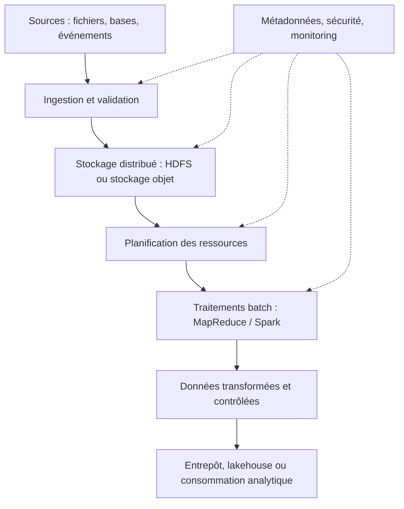
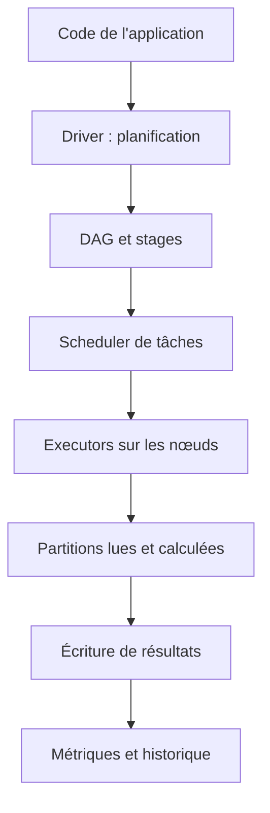
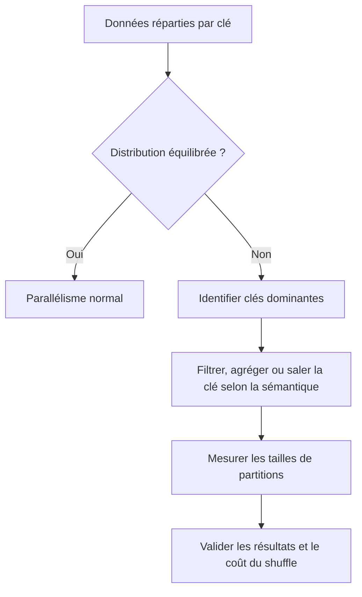

# Architecture Hadoop et Spark — Expert

> **Mise en contexte** — Une organisation conserve des années d'événements de maintenance, journaux applicatifs, mesures IoT et historiques d'interventions. Un traitement sur une seule machine devient trop long, mais répartir un fichier sur plusieurs serveurs ne suffit pas à créer un système analytique fiable. Une architecture Big Data doit distribuer le stockage et le calcul, gérer les pannes partielles, contrôler le coût des mouvements de données, rendre les traitements reproductibles et permettre de vérifier les résultats. Hadoop et Spark fournissent des composants utiles, mais chaque couche ajoute ses responsabilités opérationnelles.

## Introduction et objectifs

Ce cours approfondit HDFS, YARN, MapReduce, Spark, les formats colonnaires, les partitions, les shuffles, la tolérance aux pannes, la gestion de ressources et l'exploitation distribuée. Les architectures et modes de déploiement varient selon les versions et distributions. Les choix doivent suivre la documentation de la plateforme, les exigences de sécurité et les caractéristiques réelles des données.

À la fin, l'apprenant pourra expliquer les rôles des composants Hadoop, suivre l'exécution distribuée, choisir des opérations Spark adaptées, identifier un shuffle et un déséquilibre de partitions, concevoir un format et une stratégie de partitionnement, définir les garanties de livraison et de reprise, et préparer des tests de qualité, de performance et de coût.

## 1. Quand le calcul distribué est-il justifié ?

### 1.1 Partir du workload, pas du mot Big Data

Les volumes, vitesses et variétés sont des caractéristiques possibles, mais elles ne justifient pas chacune un cluster. Un fichier de quelques gigaoctets peut être traité simplement sur une machine ; une petite table qui doit être analysée à faible latence peut exiger une architecture spécialisée pour des raisons de service, pas de volume. Évaluer les volumes historiques et futurs, la fréquence, la concurrence, le délai attendu, les coûts, les besoins d'historique et les compétences disponibles.

Mesurer la durée actuelle, le débit, les pics, la mémoire, les accès disque et le coût de stockage. Vérifier les optimisations simples : filtrer les colonnes inutiles, éviter les boucles sur fichiers, compacter les petits fichiers, choisir un format efficace ou réduire les données intermédiaires. Distribuer une mauvaise méthode peut multiplier la complexité sans résoudre le problème.

### 1.2 Les composants d'une plateforme

Une architecture Hadoop classique combine souvent un système de fichiers distribué, une gestion des ressources et un modèle d'exécution. HDFS organise les données en blocs répliqués ou protégés par un mécanisme de stockage configuré. YARN peut allouer les ressources de calcul aux applications. MapReduce traite des données par phases map et reduce. Spark propose une exécution distribuée avec des transformations, actions, planification des tâches et caches éventuels. Ces composants ne sont pas interchangeables et peuvent être utilisés dans des architectures différentes.

L'architecture doit également inclure identité, chiffrement, catalogue, réseau, quotas, métriques, déploiement, sauvegarde des métadonnées, gestion des versions et procédures d'incident. Un cluster qui calcule vite mais ne permet pas de savoir qui a lancé un job ou d'où provient un résultat n'est pas un système de production gouverné.

## 2. HDFS : stockage distribué

### 2.1 Blocs, NameNode et DataNodes

HDFS divise les fichiers en blocs distribués sur plusieurs DataNodes. Le NameNode conserve les métadonnées et la carte logique des fichiers et blocs, tandis que les DataNodes stockent les blocs et signalent leur état. La taille des blocs et les mécanismes exacts dépendent de la version et de la configuration.

La séparation permet de stocker des fichiers volumineux et de traiter les données près des nœuds qui les hébergent. La tolérance aux pannes repose sur des copies ou d'autres mécanismes de protection ; elle ne supprime pas le risque de suppression logique, de mauvais contrôle d'accès ou de perte des métadonnées.

### 2.2 Réplication, tolérance aux pannes et coût

Une réplication élevée augmente la résilience mais consomme davantage d'espace et de bande passante. Le placement des blocs doit tenir compte des domaines de panne et des contraintes de rack ou de site. Une réplication sur plusieurs disques du même serveur ne protège pas contre la perte de ce serveur, et un placement sur un seul domaine physique ne protège pas contre la perte du domaine.

Un niveau de réplication ne doit pas être traité comme une sauvegarde indépendante. Si un utilisateur supprime le fichier avec les droits autorisés, la suppression peut être répercutée dans les métadonnées. Conserver les données nécessaires à la reprise selon une politique distincte, et tester la récupération du système et des métadonnées.

### 2.3 Petits fichiers et NameNode

Des millions de très petits fichiers peuvent imposer une charge significative en métadonnées et augmenter le coût de planification. Les tâches démarrent parfois avec plus de travail de gestion que de calcul. Compacter les fichiers en conteneurs ou formats adaptés peut améliorer l'utilisation des ressources, mais le compactage doit lui-même être planifié, idempotent et surveillé.

La taille idéale dépend du format, du type d'accès, du parallélisme et du système de stockage. De gros fichiers sont souvent utiles pour un batch séquentiel, tandis qu'un accès fin peut exiger d'autres organisations. Mesurer le nombre de fichiers, leur taille moyenne, leur distribution et la durée de planification avant de choisir.

### 2.4 Localité et transfert des données

La localité consiste à rapprocher le calcul des données lorsque l'architecture le permet, afin de limiter le réseau. Mais toutes les tâches ne s'exécutent pas localement, et les transferts intermédiaires peuvent dominer la durée. Une jointure distribuée peut nécessiter de déplacer des clés et des lignes entre partitions ; c'est souvent appelé shuffle dans Spark.

Éviter de traiter la localité comme une garantie absolue. Comprendre quels octets sont lus, quels résultats sont écrits et quel trafic circule entre nœuds. L'efficacité dépend de la disposition des données, du type de calcul, de la taille des partitions et des ressources disponibles.

## 3. YARN et gestion des ressources

### 3.1 Allocation et isolation

YARN sépare la gestion globale des ressources de l'exécution des applications. Selon la configuration, le ResourceManager et les NodeManagers participent à l'allocation et au suivi des conteneurs. Un job peut attendre faute de capacité, de quota ou de ressources correspondant à ses exigences. Une application lente n'est donc pas toujours ralentie par son code : elle peut subir une file d'attente ou des contraintes de cluster.

Définir des quotas, priorités et règles d'accès selon la criticité. Les tâches interactives et les traitements longs peuvent avoir des besoins différents. Une application qui réserve excessivement la mémoire ou le CPU peut empêcher d'autres services d'avancer. Le planificateur doit être configuré et observé à partir du profil des workloads.

### 3.2 Mémoire, CPU et ressources auxiliaires

Une exécution distribuée consomme plus que la seule mémoire de données. Il faut considérer mémoire du processus, mémoire du moteur, overhead, cache, structures de hachage, buffers, sérialisation et éventuels dépassements. Un conteneur trop petit peut échouer, tandis qu'une allocation trop grande réduit le parallélisme disponible. Les réglages doivent être testés avec les volumes réels et la version utilisée.

Distinguer la mémoire du processus maître et celle des exécutants, les ressources de calcul, le disque temporaire et la bande passante. Les limites du gestionnaire de ressources doivent correspondre à l'environnement. Une valeur de configuration provenant d'un cluster différent n'est pas une recommandation universelle.

### 3.3 Files d'attente et équité

Une file d'attente aide à partager un cluster entre équipes. Elle doit permettre de comprendre qui consomme les ressources, si la priorisation produit des attentes excessives et si les limites sont réellement appliquées. Mesurer durée d'attente, temps d'exécution, ressources demandées et consommées, échecs et nombre de tâches en parallèle.

Un job prioritaire ne doit pas masquer tous les autres sans raison. Définir des objectifs par catégorie, prévoir les fenêtres de maintenance et examiner les conséquences des jobs qui relancent automatiquement beaucoup de tâches. Une stratégie d'ordonnancement est un choix de service autant qu'un choix technique.

## 4. MapReduce : traitement en phases

### 4.1 Le modèle map et reduce

Map transforme chaque entrée en paires clé-valeur ou éléments intermédiaires. Le système regroupe les éléments selon les clés, les transfère et applique reduce à chaque groupe. Les détails varient par framework, mais l'idée consiste à répartir le travail et à agréger les résultats.

Un exemple classique compte les événements par type d'incident. Les map produisent une clé représentant le type et une valeur égale à un. Le shuffle réunit les valeurs de chaque clé, puis reduce calcule la somme. Dans un workload réel, la normalisation des catégories, les identifiants manquants et les événements dupliqués doivent être traités avant le calcul.

### 4.2 Combiner et limiter le shuffle

Une fonction de combinaison locale peut agréger des valeurs au plus près des tâches map avant le transfert, lorsque l'opération est associative et que la sémantique le permet. Cela réduit le volume réseau. Il faut vérifier les propriétés mathématiques, les types et la précision ; certaines fonctions ne peuvent pas être agrégées localement sans changer le résultat.

Éviter de supposer qu'une réduction locale sera appliquée comme on l'imagine. Le framework peut appeler ou ignorer un combiner selon ses règles. Tester le résultat et mesurer le volume intermédiaire. Les traitements de nombres décimaux, moyennes pondérées et déductions d'unicité exigent une conception plus prudente qu'une simple somme.

### 4.3 Échecs et nouvelles tentatives

Un framework distribué peut réexécuter certaines tâches après échec. Cela améliore la tolérance aux pannes, mais exige que les effets de bord soient contrôlés. Si une tâche écrit vers un service externe ou ajoute un compteur sans idempotence, la nouvelle tentative peut produire des doublons.

Préférer des sorties temporaires ou des écritures atomiques contrôlées, identifier les lots, et ne publier le résultat que lorsque l'ensemble est validé. La tolérance à la panne d'une tâche ne garantit pas la correction de toutes les interactions avec des systèmes extérieurs.

## 5. Spark : architecture et modèle d'exécution

### 5.1 Driver, executors et tâches

Spark coordonne une application depuis un driver qui construit et planifie l'exécution, tandis que des executors réalisent les tâches sur les partitions. Les transformations construisent un plan de calcul ; certaines actions déclenchent une exécution. Les détails des API et du moteur physique varient selon les versions et l'usage du DataFrame, SQL ou RDD.

La différence entre transformations paresseuses et actions est essentielle. Une transformation peut ne pas effectuer le travail immédiatement. Plusieurs transformations peuvent être optimisées ou fusionnées. Une action qui collecte le résultat sur le driver peut saturer sa mémoire si le résultat est trop grand. Préférer écrire un résultat distribué ou limiter explicitement la taille lorsque la collecte est intentionnelle.

### 5.2 DAG, stages et shuffle

Spark regroupe des opérations en stages ; une opération qui nécessite de redistribuer les données par clé peut créer une frontière de shuffle. Le shuffle implique des écritures temporaires, du réseau, du tri ou du hachage et peut devenir coûteux. Les jointures, groupements et changements de partitionnement sont des candidats fréquents à examiner.

Le plan logique montre les opérations voulues ; le plan physique explique comment elles seront exécutées, tandis que l'interface d'observation peut montrer les tâches et les données réellement traitées. Identifier une étape lente ne suffit pas : examiner le déséquilibre entre tasks, les octets du shuffle, les données de spill, la mémoire, les entrées/sorties et le nombre de partitions.

### 5.3 DataFrames et optimisation

Les DataFrames et Spark SQL permettent au moteur d'optimiser des opérations décrites de façon structurée. Les filtres et projections poussés tôt peuvent réduire les données lues et transférées. Le partitionnement, le format de données et les statistiques influencent le plan. Les UDF opaques peuvent limiter certaines optimisations et devraient être utilisées seulement lorsque les fonctions natives ne conviennent pas.

Éviter de coder en boucles côté driver pour traiter chaque ligne. Éviter également de collecter un grand dataset dans une structure locale. Conserver le calcul distribué jusqu'à l'étape où une petite sortie est réellement nécessaire. Mesurer le coût des conversions, de la sérialisation et des formats intermédiaires.

### 5.4 Cache et persistance

Le cache de Spark peut aider lorsqu'un même jeu est réutilisé par plusieurs actions ou étapes. Il consomme toutefois mémoire ou stockage local et peut être évincé ou recalculé selon la politique. Mettre en cache toute table par réflexe peut ralentir d'autres traitements et accroître la pression sur les ressources.

Identifier les données réellement réutilisées, leur taille, la durée de vie et les bénéfices mesurés. Libérer les ressources quand elles ne sont plus nécessaires et vérifier dans les métriques que le cache est utilisé. Un cache ne remplace pas l'écriture d'un résultat durable ni une stratégie de reprise.

## 6. Partitionnement et skew

### 6.1 Granularité des partitions

Trop peu de partitions sous-utilisent le parallélisme ; trop de petites partitions ajoutent un coût de planification et d'ouverture des fichiers. Des partitions trop grandes peuvent consommer trop de mémoire, augmenter les temps d'exécution et rendre les reprises plus coûteuses. La bonne granularité dépend du volume de données, du nombre de cœurs, des opérations et de la taille des fichiers.

Mesurer la distribution des partitions, la durée des tâches, les bytes lus et écrits et le nombre de tâches lancées. Ne pas confondre les partitions de calcul de Spark avec celles du stockage ou les partitions logiques d'une table Hive. Elles interagissent mais sont contrôlées par des mécanismes distincts.

### 6.2 Déséquilibre des clés

Un skew se produit lorsque certaines clés concentrent beaucoup plus de lignes ou de calcul que d'autres. La majorité des tâches peut finir rapidement pendant qu'une tâche géante retarde la fin du job. Ajouter des exécutants ne corrige pas nécessairement un déséquilibre s'il reste une partition énorme.

Les remèdes possibles incluent agrégation préalable, filtrage des clés extrêmes, salage avec une seconde réduction, ou gestion spécifique des valeurs dominantes. La méthode dépend du type de calcul et ne doit pas changer le résultat. Saler une clé sans étape de regroupement final peut produire des totaux incomplets ou des doublons.

### 6.3 Partitionnement des fichiers

Le partitionnement de stockage, par exemple par date ou domaine, aide à limiter les données lues lorsque les filtres correspondent aux partitions. Trop de partitions minuscules peuvent créer une surcharge du catalogue et des fichiers. Une clé de partition trop fine multiplie les métadonnées ; une clé trop large oblige à lire beaucoup de données.

Choisir une granularité fondée sur les requêtes et la croissance attendue. Tester le pruning des partitions, le nombre de fichiers, la taille des fichiers, les opérations de compactage et la gestion des partitions tardives. Documenter comment les données sont réécrites et qui peut effectuer la maintenance.

## 7. Formats de fichiers et sérialisation

Les CSV et JSON sont simples à inspecter, mais peuvent être coûteux pour de gros volumes, les conversions de types et la lecture partielle de colonnes. Les formats colonnaires tels que Parquet ou ORC organisent les valeurs par colonnes ou groupes permettant de réduire la lecture des champs non nécessaires et d'appliquer certaines optimisations. Le format doit être compatible avec les outils consommateurs.

La compression réduit le stockage et le transfert mais ajoute du calcul. Le compromis dépend du codec, des données, du matériel et du profil de requête. Évaluer le débit de lecture, l'espace utilisé, le coût de décompression et le nombre de fichiers. Ne pas comparer les formats sur une seule table artificiellement petite.

Le schéma des fichiers doit être stable ou évoluer selon une politique documentée. Les types, champs optionnels, valeurs manquantes, fuseaux horaires et encodages doivent être définis. Une évolution de schéma qui modifie le sens d'une colonne peut corrompre la lecture analytique même si les outils parviennent à parser le fichier.

## 8. Tolérance aux pannes et cohérence des sorties

### 8.1 Recalcul et checkpoints

Un job peut échouer après avoir calculé de nombreuses partitions. La stratégie de reprise dépend du framework, du graphe de dépendance, des données source, du stockage et des effets de bord. Un checkpoint ou un résultat intermédiaire peut réduire les recalculs, mais introduit du stockage, une gestion de cycle de vie et une exigence d'intégrité.

Choisir un checkpoint lorsque le coût de recomputation ou la profondeur du graphe le justifie. Vérifier les ressources, la rétention et la compatibilité. Ne pas conserver indéfiniment toutes les sorties temporaires, et ne pas supprimer un point nécessaire à un job encore en cours ou à une procédure de reprise.

### 8.2 Publication atomique

Un traitement batch doit éviter que les consommateurs lisent un résultat partiellement écrit. Une stratégie consiste à écrire dans une zone temporaire, valider les fichiers et les contrôles, puis publier une référence ou remplacer une partition selon une opération prise en charge par la plateforme. Les mécanismes exacts varient selon le système de fichiers, le moteur et le format de table.

Définir un identifiant de traitement, les fichiers attendus, le manifeste ou les métadonnées, les contrôles de doublons et le point de publication. Une nouvelle tentative ne doit pas fusionner aveuglément les fichiers de deux exécutions. Le consommateur doit lire une version publiée et validée.

### 8.3 Sémantique de livraison

Un pipeline peut viser différentes garanties de traitement : au plus une fois, au moins une fois, ou une forme d'effet exactement une fois à travers des mécanismes spécifiques. Les garanties dépendent de la source, du moteur et du sink. Une application ne doit pas déclarer « exactement une fois » en se basant seulement sur l'absence de doublons observés lors d'un test.

Définir les identifiants uniques, les checkpoints, l'idempotence du sink, les transactions ou mécanismes atomiques disponibles, et le comportement après panne. Tester l'échec après écriture mais avant acquittement, car il expose souvent les doublons. La preuve doit couvrir la séquence complète, pas un seul composant.

## 9. Sécurité et multi-tenant

Un cluster distribué contient des données réparties, des logs, des fichiers temporaires et des copies locales. Le contrôle d'accès doit couvrir les sources, le stockage, le gestionnaire de ressources, les services d'exécution, les sorties et les interfaces d'observation. Les identités de job ne doivent pas disposer de droits globaux par défaut.

Définir l'isolation entre équipes et domaines, les quotas, la classification, le chiffrement adapté, l'accès aux résultats intermédiaires et la politique de rétention. Les données temporaires peuvent contenir des champs sensibles ; elles ne deviennent pas non sensibles parce qu'elles sont temporaires. Éviter de copier des données réelles dans un environnement de test non autorisé.

La journalisation doit permettre d'identifier qui a soumis un job, quelles données il a lues, quelles ressources il a utilisées et où les résultats ont été publiés, selon les capacités de la plateforme. Limiter les identifiants et secrets dans le code et les logs. Les erreurs techniques exposées à un utilisateur ne doivent pas révéler des chemins ou des informations confidentielles.

## 10. Étude de cas — Agrégation de plusieurs années d'interventions

Une organisation veut calculer chaque nuit le coût et la durée des interventions sur quatre années. Les sources sont des exports CSV historiques, des tables relationnelles récentes et des événements de capteurs. Le premier Spark job est lent, son temps varie fortement et certains rapports comportent des doublons après une reprise.

### Étape A — Contrat et ingestion

Définir les champs, les unités, les identifiants, la source de vérité et les règles de traitement des données historiques. Conserver un identifiant de lot, un horodatage d'ingestion et la provenance. Normaliser les types et les fuseaux horaires avant l'unification. Placer les lignes invalides en quarantaine plutôt que de remplacer silencieusement les valeurs.

### Étape B — Plan de calcul

Lire uniquement les colonnes utilisées, filtrer les dates pertinentes au plus tôt, choisir un format colonnaire adapté et contrôler la taille des fichiers. Vérifier le plan du job et les données intermédiaires. Identifier le nombre de partitions et la durée par tâche. Une étape qui agrège par technicien peut être dominée par un petit nombre de techniciens très actifs.

### Étape C — Corriger le skew et les doublons

Inspecter la distribution des clés et trouver les valeurs dominantes. Si la sémantique le permet, agréger au plus tôt ou saler les clés dominantes avec une étape de réduction finale. Définir une clé d'événement ou une règle de déduplication, puis vérifier les reprises après panne. Ne pas supprimer tous les doublons selon une règle arbitraire si deux événements similaires peuvent être légitimes.

### Étape D — Publier le résultat

Écrire dans une zone versionnée, vérifier les totaux et les contrôles de qualité, puis publier atomiquement la version validée selon le format et le stockage. Conserver les métriques, les sources, les versions et les règles utilisées. Si les contrôles échouent, garder la dernière version valide avec un statut de fraîcheur clair, ou appliquer la politique approuvée.

### Étape E — Surveiller

Suivre temps total, temps de shuffle, spill, nombre de tâches, données lues/écrites, coût de stockage, rejets, doublons et dernière publication réussie. Les objectifs sont liés au métier : fraîcheur des rapports, exactitude et coût stable. Le job n'est pas réussi si sa durée baisse mais que le résultat est incomplet.

## 11. Pièges fréquents

- Distribuer le traitement sans mesurer une solution plus simple.
- Confondre stockage distribué et sauvegarde indépendante.
- Oublier que les fichiers temporaires peuvent contenir des données sensibles.
- Accumuler de petits fichiers et dégrader le catalogue et la planification.
- Collecter de grands datasets sur le driver Spark.
- Mettre en cache des données qui ne sont jamais réutilisées.
- Ignorer les shuffles, spills et partitions déséquilibrées.
- Saler une clé sans phase d'agrégation finale.
- Augmenter les exécutants sans mesurer la vraie ressource limitante.
- Publier un jeu partiellement écrit après l'échec d'une tâche.
- Considérer qu'une nouvelle tentative ne crée jamais de doublons.
- Déclarer une garantie exactly-once sans vérifier la chaîne source-sink.
- Utiliser un format fichier sans politique d'évolution de schéma.
- Ne pas conserver la provenance des versions de données.

## 12. Checklist de conception et d'exploitation

### Architecture
- [ ] Le besoin de calcul distribué est démontré par une baseline.
- [ ] Les rôles du stockage, du calcul et de la gestion des ressources sont clairs.
- [ ] Les formats et la stratégie de partitionnement sont justifiés.
- [ ] Les quotas, identités et règles de sécurité sont documentés.

### Performance
- [ ] Les colonnes et les périodes inutiles sont filtrées.
- [ ] Les plans et métriques du job sont disponibles.
- [ ] Les shuffles, spills et tâches lentes sont examinés.
- [ ] Le skew et les petits fichiers sont mesurés.
- [ ] Les tests incluent des volumes et distributions réalistes.

### Fiabilité
- [ ] Les sorties sont versionnées et publiées après validation.
- [ ] Les reprises sont idempotentes ou les doublons sont contrôlés.
- [ ] Le comportement en cas de panne de source ou de sink est défini.
- [ ] Les sauvegardes et métadonnées critiques sont protégées.
- [ ] Les résultats sont réconciliés et la fraîcheur visible.

## 13. Exercices corrigés

### Exercice 1 — Une tâche prend dix fois plus longtemps que les autres

**Corrigé :** examiner le skew, la taille des partitions, le nombre de lignes par clé et les éventuelles opérations non parallélisables. Ajouter des exécutants ne suffit pas si une seule partition reste dominante. Tester une stratégie ciblée, préserver la sémantique et comparer le shuffle.

### Exercice 2 — Beaucoup de petits fichiers

**Corrigé :** mesurer la surcharge de métadonnées et de planification, définir une stratégie de compactage et choisir une taille adaptée aux accès. Le compactage doit être lui-même idempotent, versionné et ne pas écraser un résultat encore consommé.

### Exercice 3 — Résultat doublé après un retry

**Corrigé :** l'échec peut survenir après l'écriture mais avant l'acquittement. Utiliser des identifiants et un sink idempotent, publier des lots isolés, vérifier les sorties de la tentative précédente et tester précisément cette fenêtre de panne.

### Exercice 4 — Le driver manque de mémoire

**Corrigé :** vérifier si une action collecte trop de lignes sur le driver. Garder le calcul distribué, écrire les résultats ou n'extraire qu'un échantillon borné. Augmenter la mémoire n'est pas une solution durable si l'architecture tente de ramener toutes les données sur un seul processus.

### Exercice 5 — Le cluster manque de ressources

**Corrigé :** examiner les files, quotas, demandes, consommations et priorités. Vérifier si le job est bloqué en attente ou consomme réellement les ressources. Ajuster le parallélisme ou la planification selon l'analyse plutôt que doubler toutes les allocations.

## 14. Défi final — Concevoir un pipeline Big Data fiable

Concevoir un pipeline qui agrège plusieurs années de données de maintenance et de capteurs. Fournir le diagramme, la stratégie HDFS ou stockage objet, le plan de ressources, le choix entre MapReduce et Spark, les formats, les partitions, la politique de reprise, la gestion du skew, la sécurité, les contrôles et la publication atomique. Fournir aussi des métriques de référence et un scénario de panne.

### Barème indicatif
- Justification de l'architecture distribuée : 15 points.
- Conception stockage et formats : 15 points.
- Modèle de calcul et analyse des shuffles : 20 points.
- Tolérance aux pannes et idempotence : 20 points.
- Sécurité, quotas et observabilité : 15 points.
- Qualité, réconciliation et déploiement : 15 points.

Un projet qui produit vite des résultats faux ou qui ne peut pas être repris en cas de panne n'est pas considéré comme réussi.

## À retenir

Hadoop et Spark distribuent stockage et calcul, mais la distribution introduit des échanges, des reprises, des métadonnées et des coûts d'exploitation. Les gains viennent d'une bonne disposition des données, d'un modèle de calcul adapté, de partitions équilibrées, d'un format efficace et d'une observation précise. La tolérance aux pannes doit être conçue jusqu'à la publication du résultat, avec des sorties reproductibles, une sécurité cohérente et des preuves d'exactitude.

## Ressources et références

- [Apache Hadoop Documentation](https://hadoop.apache.org/docs/stable/)
- [HDFS Architecture Guide](https://hadoop.apache.org/docs/stable/hadoop-project-dist/hadoop-hdfs/HdfsDesign.html)
- [Apache Spark Documentation](https://spark.apache.org/docs/latest/)
- [Spark SQL Performance Tuning](https://spark.apache.org/docs/latest/sql-performance-tuning.html)

Vérifier les versions et la configuration réellement déployées avant d'appliquer les recommandations à un cluster de production.

## 15. Gouvernance des versions et exploitation à long terme

Une plateforme Big Data évolue à travers plusieurs composants : moteur d'exécution, gestionnaire de ressources, connecteurs, format de fichiers, bibliothèques, catalogue et dépendances applicatives. Une mise à niveau peut changer le plan d'exécution, la sérialisation, la compatibilité des dépendances ou les performances. Tenir un inventaire des versions, des dates de fin de support, des politiques de déploiement et des responsables est donc une partie de la fiabilité.

### 15.1 Reproductibilité d'un job

Conserver le code, les paramètres, la version du moteur, la version de schéma, l'identifiant de source, les données de référence et la période d'exécution. Cette information permet de comprendre pourquoi deux résultats diffèrent. Un résultat analytique important doit pouvoir être reproduit selon une procédure convenue ou, à défaut, expliquer précisément pourquoi il ne l'est pas.

Un pipeline doit également séparer les paramètres propres à l'environnement des règles métier. Les tailles de conteneurs, chemins de stockage et limites de parallélisme peuvent varier entre environnements, mais les transformations métier doivent rester sous version et être testées pour maintenir leur sens.

### 15.2 Déploiement progressif et observation

Tester un nouveau moteur, une nouvelle version ou un nouveau plan sur un échantillon représentatif avant d'étendre l'exécution. Comparer le résultat et les métriques, y compris les erreurs silencieuses, le temps de shuffle, le volume de données et les ressources. Des tests uniquement fonctionnels ne détectent pas forcément une régression de performance ; des tests uniquement de performance ne détectent pas une variation sémantique.

Prévoir un retour à la version précédente, la compatibilité des formats, la période de coexistence et la méthode de publication des résultats. Une migration est complète lorsque les consommateurs sont basculés, les contrôles sont satisfaits et le stockage obsolète peut être retiré sans casser une reprise requise.

### 15.3 Définir le coût par résultat utile

Suivre le coût ou les ressources consommées par lot, par période ou par unité de donnée validée. Un job qui lit dix fois plus de données que nécessaire peut rester rapide dans un cluster surdimensionné tout en étant très coûteux. Le débit brut n'est pas toujours l'indicateur le plus pertinent : calculer un coût par intervention agrégée, par événement utile ou par rapport publié peut aider à comparer des choix.

Le coût doit inclure les données intermédiaires, le stockage temporaire, le réseau, les sauvegardes, les retries et les clusters laissés actifs après la fin du job. Les optimisations doivent préserver la qualité et la reprise. La plateforme devient durable lorsque les décisions de performance sont reliées à la valeur, à la fiabilité et au coût global.

## 15. Gouvernance des versions et exploitation à long terme

Une plateforme Big Data évolue à travers plusieurs composants : moteur d'exécution, gestionnaire de ressources, connecteurs, format de fichiers, bibliothèques, catalogue et dépendances applicatives. Une mise à niveau peut changer le plan d'exécution, la sérialisation, la compatibilité des dépendances ou les performances. Tenir un inventaire des versions, des dates de fin de support, des politiques de déploiement et des responsables est donc une partie de la fiabilité.

### 15.1 Reproductibilité d'un job

Conserver le code, les paramètres, la version du moteur, la version de schéma, l'identifiant de source, les données de référence et la période d'exécution. Cette information permet de comprendre pourquoi deux résultats diffèrent. Un résultat analytique important doit pouvoir être reproduit selon une procédure convenue ou, à défaut, expliquer précisément pourquoi il ne l'est pas.

Un pipeline doit également séparer les paramètres propres à l'environnement des règles métier. Les tailles de conteneurs, chemins de stockage et limites de parallélisme peuvent varier entre environnements, mais les transformations métier doivent rester sous version et être testées pour maintenir leur sens.

### 15.2 Déploiement progressif et observation

Tester un nouveau moteur, une nouvelle version ou un nouveau plan sur un échantillon représentatif avant d'étendre l'exécution. Comparer le résultat et les métriques, y compris les erreurs silencieuses, le temps de shuffle, le volume de données et les ressources. Des tests uniquement fonctionnels ne détectent pas forcément une régression de performance ; des tests uniquement de performance ne détectent pas une variation sémantique.

Prévoir un retour à la version précédente, la compatibilité des formats, la période de coexistence et la méthode de publication des résultats. Une migration est complète lorsque les consommateurs sont basculés, les contrôles sont satisfaits et le stockage obsolète peut être retiré sans casser une reprise requise.

### 15.3 Définir le coût par résultat utile

Suivre le coût ou les ressources consommées par lot, par période ou par unité de donnée validée. Un job qui lit dix fois plus de données que nécessaire peut rester rapide dans un cluster surdimensionné tout en étant très coûteux. Le débit brut n'est pas toujours l'indicateur le plus pertinent : calculer un coût par intervention agrégée, par événement utile ou par rapport publié peut aider à comparer des choix.

Le coût doit inclure les données intermédiaires, le stockage temporaire, le réseau, les sauvegardes, les retries et les clusters laissés actifs après la fin du job. Les optimisations doivent préserver la qualité et la reprise. La plateforme devient durable lorsque les décisions de performance sont reliées à la valeur, à la fiabilité et au coût global.
