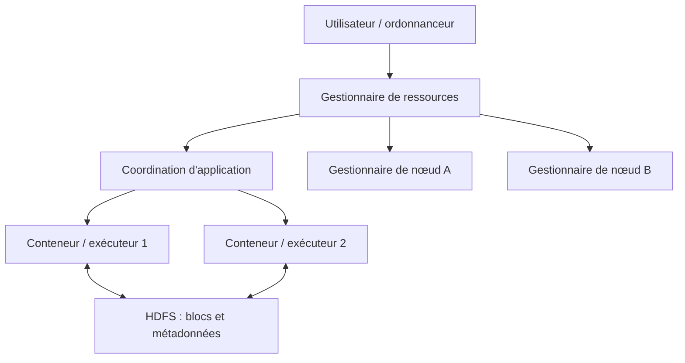
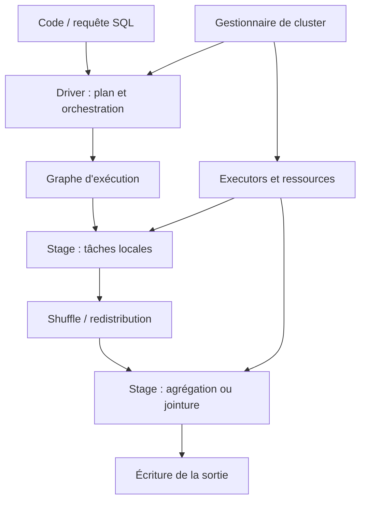

# Architecture Hadoop et Spark — Expert

> **Mise en contexte.** Une architecture Big Data ne se résume ni à un cluster de machines, ni à l’ajout de Spark à une application existante. Elle doit absorber un volume, une vitesse, une variété et une distribution de données qui dépassent les capacités ou l’économie d’un traitement classique. Hadoop a popularisé un écosystème de stockage distribué, de gestion de ressources et de traitement par lots ; Spark a apporté un moteur de calcul distribué unifié pour lots, SQL, machine learning et flux micro-batch. En production, le succès dépend autant des formats, partitions, métadonnées, politiques de sécurité, coûts et méthodes de reprise que de la puissance du moteur. Ce cours se place au niveau architecture : il relie HDFS, YARN, MapReduce, Spark, orchestration, résilience, gouvernance et exploitation. Les choix exacts dépendent des distributions, versions et plateformes installées ; validez toujours les commandes et garanties sur le produit utilisé.

## Objectifs et résultats attendus

À la fin du cours, vous serez capable de comparer les responsabilités d’Hadoop et Spark, choisir une architecture pour un cas de traitement massif, expliquer les rôles de HDFS, YARN et du moteur d’exécution, tracer la vie d’un job Spark, diagnostiquer un shuffle coûteux, choisir format, partitionnement et stratégie de stockage, définir l’isolation et les accès d’un cluster, dimensionner à partir de mesures, établir une stratégie de reprise et concevoir un pipeline observable.

Le niveau expert exige de raisonner en contraintes et compromis. « Utiliser Spark » n’est pas une décision d’architecture tant que la volumétrie, la distribution, le SLA, le mode de calcul, les objectifs de reprise et les responsabilités opérationnelles ne sont pas connus. Vous devrez justifier les frontières de composants, expliquer les risques, préciser ce qui est mesuré et identifier les cas où une architecture plus simple est préférable.

## Prérequis et environnement

Il faut maîtriser les bases SQL, les fichiers distribués, les formats de données, les bases de calcul parallèle et les notions de cluster. Une connaissance de Python, Scala ou SQL facilite les ateliers Spark ; une expérience Linux et réseau aide à diagnostiquer l’exécution. Le cours utilise du pseudo-code ou des exemples Python/Spark, mais n’impose pas une distribution commerciale particulière.

Avant toute expérimentation, consignez versions de Spark, Hadoop, Java, connecteurs, stockage et catalogue. La compatibilité est importante : des versions de bibliothèques incompatibles peuvent échouer au démarrage ou produire des erreurs d’exécution difficiles à diagnostiquer. N’exécutez pas de tests de charge sur un cluster partagé sans autorisation. Utilisez un jeu de données synthétiques et des quotas limités.

## 1. Pourquoi une architecture Big Data ?

La distribution permet de diviser le stockage et le calcul entre plusieurs nœuds, mais elle introduit des coûts : réseau, coordination, sérialisation, réplication, erreurs partielles et hétérogénéité. Une tâche exécutée en parallèle n’est pas forcément plus rapide si le volume est faible, si les données sont mal réparties ou si le shuffle réseau dépasse le travail utile. Un cluster doit résoudre un problème mesuré, pas seulement donner l’impression de modernité.

Les problèmes classiques incluent fichiers trop nombreux et trop petits, clés fortement déséquilibrées, mémoire insuffisante, stockage lent, requêtes qui parcourent des données inutiles, jobs concurrents, permissions incohérentes et sorties partielles. Les pannes partielles sont normales dans un système distribué : un exécuteur disparaît, un nœud devient inaccessible, un volume ralentit ou une tâche doit être rejouée. L’architecture doit définir quand un job réussit, quelles sorties sont visibles et comment une reprise évite les doublons.

Un système analytique doit aussi tenir compte de la valeur de l’information. Pour une transformation quotidienne de quelques centaines de mégaoctets, un cluster distribué peut coûter plus en coordination et exploitation qu’une base relationnelle ou un traitement local. Pour des pétaoctets, l’architecture distribuée peut devenir indispensable. Le seuil dépend de la complexité, de la fréquence, des performances et des compétences disponibles.

## 2. Hadoop : stockage, ressources et traitement

Hadoop est un ensemble de composants qui peuvent être déployés ensemble ou utilisés séparément. HDFS est un système de fichiers distribué qui répartit les blocs entre nœuds de données et utilise des métadonnées pour retrouver les blocs. YARN gère des ressources et des conteneurs d’exécution pour différents moteurs. MapReduce est un modèle de traitement par étapes map et reduce. L’écosystème inclut selon les plateformes d’autres outils de SQL, catalogage, ingestion et gouvernance.

HDFS privilégie le débit sur de gros fichiers plutôt que la faible latence de petits accès aléatoires. La taille de bloc et la réplication ont un impact sur le stockage et les lectures, mais les valeurs par défaut dépendent de la version et de la distribution. Une grande quantité de fichiers minuscules entraîne une pression sur les métadonnées et réduit l’efficacité de traitements massifs. Compacter les petits fichiers fait partie de l’exploitation.

Dans HDFS, NameNode gère les métadonnées du système de fichiers et DataNodes servent les blocs. Les mécanismes de haute disponibilité et de fédération peuvent répartir ou protéger les fonctions de métadonnées ; leur configuration exacte doit être vérifiée. La réplication de blocs tolère certaines pannes de stockage mais n’est pas une sauvegarde applicative à elle seule : une suppression logique peut rester visible et l’architecture doit permettre une récupération.

YARN sépare souvent gestion des ressources et gestion d’application. ResourceManager et NodeManager prennent part à l’allocation des ressources et au suivi des conteneurs ; ApplicationMaster coordonne une application particulière dans le modèle traditionnel. Spark peut s’exécuter sur YARN, Kubernetes ou d’autres modes pris en charge selon la version. Le gestionnaire de ressources et le moteur de calcul sont des responsabilités distinctes, même lorsqu’ils partagent une infrastructure.



Le diagramme est conceptuel : la topologie réelle, les processus et la haute disponibilité varient selon la distribution. Lors d’un diagnostic, identifiez quel composant est responsable du symptôme. Une erreur de planification de ressources n’est pas une corruption HDFS ; une absence de fichier n’est pas nécessairement un défaut Spark.

## 3. Le modèle MapReduce

MapReduce transforme un ensemble d’entrées en paires clé-valeur, regroupe les valeurs par clé et applique une fonction reduce. Le modèle facilite les traitements tolérants aux échecs et l’échange de données entre nœuds, mais chaque phase peut écrire et lire de grandes quantités d’intermédiaires. Pour des chaînes complexes de transformations, le coût d’écriture sur disque entre étapes peut rendre le calcul lent.

Un exemple de comptage de mots illustre le contrat :
1. le map émet une paire (mot, 1) pour chaque mot ;
2. le shuffle regroupe les valeurs selon le mot ;
3. le reduce additionne les valeurs de chaque groupe ;
4. les sorties sont écrites dans un système de fichiers.

Le partitionnement des clés détermine quel reducer reçoit une clé. Un mauvais partitionneur ou une distribution asymétrique peut concentrer une partie importante du travail dans une seule tâche. La réduction locale, ou combiner lorsqu’elle est sûre, peut limiter les données qui traversent le réseau. Elle n’est sûre que lorsque l’opération est associative et compatible avec les regroupements effectués ; une fonction arbitraire ne peut pas être utilisée comme combiner sans preuve.

MapReduce reste utile dans certains pipelines hérités, traitements batch massifs et environnements où le modèle est bien intégré. Spark n’élimine pas tous les coûts : il permet de construire un graphe d’opérations, de conserver certains résultats en mémoire ou sur disque et d’exécuter SQL, mais le shuffle, la sérialisation et les accès au stockage restent déterminants.

## 4. Architecture d’exécution Spark

Spark sépare généralement un driver qui coordonne l’application et des executors qui exécutent les tâches. Le driver construit le plan à partir du code déclaré, organise les jobs et stages et coordonne les résultats. Les executors hébergent les tâches, le cache et des données de travail. Le cluster manager alloue les ressources. La terminologie exacte et certains détails d’exécution dépendent de la version et du mode de déploiement.

Une action — écriture, collecte de résultat ou agrégation terminale — déclenche habituellement l’exécution du graphe de transformations nécessaires. Les transformations paresseuses peuvent être réorganisées par l’optimiseur lorsqu’elles passent par DataFrame ou Spark SQL. Une opération qui exige une redistribution de données crée souvent une frontière de stage, car elle nécessite un shuffle. Le plan logique optimisé et le plan physique permettent de comprendre les choix de l’optimiseur, mais les métriques d’exécution restent nécessaires pour évaluer les résultats réels.



Un job peut produire plusieurs stages, chaque stage se divise en tâches selon les partitions. Une partition détermine une unité de travail ; un trop faible nombre de partitions sous-utilise les ressources tandis qu’un nombre excessif augmente l’overhead. La partition logique d’une table sur disque n’est pas toujours identique à la partition d’exécution Spark. La confusion entre les deux conduit à un mauvais raisonnement de performance.

## 5. RDD, DataFrame et Spark SQL

Les RDD représentent des collections distribuées résilientes et permettent un contrôle de bas niveau. Les DataFrames proposent une structure nommée et typée par colonnes, avec un optimiseur qui peut réécrire les requêtes. Spark SQL exploite un plan logique et physique pour analyser les projections, filtres, jointures et agrégations. Pour la plupart des pipelines tabulaires, DataFrame et SQL offrent des opportunités d’optimisation plus visibles que des transformations opaques.

Les opérations RDD peuvent être adaptées à des traitements spécialisés ou lorsque le modèle haut niveau ne convient pas. Mais utiliser map ou une fonction Python arbitraire sur chaque ligne peut empêcher certaines optimisations, augmenter les coûts de sérialisation ou dupliquer des règles que le moteur sait exécuter de manière native. Préférez les fonctions natives SQL quand elles expriment correctement la transformation.

```python
# Exemple PySpark illustratif : le chemin doit être adapté à l'environnement.
from pyspark.sql import functions as F

events = spark.read.parquet(input_path)

daily = (
    events
    .filter(F.col("event_date") >= F.lit(start_date))
    .groupBy("event_date", "category")
    .agg(
        F.count("*").alias("event_count"),
        F.sum("amount").alias("amount_total"),
    )
)

daily.write.mode("overwrite").partitionBy("event_date").parquet(output_path)
```

Le code montre un filtre, un regroupement et une écriture partitionnée ; il ne constitue pas une commande de production universelle. L’écriture en mode overwrite peut remplacer une destination plus large que prévu si le chemin et le mode de partitionnement ne sont pas contrôlés. Pour un job réexécutable, définissez une stratégie de publication atomique, de remplacement par partition ou de table transactionnelle lorsque la plateforme le permet.

## 6. Shuffle : le coût de la distribution

Le shuffle redistribue des données entre partitions, souvent par clé. Il apparaît pour des jointures, agrégations, distinct, répartition, tri ou opérations qui exigent une nouvelle distribution. Le shuffle coûte du réseau, de la sérialisation, des écritures temporaires, des lectures et du temps de coordination. Un job qui lit peu de données peut tout de même être lent s’il effectue plusieurs shuffles massifs.

Pour diagnostiquer un shuffle, regardez bytes échangés, durée d’écriture et lecture shuffle, spills, répartition de la durée des tâches et taille des partitions. Une différence extrême entre tâche la plus rapide et la plus lente peut révéler skew. Si une seule clé représente une large part des événements, toutes les valeurs associées à cette clé peuvent converger vers une même partition et devenir un goulot d’étranglement.

Des stratégies possibles incluent réduire les colonnes avant le shuffle, filtrer plus tôt, agréger localement lorsque c’est sémantiquement sûr, choisir une clé de partitionnement adaptée, diffuser une petite table de référence si le moteur peut le faire efficacement, ou traiter des clés chaudes séparément. Les optimisations adaptatives, lorsqu’elles sont disponibles, peuvent ajuster certains plans sur la base des statistiques observées ; elles ne compensent pas toute mauvaise modélisation.

## 7. Joindre de gros et petits jeux de données

Une jointure peut utiliser une stratégie de hachage, de tri-fusion ou de diffusion d’une petite table, selon le moteur et le plan. Le broadcast peut éviter un shuffle d’une petite table de référence, mais il consomme de la mémoire sur chaque executor. Si le jeu prétendument petit grossit, il peut provoquer des erreurs mémoire. L’option doit donc reposer sur la taille réelle et les mesures, pas sur un nom de table ou une supposition ancienne.

Avant la jointure, réduisez les colonnes et les lignes non nécessaires. Assurez-vous que les clés ont le même type et la même représentation. Des espaces, encodages ou formats incohérents peuvent empêcher des correspondances et gonfler la proportion de clés inconnues. Mesurez le nombre de correspondances et les lignes orphelines. Une jointure qui termine sans erreur peut tout de même perdre 40 % des événements si la référence est incomplète.

Une jointure many-to-many peut multiplier le volume des résultats. Vérifiez les cardinalités attendues et unicité des tables de référence lorsque c’est applicable. Si un client doit avoir une seule dimension courante, plusieurs versions simultanément actives représentent un défaut de données. Une jointure ne doit pas masquer cet invariant manquant.

## 8. Partitionnement du stockage et petits fichiers

Le partitionnement physique d’un dataset par date, région ou catégorie peut permettre de lire seulement les partitions pertinentes. Mais trop de partitions, des partitions très petites ou une clé à forte cardinalité peuvent générer un grand nombre de fichiers et de métadonnées. Il faut équilibrer élimination de partitions, taille des fichiers, coût des écritures et modes de requête.

Le partitionnement choisi doit correspondre aux filtres réellement présents. Partitionner sur un UUID très cardinal peut créer des milliers de petits répertoires sans bénéfice. Partitionner par jour peut être adapté à une source massive et à des requêtes par période, mais produire des partitions minuscules si le volume est faible. Une conception efficace établit une taille de fichier cible fondée sur le moteur et le stockage, puis suit l’évolution.

La compaction combine des fichiers petits en ensembles plus efficaces. Elle doit éviter la concurrence destructive avec les lecteurs et contrôler le nombre de fichiers ouverts et la charge I/O. Un entrepôt évolue : les volumes et la distribution changent ; la politique de compaction ne doit pas être laissée à une tâche non surveillée.

## 9. Formats de fichiers : CSV, JSON, Parquet et ORC

CSV et JSON sont faciles à échanger mais peuvent demander davantage de parsing, transporter des répétitions et ne pas fournir un schéma physique optimisé pour les colonnes. Parquet et ORC stockent les données en colonnes et supportent généralement compression et statistiques utiles au filtrage. Ces formats sont courants pour les pipelines analytiques, mais les performances dépendent du schéma, des codecs, des tailles de fichiers et des patterns de requête.

Les formats de fichiers ne sont pas eux-mêmes une garantie transactionnelle. Écrire plusieurs fichiers dans un répertoire peut laisser un résultat partiel si le job échoue au mauvais moment, selon le protocole de commit et le système de stockage. Un format en colonnes ne garantit pas non plus que le schéma évolue correctement ou que toutes les écritures sont compatibles. La publication doit gérer l’état du lot, le remplacement ou l’ajout et la reprise après échec.

Documentez schéma, compression, partitions, politique d’évolution de colonnes, encodage, fuseaux horaires et comportement des champs manquants. Testez les conversions de types et les valeurs limites. Si une colonne change d’entier en texte ou si le format de date varie, le pipeline doit rejeter, convertir ou gérer le changement selon une règle explicite.

## 10. Mémoire, exécuteurs et dimensionnement

La mémoire Spark est partagée entre exécution, stockage/caching et overhead lié à la JVM ou à l’exécuteur. La gestion exacte dépend de version, du mode et du type de tâche. Une erreur mémoire peut provenir d’un jeu de données trop gros, d’une partition déséquilibrée, d’un cache excessif, d’un broadcast, d’une agrégation massive ou d’un overhead hors tas. Augmenter la mémoire peut aider mais ne corrige pas une tâche qui concentre des milliards de valeurs sur une seule clé.

Un bon dimensionnement commence par un profil de base : taille d’entrée, volume de shuffle, durée par stage, mémoire maximale, spills, temps GC, parallélisme et utilisation CPU. Exécutez une charge représentative et changez un paramètre à la fois. Ajouter des executors n’accélère pas un job limité par une seule partition chaude ou par une dépendance séquentielle.

Les ressources doivent également être partagées. Deux jobs chacun dimensionnés pour consommer toute la mémoire du cluster peuvent s’affamer mutuellement. Le gestionnaire de ressources, les pools ou files de priorité, les quotas et les fenêtres de traitement doivent refléter les niveaux de service. Mesurez l’attente en queue ainsi que le temps d’exécution du job.

## 11. Tolérance aux pannes, reprise et cohérence de sortie

Spark peut rejouer certaines tâches à partir du graphe de dépendances lorsque des partitions sont perdues. Cela ne signifie pas que tous les effets externes sont automatiquement idempotents. Si une tâche écrit directement dans une API ou une base externe sans clé d’idempotence, un retry peut dupliquer les écritures. Les sorties doivent être publiées avec un mécanisme de commit et une identité de lot.

Une stratégie robuste sépare le calcul et la publication. Écrivez dans un emplacement de staging ou une table de travail, vérifiez résultats, puis publiez l’ensemble par une opération de commit appropriée à la plateforme. Si le job échoue après avoir produit plusieurs fichiers mais avant de déclarer la sortie, les consommateurs ne doivent pas confondre le répertoire partiel avec un dataset validé.

La reprise doit définir checkpoint, sauvegardes, recomputation, idempotence et preuve de complétude. Pour un pipeline batch, le job peut recalculer une partition ; pour un flux, il peut réutiliser un checkpoint et reprendre à partir d’un offset. Les garanties exactes dépendent de l’API source, du sink et du protocole de commit. Ne proclamez pas « exactement une fois » sans préciser le périmètre, les conditions et le connecteur concernés.

## 12. Sécurité et isolation d’un cluster

Un cluster analytique peut contenir des copies agrégées de données sensibles. La sécurité doit couvrir identité, authentification, autorisation, chiffrement, secrets, réseau, journalisation et séparation de charges. La présence d’un réseau privé n’est pas suffisante : les comptes, les services et les tâches doivent avoir des droits limités. Un job soumis par un utilisateur ne doit pas automatiquement accéder à toutes les sources et toutes les tables.

La sécurité inclut la gestion des identifiants de stockage, catalogues, connecteurs et dépôts de fichiers. Les secrets doivent être injectés via un mécanisme adapté, limités aux tâches qui les nécessitent et non écrits dans les paramètres de logs. Une fonction Python qui imprime la configuration de session peut accidentellement exposer un secret. Les environnements de développement doivent utiliser des données synthétiques ou masquées et des droits distincts.

Les politiques de données doivent suivre les copies. La suppression d’une donnée personnelle dans la source doit être propagée selon le contrat au staging, aux tables analytiques, caches, extraits et sauvegardes lorsque la règle le demande. Un data lake distribué ne peut pas ignorer les obligations de rétention parce que ses fichiers sont immuables ou difficiles à supprimer.

## 13. Catalogues, métadonnées et gouvernance

Un dataset n’est pas exploitable durablement sans propriétaire, schéma, définition métier, classification, fraîcheur, lignage et politique de rétention. Un catalogue permet de découvrir les données, comprendre les transformations et contrôler les accès. Les mécanismes de catalogage varient selon les plateformes, mais le besoin est le même : savoir ce qui est stocké, qui peut l’utiliser, comment il est mis à jour et ce que signifient ses colonnes.

Le schéma devrait inclure définitions, types, unités, formats, nullabilité et compatibilité. Une colonne `amount` n’est pas suffisamment documentée si personne ne sait s’il s’agit d’un montant brut ou net, de quelle devise, à quel grain et à quel moment. Les équipes de reporting risquent sinon de créer plusieurs calculs incompatibles.

La gouvernance doit être automatisée là où cela est possible : contrôle du schéma, permissions, tests de qualité, enregistrement du lot, génération du lignage et alertes de fraîcheur. Les contrôles manuels restent utiles pour les décisions métier, mais ils ne peuvent pas remplacer les invariants techniques reproductibles.

## 14. Coût et capacité : suivre l’économie de chaque pipeline

Un job consomme calcul, mémoire, stockage temporaire, réseau, I/O et temps de queue. Le coût total inclut aussi l’exploitation et les données conservées. Garder en mémoire un dataset pour éviter de le recalculer peut réduire le temps mais consommer beaucoup de ressources et augmenter l’éviction des autres tâches. Le cache doit être justifié par la réutilisation, et le temps total doit être mesuré.

Suivez coût par lot, octets lus, octets écrits, taille du shuffle, temps de calcul, temps d’attente et volume conservé. Une métrique unique telle que CPU moyen ne révèle pas les fichiers minuscules, la saturation disque ou le skew. Identifiez également les jobs inutiles ou redondants : deux pipelines qui recomputent la même agrégation à des fréquences proches peuvent partager une sortie intermédiaire si les exigences de fraîcheur le permettent.

Définissez des budgets ou seuils et un responsable par pipeline. Si une transformation double de durée, une alerte doit déclencher l’inspection du volume, du plan et de la concurrence. Ne réduisez pas le coût en supprimant des contrôles nécessaires ou en augmentant la fenêtre de fraîcheur sans validation métier.

## 15. Atelier pratique : diagnostic d’un job Spark

### Scénario

Un job lit plusieurs centaines de gigaoctets de ventes, joint une petite table de produits, agrège par jour et catégorie puis écrit des résultats partitionnés. Le temps a doublé depuis la croissance de la source. Vous devez établir la cause avant d’ajouter de la capacité.

### Étape A — Collecter les métriques

Relevez volume des données d’entrée, nombre de fichiers, partitions, plan SQL, distribution du temps des tâches, shuffle read/write, spill, GC, mémoire maximale, erreurs et temps d’attente dans la queue. Comparez avec un exécution précédente comparable et notez le changement dans les données.

### Étape B — Examiner le plan

Vérifiez les filtres, projections, type de jointure, broadcast éventuel, nombre de stages et points de shuffle. Si une petite table de référence est en réalité devenue volumineuse, le broadcast peut ne plus convenir. Si des colonnes inutilisées sont conservées jusqu’à la jointure, réduisez la projection. Si un filtre de date n’élimine pas les partitions, vérifiez la partition du stockage et l’expression de filtre.

### Étape C — Rechercher un skew

Comparez la durée et la taille des partitions. Si une seule clé concentre une grande fraction des lignes, inspectez sa fréquence. Testez une stratégie adaptée au skew sans modifier le sens analytique. Le salting, quand il est approprié, doit répartir des clés chaudes sans oublier de recombiner correctement les résultats et sans créer des doublons.

### Étape D — Tester une modification limitée

Commencez par projeter uniquement les colonnes requises et optimiser les filtres. Mesurez à nouveau, puis changez une seule stratégie de jointure ou de partitionnement à la fois. Enregistrez version, configuration, données et résultats. Ne présentez pas une amélioration sur un petit sample comme une preuve pour toute la volumétrie.

### Étape E — Vérifier le résultat

Comparez nombres de lignes, agrégats et clés avec l’ancienne version. Contrôlez les lignes orphelines, les valeurs NULL et les catégories inconnues. Examinez également le coût d’écriture et la taille de sortie. Le job est accepté si les résultats sont équivalents selon le contrat et si les métriques atteignent la cible sans déplacer le goulot d’étranglement.

## 16. Étude de cas : une seule tâche ralentit un pipeline massif

### Situation

Toutes les tâches terminent en moins de deux minutes sauf une, qui s’exécute pendant trente minutes. Le volume total n’a que légèrement augmenté et l’usage CPU des autres executors est faible.

### Diagnostic

Cette signature suggère une partition déséquilibrée ou une clé chaude, mais d’autres causes sont possibles : accès réseau lent, fichier corrompu ou disproportionné, contention disque, tâche qui traite une partition de sortie géante ou appel externe séquentiel. Examinez métriques par tâche, distribution des clés, tailles de fichiers, accès et logs. Ne commencez pas par augmenter le nombre d’exécuteurs : cela ne divise pas automatiquement une partition déjà constituée.

### Correction possible

Si le skew de clé est confirmé, utilisez un mécanisme adapté au moteur : optimisation adaptative lorsque disponible, traitement distinct des clés chaudes, agrégation préalable ou répartition contrôlée. Si la source contient un fichier anormalement gros, recompactez ou réorganisez le stockage. Si une fonction externe domine, remplacez-la par une opération distribuée adaptée ou contrôlez la concurrence.

### Validation

Mesurez distribution des tâches, temps de stage, shuffle, consommation et résultat final. Vérifiez que le traitement de clés fréquentes ne change pas le calcul et que la stratégie de correction fonctionne sur d’autres distributions. Documentez le seuil de détection et ajoutez un contrôle qui alerte avant que le temps total ne dépasse le SLA.

## 17. Exercices avec corrigés

### Exercice 1 — Pourquoi ajouter des executors ne résout-il pas toujours un job lent ?

**Correction.** Le job peut être limité par une tâche séquentielle, un skew de clé, un shuffle, le stockage ou une file saturée. Plus de ressources ne répartissent pas automatiquement une partition mal formée et peuvent augmenter la contention. Mesurez tâches, stages, réseau, disque et attente avant de dimensionner.

### Exercice 2 — Quelle différence entre HDFS, YARN et Spark ?

**Correction.** HDFS fournit un système de fichiers distribué ; YARN est un gestionnaire de ressources et d’exécution de conteneurs dans les architectures qui l’utilisent ; Spark est un moteur de calcul. Ils peuvent coopérer mais ne font pas la même chose. Une erreur de stockage, de planification ou de calcul doit être localisée au bon composant.

### Exercice 3 — Pourquoi le mode overwrite est-il risqué ?

**Correction.** Selon le chemin et le comportement du sink, il peut remplacer plus de données que prévu ou laisser une sortie partielle en cas d’échec. Un job réexécutable doit définir le périmètre de remplacement, l’atomicité de publication et le comportement après interruption. Testez reprise et rollback sur une cible isolée.

### Exercice 4 — Quand un broadcast join peut-il devenir une mauvaise idée ?

**Correction.** Si la table diffusée dépasse sa taille prévue ou si le nombre d’executors rend la copie mémoire coûteuse, elle peut provoquer pression mémoire ou échec. Mesurez la taille réelle et vérifiez le plan. Une stratégie adaptée à un petit référentiel peut cesser de convenir quand la source évolue.

### Exercice 5 — Un job Spark a réussi et écrit les fichiers attendus. Peut-on conclure que l’ETL est valide ?

**Correction.** Non. Il faut vérifier nombre de lignes, intégrité des agrégats, fraîcheur, doublons, rejets, complétude et publication. Le succès technique n’est pas un contrat de qualité. Les consommateurs doivent lire uniquement une sortie validée.

### Exercice 6 — Pourquoi le stockage en colonnes ne résout-il pas tous les problèmes ?

**Correction.** Parquet ou ORC réduisent souvent la lecture inutile et améliorent la compression, mais ne corrigent pas un skew, une jointure many-to-many, une mauvaise sémantique ou une surcharge de petits fichiers. Les coûts de shuffle, de mémoire et de publication restent présents.

## 18. Défi final : concevoir une plateforme analytique distribuée

Une organisation ingère chaque jour des événements, des transactions et des fichiers de référence. Les rapports doivent être disponibles avant le début de la journée, certains indicateurs sensibles ne peuvent pas être exposés à tout analyste et les jobs peuvent être rejoués après incident.

### Corrigé attendu

Définissez d’abord volumétrie, croissance, fraîcheur, RPO/RTO, SLA et classes de données. Comparez architecture distribuée et alternatives plus simples sur une charge représentative. Choisissez le stockage et les formats en fonction des patterns d’accès, du besoin d’historique et du coût. Définissez la gouvernance du catalogue, les propriétaires, les permissions et le lignage.

Séparez ingestion, validation, transformation, stockage analytique et publication. Donnez un identifiant et une version à chaque lot ; utilisez des sorties intermédiaires ou des commits adaptés pour empêcher un consommateur de voir une sortie partielle. Les traitements doivent être idempotents ou fournir une stratégie de compensation. Les tests de qualité contrôlent schéma, clés, doublons, mesures et fraîcheur.

Dimensionnez à partir des métriques : CPU, mémoire, shuffle, spill, I/O, taille des fichiers, skew et concurrence. Mettez en place des quotas, priorités et alertes. Le plan de panne couvre perte d’exécuteur, interruption du driver, stockage indisponible, retard de source, clé compromise et changement de schéma. La reprise doit identifier point, dépendances et preuve de résultat.

Le dossier de livraison comprend diagrammes, décisions, mesures, risques, règles de sécurité, stratégie de rétention et procédure de reprise. Chaque décision doit avoir un responsable et une date de réexamen. Les seuils sont recalibrés lorsque les volumes, sources ou exigences changent.

## 19. Checklist d’architecture et d’exploitation

- [ ] Les exigences de volume, latence, fraîcheur, coût et reprise sont quantifiées.
- [ ] Les rôles de stockage, gestion de ressources et moteur de calcul sont clairs.
- [ ] Les versions et connecteurs sont compatibles et documentés.
- [ ] Les formats, tailles de fichiers et partitions correspondent aux accès.
- [ ] Les plans SQL et les shuffles sont mesurés.
- [ ] Les clés déséquilibrées et cardinalités sont testées.
- [ ] Les sorties sont publiées de manière contrôlée et réexécutables.
- [ ] Les métriques couvrent tâches, mémoire, GC, shuffle, I/O et queue.
- [ ] Les comptes, secrets, catalogue et droits sont gérés par moindre privilège.
- [ ] Les lots possèdent qualité, lignage, propriétaire et statut de publication.
- [ ] Les scénarios de reprise sont testés et les dépendances inventoriées.
- [ ] La capacité et les coûts sont suivis dans la durée.

## Conclusion

Une architecture Big Data experte est l’art de réduire le travail inutile tout en rendant le calcul tolérant aux pannes, observable, sécurisé et reproductible. HDFS, YARN et Spark fournissent des briques différentes ; leur association doit répondre à un besoin réel. Le plan d’exécution, le shuffle, le partitionnement, la qualité, la gouvernance et la publication ont souvent autant d’impact que le nombre de nœuds. Une plateforme est maîtrisée lorsque chaque résultat peut être expliqué, validé, rejoué et restauré sans dépendre d’une improvisation.
