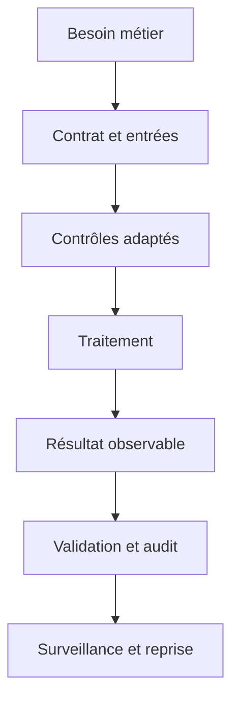
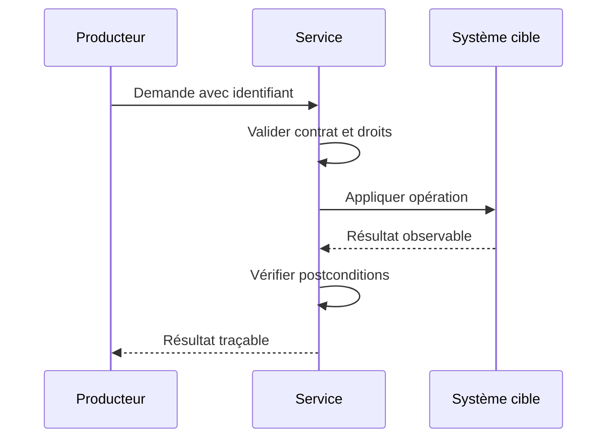
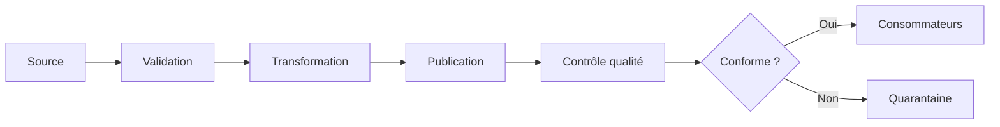
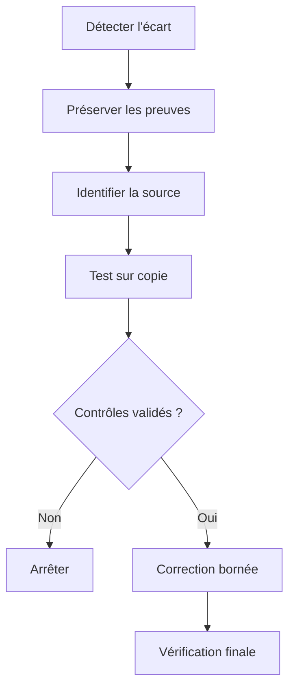
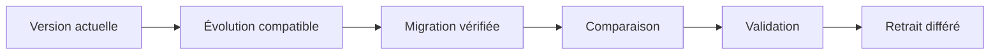

# Architecture Hadoop et Spark — Intermédiaire

> **Mise en contexte.** Comprendre le calcul distribué et diagnostiquer partitions, shuffle, skew et résilience. Le fil rouge est traiter des journaux volumineux afin de produire des agrégats fiables. Travaillez sur des données synthétiques, avec des privilèges limités et un environnement réinitialisable. Vérifiez la documentation officielle de la version avant de transposer une commande ou une garantie.

## Introduction et objectifs

Ce cours relie architecture hadoop et spark au cas concret « traiter des journaux volumineux afin de produire des agrégats fiables ». Il faut comprendre le contrat, la source de vérité, les effets secondaires et les preuves du résultat. Ce niveau vise à traiter les cas limites, comparer des stratégies et mesurer l'effet. À la fin, vous saurez définir des invariants, choisir les contrôles, construire des tests normaux et adversariaux, vérifier le résultat réel, diagnostiquer un incident et documenter les limites. Une absence d'exception ou une capture d'écran ne suffit pas à démontrer l'état métier.

## Prérequis et environnement

Références initiales : https://spark.apache.org/docs/latest/, https://hadoop.apache.org/docs/. Notez versions, paramètres, privilèges et état initial. Préparez une remise à zéro. N'utilisez pas de secrets ou données personnelles réelles. Les exemples doivent isoler les hypothèses pour pouvoir être reproduits par une autre personne.

## 1. Architecture et contrat

Décrivez la source, les producteurs, les transformations, l'état persistant et les consommateurs. Pour « traiter des journaux volumineux afin de produire des agrégats fiables », identifiez l'autorité qui fait foi et les représentations dérivées. Le contrat précise entrées, valeurs admissibles, effets secondaires, erreurs, délais et postconditions. Cette étape distingue réussite technique et résultat fiable pour le métier.

## 2. Concepts essentiels

### 1. Stockage distribué

Le concept « Stockage distribué » se comprend par la règle métier qu'il protège. Dans « traiter des journaux volumineux afin de produire des agrégats fiables », identifiez l'acteur qui produit l'information, le composant qui la traite et la propriété attendue par le consommateur. Construisez un exemple valide et un contre-exemple. Un test uniquement nominal peut masquer une erreur de modèle, une dépendance implicite ou une protection insuffisante.

Pour vérifier stockage distribué, notez version, paramètres et préconditions, puis contrôlez la postcondition dans l'état réel. Si le test échoue, examinez données, contrat, droits, configuration et ordre d'exécution séparément. Ne désactivez pas un contrôle pour forcer la réussite. Expliquez le comportement d'une valeur absente, d'un doublon et d'une reprise après interruption, puis indiquez quelles métriques ou quels journaux expurgés permettent le diagnostic.

### 2. Spark driver et executors

Le concept « Spark driver et executors » se comprend par la règle métier qu'il protège. Dans « traiter des journaux volumineux afin de produire des agrégats fiables », identifiez l'acteur qui produit l'information, le composant qui la traite et la propriété attendue par le consommateur. Construisez un exemple valide et un contre-exemple. Un test uniquement nominal peut masquer une erreur de modèle, une dépendance implicite ou une protection insuffisante.

Pour vérifier spark driver et executors, notez version, paramètres et préconditions, puis contrôlez la postcondition dans l'état réel. Si le test échoue, examinez données, contrat, droits, configuration et ordre d'exécution séparément. Ne désactivez pas un contrôle pour forcer la réussite. Expliquez le comportement d'une valeur absente, d'un doublon et d'une reprise après interruption, puis indiquez quelles métriques ou quels journaux expurgés permettent le diagnostic.

### 3. Partitions et parallélisme

Le concept « Partitions et parallélisme » se comprend par la règle métier qu'il protège. Dans « traiter des journaux volumineux afin de produire des agrégats fiables », identifiez l'acteur qui produit l'information, le composant qui la traite et la propriété attendue par le consommateur. Construisez un exemple valide et un contre-exemple. Un test uniquement nominal peut masquer une erreur de modèle, une dépendance implicite ou une protection insuffisante.

Pour vérifier partitions et parallélisme, notez version, paramètres et préconditions, puis contrôlez la postcondition dans l'état réel. Si le test échoue, examinez données, contrat, droits, configuration et ordre d'exécution séparément. Ne désactivez pas un contrôle pour forcer la réussite. Expliquez le comportement d'une valeur absente, d'un doublon et d'une reprise après interruption, puis indiquez quelles métriques ou quels journaux expurgés permettent le diagnostic.

### 4. Shuffle

Le concept « Shuffle » se comprend par la règle métier qu'il protège. Dans « traiter des journaux volumineux afin de produire des agrégats fiables », identifiez l'acteur qui produit l'information, le composant qui la traite et la propriété attendue par le consommateur. Construisez un exemple valide et un contre-exemple. Un test uniquement nominal peut masquer une erreur de modèle, une dépendance implicite ou une protection insuffisante.

Pour vérifier shuffle, notez version, paramètres et préconditions, puis contrôlez la postcondition dans l'état réel. Si le test échoue, examinez données, contrat, droits, configuration et ordre d'exécution séparément. Ne désactivez pas un contrôle pour forcer la réussite. Expliquez le comportement d'une valeur absente, d'un doublon et d'une reprise après interruption, puis indiquez quelles métriques ou quels journaux expurgés permettent le diagnostic.

### 5. Formats colonnaires

Le concept « Formats colonnaires » se comprend par la règle métier qu'il protège. Dans « traiter des journaux volumineux afin de produire des agrégats fiables », identifiez l'acteur qui produit l'information, le composant qui la traite et la propriété attendue par le consommateur. Construisez un exemple valide et un contre-exemple. Un test uniquement nominal peut masquer une erreur de modèle, une dépendance implicite ou une protection insuffisante.

Pour vérifier formats colonnaires, notez version, paramètres et préconditions, puis contrôlez la postcondition dans l'état réel. Si le test échoue, examinez données, contrat, droits, configuration et ordre d'exécution séparément. Ne désactivez pas un contrôle pour forcer la réussite. Expliquez le comportement d'une valeur absente, d'un doublon et d'une reprise après interruption, puis indiquez quelles métriques ou quels journaux expurgés permettent le diagnostic.

### 6. Data skew

Le concept « Data skew » se comprend par la règle métier qu'il protège. Dans « traiter des journaux volumineux afin de produire des agrégats fiables », identifiez l'acteur qui produit l'information, le composant qui la traite et la propriété attendue par le consommateur. Construisez un exemple valide et un contre-exemple. Un test uniquement nominal peut masquer une erreur de modèle, une dépendance implicite ou une protection insuffisante.

Pour vérifier data skew, notez version, paramètres et préconditions, puis contrôlez la postcondition dans l'état réel. Si le test échoue, examinez données, contrat, droits, configuration et ordre d'exécution séparément. Ne désactivez pas un contrôle pour forcer la réussite. Expliquez le comportement d'une valeur absente, d'un doublon et d'une reprise après interruption, puis indiquez quelles métriques ou quels journaux expurgés permettent le diagnostic.

### 7. Tolérance aux pannes

Le concept « Tolérance aux pannes » se comprend par la règle métier qu'il protège. Dans « traiter des journaux volumineux afin de produire des agrégats fiables », identifiez l'acteur qui produit l'information, le composant qui la traite et la propriété attendue par le consommateur. Construisez un exemple valide et un contre-exemple. Un test uniquement nominal peut masquer une erreur de modèle, une dépendance implicite ou une protection insuffisante.

Pour vérifier tolérance aux pannes, notez version, paramètres et préconditions, puis contrôlez la postcondition dans l'état réel. Si le test échoue, examinez données, contrat, droits, configuration et ordre d'exécution séparément. Ne désactivez pas un contrôle pour forcer la réussite. Expliquez le comportement d'une valeur absente, d'un doublon et d'une reprise après interruption, puis indiquez quelles métriques ou quels journaux expurgés permettent le diagnostic.

### 8. Gestion des ressources

Le concept « Gestion des ressources » se comprend par la règle métier qu'il protège. Dans « traiter des journaux volumineux afin de produire des agrégats fiables », identifiez l'acteur qui produit l'information, le composant qui la traite et la propriété attendue par le consommateur. Construisez un exemple valide et un contre-exemple. Un test uniquement nominal peut masquer une erreur de modèle, une dépendance implicite ou une protection insuffisante.

Pour vérifier gestion des ressources, notez version, paramètres et préconditions, puis contrôlez la postcondition dans l'état réel. Si le test échoue, examinez données, contrat, droits, configuration et ordre d'exécution séparément. Ne désactivez pas un contrôle pour forcer la réussite. Expliquez le comportement d'une valeur absente, d'un doublon et d'une reprise après interruption, puis indiquez quelles métriques ou quels journaux expurgés permettent le diagnostic.

### 9. Qualité des résultats distribués

Le concept « Qualité des résultats distribués » se comprend par la règle métier qu'il protège. Dans « traiter des journaux volumineux afin de produire des agrégats fiables », identifiez l'acteur qui produit l'information, le composant qui la traite et la propriété attendue par le consommateur. Construisez un exemple valide et un contre-exemple. Un test uniquement nominal peut masquer une erreur de modèle, une dépendance implicite ou une protection insuffisante.

Pour vérifier qualité des résultats distribués, notez version, paramètres et préconditions, puis contrôlez la postcondition dans l'état réel. Si le test échoue, examinez données, contrat, droits, configuration et ordre d'exécution séparément. Ne désactivez pas un contrôle pour forcer la réussite. Expliquez le comportement d'une valeur absente, d'un doublon et d'une reprise après interruption, puis indiquez quelles métriques ou quels journaux expurgés permettent le diagnostic.

### 10. Observabilité du job

Le concept « Observabilité du job » se comprend par la règle métier qu'il protège. Dans « traiter des journaux volumineux afin de produire des agrégats fiables », identifiez l'acteur qui produit l'information, le composant qui la traite et la propriété attendue par le consommateur. Construisez un exemple valide et un contre-exemple. Un test uniquement nominal peut masquer une erreur de modèle, une dépendance implicite ou une protection insuffisante.

Pour vérifier observabilité du job, notez version, paramètres et préconditions, puis contrôlez la postcondition dans l'état réel. Si le test échoue, examinez données, contrat, droits, configuration et ordre d'exécution séparément. Ne désactivez pas un contrôle pour forcer la réussite. Expliquez le comportement d'une valeur absente, d'un doublon et d'une reprise après interruption, puis indiquez quelles métriques ou quels journaux expurgés permettent le diagnostic.

## 3. Méthode de conception et d'exploitation

### 1. Formaliser les invariants

Écrivez ce qui doit rester vrai dans traiter des journaux volumineux afin de produire des agrégats fiables : intégrité, unicité, ordre, confidentialité, fraîcheur ou état final. Chaque invariant doit être testable et associé à une source de vérité. Donnez un exemple permis et un exemple refusé. Si le résultat ne peut pas être contrôlé, précisez quel signal servira de preuve. Au niveau intermédiaire, il faut traiter les cas limites, comparer des stratégies et mesurer l'effet. La conclusion distingue les faits observés, les hypothèses et les risques résiduels. Un contrôle n'est acquis que si le test peut être répété et comparé.

### 2. Préparer les entrées

Définissez types, unités, bornes, valeurs optionnelles, provenance et version. Préparez des cas adversariaux : doublon, valeur vide, schéma inconnu, taille inhabituelle ou référence absente. Les données synthétiques permettent de reproduire le cas sans exposer des personnes. Modifiez une hypothèse à la fois et consignez les résultats. Au niveau intermédiaire, il faut traiter les cas limites, comparer des stratégies et mesurer l'effet. La conclusion distingue les faits observés, les hypothèses et les risques résiduels. Un contrôle n'est acquis que si le test peut être répété et comparé.

### 3. Choisir le contrôle

Placez le contrôle où il peut empêcher l'état invalide : contrainte persistante, validation de contrat, transaction, contrôle d'accès ou test d'intégration. Un contrôle tardif peut signaler l'erreur sans empêcher sa propagation. Séparez garanties, alertes et bonnes pratiques. Vérifiez la portée du mécanisme dans la version réelle. Au niveau intermédiaire, il faut traiter les cas limites, comparer des stratégies et mesurer l'effet. La conclusion distingue les faits observés, les hypothèses et les risques résiduels. Un contrôle n'est acquis que si le test peut être répété et comparé.

### 4. Gérer les erreurs

Classez les erreurs en entrée invalide, incompatibilité, accès interdit, saturation, conflit concurrent et problème transitoire. Définissez une réponse par catégorie. Les erreurs permanentes sont rejetées ou mises en quarantaine avec une raison exploitable. Une reprise temporaire est bornée et ne répète jamais aveuglément un effet non idempotent. Au niveau intermédiaire, il faut traiter les cas limites, comparer des stratégies et mesurer l'effet. La conclusion distingue les faits observés, les hypothèses et les risques résiduels. Un contrôle n'est acquis que si le test peut être répété et comparé.

### 5. Protéger les reprises

Un appel peut être répété après timeout, un worker redémarré ou un lot rejoué. Définissez l'identifiant de l'action métier unique et vérifiez le résultat enregistré avant de produire un nouvel effet. Testez reprises séquentielles et concurrentes. Si le traitement déclenche un système externe, décrivez comment réconcilier les états en cas de panne. Au niveau intermédiaire, il faut traiter les cas limites, comparer des stratégies et mesurer l'effet. La conclusion distingue les faits observés, les hypothèses et les risques résiduels. Un contrôle n'est acquis que si le test peut être répété et comparé.

### 6. Mesurer avant optimisation

Établissez une référence : latence, débit, consommation, fraîcheur, taille ou taux d'erreur. Décrivez le profil de charge. Changez un facteur à la fois et répétez la mesure. Une solution correcte sur quelques lignes peut échouer lorsque volume, distribution ou concurrence changent. L'optimisation doit préserver l'exactitude. Au niveau intermédiaire, il faut traiter les cas limites, comparer des stratégies et mesurer l'effet. La conclusion distingue les faits observés, les hypothèses et les risques résiduels. Un contrôle n'est acquis que si le test peut être répété et comparé.

### 7. Limiter les privilèges

Séparez les rôles runtime, migration, reporting et administration. Les secrets restent hors du dépôt et les entrées sont paramétrées ou validées. Testez un accès autorisé et un accès interdit par le vrai chemin technique. Les journaux doivent fournir un contexte utile sans recopier les données sensibles. Au niveau intermédiaire, il faut traiter les cas limites, comparer des stratégies et mesurer l'effet. La conclusion distingue les faits observés, les hypothèses et les risques résiduels. Un contrôle n'est acquis que si le test peut être répété et comparé.

### 8. Faire évoluer sans rupture

Une évolution peut toucher consommateurs, jobs, rapports et scripts. Ajoutez une structure compatible, migrez les données, comparez les résultats et retirez l'ancien chemin après vérification. Le backfill est borné et déterministe. Testez base vide et base historique, puis prévoyez un critère d'arrêt si les écarts dépassent la tolérance. Au niveau intermédiaire, il faut traiter les cas limites, comparer des stratégies et mesurer l'effet. La conclusion distingue les faits observés, les hypothèses et les risques résiduels. Un contrôle n'est acquis que si le test peut être répété et comparé.

### 9. Rendre l'état observable

Suivez volume, durée, erreurs, fraîcheur, rejets, divergences et ressources. Chaque alerte possède un seuil, un propriétaire et une action documentée. Utilisez des identifiants de corrélation, expurgez les valeurs privées et vérifiez que le signal est actionnable. Une journalisation trop abondante peut devenir un risque de confidentialité. Au niveau intermédiaire, il faut traiter les cas limites, comparer des stratégies et mesurer l'effet. La conclusion distingue les faits observés, les hypothèses et les risques résiduels. Un contrôle n'est acquis que si le test peut être répété et comparé.

### 10. Préparer la reprise

Décrivez le retour vers un état connu. Comptez les éléments touchés avant réparation, testez sur une copie, définissez un critère d'arrêt et conservez une trace. Après application, vérifiez les invariants et réconciliez les systèmes externes. Redémarrer un service ne prouve pas l'intégrité des données. Au niveau intermédiaire, il faut traiter les cas limites, comparer des stratégies et mesurer l'effet. La conclusion distingue les faits observés, les hypothèses et les risques résiduels. Un contrôle n'est acquis que si le test peut être répété et comparé.

### 11. Comparer les options

Comparez les mécanismes selon intégrité, simplicité, disponibilité, coût, latence, sécurité et exploitabilité. Une solution plus sophistiquée n'est pas forcément plus robuste si l'équipe ne sait pas l'exploiter. Documentez options, hypothèses, risques acceptés, mesures et conditions de réévaluation. Au niveau intermédiaire, il faut traiter les cas limites, comparer des stratégies et mesurer l'effet. La conclusion distingue les faits observés, les hypothèses et les risques résiduels. Un contrôle n'est acquis que si le test peut être répété et comparé.

### 12. Automatiser les preuves

Les tests couvrent le nominal, une limite, une erreur, un doublon et une reprise. Un test échoue lorsque l'invariant n'est plus respecté et expose le contexte de diagnostic. Gardez les données synthétiques et les scripts versionnés afin qu'un autre opérateur puisse recréer le résultat. Au niveau intermédiaire, il faut traiter les cas limites, comparer des stratégies et mesurer l'effet. La conclusion distingue les faits observés, les hypothèses et les risques résiduels. Un contrôle n'est acquis que si le test peut être répété et comparé.

## 4. Atelier pratique

### Étape 1 — Définir le contrat

Pour « traiter des journaux volumineux afin de produire des agrégats fiables », écrivez ce qui sera vérifié, préparez des données synthétiques, notez paramètres et observez l'état réel. Ajoutez un cas où la règle doit refuser l'opération. Simulez une interruption dans le laboratoire, vérifiez quels effets ont déjà été appliqués et décrivez le retour à un état connu. Enregistrez les résultats et limites de version. L'étape est terminée lorsque quelqu'un d'autre peut la répéter sans étape cachée.

### Étape 2 — Créer un environnement isolé

Pour « traiter des journaux volumineux afin de produire des agrégats fiables », écrivez ce qui sera vérifié, préparez des données synthétiques, notez paramètres et observez l'état réel. Ajoutez un cas où la règle doit refuser l'opération. Simulez une interruption dans le laboratoire, vérifiez quels effets ont déjà été appliqués et décrivez le retour à un état connu. Enregistrez les résultats et limites de version. L'étape est terminée lorsque quelqu'un d'autre peut la répéter sans étape cachée.

### Étape 3 — Capturer l'état initial

Pour « traiter des journaux volumineux afin de produire des agrégats fiables », écrivez ce qui sera vérifié, préparez des données synthétiques, notez paramètres et observez l'état réel. Ajoutez un cas où la règle doit refuser l'opération. Simulez une interruption dans le laboratoire, vérifiez quels effets ont déjà été appliqués et décrivez le retour à un état connu. Enregistrez les résultats et limites de version. L'étape est terminée lorsque quelqu'un d'autre peut la répéter sans étape cachée.

### Étape 4 — Exécuter le cas nominal

Pour « traiter des journaux volumineux afin de produire des agrégats fiables », écrivez ce qui sera vérifié, préparez des données synthétiques, notez paramètres et observez l'état réel. Ajoutez un cas où la règle doit refuser l'opération. Simulez une interruption dans le laboratoire, vérifiez quels effets ont déjà été appliqués et décrivez le retour à un état connu. Enregistrez les résultats et limites de version. L'étape est terminée lorsque quelqu'un d'autre peut la répéter sans étape cachée.

### Étape 5 — Ajouter un cas adverse

Pour « traiter des journaux volumineux afin de produire des agrégats fiables », écrivez ce qui sera vérifié, préparez des données synthétiques, notez paramètres et observez l'état réel. Ajoutez un cas où la règle doit refuser l'opération. Simulez une interruption dans le laboratoire, vérifiez quels effets ont déjà été appliqués et décrivez le retour à un état connu. Enregistrez les résultats et limites de version. L'étape est terminée lorsque quelqu'un d'autre peut la répéter sans étape cachée.

### Étape 6 — Simuler un échec contrôlé

Pour « traiter des journaux volumineux afin de produire des agrégats fiables », écrivez ce qui sera vérifié, préparez des données synthétiques, notez paramètres et observez l'état réel. Ajoutez un cas où la règle doit refuser l'opération. Simulez une interruption dans le laboratoire, vérifiez quels effets ont déjà été appliqués et décrivez le retour à un état connu. Enregistrez les résultats et limites de version. L'étape est terminée lorsque quelqu'un d'autre peut la répéter sans étape cachée.

### Étape 7 — Rejouer la demande

Pour « traiter des journaux volumineux afin de produire des agrégats fiables », écrivez ce qui sera vérifié, préparez des données synthétiques, notez paramètres et observez l'état réel. Ajoutez un cas où la règle doit refuser l'opération. Simulez une interruption dans le laboratoire, vérifiez quels effets ont déjà été appliqués et décrivez le retour à un état connu. Enregistrez les résultats et limites de version. L'étape est terminée lorsque quelqu'un d'autre peut la répéter sans étape cachée.

### Étape 8 — Mesurer une variante

Pour « traiter des journaux volumineux afin de produire des agrégats fiables », écrivez ce qui sera vérifié, préparez des données synthétiques, notez paramètres et observez l'état réel. Ajoutez un cas où la règle doit refuser l'opération. Simulez une interruption dans le laboratoire, vérifiez quels effets ont déjà été appliqués et décrivez le retour à un état connu. Enregistrez les résultats et limites de version. L'étape est terminée lorsque quelqu'un d'autre peut la répéter sans étape cachée.

### Étape 9 — Tester les autorisations

Pour « traiter des journaux volumineux afin de produire des agrégats fiables », écrivez ce qui sera vérifié, préparez des données synthétiques, notez paramètres et observez l'état réel. Ajoutez un cas où la règle doit refuser l'opération. Simulez une interruption dans le laboratoire, vérifiez quels effets ont déjà été appliqués et décrivez le retour à un état connu. Enregistrez les résultats et limites de version. L'étape est terminée lorsque quelqu'un d'autre peut la répéter sans étape cachée.

### Étape 10 — Réinitialiser et documenter

Pour « traiter des journaux volumineux afin de produire des agrégats fiables », écrivez ce qui sera vérifié, préparez des données synthétiques, notez paramètres et observez l'état réel. Ajoutez un cas où la règle doit refuser l'opération. Simulez une interruption dans le laboratoire, vérifiez quels effets ont déjà été appliqués et décrivez le retour à un état connu. Enregistrez les résultats et limites de version. L'étape est terminée lorsque quelqu'un d'autre peut la répéter sans étape cachée.

## 5. Diagnostics guidés

### Cas 1 — résultat incomplet

Dans « traiter des journaux volumineux afin de produire des agrégats fiables », le symptôme peut être lié à partitions et parallélisme. Fixez période, versions, entrées et postcondition, puis réduisez le cas jusqu'à obtenir une reproduction minimale. Séparez les hypothèses liées aux données, au contrat, aux privilèges, aux ressources et à l'ordre des opérations. Préservez les journaux utiles sans exposer de secrets. La correction doit préserver les données valides, traiter la cause et pouvoir être rejouée. Confirmez le cas normal et ajoutez une régression automatisée.

### Cas 2 — doublon après relance

Dans « traiter des journaux volumineux afin de produire des agrégats fiables », le symptôme peut être lié à shuffle. Fixez période, versions, entrées et postcondition, puis réduisez le cas jusqu'à obtenir une reproduction minimale. Séparez les hypothèses liées aux données, au contrat, aux privilèges, aux ressources et à l'ordre des opérations. Préservez les journaux utiles sans exposer de secrets. La correction doit préserver les données valides, traiter la cause et pouvoir être rejouée. Confirmez le cas normal et ajoutez une régression automatisée.

### Cas 3 — latence élevée

Dans « traiter des journaux volumineux afin de produire des agrégats fiables », le symptôme peut être lié à formats colonnaires. Fixez période, versions, entrées et postcondition, puis réduisez le cas jusqu'à obtenir une reproduction minimale. Séparez les hypothèses liées aux données, au contrat, aux privilèges, aux ressources et à l'ordre des opérations. Préservez les journaux utiles sans exposer de secrets. La correction doit préserver les données valides, traiter la cause et pouvoir être rejouée. Confirmez le cas normal et ajoutez une régression automatisée.

### Cas 4 — valeur absente mal interprétée

Dans « traiter des journaux volumineux afin de produire des agrégats fiables », le symptôme peut être lié à data skew. Fixez période, versions, entrées et postcondition, puis réduisez le cas jusqu'à obtenir une reproduction minimale. Séparez les hypothèses liées aux données, au contrat, aux privilèges, aux ressources et à l'ordre des opérations. Préservez les journaux utiles sans exposer de secrets. La correction doit préserver les données valides, traiter la cause et pouvoir être rejouée. Confirmez le cas normal et ajoutez une régression automatisée.

### Cas 5 — version inattendue

Dans « traiter des journaux volumineux afin de produire des agrégats fiables », le symptôme peut être lié à tolérance aux pannes. Fixez période, versions, entrées et postcondition, puis réduisez le cas jusqu'à obtenir une reproduction minimale. Séparez les hypothèses liées aux données, au contrat, aux privilèges, aux ressources et à l'ordre des opérations. Préservez les journaux utiles sans exposer de secrets. La correction doit préserver les données valides, traiter la cause et pouvoir être rejouée. Confirmez le cas normal et ajoutez une régression automatisée.

### Cas 6 — accès non autorisé

Dans « traiter des journaux volumineux afin de produire des agrégats fiables », le symptôme peut être lié à gestion des ressources. Fixez période, versions, entrées et postcondition, puis réduisez le cas jusqu'à obtenir une reproduction minimale. Séparez les hypothèses liées aux données, au contrat, aux privilèges, aux ressources et à l'ordre des opérations. Préservez les journaux utiles sans exposer de secrets. La correction doit préserver les données valides, traiter la cause et pouvoir être rejouée. Confirmez le cas normal et ajoutez une régression automatisée.

### Cas 7 — opération partielle

Dans « traiter des journaux volumineux afin de produire des agrégats fiables », le symptôme peut être lié à qualité des résultats distribués. Fixez période, versions, entrées et postcondition, puis réduisez le cas jusqu'à obtenir une reproduction minimale. Séparez les hypothèses liées aux données, au contrat, aux privilèges, aux ressources et à l'ordre des opérations. Préservez les journaux utiles sans exposer de secrets. La correction doit préserver les données valides, traiter la cause et pouvoir être rejouée. Confirmez le cas normal et ajoutez une régression automatisée.

### Cas 8 — écart entre source et sortie

Dans « traiter des journaux volumineux afin de produire des agrégats fiables », le symptôme peut être lié à observabilité du job. Fixez période, versions, entrées et postcondition, puis réduisez le cas jusqu'à obtenir une reproduction minimale. Séparez les hypothèses liées aux données, au contrat, aux privilèges, aux ressources et à l'ordre des opérations. Préservez les journaux utiles sans exposer de secrets. La correction doit préserver les données valides, traiter la cause et pouvoir être rejouée. Confirmez le cas normal et ajoutez une régression automatisée.

### Cas 9 — charge déséquilibrée

Dans « traiter des journaux volumineux afin de produire des agrégats fiables », le symptôme peut être lié à stockage distribué. Fixez période, versions, entrées et postcondition, puis réduisez le cas jusqu'à obtenir une reproduction minimale. Séparez les hypothèses liées aux données, au contrat, aux privilèges, aux ressources et à l'ordre des opérations. Préservez les journaux utiles sans exposer de secrets. La correction doit préserver les données valides, traiter la cause et pouvoir être rejouée. Confirmez le cas normal et ajoutez une régression automatisée.

### Cas 10 — consommateur incompatible

Dans « traiter des journaux volumineux afin de produire des agrégats fiables », le symptôme peut être lié à spark driver et executors. Fixez période, versions, entrées et postcondition, puis réduisez le cas jusqu'à obtenir une reproduction minimale. Séparez les hypothèses liées aux données, au contrat, aux privilèges, aux ressources et à l'ordre des opérations. Préservez les journaux utiles sans exposer de secrets. La correction doit préserver les données valides, traiter la cause et pouvoir être rejouée. Confirmez le cas normal et ajoutez une régression automatisée.

### Cas 11 — alerte non actionnable

Dans « traiter des journaux volumineux afin de produire des agrégats fiables », le symptôme peut être lié à partitions et parallélisme. Fixez période, versions, entrées et postcondition, puis réduisez le cas jusqu'à obtenir une reproduction minimale. Séparez les hypothèses liées aux données, au contrat, aux privilèges, aux ressources et à l'ordre des opérations. Préservez les journaux utiles sans exposer de secrets. La correction doit préserver les données valides, traiter la cause et pouvoir être rejouée. Confirmez le cas normal et ajoutez une régression automatisée.

### Cas 12 — restauration non démontrée

Dans « traiter des journaux volumineux afin de produire des agrégats fiables », le symptôme peut être lié à shuffle. Fixez période, versions, entrées et postcondition, puis réduisez le cas jusqu'à obtenir une reproduction minimale. Séparez les hypothèses liées aux données, au contrat, aux privilèges, aux ressources et à l'ordre des opérations. Préservez les journaux utiles sans exposer de secrets. La correction doit préserver les données valides, traiter la cause et pouvoir être rejouée. Confirmez le cas normal et ajoutez une régression automatisée.

## 6. Exercices avec corrigés

### Exercice 1 — Formaliser une règle

**Énoncé.** Pour « traiter des journaux volumineux afin de produire des agrégats fiables », expliquez comment vérifier partitions et parallélisme et prouver le résultat.

**Corrigé.** Définissez préconditions et postconditions, utilisez des données synthétiques et contrôlez l'état réellement obtenu. Ajoutez un test négatif. Consignez versions, entrées, objets touchés, erreurs et limites. Si une reprise est possible, rejouez le même identifiant pour vérifier qu'elle ne produit pas un second effet métier. Expliquez la règle retenue et ce qui reste hors du périmètre du test.

### Exercice 2 — Choisir un contrôle

**Énoncé.** Pour « traiter des journaux volumineux afin de produire des agrégats fiables », expliquez comment vérifier data skew et prouver le résultat.

**Corrigé.** Définissez préconditions et postconditions, utilisez des données synthétiques et contrôlez l'état réellement obtenu. Ajoutez un test négatif. Consignez versions, entrées, objets touchés, erreurs et limites. Si une reprise est possible, rejouez le même identifiant pour vérifier qu'elle ne produit pas un second effet métier. Expliquez la règle retenue et ce qui reste hors du périmètre du test.

### Exercice 3 — Identifier la source de vérité

**Énoncé.** Pour « traiter des journaux volumineux afin de produire des agrégats fiables », expliquez comment vérifier qualité des résultats distribués et prouver le résultat.

**Corrigé.** Définissez préconditions et postconditions, utilisez des données synthétiques et contrôlez l'état réellement obtenu. Ajoutez un test négatif. Consignez versions, entrées, objets touchés, erreurs et limites. Si une reprise est possible, rejouez le même identifiant pour vérifier qu'elle ne produit pas un second effet métier. Expliquez la règle retenue et ce qui reste hors du périmètre du test.

### Exercice 4 — Gérer une entrée invalide

**Énoncé.** Pour « traiter des journaux volumineux afin de produire des agrégats fiables », expliquez comment vérifier spark driver et executors et prouver le résultat.

**Corrigé.** Définissez préconditions et postconditions, utilisez des données synthétiques et contrôlez l'état réellement obtenu. Ajoutez un test négatif. Consignez versions, entrées, objets touchés, erreurs et limites. Si une reprise est possible, rejouez le même identifiant pour vérifier qu'elle ne produit pas un second effet métier. Expliquez la règle retenue et ce qui reste hors du périmètre du test.

### Exercice 5 — Interpréter une mesure

**Énoncé.** Pour « traiter des journaux volumineux afin de produire des agrégats fiables », expliquez comment vérifier formats colonnaires et prouver le résultat.

**Corrigé.** Définissez préconditions et postconditions, utilisez des données synthétiques et contrôlez l'état réellement obtenu. Ajoutez un test négatif. Consignez versions, entrées, objets touchés, erreurs et limites. Si une reprise est possible, rejouez le même identifiant pour vérifier qu'elle ne produit pas un second effet métier. Expliquez la règle retenue et ce qui reste hors du périmètre du test.

### Exercice 6 — Protéger une reprise

**Énoncé.** Pour « traiter des journaux volumineux afin de produire des agrégats fiables », expliquez comment vérifier gestion des ressources et prouver le résultat.

**Corrigé.** Définissez préconditions et postconditions, utilisez des données synthétiques et contrôlez l'état réellement obtenu. Ajoutez un test négatif. Consignez versions, entrées, objets touchés, erreurs et limites. Si une reprise est possible, rejouez le même identifiant pour vérifier qu'elle ne produit pas un second effet métier. Expliquez la règle retenue et ce qui reste hors du périmètre du test.

### Exercice 7 — Planifier une évolution

**Énoncé.** Pour « traiter des journaux volumineux afin de produire des agrégats fiables », expliquez comment vérifier stockage distribué et prouver le résultat.

**Corrigé.** Définissez préconditions et postconditions, utilisez des données synthétiques et contrôlez l'état réellement obtenu. Ajoutez un test négatif. Consignez versions, entrées, objets touchés, erreurs et limites. Si une reprise est possible, rejouez le même identifiant pour vérifier qu'elle ne produit pas un second effet métier. Expliquez la règle retenue et ce qui reste hors du périmètre du test.

### Exercice 8 — Séparer les privilèges

**Énoncé.** Pour « traiter des journaux volumineux afin de produire des agrégats fiables », expliquez comment vérifier shuffle et prouver le résultat.

**Corrigé.** Définissez préconditions et postconditions, utilisez des données synthétiques et contrôlez l'état réellement obtenu. Ajoutez un test négatif. Consignez versions, entrées, objets touchés, erreurs et limites. Si une reprise est possible, rejouez le même identifiant pour vérifier qu'elle ne produit pas un second effet métier. Expliquez la règle retenue et ce qui reste hors du périmètre du test.

### Exercice 9 — Détecter une dérive

**Énoncé.** Pour « traiter des journaux volumineux afin de produire des agrégats fiables », expliquez comment vérifier tolérance aux pannes et prouver le résultat.

**Corrigé.** Définissez préconditions et postconditions, utilisez des données synthétiques et contrôlez l'état réellement obtenu. Ajoutez un test négatif. Consignez versions, entrées, objets touchés, erreurs et limites. Si une reprise est possible, rejouez le même identifiant pour vérifier qu'elle ne produit pas un second effet métier. Expliquez la règle retenue et ce qui reste hors du périmètre du test.

### Exercice 10 — Prouver une restauration

**Énoncé.** Pour « traiter des journaux volumineux afin de produire des agrégats fiables », expliquez comment vérifier observabilité du job et prouver le résultat.

**Corrigé.** Définissez préconditions et postconditions, utilisez des données synthétiques et contrôlez l'état réellement obtenu. Ajoutez un test négatif. Consignez versions, entrées, objets touchés, erreurs et limites. Si une reprise est possible, rejouez le même identifiant pour vérifier qu'elle ne produit pas un second effet métier. Expliquez la règle retenue et ce qui reste hors du périmètre du test.

## 7. Études de cas supplémentaires

### Cas d'étude 1 — Partitions et parallélisme

Le symptôme est : traitement incomplet sur données variées. Pour « traiter des journaux volumineux afin de produire des agrégats fiables », collectez versions et paramètres, créez une reproduction réduite et distinguez les causes possibles. Inspectez partitions et parallélisme, vérifiez les effets déjà appliqués et comparez l'état de référence à l'état obtenu. La solution doit avoir un périmètre borné, une procédure de retour à l'état connu et un contrôle final. Conservez une preuve de correction et un test qui détectera le même défaut en exploitation. Documentez le compromis et le risque résiduel.

### Cas d'étude 2 — Formats colonnaires

Le symptôme est : demande répétée après timeout. Pour « traiter des journaux volumineux afin de produire des agrégats fiables », collectez versions et paramètres, créez une reproduction réduite et distinguez les causes possibles. Inspectez formats colonnaires, vérifiez les effets déjà appliqués et comparez l'état de référence à l'état obtenu. La solution doit avoir un périmètre borné, une procédure de retour à l'état connu et un contrôle final. Conservez une preuve de correction et un test qui détectera le même défaut en exploitation. Documentez le compromis et le risque résiduel.

### Cas d'étude 3 — Tolérance aux pannes

Le symptôme est : ancienne version active pendant déploiement. Pour « traiter des journaux volumineux afin de produire des agrégats fiables », collectez versions et paramètres, créez une reproduction réduite et distinguez les causes possibles. Inspectez tolérance aux pannes, vérifiez les effets déjà appliqués et comparez l'état de référence à l'état obtenu. La solution doit avoir un périmètre borné, une procédure de retour à l'état connu et un contrôle final. Conservez une preuve de correction et un test qui détectera le même défaut en exploitation. Documentez le compromis et le risque résiduel.

### Cas d'étude 4 — Qualité des résultats distribués

Le symptôme est : résultats différents entre environnements. Pour « traiter des journaux volumineux afin de produire des agrégats fiables », collectez versions et paramètres, créez une reproduction réduite et distinguez les causes possibles. Inspectez qualité des résultats distribués, vérifiez les effets déjà appliqués et comparez l'état de référence à l'état obtenu. La solution doit avoir un périmètre borné, une procédure de retour à l'état connu et un contrôle final. Conservez une preuve de correction et un test qui détectera le même défaut en exploitation. Documentez le compromis et le risque résiduel.

### Cas d'étude 5 — Stockage distribué

Le symptôme est : croissance rapide du volume. Pour « traiter des journaux volumineux afin de produire des agrégats fiables », collectez versions et paramètres, créez une reproduction réduite et distinguez les causes possibles. Inspectez stockage distribué, vérifiez les effets déjà appliqués et comparez l'état de référence à l'état obtenu. La solution doit avoir un périmètre borné, une procédure de retour à l'état connu et un contrôle final. Conservez une preuve de correction et un test qui détectera le même défaut en exploitation. Documentez le compromis et le risque résiduel.

### Cas d'étude 6 — Partitions et parallélisme

Le symptôme est : accès hors périmètre. Pour « traiter des journaux volumineux afin de produire des agrégats fiables », collectez versions et paramètres, créez une reproduction réduite et distinguez les causes possibles. Inspectez partitions et parallélisme, vérifiez les effets déjà appliqués et comparez l'état de référence à l'état obtenu. La solution doit avoir un périmètre borné, une procédure de retour à l'état connu et un contrôle final. Conservez une preuve de correction et un test qui détectera le même défaut en exploitation. Documentez le compromis et le risque résiduel.

### Cas d'étude 7 — Formats colonnaires

Le symptôme est : job terminé sans preuve de qualité. Pour « traiter des journaux volumineux afin de produire des agrégats fiables », collectez versions et paramètres, créez une reproduction réduite et distinguez les causes possibles. Inspectez formats colonnaires, vérifiez les effets déjà appliqués et comparez l'état de référence à l'état obtenu. La solution doit avoir un périmètre borné, une procédure de retour à l'état connu et un contrôle final. Conservez une preuve de correction et un test qui détectera le même défaut en exploitation. Documentez le compromis et le risque résiduel.

### Cas d'étude 8 — Tolérance aux pannes

Le symptôme est : réparation manuelle sans procédure. Pour « traiter des journaux volumineux afin de produire des agrégats fiables », collectez versions et paramètres, créez une reproduction réduite et distinguez les causes possibles. Inspectez tolérance aux pannes, vérifiez les effets déjà appliqués et comparez l'état de référence à l'état obtenu. La solution doit avoir un périmètre borné, une procédure de retour à l'état connu et un contrôle final. Conservez une preuve de correction et un test qui détectera le même défaut en exploitation. Documentez le compromis et le risque résiduel.

### Cas d'étude 9 — Qualité des résultats distribués

Le symptôme est : optimisation rapide en lecture mais coûteuse en écriture. Pour « traiter des journaux volumineux afin de produire des agrégats fiables », collectez versions et paramètres, créez une reproduction réduite et distinguez les causes possibles. Inspectez qualité des résultats distribués, vérifiez les effets déjà appliqués et comparez l'état de référence à l'état obtenu. La solution doit avoir un périmètre borné, une procédure de retour à l'état connu et un contrôle final. Conservez une preuve de correction et un test qui détectera le même défaut en exploitation. Documentez le compromis et le risque résiduel.

### Cas d'étude 10 — Stockage distribué

Le symptôme est : restauration sans réconciliation. Pour « traiter des journaux volumineux afin de produire des agrégats fiables », collectez versions et paramètres, créez une reproduction réduite et distinguez les causes possibles. Inspectez stockage distribué, vérifiez les effets déjà appliqués et comparez l'état de référence à l'état obtenu. La solution doit avoir un périmètre borné, une procédure de retour à l'état connu et un contrôle final. Conservez une preuve de correction et un test qui détectera le même défaut en exploitation. Documentez le compromis et le risque résiduel.

## 8. Défi final avec correction

### Énoncé

Concevez une solution pour « traiter des journaux volumineux afin de produire des agrégats fiables » qui applique les principes de architecture hadoop et spark. Livrez contrat d'entrée-sortie, modèle ou architecture, contrôles d'intégrité et de sécurité, tests, métriques et procédure d'exploitation. La solution gère entrée invalide, demande répétée, interruption et évolution de version. Expliquez les garanties démontrées et les risques dépendant de la technologie.

### Correction détaillée

Définissez la source de vérité et les invariants métier. Choisissez le contrôle capable de protéger chacun d'eux : contrainte, validation de contrat, transaction, autorisation ou test de pipeline. Préparez un environnement isolé avec cas nominal, limite et entrée invalide. Enregistrez les versions et contrôlez l'état réel à chaque frontière ; un message de succès ne suffit pas.

Rendez la reprise bornée et répétable, distinguez erreurs permanentes et transitoires et empêchez un rejeu de créer un doublon. Définissez métriques, seuils, propriétaires d'alerte et runbook. Mesurez toute optimisation à charge équivalente. Pour faire évoluer le contrat, maintenez la compatibilité, migrez par étapes, comparez les résultats et retirez l'ancien chemin seulement après validation.

En cas d'incident, préservez les preuves, comptez le périmètre touché et testez la réparation sur copie. Après reprise, vérifiez les invariants et réconciliez les consommateurs externes. Le livrable doit permettre à un autre apprenant de reconstruire l'environnement et de répéter les tests sans étape manuelle cachée.

## 9. Schémas de référence

## 10. Checklist de maîtrise

- Besoin et invariants formalisés.
- Versions, entrées et droits contrôlés.
- Cas normaux, limites, erreurs et répétitions testés.
- Reprises bornées et idempotentes.
- Mesures de qualité et performance disponibles.
- Changements compatibles et vérifiés.
- Logs expurgés de données sensibles inutiles.
- Restauration ou reprise réellement testée.
- Scripts de test reproductibles.
- Hypothèses et risques résiduels documentés.

## 11. Références techniques

- https://spark.apache.org/docs/latest/
- https://hadoop.apache.org/docs/

Vérifiez la documentation de la version utilisée avant toute commande en production. Les règles internes de sécurité, conformité et exploitation complètent ces références.
