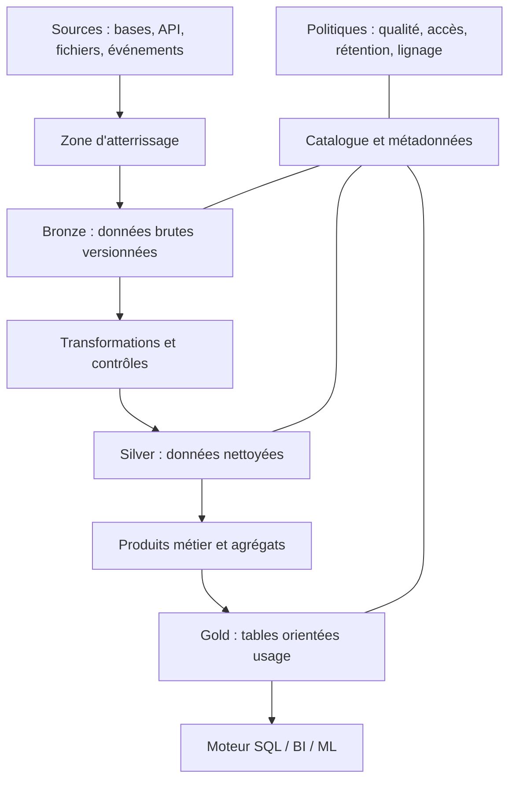

# Data Lakes et Lakehouse — Expert

> **Mise en contexte.** Une organisation collecte des journaux applicatifs, des événements métier, des exports de partenaires, des données IoT et des historiques relationnels. Les fichiers s'accumulent dans un stockage objet, mais les équipes ne savent plus quels jeux sont fiables, combien coûte une requête, quelle version d'un schéma a produit un résultat ou comment revenir à l'état d'hier. Un lakehouse vise à réunir la souplesse d'un data lake et les garanties de gestion de tables nécessaires à l'analyse. Il ne s'agit pas seulement de placer des fichiers Parquet dans un bucket : il faut définir des transactions, des métadonnées, des contrats, la qualité, la gouvernance et l'exploitation.

## Objectifs et prérequis

À la fin de ce cours, vous saurez distinguer data lake, entrepôt de données et lakehouse ; expliquer le rôle du stockage objet, du format de fichiers, du catalogue et du format de table ; concevoir des zones d'atterrissage, de données nettoyées et de produits analytiques ; choisir un partitionnement ; raisonner sur l'évolution des schémas, la concurrence d'écriture et l'isolation des transactions ; gérer les petits fichiers et les opérations de maintenance ; et proposer une architecture adaptée au coût, aux performances et aux contraintes de gouvernance.

Le parcours suppose de connaître les bases du SQL, les fichiers JSON et CSV, les concepts d'ETL/ELT et les notions générales d'entrepôt de données. Les noms des commandes et des options changent selon les moteurs et les versions. Les exemples ci-dessous illustrent des principes : avant de copier une configuration en production, vérifiez la documentation du moteur choisi, le format de table, le catalogue et le fournisseur de stockage réellement utilisés.

## 1. Data lake, warehouse et lakehouse

Un data warehouse centralise des données préparées pour l'analyse, souvent selon un modèle dimensionnel ou un modèle relationnel optimisé. Il donne une place importante aux contrats, à la qualité et aux performances des requêtes. Un data lake conserve des données de natures variées, fréquemment dans des fichiers et un stockage objet à coût compétitif. Il facilite l'arrivée de données brutes et le traitement par plusieurs moteurs, mais sans discipline de métadonnées, de qualité et de nommage, il peut devenir un « marécage de données » où personne ne sait ce qui est exploitable.

Le lakehouse cherche à apporter des garanties de table et de gestion des changements au-dessus de fichiers dans un stockage partagé. Des formats comme Apache Iceberg, Delta Lake et Apache Hudi maintiennent des métadonnées et des versions qui permettent de gérer des écritures concurrentes, des snapshots, une évolution de schéma et des opérations de maintenance selon leurs capacités respectives. Ces formats ne sont pas identiques, et tous les moteurs ne supportent pas toutes les fonctionnalités. Le choix doit être guidé par les workloads, les moteurs, les options de catalogue et la stratégie d'interopérabilité.

Le terme « lakehouse » ne signifie pas qu'un moteur unique doit gérer tous les usages. Une plateforme peut utiliser un moteur de batch pour de gros traitements, un moteur SQL interactif pour l'exploration, un processeur de flux pour l'ingestion et un catalogue commun pour découvrir les tables. La vraie valeur vient de règles partagées : définition de propriété des données, contrats, qualité, droits d'accès, versions, rétention et observabilité. Si ces règles diffèrent par moteur, la plateforme redevient une collection de silos.

## 2. Architecture de référence

Un stockage objet conserve des objets dans des buckets ou des conteneurs. Il est élastique et adapté à de grands volumes, mais ses garanties d'accès, ses coûts de requête, ses opérations de liste, ses régions et ses politiques de cycle de vie doivent être compris. Un système de fichiers distribué peut avoir une sémantique différente. Les applications ne doivent pas supposer que renommer un répertoire, déplacer des milliers de fichiers ou supprimer un objet a le même coût et la même atomicité partout.

Un format de fichier est différent d'un format de table. Parquet organise les données en colonnes et permet la lecture sélective des colonnes et le saut de blocs lorsque les statistiques sont utilisables. ORC offre également un stockage colonnaire. Avro est fréquemment utilisé pour les échanges et le streaming. CSV est facile à inspecter mais ne porte pas un typage fiable sans contrat externe. Le format de table, lui, décrit quels fichiers appartiennent à quelle version de la table, comment les changements sont publiés et quelles métadonnées permettent aux moteurs de lire un snapshot cohérent.

Le catalogue permet de découvrir les tables, leurs colonnes, leurs emplacements, leurs propriétaires et parfois leurs politiques. Il peut être fourni par un service central, un métastore, un catalogue de type REST ou le mécanisme spécifique du moteur. Il faut vérifier les capacités de verrouillage, de concurrence, d'authentification, de sauvegarde et de récupération. Un catalogue indisponible peut bloquer la découverte ou la mise à jour de tables même si les objets sont toujours présents dans le stockage.



Une architecture Bronze/Silver/Gold représente des zones logiques, pas nécessairement trois emplacements immuables. Bronze conserve une représentation aussi proche que possible de la source et permet les relectures. Silver harmonise les types, applique les contrôles, traite les doublons et rapproche les référentiels. Gold répond à un cas d'usage analytique explicite. Le découpage doit correspondre aux contrats de qualité et à la propriété des données. Dupliquer chaque table à chaque étape sans règle d'utilité augmente les coûts et les incohérences.

## 3. Stockage objet, formats colonnaires et compression

Les formats colonnaires sont efficaces lorsque les requêtes ne lisent qu'une partie des colonnes d'un schéma large. Les données d'une même colonne sont souvent similaires, ce qui améliore la compression. Des métadonnées statistiques peuvent aider le moteur à ignorer les groupes de lignes dont les valeurs ne correspondent pas au filtre. Cette efficacité est réduite si les fichiers sont minuscules, les données très désordonnées ou les filtres ne correspondent pas aux statistiques enregistrées. Il faut mesurer le rapport entre octets lus, résultats rendus et temps de planification.

La taille des fichiers influence directement les performances. Beaucoup de petits fichiers causent un coût de planification et de métadonnées, multiplient les appels de lecture et ralentissent les opérations. Un fichier unique immense peut aussi limiter le parallélisme et compliquer les mises à jour. La taille cible doit être choisie en fonction du moteur, des volumes, de la latence requise et du modèle de lecture ; une plage de centaines de mégaoctets est parfois un point de départ, pas une règle universelle. Les mesures réelles et les recommandations du moteur doivent l'emporter sur une valeur théorique.

La compression réduit le stockage et les coûts de transfert, mais elle consomme des ressources CPU. Le choix dépend du type de données, de la vitesse du moteur et de la capacité à décompresser efficacement. Les colonnes de faible cardinalité se compressent différemment des colonnes quasi aléatoires ou des objets imbriqués très variables. Une transformation peut faire gagner du stockage mais augmenter la latence d'ingestion. En production, mesurez simultanément le débit d'écriture, le temps de lecture, le volume stocké et le CPU consommé.

Un stockage objet peut facturer les opérations de lecture, de liste, d'écriture, les données transférées et la conservation selon les classes. Une architecture qui énumère des millions de chemins à chaque requête peut être coûteuse même si le stockage des objets paraît bon marché. Les catalogues et les manifests réduisent la dépendance aux listes globales lorsqu'ils sont exploités correctement. Les politiques de cycle de vie doivent respecter les besoins de restauration, la disponibilité des données et les obligations réglementaires.

## 4. Fichiers et tables : la frontière transactionnelle

Écrire un fichier dans un stockage objet ne suffit pas à modifier atomiquement une table analytique. Si un job écrit dix nouveaux fichiers et tombe après le septième, un lecteur qui liste simplement les fichiers peut voir un état partiel. Un format de table gère un ensemble de métadonnées qui identifie les fichiers participant à un snapshot. La publication d'un changement consiste à créer une nouvelle version cohérente, puis à la rendre visible selon le protocole de commit du format et du catalogue. Les détails dépendent du format ; ils doivent être compris avant de concevoir des écrivains concurrents.

Un snapshot représente un état logique de la table à un instant donné. Il peut contenir des références aux fichiers de données, des fichiers de suppression, des statistiques et des métadonnées de schéma. Les lectures qui se fixent sur un snapshot évitent de combiner des fichiers issus de versions incompatibles. Le système peut conserver un historique de snapshots, mais la rétention de cet historique est une décision opérationnelle et de gouvernance. Un snapshot ancien n'est utile que si les fichiers qui lui sont nécessaires n'ont pas été purgés.

Les conflits d'écriture surviennent lorsque deux processus tentent de modifier les mêmes métadonnées ou des partitions qui se recouvrent. Certains conflits peuvent être résolus automatiquement par un rebasage ou une validation des changements ; d'autres exigent une reprise. Un job de compaction qui tourne en même temps qu'un job d'ingestion doit être planifié ou configuré pour réduire les conflits. La détection de conflit doit être visible dans les métriques et les logs. Répéter indéfiniment un commit qui échoue peut masquer une contention structurelle.

Une transaction de table ne couvre pas nécessairement un effet externe. Publier un snapshot puis déclencher une notification métier peut échouer entre les deux étapes. Si le déclenchement doit être fiable, utilisez un journal de commandes, une outbox ou un orchestrateur idempotent. Décrivez séparément l'atomicité de la table et celle du workflow qui l'utilise.

## 5. Choisir un format de table

Apache Iceberg met l'accent sur des métadonnées de table et des snapshots qui peuvent être consommés par différents moteurs compatibles. Delta Lake combine un journal transactionnel et des fichiers de données ; ses capacités dépendent du moteur et de la version. Apache Hudi offre des mécanismes d'ingestion et de gestion de changements qui peuvent être pertinents pour des mises à jour fréquentes. Il ne faut pas établir un gagnant absolu : le choix doit correspondre au nombre d'écrivains, aux moteurs, au mode de mise à jour, au catalogage, à l'évolution du schéma et à l'expérience opérationnelle de l'équipe.

Évaluez la lecture batch, les requêtes interactives, les écritures append-only, les mises à jour, les suppressions, l'évolution de schéma, le time travel, les optimisations disponibles et l'interopérabilité. Demandez si les fonctionnalités annoncées sont standardisées, disponibles dans la version retenue et supportées à la fois en lecture et en écriture. Un moteur peut savoir lire un format sans savoir réaliser toutes ses opérations de maintenance. Une fonctionnalité présente dans une édition commerciale ou une version expérimentale ne doit pas être considérée comme disponible sans validation.

La portabilité est un objectif à tester, pas une promesse marketing. Choisissez une petite table représentative, écrivez des données depuis un moteur, lisez-les depuis un second, ajoutez un champ, réalisez une mise à jour, testez un snapshot antérieur et vérifiez les résultats. Comparez aussi l'état après un échec d'écriture et la récupération du catalogue. Documentez les limitations observées et les opérations qui restent attachées à un moteur propriétaire.

## 6. Partitionnement et organisation physique

Le partitionnement limite le volume de données lu lorsqu'une requête filtre sur les dimensions qui organisent la table. Un partitionnement par date est courant pour des événements temporels, mais un découpage trop fin peut créer des milliers de petits fichiers. Un partitionnement par identifiant client peut être dangereux si certaines valeurs produisent une quantité disproportionnée de données. Un bon schéma répond à des requêtes fréquentes, conserve un nombre raisonnable de partitions et facilite la suppression selon les règles de rétention.

Le partitionnement doit être défini en observant les filtres et la distribution des valeurs. Si les analystes filtrent presque toujours par date et région, la date peut être une clé structurante et la région une dimension secondaire ou un tri, selon le moteur. Il faut examiner la cardinalité, l'asymétrie, le volume par jour et le nombre de fichiers. Un schéma correct pour dix gigaoctets peut devenir mauvais à dix téraoctets ; une réévaluation doit être intégrée à la croissance du produit.

Le partitionnement physique ne doit pas remplacer le filtrage logique. Les moteurs capables d'appliquer des projections, des statistiques et du data skipping peuvent lire efficacement sans matérialiser chaque valeur dans un répertoire. Les chemins basés sur une convention de nommage fragile peuvent être plus difficiles à maintenir qu'un partitionnement géré par le format de table. Si la date est transformée en année/mois/jour, le type et le fuseau doivent rester documentés afin d'éviter les décalages à minuit ou autour du changement d'heure.

Les stratégies de clustering ou de tri peuvent rapprocher les valeurs souvent lues ensemble. Elles sont utiles si le moteur sait exploiter ces dispositions, mais leurs coûts doivent être comparés aux bénéfices. Chaque compactage ou reclustering consomme du calcul et peut générer des conflits d'écriture. Ne lancez pas une optimisation périodique uniquement parce qu'elle est disponible : définissez un seuil sur les petits fichiers, le taux de lecture inutile ou la latence observée.

## 7. Évolution des schémas

Les données évoluent : un producteur ajoute une colonne, change une unité, transforme un identifiant numérique en chaîne ou renomme une valeur de domaine. L'évolution technique doit rester distincte de l'évolution sémantique. Changer le type d'une colonne peut être compatible dans un moteur et casser un autre. Une colonne « montant » passée de centimes entiers à décimales ne change pas seulement le type ; elle change la signification de toutes les valeurs historiques si une migration n'est pas réalisée.

Définissez une politique d'ajout de colonnes, de valeurs nulles, de valeurs par défaut et de dépréciation. Un contrat devrait préciser la version, le responsable, les unités, les valeurs autorisées et le comportement quand un champ est absent. Les transformations doivent vérifier la compatibilité avant de publier une nouvelle version de table. Les jobs historiques doivent être capables de relire les schémas anciens sans réinterpréter silencieusement les données.

Une migration sûre peut ajouter une colonne facultative, remplir progressivement cette colonne, comparer l'ancienne et la nouvelle logique, migrer les consommateurs, puis retirer l'ancienne colonne dans une étape ultérieure. Le backfill historique doit être idempotent et versionné. Si le remplissage est partiel, les tableaux de bord doivent détecter la qualité incomplète plutôt que confondre une valeur absente et une valeur nulle métier.

## 8. Ingestion, zones et transformations

La zone d'atterrissage doit conserver suffisamment d'informations pour permettre la reprise : identifiant de source, heure d'arrivée, version du contrat, référence d'exécution et éventuellement une empreinte du fichier. Garder les fichiers originaux peut aider à reconstituer un traitement, mais la durée de conservation doit être justifiée et les accès limités. Une copie brute ne doit pas devenir un stockage éternel de données personnelles. Les données inutilisables doivent avoir un statut explicite et une procédure de correction.

La zone Bronze sert souvent de journal d'arrivée. Les transformations Silver nettoient les types, normalisent les dates, contrôlent les valeurs, dédupliquent les événements et appliquent des règles de rapprochement. Les transformations Gold regroupent ou modélisent les données pour un usage concret. Une règle de nettoyage ne devrait pas effacer silencieusement les lignes rejetées : conservez les compteurs, un échantillon sans information sensible et un motif de rejet. Chaque job doit pouvoir être rejoué avec une version de code et une plage d'entrée déterminées.

L'ETL transforme avant le chargement dans la cible ; l'ELT charge d'abord puis transforme dans la plateforme analytique. Le choix dépend de la volumétrie, des compétences, des contraintes de confidentialité et du moteur. Une transformation coûteuse en calcul doit être organisée pour éviter de retraiter toute l'histoire pour chaque mise à jour. Les stratégies incrémentales s'appuient sur des clés stables, des watermarks, des journaux de changements ou des snapshots source. Elles nécessitent une politique de correction si un événement ancien est modifié après son premier traitement.

## 9. Qualité des données et contrats

La qualité ne se résume pas à « le job est vert ». Une table peut se charger complètement et être incorrecte : taux de conversion incohérent, clé étrangère sans correspondance, dates futures, doublons ou rupture d'unité. Définissez des règles de complétude, unicité, validité, cohérence, fraîcheur et distribution. Chaque règle doit avoir un seuil, un propriétaire et un effet explicite sur la publication : bloquer, publier en quarantaine ou émettre une alerte.

Un contrat de données inclut le schéma mais aussi les attentes comportementales. Par exemple, un événement de commande doit avoir une clé stable, un montant dans une unité précise, une devise et une horodatation. Un jeu de données Gold peut promettre un rafraîchissement toutes les heures ; si la source est retardée, le produit doit signaler sa fraîcheur. Un contrat devrait être versionné avec le code de transformation, testé sur un échantillon représentatif et revu par le consommateur.

Les tests statistiques détectent les dérives de distribution : nombre de lignes, proportion de valeurs nulles, volume par catégorie et étendue temporelle. Ils ne remplacent pas les règles métier, mais permettent de repérer une variation brutale. Un seuil fixe de nombre de lignes peut être fragile si l'activité saisonnière varie. Utilisez des seuils absolus et relatifs en tenant compte du calendrier, puis fournissez une explication lorsqu'une alerte est ignorée ou acceptée.

## 10. Catalogue, lignage et découverte

Un catalogue utile répond à quatre questions : que représente cette table, qui en est responsable, comment a-t-elle été produite et qui peut la consulter ? Il devrait décrire le domaine métier, la définition des colonnes, la sensibilité, la fréquence de mise à jour, les contrôles qualité, la durée de rétention et les dépendances. Un simple nom de table ne permet pas de savoir si une colonne « status » représente le statut courant ou le dernier statut observé.

Le lignage relie les sources, les transformations et les produits de données. Le lignage technique explique les dépendances entre jobs et tables ; le lignage métier explique comment un indicateur est calculé. Il aide à évaluer l'impact d'un changement de schéma, à comprendre une anomalie et à répondre aux audits. Il doit être généré automatiquement lorsque possible, puis enrichi par les définitions métier. Une feuille maintenue manuellement devient rapidement obsolète.

La découverte doit tenir compte des droits d'accès. Afficher l'existence d'une table sensible peut déjà révéler des informations. Le catalogue peut donc appliquer des contrôles sur la description, les colonnes ou la visibilité. Les résultats de recherche devraient montrer la fraîcheur, la qualité et le propriétaire, pas seulement le nom. Une table sans propriétaire doit être considérée comme un risque opérationnel et être réattribuée ou retirée après une décision documentée.

## 11. Sécurité et gouvernance

Le stockage objet doit être privé par défaut. Les accès aux buckets sont attribués par rôle de service et par zone ; un analyste peut lire une table Gold sans disposer d'un accès global aux données brutes. Les clés de chiffrement, les journaux d'accès, les secrets de connexion et les identités du moteur doivent être gérés indépendamment du code. Les données sensibles doivent être classifiées avant qu'elles soient copiées dans plusieurs zones.

La suppression et la rétention traversent plusieurs couches : table, snapshots historiques, fichiers orphelins, exports, résultats matérialisés, sauvegardes et caches. Les formats de table ne suppriment pas automatiquement toutes les copies accessibles. Définissez la procédure de purge, l'effet sur les snapshots et la preuve de suppression. Les décisions de rétention doivent arbitrer les besoins analytiques, les obligations réglementaires et le principe de minimisation.

L'isolation multi-tenant nécessite de vérifier les droits sur les tables, les schémas, les catalogues, le stockage et les environnements temporaires. Des vues filtrées peuvent simplifier certains usages, mais elles ne remplacent pas un contrôle d'accès testé sur chaque moteur. Évitez d'exposer des identifiants de clients à travers les chemins de fichiers. Les logs et les traces de jobs ne devraient pas révéler de données de lignes.

## 12. Time travel, snapshots et maintenance

Le time travel aide à comparer un résultat actuel avec un snapshot passé, à diagnostiquer une corruption logique et à restaurer une version précédente de table. Ce mécanisme n'est disponible que si le format, le catalogue et le moteur le supportent. Il ne remplace pas une sauvegarde de la plateforme : si les métadonnées ou le stockage entier disparaissent, un snapshot dans le même système peut disparaître aussi. Testez la restauration dans un environnement isolé.

La compaction regroupe des fichiers trop petits et peut retirer des fichiers de données devenus obsolètes des snapshots actifs. Le nettoyage doit respecter la durée pendant laquelle des requêtes ou des snapshots anciens peuvent encore être utilisés. Une purge agressive peut casser le time travel ou la récupération d'une transaction. La politique de rétention doit considérer les requêtes longues, les traitements de batch, les audits et les exigences de restauration.

Les fichiers orphelins sont des objets qui ne sont plus référencés par des métadonnées actives, parfois après l'échec d'une écriture. Ils peuvent occuper beaucoup d'espace. Le nettoyage doit s'assurer qu'aucune écriture en cours ou aucun snapshot conservé n'en dépend. Évitez de supprimer directement des fichiers à partir d'une liste de chemins approximative. Utilisez les procédures de maintenance du format et vérifiez le résultat par des mesures avant/après.

Les statistiques doivent être recalculées lorsque les données changent fortement, selon les capacités du moteur. Les plans d'exécution s'appuient sur la taille et la distribution des données. Un plan adapté à une petite table peut devenir coûteux après une croissance ou une dérive de distribution. La maintenance doit être déclenchée par des symptômes mesurés et non par un calendrier unique pour toutes les tables.

## 13. Coûts, performances et capacité

Le coût total englobe le stockage de tous les snapshots et fichiers, les requêtes, les opérations de catalogue, le transfert inter-région, les jobs de compaction, la copie entre zones et les coûts des environnements de développement. Des données en double dans cinq zones peuvent coûter davantage que le format de table lui-même. Mesurez le coût par produit de données ou par workload, pas uniquement la facture globale du bucket.

Les requêtes doivent être évaluées avec un ensemble représentatif : scans complets, sélections de colonnes, filtres temporels, agrégations, jointures et requêtes concurrentes. Regardez le volume réellement lu, le nombre de fichiers examinés, le temps de planification et le coût de calcul. Une requête rapide sur un petit échantillon peut être catastrophique à l'échelle du mois. Les données de benchmark doivent inclure des distributions réalistes et des cas de skew.

Les zones froides peuvent réduire le coût de conservation mais rallonger la récupération ou empêcher certaines opérations directes. Une politique de cycle de vie doit respecter les besoins de rejeu, de restauration et d'audit. Ne placez pas automatiquement les fichiers actifs dans une classe froide pour économiser quelques pourcents si cela bloque la fraîcheur ou rend la maintenance plus coûteuse. Comparez les coûts sur un horizon correspondant à la durée de vie du produit.

## 14. Cas d'étude : bâtir une plateforme d'analytique fiable

Une entreprise veut analyser les commandes, les paiements, les stocks et les livraisons. Les commandes arrivent depuis une base transactionnelle, les événements de livraison d'un broker et les coûts de transport par fichiers chaque nuit. Les analystes ont besoin d'une vision quotidienne fiable, tandis que l'équipe opérationnelle veut voir l'évolution des livraisons toutes les quinze minutes. Il faut fournir des jeux de données distincts sans prétendre que la fréquence et la fraîcheur sont identiques.

La zone Bronze conserve les événements avec leurs dates source et ingestion, un identifiant de provenance et la version de schéma. Les données de la base transactionnelle sont ingérées par capture de changements lorsque c'est possible, avec un contrôle de continuité du journal. Les fichiers nocturnes sont enregistrés avec un manifeste, une empreinte et un statut de validation. Les enregistrements qui échouent aux règles de format sont isolés et visibles au propriétaire de la source.

La zone Silver normalise les identifiants, les montants et les fuseaux horaires, applique les règles de déduplication et vérifie les références. La zone Gold propose une table des commandes, une table des événements de livraison et un modèle analytique reliant les deux avec une définition explicite du grain. L'indicateur quotidien utilise les données clôturées ; le dashboard opérationnel expose le retard des événements et marque les résultats provisoires. Les différences entre valeurs provisoires et clôturées sont mesurées.

Le catalogue indique que l'équipe Commerce possède les définitions métier des commandes, que l'équipe Plateforme prend en charge l'ingestion et que l'équipe Finance approuve les règles de rapprochement. Chaque table dispose d'un contrat, d'un test de fraîcheur et de règles de qualité. Les accès bruts sont limités, les champs personnels sont minimisés dans la zone analytique et la suppression d'un client suit une procédure testée qui couvre les tables et les copies.

## 15. Atelier SQL d'analyse et de validation

Une table d'événements peut exposer des colonnes telles que event_id, order_id, event_time, ingested_at, event_type, amount et schema_version. Les exemples suivants sont conceptuels : adaptez les fonctions de date et les noms de colonnes au moteur utilisé. Le but est d'expliciter les contrôles et les résultats attendus.

```sql
-- Vérifier la couverture temporelle d'une table
SELECT MIN(event_time) AS first_event,
       MAX(event_time) AS last_event,
       COUNT(*) AS row_count
FROM silver_order_events;

-- Repérer des identifiants d'événement répétés
SELECT event_id, COUNT(*) AS copies
FROM silver_order_events
GROUP BY event_id
HAVING COUNT(*) > 1;

-- Mesurer le retard d'ingestion à partir d'un champ d'horodatage
SELECT DATE_TRUNC('hour', ingested_at) AS hour_bucket,
       AVG(ingested_at - event_time) AS average_delay
FROM silver_order_events
GROUP BY DATE_TRUNC('hour', ingested_at)
ORDER BY hour_bucket;
```

Ces requêtes ne prouvent pas à elles seules que les données sont fiables. Un nombre de lignes normal peut inclure des doublons. Une date maximale récente ne garantit pas que chaque région est à jour. Une moyenne de retard peut cacher quelques événements extrêmement anciens. Il faut ajouter des contrôles par source, région, type et fenêtre temporelle, puis définir les seuils d'alerte.

Pour un job incrémental, enregistrez le watermark validé dans un état durable. Le watermark ne doit avancer qu'après la publication correcte de la table cible. Si le job écrit la cible puis échoue avant d'enregistrer son état, il peut retraiter une partie de la plage ; si l'état avance avant la publication, il peut ignorer des données. Une stratégie idempotente et un protocole de commit explicite sont indispensables.

## 16. Scénarios opérationnels

### Scénario A — Le catalogue expose une table vide

Vérifiez d'abord si la table pointe vers le bon emplacement, si le snapshot actif contient des fichiers et si le moteur lit la bonne base de métadonnées. Comparez la définition des colonnes, le schéma de partitionnement et l'identifiant de table. Ne réécrivez pas la table avant d'avoir vérifié les métadonnées, car le problème peut être un catalogue incorrect et non une perte de données. Ajoutez un contrôle de cohérence entre métadonnées et nombre de lignes attendu.

### Scénario B — Une requête devient plus lente après une compaction

Comparez le plan avant/après, le nombre de fichiers, les statistiques, le clustering et le volume réellement lu. La compaction peut avoir regroupé des fichiers mais dégradé une disposition utile à une requête particulière. Vérifiez également la pression sur le stockage objet et la version du moteur. La maintenance doit être jugée par un ensemble de workloads, non par une seule requête de référence. Si nécessaire, ajustez le tri, le partitionnement ou le calendrier.

### Scénario C — Deux jobs publient la même table

Regardez si les jobs ont des écritures qui se recouvrent, s'ils utilisent le même catalogue et si le format supporte leur mode de concurrence. Les erreurs de commit doivent être visibles et les reprises doivent être bornées. Si les transformations ne sont pas commutatives, deux jobs peuvent produire un résultat logique inattendu même si le format protège l'intégrité physique. Séparez les responsabilités ou orchestrez les écritures selon une clé métier et une version de données.

### Scénario D — La suppression d'un fichier ne supprime pas la donnée

Un fichier peut être référencé par un snapshot historique, une copie exportée ou un cache. Définissez le périmètre de suppression et vérifiez le catalogue, les snapshots, les fichiers orphelins et les copies externes. Le cycle de vie doit être aligné sur les obligations de conservation. Ne promettez pas une suppression globale tant que le plan de purge n'a pas été exécuté et audité.

### Scénario E — Les données Silver contiennent des doublons

Vérifiez si la source fournit une clé stable, si l'ingestion est incrémentale et si le watermark a été traité de manière idempotente. Une simple déduplication par toutes les colonnes peut fusionner deux événements métier légitimes. Définissez les champs qui forment l'identité et la règle de résolution des versions. Conservez un compteur de doublons et rendez visible le nombre de lignes écartées.

### Scénario F — Le partitionnement génère des millions de fichiers

Inspectez la cardinalité des partitions, la taille des lots d'ingestion et la fréquence de publication. Réduisez le partitionnement excessif, regroupez les petits fichiers selon les recommandations du format et choisissez une taille de lot réaliste. Ne compactez pas sans limite : l'opération consomme du calcul et peut entrer en conflit avec les écritures. Mesurez le temps de planification et les octets lus après la correction.

### Scénario G — Une requête lit toute l'histoire

Vérifiez le prédicat temporel, les colonnes projetées, les statistiques et la compatibilité du filtre avec le partitionnement ou le data skipping. Le moteur peut ne pas pousser un filtre s'il est appliqué à une expression non exploitable. Une conversion de type ou une fonction sur la colonne partitionnée peut empêcher l'élimination de partitions. Comparez le plan et le volume lu avant de modifier la structure physique.

### Scénario H — L'ajout d'une colonne casse le modèle BI

Lisez le contrat de schéma et vérifiez comment les outils de consommation découvrent les colonnes. Un nouveau champ optionnel peut changer un SELECT * automatique, une détection de schéma ou une agrégation. Préférez des listes de colonnes explicites pour les produits stables. Testez les vues, notebooks et modèles sémantiques en préproduction ; annoncez la dépréciation avant de supprimer des colonnes.

### Scénario I — Une restauration remet la table en état, pas les indicateurs

Le dashboard peut interroger une vue matérialisée, un cache ou une copie d'entrepôt qui n'a pas été restaurée. Cartographiez le lignage des produits aval et orchestrez une restauration cohérente. Après restauration, vérifiez les résultats de référence, la fraîcheur et les dépendances. Il faut définir si les consommateurs doivent être bloqués pendant l'opération ou avertis de consulter un snapshot historique.

### Scénario J — La facture stockage augmente

Décomposez le coût par table, zone, snapshot, fichiers historiques et objets non référencés. Examinez la duplication Bronze/Silver/Gold, la rétention des snapshots et les exports oubliés. Vérifiez la fréquence de compaction et les classes de stockage. Ne supprimez pas arbitrairement les données brutes : calculez la durée de rejeu et les obligations d'audit avant de réduire la rétention.

### Scénario K — Une table est lisible depuis un moteur mais pas un autre

Vérifiez la version du format, les fonctionnalités effectivement utilisées, le catalogue, l'authentification et les métadonnées de partitionnement. Une capacité d'ouverture ne signifie pas que toutes les opérations sont supportées. Créez un test de compatibilité qui lit et écrit les opérations nécessaires, puis documentez les différences. Évitez d'activer une fonctionnalité avancée tant que tous les consommateurs importants n'ont pas été testés.

### Scénario L — Un backfill modifie des chiffres déjà publiés

Un job historique a retraité une plage après une correction de logique. Comparez la version du code, la version des sources, les snapshots et les règles métier. Publiez le backfill comme une révision contrôlée et informez les consommateurs des indicateurs qui changent. Gardez la possibilité de comparer l'ancien et le nouveau résultat, puis définissez quelle version devient la source officielle.

## 17. Exercices corrigés

### Exercice 1 — Choix du grain

Une table d'événements contient plusieurs mises à jour du même compte. Pour produire un solde courant, faut-il simplement compter les lignes ?

**Correction :** non. Il faut connaître le grain de l'événement, sa sémantique et le modèle de mise à jour. Le nombre de lignes mesure les événements, pas les comptes distincts ni le solde. Le produit Gold doit expliciter l'ordre, la règle de déduplication et le traitement des corrections.

### Exercice 2 — Format de fichier contre format de table

Pourquoi Parquet ne garantit-il pas, à lui seul, l'atomicité d'une table ?

**Correction :** Parquet décrit le stockage d'un fichier colonnaire. Il ne fournit pas seul un journal de commits qui sélectionne les fichiers visibles pour un snapshot cohérent. Le format de table et le catalogue gèrent ces métadonnées et la publication atomique selon leur protocole.

### Exercice 3 — Nombre de petits fichiers

Un job écrit 10 000 fichiers de 20 Ko chaque heure. Citez les effets et une stratégie de correction.

**Correction :** surcharge de planification, trop de métadonnées, appels de lecture nombreux et faible efficacité des scans. Augmenter la taille de lot, regrouper les écritures et compacter selon un seuil peut aider. Il faut d'abord examiner les contraintes de latence et les conflits de commit.

### Exercice 4 — Évolution de schéma

Une colonne de montant passe de centimes entiers à dollars décimaux. Est-ce un changement purement technique ?

**Correction :** non. L'unité et la signification changent. Il faut une migration versionnée, une transformation historique et des tests de rapprochement. Conserver le même nom de colonne sans conversion explicite peut produire des chiffres erronés.

### Exercice 5 — Time travel et sauvegarde

Le format conserve vingt snapshots. Peut-on considérer que les données sont sauvegardées ?

**Correction :** non, pas si le stockage ou le catalogue entier peut disparaître. Le time travel exploite l'historique géré dans la plateforme active. Il faut une stratégie de sauvegarde et de restauration adaptée au stockage, aux métadonnées et aux dépendances.

### Exercice 6 — Qualité d'une table

Un job réussit, mais le nombre de lignes a baissé de 70 % par rapport à la veille. Quelle action prendre ?

**Correction :** vérifier l'arrivée source, les filtres, les rejets, les changements de distribution et la logique de transformation avant de publier la table comme saine. Un seuil de qualité doit signaler ou bloquer la publication selon l'impact métier. Les lignes rejetées doivent être quantifiées et attribuées.

### Exercice 7 — Partitionnement

Les utilisateurs filtrent par date, mais la table est partitionnée par identifiant utilisateur à haute cardinalité. Quel risque voyez-vous ?

**Correction :** trop de partitions ou fichiers très fragmentés, coûts de planification et faible élimination des données pour les requêtes temporelles. Le schéma physique doit refléter les filtres réels et la cardinalité. Une solution peut combiner une partition temporelle, un tri et un clustering, validés par benchmark.

### Exercice 8 — Interopérabilité

Quelle preuve est nécessaire avant de déclarer une table « compatible multi-moteurs » ?

**Correction :** un test sur les versions exactes des moteurs et du format, couvrant lecture, écritures requises, évolution de schéma, concurrence, time travel et opérations de maintenance. Documentez les fonctionnalités qui ne sont pas supportées et les éventuelles dépendances à un catalogue propriétaire.

## 18. Défi final corrigé : lakehouse de données de livraison

Concevez une plateforme qui reçoit les événements de livraison en continu, les coûts de transport chaque nuit et les référentiels de clients et de commandes. Elle doit produire un tableau opérationnel avec une latence de quinze minutes et un rapport financier clôturé le lendemain. La plateforme doit conserver l'historique, prouver le calcul des indicateurs et permettre une correction de schéma.

### Proposition de solution

Les sources sont capturées dans une zone Bronze versionnée qui garde l'identifiant de source, l'heure d'événement, l'heure d'ingestion, le contrat et un statut de validation. Les événements en continu sont ingérés de façon incrémentale ; les fichiers de coûts sont enregistrés avec une empreinte et un manifeste de lot. Les données brutes ont une durée de conservation explicitement approuvée et les champs sensibles sont minimisés.

La zone Silver normalise les identifiants, unités, dates et devises. Elle applique les règles d'unicité, de fraîcheur et de référence. Les données invalides vont dans une table de quarantaine. Les corrections historiques déclenchent un backfill versionné et un test de rapprochement. La zone Gold expose des modèles orientés métier, où le grain et les définitions des indicateurs sont documentés.

Le format de table est choisi après un test multi-moteur sur les opérations réellement nécessaires. Le catalogue enregistre les propriétaires, les schémas, les contrats, les classifications, le lignage et les règles de rétention. Les tables de livraison fréquentes utilisent un partitionnement temporel justifié par les requêtes et une maintenance qui limite les petits fichiers. Les snapshots sont conservés pendant une durée cohérente avec les besoins de rollback, mais une sauvegarde distincte couvre la restauration de la plateforme.

Le tableau opérationnel affiche la fraîcheur et la proportion de résultats provisoires. Le rapport financier est publié seulement après les tests de rapprochement. Les SLO distinguent disponibilité des événements, fraîcheur du produit Gold et délai de clôture. Les accès analytiques sont contrôlés par rôle et les suppressions réglementaires traversent tables, snapshots et copies dérivées.

Les tests d'acceptation couvrent l'arrivée en double, un fichier partiellement invalide, une écriture concurrente, une évolution de schéma, une panne du catalogue, une restauration de snapshot et un backfill d'une semaine. La solution est validée lorsque chaque chiffre peut être relié à une source et une version, que les erreurs sont traçables, que les coûts sont mesurables et que les deux niveaux de fraîcheur sont clairement séparés.

## À retenir

Un lakehouse fiable réunit des fichiers performants, des métadonnées de table cohérentes, un catalogue utile, des contrats de données, une qualité vérifiable, un lignage compréhensible et une exploitation mesurée. Le stockage objet ne fournit pas à lui seul les garanties d'une table transactionnelle ; un snapshot n'est pas une sauvegarde complète ; un job vert ne prouve pas la qualité métier. Les formats et les moteurs doivent être testés ensemble sur les usages réels avant une décision d'architecture.
