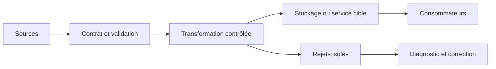
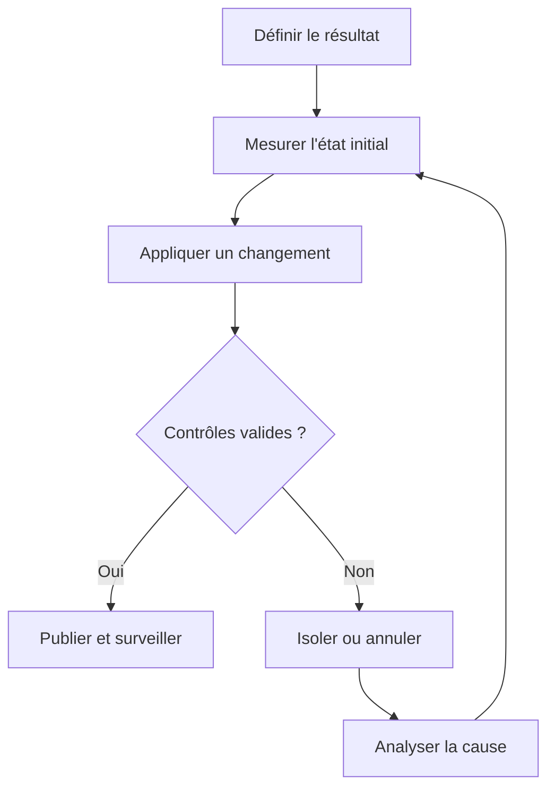
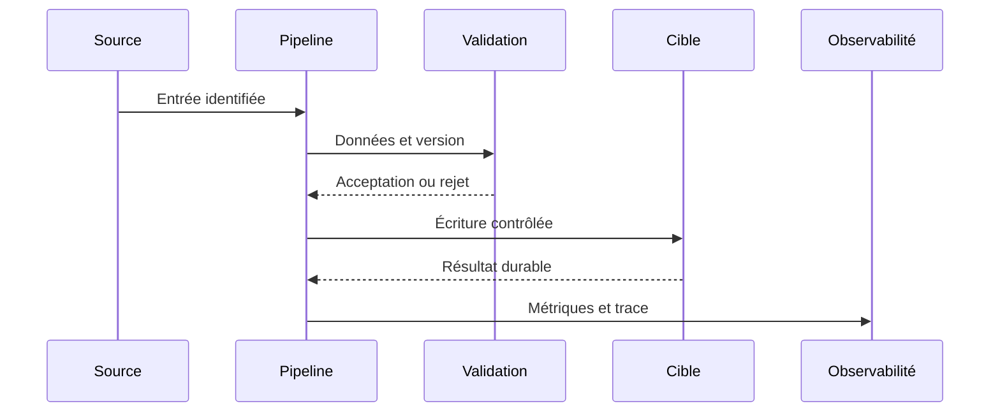
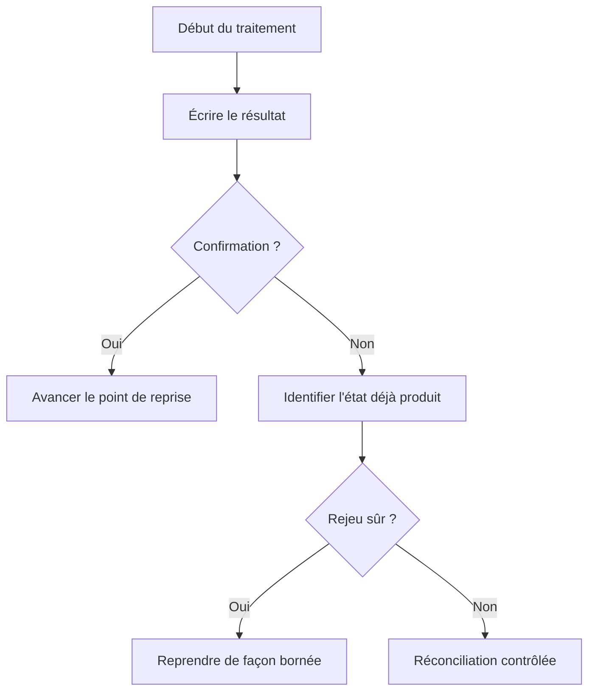
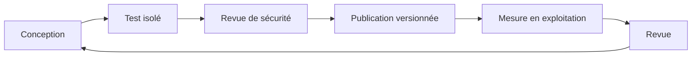

# Data Lakes et Lakehouse — Expert

> **Mise en contexte.** Ce cours approfondit Data Lake, Lakehouse et gouvernance du stockage objet. Il vise une décision technique justifiable, testable et exploitable. Les exemples doivent être adaptés à la version du moteur et au contexte réel. Utilisez des données synthétiques, notez versions et paramètres, et préparez la restauration ou le retour arrière avant une opération risquée. N’insérez jamais de secret ou de donnée personnelle dans les commandes partagées.

## Introduction et objectifs pédagogiques

La compétence recherchée ne consiste pas à exécuter une recette, mais à expliquer pourquoi une solution répond au besoin et quelles limites elle conserve. Un résultat plausible sur le cas nominal n’est pas une preuve suffisante : les erreurs, l’ordre des événements, les données absentes, la concurrence et les changements de version doivent faire partie du raisonnement.

À l’issue du cours, vous devez pouvoir définir un contrat, identifier la source de vérité, comparer plusieurs approches, construire un test reproductible, interpréter une trace et expliquer une procédure de reprise. Vous devez également pouvoir différencier une garantie fournie par le système d’un comportement qui dépend d’un paramètre ou d’un choix applicatif. La validation attendue relie intention, entrée, état final et preuve.

Objectifs opérationnels : écrire les invariants métier, cartographier les composants, établir une baseline, mesurer les risques et les coûts, traiter les échecs explicitement, protéger les données, automatiser les assertions prioritaires et documenter les limites. Le cours fournit des méthodes de validation réutilisables ; les valeurs de configuration et les garanties précises doivent être confirmées dans la documentation de la version effectivement déployée.

## Prérequis et environnement

Révisez les notions de schéma, identifiant stable, transactions, journaux, droits d’accès et tests automatisés. Consignez la version des outils, extensions, ressources, configuration et mode de déploiement. Une syntaxe qui ressemble à celle d’un autre produit ne garantit ni une sémantique ni un niveau de fiabilité identiques.

Préparez un environnement isolé, un jeu synthétique et une procédure de nettoyage. Conservez la sortie de référence et les paramètres exacts. Pour toute action destructive, préparez la restauration avant de l’exécuter. Le code retour n’est qu’un signal : il doit être complété par des contrôles sur les lignes, clés, montants, versions, messages ou métriques qui prouvent l’invariant.

## Concepts clés développés

### 1. Zones brutes, préparées et certifiées

**Principe et choix.** Les zones séparent conservation d’origine, transformation contrôlée et données prêtes à l’usage ; chaque zone doit avoir une règle d’accès et publication. Avant d’implémenter, écrivez le contrat attendu en langage métier : quelles entités, quels consommateurs et quelle granularité sont concernés ? Distinguez une garantie nécessaire d’une simple préférence d’implémentation. Si plusieurs solutions sont disponibles, comparez-les sur les mêmes critères et mesurez ce qui change réellement. Une option technique est pertinente lorsqu’elle maintient le contrat et reste compréhensible pour l’équipe qui l’exploite.

**Risque et limite.** Publier du brut comme certifié propage erreurs ; multiplier les copies sans politique ajoute coûts et confusion. Recherchez l’événement précis qui peut invalider le résultat : entrée inattendue, concurrence, changement de version, interruption entre deux étapes ou surcharge. Une conception fiable rend l’état visible et propose une action adaptée à chaque classe d’erreur. Il faut distinguer erreur temporaire, erreur permanente et résultat inconnu. Une reprise ne doit pas supposer que l’absence de réponse prouve que l’écriture n’a pas eu lieu.

**Preuve technique.** Tracer un enregistrement jusqu’au lot source et vérifier les zones accessibles au consommateur. Établissez cette preuve avant l’essai. Utilisez des entrées connues, un résultat attendu et un contrôle de l’état réellement obtenu. Conservez version, paramètres, traces et métriques. Ajoutez un cas frontière et un cas qui doit être rejeté ; un test uniquement nominal laisse de côté les invariants les plus importants. Lorsque le résultat est quantitatif, définissez le dénominateur, la fenêtre et les unités pour que la mesure soit interprétable.

**Exemple contextualisé.** Brut conserve l’entrée ; préparé normalise les types ; certifié publie un contrat stable. Commencez par un cas réduit, puis augmentez un seul facteur à la fois : volume, cardinalité, concurrence, retard, version ou droits. Comparez à une référence indépendante quand c’est possible. Si le résultat contredit l’hypothèse, conservez l’écart comme une information de diagnostic et révisez l’explication, plutôt que de changer le critère après l’observation.

**Décision d’ingénierie.** Comparez une variante simple et une variante traitant une contrainte supplémentaire. Évaluez latence, coût de stockage, charge de maintenance, privilèges requis, retour arrière et compétences nécessaires. La variante complexe n’est justifiée que si un indicateur démontre le besoin. Écrivez le seuil qui déclencherait son adoption et le signal qui imposerait de la revoir. Ce seuil rend la décision vérifiable plutôt que dépendante du goût personnel.

**Revue opérationnelle.** Demandez à un collègue de refaire l’essai à partir du compte rendu. Il doit pouvoir identifier les entrées, l’état final, le propriétaire de l’invariant et la trace à inspecter. S’il ne peut pas, la documentation ou la conception est incomplète. Un résultat exploitable peut être expliqué, surveillé, corrigé et transmis sans dépendre uniquement de la mémoire de son auteur.

### 2. Parquet et organisation physique

**Principe et choix.** Parquet est colonnaire et ses métadonnées peuvent réduire les lectures ; l’efficacité dépend colonnes, partitions et filtres exploités. Avant d’implémenter, écrivez le contrat attendu en langage métier : quelles entités, quels consommateurs et quelle granularité sont concernés ? Distinguez une garantie nécessaire d’une simple préférence d’implémentation. Si plusieurs solutions sont disponibles, comparez-les sur les mêmes critères et mesurez ce qui change réellement. Une option technique est pertinente lorsqu’elle maintient le contrat et reste compréhensible pour l’équipe qui l’exploite.

**Risque et limite.** Partition haute cardinalité génère petits fichiers ; Parquet seul n’assure pas la transaction de table. Recherchez l’événement précis qui peut invalider le résultat : entrée inattendue, concurrence, changement de version, interruption entre deux étapes ou surcharge. Une conception fiable rend l’état visible et propose une action adaptée à chaque classe d’erreur. Il faut distinguer erreur temporaire, erreur permanente et résultat inconnu. Une reprise ne doit pas supposer que l’absence de réponse prouve que l’écriture n’a pas eu lieu.

**Preuve technique.** Comparer octets lus, fichiers ouverts, colonnes scannées et durée. Établissez cette preuve avant l’essai. Utilisez des entrées connues, un résultat attendu et un contrôle de l’état réellement obtenu. Conservez version, paramètres, traces et métriques. Ajoutez un cas frontière et un cas qui doit être rejeté ; un test uniquement nominal laisse de côté les invariants les plus importants. Lorsque le résultat est quantitatif, définissez le dénominateur, la fenêtre et les unités pour que la mesure soit interprétable.

**Exemple contextualisé.** Partitionner date aide lorsque les requêtes expriment effectivement le filtre date. Commencez par un cas réduit, puis augmentez un seul facteur à la fois : volume, cardinalité, concurrence, retard, version ou droits. Comparez à une référence indépendante quand c’est possible. Si le résultat contredit l’hypothèse, conservez l’écart comme une information de diagnostic et révisez l’explication, plutôt que de changer le critère après l’observation.

**Décision d’ingénierie.** Comparez une variante simple et une variante traitant une contrainte supplémentaire. Évaluez latence, coût de stockage, charge de maintenance, privilèges requis, retour arrière et compétences nécessaires. La variante complexe n’est justifiée que si un indicateur démontre le besoin. Écrivez le seuil qui déclencherait son adoption et le signal qui imposerait de la revoir. Ce seuil rend la décision vérifiable plutôt que dépendante du goût personnel.

**Revue opérationnelle.** Demandez à un collègue de refaire l’essai à partir du compte rendu. Il doit pouvoir identifier les entrées, l’état final, le propriétaire de l’invariant et la trace à inspecter. S’il ne peut pas, la documentation ou la conception est incomplète. Un résultat exploitable peut être expliqué, surveillé, corrigé et transmis sans dépendre uniquement de la mémoire de son auteur.

### 3. Schema-on-read et évolution

**Principe et choix.** Schema-on-read apporte flexibilité mais les lecteurs doivent gérer champs absents, types, renommages et schémas historiques. Avant d’implémenter, écrivez le contrat attendu en langage métier : quelles entités, quels consommateurs et quelle granularité sont concernés ? Distinguez une garantie nécessaire d’une simple préférence d’implémentation. Si plusieurs solutions sont disponibles, comparez-les sur les mêmes critères et mesurez ce qui change réellement. Une option technique est pertinente lorsqu’elle maintient le contrat et reste compréhensible pour l’équipe qui l’exploite.

**Risque et limite.** Réutiliser un nom avec nouvelle signification corrompt les consommateurs sans erreur explicite ; cast implicite peut perdre précision. Recherchez l’événement précis qui peut invalider le résultat : entrée inattendue, concurrence, changement de version, interruption entre deux étapes ou surcharge. Une conception fiable rend l’état visible et propose une action adaptée à chaque classe d’erreur. Il faut distinguer erreur temporaire, erreur permanente et résultat inconnu. Une reprise ne doit pas supposer que l’absence de réponse prouve que l’écriture n’a pas eu lieu.

**Preuve technique.** Tester versions historiques, champs absents et conversions avant publication. Établissez cette preuve avant l’essai. Utilisez des entrées connues, un résultat attendu et un contrôle de l’état réellement obtenu. Conservez version, paramètres, traces et métriques. Ajoutez un cas frontière et un cas qui doit être rejeté ; un test uniquement nominal laisse de côté les invariants les plus importants. Lorsque le résultat est quantitatif, définissez le dénominateur, la fenêtre et les unités pour que la mesure soit interprétable.

**Exemple contextualisé.** Ajouter region au schéma doit définir le sens d’un champ absent dans les anciennes partitions. Commencez par un cas réduit, puis augmentez un seul facteur à la fois : volume, cardinalité, concurrence, retard, version ou droits. Comparez à une référence indépendante quand c’est possible. Si le résultat contredit l’hypothèse, conservez l’écart comme une information de diagnostic et révisez l’explication, plutôt que de changer le critère après l’observation.

**Décision d’ingénierie.** Comparez une variante simple et une variante traitant une contrainte supplémentaire. Évaluez latence, coût de stockage, charge de maintenance, privilèges requis, retour arrière et compétences nécessaires. La variante complexe n’est justifiée que si un indicateur démontre le besoin. Écrivez le seuil qui déclencherait son adoption et le signal qui imposerait de la revoir. Ce seuil rend la décision vérifiable plutôt que dépendante du goût personnel.

**Revue opérationnelle.** Demandez à un collègue de refaire l’essai à partir du compte rendu. Il doit pouvoir identifier les entrées, l’état final, le propriétaire de l’invariant et la trace à inspecter. S’il ne peut pas, la documentation ou la conception est incomplète. Un résultat exploitable peut être expliqué, surveillé, corrigé et transmis sans dépendre uniquement de la mémoire de son auteur.

### 4. Formats de table et snapshots

**Principe et choix.** Formats Lakehouse ajoutent métadonnées, commits et versions au-dessus des fichiers selon moteurs et fonctionnalités supportés. Avant d’implémenter, écrivez le contrat attendu en langage métier : quelles entités, quels consommateurs et quelle granularité sont concernés ? Distinguez une garantie nécessaire d’une simple préférence d’implémentation. Si plusieurs solutions sont disponibles, comparez-les sur les mêmes critères et mesurez ce qui change réellement. Une option technique est pertinente lorsqu’elle maintient le contrat et reste compréhensible pour l’équipe qui l’exploite.

**Risque et limite.** Écrire directement sous les métadonnées contourne les commits ; moteurs de versions différentes peuvent diverger. Recherchez l’événement précis qui peut invalider le résultat : entrée inattendue, concurrence, changement de version, interruption entre deux étapes ou surcharge. Une conception fiable rend l’état visible et propose une action adaptée à chaque classe d’erreur. Il faut distinguer erreur temporaire, erreur permanente et résultat inconnu. Une reprise ne doit pas supposer que l’absence de réponse prouve que l’écriture n’a pas eu lieu.

**Preuve technique.** Lire avec chaque moteur cible, inspecter snapshots et simuler un commit échoué. Établissez cette preuve avant l’essai. Utilisez des entrées connues, un résultat attendu et un contrôle de l’état réellement obtenu. Conservez version, paramètres, traces et métriques. Ajoutez un cas frontière et un cas qui doit être rejeté ; un test uniquement nominal laisse de côté les invariants les plus importants. Lorsque le résultat est quantitatif, définissez le dénominateur, la fenêtre et les unités pour que la mesure soit interprétable.

**Exemple contextualisé.** Le lecteur doit voir l’ancien snapshot complet ou le nouveau, jamais un mélange partiel. Commencez par un cas réduit, puis augmentez un seul facteur à la fois : volume, cardinalité, concurrence, retard, version ou droits. Comparez à une référence indépendante quand c’est possible. Si le résultat contredit l’hypothèse, conservez l’écart comme une information de diagnostic et révisez l’explication, plutôt que de changer le critère après l’observation.

**Décision d’ingénierie.** Comparez une variante simple et une variante traitant une contrainte supplémentaire. Évaluez latence, coût de stockage, charge de maintenance, privilèges requis, retour arrière et compétences nécessaires. La variante complexe n’est justifiée que si un indicateur démontre le besoin. Écrivez le seuil qui déclencherait son adoption et le signal qui imposerait de la revoir. Ce seuil rend la décision vérifiable plutôt que dépendante du goût personnel.

**Revue opérationnelle.** Demandez à un collègue de refaire l’essai à partir du compte rendu. Il doit pouvoir identifier les entrées, l’état final, le propriétaire de l’invariant et la trace à inspecter. S’il ne peut pas, la documentation ou la conception est incomplète. Un résultat exploitable peut être expliqué, surveillé, corrigé et transmis sans dépendre uniquement de la mémoire de son auteur.

### 5. Partitionnement et compaction

**Principe et choix.** Ces opérations réduisent lectures et coût de planification selon distribution et fréquence d’écriture. Avant d’implémenter, écrivez le contrat attendu en langage métier : quelles entités, quels consommateurs et quelle granularité sont concernés ? Distinguez une garantie nécessaire d’une simple préférence d’implémentation. Si plusieurs solutions sont disponibles, comparez-les sur les mêmes critères et mesurez ce qui change réellement. Une option technique est pertinente lorsqu’elle maintient le contrat et reste compréhensible pour l’équipe qui l’exploite.

**Risque et limite.** Compaction continue concurrence les jobs ; partition trop fine multiplie petits fichiers. Recherchez l’événement précis qui peut invalider le résultat : entrée inattendue, concurrence, changement de version, interruption entre deux étapes ou surcharge. Une conception fiable rend l’état visible et propose une action adaptée à chaque classe d’erreur. Il faut distinguer erreur temporaire, erreur permanente et résultat inconnu. Une reprise ne doit pas supposer que l’absence de réponse prouve que l’écriture n’a pas eu lieu.

**Preuve technique.** Comparer fichiers, bytes lus, durée de planification et coût de réécriture. Établissez cette preuve avant l’essai. Utilisez des entrées connues, un résultat attendu et un contrôle de l’état réellement obtenu. Conservez version, paramètres, traces et métriques. Ajoutez un cas frontière et un cas qui doit être rejeté ; un test uniquement nominal laisse de côté les invariants les plus importants. Lorsque le résultat est quantitatif, définissez le dénominateur, la fenêtre et les unités pour que la mesure soit interprétable.

**Exemple contextualisé.** Des micro-lots streaming peuvent être compactés périodiquement. Commencez par un cas réduit, puis augmentez un seul facteur à la fois : volume, cardinalité, concurrence, retard, version ou droits. Comparez à une référence indépendante quand c’est possible. Si le résultat contredit l’hypothèse, conservez l’écart comme une information de diagnostic et révisez l’explication, plutôt que de changer le critère après l’observation.

**Décision d’ingénierie.** Comparez une variante simple et une variante traitant une contrainte supplémentaire. Évaluez latence, coût de stockage, charge de maintenance, privilèges requis, retour arrière et compétences nécessaires. La variante complexe n’est justifiée que si un indicateur démontre le besoin. Écrivez le seuil qui déclencherait son adoption et le signal qui imposerait de la revoir. Ce seuil rend la décision vérifiable plutôt que dépendante du goût personnel.

**Revue opérationnelle.** Demandez à un collègue de refaire l’essai à partir du compte rendu. Il doit pouvoir identifier les entrées, l’état final, le propriétaire de l’invariant et la trace à inspecter. S’il ne peut pas, la documentation ou la conception est incomplète. Un résultat exploitable peut être expliqué, surveillé, corrigé et transmis sans dépendre uniquement de la mémoire de son auteur.

### 6. Catalogue et découverte

**Principe et choix.** Catalogue décrit nom, schéma, propriétaires, fraîcheur et classification ; chemin de fichier ne suffit pas à définir usage. Avant d’implémenter, écrivez le contrat attendu en langage métier : quelles entités, quels consommateurs et quelle granularité sont concernés ? Distinguez une garantie nécessaire d’une simple préférence d’implémentation. Si plusieurs solutions sont disponibles, comparez-les sur les mêmes critères et mesurez ce qui change réellement. Une option technique est pertinente lorsqu’elle maintient le contrat et reste compréhensible pour l’équipe qui l’exploite.

**Risque et limite.** Catalogue périmé donne fausse confiance ; métadonnées mal protégées peuvent divulguer des informations sensibles. Recherchez l’événement précis qui peut invalider le résultat : entrée inattendue, concurrence, changement de version, interruption entre deux étapes ou surcharge. Une conception fiable rend l’état visible et propose une action adaptée à chaque classe d’erreur. Il faut distinguer erreur temporaire, erreur permanente et résultat inconnu. Une reprise ne doit pas supposer que l’absence de réponse prouve que l’écriture n’a pas eu lieu.

**Preuve technique.** Demander à un consommateur d’expliquer source, définition, fraîcheur et droits. Établissez cette preuve avant l’essai. Utilisez des entrées connues, un résultat attendu et un contrôle de l’état réellement obtenu. Conservez version, paramètres, traces et métriques. Ajoutez un cas frontière et un cas qui doit être rejeté ; un test uniquement nominal laisse de côté les invariants les plus importants. Lorsque le résultat est quantitatif, définissez le dénominateur, la fenêtre et les unités pour que la mesure soit interprétable.

**Exemple contextualisé.** Table certifiée possède propriétaire et distinction claire entre production et copie exploratoire. Commencez par un cas réduit, puis augmentez un seul facteur à la fois : volume, cardinalité, concurrence, retard, version ou droits. Comparez à une référence indépendante quand c’est possible. Si le résultat contredit l’hypothèse, conservez l’écart comme une information de diagnostic et révisez l’explication, plutôt que de changer le critère après l’observation.

**Décision d’ingénierie.** Comparez une variante simple et une variante traitant une contrainte supplémentaire. Évaluez latence, coût de stockage, charge de maintenance, privilèges requis, retour arrière et compétences nécessaires. La variante complexe n’est justifiée que si un indicateur démontre le besoin. Écrivez le seuil qui déclencherait son adoption et le signal qui imposerait de la revoir. Ce seuil rend la décision vérifiable plutôt que dépendante du goût personnel.

**Revue opérationnelle.** Demandez à un collègue de refaire l’essai à partir du compte rendu. Il doit pouvoir identifier les entrées, l’état final, le propriétaire de l’invariant et la trace à inspecter. S’il ne peut pas, la documentation ou la conception est incomplète. Un résultat exploitable peut être expliqué, surveillé, corrigé et transmis sans dépendre uniquement de la mémoire de son auteur.

### 7. Sécurité et rétention

**Principe et choix.** Un lac concentre des données sensibles ; accès au stockage, catalogue, clés, snapshots et sauvegardes doivent suivre l’identité et la finalité. Avant d’implémenter, écrivez le contrat attendu en langage métier : quelles entités, quels consommateurs et quelle granularité sont concernés ? Distinguez une garantie nécessaire d’une simple préférence d’implémentation. Si plusieurs solutions sont disponibles, comparez-les sur les mêmes critères et mesurez ce qui change réellement. Une option technique est pertinente lorsqu’elle maintient le contrat et reste compréhensible pour l’équipe qui l’exploite.

**Risque et limite.** Supprimer le fichier courant ne supprime pas nécessairement les snapshots ; accès bucket peut contourner catalogue. Recherchez l’événement précis qui peut invalider le résultat : entrée inattendue, concurrence, changement de version, interruption entre deux étapes ou surcharge. Une conception fiable rend l’état visible et propose une action adaptée à chaque classe d’erreur. Il faut distinguer erreur temporaire, erreur permanente et résultat inconnu. Une reprise ne doit pas supposer que l’absence de réponse prouve que l’écriture n’a pas eu lieu.

**Preuve technique.** Tester rôles et traitement de suppression sur copies et snapshots. Établissez cette preuve avant l’essai. Utilisez des entrées connues, un résultat attendu et un contrôle de l’état réellement obtenu. Conservez version, paramètres, traces et métriques. Ajoutez un cas frontière et un cas qui doit être rejeté ; un test uniquement nominal laisse de côté les invariants les plus importants. Lorsque le résultat est quantitatif, définissez le dénominateur, la fenêtre et les unités pour que la mesure soit interprétable.

**Exemple contextualisé.** Une suppression doit suivre les données dérivées et les durées légitimes de conservation. Commencez par un cas réduit, puis augmentez un seul facteur à la fois : volume, cardinalité, concurrence, retard, version ou droits. Comparez à une référence indépendante quand c’est possible. Si le résultat contredit l’hypothèse, conservez l’écart comme une information de diagnostic et révisez l’explication, plutôt que de changer le critère après l’observation.

**Décision d’ingénierie.** Comparez une variante simple et une variante traitant une contrainte supplémentaire. Évaluez latence, coût de stockage, charge de maintenance, privilèges requis, retour arrière et compétences nécessaires. La variante complexe n’est justifiée que si un indicateur démontre le besoin. Écrivez le seuil qui déclencherait son adoption et le signal qui imposerait de la revoir. Ce seuil rend la décision vérifiable plutôt que dépendante du goût personnel.

**Revue opérationnelle.** Demandez à un collègue de refaire l’essai à partir du compte rendu. Il doit pouvoir identifier les entrées, l’état final, le propriétaire de l’invariant et la trace à inspecter. S’il ne peut pas, la documentation ou la conception est incomplète. Un résultat exploitable peut être expliqué, surveillé, corrigé et transmis sans dépendre uniquement de la mémoire de son auteur.

### 8. Contrats et coût

**Principe et choix.** Qualité, fraîcheur, provenance, droits et coût sont des propriétés d’un dataset partagé. Avant d’implémenter, écrivez le contrat attendu en langage métier : quelles entités, quels consommateurs et quelle granularité sont concernés ? Distinguez une garantie nécessaire d’une simple préférence d’implémentation. Si plusieurs solutions sont disponibles, comparez-les sur les mêmes critères et mesurez ce qui change réellement. Une option technique est pertinente lorsqu’elle maintient le contrat et reste compréhensible pour l’équipe qui l’exploite.

**Risque et limite.** Dataset volumineux peut coûter cher et rester peu fiable sans propriétaire ni seuils. Recherchez l’événement précis qui peut invalider le résultat : entrée inattendue, concurrence, changement de version, interruption entre deux étapes ou surcharge. Une conception fiable rend l’état visible et propose une action adaptée à chaque classe d’erreur. Il faut distinguer erreur temporaire, erreur permanente et résultat inconnu. Une reprise ne doit pas supposer que l’absence de réponse prouve que l’écriture n’a pas eu lieu.

**Preuve technique.** Mesurer volumes, coût, fraîcheur et erreurs ; tester une violation du contrat. Établissez cette preuve avant l’essai. Utilisez des entrées connues, un résultat attendu et un contrôle de l’état réellement obtenu. Conservez version, paramètres, traces et métriques. Ajoutez un cas frontière et un cas qui doit être rejeté ; un test uniquement nominal laisse de côté les invariants les plus importants. Lorsque le résultat est quantitatif, définissez le dénominateur, la fenêtre et les unités pour que la mesure soit interprétable.

**Exemple contextualisé.** Certification après contrôles de clés, totaux, fraîcheur et provenance. Commencez par un cas réduit, puis augmentez un seul facteur à la fois : volume, cardinalité, concurrence, retard, version ou droits. Comparez à une référence indépendante quand c’est possible. Si le résultat contredit l’hypothèse, conservez l’écart comme une information de diagnostic et révisez l’explication, plutôt que de changer le critère après l’observation.

**Décision d’ingénierie.** Comparez une variante simple et une variante traitant une contrainte supplémentaire. Évaluez latence, coût de stockage, charge de maintenance, privilèges requis, retour arrière et compétences nécessaires. La variante complexe n’est justifiée que si un indicateur démontre le besoin. Écrivez le seuil qui déclencherait son adoption et le signal qui imposerait de la revoir. Ce seuil rend la décision vérifiable plutôt que dépendante du goût personnel.

**Revue opérationnelle.** Demandez à un collègue de refaire l’essai à partir du compte rendu. Il doit pouvoir identifier les entrées, l’état final, le propriétaire de l’invariant et la trace à inspecter. S’il ne peut pas, la documentation ou la conception est incomplète. Un résultat exploitable peut être expliqué, surveillé, corrigé et transmis sans dépendre uniquement de la mémoire de son auteur.

## Architecture et schémas de référence

Le premier schéma représente le passage de l’entrée à la publication. Attribuez à chaque bloc un propriétaire et un contrôle automatisable.



La boucle de contrôle distingue hypothèse, changement et preuve.



Le diagramme de séquence identifie la frontière où le résultat devient durable.



Le chemin d’erreur doit préciser comment reconnaître un effet déjà appliqué.



Le cycle complet relie conception et amélioration continue.



## Méthode d’ingénierie : du besoin à une opération sûre

### 1. Définir le contrat

Décrire effet attendu, préconditions, postconditions et invariant métier avant de choisir une option. Pour ce cours, consignez les hypothèses, les données, la version et les résultats. Si un paramètre est inconnu, expliquez comment le mesurer plutôt que d’inventer une valeur. Faits, hypothèses et décisions doivent rester distincts pour qu’un autre opérateur puisse refaire la validation.

### 2. Identifier la source de vérité

Lister systèmes faisant autorité, copies et transformations ; retracer le résultat jusqu’à son origine. Pour ce cours, consignez les hypothèses, les données, la version et les résultats. Si un paramètre est inconnu, expliquez comment le mesurer plutôt que d’inventer une valeur. Faits, hypothèses et décisions doivent rester distincts pour qu’un autre opérateur puisse refaire la validation.

### 3. Établir une baseline

Conserver version, paramètres, volume et sortie témoin pour comparer les mêmes conditions. Pour ce cours, consignez les hypothèses, les données, la version et les résultats. Si un paramètre est inconnu, expliquez comment le mesurer plutôt que d’inventer une valeur. Faits, hypothèses et décisions doivent rester distincts pour qu’un autre opérateur puisse refaire la validation.

### 4. Tester une hypothèse

Définir le signal qui confirmerait ou réfuterait la cause et isoler une variable. Pour ce cours, consignez les hypothèses, les données, la version et les résultats. Si un paramètre est inconnu, expliquez comment le mesurer plutôt que d’inventer une valeur. Faits, hypothèses et décisions doivent rester distincts pour qu’un autre opérateur puisse refaire la validation.

### 5. Traiter les cas négatifs

Inclure absence, doublons, limites, concurrence et interruption ; définir erreurs attendues. Pour ce cours, consignez les hypothèses, les données, la version et les résultats. Si un paramètre est inconnu, expliquez comment le mesurer plutôt que d’inventer une valeur. Faits, hypothèses et décisions doivent rester distincts pour qu’un autre opérateur puisse refaire la validation.

### 6. Planifier le rejeu

Décider comment reconnaître un effet déjà validé et réconcilier un état partiel. Pour ce cours, consignez les hypothèses, les données, la version et les résultats. Si un paramètre est inconnu, expliquez comment le mesurer plutôt que d’inventer une valeur. Faits, hypothèses et décisions doivent rester distincts pour qu’un autre opérateur puisse refaire la validation.

### 7. Sécuriser les traces

Conserver le contexte nécessaire sans secrets ou données personnelles inutiles. Pour ce cours, consignez les hypothèses, les données, la version et les résultats. Si un paramètre est inconnu, expliquez comment le mesurer plutôt que d’inventer une valeur. Faits, hypothèses et décisions doivent rester distincts pour qu’un autre opérateur puisse refaire la validation.

### 8. Automatiser l’assertion

Transformer les invariants en tests avec sortie lisible et propriétaire d’alerte. Pour ce cours, consignez les hypothèses, les données, la version et les résultats. Si un paramètre est inconnu, expliquez comment le mesurer plutôt que d’inventer une valeur. Faits, hypothèses et décisions doivent rester distincts pour qu’un autre opérateur puisse refaire la validation.

### 9. Mesurer le compromis

Quantifier latence, coût, volume, complexité, maintenance et effet sur les étapes voisines. Pour ce cours, consignez les hypothèses, les données, la version et les résultats. Si un paramètre est inconnu, expliquez comment le mesurer plutôt que d’inventer une valeur. Faits, hypothèses et décisions doivent rester distincts pour qu’un autre opérateur puisse refaire la validation.

### 10. Documenter la décision

Enregistrer alternatives, limites, version, retour arrière et seuils de révision. Pour ce cours, consignez les hypothèses, les données, la version et les résultats. Si un paramètre est inconnu, expliquez comment le mesurer plutôt que d’inventer une valeur. Faits, hypothèses et décisions doivent rester distincts pour qu’un autre opérateur puisse refaire la validation.

## Atelier pratique guidé

### But

Mettre en pratique publier un jeu de données versionné sans exposer des fichiers partiels dans une copie isolée. Le laboratoire ne modifie pas de données de production. La réussite est démontrée par les sorties et contrôles, pas seulement par l’exécution d’une commande.

### Commande ou point de départ

```
SELECT event_date, count(*) AS rows,
       count(*) - count(customer_id) AS missing_keys
FROM analytics_events GROUP BY event_date ORDER BY event_date DESC;
```

Adaptez la syntaxe aux versions et droits réellement disponibles. Vérifiez la cible avant toute commande d’écriture ; si l’environnement ne correspond pas aux hypothèses, arrêtez-vous et consignez l’écart au lieu de l’ignorer.

### Déroulement

1. Conserver la zone brute avec lot, version, horodatage et provenance. Notez l’entrée, la version, le résultat observé et l’invariant vérifié. Si le résultat diffère, conservez la trace et stoppez les automatismes qui pourraient amplifier l’erreur. Comparez la sortie à la référence définie avant l’expérience.

2. Définir contrat de schéma et politique d’évolution avec les consommateurs. Notez l’entrée, la version, le résultat observé et l’invariant vérifié. Si le résultat diffère, conservez la trace et stoppez les automatismes qui pourraient amplifier l’erreur. Comparez la sortie à la référence définie avant l’expérience.

3. Convertir lot validé et vérifier types, partitions et tailles de fichiers. Notez l’entrée, la version, le résultat observé et l’invariant vérifié. Si le résultat diffère, conservez la trace et stoppez les automatismes qui pourraient amplifier l’erreur. Comparez la sortie à la référence définie avant l’expérience.

4. Utiliser une table gouvernée ou un format qui publie des commits cohérents. Notez l’entrée, la version, le résultat observé et l’invariant vérifié. Si le résultat diffère, conservez la trace et stoppez les automatismes qui pourraient amplifier l’erreur. Comparez la sortie à la référence définie avant l’expérience.

5. Simuler évolution, publication partielle et compaction puis vérifier les snapshots. Notez l’entrée, la version, le résultat observé et l’invariant vérifié. Si le résultat diffère, conservez la trace et stoppez les automatismes qui pourraient amplifier l’erreur. Comparez la sortie à la référence définie avant l’expérience.

6. Publier propriétaire, fraîcheur, lineage, classification et contrôles qualité. Notez l’entrée, la version, le résultat observé et l’invariant vérifié. Si le résultat diffère, conservez la trace et stoppez les automatismes qui pourraient amplifier l’erreur. Comparez la sortie à la référence définie avant l’expérience.

### Critères d’acceptation

Le cas nominal doit être correct, le cas invalide doit être rejeté explicitement et une seconde exécution ne doit pas créer un nouvel effet métier non désiré. La procédure doit pouvoir être rejouée par un autre apprenant. Le rapport décrit les limites, risques résiduels et chemins de retour arrière. Un résultat simplement plausible mais non réconcilié ne suffit pas.

## Étude de cas détaillée

### Situation : Après une compaction et une évolution de schéma, deux moteurs voient des états différents

La première réaction peut être de redémarrer, d’augmenter les ressources ou de corriger seulement les valeurs visibles. Ces gestes peuvent masquer le symptôme sans traiter la cause. L’analyse commence par une chronologie, une référence saine et une hypothèse qui peut être réfutée par un signal observable. Il faut établir le moment exact où l’état a divergé et identifier les changements intervenus dans cette fenêtre.

### Indices à examiner

- Publier du brut comme certifié propage erreurs ; multiplier les copies sans politique ajoute coûts et confusion.
- Partition haute cardinalité génère petits fichiers ; Parquet seul n’assure pas la transaction de table.
- Réutiliser un nom avec nouvelle signification corrompt les consommateurs sans erreur explicite ; cast implicite peut perdre précision.
- Écrire directement sous les métadonnées contourne les commits ; moteurs de versions différentes peuvent diverger.

Corrélez les indices sur une même fenêtre temporelle. Relevez les identifiants, versions, paramètres, opérations actives et erreurs. Une hypothèse doit prévoir un signal ; si celui-ci n’apparaît pas, révisez le diagnostic. Distinguez causes de données, de code, de configuration, de droits, de charge et de capacité. Une correction qui agit sur la mauvaise couche peut réduire temporairement le symptôme tout en augmentant la difficulté d’un futur diagnostic.

### Correction de référence

La correction doit commencer par un diagnostic ciblé plutôt que par un changement global. Comparez au moins deux solutions et retenez celle dont les garanties couvrent le contrat, sans imposer une complexité superflue. Appliquez-la sur une copie, mesurez l’état avant et après, puis rejouez un scénario proche de l’incident. Si plusieurs systèmes sont impliqués, définissez l’ordre de changement, le propriétaire et la réponse à une interruption intermédiaire.

### Preuve d’efficacité

Rejouez le même scénario avec la même entrée, puis ajoutez une limite et une interruption contrôlée. Comparez les résultats à une référence indépendante et mesurez les indicateurs pertinents. La correction est acceptable si l’invariant est préservé, si les traces permettent d’expliquer le résultat et si une autre personne peut refaire les contrôles. Les limites restantes doivent être consignées, même lorsque le test est réussi.

## Pièges à éviter

### Piège 1 — Zones brutes, préparées et certifiées

Publier du brut comme certifié propage erreurs ; multiplier les copies sans politique ajoute coûts et confusion. Pour éviter le piège, écrivez l’attendu avant le changement, testez une entrée normale et une adversariale, puis examinez les traces. Une solution fragile ne fonctionne que lorsque volume et ordre sont favorables. Attribuez un propriétaire à la règle et prévoyez une réparation si l’écart est découvert après publication.

### Piège 2 — Parquet et organisation physique

Partition haute cardinalité génère petits fichiers ; Parquet seul n’assure pas la transaction de table. Pour éviter le piège, écrivez l’attendu avant le changement, testez une entrée normale et une adversariale, puis examinez les traces. Une solution fragile ne fonctionne que lorsque volume et ordre sont favorables. Attribuez un propriétaire à la règle et prévoyez une réparation si l’écart est découvert après publication.

### Piège 3 — Schema-on-read et évolution

Réutiliser un nom avec nouvelle signification corrompt les consommateurs sans erreur explicite ; cast implicite peut perdre précision. Pour éviter le piège, écrivez l’attendu avant le changement, testez une entrée normale et une adversariale, puis examinez les traces. Une solution fragile ne fonctionne que lorsque volume et ordre sont favorables. Attribuez un propriétaire à la règle et prévoyez une réparation si l’écart est découvert après publication.

### Piège 4 — Formats de table et snapshots

Écrire directement sous les métadonnées contourne les commits ; moteurs de versions différentes peuvent diverger. Pour éviter le piège, écrivez l’attendu avant le changement, testez une entrée normale et une adversariale, puis examinez les traces. Une solution fragile ne fonctionne que lorsque volume et ordre sont favorables. Attribuez un propriétaire à la règle et prévoyez une réparation si l’écart est découvert après publication.

### Piège 5 — Partitionnement et compaction

Compaction continue concurrence les jobs ; partition trop fine multiplie petits fichiers. Pour éviter le piège, écrivez l’attendu avant le changement, testez une entrée normale et une adversariale, puis examinez les traces. Une solution fragile ne fonctionne que lorsque volume et ordre sont favorables. Attribuez un propriétaire à la règle et prévoyez une réparation si l’écart est découvert après publication.

### Piège 6 — Catalogue et découverte

Catalogue périmé donne fausse confiance ; métadonnées mal protégées peuvent divulguer des informations sensibles. Pour éviter le piège, écrivez l’attendu avant le changement, testez une entrée normale et une adversariale, puis examinez les traces. Une solution fragile ne fonctionne que lorsque volume et ordre sont favorables. Attribuez un propriétaire à la règle et prévoyez une réparation si l’écart est découvert après publication.

### Piège 7 — Sécurité et rétention

Supprimer le fichier courant ne supprime pas nécessairement les snapshots ; accès bucket peut contourner catalogue. Pour éviter le piège, écrivez l’attendu avant le changement, testez une entrée normale et une adversariale, puis examinez les traces. Une solution fragile ne fonctionne que lorsque volume et ordre sont favorables. Attribuez un propriétaire à la règle et prévoyez une réparation si l’écart est découvert après publication.

### Piège 8 — Contrats et coût

Dataset volumineux peut coûter cher et rester peu fiable sans propriétaire ni seuils. Pour éviter le piège, écrivez l’attendu avant le changement, testez une entrée normale et une adversariale, puis examinez les traces. Une solution fragile ne fonctionne que lorsque volume et ordre sont favorables. Attribuez un propriétaire à la règle et prévoyez une réparation si l’écart est découvert après publication.

## Diagnostic : fiches de vérification

### Diagnostic 1 — Zones brutes, préparées et certifiées

**Symptôme.** Publier du brut comme certifié propage erreurs ; multiplier les copies sans politique ajoute coûts et confusion.

**Vérifications.** Tracer un enregistrement jusqu’au lot source et vérifier les zones accessibles au consommateur. Contrôlez aussi la version, les paramètres et la granularité du résultat. Un total global correct peut cacher un groupe incorrect, une ligne dupliquée ou une publication incomplète.

**Action prudente.** Les zones séparent conservation d’origine, transformation contrôlée et données prêtes à l’usage ; chaque zone doit avoir une règle d’accès et publication. Limitez la correction au périmètre démontré et conservez une procédure pour revenir à l’état précédent.

### Diagnostic 2 — Parquet et organisation physique

**Symptôme.** Partition haute cardinalité génère petits fichiers ; Parquet seul n’assure pas la transaction de table.

**Vérifications.** Comparer octets lus, fichiers ouverts, colonnes scannées et durée. Contrôlez aussi la version, les paramètres et la granularité du résultat. Un total global correct peut cacher un groupe incorrect, une ligne dupliquée ou une publication incomplète.

**Action prudente.** Parquet est colonnaire et ses métadonnées peuvent réduire les lectures ; l’efficacité dépend colonnes, partitions et filtres exploités. Limitez la correction au périmètre démontré et conservez une procédure pour revenir à l’état précédent.

### Diagnostic 3 — Schema-on-read et évolution

**Symptôme.** Réutiliser un nom avec nouvelle signification corrompt les consommateurs sans erreur explicite ; cast implicite peut perdre précision.

**Vérifications.** Tester versions historiques, champs absents et conversions avant publication. Contrôlez aussi la version, les paramètres et la granularité du résultat. Un total global correct peut cacher un groupe incorrect, une ligne dupliquée ou une publication incomplète.

**Action prudente.** Schema-on-read apporte flexibilité mais les lecteurs doivent gérer champs absents, types, renommages et schémas historiques. Limitez la correction au périmètre démontré et conservez une procédure pour revenir à l’état précédent.

### Diagnostic 4 — Formats de table et snapshots

**Symptôme.** Écrire directement sous les métadonnées contourne les commits ; moteurs de versions différentes peuvent diverger.

**Vérifications.** Lire avec chaque moteur cible, inspecter snapshots et simuler un commit échoué. Contrôlez aussi la version, les paramètres et la granularité du résultat. Un total global correct peut cacher un groupe incorrect, une ligne dupliquée ou une publication incomplète.

**Action prudente.** Formats Lakehouse ajoutent métadonnées, commits et versions au-dessus des fichiers selon moteurs et fonctionnalités supportés. Limitez la correction au périmètre démontré et conservez une procédure pour revenir à l’état précédent.

### Diagnostic 5 — Partitionnement et compaction

**Symptôme.** Compaction continue concurrence les jobs ; partition trop fine multiplie petits fichiers.

**Vérifications.** Comparer fichiers, bytes lus, durée de planification et coût de réécriture. Contrôlez aussi la version, les paramètres et la granularité du résultat. Un total global correct peut cacher un groupe incorrect, une ligne dupliquée ou une publication incomplète.

**Action prudente.** Ces opérations réduisent lectures et coût de planification selon distribution et fréquence d’écriture. Limitez la correction au périmètre démontré et conservez une procédure pour revenir à l’état précédent.

### Diagnostic 6 — Catalogue et découverte

**Symptôme.** Catalogue périmé donne fausse confiance ; métadonnées mal protégées peuvent divulguer des informations sensibles.

**Vérifications.** Demander à un consommateur d’expliquer source, définition, fraîcheur et droits. Contrôlez aussi la version, les paramètres et la granularité du résultat. Un total global correct peut cacher un groupe incorrect, une ligne dupliquée ou une publication incomplète.

**Action prudente.** Catalogue décrit nom, schéma, propriétaires, fraîcheur et classification ; chemin de fichier ne suffit pas à définir usage. Limitez la correction au périmètre démontré et conservez une procédure pour revenir à l’état précédent.

### Diagnostic 7 — Sécurité et rétention

**Symptôme.** Supprimer le fichier courant ne supprime pas nécessairement les snapshots ; accès bucket peut contourner catalogue.

**Vérifications.** Tester rôles et traitement de suppression sur copies et snapshots. Contrôlez aussi la version, les paramètres et la granularité du résultat. Un total global correct peut cacher un groupe incorrect, une ligne dupliquée ou une publication incomplète.

**Action prudente.** Un lac concentre des données sensibles ; accès au stockage, catalogue, clés, snapshots et sauvegardes doivent suivre l’identité et la finalité. Limitez la correction au périmètre démontré et conservez une procédure pour revenir à l’état précédent.

### Diagnostic 8 — Contrats et coût

**Symptôme.** Dataset volumineux peut coûter cher et rester peu fiable sans propriétaire ni seuils.

**Vérifications.** Mesurer volumes, coût, fraîcheur et erreurs ; tester une violation du contrat. Contrôlez aussi la version, les paramètres et la granularité du résultat. Un total global correct peut cacher un groupe incorrect, une ligne dupliquée ou une publication incomplète.

**Action prudente.** Qualité, fraîcheur, provenance, droits et coût sont des propriétés d’un dataset partagé. Limitez la correction au périmètre démontré et conservez une procédure pour revenir à l’état précédent.

## Exercices d’application avec corrigés

### Exercice 1 — Zones brutes, préparées et certifiées

**Énoncé.** Construisez un cas minimal qui démontre l’invariant. Incluez un exemple valide, une limite et une erreur attendue. Précisez les entrées, métriques et traces nécessaires avant de lancer l’expérience.

**Corrigé détaillé.** Commencez par la démarche suivante : Les zones séparent conservation d’origine, transformation contrôlée et données prêtes à l’usage ; chaque zone doit avoir une règle d’accès et publication. Le risque à traiter est : Publier du brut comme certifié propage erreurs ; multiplier les copies sans politique ajoute coûts et confusion. La preuve doit établir que Tracer un enregistrement jusqu’au lot source et vérifier les zones accessibles au consommateur. Comparez le résultat à une référence indépendante, consignez versions et paramètres et ajoutez un test qui empêche la régression. Une variante différente est acceptable si elle démontre le même invariant et explique ses compromis de coût, sécurité et maintenance.

### Exercice 2 — Parquet et organisation physique

**Énoncé.** Construisez un cas minimal qui démontre l’invariant. Incluez un exemple valide, une limite et une erreur attendue. Précisez les entrées, métriques et traces nécessaires avant de lancer l’expérience.

**Corrigé détaillé.** Commencez par la démarche suivante : Parquet est colonnaire et ses métadonnées peuvent réduire les lectures ; l’efficacité dépend colonnes, partitions et filtres exploités. Le risque à traiter est : Partition haute cardinalité génère petits fichiers ; Parquet seul n’assure pas la transaction de table. La preuve doit établir que Comparer octets lus, fichiers ouverts, colonnes scannées et durée. Comparez le résultat à une référence indépendante, consignez versions et paramètres et ajoutez un test qui empêche la régression. Une variante différente est acceptable si elle démontre le même invariant et explique ses compromis de coût, sécurité et maintenance.

### Exercice 3 — Schema-on-read et évolution

**Énoncé.** Construisez un cas minimal qui démontre l’invariant. Incluez un exemple valide, une limite et une erreur attendue. Précisez les entrées, métriques et traces nécessaires avant de lancer l’expérience.

**Corrigé détaillé.** Commencez par la démarche suivante : Schema-on-read apporte flexibilité mais les lecteurs doivent gérer champs absents, types, renommages et schémas historiques. Le risque à traiter est : Réutiliser un nom avec nouvelle signification corrompt les consommateurs sans erreur explicite ; cast implicite peut perdre précision. La preuve doit établir que Tester versions historiques, champs absents et conversions avant publication. Comparez le résultat à une référence indépendante, consignez versions et paramètres et ajoutez un test qui empêche la régression. Une variante différente est acceptable si elle démontre le même invariant et explique ses compromis de coût, sécurité et maintenance.

### Exercice 4 — Formats de table et snapshots

**Énoncé.** Construisez un cas minimal qui démontre l’invariant. Incluez un exemple valide, une limite et une erreur attendue. Précisez les entrées, métriques et traces nécessaires avant de lancer l’expérience.

**Corrigé détaillé.** Commencez par la démarche suivante : Formats Lakehouse ajoutent métadonnées, commits et versions au-dessus des fichiers selon moteurs et fonctionnalités supportés. Le risque à traiter est : Écrire directement sous les métadonnées contourne les commits ; moteurs de versions différentes peuvent diverger. La preuve doit établir que Lire avec chaque moteur cible, inspecter snapshots et simuler un commit échoué. Comparez le résultat à une référence indépendante, consignez versions et paramètres et ajoutez un test qui empêche la régression. Une variante différente est acceptable si elle démontre le même invariant et explique ses compromis de coût, sécurité et maintenance.

### Exercice 5 — Partitionnement et compaction

**Énoncé.** Construisez un cas minimal qui démontre l’invariant. Incluez un exemple valide, une limite et une erreur attendue. Précisez les entrées, métriques et traces nécessaires avant de lancer l’expérience.

**Corrigé détaillé.** Commencez par la démarche suivante : Ces opérations réduisent lectures et coût de planification selon distribution et fréquence d’écriture. Le risque à traiter est : Compaction continue concurrence les jobs ; partition trop fine multiplie petits fichiers. La preuve doit établir que Comparer fichiers, bytes lus, durée de planification et coût de réécriture. Comparez le résultat à une référence indépendante, consignez versions et paramètres et ajoutez un test qui empêche la régression. Une variante différente est acceptable si elle démontre le même invariant et explique ses compromis de coût, sécurité et maintenance.

### Exercice 6 — Catalogue et découverte

**Énoncé.** Construisez un cas minimal qui démontre l’invariant. Incluez un exemple valide, une limite et une erreur attendue. Précisez les entrées, métriques et traces nécessaires avant de lancer l’expérience.

**Corrigé détaillé.** Commencez par la démarche suivante : Catalogue décrit nom, schéma, propriétaires, fraîcheur et classification ; chemin de fichier ne suffit pas à définir usage. Le risque à traiter est : Catalogue périmé donne fausse confiance ; métadonnées mal protégées peuvent divulguer des informations sensibles. La preuve doit établir que Demander à un consommateur d’expliquer source, définition, fraîcheur et droits. Comparez le résultat à une référence indépendante, consignez versions et paramètres et ajoutez un test qui empêche la régression. Une variante différente est acceptable si elle démontre le même invariant et explique ses compromis de coût, sécurité et maintenance.

### Exercice 7 — Sécurité et rétention

**Énoncé.** Construisez un cas minimal qui démontre l’invariant. Incluez un exemple valide, une limite et une erreur attendue. Précisez les entrées, métriques et traces nécessaires avant de lancer l’expérience.

**Corrigé détaillé.** Commencez par la démarche suivante : Un lac concentre des données sensibles ; accès au stockage, catalogue, clés, snapshots et sauvegardes doivent suivre l’identité et la finalité. Le risque à traiter est : Supprimer le fichier courant ne supprime pas nécessairement les snapshots ; accès bucket peut contourner catalogue. La preuve doit établir que Tester rôles et traitement de suppression sur copies et snapshots. Comparez le résultat à une référence indépendante, consignez versions et paramètres et ajoutez un test qui empêche la régression. Une variante différente est acceptable si elle démontre le même invariant et explique ses compromis de coût, sécurité et maintenance.

### Exercice 8 — Contrats et coût

**Énoncé.** Construisez un cas minimal qui démontre l’invariant. Incluez un exemple valide, une limite et une erreur attendue. Précisez les entrées, métriques et traces nécessaires avant de lancer l’expérience.

**Corrigé détaillé.** Commencez par la démarche suivante : Qualité, fraîcheur, provenance, droits et coût sont des propriétés d’un dataset partagé. Le risque à traiter est : Dataset volumineux peut coûter cher et rester peu fiable sans propriétaire ni seuils. La preuve doit établir que Mesurer volumes, coût, fraîcheur et erreurs ; tester une violation du contrat. Comparez le résultat à une référence indépendante, consignez versions et paramètres et ajoutez un test qui empêche la régression. Une variante différente est acceptable si elle démontre le même invariant et explique ses compromis de coût, sécurité et maintenance.

## Revue approfondie des limites opérationnelles

### Analyse de limite 1 — Zones brutes, préparées et certifiées

Examinez ce qui arrive juste avant et après une panne. Décrivez l’état durable, l’identifiant de corrélation, les ressources retenues et le signal qui permet de savoir si l’opération a déjà eu lieu. Distinguez erreur définitive, erreur temporaire et résultat inconnu : ces états ne doivent pas partager aveuglément la même stratégie de reprise. Une procédure doit expliciter quand l’opération peut être rejouée et quand une réconciliation est nécessaire.

Analysez ensuite les effets d’échelle. Une solution correcte sur quelques lignes peut devenir inefficace lorsque volume, cardinalité, utilisateurs ou concurrence augmentent. Mesurez le facteur qui s’accumule et choisissez un seuil de capacité fondé sur un essai représentatif. Incluez écritures, stockage et maintenance ; un benchmark chaud sur petit volume ne décrit pas automatiquement la production. Conservez la distribution des mesures plutôt qu’une seule durée moyenne.

Enfin, transformez l’invariant en assertion automatisable et définissez un signal d’exploitation pour détecter une dérive lente. Le test doit échouer quand la règle est rompue et garder assez de contexte pour expliquer l’échec. L’alerte doit nommer son propriétaire et donner une procédure d’investigation qui n’expose pas de données sensibles. Consignez aussi les circonstances qui imposeraient de revoir l’architecture.

### Analyse de limite 2 — Parquet et organisation physique

Examinez ce qui arrive juste avant et après une panne. Décrivez l’état durable, l’identifiant de corrélation, les ressources retenues et le signal qui permet de savoir si l’opération a déjà eu lieu. Distinguez erreur définitive, erreur temporaire et résultat inconnu : ces états ne doivent pas partager aveuglément la même stratégie de reprise. Une procédure doit expliciter quand l’opération peut être rejouée et quand une réconciliation est nécessaire.

Analysez ensuite les effets d’échelle. Une solution correcte sur quelques lignes peut devenir inefficace lorsque volume, cardinalité, utilisateurs ou concurrence augmentent. Mesurez le facteur qui s’accumule et choisissez un seuil de capacité fondé sur un essai représentatif. Incluez écritures, stockage et maintenance ; un benchmark chaud sur petit volume ne décrit pas automatiquement la production. Conservez la distribution des mesures plutôt qu’une seule durée moyenne.

Enfin, transformez l’invariant en assertion automatisable et définissez un signal d’exploitation pour détecter une dérive lente. Le test doit échouer quand la règle est rompue et garder assez de contexte pour expliquer l’échec. L’alerte doit nommer son propriétaire et donner une procédure d’investigation qui n’expose pas de données sensibles. Consignez aussi les circonstances qui imposeraient de revoir l’architecture.

### Analyse de limite 3 — Schema-on-read et évolution

Examinez ce qui arrive juste avant et après une panne. Décrivez l’état durable, l’identifiant de corrélation, les ressources retenues et le signal qui permet de savoir si l’opération a déjà eu lieu. Distinguez erreur définitive, erreur temporaire et résultat inconnu : ces états ne doivent pas partager aveuglément la même stratégie de reprise. Une procédure doit expliciter quand l’opération peut être rejouée et quand une réconciliation est nécessaire.

Analysez ensuite les effets d’échelle. Une solution correcte sur quelques lignes peut devenir inefficace lorsque volume, cardinalité, utilisateurs ou concurrence augmentent. Mesurez le facteur qui s’accumule et choisissez un seuil de capacité fondé sur un essai représentatif. Incluez écritures, stockage et maintenance ; un benchmark chaud sur petit volume ne décrit pas automatiquement la production. Conservez la distribution des mesures plutôt qu’une seule durée moyenne.

Enfin, transformez l’invariant en assertion automatisable et définissez un signal d’exploitation pour détecter une dérive lente. Le test doit échouer quand la règle est rompue et garder assez de contexte pour expliquer l’échec. L’alerte doit nommer son propriétaire et donner une procédure d’investigation qui n’expose pas de données sensibles. Consignez aussi les circonstances qui imposeraient de revoir l’architecture.

### Analyse de limite 4 — Formats de table et snapshots

Examinez ce qui arrive juste avant et après une panne. Décrivez l’état durable, l’identifiant de corrélation, les ressources retenues et le signal qui permet de savoir si l’opération a déjà eu lieu. Distinguez erreur définitive, erreur temporaire et résultat inconnu : ces états ne doivent pas partager aveuglément la même stratégie de reprise. Une procédure doit expliciter quand l’opération peut être rejouée et quand une réconciliation est nécessaire.

Analysez ensuite les effets d’échelle. Une solution correcte sur quelques lignes peut devenir inefficace lorsque volume, cardinalité, utilisateurs ou concurrence augmentent. Mesurez le facteur qui s’accumule et choisissez un seuil de capacité fondé sur un essai représentatif. Incluez écritures, stockage et maintenance ; un benchmark chaud sur petit volume ne décrit pas automatiquement la production. Conservez la distribution des mesures plutôt qu’une seule durée moyenne.

Enfin, transformez l’invariant en assertion automatisable et définissez un signal d’exploitation pour détecter une dérive lente. Le test doit échouer quand la règle est rompue et garder assez de contexte pour expliquer l’échec. L’alerte doit nommer son propriétaire et donner une procédure d’investigation qui n’expose pas de données sensibles. Consignez aussi les circonstances qui imposeraient de revoir l’architecture.

### Analyse de limite 5 — Partitionnement et compaction

Examinez ce qui arrive juste avant et après une panne. Décrivez l’état durable, l’identifiant de corrélation, les ressources retenues et le signal qui permet de savoir si l’opération a déjà eu lieu. Distinguez erreur définitive, erreur temporaire et résultat inconnu : ces états ne doivent pas partager aveuglément la même stratégie de reprise. Une procédure doit expliciter quand l’opération peut être rejouée et quand une réconciliation est nécessaire.

Analysez ensuite les effets d’échelle. Une solution correcte sur quelques lignes peut devenir inefficace lorsque volume, cardinalité, utilisateurs ou concurrence augmentent. Mesurez le facteur qui s’accumule et choisissez un seuil de capacité fondé sur un essai représentatif. Incluez écritures, stockage et maintenance ; un benchmark chaud sur petit volume ne décrit pas automatiquement la production. Conservez la distribution des mesures plutôt qu’une seule durée moyenne.

Enfin, transformez l’invariant en assertion automatisable et définissez un signal d’exploitation pour détecter une dérive lente. Le test doit échouer quand la règle est rompue et garder assez de contexte pour expliquer l’échec. L’alerte doit nommer son propriétaire et donner une procédure d’investigation qui n’expose pas de données sensibles. Consignez aussi les circonstances qui imposeraient de revoir l’architecture.

### Analyse de limite 6 — Catalogue et découverte

Examinez ce qui arrive juste avant et après une panne. Décrivez l’état durable, l’identifiant de corrélation, les ressources retenues et le signal qui permet de savoir si l’opération a déjà eu lieu. Distinguez erreur définitive, erreur temporaire et résultat inconnu : ces états ne doivent pas partager aveuglément la même stratégie de reprise. Une procédure doit expliciter quand l’opération peut être rejouée et quand une réconciliation est nécessaire.

Analysez ensuite les effets d’échelle. Une solution correcte sur quelques lignes peut devenir inefficace lorsque volume, cardinalité, utilisateurs ou concurrence augmentent. Mesurez le facteur qui s’accumule et choisissez un seuil de capacité fondé sur un essai représentatif. Incluez écritures, stockage et maintenance ; un benchmark chaud sur petit volume ne décrit pas automatiquement la production. Conservez la distribution des mesures plutôt qu’une seule durée moyenne.

Enfin, transformez l’invariant en assertion automatisable et définissez un signal d’exploitation pour détecter une dérive lente. Le test doit échouer quand la règle est rompue et garder assez de contexte pour expliquer l’échec. L’alerte doit nommer son propriétaire et donner une procédure d’investigation qui n’expose pas de données sensibles. Consignez aussi les circonstances qui imposeraient de revoir l’architecture.

### Analyse de limite 7 — Sécurité et rétention

Examinez ce qui arrive juste avant et après une panne. Décrivez l’état durable, l’identifiant de corrélation, les ressources retenues et le signal qui permet de savoir si l’opération a déjà eu lieu. Distinguez erreur définitive, erreur temporaire et résultat inconnu : ces états ne doivent pas partager aveuglément la même stratégie de reprise. Une procédure doit expliciter quand l’opération peut être rejouée et quand une réconciliation est nécessaire.

Analysez ensuite les effets d’échelle. Une solution correcte sur quelques lignes peut devenir inefficace lorsque volume, cardinalité, utilisateurs ou concurrence augmentent. Mesurez le facteur qui s’accumule et choisissez un seuil de capacité fondé sur un essai représentatif. Incluez écritures, stockage et maintenance ; un benchmark chaud sur petit volume ne décrit pas automatiquement la production. Conservez la distribution des mesures plutôt qu’une seule durée moyenne.

Enfin, transformez l’invariant en assertion automatisable et définissez un signal d’exploitation pour détecter une dérive lente. Le test doit échouer quand la règle est rompue et garder assez de contexte pour expliquer l’échec. L’alerte doit nommer son propriétaire et donner une procédure d’investigation qui n’expose pas de données sensibles. Consignez aussi les circonstances qui imposeraient de revoir l’architecture.

### Analyse de limite 8 — Contrats et coût

Examinez ce qui arrive juste avant et après une panne. Décrivez l’état durable, l’identifiant de corrélation, les ressources retenues et le signal qui permet de savoir si l’opération a déjà eu lieu. Distinguez erreur définitive, erreur temporaire et résultat inconnu : ces états ne doivent pas partager aveuglément la même stratégie de reprise. Une procédure doit expliciter quand l’opération peut être rejouée et quand une réconciliation est nécessaire.

Analysez ensuite les effets d’échelle. Une solution correcte sur quelques lignes peut devenir inefficace lorsque volume, cardinalité, utilisateurs ou concurrence augmentent. Mesurez le facteur qui s’accumule et choisissez un seuil de capacité fondé sur un essai représentatif. Incluez écritures, stockage et maintenance ; un benchmark chaud sur petit volume ne décrit pas automatiquement la production. Conservez la distribution des mesures plutôt qu’une seule durée moyenne.

Enfin, transformez l’invariant en assertion automatisable et définissez un signal d’exploitation pour détecter une dérive lente. Le test doit échouer quand la règle est rompue et garder assez de contexte pour expliquer l’échec. L’alerte doit nommer son propriétaire et donner une procédure d’investigation qui n’expose pas de données sensibles. Consignez aussi les circonstances qui imposeraient de revoir l’architecture.

## Défi final corrigé

### Scénario

Vous êtes responsable de Data Lake, Lakehouse et gouvernance du stockage objet. Le système doit absorber une hausse de charge tout en préservant résultats, reprise et sécurité. Un changement récent a modifié le comportement ; les équipes disposent d’indices partiels, mais pas d’une preuve complète.

### Travail demandé

1. Définir les objectifs et critères mesurables.
2. Dessiner l’architecture et ses frontières de confiance.
3. Établir une baseline et choisir des mesures discriminantes.
4. Construire des tests normal, frontière, erreur, concurrence et reprise.
5. Comparer deux variantes et décrire leurs compromis.
6. Appliquer une correction minimale sur une copie puis rejouer le cas initial.
7. Vérifier invariants, résultat, accès, coût et comportement en panne.
8. Préparer publication, surveillance, retour arrière et communication.

### Correction de référence

Commencez par établir une chronologie et une sortie de référence. Formulez le contrat avant la correction et nommez l’invariant à préserver. Réduisez l’écart à un exemple minimal, puis ajoutez les volumes, événements tardifs ou conditions concurrentes susceptibles de modifier le comportement. Chaque hypothèse doit avoir un signal qui la confirme et une observation qui la réfute.

Comparez une variante simple à une variante qui fournit une garantie supplémentaire. La complexité n’est justifiée que par une contrainte mesurée, comme débit, fraîcheur, restauration, sécurité ou disponibilité. Le compromis inclut coût d’exploitation, maintenance, compétences et retour arrière ; le succès sur le cas nominal ne valide pas tout le système.

Exécutez les variantes sur la même entrée, comparez les résultats à une référence indépendante, répétez un cas invalide et simulez une interruption contrôlée. Vérifiez que la reprise ne double pas les effets, que les contrôles qualité sont mesurés et que les journaux sont suffisants sans exposer de données sensibles. Intégrez le contrôle le plus important dans la CI afin de prévenir la régression.

Enfin, nommez un propriétaire, définissez les seuils d’alerte et documentez la procédure d’exploitation. La publication est validée lorsque l’invariant est préservé, le coût reste dans les limites, la reprise est testée et une autre personne peut refaire l’exercice sans dépendre de la mémoire de l’auteur.

## Checklist de mise en œuvre

- [ ] Besoin, granularité et invariants sont écrits.
- [ ] Sources, versions et paramètres sont identifiables.
- [ ] Cas normal, limites et invalides sont testés.
- [ ] Erreurs et reprises ont un comportement défini.
- [ ] Sécurité et minimisation sont contrôlées.
- [ ] Résultat réconcilié avec une référence indépendante.
- [ ] Coûts mesurés dans des conditions représentatives.
- [ ] Retour arrière et réparation sont possibles.
- [ ] Métriques et propriétaires sont connus.
- [ ] Limites et décisions sont documentées.

## Synthèse — à retenir

La maîtrise de Data Lake, Lakehouse et gouvernance du stockage objet combine compréhension des mécanismes, mesure, gestion des erreurs, sécurité et capacité d’évolution. Définissez le résultat avant le changement, testez les hypothèses, examinez la sortie réelle et distinguez les garanties des paramètres. Un succès ponctuel ne prouve pas la robustesse ; le système doit rester correct sous volume accru, entrée inattendue, concurrence ou reprise. En exploitation, chaque procédure possède un responsable, des signaux observables et des limites explicites.

## Références techniques

- https://parquet.apache.org/docs/
- https://iceberg.apache.org/docs/latest/evolution/
- https://docs.delta.io/latest/index.html

Consultez la documentation officielle de la version déployée avant de généraliser une syntaxe, option ou garantie. Les comportements varient selon le moteur et les services gérés.
