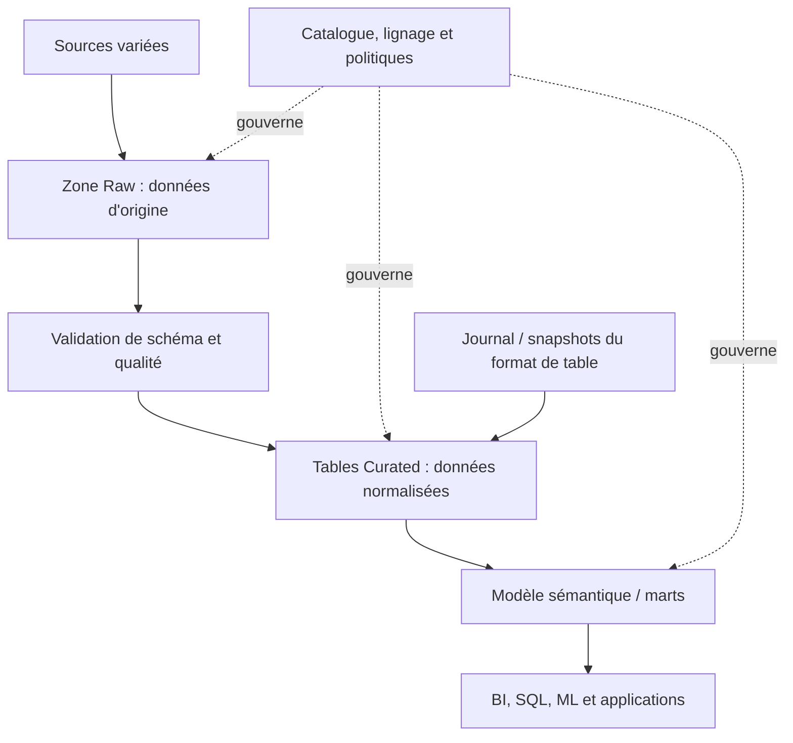

# Data Lakes et Lakehouse — Expert

> **Mise en contexte.** Un data lake conserve des données variées, parfois brutes, à grande échelle dans un stockage flexible ; un lakehouse cherche à combiner cette flexibilité avec des garanties de tables analytiques : transactions, métadonnées de schéma, évolution contrôlée et accès SQL. Le terme « lakehouse » recouvre plusieurs implémentations et ne garantit pas, à lui seul, qualité, gouvernance ou performance. L’architecture doit traiter le cycle complet : ingestion, formats, catalogue, zones de données, contrôles, concurrence, coût, sécurité, rétention et publication. Ce cours adopte une perspective d’ingénierie : choisir des contrats, maîtriser les formats et métadonnées, comparer les mécanismes de table et démontrer la reprise. Les noms de commandes et garanties dépendent du moteur et de la version utilisés.

## Objectifs pédagogiques

À l’issue du cours, vous pourrez distinguer lake et lakehouse, définir les zones raw, curated et serving, expliquer le rôle des formats en colonnes et des formats de tables, choisir une stratégie de partitionnement, comprendre transactions et snapshots, maîtriser l’évolution de schéma, concevoir la compaction et le cycle de vie, organiser catalogue et lignage, sécuriser les accès et écrire un plan de migration et de reprise.

Le niveau expert signifie qu’il faut relier chaque choix à des patterns d’accès et des garanties concrètes. Un répertoire d’objets avec des fichiers Parquet n’est pas automatiquement une table transactionnelle. Un catalogue n’est pas la preuve qu’un schéma est valide. Un moteur qui autorise deux écritures ne garantit pas que ces écritures sont isolées sans protocole adéquat. Une architecture doit expliquer comment elle gère les conflits, les lectures concurrentes, les erreurs partielles et les restaurations.

## Prérequis et environnement

Vous devez connaître les formats JSON, CSV et Parquet, les agrégations SQL, les partitions de stockage, les systèmes distribués et les bases de sécurité des données. Familiarisez-vous avec les outils de la plateforme étudiée. Avant d’expérimenter, notez le stockage cible, les droits, versions de moteur, catalogue, connecteurs et table format. Utilisez un conteneur ou un espace de test et des données synthétiques ; ne lancez pas de compaction, nettoyage ou modification destructive sur un lake partagé sans approbation.

## 1. Data lake : flexibilité et responsabilité

Un data lake stocke des données de sources multiples : événements, fichiers, exports de bases, documents, journaux, données semi-structurées ou médias. Le stockage objet distribué est fréquent, mais un lake peut utiliser d’autres systèmes. Il permet de conserver un format proche de la source puis d’appliquer différents traitements selon l’usage. Cette flexibilité crée un risque de désordre si les données ne possèdent ni propriétaire, ni schéma, ni rétention, ni contrôle d’accès.

Les fichiers bruts préservent souvent une copie fidèle des entrées et facilitent le rejeu. Ils ne doivent pas devenir une zone où des utilisateurs écrivent des versions arbitraires, sans clé de lot ni preuve de provenance. Les données brutes peuvent contenir des secrets, identifiants personnels ou informations réglementées. Le fait qu’elles soient « brutes » ne diminue pas les obligations de protection.

Un lake sain définit un chemin de maturation : données arrivées, données validées, données transformées et données publiées. Chaque transition possède un contrat. Les données source doivent garder leur provenance ; les transformations doivent enregistrer le code et la version du schéma ; les produits analytiques doivent avoir des définitions métier et un propriétaire. Le consommateur doit savoir si un dataset est expérimental, en validation ou approuvé.

## 2. Lakehouse : tables fiables sur stockage flexible

Le lakehouse vise à ajouter au stockage de fichiers des capacités de gestion de tables : snapshots cohérents, transactions ou commits atomiques à l’échelle du format, évolution de schéma, historique et optimisation des lectures. Delta Lake, Apache Iceberg et Apache Hudi sont des exemples de projets avec des mécanismes distincts. Ils ne sont pas interchangeables à toutes les versions, ni compatibles avec tous les moteurs de la même manière. Vérifiez support du catalogue, protocole de commit, isolation, fonctionnalités et connecteurs.

Le stockage sous-jacent peut rester composé de fichiers en colonnes, tandis qu’un journal ou un ensemble de métadonnées décrit quels fichiers constituent la version courante de la table. Le moteur ne doit pas se contenter de lire tous les fichiers qui existent dans le répertoire : des fichiers temporaires, obsolètes ou non publiés pourraient fausser les résultats. Un lecteur conforme utilise le mécanisme de table et la version appropriée.

Le schéma montre des responsabilités, pas une obligation d’adopter trois couches nommées. Certains systèmes utilisent bronze/silver/gold ou raw/refined/serving ; le nom importe moins que le contrat. Une architecture à plusieurs couches n’est pas automatiquement plus fiable si chaque couche copie les mêmes données sans propriétaire ou besoin.

## 3. Stockage objet et formats de fichiers

Les fichiers en colonnes comme Parquet et ORC peuvent réduire les lectures si le moteur n’a besoin que de certaines colonnes, et ils supportent généralement compression et statistiques de blocs. CSV et JSON sont pratiques pour l’échange ou le stockage initial, mais nécessitent parsing et répétition de schéma. Le choix dépend de la structure, des consommateurs, de la compatibilité et des opérations de maintenance.

Un fichier Parquet n’est pas une transaction. Un job qui écrit 300 fichiers peut échouer après 180 fichiers et laisser un répertoire qui ressemble à une sortie complète. Une table formatée transactionnellement résout ce problème à travers un protocole de commit si les outils le respectent. Si l’on travaille uniquement avec des fichiers, il faut construire un mécanisme de publication équivalent : zone de staging, manifeste, validation, puis bascule contrôlée vers une version publiée.

Les objets peuvent être immuables une fois écrits, mais cela ne signifie pas que la table est immuable ou que les objets ne peuvent être supprimés. Les systèmes de fichiers objet n’ont pas toujours les mêmes opérations atomiques qu’un système de fichiers POSIX. Un script qui renomme un dossier peut ne pas bénéficier des mêmes garanties selon le stockage. L’architecture doit être alignée sur les capacités réelles du backend.

## 4. Couche de métadonnées et catalogue

Le catalogue enregistre des informations permettant de découvrir les datasets et leurs schémas : noms, formats, partitions, emplacements, droits et parfois statistiques. Le catalogue peut être partagé par plusieurs moteurs. Il faut toutefois assurer cohérence, autorisations, disponibilité et migration de ses métadonnées. Un stockage correct mais un catalogue cassé peut devenir inaccessible aux consommateurs.

Les métadonnées de table et le catalogue ne sont pas la même chose. Un format transactionnel peut garder des snapshots et manifests dans le stockage tout en utilisant un catalogue pour localiser et verrouiller la table. Les opérations de commit nécessitent que les écritures concurrentes voient un état cohérent. Les configurations de catalogue et de verrouillage varient selon la plateforme et ne doivent pas être supposées à partir du nom du produit.

Le catalogue doit inclure des définitions compréhensibles : propriétaire, description, schéma, unité, classification, fraîcheur, source, lignage et usage autorisé. Une table nommée `fact_events_v2_final2` sans documentation ne constitue pas un produit analytique. Il faut une convention pour nom, version, statut, rétention et obsolescence, avec un processus de retrait des données inutilisées.

## 5. Transactions, snapshots et lecteurs concurrents

Une table avec snapshots expose une vue logique de l’état validé à une version donnée. Un lecteur peut continuer à voir un snapshot cohérent pendant qu’un écrivain prépare une nouvelle version, selon les garanties du format et du moteur. Le commit publie les fichiers et les métadonnées selon un protocole ; les fichiers non référencés par un snapshot courant ne doivent pas être considérés comme des données publiées.

Les conflits dépendent des opérations. Deux écrivains peuvent modifier des partitions disjointes ou se chevaucher. Un format peut détecter certains conflits et demander un retry ; le code doit ensuite recalculer de manière sûre. Si deux processus écrivent sans passer par le protocole de table, ils peuvent laisser des fichiers inattendus ou contourner l’isolation. Les outils compatibles doivent être identifiés pour chaque accès en lecture et en écriture.

Un commit réussi ne garantit pas que la transformation est métier-correcte. Il garantit seulement que la version est publiée selon le protocole. Des tests de qualité restent nécessaires : schéma, doublons, clés, mesures, fraîcheur et lignage. Le lakehouse améliore les garanties de table, mais n’invente pas la définition des indicateurs.

## 6. Évolution de schéma

Les données évoluent : une colonne peut être ajoutée, supprimée, renommée ou changer de type. Les formats et moteurs n’appliquent pas tous les mêmes règles. Une lecture qui ignore une colonne nouvelle peut rester compatible, tandis qu’un changement d’entier à texte peut échouer ou convertir silencieusement. Un changement de sens sans changement de nom est encore plus dangereux : le schéma technique reste lisible mais la donnée signifie autre chose.

Définissez la compatibilité : champs obligatoires, champs facultatifs, valeur par défaut, type autorisé, nullabilité, convention de nommage et période de coexistence des versions. Avant de rendre un champ obligatoire, contrôlez toutes les données existantes. Pour un renommage, utilisez une transition avec ancien et nouveau champ, double lecture ou transformation versionnée selon le contexte.

La migration de schéma doit être testée dans un environnement représentatif, puis déployée dans un ordre compatible avec les lecteurs. Les consommateurs plus anciens peuvent continuer à lire un snapshot historique ou une partition non migrée. Une version de schéma jointe aux lots permet de localiser les différences et de reproduire le résultat.

## 7. Partitionnement, pruning et surpartitionnement

Le partitionnement physique peut rendre une requête plus rapide en évitant de lire des groupes de fichiers que le filtre élimine. Une partition par date peut convenir aux analyses temporelles. Un partitionnement par région peut être utile si les accès filtrent souvent cette dimension et que la distribution est raisonnable. La cardinalité et le volume par partition doivent guider le choix.

Trop de partitions entraînent de nombreux petits fichiers, des métadonnées plus nombreuses et des opérations de planning plus coûteuses. Une seule partition énorme peut concentrer la charge ou ralentir les mises à jour. Évitez les clés très cardinales sans bénéfice prouvé. Mesurez fichiers par partition, taille moyenne, déséquilibre, nombre de partitions touchées et volume réellement lu.

Le partition pruning dépend de l’expression de la requête, du type de colonne, du format et du moteur. Un filtre qui convertit la date ou applique une fonction non prise en charge peut empêcher l’élimination. Le plan d’exécution et les statistiques de lecture sont nécessaires pour démontrer que le partitionnement fonctionne.

## 8. Petits fichiers et compaction

Des milliers de fichiers minuscules réduisent le débit des scans, augmentent les opérations de listing et chargent les métadonnées. Ils peuvent provenir de jobs trop parallèles, de micro-lots fréquents ou de partitions surdimensionnées. La compaction combine ces fichiers en tailles plus adaptées, mais lit et réécrit des données et consomme des ressources.

La politique de compaction doit définir la taille cible, les partitions éligibles, la concurrence, le calendrier, les critères de réussite et les fichiers obsolètes conservés. Ne compacte pas une partition en cours d’écriture sans comprendre le protocole de transaction et les locks du format. Les snapshots historiques peuvent encore référencer des fichiers qu’une procédure de nettoyage souhaiterait supprimer ; la rétention doit tenir compte des lecteurs longs et des besoins de time travel.

La compaction peut aussi changer les performances de requête et le coût de stockage. Mesurez avant/après : nombre de fichiers, octets lus, latence, coût d’écriture, fenêtre de maintenance. Une routine de compaction qui ne s’arrête jamais peut consommer la capacité réservée aux jobs métier. Elle doit avoir quotas, métriques et alertes.

## 9. Historique, time travel et nettoyage

Certains formats permettent de lire une version ou un snapshot antérieur tant que les métadonnées et fichiers nécessaires sont conservés. Cette capacité facilite les comparaisons et certaines récupérations, mais ne doit pas être considérée comme une sauvegarde indépendante. Un nettoyage trop agressif peut supprimer les fichiers de snapshots encore utiles ; une rétention infinie augmente le coût et peut contredire les politiques de données.

Définissez combien de temps les snapshots doivent rester récupérables, quelles opérations de nettoyage sont autorisées et comment vérifier qu’aucun lecteur long ne dépend encore d’un ancien état. L’heure de commit, la version de table et l’identité du job doivent permettre d’identifier la version à restaurer. Le rapport de récupération vérifie aussi la qualité de l’état avant de le promouvoir.

L’historique technique ne remplace pas une copie de sauvegarde contre la perte complète du compte ou du stockage. Pour une stratégie de reprise, définissez les domaines de panne, les accès aux clés, les copies indépendantes et les tests d’importation/lecture depuis l’emplacement de secours. Les snapshots ne protègent pas automatiquement contre la suppression de tous les fichiers ou la compromission du contrôle d’accès.

## 10. Formats de table : choisir sans slogans

Delta Lake, Apache Iceberg et Apache Hudi fournissent des approches de gestion des tables analytiques et de suivi de changements, mais leurs fonctionnalités, protocoles, connecteurs et comportements dépendent de leurs versions. Comparez les besoins : commits concurrents, snapshots, merge/upsert, suppression, évolution de schéma, partitionnement, compaction, streaming, time travel, catalogue et compatibilité entre moteurs.

Établissez une matrice de compatibilité réaliste. Une fonctionnalité supportée par un moteur en lecture ne l’est pas forcément en écriture. Un format créé avec une version récente peut utiliser une capacité non comprise par un consommateur plus ancien. Les opérations d’optimisation peuvent créer de nouveaux snapshots, compacter les fichiers ou réécrire des métadonnées. Les tests doivent refléter le portefeuille de lecteurs réels.

Ne choisissez pas un format uniquement parce qu’il est populaire. Considérez compétences, coût d’exploitation, stratégie de migration, support communautaire ou fournisseur, portabilité des données et façon de quitter la plateforme. Le format ne remplace ni une convention de schéma, ni la qualité, ni la sécurité.

## 11. Ingestion batch, incrémentale et CDC

L’ingestion peut utiliser des fichiers périodiques, des exports, des flux d’événements ou la capture de changements (CDC). Une extraction complète est simple mais coûteuse à grande échelle. L’incrémental réduit le volume, mais doit gérer retards, suppressions, mises à jour historiques, erreurs de watermark et reprises. Le CDC peut réduire la latence mais ajoute la dépendance aux journaux source, offsets et connecteurs.

Chaque lot doit posséder une identité, un instant source, une version de schéma, un compte de lignes et un statut. Les traitements doivent être idempotents ou avoir une stratégie de réparation. Un lot ne doit pas être publié avant les contrôles nécessaires. Les événements dupliqués et les modifications tardives sont des conditions normales à concevoir, pas des exceptions à traiter uniquement à la main.

Pour une source transactionnelle, comparez le dernier watermark avec la plage réellement extraite. Un champ `updated_at` peut être inexact ou manquer les suppressions ; un identifiant croissant ne capture pas les modifications des enregistrements existants. Le CDC peut capturer des deletes mais sa rétention doit dépasser le retard maximal prévu. Les métriques de retard doivent déclencher une alerte avant que la reprise exige une réingestion complète.

## 12. Qualité, déduplication et publication

Un lakehouse doit séparer les données reçues de celles qui sont validées et publiées. Contrôlez types, nulls, valeurs, clés, doublons, mesures, frais de transformation et fraîcheur. Les rejets doivent avoir un motif et conserver une référence à la source, avec une protection des données sensibles. Une suppression silencieuse peut créer un rapport apparemment stable mais incomplet.

Pour dédupliquer, choisissez une identité métier réelle : ID source, version, event ID ou combinaison justifiée. Deux événements avec même montant et même timestamp ne sont pas nécessairement le même fait. Définissez la règle de priorité quand plusieurs versions existent et gardez un historique de la décision. Pour publier, validez le lot ou le snapshot selon le mécanisme de table puis mettez à jour le statut de produit. Les consommateurs doivent lire la table et la version prévues, pas les répertoires de staging.

Les contrôles doivent préciser tolérances et seuils. Un nombre de lignes différent peut être normal si le contrat filtre certaines données ; il doit alors être expliqué. Une somme de contrôle sur les montants peut détecter des écarts mais doit gérer devises, retours, arrondis et données révisées. Comparez aussi des échantillons par clé, pas uniquement des agrégats globaux.

## 13. Sécurité, gouvernance et confidentialité

L’échelle et la variété d’un lake augmentent la surface d’exposition. Configurez identités de service distinctes, droits limités au préfixe ou à la table appropriée, chiffrement requis, gestion de clés, audit et segmentation réseau. L’accès aux données brutes doit être plus restreint lorsque celles-ci contiennent des informations sensibles ou non filtrées. Les droits du catalogue doivent être cohérents avec les droits du stockage et le comportement des moteurs.

Le principe du moindre privilège s’applique aussi aux jobs. Un pipeline ne devrait pas recevoir un accès administrateur à tout le stockage si une lecture d’une source et une écriture dans un dataset sont suffisantes. Les identifiants utilisés par les runners ne doivent pas être imprimés dans les logs. Les comptes d’urgence doivent être surveillés et les clés révoquées lorsqu’un service est retiré.

La rétention doit couvrir toutes les copies : raw, refined, snapshots, extraits, logs, caches et sauvegardes. Une table supprimée du catalogue peut rester accessible par un chemin direct si les permissions du stockage ne sont pas cohérentes. Le processus de suppression doit identifier les références et publier une preuve, tout en respectant les exigences de sauvegarde et de récupération applicables.

## 14. Performance et coût d’exploitation

Les dépenses peuvent provenir des lectures répétées, du stockage historique, des fichiers minuscules, des opérations de compaction, du shuffle, des snapshots, des sorties redondantes ou des requêtes qui scannent toute la table. Mesurez coût par dataset et par charge utile. Un lake bon marché à l’ingestion peut devenir coûteux si chaque requête relit tous les fichiers historiques.

Les statistiques de fichiers et de colonnes, quand le format et le moteur les exploitent, peuvent éliminer des lectures. Les projections, filtres et partitions doivent être écrits de façon à permettre cette élimination. Les données froides peuvent nécessiter un stockage moins coûteux, mais la latence d’accès, le coût de récupération et les règles de rétention doivent être connus.

Définissez le propriétaire et le SLA de chaque produit de données. Si une table est consultée par personne, son stockage et ses snapshots doivent être revus. Le nettoyage est une opération gouvernée : supprimez uniquement les versions et objets qui ne sont plus référencés ou requis. Une économie de stockage ne doit pas faire perdre l’unique point de reprise valide.

## 15. Atelier pratique : transformer un répertoire brut en table publiée

### Scénario

Une source dépose chaque jour des fichiers d’événements. Certains fichiers sont dupliqués, certains contiennent un champ de date mal formé, et l’application analytique demande des totaux par jour et catégorie. Vous devez concevoir les étapes raw, validée et publiée et démontrer qu’un lot peut être rejoué sans doubler les mesures.

### Étape A — Définir l’entrée

Attribuez à chaque fichier un identifiant, date de réception, source et checksum lorsque disponible. Gardez le fichier original selon la politique de rétention. Validez le schéma et les champs requis avant de le considérer comme prêt. Un fichier reçu n’est pas automatiquement un fichier valide.

### Étape B — Charger dans la zone raw

Stockez l’objet dans un emplacement contrôlé et écrivez son enregistrement de manifeste. Ne renommez pas un chemin partagé sans comprendre l’effet sur les lecteurs. Si le fichier existe déjà selon l’identité prévue, appliquez la règle de doublon et journalisez la décision. N’utilisez pas uniquement le nom de fichier si la source peut réémettre un contenu différent sous le même nom.

### Étape C — Normaliser

Convertissez dates, types et valeurs selon un contrat explicite. Placez les lignes invalides en quarantaine avec motif. Gardez source, lot, version de code et résultat de validation. Le passage à l’état validé doit être déterministe et idempotent.

### Étape D — Publier un snapshot ou une sortie stable

Dans une plateforme lakehouse, utilisez le protocole de table choisi, version et catalogue. Dans un système de fichiers sans transaction, utilisez staging, manifeste et publication contrôlée. Ne laissez pas les consommateurs parcourir des fichiers partiels. En cas d’échec au milieu de l’écriture, le job doit pouvoir être relancé sans publier deux fois les lignes.

### Étape E — Tester la qualité

Comparez nombre d’entrée, lignes acceptées, rejets, clés uniques et totaux d’agrégats. Vérifiez les dates frontières et les données inconnues. Exécutez deux fois le même lot et confirmez que la sortie publiée reste cohérente. Ensuite, simulez une mise à jour historique et contrôlez que la règle de correction est appliquée.

### Critères d’acceptation

Le laboratoire réussit si l’origine de chaque ligne est traçable, les données invalides sont visibles, les doublons sont traités selon une règle, la sortie n’est pas partielle, le rejeu est idempotent et les agrégats correspondent au contrat métier. Documentez le format, les versions, le protocole de publication, la rétention et le plan de récupération.

## 16. Étude de cas : le nettoyage a supprimé des fichiers utiles

### Situation

Une tâche automatique nettoie les vieux fichiers d’un dataset. Après l’opération, un ancien snapshot n’est plus lisible et un rapport ne peut pas revenir à sa version précédente.

### Analyse

Déterminez si les fichiers étaient encore référencés par un snapshot, si une durée de rétention minimale était en place et si des lecteurs longs utilisaient une ancienne version. Vérifiez le journal de commits, le mode de nettoyage, les permissions et l’ordre des opérations. Un fichier qui semble ancien dans un dossier peut encore être essentiel à une version valide de la table.

### Correction

Arrêtez le nettoyage automatique si son périmètre est incertain, conservez les logs et identifiez les versions récupérables. Restaurer des fichiers depuis une copie indépendante peut être nécessaire. Ne relancez pas aveuglément une compaction ou un vacuum qui risquerait d’aggraver l’état. Vérifiez d’abord les garanties et la version du format utilisé.

### Prévention

Définissez une rétention minimale supérieure à la durée de vie des transactions/lecteurs attendus, selon le format. Testez les lecteurs longs et un scénario de restauration. Restreignez les permissions de suppression, séparez les tâches d’optimisation et de nettoyage, et ajoutez une alerte pour les opérations de maintenance. La procédure doit conserver un point de récupération sain en dehors du domaine de panne courant.

## 17. Exercices avec corrigés

### Exercice 1 — Un répertoire contient des fichiers Parquet valides. Est-ce une table lakehouse ?

**Correction.** Pas nécessairement. Il peut manquer protocole de commit, snapshots, catalogue, isolation concurrente ou schéma de table. Une table formatée doit être lue et modifiée au travers des mécanismes compatibles. Sinon, il faut construire une publication contrôlée qui protège des sorties partielles.

### Exercice 2 — Pourquoi le nettoyage de snapshots doit-il être gouverné ?

**Correction.** Les anciennes versions peuvent encore référencer des fichiers utiles à des lecteurs ou à la récupération. Un nettoyage trop agressif rend ces versions impossibles à lire ; une rétention illimitée augmente les coûts et peut violer une politique de données. Définissez fenêtres, références, durée des lecteurs et preuve d’exécution.

### Exercice 3 — Comment choisir la clé de partitionnement ?

**Correction.** À partir des filtres, du volume et de la distribution. Une date peut aider les analyses temporelles mais créer de petites partitions si le volume est faible ; une clé à très forte cardinalité peut entraîner une explosion de fichiers. Mesurez pruning, tailles et coût de maintenance.

### Exercice 4 — Quelle garantie apporte un snapshot transactionnel ?

**Correction.** Il permet aux lecteurs conformes de voir une version cohérente publiée selon le protocole. Il ne prouve pas que les données satisfont les règles métier, que tous les consommateurs respectent le format, ni que le stockage entier est sauvegardé. Qualité et récupération restent nécessaires.

### Exercice 5 — Un champ change de type mais le job continue. Est-ce suffisant ?

**Correction.** Non. Une conversion silencieuse peut tronquer, invalider ou modifier le sens. Le contrat doit définir compatibilité, traitement des valeurs non convertibles et contrôle des consommateurs. Les types et résultats doivent être comparés avant la publication.

### Exercice 6 — Pourquoi garder une zone raw si les données sont transformées immédiatement ?

**Correction.** Elle peut permettre audit, rejeu et comparaison à la source, mais ajoute coût et risque de confidentialité. Sa rétention et ses accès doivent être justifiés. Pour une source reconstructible ou un contexte sensible, une autre stratégie peut être préférable ; le choix est explicite et testable.

## 18. Défi final : concevoir un lakehouse multi-moteurs

Plusieurs équipes lisent un ensemble de tables analytiques à partir de moteurs différents. Les données sont chargées en continu par lots, les schémas évoluent, certains rapports ont besoin de snapshots historiques et les données sensibles doivent être limitées aux utilisateurs autorisés.

### Corrigé attendu

Commencez par l’inventaire des consommateurs : moteurs et versions, protocoles pris en charge, requêtes, fréquence, fraîcheur et garanties nécessaires. Sélectionnez un format de table et un catalogue compatibles avec les accès et les opérations d’écriture. Testez lecture, écriture, évolution de schéma, commit concurrent, snapshots et récupération dans les versions ciblées. Évitez d’affirmer la portabilité sans test inter-moteurs.

Définissez zones raw, validée et serving avec propriétaires et rétention. Chaque lot transporte source, identité, horodatage, schéma et version de transformation. Les contrôles de qualité bloquent la publication si des seuils obligatoires échouent. La publication s’appuie sur un commit de table ou un protocole équivalent. Le registre de lots montre état technique et état métier.

Le catalogue contient schéma, description métier, classification, droits, lignage, fraîcheur et propriétaire. Les accès du stockage et du catalogue sont cohérents. Les secrets des jobs sont isolés, les environnements de test utilisent des données synthétiques et les opérations de suppression sont tracées. La politique de rétention se propage aux snapshots, exports et copies de secours.

La stratégie de performance comprend partitionnement, compaction, statistiques, surveillance des fichiers, coût des scans et capacité du moteur. Les jobs et la maintenance partagent des quotas et des fenêtres. Une procédure de reprise permet de revenir à un snapshot validé, de restaurer les fichiers depuis une copie indépendante et de prouver que les données sont cohérentes avant de réouvrir l’accès.

La remise finale fournit les décisions de format/catalogue, le diagramme, les tests de compatibilité, les règles de schéma, la matrice d’accès, les seuils qualité, l’inventaire de snapshots, la stratégie de récupération et les risques résiduels. Les équipes savent qui approuve une évolution et comment le consommateur sait qu’un résultat est validé.

## 19. Checklist d’architecture

- [ ] Les besoins de fraîcheur, historique, coût, reprise et accès sont explicites.
- [ ] Le choix lake/lakehouse et du format de table est justifié par des tests.
- [ ] Les lecteurs et écrivains utilisent un protocole compatible.
- [ ] Les zones ont des contrats, propriétaires et rétentions définis.
- [ ] Les schémas évoluent selon une politique versionnée.
- [ ] Le partitionnement et la compaction sont mesurés et limités.
- [ ] Les snapshots et nettoyages respectent la durée des lecteurs et la récupération.
- [ ] Les lots sont idempotents et les sorties publiées sont complètes.
- [ ] Le catalogue décrit métadonnées, lignage, classification et accès.
- [ ] Les politiques de stockage et catalogue sont cohérentes.
- [ ] Le plan de reprise inclut copies indépendantes, clés, versions et preuves.
- [ ] Les coûts, petits fichiers, scans et retards sont surveillés.

## Conclusion

Un lakehouse améliore la gestion des tables analytiques sur un stockage flexible, mais ne remplace ni la gouvernance, ni la qualité, ni les tests de reprise. Formats de fichiers, protocoles de table, catalogue, partitions et snapshots ont des responsabilités distinctes. Une architecture experte définit les garanties réellement disponibles, rend les changements de schéma contrôlables, protège les données et publie seulement des états vérifiés. Le résultat est un produit de données dont les utilisateurs peuvent expliquer la provenance, la fraîcheur et les limites.

## Complément : migration et portabilité des tables

### Migrer depuis des fichiers simples

Le passage d’un dossier CSV ou Parquet vers un format transactionnel doit inventorier les fichiers, identifier les doublons, confirmer schéma et grain, puis calculer les contrôles de rapprochement. Écrivez la nouvelle table dans un emplacement distinct, vérifiez le nombre de lignes, les agrégats et les clés, puis faites basculer les consommateurs via le catalogue ou une référence versionnée. Gardez une période de retour arrière définie et ne supprimez pas les anciens fichiers avant approbation.

La migration doit aussi clarifier le futur propriétaire des fichiers non référencés et des métadonnées. Un ancien job qui écrit directement dans le répertoire peut corrompre le contrat même si le nouveau format possède un journal de transactions. Bloquez ou migrez tous les producteurs vers le protocole avant de déclarer la transition terminée.

### Lire depuis plusieurs moteurs

Un moteur peut comprendre une partie du format et ne pas supporter une fonctionnalité récente. Testez le comportement réel des lectures : colonnes ajoutées, types décimaux, timestamps, suppression logique, snapshots, partitionnement et vues. Pour les écritures, testez les commits concurrents, conflits, retry et évolutions de schéma. Les capacités doivent être documentées par version, pas uniquement par nom de produit.

Si certains consommateurs ne supportent pas le format, exposez éventuellement une couche d’export stable et reconstruisible, sans permettre aux anciens lecteurs de modifier directement la table maître. L’export doit avoir un instant de génération, une version de contrat, une rétention et une vérification de complétude. Les copies de service ne doivent pas devenir silencieusement une deuxième source de vérité.

### Contrôle du cycle de vie

Le cycle de vie d’une table inclut création, qualification, publication, optimisation, dépréciation et suppression. Chaque étape comporte un propriétaire, des contrôles et des conditions de passage. Une table qui n’a plus de propriétaire devient un risque de sécurité et de coût. Un nettoyage automatique devrait se baser sur l’état du catalogue, les snapshots, les consommations récentes et les règles de rétention, puis exiger des conditions de sécurité avant la suppression.

La suppression doit considérer logs, exports, caches, snapshots et sauvegardes. Une suppression dans le catalogue seule ne garantit pas que le stockage est inaccessible. À l’inverse, effacer tous les fichiers sans tenir compte d’un snapshot peut détruire un point de récupération. Le processus doit produire une preuve de ce qui a été retiré et de ce qui reste retenu, selon les règles applicables.

### Démontrer la compatibilité opérationnelle

Un test inter-moteurs ne se limite pas à compter les lignes lues. Il doit vérifier sémantique des NULL, types numériques, fuseaux horaires, traitement des colonnes absentes, ordre des transactions, isolation et résultats après une écriture concurrente. Le test doit inclure données limites et un cas de conflit. Publiez les versions, paramètres et limitations, afin qu’une mise à niveau de moteur déclenche une nouvelle validation plutôt qu’une supposition.

Une architecture portable n’est pas une architecture sans contraintes. Elle est une architecture dont les contrats, dépendances et options sont connus, testés et révisés lorsque l’un des composants évolue.