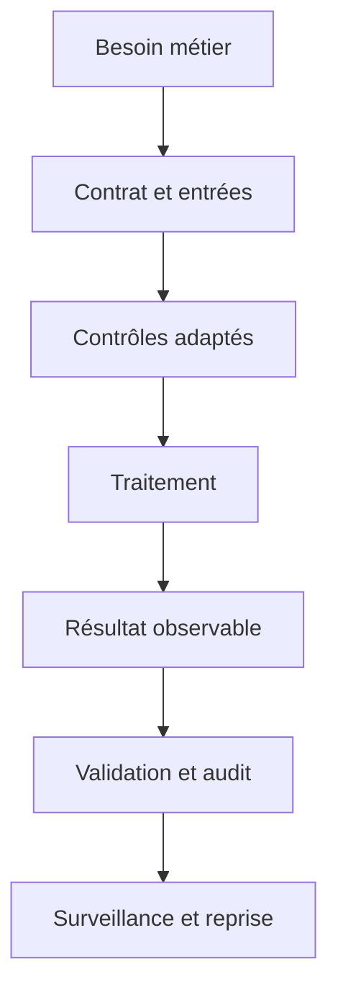
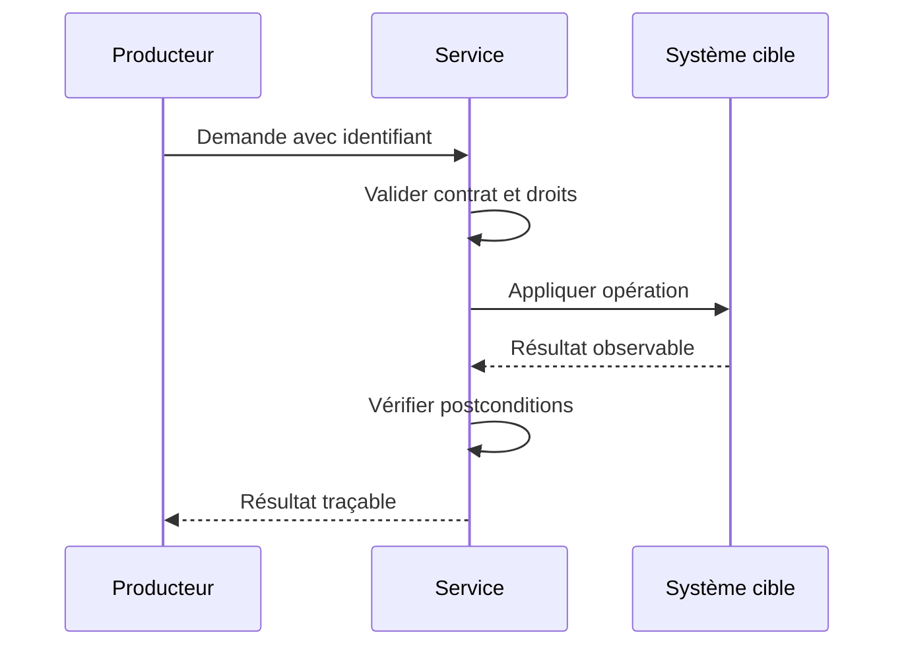
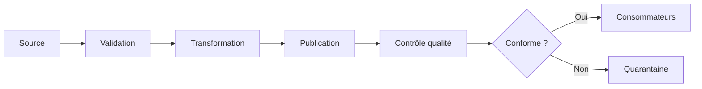
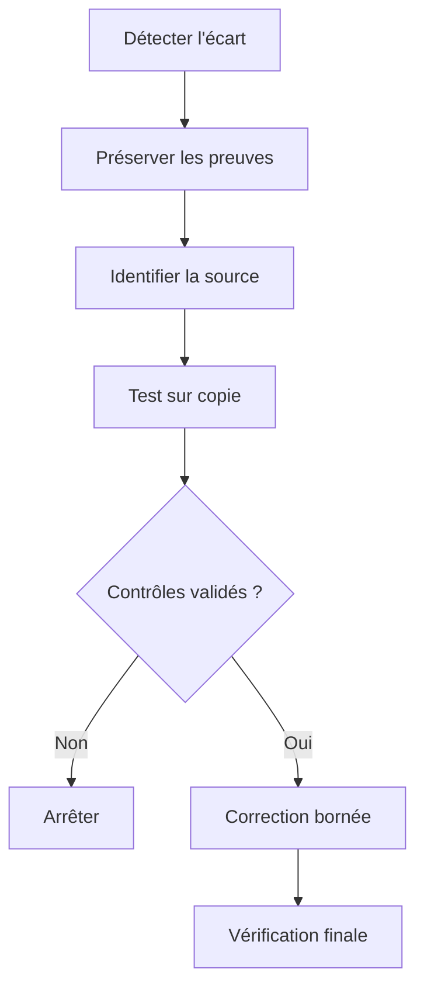
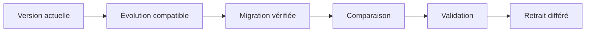

# Data Lakes et Lakehouse — Intermédiaire

> **Mise en contexte.** Organiser les données sur stockage objet avec des couches de qualité et des tables analytiques évolutives. Le fil rouge est assembler des données brutes de plusieurs sources dans une zone analytique gouvernée. Travaillez sur des données synthétiques, avec des privilèges limités et un environnement réinitialisable. Vérifiez la documentation officielle de la version avant de transposer une commande ou une garantie.

## Introduction et objectifs

Ce cours relie data lakes et lakehouse au cas concret « assembler des données brutes de plusieurs sources dans une zone analytique gouvernée ». Il faut comprendre le contrat, la source de vérité, les effets secondaires et les preuves du résultat. Ce niveau vise à traiter les cas limites, comparer des stratégies et mesurer l'effet. À la fin, vous saurez définir des invariants, choisir les contrôles, construire des tests normaux et adversariaux, vérifier le résultat réel, diagnostiquer un incident et documenter les limites. Une absence d'exception ou une capture d'écran ne suffit pas à démontrer l'état métier.

## Prérequis et environnement

Références initiales : https://iceberg.apache.org/docs/latest/, https://docs.delta.io/latest/, https://parquet.apache.org/docs/. Notez versions, paramètres, privilèges et état initial. Préparez une remise à zéro. N'utilisez pas de secrets ou données personnelles réelles. Les exemples doivent isoler les hypothèses pour pouvoir être reproduits par une autre personne.

## 1. Architecture et contrat

Décrivez la source, les producteurs, les transformations, l'état persistant et les consommateurs. Pour « assembler des données brutes de plusieurs sources dans une zone analytique gouvernée », identifiez l'autorité qui fait foi et les représentations dérivées. Le contrat précise entrées, valeurs admissibles, effets secondaires, erreurs, délais et postconditions. Cette étape distingue réussite technique et résultat fiable pour le métier.

## 2. Concepts essentiels

### 1. Stockage objet

Le concept « Stockage objet » se comprend par la règle métier qu'il protège. Dans « assembler des données brutes de plusieurs sources dans une zone analytique gouvernée », identifiez l'acteur qui produit l'information, le composant qui la traite et la propriété attendue par le consommateur. Construisez un exemple valide et un contre-exemple. Un test uniquement nominal peut masquer une erreur de modèle, une dépendance implicite ou une protection insuffisante.

Pour vérifier stockage objet, notez version, paramètres et préconditions, puis contrôlez la postcondition dans l'état réel. Si le test échoue, examinez données, contrat, droits, configuration et ordre d'exécution séparément. Ne désactivez pas un contrôle pour forcer la réussite. Expliquez le comportement d'une valeur absente, d'un doublon et d'une reprise après interruption, puis indiquez quelles métriques ou quels journaux expurgés permettent le diagnostic.

### 2. Zones bronze, silver et gold

Le concept « Zones bronze, silver et gold » se comprend par la règle métier qu'il protège. Dans « assembler des données brutes de plusieurs sources dans une zone analytique gouvernée », identifiez l'acteur qui produit l'information, le composant qui la traite et la propriété attendue par le consommateur. Construisez un exemple valide et un contre-exemple. Un test uniquement nominal peut masquer une erreur de modèle, une dépendance implicite ou une protection insuffisante.

Pour vérifier zones bronze, silver et gold, notez version, paramètres et préconditions, puis contrôlez la postcondition dans l'état réel. Si le test échoue, examinez données, contrat, droits, configuration et ordre d'exécution séparément. Ne désactivez pas un contrôle pour forcer la réussite. Expliquez le comportement d'une valeur absente, d'un doublon et d'une reprise après interruption, puis indiquez quelles métriques ou quels journaux expurgés permettent le diagnostic.

### 3. Parquet et formats colonnaires

Le concept « Parquet et formats colonnaires » se comprend par la règle métier qu'il protège. Dans « assembler des données brutes de plusieurs sources dans une zone analytique gouvernée », identifiez l'acteur qui produit l'information, le composant qui la traite et la propriété attendue par le consommateur. Construisez un exemple valide et un contre-exemple. Un test uniquement nominal peut masquer une erreur de modèle, une dépendance implicite ou une protection insuffisante.

Pour vérifier parquet et formats colonnaires, notez version, paramètres et préconditions, puis contrôlez la postcondition dans l'état réel. Si le test échoue, examinez données, contrat, droits, configuration et ordre d'exécution séparément. Ne désactivez pas un contrôle pour forcer la réussite. Expliquez le comportement d'une valeur absente, d'un doublon et d'une reprise après interruption, puis indiquez quelles métriques ou quels journaux expurgés permettent le diagnostic.

### 4. Catalogue et métadonnées

Le concept « Catalogue et métadonnées » se comprend par la règle métier qu'il protège. Dans « assembler des données brutes de plusieurs sources dans une zone analytique gouvernée », identifiez l'acteur qui produit l'information, le composant qui la traite et la propriété attendue par le consommateur. Construisez un exemple valide et un contre-exemple. Un test uniquement nominal peut masquer une erreur de modèle, une dépendance implicite ou une protection insuffisante.

Pour vérifier catalogue et métadonnées, notez version, paramètres et préconditions, puis contrôlez la postcondition dans l'état réel. Si le test échoue, examinez données, contrat, droits, configuration et ordre d'exécution séparément. Ne désactivez pas un contrôle pour forcer la réussite. Expliquez le comportement d'une valeur absente, d'un doublon et d'une reprise après interruption, puis indiquez quelles métriques ou quels journaux expurgés permettent le diagnostic.

### 5. Évolution du schéma

Le concept « Évolution du schéma » se comprend par la règle métier qu'il protège. Dans « assembler des données brutes de plusieurs sources dans une zone analytique gouvernée », identifiez l'acteur qui produit l'information, le composant qui la traite et la propriété attendue par le consommateur. Construisez un exemple valide et un contre-exemple. Un test uniquement nominal peut masquer une erreur de modèle, une dépendance implicite ou une protection insuffisante.

Pour vérifier évolution du schéma, notez version, paramètres et préconditions, puis contrôlez la postcondition dans l'état réel. Si le test échoue, examinez données, contrat, droits, configuration et ordre d'exécution séparément. Ne désactivez pas un contrôle pour forcer la réussite. Expliquez le comportement d'une valeur absente, d'un doublon et d'une reprise après interruption, puis indiquez quelles métriques ou quels journaux expurgés permettent le diagnostic.

### 6. Formats de tables

Le concept « Formats de tables » se comprend par la règle métier qu'il protège. Dans « assembler des données brutes de plusieurs sources dans une zone analytique gouvernée », identifiez l'acteur qui produit l'information, le composant qui la traite et la propriété attendue par le consommateur. Construisez un exemple valide et un contre-exemple. Un test uniquement nominal peut masquer une erreur de modèle, une dépendance implicite ou une protection insuffisante.

Pour vérifier formats de tables, notez version, paramètres et préconditions, puis contrôlez la postcondition dans l'état réel. Si le test échoue, examinez données, contrat, droits, configuration et ordre d'exécution séparément. Ne désactivez pas un contrôle pour forcer la réussite. Expliquez le comportement d'une valeur absente, d'un doublon et d'une reprise après interruption, puis indiquez quelles métriques ou quels journaux expurgés permettent le diagnostic.

### 7. Partition pruning

Le concept « Partition pruning » se comprend par la règle métier qu'il protège. Dans « assembler des données brutes de plusieurs sources dans une zone analytique gouvernée », identifiez l'acteur qui produit l'information, le composant qui la traite et la propriété attendue par le consommateur. Construisez un exemple valide et un contre-exemple. Un test uniquement nominal peut masquer une erreur de modèle, une dépendance implicite ou une protection insuffisante.

Pour vérifier partition pruning, notez version, paramètres et préconditions, puis contrôlez la postcondition dans l'état réel. Si le test échoue, examinez données, contrat, droits, configuration et ordre d'exécution séparément. Ne désactivez pas un contrôle pour forcer la réussite. Expliquez le comportement d'une valeur absente, d'un doublon et d'une reprise après interruption, puis indiquez quelles métriques ou quels journaux expurgés permettent le diagnostic.

### 8. Compaction et petits fichiers

Le concept « Compaction et petits fichiers » se comprend par la règle métier qu'il protège. Dans « assembler des données brutes de plusieurs sources dans une zone analytique gouvernée », identifiez l'acteur qui produit l'information, le composant qui la traite et la propriété attendue par le consommateur. Construisez un exemple valide et un contre-exemple. Un test uniquement nominal peut masquer une erreur de modèle, une dépendance implicite ou une protection insuffisante.

Pour vérifier compaction et petits fichiers, notez version, paramètres et préconditions, puis contrôlez la postcondition dans l'état réel. Si le test échoue, examinez données, contrat, droits, configuration et ordre d'exécution séparément. Ne désactivez pas un contrôle pour forcer la réussite. Expliquez le comportement d'une valeur absente, d'un doublon et d'une reprise après interruption, puis indiquez quelles métriques ou quels journaux expurgés permettent le diagnostic.

### 9. Gouvernance de la zone brute

Le concept « Gouvernance de la zone brute » se comprend par la règle métier qu'il protège. Dans « assembler des données brutes de plusieurs sources dans une zone analytique gouvernée », identifiez l'acteur qui produit l'information, le composant qui la traite et la propriété attendue par le consommateur. Construisez un exemple valide et un contre-exemple. Un test uniquement nominal peut masquer une erreur de modèle, une dépendance implicite ou une protection insuffisante.

Pour vérifier gouvernance de la zone brute, notez version, paramètres et préconditions, puis contrôlez la postcondition dans l'état réel. Si le test échoue, examinez données, contrat, droits, configuration et ordre d'exécution séparément. Ne désactivez pas un contrôle pour forcer la réussite. Expliquez le comportement d'une valeur absente, d'un doublon et d'une reprise après interruption, puis indiquez quelles métriques ou quels journaux expurgés permettent le diagnostic.

### 10. Contrôle de qualité

Le concept « Contrôle de qualité » se comprend par la règle métier qu'il protège. Dans « assembler des données brutes de plusieurs sources dans une zone analytique gouvernée », identifiez l'acteur qui produit l'information, le composant qui la traite et la propriété attendue par le consommateur. Construisez un exemple valide et un contre-exemple. Un test uniquement nominal peut masquer une erreur de modèle, une dépendance implicite ou une protection insuffisante.

Pour vérifier contrôle de qualité, notez version, paramètres et préconditions, puis contrôlez la postcondition dans l'état réel. Si le test échoue, examinez données, contrat, droits, configuration et ordre d'exécution séparément. Ne désactivez pas un contrôle pour forcer la réussite. Expliquez le comportement d'une valeur absente, d'un doublon et d'une reprise après interruption, puis indiquez quelles métriques ou quels journaux expurgés permettent le diagnostic.

## 3. Méthode de conception et d'exploitation

### 1. Formaliser les invariants

Écrivez ce qui doit rester vrai dans assembler des données brutes de plusieurs sources dans une zone analytique gouvernée : intégrité, unicité, ordre, confidentialité, fraîcheur ou état final. Chaque invariant doit être testable et associé à une source de vérité. Donnez un exemple permis et un exemple refusé. Si le résultat ne peut pas être contrôlé, précisez quel signal servira de preuve. Au niveau intermédiaire, il faut traiter les cas limites, comparer des stratégies et mesurer l'effet. La conclusion distingue les faits observés, les hypothèses et les risques résiduels. Un contrôle n'est acquis que si le test peut être répété et comparé.

### 2. Préparer les entrées

Définissez types, unités, bornes, valeurs optionnelles, provenance et version. Préparez des cas adversariaux : doublon, valeur vide, schéma inconnu, taille inhabituelle ou référence absente. Les données synthétiques permettent de reproduire le cas sans exposer des personnes. Modifiez une hypothèse à la fois et consignez les résultats. Au niveau intermédiaire, il faut traiter les cas limites, comparer des stratégies et mesurer l'effet. La conclusion distingue les faits observés, les hypothèses et les risques résiduels. Un contrôle n'est acquis que si le test peut être répété et comparé.

### 3. Choisir le contrôle

Placez le contrôle où il peut empêcher l'état invalide : contrainte persistante, validation de contrat, transaction, contrôle d'accès ou test d'intégration. Un contrôle tardif peut signaler l'erreur sans empêcher sa propagation. Séparez garanties, alertes et bonnes pratiques. Vérifiez la portée du mécanisme dans la version réelle. Au niveau intermédiaire, il faut traiter les cas limites, comparer des stratégies et mesurer l'effet. La conclusion distingue les faits observés, les hypothèses et les risques résiduels. Un contrôle n'est acquis que si le test peut être répété et comparé.

### 4. Gérer les erreurs

Classez les erreurs en entrée invalide, incompatibilité, accès interdit, saturation, conflit concurrent et problème transitoire. Définissez une réponse par catégorie. Les erreurs permanentes sont rejetées ou mises en quarantaine avec une raison exploitable. Une reprise temporaire est bornée et ne répète jamais aveuglément un effet non idempotent. Au niveau intermédiaire, il faut traiter les cas limites, comparer des stratégies et mesurer l'effet. La conclusion distingue les faits observés, les hypothèses et les risques résiduels. Un contrôle n'est acquis que si le test peut être répété et comparé.

### 5. Protéger les reprises

Un appel peut être répété après timeout, un worker redémarré ou un lot rejoué. Définissez l'identifiant de l'action métier unique et vérifiez le résultat enregistré avant de produire un nouvel effet. Testez reprises séquentielles et concurrentes. Si le traitement déclenche un système externe, décrivez comment réconcilier les états en cas de panne. Au niveau intermédiaire, il faut traiter les cas limites, comparer des stratégies et mesurer l'effet. La conclusion distingue les faits observés, les hypothèses et les risques résiduels. Un contrôle n'est acquis que si le test peut être répété et comparé.

### 6. Mesurer avant optimisation

Établissez une référence : latence, débit, consommation, fraîcheur, taille ou taux d'erreur. Décrivez le profil de charge. Changez un facteur à la fois et répétez la mesure. Une solution correcte sur quelques lignes peut échouer lorsque volume, distribution ou concurrence changent. L'optimisation doit préserver l'exactitude. Au niveau intermédiaire, il faut traiter les cas limites, comparer des stratégies et mesurer l'effet. La conclusion distingue les faits observés, les hypothèses et les risques résiduels. Un contrôle n'est acquis que si le test peut être répété et comparé.

### 7. Limiter les privilèges

Séparez les rôles runtime, migration, reporting et administration. Les secrets restent hors du dépôt et les entrées sont paramétrées ou validées. Testez un accès autorisé et un accès interdit par le vrai chemin technique. Les journaux doivent fournir un contexte utile sans recopier les données sensibles. Au niveau intermédiaire, il faut traiter les cas limites, comparer des stratégies et mesurer l'effet. La conclusion distingue les faits observés, les hypothèses et les risques résiduels. Un contrôle n'est acquis que si le test peut être répété et comparé.

### 8. Faire évoluer sans rupture

Une évolution peut toucher consommateurs, jobs, rapports et scripts. Ajoutez une structure compatible, migrez les données, comparez les résultats et retirez l'ancien chemin après vérification. Le backfill est borné et déterministe. Testez base vide et base historique, puis prévoyez un critère d'arrêt si les écarts dépassent la tolérance. Au niveau intermédiaire, il faut traiter les cas limites, comparer des stratégies et mesurer l'effet. La conclusion distingue les faits observés, les hypothèses et les risques résiduels. Un contrôle n'est acquis que si le test peut être répété et comparé.

### 9. Rendre l'état observable

Suivez volume, durée, erreurs, fraîcheur, rejets, divergences et ressources. Chaque alerte possède un seuil, un propriétaire et une action documentée. Utilisez des identifiants de corrélation, expurgez les valeurs privées et vérifiez que le signal est actionnable. Une journalisation trop abondante peut devenir un risque de confidentialité. Au niveau intermédiaire, il faut traiter les cas limites, comparer des stratégies et mesurer l'effet. La conclusion distingue les faits observés, les hypothèses et les risques résiduels. Un contrôle n'est acquis que si le test peut être répété et comparé.

### 10. Préparer la reprise

Décrivez le retour vers un état connu. Comptez les éléments touchés avant réparation, testez sur une copie, définissez un critère d'arrêt et conservez une trace. Après application, vérifiez les invariants et réconciliez les systèmes externes. Redémarrer un service ne prouve pas l'intégrité des données. Au niveau intermédiaire, il faut traiter les cas limites, comparer des stratégies et mesurer l'effet. La conclusion distingue les faits observés, les hypothèses et les risques résiduels. Un contrôle n'est acquis que si le test peut être répété et comparé.

### 11. Comparer les options

Comparez les mécanismes selon intégrité, simplicité, disponibilité, coût, latence, sécurité et exploitabilité. Une solution plus sophistiquée n'est pas forcément plus robuste si l'équipe ne sait pas l'exploiter. Documentez options, hypothèses, risques acceptés, mesures et conditions de réévaluation. Au niveau intermédiaire, il faut traiter les cas limites, comparer des stratégies et mesurer l'effet. La conclusion distingue les faits observés, les hypothèses et les risques résiduels. Un contrôle n'est acquis que si le test peut être répété et comparé.

### 12. Automatiser les preuves

Les tests couvrent le nominal, une limite, une erreur, un doublon et une reprise. Un test échoue lorsque l'invariant n'est plus respecté et expose le contexte de diagnostic. Gardez les données synthétiques et les scripts versionnés afin qu'un autre opérateur puisse recréer le résultat. Au niveau intermédiaire, il faut traiter les cas limites, comparer des stratégies et mesurer l'effet. La conclusion distingue les faits observés, les hypothèses et les risques résiduels. Un contrôle n'est acquis que si le test peut être répété et comparé.

## 4. Atelier pratique

### Étape 1 — Définir le contrat

Pour « assembler des données brutes de plusieurs sources dans une zone analytique gouvernée », écrivez ce qui sera vérifié, préparez des données synthétiques, notez paramètres et observez l'état réel. Ajoutez un cas où la règle doit refuser l'opération. Simulez une interruption dans le laboratoire, vérifiez quels effets ont déjà été appliqués et décrivez le retour à un état connu. Enregistrez les résultats et limites de version. L'étape est terminée lorsque quelqu'un d'autre peut la répéter sans étape cachée.

### Étape 2 — Créer un environnement isolé

Pour « assembler des données brutes de plusieurs sources dans une zone analytique gouvernée », écrivez ce qui sera vérifié, préparez des données synthétiques, notez paramètres et observez l'état réel. Ajoutez un cas où la règle doit refuser l'opération. Simulez une interruption dans le laboratoire, vérifiez quels effets ont déjà été appliqués et décrivez le retour à un état connu. Enregistrez les résultats et limites de version. L'étape est terminée lorsque quelqu'un d'autre peut la répéter sans étape cachée.

### Étape 3 — Capturer l'état initial

Pour « assembler des données brutes de plusieurs sources dans une zone analytique gouvernée », écrivez ce qui sera vérifié, préparez des données synthétiques, notez paramètres et observez l'état réel. Ajoutez un cas où la règle doit refuser l'opération. Simulez une interruption dans le laboratoire, vérifiez quels effets ont déjà été appliqués et décrivez le retour à un état connu. Enregistrez les résultats et limites de version. L'étape est terminée lorsque quelqu'un d'autre peut la répéter sans étape cachée.

### Étape 4 — Exécuter le cas nominal

Pour « assembler des données brutes de plusieurs sources dans une zone analytique gouvernée », écrivez ce qui sera vérifié, préparez des données synthétiques, notez paramètres et observez l'état réel. Ajoutez un cas où la règle doit refuser l'opération. Simulez une interruption dans le laboratoire, vérifiez quels effets ont déjà été appliqués et décrivez le retour à un état connu. Enregistrez les résultats et limites de version. L'étape est terminée lorsque quelqu'un d'autre peut la répéter sans étape cachée.

### Étape 5 — Ajouter un cas adverse

Pour « assembler des données brutes de plusieurs sources dans une zone analytique gouvernée », écrivez ce qui sera vérifié, préparez des données synthétiques, notez paramètres et observez l'état réel. Ajoutez un cas où la règle doit refuser l'opération. Simulez une interruption dans le laboratoire, vérifiez quels effets ont déjà été appliqués et décrivez le retour à un état connu. Enregistrez les résultats et limites de version. L'étape est terminée lorsque quelqu'un d'autre peut la répéter sans étape cachée.

### Étape 6 — Simuler un échec contrôlé

Pour « assembler des données brutes de plusieurs sources dans une zone analytique gouvernée », écrivez ce qui sera vérifié, préparez des données synthétiques, notez paramètres et observez l'état réel. Ajoutez un cas où la règle doit refuser l'opération. Simulez une interruption dans le laboratoire, vérifiez quels effets ont déjà été appliqués et décrivez le retour à un état connu. Enregistrez les résultats et limites de version. L'étape est terminée lorsque quelqu'un d'autre peut la répéter sans étape cachée.

### Étape 7 — Rejouer la demande

Pour « assembler des données brutes de plusieurs sources dans une zone analytique gouvernée », écrivez ce qui sera vérifié, préparez des données synthétiques, notez paramètres et observez l'état réel. Ajoutez un cas où la règle doit refuser l'opération. Simulez une interruption dans le laboratoire, vérifiez quels effets ont déjà été appliqués et décrivez le retour à un état connu. Enregistrez les résultats et limites de version. L'étape est terminée lorsque quelqu'un d'autre peut la répéter sans étape cachée.

### Étape 8 — Mesurer une variante

Pour « assembler des données brutes de plusieurs sources dans une zone analytique gouvernée », écrivez ce qui sera vérifié, préparez des données synthétiques, notez paramètres et observez l'état réel. Ajoutez un cas où la règle doit refuser l'opération. Simulez une interruption dans le laboratoire, vérifiez quels effets ont déjà été appliqués et décrivez le retour à un état connu. Enregistrez les résultats et limites de version. L'étape est terminée lorsque quelqu'un d'autre peut la répéter sans étape cachée.

### Étape 9 — Tester les autorisations

Pour « assembler des données brutes de plusieurs sources dans une zone analytique gouvernée », écrivez ce qui sera vérifié, préparez des données synthétiques, notez paramètres et observez l'état réel. Ajoutez un cas où la règle doit refuser l'opération. Simulez une interruption dans le laboratoire, vérifiez quels effets ont déjà été appliqués et décrivez le retour à un état connu. Enregistrez les résultats et limites de version. L'étape est terminée lorsque quelqu'un d'autre peut la répéter sans étape cachée.

### Étape 10 — Réinitialiser et documenter

Pour « assembler des données brutes de plusieurs sources dans une zone analytique gouvernée », écrivez ce qui sera vérifié, préparez des données synthétiques, notez paramètres et observez l'état réel. Ajoutez un cas où la règle doit refuser l'opération. Simulez une interruption dans le laboratoire, vérifiez quels effets ont déjà été appliqués et décrivez le retour à un état connu. Enregistrez les résultats et limites de version. L'étape est terminée lorsque quelqu'un d'autre peut la répéter sans étape cachée.

## 5. Diagnostics guidés

### Cas 1 — résultat incomplet

Dans « assembler des données brutes de plusieurs sources dans une zone analytique gouvernée », le symptôme peut être lié à zones bronze, silver et gold. Fixez période, versions, entrées et postcondition, puis réduisez le cas jusqu'à obtenir une reproduction minimale. Séparez les hypothèses liées aux données, au contrat, aux privilèges, aux ressources et à l'ordre des opérations. Préservez les journaux utiles sans exposer de secrets. La correction doit préserver les données valides, traiter la cause et pouvoir être rejouée. Confirmez le cas normal et ajoutez une régression automatisée.

### Cas 2 — doublon après relance

Dans « assembler des données brutes de plusieurs sources dans une zone analytique gouvernée », le symptôme peut être lié à parquet et formats colonnaires. Fixez période, versions, entrées et postcondition, puis réduisez le cas jusqu'à obtenir une reproduction minimale. Séparez les hypothèses liées aux données, au contrat, aux privilèges, aux ressources et à l'ordre des opérations. Préservez les journaux utiles sans exposer de secrets. La correction doit préserver les données valides, traiter la cause et pouvoir être rejouée. Confirmez le cas normal et ajoutez une régression automatisée.

### Cas 3 — latence élevée

Dans « assembler des données brutes de plusieurs sources dans une zone analytique gouvernée », le symptôme peut être lié à catalogue et métadonnées. Fixez période, versions, entrées et postcondition, puis réduisez le cas jusqu'à obtenir une reproduction minimale. Séparez les hypothèses liées aux données, au contrat, aux privilèges, aux ressources et à l'ordre des opérations. Préservez les journaux utiles sans exposer de secrets. La correction doit préserver les données valides, traiter la cause et pouvoir être rejouée. Confirmez le cas normal et ajoutez une régression automatisée.

### Cas 4 — valeur absente mal interprétée

Dans « assembler des données brutes de plusieurs sources dans une zone analytique gouvernée », le symptôme peut être lié à évolution du schéma. Fixez période, versions, entrées et postcondition, puis réduisez le cas jusqu'à obtenir une reproduction minimale. Séparez les hypothèses liées aux données, au contrat, aux privilèges, aux ressources et à l'ordre des opérations. Préservez les journaux utiles sans exposer de secrets. La correction doit préserver les données valides, traiter la cause et pouvoir être rejouée. Confirmez le cas normal et ajoutez une régression automatisée.

### Cas 5 — version inattendue

Dans « assembler des données brutes de plusieurs sources dans une zone analytique gouvernée », le symptôme peut être lié à formats de tables. Fixez période, versions, entrées et postcondition, puis réduisez le cas jusqu'à obtenir une reproduction minimale. Séparez les hypothèses liées aux données, au contrat, aux privilèges, aux ressources et à l'ordre des opérations. Préservez les journaux utiles sans exposer de secrets. La correction doit préserver les données valides, traiter la cause et pouvoir être rejouée. Confirmez le cas normal et ajoutez une régression automatisée.

### Cas 6 — accès non autorisé

Dans « assembler des données brutes de plusieurs sources dans une zone analytique gouvernée », le symptôme peut être lié à partition pruning. Fixez période, versions, entrées et postcondition, puis réduisez le cas jusqu'à obtenir une reproduction minimale. Séparez les hypothèses liées aux données, au contrat, aux privilèges, aux ressources et à l'ordre des opérations. Préservez les journaux utiles sans exposer de secrets. La correction doit préserver les données valides, traiter la cause et pouvoir être rejouée. Confirmez le cas normal et ajoutez une régression automatisée.

### Cas 7 — opération partielle

Dans « assembler des données brutes de plusieurs sources dans une zone analytique gouvernée », le symptôme peut être lié à compaction et petits fichiers. Fixez période, versions, entrées et postcondition, puis réduisez le cas jusqu'à obtenir une reproduction minimale. Séparez les hypothèses liées aux données, au contrat, aux privilèges, aux ressources et à l'ordre des opérations. Préservez les journaux utiles sans exposer de secrets. La correction doit préserver les données valides, traiter la cause et pouvoir être rejouée. Confirmez le cas normal et ajoutez une régression automatisée.

### Cas 8 — écart entre source et sortie

Dans « assembler des données brutes de plusieurs sources dans une zone analytique gouvernée », le symptôme peut être lié à gouvernance de la zone brute. Fixez période, versions, entrées et postcondition, puis réduisez le cas jusqu'à obtenir une reproduction minimale. Séparez les hypothèses liées aux données, au contrat, aux privilèges, aux ressources et à l'ordre des opérations. Préservez les journaux utiles sans exposer de secrets. La correction doit préserver les données valides, traiter la cause et pouvoir être rejouée. Confirmez le cas normal et ajoutez une régression automatisée.

### Cas 9 — charge déséquilibrée

Dans « assembler des données brutes de plusieurs sources dans une zone analytique gouvernée », le symptôme peut être lié à contrôle de qualité. Fixez période, versions, entrées et postcondition, puis réduisez le cas jusqu'à obtenir une reproduction minimale. Séparez les hypothèses liées aux données, au contrat, aux privilèges, aux ressources et à l'ordre des opérations. Préservez les journaux utiles sans exposer de secrets. La correction doit préserver les données valides, traiter la cause et pouvoir être rejouée. Confirmez le cas normal et ajoutez une régression automatisée.

### Cas 10 — consommateur incompatible

Dans « assembler des données brutes de plusieurs sources dans une zone analytique gouvernée », le symptôme peut être lié à stockage objet. Fixez période, versions, entrées et postcondition, puis réduisez le cas jusqu'à obtenir une reproduction minimale. Séparez les hypothèses liées aux données, au contrat, aux privilèges, aux ressources et à l'ordre des opérations. Préservez les journaux utiles sans exposer de secrets. La correction doit préserver les données valides, traiter la cause et pouvoir être rejouée. Confirmez le cas normal et ajoutez une régression automatisée.

### Cas 11 — alerte non actionnable

Dans « assembler des données brutes de plusieurs sources dans une zone analytique gouvernée », le symptôme peut être lié à zones bronze, silver et gold. Fixez période, versions, entrées et postcondition, puis réduisez le cas jusqu'à obtenir une reproduction minimale. Séparez les hypothèses liées aux données, au contrat, aux privilèges, aux ressources et à l'ordre des opérations. Préservez les journaux utiles sans exposer de secrets. La correction doit préserver les données valides, traiter la cause et pouvoir être rejouée. Confirmez le cas normal et ajoutez une régression automatisée.

### Cas 12 — restauration non démontrée

Dans « assembler des données brutes de plusieurs sources dans une zone analytique gouvernée », le symptôme peut être lié à parquet et formats colonnaires. Fixez période, versions, entrées et postcondition, puis réduisez le cas jusqu'à obtenir une reproduction minimale. Séparez les hypothèses liées aux données, au contrat, aux privilèges, aux ressources et à l'ordre des opérations. Préservez les journaux utiles sans exposer de secrets. La correction doit préserver les données valides, traiter la cause et pouvoir être rejouée. Confirmez le cas normal et ajoutez une régression automatisée.

## 6. Exercices avec corrigés

### Exercice 1 — Formaliser une règle

**Énoncé.** Pour « assembler des données brutes de plusieurs sources dans une zone analytique gouvernée », expliquez comment vérifier zones bronze, silver et gold et prouver le résultat.

**Corrigé.** Définissez préconditions et postconditions, utilisez des données synthétiques et contrôlez l'état réellement obtenu. Ajoutez un test négatif. Consignez versions, entrées, objets touchés, erreurs et limites. Si une reprise est possible, rejouez le même identifiant pour vérifier qu'elle ne produit pas un second effet métier. Expliquez la règle retenue et ce qui reste hors du périmètre du test.

### Exercice 2 — Choisir un contrôle

**Énoncé.** Pour « assembler des données brutes de plusieurs sources dans une zone analytique gouvernée », expliquez comment vérifier évolution du schéma et prouver le résultat.

**Corrigé.** Définissez préconditions et postconditions, utilisez des données synthétiques et contrôlez l'état réellement obtenu. Ajoutez un test négatif. Consignez versions, entrées, objets touchés, erreurs et limites. Si une reprise est possible, rejouez le même identifiant pour vérifier qu'elle ne produit pas un second effet métier. Expliquez la règle retenue et ce qui reste hors du périmètre du test.

### Exercice 3 — Identifier la source de vérité

**Énoncé.** Pour « assembler des données brutes de plusieurs sources dans une zone analytique gouvernée », expliquez comment vérifier compaction et petits fichiers et prouver le résultat.

**Corrigé.** Définissez préconditions et postconditions, utilisez des données synthétiques et contrôlez l'état réellement obtenu. Ajoutez un test négatif. Consignez versions, entrées, objets touchés, erreurs et limites. Si une reprise est possible, rejouez le même identifiant pour vérifier qu'elle ne produit pas un second effet métier. Expliquez la règle retenue et ce qui reste hors du périmètre du test.

### Exercice 4 — Gérer une entrée invalide

**Énoncé.** Pour « assembler des données brutes de plusieurs sources dans une zone analytique gouvernée », expliquez comment vérifier stockage objet et prouver le résultat.

**Corrigé.** Définissez préconditions et postconditions, utilisez des données synthétiques et contrôlez l'état réellement obtenu. Ajoutez un test négatif. Consignez versions, entrées, objets touchés, erreurs et limites. Si une reprise est possible, rejouez le même identifiant pour vérifier qu'elle ne produit pas un second effet métier. Expliquez la règle retenue et ce qui reste hors du périmètre du test.

### Exercice 5 — Interpréter une mesure

**Énoncé.** Pour « assembler des données brutes de plusieurs sources dans une zone analytique gouvernée », expliquez comment vérifier catalogue et métadonnées et prouver le résultat.

**Corrigé.** Définissez préconditions et postconditions, utilisez des données synthétiques et contrôlez l'état réellement obtenu. Ajoutez un test négatif. Consignez versions, entrées, objets touchés, erreurs et limites. Si une reprise est possible, rejouez le même identifiant pour vérifier qu'elle ne produit pas un second effet métier. Expliquez la règle retenue et ce qui reste hors du périmètre du test.

### Exercice 6 — Protéger une reprise

**Énoncé.** Pour « assembler des données brutes de plusieurs sources dans une zone analytique gouvernée », expliquez comment vérifier partition pruning et prouver le résultat.

**Corrigé.** Définissez préconditions et postconditions, utilisez des données synthétiques et contrôlez l'état réellement obtenu. Ajoutez un test négatif. Consignez versions, entrées, objets touchés, erreurs et limites. Si une reprise est possible, rejouez le même identifiant pour vérifier qu'elle ne produit pas un second effet métier. Expliquez la règle retenue et ce qui reste hors du périmètre du test.

### Exercice 7 — Planifier une évolution

**Énoncé.** Pour « assembler des données brutes de plusieurs sources dans une zone analytique gouvernée », expliquez comment vérifier contrôle de qualité et prouver le résultat.

**Corrigé.** Définissez préconditions et postconditions, utilisez des données synthétiques et contrôlez l'état réellement obtenu. Ajoutez un test négatif. Consignez versions, entrées, objets touchés, erreurs et limites. Si une reprise est possible, rejouez le même identifiant pour vérifier qu'elle ne produit pas un second effet métier. Expliquez la règle retenue et ce qui reste hors du périmètre du test.

### Exercice 8 — Séparer les privilèges

**Énoncé.** Pour « assembler des données brutes de plusieurs sources dans une zone analytique gouvernée », expliquez comment vérifier parquet et formats colonnaires et prouver le résultat.

**Corrigé.** Définissez préconditions et postconditions, utilisez des données synthétiques et contrôlez l'état réellement obtenu. Ajoutez un test négatif. Consignez versions, entrées, objets touchés, erreurs et limites. Si une reprise est possible, rejouez le même identifiant pour vérifier qu'elle ne produit pas un second effet métier. Expliquez la règle retenue et ce qui reste hors du périmètre du test.

### Exercice 9 — Détecter une dérive

**Énoncé.** Pour « assembler des données brutes de plusieurs sources dans une zone analytique gouvernée », expliquez comment vérifier formats de tables et prouver le résultat.

**Corrigé.** Définissez préconditions et postconditions, utilisez des données synthétiques et contrôlez l'état réellement obtenu. Ajoutez un test négatif. Consignez versions, entrées, objets touchés, erreurs et limites. Si une reprise est possible, rejouez le même identifiant pour vérifier qu'elle ne produit pas un second effet métier. Expliquez la règle retenue et ce qui reste hors du périmètre du test.

### Exercice 10 — Prouver une restauration

**Énoncé.** Pour « assembler des données brutes de plusieurs sources dans une zone analytique gouvernée », expliquez comment vérifier gouvernance de la zone brute et prouver le résultat.

**Corrigé.** Définissez préconditions et postconditions, utilisez des données synthétiques et contrôlez l'état réellement obtenu. Ajoutez un test négatif. Consignez versions, entrées, objets touchés, erreurs et limites. Si une reprise est possible, rejouez le même identifiant pour vérifier qu'elle ne produit pas un second effet métier. Expliquez la règle retenue et ce qui reste hors du périmètre du test.

## 7. Études de cas supplémentaires

### Cas d'étude 1 — Zones bronze, silver et gold

Le symptôme est : traitement incomplet sur données variées. Pour « assembler des données brutes de plusieurs sources dans une zone analytique gouvernée », collectez versions et paramètres, créez une reproduction réduite et distinguez les causes possibles. Inspectez zones bronze, silver et gold, vérifiez les effets déjà appliqués et comparez l'état de référence à l'état obtenu. La solution doit avoir un périmètre borné, une procédure de retour à l'état connu et un contrôle final. Conservez une preuve de correction et un test qui détectera le même défaut en exploitation. Documentez le compromis et le risque résiduel.

### Cas d'étude 2 — Catalogue et métadonnées

Le symptôme est : demande répétée après timeout. Pour « assembler des données brutes de plusieurs sources dans une zone analytique gouvernée », collectez versions et paramètres, créez une reproduction réduite et distinguez les causes possibles. Inspectez catalogue et métadonnées, vérifiez les effets déjà appliqués et comparez l'état de référence à l'état obtenu. La solution doit avoir un périmètre borné, une procédure de retour à l'état connu et un contrôle final. Conservez une preuve de correction et un test qui détectera le même défaut en exploitation. Documentez le compromis et le risque résiduel.

### Cas d'étude 3 — Formats de tables

Le symptôme est : ancienne version active pendant déploiement. Pour « assembler des données brutes de plusieurs sources dans une zone analytique gouvernée », collectez versions et paramètres, créez une reproduction réduite et distinguez les causes possibles. Inspectez formats de tables, vérifiez les effets déjà appliqués et comparez l'état de référence à l'état obtenu. La solution doit avoir un périmètre borné, une procédure de retour à l'état connu et un contrôle final. Conservez une preuve de correction et un test qui détectera le même défaut en exploitation. Documentez le compromis et le risque résiduel.

### Cas d'étude 4 — Compaction et petits fichiers

Le symptôme est : résultats différents entre environnements. Pour « assembler des données brutes de plusieurs sources dans une zone analytique gouvernée », collectez versions et paramètres, créez une reproduction réduite et distinguez les causes possibles. Inspectez compaction et petits fichiers, vérifiez les effets déjà appliqués et comparez l'état de référence à l'état obtenu. La solution doit avoir un périmètre borné, une procédure de retour à l'état connu et un contrôle final. Conservez une preuve de correction et un test qui détectera le même défaut en exploitation. Documentez le compromis et le risque résiduel.

### Cas d'étude 5 — Contrôle de qualité

Le symptôme est : croissance rapide du volume. Pour « assembler des données brutes de plusieurs sources dans une zone analytique gouvernée », collectez versions et paramètres, créez une reproduction réduite et distinguez les causes possibles. Inspectez contrôle de qualité, vérifiez les effets déjà appliqués et comparez l'état de référence à l'état obtenu. La solution doit avoir un périmètre borné, une procédure de retour à l'état connu et un contrôle final. Conservez une preuve de correction et un test qui détectera le même défaut en exploitation. Documentez le compromis et le risque résiduel.

### Cas d'étude 6 — Zones bronze, silver et gold

Le symptôme est : accès hors périmètre. Pour « assembler des données brutes de plusieurs sources dans une zone analytique gouvernée », collectez versions et paramètres, créez une reproduction réduite et distinguez les causes possibles. Inspectez zones bronze, silver et gold, vérifiez les effets déjà appliqués et comparez l'état de référence à l'état obtenu. La solution doit avoir un périmètre borné, une procédure de retour à l'état connu et un contrôle final. Conservez une preuve de correction et un test qui détectera le même défaut en exploitation. Documentez le compromis et le risque résiduel.

### Cas d'étude 7 — Catalogue et métadonnées

Le symptôme est : job terminé sans preuve de qualité. Pour « assembler des données brutes de plusieurs sources dans une zone analytique gouvernée », collectez versions et paramètres, créez une reproduction réduite et distinguez les causes possibles. Inspectez catalogue et métadonnées, vérifiez les effets déjà appliqués et comparez l'état de référence à l'état obtenu. La solution doit avoir un périmètre borné, une procédure de retour à l'état connu et un contrôle final. Conservez une preuve de correction et un test qui détectera le même défaut en exploitation. Documentez le compromis et le risque résiduel.

### Cas d'étude 8 — Formats de tables

Le symptôme est : réparation manuelle sans procédure. Pour « assembler des données brutes de plusieurs sources dans une zone analytique gouvernée », collectez versions et paramètres, créez une reproduction réduite et distinguez les causes possibles. Inspectez formats de tables, vérifiez les effets déjà appliqués et comparez l'état de référence à l'état obtenu. La solution doit avoir un périmètre borné, une procédure de retour à l'état connu et un contrôle final. Conservez une preuve de correction et un test qui détectera le même défaut en exploitation. Documentez le compromis et le risque résiduel.

### Cas d'étude 9 — Compaction et petits fichiers

Le symptôme est : optimisation rapide en lecture mais coûteuse en écriture. Pour « assembler des données brutes de plusieurs sources dans une zone analytique gouvernée », collectez versions et paramètres, créez une reproduction réduite et distinguez les causes possibles. Inspectez compaction et petits fichiers, vérifiez les effets déjà appliqués et comparez l'état de référence à l'état obtenu. La solution doit avoir un périmètre borné, une procédure de retour à l'état connu et un contrôle final. Conservez une preuve de correction et un test qui détectera le même défaut en exploitation. Documentez le compromis et le risque résiduel.

### Cas d'étude 10 — Contrôle de qualité

Le symptôme est : restauration sans réconciliation. Pour « assembler des données brutes de plusieurs sources dans une zone analytique gouvernée », collectez versions et paramètres, créez une reproduction réduite et distinguez les causes possibles. Inspectez contrôle de qualité, vérifiez les effets déjà appliqués et comparez l'état de référence à l'état obtenu. La solution doit avoir un périmètre borné, une procédure de retour à l'état connu et un contrôle final. Conservez une preuve de correction et un test qui détectera le même défaut en exploitation. Documentez le compromis et le risque résiduel.

## 8. Défi final avec correction

### Énoncé

Concevez une solution pour « assembler des données brutes de plusieurs sources dans une zone analytique gouvernée » qui applique les principes de data lakes et lakehouse. Livrez contrat d'entrée-sortie, modèle ou architecture, contrôles d'intégrité et de sécurité, tests, métriques et procédure d'exploitation. La solution gère entrée invalide, demande répétée, interruption et évolution de version. Expliquez les garanties démontrées et les risques dépendant de la technologie.

### Correction détaillée

Définissez la source de vérité et les invariants métier. Choisissez le contrôle capable de protéger chacun d'eux : contrainte, validation de contrat, transaction, autorisation ou test de pipeline. Préparez un environnement isolé avec cas nominal, limite et entrée invalide. Enregistrez les versions et contrôlez l'état réel à chaque frontière ; un message de succès ne suffit pas.

Rendez la reprise bornée et répétable, distinguez erreurs permanentes et transitoires et empêchez un rejeu de créer un doublon. Définissez métriques, seuils, propriétaires d'alerte et runbook. Mesurez toute optimisation à charge équivalente. Pour faire évoluer le contrat, maintenez la compatibilité, migrez par étapes, comparez les résultats et retirez l'ancien chemin seulement après validation.

En cas d'incident, préservez les preuves, comptez le périmètre touché et testez la réparation sur copie. Après reprise, vérifiez les invariants et réconciliez les consommateurs externes. Le livrable doit permettre à un autre apprenant de reconstruire l'environnement et de répéter les tests sans étape manuelle cachée.

## 9. Schémas de référence

## 10. Checklist de maîtrise

- Besoin et invariants formalisés.
- Versions, entrées et droits contrôlés.
- Cas normaux, limites, erreurs et répétitions testés.
- Reprises bornées et idempotentes.
- Mesures de qualité et performance disponibles.
- Changements compatibles et vérifiés.
- Logs expurgés de données sensibles inutiles.
- Restauration ou reprise réellement testée.
- Scripts de test reproductibles.
- Hypothèses et risques résiduels documentés.

## 11. Références techniques

- https://iceberg.apache.org/docs/latest/
- https://docs.delta.io/latest/
- https://parquet.apache.org/docs/

Vérifiez la documentation de la version utilisée avant toute commande en production. Les règles internes de sécurité, conformité et exploitation complètent ces références.
