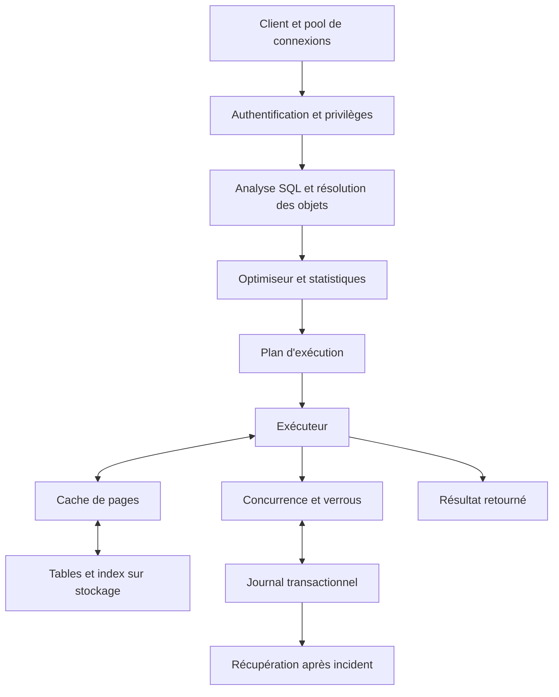
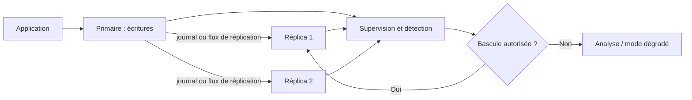
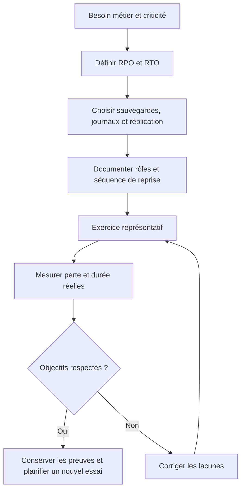
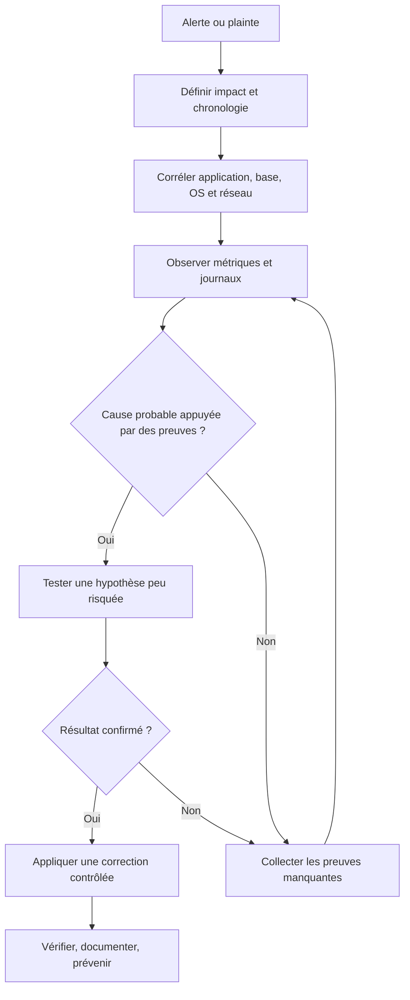

# Rôle du DBA et architecture SGBD — Intermédiaire

> **Mise en contexte** — Une base de données peut répondre vite le lundi et devenir indisponible le vendredi, même sans changement du code applicatif. Hausse du volume, requête mal conçue, sauvegarde non testée, verrou prolongé ou certificat expiré : chaque incident peut affecter toute une organisation. Le Database Administrator (DBA) maintient un service de données fiable, sécurisé, performant, compréhensible et récupérable. Son travail dépasse la création des comptes et le redémarrage du serveur. Il relie les besoins métier, l'application, le moteur, le stockage, le réseau, la sécurité, les sauvegardes et l'exploitation ; il cherche les preuves avant de modifier un service critique.

## Introduction et objectifs

Ce cours prolonge les bases SQL, la modélisation et les travaux pratiques. Il présente le rôle moderne du DBA, les composants d'un SGBD relationnel, les choix d'architecture et les pratiques d'exploitation. Les options exactes diffèrent entre PostgreSQL, MySQL, SQL Server, Oracle et les services managés. Avant toute commande réelle, vérifier la version, la documentation du produit, les privilèges requis, le périmètre et les conséquences.

À la fin, l'apprenant pourra décrire le parcours d'une requête, expliquer les rôles du stockage et des journaux, distinguer disponibilité, réplication et sauvegarde, comparer plusieurs topologies, définir des objectifs de reprise, diagnostiquer des signaux opérationnels et préparer un changement réversible.

## 1. Responsabilités du DBA

### 1.1 Domaines de responsabilité

- **Conception** : types, clés, contraintes, index, schémas, paramètres et fonctionnalités adaptées.
- **Exploitation** : démarrage, arrêt, maintenance, mises à jour, capacité, journaux et supervision.
- **Performance** : requêtes coûteuses, concurrence, verrous, statistiques, mémoire, stockage et réseau.
- **Disponibilité** : sauvegardes, restauration, réplication, bascule, procédures et tests de continuité.
- **Sécurité** : identités, rôles, permissions, chiffrement, journalisation, secrets et segmentation.
- **Changements** : migrations de schéma, compatibilité des versions, tests, retour arrière et vérification.
- **Gouvernance** : inventaire des bases, classification, propriétaires, rétention et preuves d'audit.
- **Accompagnement** : aider les développeurs à comprendre le coût des requêtes et les métiers à préciser leurs exigences.

Dans une petite équipe, un ingénieur plateforme ou un développeur senior peut porter une partie de ces fonctions. Dans une grande organisation, les tâches sont partagées entre DBA, SRE, architectes, sécurité, propriétaires de produit et équipes applicatives. Il faut néanmoins identifier un responsable pour chaque décision critique. La responsabilité ne doit pas être supposée parce qu'une personne possède un accès administrateur.

### 1.2 Plateforme managée ou base autogérée

Un fournisseur managé peut prendre en charge le provisionnement, certaines mises à jour, la surveillance de l'infrastructure et des sauvegardes selon le produit. Cela ne supprime pas la responsabilité de l'organisation concernant les données, les accès, les schémas, les coûts, la restauration, les besoins de cohérence ou le bon fonctionnement du parcours applicatif.

Une console affichant « sauvegarde activée » ne prouve ni qu'une restauration à un instant précis est disponible, ni que les données restaurées sont cohérentes, ni que le service peut reprendre dans le délai métier. Un SLA fournisseur ne garantit pas non plus la validité des transactions applicatives. Documenter la frontière de responsabilité et vérifier les scénarios que le fournisseur ne couvre pas.

### 1.3 Questions métier avant de concevoir l'architecture

Avant un choix technique, clarifier les opérations critiques, le volume actuel et prévu, la latence acceptable, l'indisponibilité tolérée, la perte de données acceptable, la sensibilité et la conservation des données, les fenêtres de maintenance, les dépendances applicatives et les autorisations de restauration ou de bascule.

Les besoins doivent être distingués par parcours. Une lecture analytique de rapports historiques peut accepter des données légèrement anciennes alors qu'une réservation de la dernière pièce en stock nécessite une coordination stricte. Le niveau de service choisi doit découler de ces exigences, et non d'un catalogue générique d'architectures.

## 2. Architecture logique d'un SGBD

### 2.1 Composants usuels

Un moteur relationnel reçoit une requête, vérifie son accès, résout les objets, choisit un plan, exécute les opérations, lit ou modifie les pages de données et retourne un résultat. Selon le moteur, on retrouve généralement une interface de connexion, l'authentification, l'analyse SQL, l'optimiseur, l'exécuteur, un cache de pages, des tables et index, les mécanismes de concurrence, le journal transactionnel, ainsi que les tâches de nettoyage, de checkpoint, de réplication et de collecte de statistiques.

Il faut raisonner à partir des comportements observables. Deux moteurs peuvent offrir une fonction nommée de manière semblable tout en ayant des garanties ou des mécanismes différents. La documentation de la version installée reste la source d'autorité pour les commandes, les paramètres et les limites.

### 2.2 Parcours d'une requête

Une connexion refusée peut venir de l'identité, du réseau, d'une règle d'accès ou d'une limite de sessions. Une requête qui attend peut être bloquée par une transaction concurrente. Une requête lente peut être due à un plan sous-optimal, une lecture physique, un tri volumineux, trop de lignes retournées, un aller-retour réseau ou une saturation. Une latence de commit peut signaler un problème de journal, de stockage ou d'attente de réplication synchrone.

La première compétence du DBA est de séparer ces causes. Ajouter de la mémoire ne corrige pas un deadlock ; multiplier les répliques n'accélère pas nécessairement les écritures sur le primaire ; un réseau plus rapide ne rend pas sélective une requête qui parcourt la table entière.

### 2.3 Plans logiques et plans physiques

Le SQL décrit le résultat recherché, pas l'algorithme d'exécution. Pour une jointure, le moteur peut choisir une nested loop, une hash join ou une merge join. Pour filtrer, il peut lire séquentiellement une table ou utiliser un index. Le choix dépend du volume estimé, de la sélectivité, de la distribution des données, des statistiques, du coût des accès et des paramètres du moteur.

Un plan est un choix fait avec les informations disponibles. Si les statistiques sont obsolètes, le moteur peut mal estimer le nombre de lignes. Si un test ne contient que quelques centaines de lignes, le plan peut être inadéquat en production. Il faut comparer le plan réel et estimé sur un volume représentatif et vérifier que le test mesure la même opération métier.

### 2.4 Tables, pages, fichiers et index

Les moteurs organisent les données en pages ou blocs. Une table logique n'est pas un simple fichier texte. Un index est une structure qui aide à localiser certaines lignes, mais il occupe du stockage et doit être maintenu lors des écritures. Les index composés dépendent de l'ordre des colonnes, de la forme du prédicat et de l'opérateur de recherche. Un parcours séquentiel peut être plus efficace lorsque la requête lit une part importante d'une table.

Ne jamais modifier manuellement les fichiers internes d'une base active. Le moteur gère les métadonnées, la cohérence, les verrous et la récupération. Déplacer ou supprimer un fichier supposé temporaire peut rendre le service inutilisable.

## 3. Transactions, concurrence et cohérence

### 3.1 ACID en pratique

- **Atomicité** : une transaction est appliquée entièrement ou annulée selon les garanties du moteur.
- **Cohérence** : les contraintes déclarées sont respectées par les opérations valides ; une règle métier absente ne peut pas être devinée par le SGBD.
- **Isolation** : les effets des transactions concurrentes sont observés selon le niveau d'isolation et l'implémentation du moteur.
- **Durabilité** : après confirmation du commit, les données sont conservées selon les garanties et paramètres documentés.

ACID ne corrige ni une donnée erronée fournie par le client, ni un compte sur-privilégié, ni un traitement applicatif qui omet une validation. La durabilité dépend aussi des paramètres du journal et du stockage.

### 3.2 Verrous et interblocages

Les verrous coordonnent les opérations concurrentes. Une transaction peut garder des verrous trop longtemps si elle attend un utilisateur, fait un appel réseau ou reste ouverte sans commit ni rollback. Deux transactions peuvent attendre l'une l'autre dans un interblocage (deadlock). Certains moteurs détectent le cycle et interrompent une transaction, mais l'application doit gérer l'échec et décider si une reprise est sûre.

Pratiques utiles : garder les transactions courtes, éviter d'attendre une action humaine pendant une transaction ouverte, accéder aux objets dans un ordre cohérent lorsque cela aide, observer les transactions longues, mesurer l'attente des verrous, et ne jamais terminer une session sans comprendre son rôle et ses effets. Les procédures varient selon le produit ; utiliser les mécanismes documentés.

### 3.3 Isolation et courses concurrentes

Les niveaux d'isolation représentent des compromis entre cohérence observée et concurrence. Le même nom n'implique pas toujours la même implémentation entre moteurs. Certains reposent sur les verrous, d'autres sur le versionnement de lignes (MVCC), ou une combinaison.

Lorsqu'une opération doit garantir qu'une seule commande réserve la dernière pièce, une lecture suivie d'une modification séparée peut créer une course. Une contrainte, une mise à jour conditionnelle, une transaction à isolation adaptée ou un verrou peut être requis. Tester le scénario avec plusieurs sessions simultanées et les échecs attendus ; un test mono-utilisateur ne valide pas la concurrence.

### 3.4 Transaction et effet externe

Pour un transfert entre comptes, vérifier le compte débiteur et les règles de solde, diminuer ce solde, créditer le compte bénéficiaire et enregistrer le transfert dans une transaction atomique. Valider le débit puis échouer avant le crédit crée un état intermédiaire interdit si la transaction ou une stratégie de compensation correcte n'est pas utilisée.

Éviter d'inclure un appel externe lent, comme l'envoi d'un courriel, dans une transaction de base de données. Un modèle outbox peut enregistrer un événement métier dans la même transaction que les données, puis transmettre l'événement après commit. Le consommateur doit tolérer ou dédupliquer les répétitions. Ce modèle ne promet pas magiquement « exactement une fois » à travers des systèmes indépendants ; il rend les reprises observables et contrôlables.

## 4. Stockage, journaux et récupération

### 4.1 Journal de transaction

Les journaux de récupération aident à retrouver un état cohérent après un arrêt et, selon le moteur et sa configuration, à restaurer des changements à un instant donné. Les noms et détails varient : Write-Ahead Logging (WAL) dans PostgreSQL, redo log et binary log dans MySQL/InnoDB, ou mécanismes équivalents ailleurs.

Certaines pages de données peuvent être écrites après la confirmation d'une transaction, car le journal permet de rejouer ou annuler les changements nécessaires à la récupération. Le comportement précis dépend du moteur, de la configuration, du stockage et des garanties demandées. Désactiver une garantie de durabilité pour gagner quelques millisecondes peut rendre possible une perte de transactions après panne. Tout compromis de ce type doit faire l'objet d'une décision de risque explicite.

### 4.2 Mémoire, cache et stockage physique

Le cache limite les lectures répétées depuis le stockage. Une taille insuffisante peut accroître les entrées-sorties ; une taille excessive peut priver le système d'exploitation ou d'autres processus de mémoire. Ne pas copier une valeur issue d'un autre serveur sans connaître la charge, la mémoire totale et les autres composants.

Mesurer les lectures physiques, les taux de cache disponibles, les attentes du stockage, les files, la latence de commit et les variations de charge. Un SSD plus rapide ne corrige pas automatiquement une requête qui lit trop de lignes, un index inadapté ou un problème de verrouillage. Le diagnostic doit expliquer quel composant limite réellement le parcours.

### 4.3 Maintenance et statistiques

Certains moteurs exigent un nettoyage de versions de lignes, une mise à jour des statistiques, une maintenance d'index ou une surveillance de la fragmentation. Une opération mal planifiée peut consommer CPU, mémoire, I/O, espace temporaire ou verrouillage et dégrader le service. Les tâches et recommandations diffèrent selon le moteur.

Définir une fenêtre, suivre la durée, l'espace libre, les retards de réplication et les erreurs. Utiliser les mécanismes de maintenance adaptés à la version. Ne pas tout planifier aveuglément, mais ne pas supprimer les opérations utiles simplement parce que le serveur paraît rapide à un instant.

## 5. Connexions et réseau

Un grand nombre de connexions n'est pas nécessairement synonyme de capacité. Les sessions consomment des ressources, peuvent multiplier les changements de contexte et amplifier la concurrence. Un pool de connexions réutilise un nombre limité de sessions au lieu d'en créer une nouvelle pour chaque requête.

Le dimensionnement dépend de la puissance du moteur, de la latence des requêtes, des attentes, des transactions concurrentes, des autres clients et de l'architecture d'application. Un pool gigantesque peut aggraver la saturation ; un pool trop petit crée des files en amont. Mesurer les connexions actives, l'attente d'obtention de session, les transactions longues et les sessions inactives qui conservent des ressources.

Utiliser TLS quand il est exigé par le contexte, vérifier les certificats et limiter l'exposition réseau. Ne pas exposer une instance directement à Internet sans architecture et contrôles explicitement conçus. Les comptes applicatifs ne doivent pas être superutilisateurs. Les secrets ne doivent pas être écrits en clair dans le code source, les tickets ou les journaux.

## 6. Stratégies d'architecture

### 6.1 Instance unique

Une seule instance peut être le meilleur choix pour une petite application, une équipe limitée et une charge modérée. Elle limite la complexité mais devient un point de défaillance et peut imposer des interruptions lors de certaines maintenances. Les sauvegardes, la supervision, un stockage fiable et un plan de reprise réduisent le risque, sans supprimer la limite de l'instance unique.

Il ne faut pas rejeter cette solution seulement parce qu'une architecture distribuée semble plus moderne. La complexité a un coût d'implantation, de diagnostic, de tests et d'astreinte. Le bon choix est celui qui satisfait les besoins documentés de façon soutenable.

### 6.2 Réplication et haute disponibilité

La réplication copie les changements entre instances. En asynchrone, le primaire peut confirmer une écriture avant que le réplica ne l'ait reçue ou appliquée ; une bascule immédiate peut perdre des transactions récentes. En synchrone, le commit attend une confirmation selon la politique choisie, avec un coût possible en latence ou disponibilité si la réplique est inaccessible.

Une réplique n'est pas une sauvegarde : une suppression accidentelle ou une corruption logique peut être répliquée. La haute disponibilité exige une détection de panne, une politique de sélection, des mécanismes contre le split-brain, un endpoint applicatif adapté et des tests de bascule et de retour. Il faut aussi surveiller le retard et savoir ce que l'application peut observer depuis chaque réplica.

### 6.3 Distribution des lectures et écritures

Envoyer certaines lectures vers des répliques peut soulager le primaire. Il faut cependant traiter le retard de réplication. Une application qui écrit puis relit immédiatement sur une réplique en retard peut afficher une ancienne valeur. On peut lire sur le primaire après écriture, attendre un repère de réplication selon les capacités du moteur, ou accepter explicitement une cohérence éventuelle pour certains parcours non critiques.

Ne pas distribuer toutes les requêtes par défaut. Les lectures utilisées dans une décision métier doivent avoir une exigence de cohérence claire. L'architecture documente quelles opérations sont dirigées vers quelle instance et pourquoi.

### 6.4 Partitionnement et sharding

Le partitionnement organise les données en parties selon une clé ou une règle. Il peut aider la maintenance, l'élimination de partitions inutiles et la gestion de grands volumes, mais ajoute des contraintes de schéma et d'entretien. Le sharding répartit les données entre plusieurs instances et introduit des difficultés de routage, de rééquilibrage, de requêtes multi-shards, de transactions et de choix de clé.

Ne pas confondre partitionnement interne et sharding entre instances. Le choix doit répondre à une limite identifiée : capacité, débit d'écriture, isolement, cycle de vie ou coût. Avant de distribuer, vérifier si le schéma, les index, les requêtes, les pools de connexion ou les limites de ressources peuvent résoudre le problème avec moins de complexité.

## 7. Disponibilité et reprise

### 7.1 SLA et objectifs internes

Un SLA peut constituer un engagement contractuel. Un SLO décrit un objectif de niveau de service sur une période et une population définies. « 99,9 % de disponibilité » n'est pas interprétable sans connaître l'endpoint, les opérations, les exclusions, les fenêtres et la méthode de calcul. La mesure doit refléter la fonction utile au métier, pas seulement l'état du processus serveur.

Définir les besoins avec le propriétaire du service. Une application interne peut tolérer une fenêtre de maintenance ; un service transactionnel critique peut exiger une approche différente. Les objectifs techniques doivent être reliés à l'impact et au coût. Ne pas promettre un niveau qui n'est pas soutenu par l'architecture, les procédures, le budget et les compétences.

### 7.2 RPO et RTO

Le RPO (Recovery Point Objective) représente la perte de données temporelle acceptable selon l'objectif approuvé. Le RTO (Recovery Time Objective) est la durée cible pour rétablir le service après interruption. Ce sont des objectifs de planification et de validation, non des garanties automatiques.

Une sauvegarde chaque quart d'heure ne garantit pas à elle seule un RPO de quinze minutes : la couverture des journaux, leur transfert, leur rétention, leur cohérence et la réussite de la restauration comptent aussi. Un RTO de deux heures n'est confirmé que si l'exercice inclut infrastructure, accès, restauration, connexions applicatives et tests fonctionnels.

La reprise n'est achevée qu'une fois le service métier utilisable. Une base peut être restaurée alors que les connexions échouent faute de secret, de certificat, de compatibilité de schéma ou d'une dépendance externe. Définir le critère de fin de chronométrage avant l'exercice.

## 8. Sécurité et administration des accès

### 8.1 Moindre privilège

Attribuer à chaque identité uniquement les permissions nécessaires à sa fonction. Séparer administration, comptes applicatifs, réplication, sauvegarde et lecture analytique. Éviter les comptes partagés qui rendent difficile l'attribution et la révocation.

Une matrice de rôles devrait distinguer lecture, modification des données, changement du schéma, gestion des identités, sauvegarde, restauration et accès aux exports. Le droit de lire une table ne signifie pas qu'une extraction complète est autorisée. La capacité de créer une sauvegarde ne doit pas automatiquement impliquer un accès libre au contenu déchiffré si le processus peut séparer ces fonctions.

### 8.2 Secrets, chiffrement et audit

Utiliser un gestionnaire de secrets approuvé, limiter leur portée et prévoir la rotation. Le chiffrement en transit protège la communication selon sa configuration ; le chiffrement au repos protège certains supports selon la gestion des clés. Aucun chiffrement ne remplace l'autorisation, la sécurité des administrateurs ou la prévention d'extractions licites au niveau technique mais inappropriées dans leur finalité.

Les journaux d'audit doivent avoir une finalité, une couverture et une rétention proportionnées. Éviter d'y écrire des mots de passe, tokens et données personnelles inutiles. Contrôler l'accès et empêcher, selon les capacités de l'organisation, que les personnes auditées puissent modifier seules les traces qui documentent leurs actions.

### 8.3 Migrations de schéma

Les migrations doivent être versionnées, relues et testées sur un volume représentatif. Ajouter une colonne non nullable, reconstruire un index ou convertir un type peut verrouiller des accès, consommer du stockage temporaire ou produire une charge importante selon la version. Les opérations dites en ligne ne sont pas exemptes de limites.

Une approche expand-contract rend le schéma compatible avec l'ancien et le nouveau code, déploie une version transitoire, migre les données progressivement puis retire l'ancien chemin lors d'une étape séparée. L'ordre exact dépend de l'opération. Pour chaque migration, définir préconditions, durée estimée, seuil d'arrêt, validation et plan de correction.

## 9. Observabilité et diagnostic

### 9.1 Familles de signaux

1. **Disponibilité** : connexions, redémarrages, erreurs, réponses aux requêtes de santé.
2. **Performance** : latence, débit, files d'attente, attentes et distribution des durées.
3. **Ressources** : CPU, mémoire, stockage, IOPS, espace libre et croissance des journaux.
4. **Cohérence et reprise** : retard de réplication, sauvegardes manquées, restauration et dérive de configuration.

Ajouter la version, les changements récents, le volume, le client et la période. Une moyenne cache souvent les requêtes rares mais très lentes ; percentiles et mesures par parcours révèlent mieux les extrêmes. Éviter les métriques dont chaque label contient un identifiant unique, ce qui fait exploser la cardinalité et le coût de stockage.

### 9.2 Diagnostic reproductible

Commencer par l'impact et la chronologie. Le problème concerne-t-il tous les utilisateurs, une opération, une zone, un client ou une seule requête ? Comparer avant et après un changement. Formuler une hypothèse réfutable, collecter des preuves sans aggraver la situation et appliquer une correction réversible. Un redémarrage peut être nécessaire dans certains cas, mais il peut aussi masquer la cause, prolonger l'indisponibilité ou faire perdre des éléments de diagnostic.

### 9.3 Capacité et alertes utiles

Suivre la croissance des tables, index, journaux, sauvegardes et historiques ; surveiller les connexions, le stockage, les I/O et la saisonnalité de charge. La capacité libre doit couvrir les pics et les opérations de maintenance ou de restauration. Un disque plein peut bloquer le journal et rendre le service indisponible.

Une alerte doit avoir un propriétaire, un seuil, une urgence, un délai de réaction, une escalade et une action provisoire. Tester les alertes et runbooks. Une alerte fréquente que personne ne traite devient du bruit ; une alerte qui ne se déclenche qu'à la panne est trop tardive. Distinguer seuil d'avertissement, seuil critique et condition de protection automatique.

## 10. Étude de cas — Base applicative lente lors des pics

Une plateforme de gestion d'ordres de maintenance stocke interventions, pièces, techniciens et comptes rendus dans une base relationnelle. Lors des périodes d'activité élevée, la latence augmente, les connexions attendent et les agents déclarent des erreurs. L'équipe propose d'augmenter la mémoire et d'ajouter deux répliques.

### Étape A — Quantifier le symptôme

Documenter les opérations touchées, l'heure de début, la durée, la population, les erreurs, la latence médiane et les percentiles élevés, le volume de requêtes et les changements récents. Vérifier si la lenteur concerne les lectures, les écritures, le commit, la prise de connexion ou l'affichage dans le navigateur.

### Étape B — Formuler plusieurs hypothèses

Causes possibles : recherche non indexée, plan qui a évolué, verrous dus à une transaction longue, pool trop grand, stockage saturé, tâche de maintenance concurrente ou polling applicatif trop fréquent. Chaque hypothèse exige un signal de confirmation et une méthode de test qui n'aggrave pas le service.

### Étape C — Collecter les preuves

Examiner les requêtes coûteuses, plans, attentes, transactions ouvertes, connexions, I/O et statistiques. Corréler le pic avec la charge et les déploiements. Ne pas exporter des données sensibles vers un outil non autorisé pour obtenir une aide externe.

Supposons que le diagnostic confirme une recherche par technicien et statut sans index utile. Un index peut aider, mais il faut analyser la sélectivité, l'ordre des colonnes, la charge d'écriture, la taille et le coût de déploiement. Il faut aussi vérifier si la requête retourne trop de lignes. Tester sur un échantillon représentatif et mesurer la différence dans le plan et la latence.

### Étape D — Planifier la correction

Mesurer l'état avant changement, tester l'index, estimer sa création, planifier la fenêtre, vérifier l'espace libre et préparer l'observation après déploiement. Si la version propose une création concurrente ou en ligne, vérifier ses conditions et limites. Définir un point de retour si l'opération dégrade le service.

### Étape E — Réévaluer l'architecture

Si la cause est une requête inefficace sur le primaire, ajouter des répliques ne corrige pas nécessairement les écritures ou les verrous. Une réplique pourrait aider certaines lectures mais ajoute un retard potentiel et des tâches d'exploitation. L'investissement doit être justifié par la charge observée et les exigences de cohérence, pas par l'apparence de robustesse.

### Résultat attendu

Un compte rendu identifie les preuves, l'hypothèse, le changement exact, les indicateurs affectés, les effets secondaires, les limites restantes et les actions préventives. « Le serveur est optimisé » est trop vague : l'équipe doit fournir des mesures de référence et permettre à un autre intervenant de confirmer le résultat.

## 11. Pièges fréquents

- Modifier plusieurs paramètres à la fois puis ne plus savoir lequel a eu un effet.
- Confondre réplication, sauvegarde et haute disponibilité.
- Donner les droits d'administrateur au compte applicatif pour contourner une erreur d'autorisation.
- Augmenter arbitrairement le pool et amplifier la concurrence.
- Copier une configuration provenant d'un serveur aux ressources différentes.
- Ajouter des index sans mesurer les coûts d'écriture et de stockage.
- Ignorer les transactions longues, verrous et opérations en attente.
- Considérer qu'une sauvegarde planifiée suffit sans test de restauration.
- Déployer une migration sans évaluer le volume et les verrous.
- Changer de moteur sans plan de compatibilité, export et sortie.
- Conserver des journaux indéfiniment sans contrôle ni durée de conservation.
- Regarder une moyenne sans examiner les pires latences.
- Redémarrer avant d'avoir consigné les symptômes quand une collecte sûre est possible.
- Confondre la responsabilité d'un fournisseur managé et celle du propriétaire de la donnée.

## 12. Checklist opérationnelle

### Avant mise en production
- [ ] Le propriétaire du service, le DBA de contact et l'autorité d'approbation sont connus.
- [ ] Le modèle de données et les contraintes ont été relus.
- [ ] Les requêtes critiques sont testées sur des volumes représentatifs.
- [ ] Le compte applicatif dispose seulement des droits nécessaires.
- [ ] Les connexions, certificats et secrets sont gérés selon la politique interne.
- [ ] La sauvegarde, la rétention et le test de restauration sont documentés.
- [ ] Les alertes, runbooks et procédures d'escalade sont disponibles.
- [ ] La migration a une précondition, une méthode de validation et un plan de correction.
- [ ] Les objectifs de reprise sont décidés par les responsables compétents.
- [ ] Capacité, coûts récurrents et dépendances sont connus.

### Lors d'un incident
- [ ] L'impact et la chronologie sont consignés.
- [ ] Les symptômes sont collectés avant une action intrusive si c'est sûr.
- [ ] Les causes restent des hypothèses tant que les preuves sont insuffisantes.
- [ ] La correction la moins risquée est évaluée.
- [ ] La bascule ou la restauration est autorisée par la personne compétente.
- [ ] Les résultats et données réconciliées sont consignés.
- [ ] Le service métier est vérifié après rétablissement.
- [ ] Les actions post-incident ont un propriétaire et une échéance.

## 13. Exercices corrigés

### Exercice 1 — Plusieurs répliques, aucune sauvegarde

Une architecture dispose de trois répliques synchronisées mais n'a aucune sauvegarde isolée.

**Corrigé :** la réplication peut propager les erreurs logiques et suppressions. Elle aide certaines formes de disponibilité, pas la récupération d'un état antérieur indépendant. Définir une politique de sauvegarde, isoler les copies et effectuer des restaurations périodiques.

### Exercice 2 — Connexions multipliées

Après une augmentation importante du pool, la latence augmente.

**Corrigé :** examiner la concurrence, les sessions inactives dans une transaction, les attentes et la saturation. Un nombre plus élevé peut détériorer le débit utile. Ajuster le pool sur la base des mesures et des limites réelles du moteur.

### Exercice 3 — RPO trop ambitieux

Le métier demande zéro perte de données, mais la topologie utilise une réplication asynchrone et aucun test de bascule.

**Corrigé :** expliquer les limites et comparer les options documentées du moteur. La garantie dépend de la configuration, des domaines de panne et de la procédure. Ne pas promettre un objectif sans test et acceptation du coût correspondant.

### Exercice 4 — Index en production

Un développeur propose un index sur chaque colonne filtrée.

**Corrigé :** examiner le plan, les prédicats, la sélectivité, l'ordre des colonnes, les statistiques, les écritures et le coût des index. Tester une option sur des données représentatives puis planifier l'opération dans une fenêtre adaptée.

### Exercice 5 — Redémarrage d'urgence

Le DBA redémarre la base au premier signal de latence et les symptômes disparaissent temporairement.

**Corrigé :** rétablir le service si nécessaire, mais préserver les preuves disponibles quand c'est sûr. Analyser la chronologie, les attentes, les transactions et les ressources. Le redémarrage ne remplace ni le diagnostic ni la prévention d'une récidive.

## 14. Défi final — Fiche d'exploitation

Vous administrez une base PostgreSQL ou MySQL qui soutient un portail d'interventions. Préparez une fiche contenant les composants, les rôles, les comptes, les sauvegardes, la restauration, la supervision, la procédure d'incident, le plan de changement, les objectifs de reprise et les contacts. Présentez une architecture proportionnée au risque.

Livrables : diagramme d'architecture, matrice des responsabilités, métriques, procédure de restauration, checklist de mise en production, analyse de risques, comparaison des performances et deux scénarios d'incident avec critères d'escalade. Un dossier recevable distingue ce qui est vérifié, supposé et à tester. Les objectifs métier sont approuvés, les droits limités, la restauration testée et la procédure permet de décider sans improviser.

### Barème indicatif
- Architecture et parcours de requête : 15 points.
- Transactions, concurrence et reprise : 20 points.
- Sécurité et moindre privilège : 15 points.
- Observabilité et diagnostic : 20 points.
- Continuité et réversibilité : 20 points.
- Clarté et traçabilité : 10 points.

## 15. Construire un inventaire et un runbook utilisables

La documentation doit permettre à une personne de comprendre la base sans dépendre exclusivement de l'administrateur qui l'a installée. Maintenir un inventaire versionné, accessible aux personnes autorisées, et le réviser après les changements importants.

L'inventaire peut contenir l'identifiant du service, l'environnement, le moteur et sa version, la topologie, la région ou le site, le propriétaire, les contacts d'astreinte, la criticité, les dépendances, le stockage, les ports, les mécanismes d'authentification, la politique de sauvegarde, la réplication et les fins de support connues. Ne pas consigner de mots de passe ou de clés privées ; référencer le gestionnaire de secrets et le chemin autorisé pour obtenir les droits nécessaires.

Un runbook décrit les conditions de déclenchement, les précautions, les commandes d'observation autorisées, les critères de décision, les actions permises, les vérifications post-action et l'escalade. Marquer clairement les opérations de lecture et les opérations qui modifient l'état. Une commande dangereuse copiée sans contexte peut aggraver l'incident.

### Structure d'un runbook

1. **Détection** : quelle alerte ou quel symptôme ouvre la procédure ?
2. **Impact** : quelles fonctions et quels utilisateurs sont affectés ?
3. **Sécurité** : existe-t-il une suspicion de compromission ou de perte de données ?
4. **État technique** : connexions, stockage, CPU, mémoire, verrous, journaux et réplication.
5. **Preuves** : quelles informations doivent être conservées avant l'action ?
6. **Décision** : qui peut autoriser le redémarrage, la bascule ou la restauration ?
7. **Action** : quelle intervention est permise et quelles sont ses limites ?
8. **Vérification** : quelle preuve confirme le rétablissement fonctionnel ?
9. **Communication** : qui doit être informé et par quel canal ?
10. **Apprentissage** : quel rapport post-incident et quelles mesures préventives sont attendus ?

Tester le runbook lors d'un exercice. Simuler par exemple une saturation de connexions, un retard de réplication ou une restauration en environnement non critique. Éviter de provoquer une panne de production uniquement pour vérifier une alerte. Interrompre l'exercice si le risque dépasse le périmètre autorisé.

Réviser le runbook après évolution du moteur, de la topologie, du fournisseur, du réseau ou des accès. Une procédure jamais testée doit être signalée comme non vérifiée et ne peut pas servir de preuve de capacité de reprise. Faire relire les procédures critiques par une deuxième personne et conserver l'historique des révisions.

## 16. Capacité, maintenance et cycle de vie

La gestion de capacité vise à identifier les limites avant qu'elles ne bloquent le service. Suivre la croissance des tables, index, journaux, sauvegardes, connexions, historiques d'audit et volumes de données transférées. La capacité libre doit inclure une marge pour les pics, la maintenance et les opérations de restauration.

Une projection élémentaire peut estimer le temps avant saturation, mais reste une approximation. Si un volume de 700 Go croît de 25 Go par semaine et que 200 Go sont réellement disponibles, une estimation linéaire indique environ huit semaines. Cela ne garantit rien : la croissance peut accélérer, les opérations exigent de l'espace temporaire, et les journaux ou sauvegardes peuvent croître différemment. Ajouter une marge, examiner la saisonnalité et confirmer la projection par des mesures plus détaillées.

Les opérations de maintenance doivent être coordonnées avec l'exploitation. Une modification massive ou une reconstruction d'index peut générer beaucoup d'I/O, grossir temporairement les fichiers ou monopoliser les ressources. L'estimation de durée doit venir d'un test représentatif ou d'un historique, pas d'une intuition. Si une opération est annulable, documenter les conséquences de l'annulation et le temps nécessaire pour retrouver un état stable.

Le cycle de vie comprend aussi les versions. Une version proche de la fin de support augmente le risque technique et de sécurité. Planifier la mise à niveau avec une matrice de compatibilité, une sauvegarde validée, une répétition, une fenêtre, une procédure de retour et des tests applicatifs. Vérifier aussi les extensions, pilotes, connecteurs, outils d'observation et procédures d'astreinte. La mise à niveau technique n'est pas un succès si l'application ne fonctionne plus.

## 17. Exercices d'observation supplémentaires

### Exercice 6 — Le cache semble efficace

Un tableau de bord affiche 98 % de cache hits, mais les utilisateurs signalent que les recherches essentielles restent lentes.

**Corrigé :** un ratio global ne révèle pas les requêtes lentes ni les lectures coûteuses restantes. Examiner les plans, la latence par opération, les verrous, les cardinalités, la taille des réponses et les percentiles élevés.

### Exercice 7 — Le service managé promet la disponibilité

Le fournisseur affiche un SLA élevé et l'équipe propose d'abandonner les tests de reprise internes.

**Corrigé :** le SLA ne couvre pas automatiquement l'application, les identités, le réseau et les dépendances. Vérifier son périmètre, définir des objectifs internes et tester la bascule et la reprise du parcours métier.

### Exercice 8 — Demande d'accès urgent

Un analyste veut extraire des données sensibles et demande les droits de superutilisateur pour éviter d'attendre.

**Corrigé :** déterminer la finalité, les champs nécessaires, les autorisations et la durée. Préparer une extraction approuvée, minimiser les données, utiliser un canal autorisé et tracer l'opération. L'urgence ne justifie pas des privilèges illimités.

### Exercice 9 — Lecture de données anciennes

Après une mise à jour, l'application lit la même ligne sur une réplique et affiche une ancienne valeur.

**Corrigé :** suspecter un retard de réplication. Préciser la cohérence requise du parcours et choisir une stratégie adaptée, comme lire sur le primaire après écriture ou attendre un repère de réplication selon le moteur. Ne pas diriger toutes les lectures vers le primaire sans examiner les coûts.

### Exercice 10 — Restauration terminée, service en échec

La base est restaurée dans le délai cible, mais les utilisateurs ne peuvent pas se connecter.

**Corrigé :** la reprise comprend les secrets, certificats, connexions, schémas, files et tests fonctionnels. Le délai doit être mesuré jusqu'au rétablissement réel du service convenu, pas simplement jusqu'à la fin de la commande de restauration.

## À retenir

Le DBA porte la santé globale du service de données avec les équipes concernées. L'architecture découle des exigences de cohérence, performance, disponibilité et reprise. Les index, réplications, caches et paramètres ne sont pas des remèdes universels. Mesures fiables, restauration testée, moindre privilège et changements contrôlés sont essentiels. Un service robuste est un service dont les dépendances sont comprises, les comportements observés et la reprise démontrable.

## Ressources et références

- [Documentation PostgreSQL](https://www.postgresql.org/docs/current/)
- [Manuel de référence MySQL 8.4](https://dev.mysql.com/doc/refman/8.4/en/)
- [PostgreSQL — Write-Ahead Logging](https://www.postgresql.org/docs/current/wal-intro.html)
- [PostgreSQL — Haute disponibilité et réplication](https://www.postgresql.org/docs/current/high-availability.html)
- [MySQL — Réplication](https://dev.mysql.com/doc/refman/8.4/en/replication.html)

Consulter la documentation correspondant à la version installée et valider chaque opération dans un environnement non critique avant application en production.
