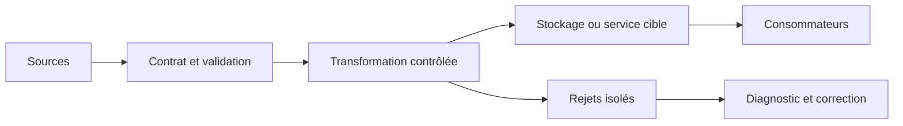
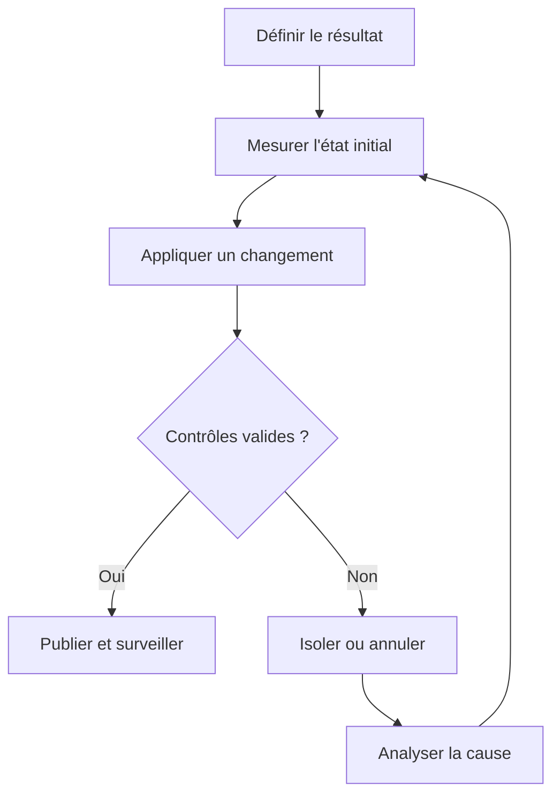
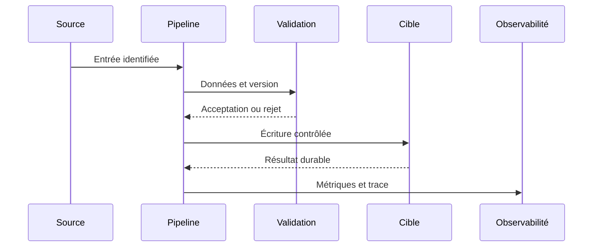
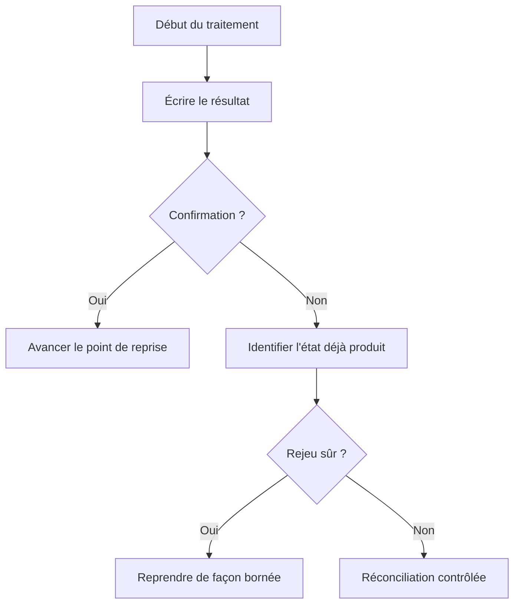
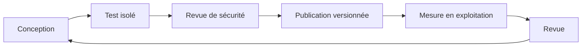

# Rôle du DBA et architecture SGBD — Intermédiaire

> **Mise en contexte.** Ce cours approfondit rôle du DBA et architecture des SGBD. Il vise une décision technique justifiable, testable et exploitable. Les exemples doivent être adaptés à la version du moteur et au contexte réel. Utilisez des données synthétiques, notez versions et paramètres, et préparez la restauration ou le retour arrière avant une opération risquée. N’insérez jamais de secret ou de donnée personnelle dans les commandes partagées.

## Introduction et objectifs pédagogiques

La compétence recherchée ne consiste pas à exécuter une recette, mais à expliquer pourquoi une solution répond au besoin et quelles limites elle conserve. Un résultat plausible sur le cas nominal n’est pas une preuve suffisante : les erreurs, l’ordre des événements, les données absentes, la concurrence et les changements de version doivent faire partie du raisonnement.

À l’issue du cours, vous devez pouvoir définir un contrat, identifier la source de vérité, comparer plusieurs approches, construire un test reproductible, interpréter une trace et expliquer une procédure de reprise. Vous devez également pouvoir différencier une garantie fournie par le système d’un comportement qui dépend d’un paramètre ou d’un choix applicatif. La validation attendue relie intention, entrée, état final et preuve.

Objectifs opérationnels : écrire les invariants métier, cartographier les composants, établir une baseline, mesurer les risques et les coûts, traiter les échecs explicitement, protéger les données, automatiser les assertions prioritaires et documenter les limites. Le cours fournit des méthodes de validation réutilisables ; les valeurs de configuration et les garanties précises doivent être confirmées dans la documentation de la version effectivement déployée.

## Prérequis et environnement

Révisez les notions de schéma, identifiant stable, transactions, journaux, droits d’accès et tests automatisés. Consignez la version des outils, extensions, ressources, configuration et mode de déploiement. Une syntaxe qui ressemble à celle d’un autre produit ne garantit ni une sémantique ni un niveau de fiabilité identiques.

Préparez un environnement isolé, un jeu synthétique et une procédure de nettoyage. Conservez la sortie de référence et les paramètres exacts. Pour toute action destructive, préparez la restauration avant de l’exécuter. Le code retour n’est qu’un signal : il doit être complété par des contrôles sur les lignes, clés, montants, versions, messages ou métriques qui prouvent l’invariant.

## Concepts clés développés

### 1. Frontières de responsabilité

**Principe et choix.** Le SGBD porte stockage, transactions, concurrence et contraintes ; l’application porte l’orchestration et l’autorisation des parcours métier. Avant d’implémenter, écrivez le contrat attendu en langage métier : quelles entités, quels consommateurs et quelle granularité sont concernés ? Distinguez une garantie nécessaire d’une simple préférence d’implémentation. Si plusieurs solutions sont disponibles, comparez-les sur les mêmes critères et mesurez ce qui change réellement. Une option technique est pertinente lorsqu’elle maintient le contrat et reste compréhensible pour l’équipe qui l’exploite.

**Risque et limite.** Une règle uniquement dans l’interface peut être contournée ; des droits DBA accordés au compte applicatif élargissent l’impact d’une compromission. Recherchez l’événement précis qui peut invalider le résultat : entrée inattendue, concurrence, changement de version, interruption entre deux étapes ou surcharge. Une conception fiable rend l’état visible et propose une action adaptée à chaque classe d’erreur. Il faut distinguer erreur temporaire, erreur permanente et résultat inconnu. Une reprise ne doit pas supposer que l’absence de réponse prouve que l’écriture n’a pas eu lieu.

**Preuve technique.** Relier chaque invariant à un propriétaire, un test positif, un test négatif et une preuve observable. Établissez cette preuve avant l’essai. Utilisez des entrées connues, un résultat attendu et un contrôle de l’état réellement obtenu. Conservez version, paramètres, traces et métriques. Ajoutez un cas frontière et un cas qui doit être rejeté ; un test uniquement nominal laisse de côté les invariants les plus importants. Lorsque le résultat est quantitatif, définissez le dénominateur, la fenêtre et les unités pour que la mesure soit interprétable.

**Exemple contextualisé.** Pour le stock, l’API vérifie le droit de vendre mais la transaction empêche une quantité négative. Commencez par un cas réduit, puis augmentez un seul facteur à la fois : volume, cardinalité, concurrence, retard, version ou droits. Comparez à une référence indépendante quand c’est possible. Si le résultat contredit l’hypothèse, conservez l’écart comme une information de diagnostic et révisez l’explication, plutôt que de changer le critère après l’observation.

**Décision d’ingénierie.** Comparez une variante simple et une variante traitant une contrainte supplémentaire. Évaluez latence, coût de stockage, charge de maintenance, privilèges requis, retour arrière et compétences nécessaires. La variante complexe n’est justifiée que si un indicateur démontre le besoin. Écrivez le seuil qui déclencherait son adoption et le signal qui imposerait de la revoir. Ce seuil rend la décision vérifiable plutôt que dépendante du goût personnel.

**Revue opérationnelle.** Demandez à un collègue de refaire l’essai à partir du compte rendu. Il doit pouvoir identifier les entrées, l’état final, le propriétaire de l’invariant et la trace à inspecter. S’il ne peut pas, la documentation ou la conception est incomplète. Un résultat exploitable peut être expliqué, surveillé, corrigé et transmis sans dépendre uniquement de la mémoire de son auteur.

### 2. Connexions et pools

**Principe et choix.** Un pool réutilise des sessions et limite leur nombre, mais il ne supprime ni le coût des requêtes ni le coût d’une transaction longue. Avant d’implémenter, écrivez le contrat attendu en langage métier : quelles entités, quels consommateurs et quelle granularité sont concernés ? Distinguez une garantie nécessaire d’une simple préférence d’implémentation. Si plusieurs solutions sont disponibles, comparez-les sur les mêmes critères et mesurez ce qui change réellement. Une option technique est pertinente lorsqu’elle maintient le contrat et reste compréhensible pour l’équipe qui l’exploite.

**Risque et limite.** Plusieurs pools par worker peuvent dépasser la limite globale ; un appel réseau dans une transaction retient inutilement une connexion. Recherchez l’événement précis qui peut invalider le résultat : entrée inattendue, concurrence, changement de version, interruption entre deux étapes ou surcharge. Une conception fiable rend l’état visible et propose une action adaptée à chaque classe d’erreur. Il faut distinguer erreur temporaire, erreur permanente et résultat inconnu. Une reprise ne doit pas supposer que l’absence de réponse prouve que l’écriture n’a pas eu lieu.

**Preuve technique.** Mesurer sessions actives, attente du pool, p50/p95 et plafond serveur sous charge représentative. Établissez cette preuve avant l’essai. Utilisez des entrées connues, un résultat attendu et un contrôle de l’état réellement obtenu. Conservez version, paramètres, traces et métriques. Ajoutez un cas frontière et un cas qui doit être rejeté ; un test uniquement nominal laisse de côté les invariants les plus importants. Lorsque le résultat est quantitatif, définissez le dénominateur, la fenêtre et les unités pour que la mesure soit interprétable.

**Exemple contextualisé.** Quatre workers avec un pool de trente peuvent demander jusqu’à 120 connexions avant les tâches de fond. Commencez par un cas réduit, puis augmentez un seul facteur à la fois : volume, cardinalité, concurrence, retard, version ou droits. Comparez à une référence indépendante quand c’est possible. Si le résultat contredit l’hypothèse, conservez l’écart comme une information de diagnostic et révisez l’explication, plutôt que de changer le critère après l’observation.

**Décision d’ingénierie.** Comparez une variante simple et une variante traitant une contrainte supplémentaire. Évaluez latence, coût de stockage, charge de maintenance, privilèges requis, retour arrière et compétences nécessaires. La variante complexe n’est justifiée que si un indicateur démontre le besoin. Écrivez le seuil qui déclencherait son adoption et le signal qui imposerait de la revoir. Ce seuil rend la décision vérifiable plutôt que dépendante du goût personnel.

**Revue opérationnelle.** Demandez à un collègue de refaire l’essai à partir du compte rendu. Il doit pouvoir identifier les entrées, l’état final, le propriétaire de l’invariant et la trace à inspecter. S’il ne peut pas, la documentation ou la conception est incomplète. Un résultat exploitable peut être expliqué, surveillé, corrigé et transmis sans dépendre uniquement de la mémoire de son auteur.

### 3. Transactions et MVCC

**Principe et choix.** Les niveaux d’isolation définissent les anomalies concurrentes observables ; MVCC facilite certaines lectures sans supprimer tous les conflits d’écriture. Avant d’implémenter, écrivez le contrat attendu en langage métier : quelles entités, quels consommateurs et quelle granularité sont concernés ? Distinguez une garantie nécessaire d’une simple préférence d’implémentation. Si plusieurs solutions sont disponibles, comparez-les sur les mêmes critères et mesurez ce qui change réellement. Une option technique est pertinente lorsqu’elle maintient le contrat et reste compréhensible pour l’équipe qui l’exploite.

**Risque et limite.** Les transactions longues retiennent des versions et ressources ; un retry non idempotent peut refaire un débit. Recherchez l’événement précis qui peut invalider le résultat : entrée inattendue, concurrence, changement de version, interruption entre deux étapes ou surcharge. Une conception fiable rend l’état visible et propose une action adaptée à chaque classe d’erreur. Il faut distinguer erreur temporaire, erreur permanente et résultat inconnu. Une reprise ne doit pas supposer que l’absence de réponse prouve que l’écriture n’a pas eu lieu.

**Preuve technique.** Reproduire deux transactions concurrentes et contrôler état final, verrous et erreurs. Établissez cette preuve avant l’essai. Utilisez des entrées connues, un résultat attendu et un contrôle de l’état réellement obtenu. Conservez version, paramètres, traces et métriques. Ajoutez un cas frontière et un cas qui doit être rejeté ; un test uniquement nominal laisse de côté les invariants les plus importants. Lorsque le résultat est quantitatif, définissez le dénominateur, la fenêtre et les unités pour que la mesure soit interprétable.

**Exemple contextualisé.** La réservation de la dernière unité doit être atomique plutôt que deux lectures suivies d’écritures. Commencez par un cas réduit, puis augmentez un seul facteur à la fois : volume, cardinalité, concurrence, retard, version ou droits. Comparez à une référence indépendante quand c’est possible. Si le résultat contredit l’hypothèse, conservez l’écart comme une information de diagnostic et révisez l’explication, plutôt que de changer le critère après l’observation.

**Décision d’ingénierie.** Comparez une variante simple et une variante traitant une contrainte supplémentaire. Évaluez latence, coût de stockage, charge de maintenance, privilèges requis, retour arrière et compétences nécessaires. La variante complexe n’est justifiée que si un indicateur démontre le besoin. Écrivez le seuil qui déclencherait son adoption et le signal qui imposerait de la revoir. Ce seuil rend la décision vérifiable plutôt que dépendante du goût personnel.

**Revue opérationnelle.** Demandez à un collègue de refaire l’essai à partir du compte rendu. Il doit pouvoir identifier les entrées, l’état final, le propriétaire de l’invariant et la trace à inspecter. S’il ne peut pas, la documentation ou la conception est incomplète. Un résultat exploitable peut être expliqué, surveillé, corrigé et transmis sans dépendre uniquement de la mémoire de son auteur.

### 4. Verrous et deadlocks

**Principe et choix.** Un deadlock forme un cycle d’attente entre transactions et conduit généralement à l’annulation d’une transaction par le moteur. Avant d’implémenter, écrivez le contrat attendu en langage métier : quelles entités, quels consommateurs et quelle granularité sont concernés ? Distinguez une garantie nécessaire d’une simple préférence d’implémentation. Si plusieurs solutions sont disponibles, comparez-les sur les mêmes critères et mesurez ce qui change réellement. Une option technique est pertinente lorsqu’elle maintient le contrat et reste compréhensible pour l’équipe qui l’exploite.

**Risque et limite.** Redémarrer sans collecter les attentes efface les indices ; accroître les timeouts peut prolonger l’incident. Recherchez l’événement précis qui peut invalider le résultat : entrée inattendue, concurrence, changement de version, interruption entre deux étapes ou surcharge. Une conception fiable rend l’état visible et propose une action adaptée à chaque classe d’erreur. Il faut distinguer erreur temporaire, erreur permanente et résultat inconnu. Une reprise ne doit pas supposer que l’absence de réponse prouve que l’écriture n’a pas eu lieu.

**Preuve technique.** Capturer les sessions en attente et l’ordre d’acquisition, puis rejouer après correction. Établissez cette preuve avant l’essai. Utilisez des entrées connues, un résultat attendu et un contrôle de l’état réellement obtenu. Conservez version, paramètres, traces et métriques. Ajoutez un cas frontière et un cas qui doit être rejeté ; un test uniquement nominal laisse de côté les invariants les plus importants. Lorsque le résultat est quantitatif, définissez le dénominateur, la fenêtre et les unités pour que la mesure soit interprétable.

**Exemple contextualisé.** Traiter les comptes A puis B et B puis A peut créer un cycle ; un ordre stable diminue le risque. Commencez par un cas réduit, puis augmentez un seul facteur à la fois : volume, cardinalité, concurrence, retard, version ou droits. Comparez à une référence indépendante quand c’est possible. Si le résultat contredit l’hypothèse, conservez l’écart comme une information de diagnostic et révisez l’explication, plutôt que de changer le critère après l’observation.

**Décision d’ingénierie.** Comparez une variante simple et une variante traitant une contrainte supplémentaire. Évaluez latence, coût de stockage, charge de maintenance, privilèges requis, retour arrière et compétences nécessaires. La variante complexe n’est justifiée que si un indicateur démontre le besoin. Écrivez le seuil qui déclencherait son adoption et le signal qui imposerait de la revoir. Ce seuil rend la décision vérifiable plutôt que dépendante du goût personnel.

**Revue opérationnelle.** Demandez à un collègue de refaire l’essai à partir du compte rendu. Il doit pouvoir identifier les entrées, l’état final, le propriétaire de l’invariant et la trace à inspecter. S’il ne peut pas, la documentation ou la conception est incomplète. Un résultat exploitable peut être expliqué, surveillé, corrigé et transmis sans dépendre uniquement de la mémoire de son auteur.

### 5. Réplication et cohérence

**Principe et choix.** Les répliques servent à la disponibilité ou aux lectures selon le mode de réplication, le retard et le mécanisme de promotion. Avant d’implémenter, écrivez le contrat attendu en langage métier : quelles entités, quels consommateurs et quelle granularité sont concernés ? Distinguez une garantie nécessaire d’une simple préférence d’implémentation. Si plusieurs solutions sont disponibles, comparez-les sur les mêmes critères et mesurez ce qui change réellement. Une option technique est pertinente lorsqu’elle maintient le contrat et reste compréhensible pour l’équipe qui l’exploite.

**Risque et limite.** Une lecture après écriture peut voir un ancien état sur une réplique asynchrone ; une corruption peut aussi être répliquée. Recherchez l’événement précis qui peut invalider le résultat : entrée inattendue, concurrence, changement de version, interruption entre deux étapes ou surcharge. Une conception fiable rend l’état visible et propose une action adaptée à chaque classe d’erreur. Il faut distinguer erreur temporaire, erreur permanente et résultat inconnu. Une reprise ne doit pas supposer que l’absence de réponse prouve que l’écriture n’a pas eu lieu.

**Preuve technique.** Mesurer le lag, tester le basculement et vérifier les écritures après retour nominal. Établissez cette preuve avant l’essai. Utilisez des entrées connues, un résultat attendu et un contrôle de l’état réellement obtenu. Conservez version, paramètres, traces et métriques. Ajoutez un cas frontière et un cas qui doit être rejeté ; un test uniquement nominal laisse de côté les invariants les plus importants. Lorsque le résultat est quantitatif, définissez le dénominateur, la fenêtre et les unités pour que la mesure soit interprétable.

**Exemple contextualisé.** Une lecture de sécurité après changement d’accès peut rester dirigée vers le primaire selon la garantie attendue. Commencez par un cas réduit, puis augmentez un seul facteur à la fois : volume, cardinalité, concurrence, retard, version ou droits. Comparez à une référence indépendante quand c’est possible. Si le résultat contredit l’hypothèse, conservez l’écart comme une information de diagnostic et révisez l’explication, plutôt que de changer le critère après l’observation.

**Décision d’ingénierie.** Comparez une variante simple et une variante traitant une contrainte supplémentaire. Évaluez latence, coût de stockage, charge de maintenance, privilèges requis, retour arrière et compétences nécessaires. La variante complexe n’est justifiée que si un indicateur démontre le besoin. Écrivez le seuil qui déclencherait son adoption et le signal qui imposerait de la revoir. Ce seuil rend la décision vérifiable plutôt que dépendante du goût personnel.

**Revue opérationnelle.** Demandez à un collègue de refaire l’essai à partir du compte rendu. Il doit pouvoir identifier les entrées, l’état final, le propriétaire de l’invariant et la trace à inspecter. S’il ne peut pas, la documentation ou la conception est incomplète. Un résultat exploitable peut être expliqué, surveillé, corrigé et transmis sans dépendre uniquement de la mémoire de son auteur.

### 6. Observabilité opérationnelle

**Principe et choix.** Métriques, journaux, traces et plans apportent des angles complémentaires ; leur corrélation temporelle aide à localiser la cause. Avant d’implémenter, écrivez le contrat attendu en langage métier : quelles entités, quels consommateurs et quelle granularité sont concernés ? Distinguez une garantie nécessaire d’une simple préférence d’implémentation. Si plusieurs solutions sont disponibles, comparez-les sur les mêmes critères et mesurez ce qui change réellement. Une option technique est pertinente lorsqu’elle maintient le contrat et reste compréhensible pour l’équipe qui l’exploite.

**Risque et limite.** Des logs trop détaillés peuvent exposer des données sensibles ; une métrique seule explique rarement un incident. Recherchez l’événement précis qui peut invalider le résultat : entrée inattendue, concurrence, changement de version, interruption entre deux étapes ou surcharge. Une conception fiable rend l’état visible et propose une action adaptée à chaque classe d’erreur. Il faut distinguer erreur temporaire, erreur permanente et résultat inconnu. Une reprise ne doit pas supposer que l’absence de réponse prouve que l’écriture n’a pas eu lieu.

**Preuve technique.** Reconstituer une chronologie avec pool, requêtes, verrous, I/O et erreurs sans divulguer de secrets. Établissez cette preuve avant l’essai. Utilisez des entrées connues, un résultat attendu et un contrôle de l’état réellement obtenu. Conservez version, paramètres, traces et métriques. Ajoutez un cas frontière et un cas qui doit être rejeté ; un test uniquement nominal laisse de côté les invariants les plus importants. Lorsque le résultat est quantitatif, définissez le dénominateur, la fenêtre et les unités pour que la mesure soit interprétable.

**Exemple contextualisé.** Latence p95 élevée avec CPU modéré et sessions en attente invite à examiner contention et pool avant le CPU. Commencez par un cas réduit, puis augmentez un seul facteur à la fois : volume, cardinalité, concurrence, retard, version ou droits. Comparez à une référence indépendante quand c’est possible. Si le résultat contredit l’hypothèse, conservez l’écart comme une information de diagnostic et révisez l’explication, plutôt que de changer le critère après l’observation.

**Décision d’ingénierie.** Comparez une variante simple et une variante traitant une contrainte supplémentaire. Évaluez latence, coût de stockage, charge de maintenance, privilèges requis, retour arrière et compétences nécessaires. La variante complexe n’est justifiée que si un indicateur démontre le besoin. Écrivez le seuil qui déclencherait son adoption et le signal qui imposerait de la revoir. Ce seuil rend la décision vérifiable plutôt que dépendante du goût personnel.

**Revue opérationnelle.** Demandez à un collègue de refaire l’essai à partir du compte rendu. Il doit pouvoir identifier les entrées, l’état final, le propriétaire de l’invariant et la trace à inspecter. S’il ne peut pas, la documentation ou la conception est incomplète. Un résultat exploitable peut être expliqué, surveillé, corrigé et transmis sans dépendre uniquement de la mémoire de son auteur.

### 7. Capacité et maintenance

**Principe et choix.** La capacité dépend de la croissance, des index, des journaux, du cache, de la sauvegarde et des tâches de maintenance. Avant d’implémenter, écrivez le contrat attendu en langage métier : quelles entités, quels consommateurs et quelle granularité sont concernés ? Distinguez une garantie nécessaire d’une simple préférence d’implémentation. Si plusieurs solutions sont disponibles, comparez-les sur les mêmes critères et mesurez ce qui change réellement. Une option technique est pertinente lorsqu’elle maintient le contrat et reste compréhensible pour l’équipe qui l’exploite.

**Risque et limite.** Un disque plein bloque les écritures ou l’archivage ; une maintenance mal planifiée peut monopoliser I/O et verrous. Recherchez l’événement précis qui peut invalider le résultat : entrée inattendue, concurrence, changement de version, interruption entre deux étapes ou surcharge. Une conception fiable rend l’état visible et propose une action adaptée à chaque classe d’erreur. Il faut distinguer erreur temporaire, erreur permanente et résultat inconnu. Une reprise ne doit pas supposer que l’absence de réponse prouve que l’écriture n’a pas eu lieu.

**Preuve technique.** Projeter plusieurs scénarios de croissance et mesurer la maintenance sur un volume représentatif. Établissez cette preuve avant l’essai. Utilisez des entrées connues, un résultat attendu et un contrôle de l’état réellement obtenu. Conservez version, paramètres, traces et métriques. Ajoutez un cas frontière et un cas qui doit être rejeté ; un test uniquement nominal laisse de côté les invariants les plus importants. Lorsque le résultat est quantitatif, définissez le dénominateur, la fenêtre et les unités pour que la mesure soit interprétable.

**Exemple contextualisé.** Le volume de journaux produit pendant un import doit faire partie de l’estimation d’espace. Commencez par un cas réduit, puis augmentez un seul facteur à la fois : volume, cardinalité, concurrence, retard, version ou droits. Comparez à une référence indépendante quand c’est possible. Si le résultat contredit l’hypothèse, conservez l’écart comme une information de diagnostic et révisez l’explication, plutôt que de changer le critère après l’observation.

**Décision d’ingénierie.** Comparez une variante simple et une variante traitant une contrainte supplémentaire. Évaluez latence, coût de stockage, charge de maintenance, privilèges requis, retour arrière et compétences nécessaires. La variante complexe n’est justifiée que si un indicateur démontre le besoin. Écrivez le seuil qui déclencherait son adoption et le signal qui imposerait de la revoir. Ce seuil rend la décision vérifiable plutôt que dépendante du goût personnel.

**Revue opérationnelle.** Demandez à un collègue de refaire l’essai à partir du compte rendu. Il doit pouvoir identifier les entrées, l’état final, le propriétaire de l’invariant et la trace à inspecter. S’il ne peut pas, la documentation ou la conception est incomplète. Un résultat exploitable peut être expliqué, surveillé, corrigé et transmis sans dépendre uniquement de la mémoire de son auteur.

### 8. Changements et runbooks

**Principe et choix.** Une migration fiable est versionnée, testée, observable et liée à un propriétaire, un critère d’arrêt et une procédure de reprise. Avant d’implémenter, écrivez le contrat attendu en langage métier : quelles entités, quels consommateurs et quelle granularité sont concernés ? Distinguez une garantie nécessaire d’une simple préférence d’implémentation. Si plusieurs solutions sont disponibles, comparez-les sur les mêmes critères et mesurez ce qui change réellement. Une option technique est pertinente lorsqu’elle maintient le contrat et reste compréhensible pour l’équipe qui l’exploite.

**Risque et limite.** Un changement manuel non journalisé diverge entre environnements ; rollback applicatif ne restaure pas les données transformées. Recherchez l’événement précis qui peut invalider le résultat : entrée inattendue, concurrence, changement de version, interruption entre deux étapes ou surcharge. Une conception fiable rend l’état visible et propose une action adaptée à chaque classe d’erreur. Il faut distinguer erreur temporaire, erreur permanente et résultat inconnu. Une reprise ne doit pas supposer que l’absence de réponse prouve que l’écriture n’a pas eu lieu.

**Preuve technique.** Exécuter la migration sur une copie, comparer les invariants avant/après et répéter le retour arrière. Établissez cette preuve avant l’essai. Utilisez des entrées connues, un résultat attendu et un contrôle de l’état réellement obtenu. Conservez version, paramètres, traces et métriques. Ajoutez un cas frontière et un cas qui doit être rejeté ; un test uniquement nominal laisse de côté les invariants les plus importants. Lorsque le résultat est quantitatif, définissez le dénominateur, la fenêtre et les unités pour que la mesure soit interprétable.

**Exemple contextualisé.** Ajouter une colonne en plusieurs étapes compatibles évite de casser une version de l’application encore active. Commencez par un cas réduit, puis augmentez un seul facteur à la fois : volume, cardinalité, concurrence, retard, version ou droits. Comparez à une référence indépendante quand c’est possible. Si le résultat contredit l’hypothèse, conservez l’écart comme une information de diagnostic et révisez l’explication, plutôt que de changer le critère après l’observation.

**Décision d’ingénierie.** Comparez une variante simple et une variante traitant une contrainte supplémentaire. Évaluez latence, coût de stockage, charge de maintenance, privilèges requis, retour arrière et compétences nécessaires. La variante complexe n’est justifiée que si un indicateur démontre le besoin. Écrivez le seuil qui déclencherait son adoption et le signal qui imposerait de la revoir. Ce seuil rend la décision vérifiable plutôt que dépendante du goût personnel.

**Revue opérationnelle.** Demandez à un collègue de refaire l’essai à partir du compte rendu. Il doit pouvoir identifier les entrées, l’état final, le propriétaire de l’invariant et la trace à inspecter. S’il ne peut pas, la documentation ou la conception est incomplète. Un résultat exploitable peut être expliqué, surveillé, corrigé et transmis sans dépendre uniquement de la mémoire de son auteur.

## Architecture et schémas de référence

Le premier schéma représente le passage de l’entrée à la publication. Attribuez à chaque bloc un propriétaire et un contrôle automatisable.



La boucle de contrôle distingue hypothèse, changement et preuve.



Le diagramme de séquence identifie la frontière où le résultat devient durable.



Le chemin d’erreur doit préciser comment reconnaître un effet déjà appliqué.



Le cycle complet relie conception et amélioration continue.



## Méthode d’ingénierie : du besoin à une opération sûre

### 1. Définir le contrat

Décrire effet attendu, préconditions, postconditions et invariant métier avant de choisir une option. Pour ce cours, consignez les hypothèses, les données, la version et les résultats. Si un paramètre est inconnu, expliquez comment le mesurer plutôt que d’inventer une valeur. Faits, hypothèses et décisions doivent rester distincts pour qu’un autre opérateur puisse refaire la validation.

### 2. Identifier la source de vérité

Lister systèmes faisant autorité, copies et transformations ; retracer le résultat jusqu’à son origine. Pour ce cours, consignez les hypothèses, les données, la version et les résultats. Si un paramètre est inconnu, expliquez comment le mesurer plutôt que d’inventer une valeur. Faits, hypothèses et décisions doivent rester distincts pour qu’un autre opérateur puisse refaire la validation.

### 3. Établir une baseline

Conserver version, paramètres, volume et sortie témoin pour comparer les mêmes conditions. Pour ce cours, consignez les hypothèses, les données, la version et les résultats. Si un paramètre est inconnu, expliquez comment le mesurer plutôt que d’inventer une valeur. Faits, hypothèses et décisions doivent rester distincts pour qu’un autre opérateur puisse refaire la validation.

### 4. Tester une hypothèse

Définir le signal qui confirmerait ou réfuterait la cause et isoler une variable. Pour ce cours, consignez les hypothèses, les données, la version et les résultats. Si un paramètre est inconnu, expliquez comment le mesurer plutôt que d’inventer une valeur. Faits, hypothèses et décisions doivent rester distincts pour qu’un autre opérateur puisse refaire la validation.

### 5. Traiter les cas négatifs

Inclure absence, doublons, limites, concurrence et interruption ; définir erreurs attendues. Pour ce cours, consignez les hypothèses, les données, la version et les résultats. Si un paramètre est inconnu, expliquez comment le mesurer plutôt que d’inventer une valeur. Faits, hypothèses et décisions doivent rester distincts pour qu’un autre opérateur puisse refaire la validation.

### 6. Planifier le rejeu

Décider comment reconnaître un effet déjà validé et réconcilier un état partiel. Pour ce cours, consignez les hypothèses, les données, la version et les résultats. Si un paramètre est inconnu, expliquez comment le mesurer plutôt que d’inventer une valeur. Faits, hypothèses et décisions doivent rester distincts pour qu’un autre opérateur puisse refaire la validation.

### 7. Sécuriser les traces

Conserver le contexte nécessaire sans secrets ou données personnelles inutiles. Pour ce cours, consignez les hypothèses, les données, la version et les résultats. Si un paramètre est inconnu, expliquez comment le mesurer plutôt que d’inventer une valeur. Faits, hypothèses et décisions doivent rester distincts pour qu’un autre opérateur puisse refaire la validation.

### 8. Automatiser l’assertion

Transformer les invariants en tests avec sortie lisible et propriétaire d’alerte. Pour ce cours, consignez les hypothèses, les données, la version et les résultats. Si un paramètre est inconnu, expliquez comment le mesurer plutôt que d’inventer une valeur. Faits, hypothèses et décisions doivent rester distincts pour qu’un autre opérateur puisse refaire la validation.

### 9. Mesurer le compromis

Quantifier latence, coût, volume, complexité, maintenance et effet sur les étapes voisines. Pour ce cours, consignez les hypothèses, les données, la version et les résultats. Si un paramètre est inconnu, expliquez comment le mesurer plutôt que d’inventer une valeur. Faits, hypothèses et décisions doivent rester distincts pour qu’un autre opérateur puisse refaire la validation.

### 10. Documenter la décision

Enregistrer alternatives, limites, version, retour arrière et seuils de révision. Pour ce cours, consignez les hypothèses, les données, la version et les résultats. Si un paramètre est inconnu, expliquez comment le mesurer plutôt que d’inventer une valeur. Faits, hypothèses et décisions doivent rester distincts pour qu’un autre opérateur puisse refaire la validation.

## Atelier pratique guidé

### But

Mettre en pratique diagnostiquer une dégradation de service sans redémarrer à l’aveugle dans une copie isolée. Le laboratoire ne modifie pas de données de production. La réussite est démontrée par les sorties et contrôles, pas seulement par l’exécution d’une commande.

### Commande ou point de départ

```
-- PostgreSQL : sessions actives et attentes (droits requis)
SELECT pid, state, wait_event_type, wait_event, query_start
FROM pg_stat_activity
WHERE datname = current_database();

-- MySQL : sessions en cours
SHOW FULL PROCESSLIST;
```

Adaptez la syntaxe aux versions et droits réellement disponibles. Vérifiez la cible avant toute commande d’écriture ; si l’environnement ne correspond pas aux hypothèses, arrêtez-vous et consignez l’écart au lieu de l’ignorer.

### Déroulement

1. Définir le périmètre, la fenêtre et une baseline avant intervention. Notez l’entrée, la version, le résultat observé et l’invariant vérifié. Si le résultat diffère, conservez la trace et stoppez les automatismes qui pourraient amplifier l’erreur. Comparez la sortie à la référence définie avant l’expérience.

2. Comparer connexions actives, attente du pool, requêtes longues et verrous au même instant. Notez l’entrée, la version, le résultat observé et l’invariant vérifié. Si le résultat diffère, conservez la trace et stoppez les automatismes qui pourraient amplifier l’erreur. Comparez la sortie à la référence définie avant l’expérience.

3. Lire le plan de la requête candidate et repérer les tâches planifiées concurrentes. Notez l’entrée, la version, le résultat observé et l’invariant vérifié. Si le résultat diffère, conservez la trace et stoppez les automatismes qui pourraient amplifier l’erreur. Comparez la sortie à la référence définie avant l’expérience.

4. Tester une correction minimale sur une copie et préciser quelles métriques doivent changer. Notez l’entrée, la version, le résultat observé et l’invariant vérifié. Si le résultat diffère, conservez la trace et stoppez les automatismes qui pourraient amplifier l’erreur. Comparez la sortie à la référence définie avant l’expérience.

5. Simuler une erreur et vérifier la libération de la connexion. Notez l’entrée, la version, le résultat observé et l’invariant vérifié. Si le résultat diffère, conservez la trace et stoppez les automatismes qui pourraient amplifier l’erreur. Comparez la sortie à la référence définie avant l’expérience.

6. Documenter la prévention, les seuils d’alerte, le propriétaire et le retour arrière. Notez l’entrée, la version, le résultat observé et l’invariant vérifié. Si le résultat diffère, conservez la trace et stoppez les automatismes qui pourraient amplifier l’erreur. Comparez la sortie à la référence définie avant l’expérience.

### Critères d’acceptation

Le cas nominal doit être correct, le cas invalide doit être rejeté explicitement et une seconde exécution ne doit pas créer un nouvel effet métier non désiré. La procédure doit pouvoir être rejouée par un autre apprenant. Le rapport décrit les limites, risques résiduels et chemins de retour arrière. Un résultat simplement plausible mais non réconcilié ne suffit pas.

## Étude de cas détaillée

### Situation : Une API devient lente chaque matin alors que le CPU n’est pas saturé en permanence

La première réaction peut être de redémarrer, d’augmenter les ressources ou de corriger seulement les valeurs visibles. Ces gestes peuvent masquer le symptôme sans traiter la cause. L’analyse commence par une chronologie, une référence saine et une hypothèse qui peut être réfutée par un signal observable. Il faut établir le moment exact où l’état a divergé et identifier les changements intervenus dans cette fenêtre.

### Indices à examiner

- Une règle uniquement dans l’interface peut être contournée ; des droits DBA accordés au compte applicatif élargissent l’impact d’une compromission.
- Plusieurs pools par worker peuvent dépasser la limite globale ; un appel réseau dans une transaction retient inutilement une connexion.
- Les transactions longues retiennent des versions et ressources ; un retry non idempotent peut refaire un débit.
- Redémarrer sans collecter les attentes efface les indices ; accroître les timeouts peut prolonger l’incident.

Corrélez les indices sur une même fenêtre temporelle. Relevez les identifiants, versions, paramètres, opérations actives et erreurs. Une hypothèse doit prévoir un signal ; si celui-ci n’apparaît pas, révisez le diagnostic. Distinguez causes de données, de code, de configuration, de droits, de charge et de capacité. Une correction qui agit sur la mauvaise couche peut réduire temporairement le symptôme tout en augmentant la difficulté d’un futur diagnostic.

### Correction de référence

La correction doit commencer par un diagnostic ciblé plutôt que par un changement global. Comparez au moins deux solutions et retenez celle dont les garanties couvrent le contrat, sans imposer une complexité superflue. Appliquez-la sur une copie, mesurez l’état avant et après, puis rejouez un scénario proche de l’incident. Si plusieurs systèmes sont impliqués, définissez l’ordre de changement, le propriétaire et la réponse à une interruption intermédiaire.

### Preuve d’efficacité

Rejouez le même scénario avec la même entrée, puis ajoutez une limite et une interruption contrôlée. Comparez les résultats à une référence indépendante et mesurez les indicateurs pertinents. La correction est acceptable si l’invariant est préservé, si les traces permettent d’expliquer le résultat et si une autre personne peut refaire les contrôles. Les limites restantes doivent être consignées, même lorsque le test est réussi.

## Pièges à éviter

### Piège 1 — Frontières de responsabilité

Une règle uniquement dans l’interface peut être contournée ; des droits DBA accordés au compte applicatif élargissent l’impact d’une compromission. Pour éviter le piège, écrivez l’attendu avant le changement, testez une entrée normale et une adversariale, puis examinez les traces. Une solution fragile ne fonctionne que lorsque volume et ordre sont favorables. Attribuez un propriétaire à la règle et prévoyez une réparation si l’écart est découvert après publication.

### Piège 2 — Connexions et pools

Plusieurs pools par worker peuvent dépasser la limite globale ; un appel réseau dans une transaction retient inutilement une connexion. Pour éviter le piège, écrivez l’attendu avant le changement, testez une entrée normale et une adversariale, puis examinez les traces. Une solution fragile ne fonctionne que lorsque volume et ordre sont favorables. Attribuez un propriétaire à la règle et prévoyez une réparation si l’écart est découvert après publication.

### Piège 3 — Transactions et MVCC

Les transactions longues retiennent des versions et ressources ; un retry non idempotent peut refaire un débit. Pour éviter le piège, écrivez l’attendu avant le changement, testez une entrée normale et une adversariale, puis examinez les traces. Une solution fragile ne fonctionne que lorsque volume et ordre sont favorables. Attribuez un propriétaire à la règle et prévoyez une réparation si l’écart est découvert après publication.

### Piège 4 — Verrous et deadlocks

Redémarrer sans collecter les attentes efface les indices ; accroître les timeouts peut prolonger l’incident. Pour éviter le piège, écrivez l’attendu avant le changement, testez une entrée normale et une adversariale, puis examinez les traces. Une solution fragile ne fonctionne que lorsque volume et ordre sont favorables. Attribuez un propriétaire à la règle et prévoyez une réparation si l’écart est découvert après publication.

### Piège 5 — Réplication et cohérence

Une lecture après écriture peut voir un ancien état sur une réplique asynchrone ; une corruption peut aussi être répliquée. Pour éviter le piège, écrivez l’attendu avant le changement, testez une entrée normale et une adversariale, puis examinez les traces. Une solution fragile ne fonctionne que lorsque volume et ordre sont favorables. Attribuez un propriétaire à la règle et prévoyez une réparation si l’écart est découvert après publication.

### Piège 6 — Observabilité opérationnelle

Des logs trop détaillés peuvent exposer des données sensibles ; une métrique seule explique rarement un incident. Pour éviter le piège, écrivez l’attendu avant le changement, testez une entrée normale et une adversariale, puis examinez les traces. Une solution fragile ne fonctionne que lorsque volume et ordre sont favorables. Attribuez un propriétaire à la règle et prévoyez une réparation si l’écart est découvert après publication.

### Piège 7 — Capacité et maintenance

Un disque plein bloque les écritures ou l’archivage ; une maintenance mal planifiée peut monopoliser I/O et verrous. Pour éviter le piège, écrivez l’attendu avant le changement, testez une entrée normale et une adversariale, puis examinez les traces. Une solution fragile ne fonctionne que lorsque volume et ordre sont favorables. Attribuez un propriétaire à la règle et prévoyez une réparation si l’écart est découvert après publication.

### Piège 8 — Changements et runbooks

Un changement manuel non journalisé diverge entre environnements ; rollback applicatif ne restaure pas les données transformées. Pour éviter le piège, écrivez l’attendu avant le changement, testez une entrée normale et une adversariale, puis examinez les traces. Une solution fragile ne fonctionne que lorsque volume et ordre sont favorables. Attribuez un propriétaire à la règle et prévoyez une réparation si l’écart est découvert après publication.

## Diagnostic : fiches de vérification

### Diagnostic 1 — Frontières de responsabilité

**Symptôme.** Une règle uniquement dans l’interface peut être contournée ; des droits DBA accordés au compte applicatif élargissent l’impact d’une compromission.

**Vérifications.** Relier chaque invariant à un propriétaire, un test positif, un test négatif et une preuve observable. Contrôlez aussi la version, les paramètres et la granularité du résultat. Un total global correct peut cacher un groupe incorrect, une ligne dupliquée ou une publication incomplète.

**Action prudente.** Le SGBD porte stockage, transactions, concurrence et contraintes ; l’application porte l’orchestration et l’autorisation des parcours métier. Limitez la correction au périmètre démontré et conservez une procédure pour revenir à l’état précédent.

### Diagnostic 2 — Connexions et pools

**Symptôme.** Plusieurs pools par worker peuvent dépasser la limite globale ; un appel réseau dans une transaction retient inutilement une connexion.

**Vérifications.** Mesurer sessions actives, attente du pool, p50/p95 et plafond serveur sous charge représentative. Contrôlez aussi la version, les paramètres et la granularité du résultat. Un total global correct peut cacher un groupe incorrect, une ligne dupliquée ou une publication incomplète.

**Action prudente.** Un pool réutilise des sessions et limite leur nombre, mais il ne supprime ni le coût des requêtes ni le coût d’une transaction longue. Limitez la correction au périmètre démontré et conservez une procédure pour revenir à l’état précédent.

### Diagnostic 3 — Transactions et MVCC

**Symptôme.** Les transactions longues retiennent des versions et ressources ; un retry non idempotent peut refaire un débit.

**Vérifications.** Reproduire deux transactions concurrentes et contrôler état final, verrous et erreurs. Contrôlez aussi la version, les paramètres et la granularité du résultat. Un total global correct peut cacher un groupe incorrect, une ligne dupliquée ou une publication incomplète.

**Action prudente.** Les niveaux d’isolation définissent les anomalies concurrentes observables ; MVCC facilite certaines lectures sans supprimer tous les conflits d’écriture. Limitez la correction au périmètre démontré et conservez une procédure pour revenir à l’état précédent.

### Diagnostic 4 — Verrous et deadlocks

**Symptôme.** Redémarrer sans collecter les attentes efface les indices ; accroître les timeouts peut prolonger l’incident.

**Vérifications.** Capturer les sessions en attente et l’ordre d’acquisition, puis rejouer après correction. Contrôlez aussi la version, les paramètres et la granularité du résultat. Un total global correct peut cacher un groupe incorrect, une ligne dupliquée ou une publication incomplète.

**Action prudente.** Un deadlock forme un cycle d’attente entre transactions et conduit généralement à l’annulation d’une transaction par le moteur. Limitez la correction au périmètre démontré et conservez une procédure pour revenir à l’état précédent.

### Diagnostic 5 — Réplication et cohérence

**Symptôme.** Une lecture après écriture peut voir un ancien état sur une réplique asynchrone ; une corruption peut aussi être répliquée.

**Vérifications.** Mesurer le lag, tester le basculement et vérifier les écritures après retour nominal. Contrôlez aussi la version, les paramètres et la granularité du résultat. Un total global correct peut cacher un groupe incorrect, une ligne dupliquée ou une publication incomplète.

**Action prudente.** Les répliques servent à la disponibilité ou aux lectures selon le mode de réplication, le retard et le mécanisme de promotion. Limitez la correction au périmètre démontré et conservez une procédure pour revenir à l’état précédent.

### Diagnostic 6 — Observabilité opérationnelle

**Symptôme.** Des logs trop détaillés peuvent exposer des données sensibles ; une métrique seule explique rarement un incident.

**Vérifications.** Reconstituer une chronologie avec pool, requêtes, verrous, I/O et erreurs sans divulguer de secrets. Contrôlez aussi la version, les paramètres et la granularité du résultat. Un total global correct peut cacher un groupe incorrect, une ligne dupliquée ou une publication incomplète.

**Action prudente.** Métriques, journaux, traces et plans apportent des angles complémentaires ; leur corrélation temporelle aide à localiser la cause. Limitez la correction au périmètre démontré et conservez une procédure pour revenir à l’état précédent.

### Diagnostic 7 — Capacité et maintenance

**Symptôme.** Un disque plein bloque les écritures ou l’archivage ; une maintenance mal planifiée peut monopoliser I/O et verrous.

**Vérifications.** Projeter plusieurs scénarios de croissance et mesurer la maintenance sur un volume représentatif. Contrôlez aussi la version, les paramètres et la granularité du résultat. Un total global correct peut cacher un groupe incorrect, une ligne dupliquée ou une publication incomplète.

**Action prudente.** La capacité dépend de la croissance, des index, des journaux, du cache, de la sauvegarde et des tâches de maintenance. Limitez la correction au périmètre démontré et conservez une procédure pour revenir à l’état précédent.

### Diagnostic 8 — Changements et runbooks

**Symptôme.** Un changement manuel non journalisé diverge entre environnements ; rollback applicatif ne restaure pas les données transformées.

**Vérifications.** Exécuter la migration sur une copie, comparer les invariants avant/après et répéter le retour arrière. Contrôlez aussi la version, les paramètres et la granularité du résultat. Un total global correct peut cacher un groupe incorrect, une ligne dupliquée ou une publication incomplète.

**Action prudente.** Une migration fiable est versionnée, testée, observable et liée à un propriétaire, un critère d’arrêt et une procédure de reprise. Limitez la correction au périmètre démontré et conservez une procédure pour revenir à l’état précédent.

## Exercices d’application avec corrigés

### Exercice 1 — Frontières de responsabilité

**Énoncé.** Construisez un cas minimal qui démontre l’invariant. Incluez un exemple valide, une limite et une erreur attendue. Précisez les entrées, métriques et traces nécessaires avant de lancer l’expérience.

**Corrigé détaillé.** Commencez par la démarche suivante : Le SGBD porte stockage, transactions, concurrence et contraintes ; l’application porte l’orchestration et l’autorisation des parcours métier. Le risque à traiter est : Une règle uniquement dans l’interface peut être contournée ; des droits DBA accordés au compte applicatif élargissent l’impact d’une compromission. La preuve doit établir que Relier chaque invariant à un propriétaire, un test positif, un test négatif et une preuve observable. Comparez le résultat à une référence indépendante, consignez versions et paramètres et ajoutez un test qui empêche la régression. Une variante différente est acceptable si elle démontre le même invariant et explique ses compromis de coût, sécurité et maintenance.

### Exercice 2 — Connexions et pools

**Énoncé.** Construisez un cas minimal qui démontre l’invariant. Incluez un exemple valide, une limite et une erreur attendue. Précisez les entrées, métriques et traces nécessaires avant de lancer l’expérience.

**Corrigé détaillé.** Commencez par la démarche suivante : Un pool réutilise des sessions et limite leur nombre, mais il ne supprime ni le coût des requêtes ni le coût d’une transaction longue. Le risque à traiter est : Plusieurs pools par worker peuvent dépasser la limite globale ; un appel réseau dans une transaction retient inutilement une connexion. La preuve doit établir que Mesurer sessions actives, attente du pool, p50/p95 et plafond serveur sous charge représentative. Comparez le résultat à une référence indépendante, consignez versions et paramètres et ajoutez un test qui empêche la régression. Une variante différente est acceptable si elle démontre le même invariant et explique ses compromis de coût, sécurité et maintenance.

### Exercice 3 — Transactions et MVCC

**Énoncé.** Construisez un cas minimal qui démontre l’invariant. Incluez un exemple valide, une limite et une erreur attendue. Précisez les entrées, métriques et traces nécessaires avant de lancer l’expérience.

**Corrigé détaillé.** Commencez par la démarche suivante : Les niveaux d’isolation définissent les anomalies concurrentes observables ; MVCC facilite certaines lectures sans supprimer tous les conflits d’écriture. Le risque à traiter est : Les transactions longues retiennent des versions et ressources ; un retry non idempotent peut refaire un débit. La preuve doit établir que Reproduire deux transactions concurrentes et contrôler état final, verrous et erreurs. Comparez le résultat à une référence indépendante, consignez versions et paramètres et ajoutez un test qui empêche la régression. Une variante différente est acceptable si elle démontre le même invariant et explique ses compromis de coût, sécurité et maintenance.

### Exercice 4 — Verrous et deadlocks

**Énoncé.** Construisez un cas minimal qui démontre l’invariant. Incluez un exemple valide, une limite et une erreur attendue. Précisez les entrées, métriques et traces nécessaires avant de lancer l’expérience.

**Corrigé détaillé.** Commencez par la démarche suivante : Un deadlock forme un cycle d’attente entre transactions et conduit généralement à l’annulation d’une transaction par le moteur. Le risque à traiter est : Redémarrer sans collecter les attentes efface les indices ; accroître les timeouts peut prolonger l’incident. La preuve doit établir que Capturer les sessions en attente et l’ordre d’acquisition, puis rejouer après correction. Comparez le résultat à une référence indépendante, consignez versions et paramètres et ajoutez un test qui empêche la régression. Une variante différente est acceptable si elle démontre le même invariant et explique ses compromis de coût, sécurité et maintenance.

### Exercice 5 — Réplication et cohérence

**Énoncé.** Construisez un cas minimal qui démontre l’invariant. Incluez un exemple valide, une limite et une erreur attendue. Précisez les entrées, métriques et traces nécessaires avant de lancer l’expérience.

**Corrigé détaillé.** Commencez par la démarche suivante : Les répliques servent à la disponibilité ou aux lectures selon le mode de réplication, le retard et le mécanisme de promotion. Le risque à traiter est : Une lecture après écriture peut voir un ancien état sur une réplique asynchrone ; une corruption peut aussi être répliquée. La preuve doit établir que Mesurer le lag, tester le basculement et vérifier les écritures après retour nominal. Comparez le résultat à une référence indépendante, consignez versions et paramètres et ajoutez un test qui empêche la régression. Une variante différente est acceptable si elle démontre le même invariant et explique ses compromis de coût, sécurité et maintenance.

### Exercice 6 — Observabilité opérationnelle

**Énoncé.** Construisez un cas minimal qui démontre l’invariant. Incluez un exemple valide, une limite et une erreur attendue. Précisez les entrées, métriques et traces nécessaires avant de lancer l’expérience.

**Corrigé détaillé.** Commencez par la démarche suivante : Métriques, journaux, traces et plans apportent des angles complémentaires ; leur corrélation temporelle aide à localiser la cause. Le risque à traiter est : Des logs trop détaillés peuvent exposer des données sensibles ; une métrique seule explique rarement un incident. La preuve doit établir que Reconstituer une chronologie avec pool, requêtes, verrous, I/O et erreurs sans divulguer de secrets. Comparez le résultat à une référence indépendante, consignez versions et paramètres et ajoutez un test qui empêche la régression. Une variante différente est acceptable si elle démontre le même invariant et explique ses compromis de coût, sécurité et maintenance.

### Exercice 7 — Capacité et maintenance

**Énoncé.** Construisez un cas minimal qui démontre l’invariant. Incluez un exemple valide, une limite et une erreur attendue. Précisez les entrées, métriques et traces nécessaires avant de lancer l’expérience.

**Corrigé détaillé.** Commencez par la démarche suivante : La capacité dépend de la croissance, des index, des journaux, du cache, de la sauvegarde et des tâches de maintenance. Le risque à traiter est : Un disque plein bloque les écritures ou l’archivage ; une maintenance mal planifiée peut monopoliser I/O et verrous. La preuve doit établir que Projeter plusieurs scénarios de croissance et mesurer la maintenance sur un volume représentatif. Comparez le résultat à une référence indépendante, consignez versions et paramètres et ajoutez un test qui empêche la régression. Une variante différente est acceptable si elle démontre le même invariant et explique ses compromis de coût, sécurité et maintenance.

### Exercice 8 — Changements et runbooks

**Énoncé.** Construisez un cas minimal qui démontre l’invariant. Incluez un exemple valide, une limite et une erreur attendue. Précisez les entrées, métriques et traces nécessaires avant de lancer l’expérience.

**Corrigé détaillé.** Commencez par la démarche suivante : Une migration fiable est versionnée, testée, observable et liée à un propriétaire, un critère d’arrêt et une procédure de reprise. Le risque à traiter est : Un changement manuel non journalisé diverge entre environnements ; rollback applicatif ne restaure pas les données transformées. La preuve doit établir que Exécuter la migration sur une copie, comparer les invariants avant/après et répéter le retour arrière. Comparez le résultat à une référence indépendante, consignez versions et paramètres et ajoutez un test qui empêche la régression. Une variante différente est acceptable si elle démontre le même invariant et explique ses compromis de coût, sécurité et maintenance.

## Revue approfondie des limites opérationnelles

### Analyse de limite 1 — Frontières de responsabilité

Examinez ce qui arrive juste avant et après une panne. Décrivez l’état durable, l’identifiant de corrélation, les ressources retenues et le signal qui permet de savoir si l’opération a déjà eu lieu. Distinguez erreur définitive, erreur temporaire et résultat inconnu : ces états ne doivent pas partager aveuglément la même stratégie de reprise. Une procédure doit expliciter quand l’opération peut être rejouée et quand une réconciliation est nécessaire.

Analysez ensuite les effets d’échelle. Une solution correcte sur quelques lignes peut devenir inefficace lorsque volume, cardinalité, utilisateurs ou concurrence augmentent. Mesurez le facteur qui s’accumule et choisissez un seuil de capacité fondé sur un essai représentatif. Incluez écritures, stockage et maintenance ; un benchmark chaud sur petit volume ne décrit pas automatiquement la production. Conservez la distribution des mesures plutôt qu’une seule durée moyenne.

Enfin, transformez l’invariant en assertion automatisable et définissez un signal d’exploitation pour détecter une dérive lente. Le test doit échouer quand la règle est rompue et garder assez de contexte pour expliquer l’échec. L’alerte doit nommer son propriétaire et donner une procédure d’investigation qui n’expose pas de données sensibles. Consignez aussi les circonstances qui imposeraient de revoir l’architecture.

### Analyse de limite 2 — Connexions et pools

Examinez ce qui arrive juste avant et après une panne. Décrivez l’état durable, l’identifiant de corrélation, les ressources retenues et le signal qui permet de savoir si l’opération a déjà eu lieu. Distinguez erreur définitive, erreur temporaire et résultat inconnu : ces états ne doivent pas partager aveuglément la même stratégie de reprise. Une procédure doit expliciter quand l’opération peut être rejouée et quand une réconciliation est nécessaire.

Analysez ensuite les effets d’échelle. Une solution correcte sur quelques lignes peut devenir inefficace lorsque volume, cardinalité, utilisateurs ou concurrence augmentent. Mesurez le facteur qui s’accumule et choisissez un seuil de capacité fondé sur un essai représentatif. Incluez écritures, stockage et maintenance ; un benchmark chaud sur petit volume ne décrit pas automatiquement la production. Conservez la distribution des mesures plutôt qu’une seule durée moyenne.

Enfin, transformez l’invariant en assertion automatisable et définissez un signal d’exploitation pour détecter une dérive lente. Le test doit échouer quand la règle est rompue et garder assez de contexte pour expliquer l’échec. L’alerte doit nommer son propriétaire et donner une procédure d’investigation qui n’expose pas de données sensibles. Consignez aussi les circonstances qui imposeraient de revoir l’architecture.

### Analyse de limite 3 — Transactions et MVCC

Examinez ce qui arrive juste avant et après une panne. Décrivez l’état durable, l’identifiant de corrélation, les ressources retenues et le signal qui permet de savoir si l’opération a déjà eu lieu. Distinguez erreur définitive, erreur temporaire et résultat inconnu : ces états ne doivent pas partager aveuglément la même stratégie de reprise. Une procédure doit expliciter quand l’opération peut être rejouée et quand une réconciliation est nécessaire.

Analysez ensuite les effets d’échelle. Une solution correcte sur quelques lignes peut devenir inefficace lorsque volume, cardinalité, utilisateurs ou concurrence augmentent. Mesurez le facteur qui s’accumule et choisissez un seuil de capacité fondé sur un essai représentatif. Incluez écritures, stockage et maintenance ; un benchmark chaud sur petit volume ne décrit pas automatiquement la production. Conservez la distribution des mesures plutôt qu’une seule durée moyenne.

Enfin, transformez l’invariant en assertion automatisable et définissez un signal d’exploitation pour détecter une dérive lente. Le test doit échouer quand la règle est rompue et garder assez de contexte pour expliquer l’échec. L’alerte doit nommer son propriétaire et donner une procédure d’investigation qui n’expose pas de données sensibles. Consignez aussi les circonstances qui imposeraient de revoir l’architecture.

### Analyse de limite 4 — Verrous et deadlocks

Examinez ce qui arrive juste avant et après une panne. Décrivez l’état durable, l’identifiant de corrélation, les ressources retenues et le signal qui permet de savoir si l’opération a déjà eu lieu. Distinguez erreur définitive, erreur temporaire et résultat inconnu : ces états ne doivent pas partager aveuglément la même stratégie de reprise. Une procédure doit expliciter quand l’opération peut être rejouée et quand une réconciliation est nécessaire.

Analysez ensuite les effets d’échelle. Une solution correcte sur quelques lignes peut devenir inefficace lorsque volume, cardinalité, utilisateurs ou concurrence augmentent. Mesurez le facteur qui s’accumule et choisissez un seuil de capacité fondé sur un essai représentatif. Incluez écritures, stockage et maintenance ; un benchmark chaud sur petit volume ne décrit pas automatiquement la production. Conservez la distribution des mesures plutôt qu’une seule durée moyenne.

Enfin, transformez l’invariant en assertion automatisable et définissez un signal d’exploitation pour détecter une dérive lente. Le test doit échouer quand la règle est rompue et garder assez de contexte pour expliquer l’échec. L’alerte doit nommer son propriétaire et donner une procédure d’investigation qui n’expose pas de données sensibles. Consignez aussi les circonstances qui imposeraient de revoir l’architecture.

### Analyse de limite 5 — Réplication et cohérence

Examinez ce qui arrive juste avant et après une panne. Décrivez l’état durable, l’identifiant de corrélation, les ressources retenues et le signal qui permet de savoir si l’opération a déjà eu lieu. Distinguez erreur définitive, erreur temporaire et résultat inconnu : ces états ne doivent pas partager aveuglément la même stratégie de reprise. Une procédure doit expliciter quand l’opération peut être rejouée et quand une réconciliation est nécessaire.

Analysez ensuite les effets d’échelle. Une solution correcte sur quelques lignes peut devenir inefficace lorsque volume, cardinalité, utilisateurs ou concurrence augmentent. Mesurez le facteur qui s’accumule et choisissez un seuil de capacité fondé sur un essai représentatif. Incluez écritures, stockage et maintenance ; un benchmark chaud sur petit volume ne décrit pas automatiquement la production. Conservez la distribution des mesures plutôt qu’une seule durée moyenne.

Enfin, transformez l’invariant en assertion automatisable et définissez un signal d’exploitation pour détecter une dérive lente. Le test doit échouer quand la règle est rompue et garder assez de contexte pour expliquer l’échec. L’alerte doit nommer son propriétaire et donner une procédure d’investigation qui n’expose pas de données sensibles. Consignez aussi les circonstances qui imposeraient de revoir l’architecture.

### Analyse de limite 6 — Observabilité opérationnelle

Examinez ce qui arrive juste avant et après une panne. Décrivez l’état durable, l’identifiant de corrélation, les ressources retenues et le signal qui permet de savoir si l’opération a déjà eu lieu. Distinguez erreur définitive, erreur temporaire et résultat inconnu : ces états ne doivent pas partager aveuglément la même stratégie de reprise. Une procédure doit expliciter quand l’opération peut être rejouée et quand une réconciliation est nécessaire.

Analysez ensuite les effets d’échelle. Une solution correcte sur quelques lignes peut devenir inefficace lorsque volume, cardinalité, utilisateurs ou concurrence augmentent. Mesurez le facteur qui s’accumule et choisissez un seuil de capacité fondé sur un essai représentatif. Incluez écritures, stockage et maintenance ; un benchmark chaud sur petit volume ne décrit pas automatiquement la production. Conservez la distribution des mesures plutôt qu’une seule durée moyenne.

Enfin, transformez l’invariant en assertion automatisable et définissez un signal d’exploitation pour détecter une dérive lente. Le test doit échouer quand la règle est rompue et garder assez de contexte pour expliquer l’échec. L’alerte doit nommer son propriétaire et donner une procédure d’investigation qui n’expose pas de données sensibles. Consignez aussi les circonstances qui imposeraient de revoir l’architecture.

### Analyse de limite 7 — Capacité et maintenance

Examinez ce qui arrive juste avant et après une panne. Décrivez l’état durable, l’identifiant de corrélation, les ressources retenues et le signal qui permet de savoir si l’opération a déjà eu lieu. Distinguez erreur définitive, erreur temporaire et résultat inconnu : ces états ne doivent pas partager aveuglément la même stratégie de reprise. Une procédure doit expliciter quand l’opération peut être rejouée et quand une réconciliation est nécessaire.

Analysez ensuite les effets d’échelle. Une solution correcte sur quelques lignes peut devenir inefficace lorsque volume, cardinalité, utilisateurs ou concurrence augmentent. Mesurez le facteur qui s’accumule et choisissez un seuil de capacité fondé sur un essai représentatif. Incluez écritures, stockage et maintenance ; un benchmark chaud sur petit volume ne décrit pas automatiquement la production. Conservez la distribution des mesures plutôt qu’une seule durée moyenne.

Enfin, transformez l’invariant en assertion automatisable et définissez un signal d’exploitation pour détecter une dérive lente. Le test doit échouer quand la règle est rompue et garder assez de contexte pour expliquer l’échec. L’alerte doit nommer son propriétaire et donner une procédure d’investigation qui n’expose pas de données sensibles. Consignez aussi les circonstances qui imposeraient de revoir l’architecture.

### Analyse de limite 8 — Changements et runbooks

Examinez ce qui arrive juste avant et après une panne. Décrivez l’état durable, l’identifiant de corrélation, les ressources retenues et le signal qui permet de savoir si l’opération a déjà eu lieu. Distinguez erreur définitive, erreur temporaire et résultat inconnu : ces états ne doivent pas partager aveuglément la même stratégie de reprise. Une procédure doit expliciter quand l’opération peut être rejouée et quand une réconciliation est nécessaire.

Analysez ensuite les effets d’échelle. Une solution correcte sur quelques lignes peut devenir inefficace lorsque volume, cardinalité, utilisateurs ou concurrence augmentent. Mesurez le facteur qui s’accumule et choisissez un seuil de capacité fondé sur un essai représentatif. Incluez écritures, stockage et maintenance ; un benchmark chaud sur petit volume ne décrit pas automatiquement la production. Conservez la distribution des mesures plutôt qu’une seule durée moyenne.

Enfin, transformez l’invariant en assertion automatisable et définissez un signal d’exploitation pour détecter une dérive lente. Le test doit échouer quand la règle est rompue et garder assez de contexte pour expliquer l’échec. L’alerte doit nommer son propriétaire et donner une procédure d’investigation qui n’expose pas de données sensibles. Consignez aussi les circonstances qui imposeraient de revoir l’architecture.

## Défi final corrigé

### Scénario

Vous êtes responsable de rôle du DBA et architecture des SGBD. Le système doit absorber une hausse de charge tout en préservant résultats, reprise et sécurité. Un changement récent a modifié le comportement ; les équipes disposent d’indices partiels, mais pas d’une preuve complète.

### Travail demandé

1. Définir les objectifs et critères mesurables.
2. Dessiner l’architecture et ses frontières de confiance.
3. Établir une baseline et choisir des mesures discriminantes.
4. Construire des tests normal, frontière, erreur, concurrence et reprise.
5. Comparer deux variantes et décrire leurs compromis.
6. Appliquer une correction minimale sur une copie puis rejouer le cas initial.
7. Vérifier invariants, résultat, accès, coût et comportement en panne.
8. Préparer publication, surveillance, retour arrière et communication.

### Correction de référence

Commencez par établir une chronologie et une sortie de référence. Formulez le contrat avant la correction et nommez l’invariant à préserver. Réduisez l’écart à un exemple minimal, puis ajoutez les volumes, événements tardifs ou conditions concurrentes susceptibles de modifier le comportement. Chaque hypothèse doit avoir un signal qui la confirme et une observation qui la réfute.

Comparez une variante simple à une variante qui fournit une garantie supplémentaire. La complexité n’est justifiée que par une contrainte mesurée, comme débit, fraîcheur, restauration, sécurité ou disponibilité. Le compromis inclut coût d’exploitation, maintenance, compétences et retour arrière ; le succès sur le cas nominal ne valide pas tout le système.

Exécutez les variantes sur la même entrée, comparez les résultats à une référence indépendante, répétez un cas invalide et simulez une interruption contrôlée. Vérifiez que la reprise ne double pas les effets, que les contrôles qualité sont mesurés et que les journaux sont suffisants sans exposer de données sensibles. Intégrez le contrôle le plus important dans la CI afin de prévenir la régression.

Enfin, nommez un propriétaire, définissez les seuils d’alerte et documentez la procédure d’exploitation. La publication est validée lorsque l’invariant est préservé, le coût reste dans les limites, la reprise est testée et une autre personne peut refaire l’exercice sans dépendre de la mémoire de l’auteur.

## Checklist de mise en œuvre

- [ ] Besoin, granularité et invariants sont écrits.
- [ ] Sources, versions et paramètres sont identifiables.
- [ ] Cas normal, limites et invalides sont testés.
- [ ] Erreurs et reprises ont un comportement défini.
- [ ] Sécurité et minimisation sont contrôlées.
- [ ] Résultat réconcilié avec une référence indépendante.
- [ ] Coûts mesurés dans des conditions représentatives.
- [ ] Retour arrière et réparation sont possibles.
- [ ] Métriques et propriétaires sont connus.
- [ ] Limites et décisions sont documentées.

## Synthèse — à retenir

La maîtrise de rôle du DBA et architecture des SGBD combine compréhension des mécanismes, mesure, gestion des erreurs, sécurité et capacité d’évolution. Définissez le résultat avant le changement, testez les hypothèses, examinez la sortie réelle et distinguez les garanties des paramètres. Un succès ponctuel ne prouve pas la robustesse ; le système doit rester correct sous volume accru, entrée inattendue, concurrence ou reprise. En exploitation, chaque procédure possède un responsable, des signaux observables et des limites explicites.

## Références techniques

- https://www.postgresql.org/docs/current/monitoring-stats.html
- https://dev.mysql.com/doc/refman/8.4/en/performance-schema.html
- https://www.pgbouncer.org/config.html

Consultez la documentation officielle de la version déployée avant de généraliser une syntaxe, option ou garantie. Les comportements varient selon le moteur et les services gérés.
