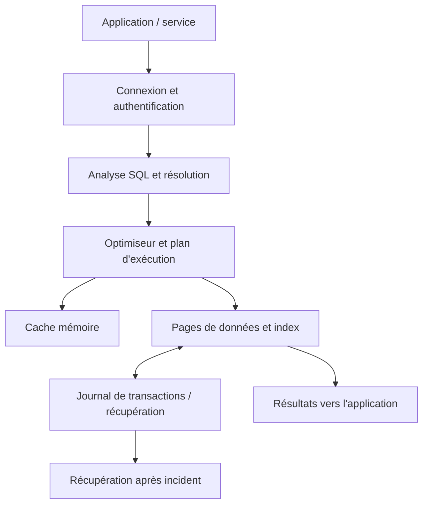
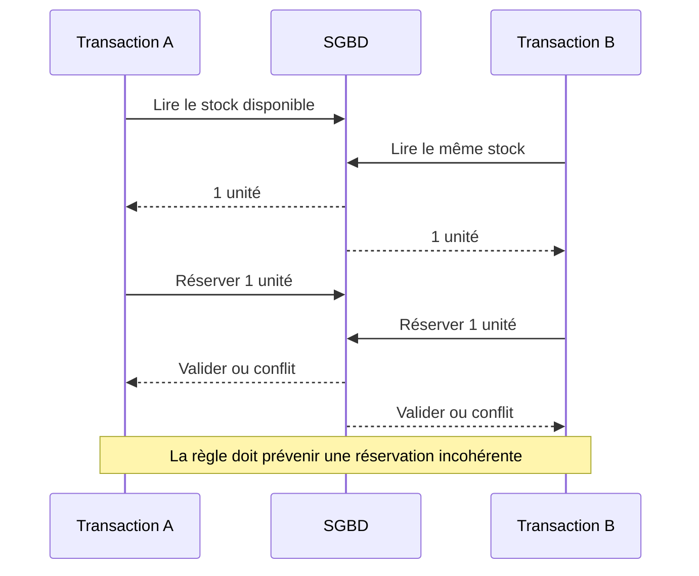
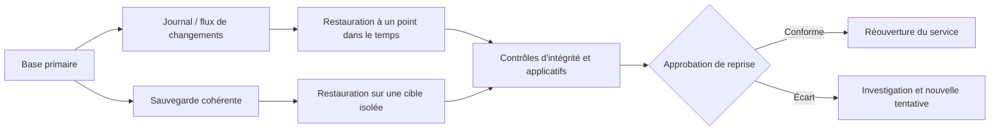

# Rôle du DBA et architecture SGBD — Intermédiaire

> **Mise en contexte.** Une base de données est un composant critique d’un système d’information : elle conserve des faits, les rend interrogeables et arbitre les accès concurrents. Le rôle d’un administrateur de bases de données (DBA, *Database Administrator*) ne se résume donc pas à créer des tables ou à relancer un service. Il s’agit d’assurer un niveau de service mesurable, de protéger la cohérence, de réduire les risques de perte ou de divulgation et de permettre une évolution contrôlée. Ce cours relie architecture, exploitation, sécurité, performance et récupération après incident. Les commandes sont des exemples à adapter au moteur et à sa version. Effectuez les manipulations sur une instance de laboratoire, avec des données fictives, jamais sur une production sans autorisation, sauvegarde vérifiée et procédure de retour arrière.

## Objectifs pédagogiques

À la fin de ce parcours, vous pourrez expliquer les responsabilités du DBA, dessiner les frontières d’une architecture SGBD, identifier les composants du moteur, préparer un changement de schéma, évaluer une sauvegarde, interpréter des indicateurs de santé et conduire un diagnostic reproductible. Vous devrez aussi distinguer disponibilité, durabilité, cohérence, confidentialité et performance : ces objectifs interagissent mais ne sont pas interchangeables.

Les objectifs opérationnels sont les suivants :

- traduire les besoins d’une application en exigences d’exploitation : capacité, latence, disponibilité, rétention et sécurité ;
- distinguer serveur, instance, base, schéma logique, fichiers physiques, journal de transactions et sauvegardes ;
- répartir responsabilités et permissions entre propriétaire de données, DBA, développeur, opérateur et responsable métier ;
- appliquer une modification avec préconditions, sauvegarde, fenêtre de changement, vérifications et plan de retour arrière ;
- expliquer ce que prouvent — et ne prouvent pas — un état « service démarré », un code retour nul ou une sauvegarde terminée ;
- préparer un dossier d’exploitation qui permette à une autre personne de reprendre le service.

## Prérequis et environnement de travail

Il est utile de connaître les notions de table, ligne, colonne, clé primaire, relation, requête SQL et compte utilisateur. Il n’est pas nécessaire de maîtriser un moteur particulier, mais vous devez savoir quel produit vous utilisez : PostgreSQL, MySQL, SQL Server, Oracle et SQLite partagent des concepts sans avoir les mêmes commandes, mécanismes internes, licences ni garanties.

Préparez un environnement isolé. Notez le système d’exploitation, la version du moteur, le mode de déploiement, le compte d’administration utilisé, le répertoire des données et la méthode de réinitialisation. Faites la différence entre l’environnement du poste de développement, celui de test et la production. Vérifiez la destination avant chaque commande destructive. Utilisez des identifiants de laboratoire, jamais des mots de passe copiés depuis des systèmes réels.

Une règle d’exploitation fondamentale : **le code de l’application ne doit pas être le seul endroit où vivent les règles d’intégrité**. Les contraintes du SGBD, les rôles et les transactions constituent des protections même si les données arrivent d’un import, d’une tâche planifiée ou d’un script d’administration.

## 1. Les missions du DBA dans le cycle de vie des données

Le DBA intervient à plusieurs étapes. En conception, il challenge le modèle : types adaptés, cardinalités, contraintes, stratégie d’identité et volume attendu. À la mise en service, il prépare comptes, paramètres, supervision, sauvegardes et procédures. En exploitation, il observe charge, verrous, croissance, capacité et erreurs. En incident, il protège les preuves, limite les impacts et restaure si nécessaire. Lors d’une évolution, il coordonne migrations, compatibilité et retour arrière.

Dans une petite équipe, une même personne peut remplir les fonctions de DBA et d’ingénieur plateforme. Dans une organisation plus grande, des responsabilités distinctes existent. La séparation ne supprime pas le besoin de coopération : une requête lente peut venir d’un plan d’exécution, d’un changement d’application, d’un réseau saturé ou d’une requête de reporting lancée au mauvais moment.

La responsabilité doit être explicite. Le propriétaire métier définit la signification et la durée de conservation des données. Le développeur définit les contrats applicatifs et les changements attendus. Le DBA maintient l’intégrité, l’accès, la capacité, la récupération et la visibilité technique. L’équipe sécurité valide le modèle de menace et les exigences de protection. L’exploitation assure l’infrastructure, les alertes et les procédures. Le DBA ne peut pas décider seul qu’une donnée doit être conservée indéfiniment, ni que toute personne ayant un compte technique peut lire toutes les tables.

### Exemple de matrice de responsabilités

| Activité | DBA | Développement | Métier / propriétaire | Sécurité / exploitation |
|---|---|---|---|---|
| Définition des règles métier | Conseil | Conseil | Responsable | Consultation |
| Modèle physique et index | Responsable technique | Contribution | Validation du sens | Consultation |
| Requête et code applicatif | Revue | Responsable | Validation fonctionnelle | Consultation |
| Rôles et privilèges | Responsable technique | Usage des rôles fournis | Validation des besoins | Revue de sécurité |
| Sauvegarde et restauration | Responsable technique | Test de compatibilité | Validation RPO/RTO | Copilotage |
| Incident de production | Diagnostic données | Diagnostic application | Évaluation de l’impact métier | Coordination |
| Rétention et suppression | Application technique | Mise en œuvre | Décision et justification | Contrôle |

Cette matrice est un point de départ, pas une règle universelle. L’organisation doit définir qui approuve les changements, qui possède les identifiants d’urgence, qui contrôle les preuves de restauration et qui peut autoriser un accès exceptionnel.

## 2. Architecture logique et architecture physique

L’architecture logique décrit la manière dont les données sont organisées et comprises : entités, relations, contraintes, vues et permissions. L’architecture physique décrit comment le moteur stocke, journalise, met en cache, indexe et récupère ces informations. Les deux niveaux sont liés mais ne doivent pas être confondus.

Un serveur peut exécuter un ou plusieurs processus ou instances. Une instance utilise une configuration, des ressources et un répertoire de données. À l’intérieur, il peut exister plusieurs bases logiques, puis des schémas, tables, index, vues, séquences et autres objets. Le vocabulaire exact varie selon le produit. SQLite est souvent une bibliothèque intégrée à l’application et à un fichier plutôt qu’un service réseau central ; PostgreSQL est un serveur client-serveur doté de processus et d’un journal de transactions.

Le chemin d’une requête typique suit des étapes : authentification, vérification des droits, analyse syntaxique, résolution des objets et des types, réécriture éventuelle, planification, exécution puis transmission des lignes. Le moteur peut lire des pages depuis le stockage ou les trouver dans le cache mémoire. Une écriture peut d’abord être inscrite dans un journal, puis les pages de données sont persistées selon les garanties de durabilité et la configuration. Le détail interne dépend du SGBD, mais cette chaîne aide à diagnostiquer une panne : erreur de syntaxe, refus d’accès, attente de verrou, lecture lente et saturation disque n’ont pas la même cause.



Le diagramme simplifie volontairement les mécanismes. Certains moteurs utilisent plusieurs processus, caches, journaux ou services ; d’autres ont une architecture embarquée. Ne déduisez pas la topologie exacte d’un dessin conceptuel. L’objectif est d’identifier des frontières de panne et les éléments qui doivent être surveillés ensemble.

### Bases, schémas et fichiers

Une base logique n’est pas nécessairement un fichier. Un moteur peut répartir les données sur plusieurs fichiers, volumes ou espaces de stockage. Un index n’est pas une deuxième copie exacte de la table : il est une structure qui accélère certains accès au prix de stockage et de travail supplémentaire lors des écritures. Un journal de transactions n’est pas un remplacement permanent d’une sauvegarde : il sert à la récupération et, dans des configurations adaptées, à la restauration à un point dans le temps.

Dans une architecture partagée, plusieurs applications peuvent utiliser une même instance. Il faut alors contrôler les rôles, les limites de ressources, les conventions de nommage et les chemins de migration. Dans une architecture dédiée, la séparation améliore parfois l’isolation et la maîtrise des changements mais ajoute des coûts de calcul, de supervision et d’exploitation. Le bon choix dépend des exigences mesurées, pas d’une règle qui imposerait systématiquement « une application, un serveur ».

## 3. Transactions, cohérence et concurrence

Une transaction délimite un ensemble d’opérations qui doivent former une unité logique. Les propriétés ACID sont l’atomicité, la cohérence, l’isolation et la durabilité. L’atomicité évite qu’une moitié seulement d’une opération métier soit validée. La cohérence signifie que les règles maintenues par la transaction sont respectées avant et après l’opération. L’isolation limite les interférences entre transactions concurrentes. La durabilité signifie qu’une transaction confirmée résiste aux pannes couvertes par la garantie du moteur et sa configuration.

Exemple : une vente diminue le stock, crée une commande et inscrit un mouvement. Si la commande est validée mais que le stock ne diminue pas, l’application est incohérente. Grouper ces changements dans une transaction rend l’opération atomique. Les contraintes restent néanmoins nécessaires : une transaction peut être correctement validée tout en appliquant une mauvaise règle métier.

Les anomalies de concurrence comprennent les lectures non répétables, les lignes fantômes, les mises à jour perdues et certains conflits de sérialisation. Leur existence dépend du niveau d’isolation et du moteur. Une transaction longue peut retenir des verrous, empêcher une opération de terminer et amplifier un incident. Le DBA doit reconnaître les attentes, localiser la session bloquante et comprendre l’effet d’une interruption. Tuer une session n’est pas une correction automatique : elle peut annuler du travail, déclencher un rollback long ou interrompre un traitement légitime.



Une implémentation robuste utilise une mise à jour conditionnelle, une contrainte ou un mécanisme de verrouillage adapté, puis vérifie le nombre de lignes affectées. L’approche précise dépend du modèle et du moteur. Le test doit inclure deux transactions concurrentes, pas seulement une exécution séquentielle.

## 4. Comptes, rôles et privilèges

L’authentification répond à « qui se connecte ? » ; l’autorisation répond à « que cette identité a-t-elle le droit de faire ? ». Un compte valide ne doit pas automatiquement lire toutes les données ou modifier le schéma. Le principe du moindre privilège attribue les droits les plus restreints compatibles avec la tâche.

Séparez les identités humaines, applicatives, de sauvegarde, de supervision et d’administration. L’application n’a normalement pas besoin de créer des rôles, de supprimer une base ou de modifier les paramètres globaux. Un compte de reporting peut avoir accès à des vues ou à des tables précises mais pas aux secrets et tables de sessions. Une tâche de sauvegarde peut nécessiter des privilèges spécialisés ; ils doivent être réduits à ce qui est indispensable au moteur.

Les privilèges doivent être contrôlés régulièrement. La suppression d’un employé, le départ d’un prestataire ou le remplacement d’un service doit déclencher une revue d’accès. Évitez les comptes partagés : ils rendent l’attribution d’une action difficile. Si un compte d’urgence existe, son usage doit être limité, enregistré, surveillé et revu. Les secrets doivent être stockés dans un gestionnaire adapté ou injectés par l’environnement ; ne les placez ni dans le dépôt, ni dans l’historique shell, ni dans un journal partagé.

### Exemple de séparation des rôles

```sql
-- Exemple conceptuel PostgreSQL : à adapter aux rôles et objets réels.
CREATE ROLE app_reader NOLOGIN;
GRANT CONNECT ON DATABASE atelier TO app_reader;
GRANT USAGE ON SCHEMA public TO app_reader;
GRANT SELECT ON TABLE public.articles TO app_reader;

CREATE ROLE app_runtime LOGIN;
GRANT app_reader TO app_runtime;
-- Les droits INSERT, UPDATE ou DELETE sont ajoutés seulement si nécessaires.
```

Ne copiez pas ce fragment sans connaître le schéma cible et les conventions d’accès. Les commandes de gestion des rôles et les droits par défaut diffèrent entre PostgreSQL, MySQL, SQL Server et Oracle. Le point important est de définir les permissions par rôle fonctionnel puis de tester qu’une opération interdite est effectivement refusée.

## 5. Capacité, mémoire et stockage

La capacité ne se résume pas à l’espace disque libre. Le service peut être limité par CPU, mémoire, I/O, nombre de connexions, espace temporaire, croissance du journal, contention ou limites de service. La saturation d’une ressource peut provoquer un effet en chaîne : des requêtes ralentissent, elles conservent leurs connexions plus longtemps, le pool se remplit, les nouvelles demandes s’accumulent et les délais expirent.

Le DBA doit connaître l’évolution de la taille des tables, des index et des journaux, ainsi que les tendances de croissance. Une prévision doit préciser l’horizon et l’incertitude. Une base qui gagne 4 Go par semaine ne doit pas être dimensionnée seulement à partir de sa taille aujourd’hui ; il faut estimer croissance, pics, maintenance, rétention, sauvegardes et espace nécessaire aux opérations temporaires. Le volume d’une sauvegarde compressée ne correspond pas forcément à la taille d’un stockage restauré.

Les alertes doivent être orientées vers une action. « Disque à 80 % » peut être pertinent si l’équipe sait quel volume est concerné, quelle croissance attendre et comment augmenter la capacité. Une alerte permanente sans seuil d’action finit par être ignorée. Prévoyez des seuils de tendance et de capacité critique, sans attendre que le système refuse les écritures.

Surveillez aussi les connexions. Trop de connexions peuvent épuiser la mémoire et augmenter la concurrence. Un pool de connexions, lorsqu’il est adapté au moteur, peut réduire le coût d’ouverture et limiter les sessions simultanées. Toutefois, un pool mal calibré garde des transactions longues ou impose une attente supplémentaire. Le nombre optimal dépend des ressources et du comportement des requêtes.

## 6. Sauvegarde, restauration et objectifs de reprise

Une sauvegarde est une copie récupérable des données et des éléments nécessaires à leur remise en service. Elle peut être logique, physique, complète, différentielle, incrémentale ou coordonnée à un journal. Chaque méthode a des prérequis et des limites. La présence d’un fichier ne prouve pas qu’il est complet, cohérent ou restaurable.

Deux indicateurs structurent souvent la stratégie. Le RPO (*Recovery Point Objective*) est la perte de données maximale tolérée, exprimée en durée. Le RTO (*Recovery Time Objective*) est le délai maximal visé pour rétablir le service. Par exemple, un RPO de 15 minutes indique que l’organisation cherche à limiter la perte à 15 minutes de transactions ; un RTO de deux heures exprime le délai cible de reprise. Ces objectifs sont des exigences métier et doivent être validés par les responsables concernés, car leur coût dépend de la technologie, de la réplication, de la fréquence de sauvegarde et de la capacité de l’équipe.

Il faut distinguer haute disponibilité et sauvegarde. La réplication peut reproduire très rapidement une suppression erronée ou une corruption logique ; elle permet parfois une bascule, mais elle ne garantit pas l’existence d’une version saine antérieure. Une sauvegarde isolée peut protéger contre certains incidents, mais le temps de restauration peut dépasser l’objectif de service. Une solution de résilience combine selon le risque réplication, sauvegardes, journaux, isolation, tests de restauration et procédure opérationnelle.



Un exercice de restauration doit mesurer le temps réel, vérifier les permissions, la configuration et l’intégrité, puis exécuter des contrôles applicatifs. Testez aussi les dépendances : secrets, certificats, extensions, versions, tâches planifiées, DNS, droits sur les fichiers et paramètres réseau. Si une base se restaure mais que l’application ne peut pas se connecter, la reprise n’est pas complète.

## 7. Changements de schéma et migrations

Une migration modifie une structure, des données ou le comportement du système. Elle doit être versionnée, revue, testée sur une copie représentative et accompagnée d’un plan de retour arrière. Le script « marche sur mon ordinateur » ne suffit pas : les données de production peuvent contenir doublons, valeurs inattendues ou volumes qui changent la durée du traitement.

Privilégiez les changements compatibles avec l’ancienne et la nouvelle version de l’application quand le déploiement se déroule progressivement. Une stratégie classique ajoute d’abord une colonne facultative, déploie le code capable de lire l’ancien et le nouveau format, remplit les valeurs par lots, vérifie les résultats, puis rend la colonne obligatoire lors d’une étape distincte si cela est sûr. La possibilité de retour arrière est parfois limitée après une transformation de données irréversible ; dans ce cas, prévoyez une restauration ou une procédure de compensation.

Avant le changement : capturez le schéma, vérifiez une sauvegarde, mesurez durée et verrouillage sur un jeu représentatif, identifiez les requêtes dépendantes et définissez les critères d’arrêt. Pendant le changement : observez l’avancement et le nombre d’éléments affectés, évitez de lancer des opérations concurrentes imprévues et conservez les journaux nécessaires. Après le changement : vérifiez le schéma réel, les contraintes, les comptes, les performances et les parcours utilisateurs. L’approbation de fin doit se baser sur ces preuves.

Le retour arrière n’est pas toujours une commande inverse. Ajouter un index peut être réversible avec peu d’effets sur le sens des données ; supprimer ou transformer une colonne peut faire perdre l’information originale. Documentez ce qui est réellement récupérable et le point à partir duquel le retour arrière nécessite restauration, relecture des événements ou compensation métier.

## 8. Performance : mesurer avant d’optimiser

La performance se mesure par une distribution et un objectif : médiane, percentiles, débit, taux d’erreur et consommation de ressources. Une moyenne seule peut cacher un petit pourcentage de requêtes extrêmement lentes. L’analyse doit corréler latence, plan d’exécution, taille de données, verrous, cache, paramètres et événements applicatifs.

Un DBA ne doit pas ajouter un index chaque fois qu’une requête est lente. Les index accélèrent certains accès mais augmentent stockage et coût d’écriture. Le moteur choisit un plan d’après les statistiques, les estimations de cardinalité, les contraintes et le coût estimé. Une estimation erronée peut conduire à un mauvais ordre de jointure ou à une opération trop coûteuse. Utilisez les outils de planification et de profilage fournis par votre moteur, sur des environnements et requêtes autorisés.

La première étape est de reproduire le problème avec des paramètres comparables. Vérifiez si la lenteur touche une requête, une population de données, une région, un type de compte ou toute l’instance. Cherchez aussi les opérations concurrentes : un rapport massif peut ralentir une transaction sensible sans que celle-ci ait changé. Ne mélangez pas une correction de SQL avec une augmentation de ressources avant d’avoir posé une hypothèse mesurable.

## 9. Supervision et observabilité

Une supervision complète inclut métriques, journaux et traces. Les métriques montrent les tendances : connexions, latence, I/O, cache, verrous, espace, erreurs et croissance. Les journaux documentent des événements précis. Les traces relient l’appel client aux services et requêtes successives. Aucun de ces éléments ne suffit seul.

Définissez des indicateurs liés aux objectifs métier. Si une application doit confirmer une opération en moins de 300 ms au 95e percentile, l’alerte doit mesurer cette expérience, tout en fournissant des métriques techniques pour diagnostiquer. Un serveur « vert » peut malgré tout servir des données périmées ou produire des erreurs fonctionnelles. Une requête de santé doit vérifier le minimum utile sans charger lourdement la base ni publier des informations sensibles.

Les journaux doivent avoir une politique de rétention, une horloge cohérente et une protection contre l’accès non autorisé. Évitez d’y écrire des mots de passe, jetons, coordonnées personnelles ou contenus complets de requêtes qui contiennent des secrets. En incident, consignez l’heure, le périmètre, l’identité des opérateurs, les changements faits et les preuves observées. Ne supprimez pas les logs qui pourraient expliquer un problème.

Une alerte de qualité doit comporter un propriétaire, une gravité, un seuil, une période et une action attendue. Les seuils doivent être calibrés à partir d’une base de référence. Les faux positifs répétés entraînent une fatigue d’alerte ; des seuils trop élevés découvrent l’incident trop tard. Revoyez les alertes après chaque incident et notez celles qui ont aidé ou manqué.

## 10. Réplication, haute disponibilité et reprise après sinistre

La réplication peut être synchrone ou asynchrone, selon le moteur et la topologie. La réplication synchrone peut réduire la perte d’écritures confirmées dans les conditions prévues, au prix potentiel d’une latence plus élevée ou d’une disponibilité réduite quand le réplica est indisponible. L’asynchrone améliore souvent la fluidité mais permet un décalage ; après une panne, certaines transactions récentes peuvent ne pas être présentes sur la cible. Les garanties exactes doivent être vérifiées pour le produit déployé.

Haute disponibilité, répartition de charge, réplication de lecture et sauvegarde répondent à des besoins différents. Une réplique de lecture peut décharger des requêtes, mais elle peut renvoyer un résultat en retard. Une bascule automatique peut rétablir un service, mais uniquement si le mécanisme gère correctement le quorum, la détection et le risque de double primaire. La topologie doit être testée en cas de perte du nœud, du réseau, du stockage ou d’une zone.

Le plan de reprise doit définir qui décide, quels systèmes redémarrer, comment empêcher les écritures concurrentes sur deux primaires, comment valider les données, quel retard est acceptable et comment informer les utilisateurs. Le retour à l’architecture nominale est une phase distincte : basculer vers un secours n’implique pas que le retour puisse être fait sans transfert, vérification et fenêtre de maintenance.

## 11. Sécurité des données et conformité

La protection ne se limite pas au chiffrement. Elle couvre classification des données, contrôle d’accès, séparation des environnements, gestion des secrets, journalisation, rétention, suppression et capacité d’audit. Le chiffrement en transit protège la communication contre certaines interceptions ; le chiffrement au repos réduit certains risques si le stockage est obtenu sans les clés. Ni l’un ni l’autre ne remplace les permissions et la sécurité des postes d’administration.

Les exigences légales, notamment celles relatives aux données personnelles, doivent être évaluées par les responsables appropriés pour le territoire, le secteur et les usages concernés. Le DBA met en œuvre les contrôles techniques décidés et fournit les preuves demandées, mais il ne doit pas improviser une interprétation juridique. La collecte minimale, les durées de conservation et les droits d’accès doivent être décrits avant de concevoir les sauvegardes et les archives.

Les copies de production utilisées pour des tests exposent les mêmes risques de confidentialité que la base d’origine. Préférez les données synthétiques ou masquées, réduisez la durée de vie des environnements de test et empêchez les exports de contourner la politique d’accès. Une restauration de secours doit aussi respecter les contraintes de protection des données.

## 12. Déploiement et choix de plateforme

Le choix entre instance gérée, serveur administré, conteneur et base embarquée dépend des exigences, compétences, coûts et limites. Un service géré peut fournir sauvegardes, patchs et bascules, mais les responsabilités exactes restent contractuelles et varient selon le fournisseur. Un conteneur facilite la reproductibilité de l’exécution, mais le stockage persistant, la sauvegarde, les secrets et la mise à niveau doivent être conçus. Une base embarquée simplifie un petit déploiement local, mais peut avoir des limites de concurrence ou de distribution selon l’usage.

Évaluez coût total, pas seulement prix de calcul. Incluez stockage, sauvegardes, transfert réseau, surveillance, réplication, environnement de test, astreinte, migrations et coût de sortie. Vérifiez les quotas, versions disponibles, extensions, options de restauration, accès réseau privé et mécanismes d’export. Une architecture qui semble bon marché peut devenir coûteuse si elle exige beaucoup d’opérations manuelles ou si elle ne respecte pas le temps de reprise demandé.

Le choix du moteur est également un compromis. Les fonctionnalités spécifiques facilitent certains usages mais renforcent le couplage. Le standard SQL ne signifie pas que toutes les requêtes, index ou stratégies de verrouillage sont identiques. Documentez les dépendances importantes et testez la compatibilité avant une migration entre moteurs.

## 13. Procédure d’exploitation standard

Une procédure utile est courte, exacte et vérifiable. Elle indique les prérequis, les droits nécessaires, le résultat attendu, les erreurs connues, la condition d’arrêt et le retour arrière. Elle précise également quelle version a été testée, parce qu’une commande valide pour une version peut avoir des options différentes dans une autre.

Pour chaque action importante, définissez quatre éléments : **précondition**, **commande**, **postcondition** et **preuve**. La précondition établit que la cible et l’état initial sont corrects. La commande effectue une action précisément limitée. La postcondition précise le résultat attendu. La preuve permet à un tiers de le vérifier. Cette méthode est plus robuste que d’enchaîner des commandes sans s’arrêter pour contrôler l’état.

### Exemple de fiche de changement

| Élément | Contenu attendu |
|---|---|
| Identifiant | Référence du changement, date et responsable |
| Objectif | Règle métier ou problème résolu |
| Périmètre | Instance, base, tables, applications concernées |
| Risque | Verrous, perte potentielle, incompatibilité |
| Préconditions | Sauvegarde, droits, capacité, test validé |
| Exécution | Étapes numérotées et durée estimée |
| Contrôle | Requêtes et métriques après changement |
| Arrêt | Conditions qui interrompent le déploiement |
| Retour arrière | Procédure testée et limites explicites |
| Approbation | Personne qui autorise la reprise du trafic |

## 14. Laboratoire pratique : exploiter une base de démonstration

### Scénario

Vous gérez un petit service d’atelier. Il contient des fournisseurs, des articles et des commandes. Vous devez créer une base de test, documenter son schéma, séparer la lecture de l’écriture, produire un instantané logique et démontrer un contrôle de cohérence. L’objectif est de pratiquer le raisonnement d’exploitation, et non d’imiter une plateforme de production complète.

### A. Préparer le schéma

Le fragment SQL ci-dessous convient à de nombreux moteurs relationnels avec des adaptations possibles de types et de syntaxe.

```sql
CREATE TABLE fournisseur (
    fournisseur_id INTEGER PRIMARY KEY,
    nom TEXT NOT NULL UNIQUE
);

CREATE TABLE article (
    article_id INTEGER PRIMARY KEY,
    fournisseur_id INTEGER NOT NULL,
    reference TEXT NOT NULL UNIQUE,
    libelle TEXT NOT NULL,
    quantite INTEGER NOT NULL CHECK (quantite >= 0),
    FOREIGN KEY (fournisseur_id) REFERENCES fournisseur(fournisseur_id)
);

CREATE TABLE commande (
    commande_id INTEGER PRIMARY KEY,
    article_id INTEGER NOT NULL,
    quantite INTEGER NOT NULL CHECK (quantite > 0),
    cree_le TIMESTAMP NOT NULL,
    FOREIGN KEY (article_id) REFERENCES article(article_id)
);
```

Dans SQLite, vérifiez que les clés étrangères sont activées pour la connexion si votre configuration l’exige. Dans PostgreSQL, les types d’identifiants et les fonctions de génération d’identifiants peuvent être choisis différemment. Cette différence est une raison de documenter le moteur réellement utilisé. Ne supposez pas que la même syntaxe d’heure ou d’auto-incrémentation est portable.

### B. Ajouter un petit jeu synthétique

```sql
INSERT INTO fournisseur (fournisseur_id, nom)
VALUES (1, 'Fournisseur Démo');

INSERT INTO article (article_id, fournisseur_id, reference, libelle, quantite)
VALUES (10, 1, 'OUTIL-001', 'Tournevis de démonstration', 25);

INSERT INTO commande (commande_id, article_id, quantite, cree_le)
VALUES (100, 10, 2, CURRENT_TIMESTAMP);
```

Contrôlez ensuite les lignes et les relations par des requêtes de lecture. Essayez d’ajouter un article avec le fournisseur 999 et une quantité négative. Ces tests doivent être refusés si les contraintes sont actives et correctement configurées. Conservez le message d’erreur : il fait partie de la preuve que le contrôle est bien exécuté.

### C. Vérifier le modèle et les accès

Inventoriez les tables, clés et contraintes avec les outils de votre moteur. Vérifiez qu’un compte de lecture peut effectuer une requête de sélection mais ne peut pas modifier les quantités. Les commandes de création de comptes ne sont pas identiques dans tous les moteurs ; écrivez la version exacte utilisée dans le compte-rendu plutôt que de masquer cette étape derrière une affirmation.

### D. Préparer et vérifier une sauvegarde

Pour une petite base SQLite de laboratoire, une copie cohérente peut être faite avec le mécanisme de sauvegarde adapté à SQLite ; ne copiez pas simplement le fichier actif si des transactions ou un journal sont en cours sans comprendre les modes de journalisation. Pour PostgreSQL, des outils tels que pg_dump peuvent produire une sauvegarde logique, mais la commande et les options doivent être testées sur la version réelle. Les sauvegardes physiques et les archives de journaux suivent d’autres procédures.

Après avoir produit la sauvegarde, restaurez-la vers une nouvelle cible isolée. Comparez nombre de tables et lignes, contrôlez les clés étrangères et exécutez les requêtes applicatives représentatives. Une archive qui existe n’est pas une preuve de restauration. Mesurez le temps et consignez les limites.

### E. Simuler une modification contrôlée

Ajoutez un champ de classification, testez d’abord la migration sur une copie, puis vérifiez la compatibilité avec la version de l’application. Définissez un seuil de durée, notez la procédure d’arrêt et indiquez comment revenir à l’état précédent. Si le changement supprime ou transforme de l’information, soyez explicite : une migration inverse ne suffit pas toujours à reconstituer les valeurs originales.

### Critères d’acceptation

Le laboratoire est réussi si le schéma correspond au contrat, les contraintes refusent les données incorrectes, les droits séparent lecture et écriture, la sauvegarde peut être restaurée et la migration laisse une preuve avant/après. Le rapport doit mentionner le moteur, la version, les commandes exactes, les erreurs observées et les précautions à appliquer avant une exécution réelle.

## 15. Étude de cas : la base répond, mais l’application est en panne

### Symptômes

Le service de base de données est déclaré démarré. Pourtant, l’application dépasse ses délais et des utilisateurs signalent des erreurs intermittentes. Les métriques montrent un nombre élevé de sessions actives et une augmentation des requêtes en attente.

### Hypothèses possibles

La panne peut venir d’une requête lente, d’une transaction bloquante, d’une hausse de connexions, d’un changement de plan, d’un traitement de reporting ou de la saturation d’une ressource. « Le serveur est vivant » confirme seulement une partie du système ; cela ne démontre ni la validité des données, ni la capacité à exécuter les opérations essentielles dans les délais.

### Démarche de diagnostic

1. Fixer l’heure de début et le périmètre : toutes les fonctions ou seulement une route.
2. Comparer métriques et journaux avant et après le début de l’incident.
3. Identifier les requêtes, verrous, connexions et tâches qui diffèrent de la ligne de base.
4. Vérifier si un déploiement, une migration ou un changement de paramètres précède le symptôme.
5. Former une hypothèse testable et choisir une vérification non destructive.
6. Définir une mitigation bornée, par exemple mettre en pause un reporting non critique après approbation.
7. Vérifier les critères de retour au service et surveiller la réapparition du symptôme.
8. Documenter la cause confirmée, le risque résiduel et le test qui préviendra une récidive.

### Mauvaise réaction à éviter

Redémarrer immédiatement le serveur peut supprimer des indices, annuler de longues transactions et ne pas traiter la cause. Augmenter le nombre de connexions peut aggraver la contention. Ajouter un index sans analyser les écritures et la sélectivité peut accroître le coût d’exploitation. Une action de mitigation n’est acceptable que si son bénéfice attendu, ses effets secondaires et son retour arrière sont connus.

## 16. Exercices avec corrigés

### Exercice 1 — Une sauvegarde termine sans erreur. Le service peut-il être déclaré récupérable ?

**Correction.** Non. Le journal de succès prouve que le programme a terminé selon ses propres critères, pas que la sauvegarde peut être restaurée ni que l’application fonctionnera. Il faut restaurer dans une cible isolée, vérifier l’intégrité, les permissions, la configuration et les parcours applicatifs. Il faut également mesurer la durée pour la comparer au RTO.

### Exercice 2 — Pourquoi l’application ne doit-elle pas utiliser un compte DBA ?

**Correction.** Ce serait une violation du moindre privilège. Une injection SQL, une erreur de code ou une fuite de secret pourrait permettre la suppression de tables, la création de comptes ou la lecture de données hors du périmètre nécessaire. Le compte applicatif ne doit posséder que les droits requis par ses opérations et les migrations doivent utiliser une identité distincte, contrôlée et temporaire.

### Exercice 3 — La réplication est active. Faut-il encore des sauvegardes ?

**Correction.** Oui. Une réplique peut reproduire une suppression involontaire, une corruption logique ou une erreur applicative. La réplication répond surtout à la disponibilité et à la distribution de données ; la sauvegarde fournit des points de récupération antérieurs. La stratégie correcte dépend du RPO, du RTO et des modes de panne à couvrir.

### Exercice 4 — Une requête est lente une fois sur cent, mais rapide le reste du temps. Quelle mesure regarder ?

**Correction.** Examinez la distribution des latences et un percentile élevé, par exemple le 95e ou le 99e, plutôt que seulement la moyenne. Corrélez les requêtes lentes avec concurrence, verrous, tailles de jeu, paramètres, cache et ressources. Une moyenne basse peut cacher une expérience utilisateur inacceptable sur les cas rares.

### Exercice 5 — Peut-on appliquer une migration directement en production parce qu’elle fonctionne sur une base vide ?

**Correction.** Non. La production contient du volume et des valeurs inhabituelles ; un index, une contrainte ou une conversion peut durer longtemps, bloquer les écritures ou échouer sur des données existantes. Testez sur une copie représentative, établissez préconditions et critères d’arrêt, vérifiez sauvegarde et retour arrière, puis contrôlez les résultats après le changement.

### Exercice 6 — Un compte de reporting nécessite SELECT sur une vue agrégée. Faut-il lui donner SELECT sur toutes les tables ?

**Correction.** Pas nécessairement. Accordez uniquement l’accès nécessaire à la vue et aux objets requis selon le moteur. Vérifiez les permissions effectives et la façon dont la vue s’exécute. L’accès direct à toutes les tables élargit l’exposition des données et complique la revue de privilèges.

## 17. Défi final : concevoir une exploitation minimale et défendable

Vous prenez en charge une application qui utilise un SGBD relationnel. Elle doit être exploitable par une équipe de deux personnes. On vous demande de proposer un dossier de mise en production sans supposer de fournisseur ou de produit spécifique.

Votre dossier doit couvrir :
1. l’architecture logique et physique, ainsi que les frontières des composants ;
2. la matrice des rôles et les accès de secours ;
3. les indicateurs, seuils et actions d’alerte ;
4. une politique de sauvegarde associée à un RPO et un RTO validés ;
5. le test de restauration, les contrôles d’intégrité et les dépendances à réinstaller ;
6. le cycle de migration avec préconditions, approbation, observation et retour arrière ;
7. le processus de diagnostic et la conservation des preuves ;
8. les limites connues, risques résiduels et responsables de suivi.

### Corrigé attendu

La bonne réponse n’est pas un schéma unique. Elle doit montrer la cohérence entre besoin métier et solution technique. Par exemple, une application à faible volume et à faible criticité peut fonctionner sur une base relativement simple si des sauvegardes testées, une procédure de restauration et un accès restreint existent. Un système transactionnel critique peut nécessiter réplication, surveillance renforcée, journalisation, procédure de bascule et exercices de reprise plus fréquents.

Les objectifs doivent être quantifiés. « Sauvegarder régulièrement » est insuffisant ; indiquez fréquence, rétention, lieu de stockage, protection, propriétaire et preuve de restauration. « Surveiller la performance » est insuffisant ; précisez les métriques et les seuils qui déclenchent une action. « Appliquer les migrations avec prudence » est insuffisant ; décrivez le protocole de test, d’approbation et de retour arrière.

Le corrigé doit aussi rendre visibles les compromis. Le synchrone peut diminuer le risque de perte mais ajouter une dépendance au secondaire. Une sauvegarde plus fréquente réduit parfois la perte potentielle mais augmente coût de stockage et de transfert. Un compte très restreint réduit l’exposition mais peut empêcher une tâche légitime si le rôle n’est pas modélisé. Une bonne conception mesure ces compromis et attribue les décisions à leurs propriétaires.

Enfin, une personne extérieure à l’équipe doit pouvoir reproduire les vérifications à partir du dossier sans improviser de commandes destructives. Le dossier doit être versionné, périodiquement exercé et mis à jour après chaque changement majeur.

## 18. Liste de contrôle avant mise en service

- [ ] La version du moteur et les dépendances sont documentées.
- [ ] Le schéma, les contraintes et les chemins de migration sont versionnés.
- [ ] Les comptes et privilèges respectent le moindre privilège.
- [ ] Les secrets ne figurent pas dans le code ni dans les journaux.
- [ ] Les sauvegardes sont protégées et une restauration récente a été démontrée.
- [ ] Le RPO et le RTO ont été confirmés par les propriétaires métier.
- [ ] Les métriques incluent latence, erreurs, connexions, capacité et stockage.
- [ ] Les alertes ont un responsable et une action définie.
- [ ] Les changements ont des critères d’arrêt et un retour arrière documenté.
- [ ] Les tests de charge et de concurrence couvrent des volumes réalistes.
- [ ] La procédure d’incident garde les preuves et limite les modifications irréversibles.
- [ ] Le plan de reprise couvre aussi identités, configuration, clés, extensions et dépendances applicatives.

## Conclusion

L’architecture SGBD se conçoit comme un ensemble de garanties vérifiables : structure correcte, transactions cohérentes, droits limités, ressources suffisantes, restauration possible et changements contrôlés. Le DBA relie le besoin métier au fonctionnement réel du moteur. Il doit savoir expliquer une décision, identifier ce qui reste inconnu, construire un test qui peut réfuter son hypothèse et garder une preuve de la postcondition. C’est cette discipline qui transforme une base simplement « disponible » en service de données exploitable, sûr et récupérable.
