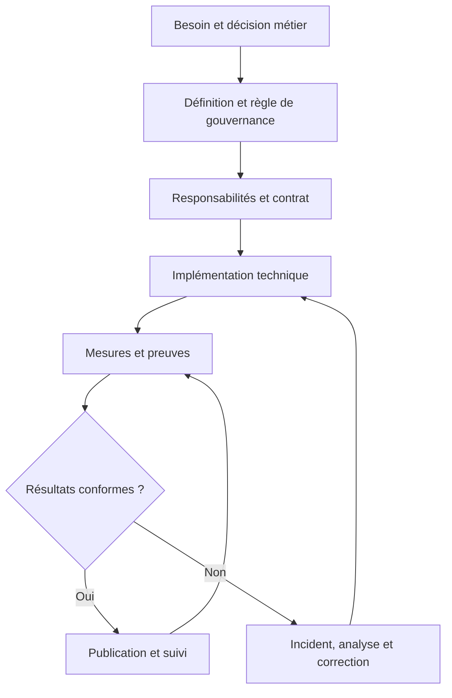
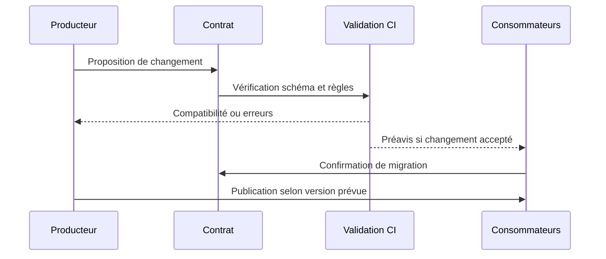
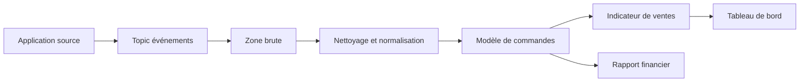
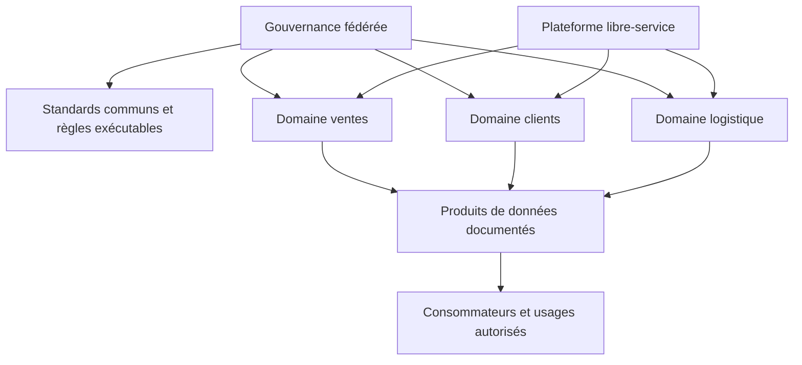
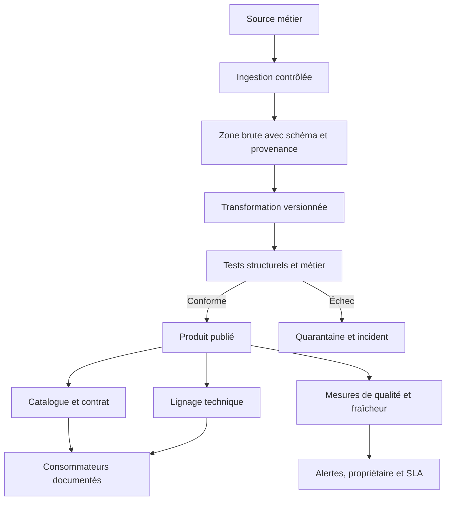

# Qualité, lignage et gouvernance — Expert

> **Mise en contexte.** Une plateforme de données peut traiter des milliards d’événements à grande vitesse et pourtant produire des décisions fausses si un indicateur change de définition, si une source cesse d’envoyer ses données sans que personne ne le remarque, si une table dérivée ne peut pas être reliée à son origine ou si personne n’est responsable d’une anomalie. La gouvernance des données ne consiste pas seulement à créer un comité qui approuve des documents. Elle consiste à rendre les données compréhensibles, fiables, traçables et utilisables selon des règles explicites, mesurables et applicables au quotidien.

Ce cours s’adresse à une personne qui doit concevoir, faire évoluer ou auditer une plateforme de données distribuée : bases relationnelles, outils d’intégration, entrepôt analytique, lakehouse, applications métier, services de streaming et tableaux de bord. Il relie la qualité des données, les métadonnées, le catalogue, le lignage, les contrats de données, la responsabilité métier, les données de référence, la mesure opérationnelle et les changements de schéma.

L’objectif n’est pas de promettre des données parfaites. Toute qualité dépend d’un usage : une valeur peut être acceptable pour une tendance approximative et insuffisante pour une facturation ou une décision individuelle. Une gouvernance mature explicite ce compromis, définit des critères vérifiables, indique les limites connues, attribue les décisions à des responsables et fait remonter les incidents aux personnes capables de les résoudre.

## Objectifs pédagogiques

À l’issue de cette leçon, vous serez capable de définir une stratégie de qualité reliée aux usages métier, construire des règles et indicateurs testables, distinguer les dimensions de qualité et leurs limites, concevoir des contrats de données compatibles avec des producteurs et consommateurs indépendants, documenter le lignage technique et métier, organiser un catalogue avec des propriétaires et des responsables, gérer les changements de schéma, mettre en place une boucle de résolution d’anomalies, concevoir des règles de données de référence, comprendre les compromis d’une architecture data mesh et préparer des preuves de gouvernance exploitables.

Vous apprendrez aussi à éviter les confusions courantes : une exécution réussie d’un pipeline ne garantit pas que les données soient fraîches ou correctes ; un catalogue rempli de descriptions copiées n’est pas une gouvernance opérationnelle ; un test qui passe sur un échantillon ne démontre pas une qualité globale ; un graphe de dépendances technique ne décrit pas nécessairement la signification métier d’un indicateur ; un score unique peut cacher un problème critique dans une dimension particulière.

## 1. Gouvernance : règles, décisions, responsabilités et preuves

La gouvernance des données regroupe les droits de décision et les responsabilités qui assurent que les données sont gérées comme un actif. Elle définit qui décide de la signification d’un champ, qui approuve une définition métier, qui fixe les objectifs de qualité, qui autorise un nouvel usage, qui peut accéder à une donnée sensible, qui doit intervenir lorsqu’un contrôle échoue et qui peut accepter temporairement un risque.

La gestion quotidienne des données met ces décisions en pratique : ingestion, transformation, catalogage, accès, correction, conservation, surveillance et support. La gouvernance fixe les principes et responsabilités ; l’exploitation les traduit en mécanismes et preuves. Si elle ne rejoint jamais les processus d’ingénierie, elle devient une documentation qui décrit un système idéal différent du système réel.

### 1.1 Quatre niveaux à relier

Une architecture de gouvernance opérationnelle relie quatre niveaux. Le niveau métier définit les finalités, les termes, les indicateurs et la tolérance à l’erreur. Le niveau organisationnel identifie les propriétaires, stewards, producteurs, consommateurs et responsables de plateforme. Le niveau technique assure les schémas, transformations, tests, catalogues, règles d’accès et systèmes d’observabilité. Le niveau d’assurance conserve les preuves, examine les exceptions, suit les corrections et améliore le dispositif.



Une gouvernance efficace n’exige pas que chaque décision soit centralisée. Elle exige que le lieu de décision soit clair, que les principes communs soient respectés et que les conflits puissent être résolus. Une équipe métier peut être responsable de la définition du chiffre d’affaires ; une équipe plateforme peut être responsable du fonctionnement de l’entrepôt ; une équipe de gouvernance peut définir les standards de classification et d’annotation. Ces responsabilités sont complémentaires et ne doivent pas être confondues.

### 1.2 Pourquoi la propriété métier est essentielle

Une équipe technique peut vérifier qu’une colonne est numérique, mais elle ne peut pas toujours déterminer si le chiffre d’affaires inclut les taxes, les remboursements, les commandes annulées ou les ventes non encore encaissées. Ces décisions doivent être portées par une personne ou une fonction métier identifiée. Sans propriétaire, les divergences sont traitées comme des bugs techniques alors qu’elles reflètent parfois des définitions contradictoires.

Le propriétaire de données prend les décisions de fond sur un domaine, ses usages, ses définitions et les risques acceptables. Le data steward assure souvent la cohérence quotidienne des définitions, métadonnées et règles, en coordonnant les métiers et les équipes techniques. Le producteur construit ou maintient le flux. Le consommateur utilise le jeu de données et exprime ses besoins. Le responsable plateforme garantit les capacités communes. L’organisation peut adapter les noms, mais elle doit éviter les responsabilités implicites.

### 1.3 Une matrice RACI utile

Une matrice RACI précise qui est responsable de l’exécution, qui rend compte de la décision finale, qui est consulté et qui est informé. Elle n’a de valeur que si les tâches sont concrètes et les rôles réellement disponibles.

| Activité | Propriétaire métier | Steward | Producteur technique | Plateforme | Consommateur BI |
|---|---|---|---|---|---|
| Définir le montant net | A | R | C | I | C |
| Publier un nouveau champ | A | C | R | C | I |
| Détecter une rupture de fraîcheur | I | C | R | R | I |
| Évaluer un indicateur métier erroné | A | R | C | C | C |
| Définir un standard de métadonnées | C | R | C | A/R selon l’organisation | I |
| Accepter une dérogation de qualité | A | R | C | C | C |

La matrice doit refléter l’organisation réelle. Évitez de nommer une équipe responsable de tout sans capacité de décision ni temps consacré. Une responsabilité sans autorité ou sans accès aux outils est une responsabilité fictive.

### 1.4 Gouvernance fédérée et décisions centrales

Les standards transverses — classification, format des métadonnées, exigences minimales de qualité, conventions de sécurité, règles de publication — peuvent être définis centralement. La définition métier d’un domaine peut rester auprès de l’équipe la plus proche de la source. Un modèle fédéré cherche à maintenir une cohérence générale sans obliger chaque équipe à attendre un organe central pour toute évolution.

Le coût de la fédération est la nécessité d’interfaces claires. Il faut un vocabulaire commun, une procédure d’arbitrage, des standards d’automatisation et des responsables de domaine. Sans ces éléments, les équipes créent des définitions parallèles et des contrats incompatibles. La centralisation complète peut au contraire devenir un goulot d’étranglement et éloigner les décisions de la réalité métier.

## 2. Définir la qualité des données par rapport à un usage

La qualité ne se résume pas à supprimer les valeurs nulles. Elle décrit le degré auquel les données sont adaptées à une finalité spécifiée. Une date de naissance peut être complète mais fausse ; une adresse peut être valide syntaxiquement mais obsolète ; un événement peut être exact mais arriver après l’heure à laquelle la décision devait être prise.

Les règles doivent commencer par une question métier : quelle décision dépend de cette donnée, quel défaut pourrait l’invalider, et quel niveau de tolérance est acceptable ? La définition d’une qualité suffisante varie selon le coût d’une erreur, le volume, la possibilité de correction et le moment d’utilisation.

### 2.1 Les principales dimensions

**Complétude.** Proportion de champs ou d’enregistrements attendus qui sont présents. Il faut définir ce qui est requis, ce qui peut être absent et dans quelles circonstances.

**Validité.** Respect des formats, types, domaines et contraintes définis. Une date doit respecter un format reconnu, une devise doit appartenir à la liste admise et une quantité doit respecter des bornes métier.

**Exactitude.** Proximité de la valeur stockée avec la réalité ou avec une source de référence fiable. Une donnée peut respecter tous les formats et rester fausse.

**Cohérence.** Compatibilité entre valeurs, champs, systèmes ou périodes. Une commande marquée livrée ne devrait pas avoir une date d’expédition postérieure à sa livraison, sauf règle métier explicitement documentée.

**Unicité.** Absence de doublons non désirés selon une clé et une règle de dédoublonnage définies. Deux personnes différentes peuvent partager un nom, tandis qu’un même client peut avoir plusieurs adresses.

**Fraîcheur et ponctualité.** Délai entre la disponibilité attendue et l’arrivée réelle. Une donnée vieille de trois jours peut être correcte pour une analyse annuelle et inutilisable pour la surveillance de stock.

**Intégrité référentielle.** Relations valides entre entités : une ligne de commande référence une commande existante, un événement référence un client connu selon les règles du domaine.

**Traçabilité et interprétabilité.** Capacité à savoir d’où vient la donnée, comment elle a été transformée, ce qu’elle signifie et quelles limites sont connues.

**Accessibilité et disponibilité.** Capacité des consommateurs autorisés à trouver et utiliser le jeu conformément au contrat. Un jeu parfait mais indisponible à l’heure de la décision peut être de mauvaise qualité pour cet usage.

Ces dimensions se chevauchent parfois. Il n’existe pas de liste universelle qui capture tous les besoins. Pour un moteur de fraude, le délai de livraison d’un événement peut être plus important que la complétude d’une colonne facultative. Pour une clôture financière, l’exactitude, le rapprochement et la reproductibilité peuvent être dominants.

### 2.2 Formuler des règles mesurables

Une règle de qualité doit indiquer le périmètre, l’expression ou l’algorithme, la fréquence, le seuil attendu, la gravité en cas de dépassement, le propriétaire et la réponse attendue. Dire que les emails doivent être corrects est trop vague. Dire que le champ email doit être présent pour les clients actifs qui ont choisi une notification par courrier électronique, et respecter le format accepté par le service, est testable.

Exemple de spécification :

- **Jeu :** commandes préparées.
- **Règle :** le montant net ne doit pas être négatif, sauf pour les lignes explicitement identifiées comme avoirs.
- **Population :** commandes comptabilisables sur la période.
- **Mesure :** nombre de lignes en violation et proportion sur le total.
- **Seuil :** zéro violation inexpliquée avant publication comptable.
- **Propriétaire :** responsable métier des ventes.
- **Action :** bloquer la publication comptable, ouvrir une anomalie et permettre une correction avec piste d’audit.

Une règle doit aussi indiquer ses exceptions valides. Le but n’est pas de rendre les données artificiellement conformes par suppression systématique des cas atypiques. Un remboursement peut être négatif et parfaitement correct si la sémantique l’autorise.

### 2.3 Dénominateurs et biais de mesure

Tout ratio nécessite une population claire. Calculer la proportion de champs non nuls sans identifier les enregistrements applicables peut masquer des erreurs. Si une colonne n’est obligatoire que pour un type de client, le dénominateur doit inclure uniquement la population à laquelle la règle s’applique.

Les exclusions et filtres sont eux-mêmes une partie de la règle et doivent être versionnés et revus. Sinon, une équipe peut améliorer artificiellement un score en excluant les lignes défectueuses. Lorsqu’une règle change, conservez la différence entre le résultat obtenu avec l’ancienne version et celui de la nouvelle, afin de distinguer une évolution réelle de la qualité d’une évolution de mesure.

### 2.4 Score global ou dimensions séparées ?

Un score synthétique peut résumer une situation, mais il peut cacher une défaillance critique. Une moyenne de 99 % n’est pas rassurante si 1 % des paiements concernés sont mal attribués ou si les données livrées avec vingt-quatre heures de retard sont celles utilisées pour la détection de fraude.

Présentez le score avec les dimensions importantes, les volumes, les tendances, la gravité et les règles en échec. Les règles critiques peuvent être des portes de publication indépendantes du score global. Une agrégation pondérée n’a de sens que si les pondérations sont explicites et validées par les personnes concernées.

## 3. Profilage, tests et détection de défauts

Le profilage décrit les propriétés observées d’un jeu : nombre de lignes, valeurs manquantes, distributions, cardinalité, valeurs rares, min/max, formats, doublons, fraîcheur et changements dans le temps. Il aide à découvrir les hypothèses cachées dans les données et à construire des tests, mais il ne prouve pas qu’une valeur est vraie.

### 3.1 Profilage initial et continu

Le profilage initial aide à comprendre la source avant d’imposer des règles. Examinez le volume, les taux de nullité, les valeurs distinctes, les distributions et les relations. Cherchez également les événements rares, les formats historiques, les changements d’unité et les valeurs sentinelles telles que inconnu, N/A ou une date par défaut.

Le profilage continu suit l’évolution des distributions. Si le pourcentage de commandes sans région passe de 0,2 % à 30 %, la syntaxe des lignes peut encore être valide mais la source a probablement changé. Des seuils adaptatifs peuvent être utiles pour les séries saisonnières, mais ils doivent rester explicables. La détection automatique d’anomalies ne doit pas être une boîte noire qui ouvre constamment de faux incidents.

### 3.2 Tests structurels et tests métier

Les tests structurels vérifient le schéma, les types, les clés, les contraintes et certaines relations. Les tests métier vérifient des invariants du domaine : une facture comptabilisée a un client valide, un montant net correspond à la règle de calcul définie, une période clôturée ne reçoit pas silencieusement des transactions anciennes sans correction comptable.

Les deux catégories sont nécessaires. Un schéma peut être stable alors que les valeurs changent de signification. Inversement, les règles métier peuvent être correctes tandis qu’un changement de nom de colonne casse un consommateur. Les tests doivent être exécutés à plusieurs frontières : ingestion, transformation, publication du jeu et consommation critique.

### 3.3 SQL pour mesurer la complétude et l’unicité

Exemple illustratif, à adapter au moteur et au modèle de données :

```sql
-- Complétude du champ client_id sur les commandes actives
SELECT
    COUNT(*) AS lignes_actives,
    SUM(CASE WHEN client_id IS NULL THEN 1 ELSE 0 END) AS client_id_absents,
    1.0 * SUM(CASE WHEN client_id IS NULL THEN 1 ELSE 0 END)
        / NULLIF(COUNT(*), 0) AS taux_absence
FROM commerce.commandes
WHERE statut <> 'ANNULEE';

-- Clés de commande dupliquées dans la source
SELECT commande_id, COUNT(*) AS occurrences
FROM staging.commandes
GROUP BY commande_id
HAVING COUNT(*) > 1;
```

La requête de doublons détecte des clés répétées dans cette source ; elle ne permet pas à elle seule de conclure qu’il s’agit de doublons métier. Une commande peut avoir plusieurs événements ou lignes légitimes. Avant de supprimer des répétitions, définissez la clé naturelle, la granularité, la politique de priorité et le comportement attendu lors d’un rejeu.

### 3.4 Détecter les ruptures de fraîcheur

Un pipeline peut terminer en succès après avoir traité zéro ligne. Le statut technique du job ne suffit donc pas à démontrer que le produit de données est frais. Il faut comparer le dernier événement accepté ou la dernière période couverte à l’objectif métier.

```sql
SELECT
    MAX(ingere_le) AS derniere_ingestion,
    MAX(evenement_le) AS dernier_evenement
FROM analytics.evenements;
```

La mesure doit tenir compte du fuseau horaire, de la fréquence de la source, des périodes sans activité et des retards prévus. Une source quotidienne peut être correctement fraîche à 08 h et en retard à midi. Le seuil dépend du contrat. Une alerte doit être déclenchée lorsque la donnée devient trop ancienne, pas uniquement lorsque le processus informatique échoue.

### 3.5 Anomalies et exceptions

Toutes les anomalies ne sont pas des erreurs. Une hausse de remboursements peut être liée à une campagne, une mise à jour d’application ou une véritable fraude. Le contrôle doit orienter le diagnostic sans masquer automatiquement l’événement. Les lignes rejetées, mises en quarantaine ou corrigées doivent rester traçables, avec un motif et une décision.

La quarantaine protège le modèle de publication lorsque des enregistrements sont douteux. Elle doit prévoir un propriétaire, un délai de traitement, un mécanisme de correction et un indicateur de volume bloqué. Sinon, elle devient un cimetière de données. Certaines violations peuvent bloquer une publication ; d’autres peuvent autoriser un traitement avec une réserve clairement visible. Ce choix doit être défini selon l’impact.

## 4. Contrats de données : stabiliser la relation entre producteurs et consommateurs

Un contrat de données explicite les attentes entre celui qui publie un flux et ceux qui le consomment. Il peut définir les champs, types, sémantique, clés, contraintes, qualité, fraîcheur, compatibilité, classification, règles d’accès, disponibilité, gestion des versions et procédure de changement. Il est utile parce qu’il rend visible ce qui, autrement, repose sur des échanges informels.

### 4.1 Un contrat est plus qu’un schéma

Un schéma décrit la structure et certains types. Un contrat décrit aussi le sens : unité monétaire, fuseau horaire, définition du statut, granularité, sémantique des valeurs absentes, règles de correction et garanties opérationnelles. Deux champs nommés amount peuvent contenir des montants bruts, nets, TTC ou hors taxe ; leur compatibilité technique ne signifie pas qu’ils sont interchangeables.

Un contrat minimal devrait inclure le nom et la description du produit, les producteurs et responsables, le schéma, la clé et la granularité, les définitions de champs et unités, les règles de qualité mesurables, les objectifs de fraîcheur et disponibilité, la classification et les politiques d’accès, la stratégie de version et de dépréciation, le comportement en cas d’erreur et de rejeu, ainsi qu’une procédure de communication et de changement.

### 4.2 Compatibilité de schéma

Un changement peut être compatible avec certains consommateurs et incompatible avec d’autres. Ajouter un champ facultatif peut être acceptable si les consommateurs tolèrent les champs inconnus. Supprimer ou renommer un champ peut casser des transformations. Changer la sémantique d’un champ sans changer son type est souvent plus dangereux qu’une modification structurelle visible.

Les stratégies possibles incluent la version explicite, l’évolution compatible, la période de transition, les champs de remplacement, la double publication et la dépréciation annoncée. Chaque approche a un coût. Les contrats doivent spécifier quelles évolutions sont autorisées et quelles vérifications se font automatiquement.



### 4.3 Versionnement sémantique et limites

Le versionnement sémantique peut exprimer les niveaux de changement : correctif, ajout compatible, rupture. Mais le numéro seul ne suffit pas. Les équipes doivent définir ce qui constitue une rupture pour les consommateurs existants. Une modification de la définition d’un indicateur peut demander une nouvelle version même si le schéma est identique.

Conservez l’historique des versions de contrat et associez les déploiements aux versions effectivement publiées. Il doit être possible de répondre à la question : quelle définition était en vigueur quand ce tableau de bord ou ce rapport a été calculé ? Cette information est importante pour les analyses reproductibles, les audits et la correction des erreurs historiques.

### 4.4 Produit de données et niveau de service

Un produit de données est un jeu publié avec une finalité et des utilisateurs identifiés, des responsabilités, des garanties et une interface documentée. L’approche aide à considérer la donnée comme un service maintenu plutôt que comme un fichier déposé sans propriétaire.

Le niveau de service peut combiner fraîcheur, disponibilité, exactitude, qualité de documentation, délai de réponse aux incidents et compatibilité des changements. Ne définissez pas des garanties que l’équipe ne peut pas mesurer. Une promesse de disponibilité sans mesure de l’accès effectif ne peut pas être auditée. Un délai de résolution doit distinguer accusé de réception, diagnostic, contournement et correction définitive.

## 5. Catalogue et métadonnées

Un catalogue aide les utilisateurs à découvrir les jeux, comprendre leur signification, identifier le propriétaire, voir la classification, connaître les contraintes d’accès et trouver les dépendances. Il relie les actifs techniques aux définitions métier et aux décisions de gouvernance.

### 5.1 Métadonnées techniques, métier et opérationnelles

Les métadonnées techniques décrivent schémas, types, formats, partitions, systèmes, versions et emplacements. Les métadonnées métier donnent les définitions, synonymes, règles de calcul, finalités et indicateurs liés. Les métadonnées opérationnelles décrivent la fraîcheur, le statut des pipelines, les volumes, les erreurs, les tests et l’historique de publication. Les métadonnées de gouvernance concernent les propriétaires, la classification, les politiques d’accès, la rétention et les décisions.

Ces catégories doivent être reliées. Si le catalogue affiche une description mais n’indique ni le propriétaire ni l’actualisation, l’utilisateur peut trouver les données sans savoir si elles sont fiables. Si les métadonnées d’accès diffèrent des permissions réelles, le catalogue peut induire en erreur et devenir un risque.

### 5.2 Un catalogue vivant

Automatisez autant que possible la découverte des schémas, les statistiques, les résultats de tests et le lignage technique. Les définitions métier et l’approbation des usages nécessitent souvent une validation humaine. L’objectif est de limiter la saisie redondante et les descriptions périmées, pas de prétendre que l’automatisation peut décider du sens d’un indicateur.

Un catalogue vivant possède une cadence de mise à jour, des contrôles de complétude, des propriétaires et un mécanisme de correction. Les actifs sans propriétaire ou avec un contact inactif doivent apparaître dans une file d’assainissement. Les indicateurs d’usage peuvent montrer les jeux ignorés ou les doublons de produits. Un jeu très consulté n’est pas automatiquement correct : la popularité n’est pas une dimension de qualité.

### 5.3 Glossaire métier et indicateurs certifiés

Un glossaire définit des termes partagés : client actif, commande livrée, revenu reconnu, période de clôture, région commerciale. Chaque terme doit indiquer le propriétaire de la définition, le sens inclus et exclu, les règles de calcul, les exemples, les limites et les jeux qui l’implémentent.

Un indicateur certifié doit avoir une définition validée et une implémentation contrôlée. Les tableaux de bord peuvent identifier clairement la version certifiée. Cela ne signifie pas que chaque résultat est correct : la fraîcheur, les sources, les règles de qualité et les incidents doivent rester visibles. La certification doit être réévaluée lorsqu’un changement de source ou de définition survient.

## 6. Lignage technique et lignage métier

Le lignage décrit comment les données sont produites et transformées. Au niveau technique, il relie les sources, tables, jobs, transformations, modèles et sorties. Au niveau métier, il explique comment une donnée soutient un indicateur ou une décision. Les deux perspectives sont complémentaires et n’ont pas toujours les mêmes granularités.

### 6.1 Lignage de bout en bout

Un chemin analytique peut partir d’un événement applicatif, passer par un topic de streaming, une zone brute, une transformation de nettoyage, un entrepôt et une vue consommée par un tableau de bord. Une rupture de qualité dans la source peut affecter plusieurs indicateurs, tandis qu’un changement de vue peut n’affecter qu’un ensemble réduit de consommateurs.



Un lignage utile peut répondre à deux directions. L’analyse en amont identifie les sources qui ont contribué à une valeur. L’analyse en aval identifie les consommateurs susceptibles d’être affectés par une modification ou une anomalie. Pour être fiable, le graphe doit être mis à jour lors des changements de code et indiquer la fraîcheur des métadonnées.

### 6.2 Lignage au niveau colonne

Le lignage au niveau table ne suffit pas toujours. Si un rapport utilise uniquement la colonne montant net, la modification d’une colonne d’adresse peut ne pas être pertinente, tandis qu’un changement de formule du montant peut être critique. Le lignage de colonne associe les colonnes de sortie aux expressions, colonnes d’entrée et règles de transformation.

Il peut être difficile à extraire lorsque la logique est dynamique, répartie dans des procédures, des scripts Python, des notebooks et des macros. Indiquez les zones couvertes, les limites et les traitements qui nécessitent une annotation manuelle. Un graphe visuellement complet peut être trompeur si certains chemins ne sont pas instrumentés.

### 6.3 Provenance, reproductibilité et audit

La provenance répond à la question de l’origine : quel jeu, quelle version, quelle période et quelles règles ont servi à produire ce résultat ? Pour une analyse importante, conservez les références de versions de code, configurations, snapshots et paramètres. Les informations doivent permettre de reconstruire un résultat lorsqu’une décision est contestée ou lorsqu’une anomalie est découverte.

La reproductibilité ne signifie pas toujours pouvoir recréer chaque octet exactement. Certains traitements incluent des événements en temps réel, des sources qui changent ou des modèles non déterministes. Documentez alors les limites, les entrées disponibles et les sources de non-déterminisme. Un rapport d’audit doit distinguer les éléments reconstruits, les éléments observés et les hypothèses.

### 6.4 Analyse d’impact

Avant de renommer une colonne, modifier une définition ou supprimer un jeu, recherchez les dépendances en aval et les consommateurs métier. Le processus d’impact doit inclure les notebooks, exports récurrents, rapports, modèles, flux d’événements, API et consommateurs externes connus. Les dépendances non détectées sont un risque qui doit être rendu visible.

L’analyse d’impact doit aboutir à une décision : changement compatible, migration planifiée, période de double publication, correction des consommateurs, ou refus temporaire. Une notification envoyée mais non reçue ou non comprise ne garantit pas que les consommateurs ont migré. Pour un changement critique, une confirmation ou un test de compatibilité est préférable.

## 7. Données de référence, MDM et résolution d’entités

Les données de référence décrivent des entités partagées entre plusieurs systèmes : clients, produits, fournisseurs, lieux, organisations, comptes ou codes de statut. Elles diffèrent des événements transactionnels qui enregistrent une action à un instant donné. Plusieurs applications peuvent contenir des versions différentes d’un même client, avec des identifiants, adresses ou règles de nommage divergents.

La gestion des données de référence (MDM) cherche à produire une vue fiable de ces entités et à organiser la relation avec les systèmes sources. Elle n’impose pas nécessairement qu’une seule base centralisée écrive partout. Une solution peut fédérer les identifiants, synchroniser certains attributs ou maintenir un registre d’identité et de correspondances.

### 7.1 Identité, survivorship et historique

La résolution d’entités détermine si plusieurs enregistrements représentent la même entité. Une correspondance exacte sur un identifiant fiable peut être robuste ; une correspondance probabiliste sur le nom, l’adresse et la date de naissance comporte des erreurs possibles. Les règles doivent définir les champs utilisés, leurs poids, les seuils, les décisions automatiques, les cas manuels et le traitement des faux positifs et faux négatifs.

La règle de survivorship détermine quelle valeur devient la valeur de référence lorsque les systèmes divergent. Le système qui fournit une adresse la plus récente n’est pas forcément le plus fiable ; une source officielle ou un processus validé peut avoir priorité. Chaque règle doit avoir une justification métier et être testée sur des cas représentatifs. Pour les valeurs sensibles, la provenance et l’historique doivent être conservés selon les besoins et les règles de conservation.

### 7.2 Historiser les changements

La dimension temporelle est importante pour comprendre les changements. Une table peut avoir une date d’effet métier et une date d’enregistrement technique. Une correction rétroactive peut changer l’état connu aujourd’hui sans effacer le fait qu’une autre valeur a été utilisée dans un rapport ancien.

Les approches de type Slowly Changing Dimension sont utiles dans les entrepôts. Le type 1 remplace la valeur courante ; le type 2 conserve des versions avec dates d’effet ; d’autres modèles répondent à des besoins particuliers. Le choix dépend de la question analytique : veut-on connaître la valeur courante ou la valeur qui était connue à une date passée ? Les règles de correction et les rechargements doivent être documentés.

### 7.3 Éviter un registre maître inaccessible

Un MDM n’est pas seulement un outil de dédoublonnage. Il faut définir les sources autoritatives par attribut, les processus de correction, les usages autorisés, les identifiants partagés, les délais de propagation et les modes de résolution en cas de conflit. Une source maîtresse trop lente ou mal gouvernée incite les équipes à créer leurs propres copies, ramenant le problème initial.

## 8. Architecture orientée domaines et data mesh

Le data mesh est une approche organisationnelle et architecturale qui met l’accent sur la propriété des données par domaines, les données en tant que produits, une plateforme en libre-service et une gouvernance fédérée. Ce n’est pas simplement déplacer des tables à chaque équipe. Sans standards communs, responsabilités et produits réellement consommables, la décentralisation peut amplifier la fragmentation.

### 8.1 Propriété par domaine

Un domaine connaît généralement mieux la sémantique et les processus qui produisent ses données. Il peut être responsable de la définition, de la qualité, du contrat, du support et de la documentation de son produit. Les équipes consommatrices ne doivent pas avoir besoin de comprendre les détails internes du système producteur pour utiliser l’interface documentée.

Cette autonomie exige des compétences et un temps opérationnel. Chaque domaine doit pouvoir mesurer la fraîcheur, expliquer les changements, traiter les défauts et maintenir les métadonnées. Le fait de nommer une équipe propriétaire ne suffit pas si elle ne dispose pas d’outils ni d’objectifs liés à la qualité.

### 8.2 Plateforme en libre-service

Une plateforme commune peut offrir l’ingestion, le déploiement de transformations, les tests de qualité, le catalogue, le lignage, la surveillance, la gestion des accès et les modèles de contrats. Les équipes de domaine réutilisent des capacités standardisées au lieu de reconstruire des solutions différentes.

La plateforme devrait réduire les obstacles sans masquer les responsabilités. Les modèles communs peuvent intégrer des contrôles par défaut, mais chaque domaine doit déclarer la signification des champs, les règles de qualité, la sensibilité et les consommateurs prévus. Les capacités de libre-service doivent être sécurisées par des identités, des quotas, un audit et des limites d’accès.

### 8.3 Gouvernance fédérée et standards exécutables

Les standards fédérés définissent ce qui doit être commun, par exemple la classification, les métadonnées obligatoires, les contrats minimaux, les conventions d’identifiants, les règles d’accès, la gestion des évolutions et les attentes de qualité. Les règles les plus importantes peuvent être codées dans des validateurs de contrats, des politiques de catalogue et des contrôles de déploiement.



Une gouvernance efficace n’est ni la centralisation de toutes les transformations ni une absence de contrôle. Elle établit des règles communes qui réduisent les coûts de coordination et laisse les domaines prendre des décisions proches de leurs données. Les conflits sémantiques ou les risques transversaux ont besoin d’un mécanisme d’arbitrage clairement défini.

## 9. Observabilité des données

L’observabilité des données vise à détecter les problèmes qui affectent les jeux publiés : fraîcheur, volume, distribution, schéma, qualité et lignage. Elle complète l’observabilité applicative classique, qui mesure par exemple la disponibilité des processus, les erreurs et les ressources. Un job peut être opérationnel alors que son produit est vide, incomplet ou sémantiquement incorrect.

### 9.1 Les cinq familles de signaux

Une stratégie peut surveiller la fraîcheur, le volume, les distributions, le schéma et le lignage. La fraîcheur mesure le retard entre le moment attendu et l’arrivée de la dernière donnée. Le volume observe le nombre d’événements, lignes, fichiers ou partitions. La distribution détecte les changements significatifs de fréquence des valeurs, de nullité ou de cardinalité. Le schéma signale l’ajout, la suppression, le renommage ou le changement de type de champ. Le lignage détecte notamment l’absence d’une source attendue ou un changement de dépendance.

Il faut ajouter les résultats des règles métier et le statut des contrats. Ces signaux produisent une vue plus utile qu’un seul voyant de pipeline. Les seuils doivent s’adapter à la périodicité, au calendrier métier et aux variations habituelles.

### 9.2 Alertes actionnables

Une alerte utile mentionne le jeu concerné, la règle, l’ampleur de l’écart, la période, le propriétaire, la gravité, les consommateurs affectés et le lien vers le diagnostic. Une alerte qui dit seulement « qualité rouge » ne permet pas de choisir une action. Le routage doit diriger l’incident vers la personne capable d’investiguer et un mécanisme d’escalade doit être prévu si elle ne répond pas.

Évitez les alertes permanentes. Si une règle échoue chaque jour sans action, le signal perd sa valeur. Il faut revoir la règle, corriger le problème ou définir une exception temporaire avec un propriétaire et une date d’expiration. Les exceptions perpétuelles deviennent une politique de qualité implicite.

### 9.3 SLO de données

Un objectif de niveau de service peut spécifier que 99 % des partitions arrivent avant une heure définie, que les règles critiques passent avant publication ou que les consommateurs reçoivent un préavis pour les changements incompatibles. Les objectifs doivent refléter le besoin métier et les capacités de la plateforme.

Les indicateurs peuvent inclure la proportion de produits conformes à leur contrat, le temps moyen de détection, le temps moyen de résolution, la durée pendant laquelle les consommateurs ont reçu des données incorrectes et le nombre d’incidents récurrents. Utilisez ces métriques pour améliorer le système, pas seulement pour classer les équipes. Les objectifs sans contexte encouragent parfois à cacher les incidents ou à assouplir les seuils.

## 10. Gestion des incidents de qualité

Un incident de données est un événement qui compromet un usage attendu : chiffres incorrects, retard, champ manquant, contrat rompu, doublons, source en panne ou exposition d’un jeu non prévu. Il doit avoir une procédure comparable à celle des incidents applicatifs, avec gravité, propriétaire, communication, correction et apprentissage.

### 10.1 Qualifier l’impact

La gravité dépend des utilisateurs affectés, de la décision influencée, du volume, de la durée, du caractère réversible et des obligations éventuelles. Une erreur dans une maquette interne peut être mineure. Une erreur dans une clôture financière, un score de risque ou une facturation peut être critique. Le nombre de lignes erronées ne suffit pas à définir l’impact.

Lors du triage, identifiez la première période touchée, la source, la transformation, les consommateurs, les tableaux de bord déjà consultés et les décisions qui ont pu être prises. Le lignage peut accélérer cette étape. Si le lignage est incomplet, indiquez les zones d’incertitude et étendez la recherche plutôt que de supposer que seuls les consommateurs visibles sont affectés.

### 10.2 Contenir et corriger

La mesure de confinement peut être de bloquer la publication, de marquer le produit comme dégradé, de suspendre un flux aval, de revenir à une version précédente ou de republier une version corrigée. La bonne réponse dépend du coût d’une donnée incorrecte face au coût du retard. Évitez qu’un correctif technique fasse disparaître l’historique de l’incident ou rende impossible l’explication des résultats déjà produits.

La correction doit être reproductible. Préférez une transformation corrigée puis rejouée avec des paramètres et versions identifiables à une modification manuelle opaque dans une table de production. Si un ajustement manuel est indispensable, documentez l’auteur, le motif, les valeurs modifiées et la méthode de validation. La correction ne doit pas créer de nouvelle anomalie ni casser le lignage.

### 10.3 Analyse de cause racine

L’analyse de cause racine recherche les conditions qui ont permis l’incident : contrat absent, test trop faible, changement non annoncé, donnée source mal définie, monitoring incomplet, droits de publication excessifs ou responsabilité floue. Une simple phrase « erreur humaine » n’est pas une cause suffisante. Il faut identifier la condition de système qui rendait l’erreur probable ou difficile à détecter.

Les actions post-incident doivent être concrètes, avec responsable et critère de clôture. Par exemple, ajouter un contrôle de fraîcheur avec une alerte à l’équipe propriétaire et un test de simulation est vérifiable. Être plus vigilant ne l’est pas. Les incidents répétitifs justifient une revue de la conception et des moyens opérationnels.

## 11. Gouvernance des données personnelles et des données sensibles

La qualité, le lignage et le catalogue doivent être reliés à la classification et aux politiques d’accès. Une métadonnée indique qu’un champ contient des informations personnelles, que sa finalité est limitée à un processus donné ou que son export exige une approbation. Ces informations influencent les usages autorisés, les tests, la rétention et la publication.

Le catalogue ne doit pas exposer lui-même des données qu’il est censé protéger. Il suffit souvent de documenter la présence d’un attribut sensible, son propriétaire et sa politique, sans copier des valeurs réelles ni des exemples identifiants. Les accès au glossaire et aux informations de lignage peuvent aussi révéler des détails d’architecture ou des dépendances à protéger.

### 11.1 Classification et politiques applicables

Associez des labels compréhensibles aux données : public, interne, confidentiel, sensible, par exemple. Les critères doivent être définis et utilisés de la même façon dans les systèmes. Une classification manuelle initiale peut être complétée par une détection automatique de motifs, de types ou de noms de champs. Les résultats automatiques doivent être vérifiés pour les cas à fort impact ; un outil de détection peut manquer une donnée sensible codée de façon non évidente.

Une classification n’est pas une autorisation en soi. Elle doit entraîner des politiques concrètes : identités autorisées, restrictions d’export, chiffrement, audit, durée de conservation et traitements permis. Les changements de classification doivent être gouvernés et propagés aux copies pertinentes.

### 11.2 Rétention et données dérivées

Les durées de conservation se définissent par finalité et obligations applicables, pas seulement par la capacité de stockage. Les données dérivées peuvent contenir des informations personnelles même après une transformation. Une politique doit indiquer comment elle s’applique aux tables de préparation, fichiers, notebooks, exports, caches, index et sauvegardes.

L’effacement dans un système distribué exige de connaître les destinations et les mécanismes de propagation. Le lignage aide à trouver les descendants, mais ne garantit pas qu’il recense les copies manuelles. Combinez les métadonnées, contrats, processus d’export et mesures d’exploitation. Testez aussi qu’une restauration ne réintroduit pas une donnée supprimée dans le système actif.

### 11.3 Un catalogue de confiance

Les utilisateurs ont besoin de savoir si le jeu est approuvé pour un usage donné, s’il contient des données sensibles, à quand remonte la dernière mise à jour, si des incidents de qualité sont ouverts et qui peut accorder un accès. Les labels certifié ou officiel doivent être accompagnés de critères, d’une date de validation et d’un propriétaire.

Un catalogue peut aider à découvrir des données adaptées mais ne doit pas encourager le réemploi incompatible de données personnelles. Un jeu accessible à l’analyste n’est pas nécessairement approuvé pour l’export vers un nouveau service ou la création d’un modèle. Les finalités et autorisations doivent faire partie de la décision d’usage.

## 12. Architecture technique de référence

Pour illustrer une chaîne complète, considérons une source de commandes, un service d’ingestion, une zone brute, une zone préparée, un entrepôt et un tableau de bord. Chaque produit possède une définition, un propriétaire, un contrat, des tests de qualité et des métadonnées d’accès. Les transformations sont déployées via une chaîne d’intégration continue et publient les versions du modèle et du contrat.



La plateforme peut automatiser la collecte du schéma, la génération des métadonnées techniques, les tests, la publication du contrat, le lignage issu de l’exécution et les métriques. Les définitions métier, règles d’exception, objectifs de qualité et décisions sur les usages restent sous contrôle du propriétaire approprié. L’automatisation rend les décisions cohérentes et vérifiables ; elle ne peut pas décider seule si un indicateur est juste pour le métier.

### 12.1 Séparer les états techniques et métier

Évitez un seul statut OK qui masque plusieurs dimensions. Le job peut avoir terminé, tandis que la donnée est en retard. Le contrat peut être respecté, mais la valeur métier erronée. Le catalogue peut être actualisé, alors que le propriétaire est parti. Distinguez l’état de l’exécution, de la qualité, de la fraîcheur, de la publication et de la certification.

Cette séparation aide les consommateurs à prendre une décision éclairée. Selon le produit, ils peuvent accepter une publication partielle avec une réserve, ou au contraire bloquer complètement l’usage. Ces politiques doivent être définies avant l’incident. L’équipe ne devrait pas devoir inventer en urgence la signification d’un voyant rouge.

### 12.2 Traiter les données tardives et les corrections

Des sources événementielles peuvent livrer des événements tardifs, dupliqués ou réordonnés. La gouvernance doit définir comment une période peut être corrigée, à partir de quand elle est déclarée stable, et comment les consommateurs sont avertis. Les agrégats peuvent être recalculés ; les indicateurs qui déclenchent des actions peuvent nécessiter une politique distincte.

La correction tardive doit rester visible dans le lignage et l’historique. Un rapport qui change après une correction doit pouvoir indiquer quelle version a été diffusée auparavant et quand elle a été remplacée. Le système ne doit pas donner l’illusion que le passé n’a jamais été différent si des décisions ont été prises à partir d’anciennes valeurs.

## 13. Atelier guidé : créer un produit de données gouverné

Nous allons définir un produit de données des commandes journalières qui alimente un tableau de bord régional. Les champs sont une date de commande, une région, un identifiant de commande, un montant net, un statut de publication et l’horodatage d’ingestion. Le tableau de bord a besoin des totaux régionaux, mais le service client utilise les détails individuels dans un autre produit.

### Étape A — Définir le produit

Rédigez la finalité du jeu, sa granularité, les propriétaires, les producteurs, les consommateurs et les règles de publication. Définissez commande, montant net et région à l’aide d’exemples positifs et négatifs. Précisez les traitements des commandes annulées, des remboursements, des taxes et des commandes corrigées.

Le propriétaire métier doit valider les termes et les décisions associées. Le producteur confirme comment les champs sont générés. Le steward relie ces définitions au glossaire et aux règles. Le responsable plateforme met en place les tests et le monitoring. Le consommateur confirme que les garanties répondent au besoin.

### Étape B — Écrire des règles de qualité

Proposez au moins cinq règles : unicité selon la granularité, validité des statuts, présence de la région pour la population concernée, cohérence du montant selon le statut et fraîcheur du dernier lot. Pour chaque règle, définissez la population, la mesure, le seuil, le niveau de gravité, le propriétaire et la réponse en cas de violation.

Le choix de seuil doit être motivé. Pour un contrôle comptable critique, le seuil de violations non expliquées peut être nul avant publication. Pour une géolocalisation facultative, une tolérance peut être acceptable. La tolérance ne doit pas devenir une exclusion permanente sans propriétaire ni réévaluation.

### Étape C — Assurer le lignage

Documentez la source, les transformations, le modèle analytique et le tableau de bord. Identifiez les colonnes utilisées par le total net. Expliquez quels consommateurs seront affectés si la définition du montant change. Si une transformation s’exécute dans un notebook ou un script externe, indiquez comment le lignage sera maintenu ou quelles limites demeurent.

### Étape D — Publier un contrat

Définissez les champs, les types, les unités, la sémantique, les règles, le délai de fraîcheur et les changements acceptés. Établissez une procédure pour ajouter une colonne, renommer une colonne ou changer la définition de montant net. La CI doit exécuter les validations structurelles et les tests métier avant de publier la nouvelle version.

### Étape E — Déclencher un incident simulé

Faites disparaître une partie des événements source ou modifiez temporairement la définition d’un statut. Vérifiez que le contrôle détecte l’écart, qu’une alerte contient des informations actionnables, qu’un propriétaire est prévenu et que la publication suit la politique prévue. Rejouez ensuite la source corrigée et documentez la clôture.

### Étape F — Publier et réviser

Le catalogue doit afficher les métadonnées utiles, les contacts, la certification, les règles de qualité, le niveau de fraîcheur et le lignage. Demandez à une personne qui ne connaît pas la source de retrouver le produit, comprendre le sens de ses champs et identifier les limites d’usage. Ses questions permettent d’identifier les métadonnées manquantes.

## 14. Exemples de contrats et règles sous contrôle de version

Les outils varient, mais conserver une définition lisible et versionnée facilite la revue. Exemple de contrat pédagogique sous forme YAML :

```yaml
data_product:
  name: commandes_journalieres
  owner: equipe_ventes
  steward: steward_commerce
  purpose: "Suivi des ventes agrégées par jour et région"
  grain: "Une ligne par date, région et statut retenu"
  freshness_target: "Données disponibles avant 07:00 Europe/Paris"
  classification: "interne"
  schema:
    - name: date_commande
      type: date
      required: true
      meaning: "Date métier de la commande"
    - name: region
      type: string
      required: true
      meaning: "Région commerciale de référence"
    - name: montant_net
      type: decimal
      required: true
      unit: "devise définie par le contrat"
      meaning: "Montant net suivant la définition métier approuvée"
  quality:
    - id: unicite_granularite
      severity: critical
    - id: statut_valide
      severity: critical
    - id: fraicheur_source
      severity: high
  change_policy:
    breaking_change: "Nouvelle version et migration annoncée"
    owner_approval: required
```

Cet exemple est une structure illustrative, pas un standard universel directement consommable. Le parseur, le format, les champs obligatoires, les types et les mécanismes d’intégration CI doivent être adaptés à l’outillage de l’organisation. Un contrat qui existe dans Git doit être relié à l’exécution : s’il n’est jamais validé ni comparé à la publication réelle, il peut diverger du produit.

### 14.1 Un contrôle de schéma en CI

La CI peut comparer le schéma produit au contrat approuvé, détecter les suppressions de champs et exécuter les tests de qualité sur un jeu de référence. Les tests d’intégration doivent également s’assurer que le catalogue et le produit publié affichent la bonne version. Le résultat du contrôle est une preuve liée au commit et à l’environnement.

Le contrôle doit éviter deux erreurs. Premièrement, refuser tout changement, même compatible et utile, ce qui pousse les équipes à contourner la CI. Deuxièmement, autoriser automatiquement toute évolution, même si elle modifie le sens métier ou casse les consommateurs. Des règles de compatibilité et un processus d’approbation explicites permettent de traiter les cas correctement.

### 14.2 Versionner les règles métier

Les tests de qualité sont du code et doivent être revus comme tel. Une modification de la règle de montant net peut transformer des résultats historiques. Conservez l’historique de la définition, la date d’effet, les personnes qui l’ont validée et les jeux impactés. Les consommateurs doivent pouvoir savoir quelle version a produit un indicateur.

Des règles peuvent aussi être paramétrées, par exemple le seuil de retard d’un flux. Les paramètres critiques doivent être versionnés et contrôlés. Un seuil modifié en production sans historique peut faire disparaître des alertes tout en donnant l’impression que la qualité s’est améliorée.

## 15. Construire un tableau de bord de qualité utile

Le tableau de bord de qualité doit présenter des informations actionnables plutôt qu’un grand nombre de graphiques décoratifs. Les éléments recommandés incluent l’état des règles critiques, les tendances par dimension, le volume affecté, la fraîcheur, la durée des incidents, les produits sans propriétaire et les violations de contrat. Les filtres doivent permettre de rechercher par domaine, produit, gravité et période.

### 15.1 Indicateurs possibles

| Indicateur | Ce qu’il mesure | Limite à considérer |
|---|---|---|
| Taux de complétude | Part de valeurs requises présentes | Peut ignorer les valeurs présentes mais fausses |
| Taux de doublons | Proportion de clés en conflit selon la règle choisie | Dépend de la définition de la clé et de la granularité |
| Fraîcheur | Retard depuis l’arrivée ou l’événement attendu | Doit traiter les périodes sans événement et les fuseaux |
| Taux de réussite des règles critiques | Résultats des tests bloquants | Un test mal conçu peut passer malgré un défaut réel |
| Temps moyen de détection | Temps entre l’apparition et la détection de l’incident | Dépend de la définition de début |
| Temps moyen de résolution | Délai jusqu’au rétablissement ou à la correction | Distinguer le contournement de la correction définitive |
| Couverture de lignage | Part des produits critiques avec dépendances documentées | Une couverture calculée ne garantit pas l’exactitude du graphe |
| Couverture de propriété | Part des actifs avec un propriétaire actif | Un nom ne prouve pas une responsabilité effective |

Les tendances doivent être interprétées avec le contexte. Une hausse des échecs après l’ajout d’une règle peut être le signe d’une meilleure détection, non d’une dégradation réelle. Un temps de résolution très faible peut refléter un incident facile, mais aussi une clôture administrative prématurée. Les métriques doivent être complétées par des exemples, les causes et les décisions.

### 15.2 Du tableau de bord à l’action

Chaque incident ouvert doit avoir un état, un propriétaire, un impact, une prochaine action et une échéance appropriée. Les équipes doivent pouvoir filtrer les exceptions acceptées et voir leur date de fin. Les produits critiques qui échouent doivent être distingués de ceux qui ont seulement une anomalie informative.

Ne faites pas dépendre la réussite de la gouvernance d’un score de conformité global. Certains écarts peuvent être acceptés après analyse documentée, alors qu’une seule violation critique peut bloquer un usage. Le tableau de bord doit refléter ces différences.

## 16. Organiser les revues de gouvernance

Les revues doivent se concentrer sur les décisions et les risques, pas sur la lecture de métriques déjà disponibles. Une revue mensuelle peut examiner les incidents récurrents, les exceptions expirées, les changements de contrat, les actifs sans propriétaire, les problèmes de qualité transversaux et les conflits de définition. Une revue de produit plus fréquente peut se concentrer sur le niveau de service et les consommateurs.

Chaque revue produit des décisions avec responsable, date, justification et preuve de suivi. Les actions en retard sont visibles et escaladées. Les décisions sur la définition d’un indicateur ou l’acceptation d’un risque doivent être associées au terme du glossaire et à la version du contrat.

### 16.1 Arbitrer les conflits de définition

Deux équipes peuvent calculer client actif de manière différente : connexion dans les trente derniers jours, achat dans les quatre-vingt-dix jours, compte facturé pendant le mois. Le premier objectif n’est pas forcément de forcer les trois usages dans une seule définition. Il faut déterminer si les notions répondent à des questions différentes et, le cas échéant, nommer et documenter séparément les indicateurs.

L’arbitrage doit préciser la définition retenue pour le reporting commun, les usages qui peuvent maintenir une définition locale et les conditions de migration. Le glossaire doit rendre les différences visibles. L’objectif est d’éviter les contradictions cachées, pas d’éliminer toute variation sémantique légitime.

### 16.2 Exceptions temporaires

Une exception peut être nécessaire si un système historique ne peut pas immédiatement respecter un standard. L’exception doit préciser le périmètre, le risque, la justification, les mesures compensatoires, le propriétaire, la date d’expiration et le plan de remédiation. Les exceptions arrivées à expiration doivent être bloquées ou réévaluées, pas prolongées automatiquement.

Le registre des exceptions doit être consultable par les personnes qui prennent des décisions d’architecture et de publication. Une exception est un risque accepté, pas une preuve que le contrôle est conforme. Son statut doit apparaître dans les rapports de gouvernance.

## 17. Exercices corrigés

### Exercice 1 — Une règle de complétude suffit-elle ?

Un jeu a 100 % de champs email non nuls. L’équipe affirme que la qualité des adresses est parfaite. Évaluez l’affirmation.

**Correction.** La complétude n’est qu’une dimension. Les adresses peuvent être mal formées, obsolètes, associées au mauvais client ou inutilisables. Il faut définir les critères correspondant à la finalité : format accepté, correspondance avec une source fiable, date de vérification, règles de déduplication éventuelles et traitement des retours. La qualité dépend de l’usage et des preuves disponibles.

### Exercice 2 — Pipeline vert, données absentes

Un traitement planifié se termine en succès chaque matin, mais le tableau de bord n’a pas reçu de nouvelle donnée depuis deux jours. Quel contrôle manque probablement ?

**Correction.** Il manque une mesure de fraîcheur du produit, fondée sur la dernière donnée métier ou la dernière partition attendue, avec un seuil et un propriétaire d’alerte. Le statut du job mesure son exécution, pas la disponibilité ni la ponctualité du résultat attendu. Il faut aussi vérifier la source, les fenêtres temporelles et la condition qui permet de déclarer le lot conforme.

### Exercice 3 — Modification de sémantique

Une colonne revenu conserve son type décimal mais passe d’un montant TTC à un montant HT. Pourquoi un contrôle de schéma ne suffit-il pas ?

**Correction.** La structure n’a pas changé mais la signification métier est rompue pour les consommateurs. Le contrat doit versionner la sémantique, identifier les indicateurs aval, prévoir une communication et une migration, et éventuellement créer un nouveau champ ou une nouvelle version de produit. Les tests structurels doivent être complétés par des validations sémantiques et métier.

### Exercice 4 — Analyse d’impact

Une colonne de région change de code. Le lignage de table indique que cinq tables dépendent de la source mais ne montre pas les colonnes transformées. Quelle est la limite ?

**Correction.** Le lignage de table ne dit pas toujours quelles colonnes et quels calculs sont affectés. Il faut compléter avec du lignage de colonne, les définitions métier, les modèles et les consommateurs, tout en indiquant les zones non instrumentées. Avant déploiement, testez les transformations, notifiez les consommateurs et planifiez une migration si les codes ne sont pas compatibles.

### Exercice 5 — Doublons

Une requête détecte deux lignes portant le même nom de client. L’équipe supprime l’une d’elles automatiquement. Quelle erreur de méthode a-t-elle commise ?

**Correction.** Un nom n’est pas nécessairement une clé unique. Deux personnes peuvent porter le même nom, et une personne peut être présente dans plusieurs contextes légitimes. Il faut définir l’entité, sa granularité, une clé fiable ou une règle de rapprochement, le traitement des ambiguïtés et la possibilité de corriger. Les suppressions irréversibles fondées sur une hypothèse non validée sont dangereuses.

### Exercice 6 — Contrat de données

Un producteur ajoute un champ facultatif, mais plusieurs consommateurs rejettent le schéma parce qu’ils interdisent les champs inconnus. Le changement est-il automatiquement compatible ?

**Correction.** Non. La compatibilité dépend de la capacité réelle des consommateurs et du contrat. Il faut tester le changement contre les versions de consommateurs supportées. L’ajout peut être techniquement compatible selon une convention donnée, mais rompre les clients stricts. Le contrat doit définir la politique des champs supplémentaires et la transition éventuelle.

### Exercice 7 — Catalogue

Un catalogue contient une description pour tous les jeux de données, mais la moitié des contacts sont inactifs et les labels de fraîcheur datent de plusieurs mois. Peut-on le considérer comme opérationnel ?

**Correction.** Non. Le catalogue doit avoir une cadence de mise à jour, une preuve de fraîcheur, des propriétaires actifs et une procédure de correction. La complétude statique ne garantit pas l’exactitude actuelle. Il faut détecter les actifs non gouvernés, attribuer les mises à jour et automatiser les métadonnées techniques quand cela est fiable.

### Exercice 8 — RACI ambiguë

Le steward, le producteur et l’équipe plateforme sont tous marqués responsables de la définition d’un indicateur, mais personne n’a l’autorité de trancher. Que faut-il changer ?

**Correction.** La matrice doit identifier un décideur final qui a l’autorité métier, puis préciser les rôles qui exécutent, consultent et reçoivent l’information. La responsabilité d’implémenter le calcul ne doit pas être confondue avec celle de définir ce que l’indicateur signifie. Le mécanisme d’arbitrage doit être explicite.

### Exercice 9 — Qualité et échantillonnage

Un test examine 500 lignes aléatoires et ne détecte aucun doublon. L’équipe annonce qu’il n’y a aucun doublon dans un milliard de lignes. Pourquoi est-ce incorrect ?

**Correction.** Le test n’a observé qu’un échantillon et ne prouve pas l’absence dans toute la population. Il peut fournir un signal, mais il faut employer une stratégie adaptée : contraintes ou tests complets lorsque possible, contrôles incrémentaux, rapprochement sur clé, partitionnement et analyse statistique avec limites documentées. La conclusion doit correspondre à la portée réelle du contrôle.

### Exercice 10 — Data mesh sans contrat

Chaque domaine possède ses propres tables et peut les modifier sans préavis. Les équipes considèrent cela comme une autonomie réussie. Quel risque émerge ?

**Correction.** L’autonomie sans interface convenue produit une fragmentation, des consommateurs cassés et des définitions contradictoires. Le modèle doit inclure des produits de données documentés, des contrats, des standards fédérés, des tests de compatibilité et un mécanisme d’annonce et d’arbitrage. La responsabilité du domaine inclut le maintien des garanties promises.

### Exercice 11 — Incident de chiffre d’affaires

Après une modification d’une source, un rapport financier affiche un chiffre de ventes trop élevé. Quels éléments faut-il établir avant de corriger ?

**Correction.** Identifier la période touchée, la source, la règle qui a changé, les modèles et consommateurs en aval, les versions des contrats, le volume affecté, les rapports déjà diffusés et les décisions potentiellement prises. Contenir la publication selon sa criticité, corriger de manière reproductible, recalculer les résultats nécessaires et informer les utilisateurs concernés. Documenter la cause racine et ajouter un test de non-régression.

### Exercice 12 — Définir un SLO

Une équipe affirme que son produit est disponible à 99,9 %, mais elle mesure uniquement le temps d’exécution du pipeline. Pourquoi la mesure est-elle insuffisante ?

**Correction.** Le pipeline peut réussir sans produire de données fraîches ou conformes. Le SLO doit être défini depuis le point de vue du consommateur : disponibilité du produit, respect du délai de fraîcheur, résultats des règles critiques et comportement de l’interface. La mesure doit indiquer la période, le dénominateur, les exclusions et la source de preuve.

## 18. Défi final : gouverner un produit de données d’entreprise

### Scénario

Une entreprise dispose de systèmes de vente, de relation client, de logistique et de facturation. Chaque système publie des données dans une plateforme analytique. Les équipes utilisent des définitions différentes de client actif et chiffre d’affaires. Un nouveau changement dans la source des commandes provoque un doublonnage partiel ; le pipeline se termine normalement et le tableau de bord présente une hausse artificielle. Le catalogue comporte des tables non documentées et le lignage ne couvre pas certains notebooks.

### Travail demandé

1. Définissez les rôles de propriétaire métier, steward, producteur, équipe plateforme et consommateurs.
2. Définissez les termes client actif et chiffre d’affaires ou expliquez comment séparer les usages qui ne répondent pas à la même question.
3. Construisez au moins six règles de qualité mesurables, avec population, seuil, gravité et propriétaire.
4. Proposez le contrat de données des commandes et la politique de compatibilité des changements.
5. Concevez le lignage technique et métier permettant de retrouver les sources et consommateurs affectés.
6. Organisez le catalogue : métadonnées obligatoires, propriétaires, classification, fraîcheur, certification et mise à jour.
7. Proposez le mécanisme de détection, de confinement, de correction et d’analyse de cause racine de l’incident.
8. Établissez une stratégie de tests en CI et de monitoring continu.
9. Définissez un processus de gestion des exceptions avec justification, responsable et échéance.
10. Décrivez les métriques qui permettront d’évaluer la qualité du dispositif de gouvernance.

### Correction indicative

La solution commence par faire cesser la publication ou rendre visible l’état dégradé du produit financier, selon les règles de criticité définies avant l’incident. Il faut identifier la première partition touchée, comparer les clés et volumes de la source, du modèle préparé et du produit final, puis utiliser le lignage pour repérer les rapports et consommateurs affectés. Les résultats déjà utilisés doivent être identifiés et corrigés de manière traçable plutôt que simplement écrasés sans historique.

Les définitions métier sont validées par les propriétaires concernés. Si client actif signifie des choses différentes selon la finalité, il est préférable de publier des indicateurs distincts et clairement nommés plutôt que de forcer une définition ambiguë. Le glossaire doit conserver inclusions, exclusions, période de référence, version et propriétaire. Les calculs certifiés doivent utiliser une implémentation contrôlée reliée à cette définition.

Le contrat des commandes fixe schéma, clés, granularité, sémantique, règles de qualité, cible de fraîcheur, classification, compatibilité et procédure de changement. Le contrôle d’unicité doit s’appuyer sur une clé métier et la granularité appropriées ; les tests de fraîcheur et de volume doivent comparer le résultat à des attentes réalistes. Les changements de schéma et de sens sont examinés avant publication et évalués contre les consommateurs connus.

Le catalogue est alimenté automatiquement pour les propriétés techniques, les résultats de tests et la fraîcheur, mais les définitions, usages, responsables et décisions restent validés. Les actifs sans propriétaire ont un processus d’attribution. Le lignage couvre autant que possible les transformations et notebooks ; les zones non couvertes sont déclarées et suivies jusqu’à leur résolution.

Après la correction, l’équipe rejoue les données selon une procédure reproductible, compare les résultats, vérifie les indicateurs aval et communique les changements. L’analyse de cause racine doit expliquer pourquoi le doublon n’a pas été bloqué : règle manquante, clé incorrecte, test seulement échantillonné, contrat insuffisant ou alerte trop faible. Les actions de remédiation ont un propriétaire, une date et un test de clôture.

Les métriques devraient inclure les résultats des règles critiques, la fraîcheur, les incidents par produit et leur récurrence, le temps de détection et de résolution, la proportion de produits avec contrats et lignage fiables, le taux d’actifs avec un propriétaire actif, la quantité et l’âge des exceptions et la couverture des tests automatiques. Elles sont interprétées avec le contexte et ne remplacent pas l’examen des causes.

## 19. Checklist avant publication d’un produit de données

- [ ] La finalité et les consommateurs sont décrits.
- [ ] Le propriétaire métier, le steward et le responsable technique sont identifiés.
- [ ] La granularité, les clés, les unités et la sémantique de chaque champ important sont documentées.
- [ ] Les règles de qualité sont testables et disposent de seuils, de gravités et de propriétaires.
- [ ] Les mesures de fraîcheur et de volume sont liées aux attentes métier.
- [ ] Le contrat est versionné et validé contre la publication effective.
- [ ] Les changements de schéma et de sémantique ont une procédure de compatibilité.
- [ ] Les sources, transformations, colonnes et consommateurs sont reliés par un lignage adapté.
- [ ] Les limites du lignage et des tests sont explicitement documentées.
- [ ] Le catalogue indique la classification, l’accès, la rétention et la date de mise à jour.
- [ ] Les indicateurs certifiés sont reliés à une définition et une implémentation approuvées.
- [ ] Les alertes ont un responsable, une priorité et un chemin d’escalade.
- [ ] Les incidents ont un processus de confinement, correction reproductible et analyse de cause racine.
- [ ] Les exceptions ont un propriétaire et une date de réévaluation.
- [ ] Les consommateurs peuvent connaître la version, la fraîcheur et les limites du produit.

## 20. Glossaire

**Data owner :** responsable des décisions métier et des risques liés à un domaine de données.  
**Data steward :** personne qui coordonne la définition, les métadonnées, les règles et les pratiques du domaine.  
**Data product :** jeu ou flux publié avec une finalité, des propriétaires, des garanties et une interface documentée.  
**Contrat de données :** accord vérifiable sur la structure, la sémantique, la qualité, la fraîcheur et l’évolution d’un produit.  
**Catalogue :** inventaire enrichi qui permet de découvrir, comprendre et gouverner les actifs de données.  
**Lignage :** relation entre sources, transformations, sorties et consommateurs.  
**Provenance :** informations retraçant l’origine et le contexte d’un résultat ou d’un jeu de données.  
**Complétude :** mesure de présence des valeurs attendues dans une population définie.  
**Validité :** conformité à des formats, types, domaines ou contraintes.  
**Exactitude :** accord entre la donnée et la réalité ou une source de référence fiable.  
**Cohérence :** compatibilité des valeurs entre elles, les systèmes ou les périodes.  
**Unicité :** absence de doublons non attendus selon une clé et une granularité précises.  
**Fraîcheur :** délai entre le moment où une donnée est attendue et sa disponibilité réelle.  
**MDM :** gestion des données de référence partagées entre plusieurs systèmes.  
**SCD :** approche d’historisation des changements d’attributs dans un modèle dimensionnel.  
**SLO :** objectif de niveau de service mesurable pour un produit ou service.  
**RACI :** matrice qui précise les rôles d’exécution, de décision, de consultation et d’information.  
**Data mesh :** approche qui combine propriété par domaine, produits de données, plateforme en libre-service et gouvernance fédérée.  
**Quarantaine :** espace contrôlé où les enregistrements ou lots non conformes attendent une décision.  
**Exception de gouvernance :** dérogation limitée et documentée à une règle, avec justification, risque accepté, propriétaire et échéance.

## 21. Références techniques et méthodologiques

- **DAMA International — Data Management Body of Knowledge (DAMA-DMBOK).** Référence de pratique pour la gouvernance, la qualité, les métadonnées, l’architecture et les données de référence : https://www.dama.org/
- **Data Contracts specification.** Référence communautaire à examiner avec l’outillage choisi pour concevoir et valider les contrats : https://datacontract.com/
- **OpenLineage.** Modèle ouvert de métadonnées sur les exécutions et les lignages de jobs, utile pour relier les pipelines et leurs entrées/sorties : https://openlineage.io/
- **OpenMetadata.** Documentation d’une plateforme de catalogue, de métadonnées, de lignage et de gouvernance : https://docs.open-metadata.org/
- **Great Expectations.** Documentation sur les attentes et contrôles de qualité des données : https://docs.greatexpectations.io/
- **dbt documentation.** Documentation sur les tests de modèles, la documentation et les conventions de transformations analytiques : https://docs.getdbt.com/
- **W3C PROV.** Modèle de provenance pour exprimer les entités, activités et agents liés à la production de données : https://www.w3.org/TR/prov-overview/
- **Documentation officielle du SGBD et de l’orchestrateur.** Consulter la version exacte utilisée pour les tests, les schémas, les journaux d’exécution, les transactions et les comportements de rejeu.

Les outils ne fournissent pas automatiquement une gouvernance mature. Ils aident à exécuter des décisions qui doivent rester explicites, attribuées et adaptées aux usages. Toute métrique ou certification doit pouvoir être reliée à sa définition, sa version, son périmètre et ses limites.