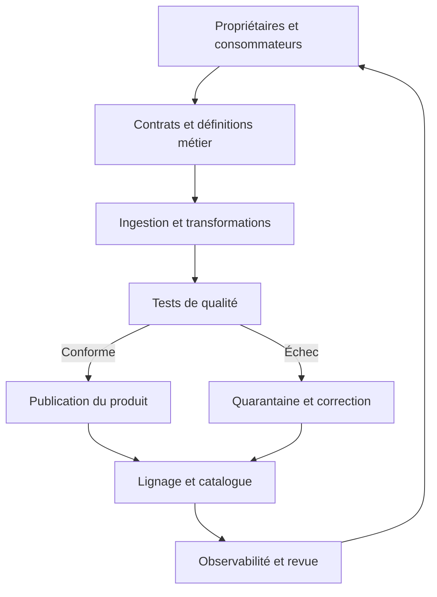

# Qualité, lignage et gouvernance — Expert

> **Mise en contexte.** Une équipe de direction constate trois chiffres de chiffre d'affaires différents dans trois tableaux de bord. Chaque équipe possède un jeu de données qui semble correct, mais personne ne sait quelle définition est officielle, d'où vient l'écart ou qui doit le corriger. La gouvernance des données répond à cette situation : établir des responsabilités, rendre la signification des données explicite, mesurer leur qualité, retracer les transformations et gérer les changements. Ce n'est pas seulement une politique documentaire ; c'est une capacité opérationnelle intégrée au cycle de vie des données.

## Objectifs pédagogiques

À la fin de ce cours, vous saurez organiser un modèle de gouvernance adapté à un produit de données, définir des rôles de responsabilité, construire un catalogue utile, produire un lignage technique et métier, établir des contrats de données, concevoir des contrôles de qualité, traiter les incidents de données, mesurer la maturité et conduire un programme d'amélioration. Vous saurez également expliquer comment l'observabilité, l'automatisation et les processus d'approbation permettent de passer d'une gouvernance théorique à une pratique mesurable.

Il est utile de connaître SQL, les pipelines ETL/ELT, la modélisation analytique, les métadonnées et les bases de la sécurité. La gouvernance varie selon l'organisation, le secteur et les contraintes réglementaires. Les exemples sont des modèles techniques à adapter : les responsabilités finales, les règles de conservation et les obligations réglementaires doivent être validées par les acteurs compétents.

## 1. Pourquoi la gouvernance est une capacité d'ingénierie

Les données sont utilisées par des équipes qui ne partagent pas nécessairement les mêmes hypothèses. Le département commercial peut définir un client actif comme un compte ayant acheté pendant les trente derniers jours, alors que les opérations le définissent comme un compte disposant d'un contrat valide. Si le même nom d'indicateur recouvre deux règles différentes, les chiffres peuvent être corrects selon chaque définition mais trompeurs lorsqu'ils sont comparés.

La gouvernance rend explicites les conventions partagées : définitions métier, unités, seuils de qualité, rôles de décision, cycle de vie, droits d'accès, versions, responsabilités et procédures d'incident. Elle réduit les ambiguïtés au moment où les données sont créées et consommées. Elle doit être assez concrète pour être vérifiée dans le code, les tests, le catalogue ou les systèmes d'accès. Une politique sans mécanisme de contrôle dépend de la mémoire des personnes et se dégrade au fil des changements d'équipe.

Une approche efficace ne consiste pas à centraliser chaque décision chez un comité. Une organisation peut fixer des règles communes et déléguer la propriété des domaines aux équipes les plus proches du métier. Les règles de classification, de sécurité et de qualité minimales sont définies à l'échelle de la plateforme ; les définitions métier sont élaborées par les propriétaires de domaine avec les consommateurs concernés. Les exceptions disposent d'un motif, d'un responsable et d'une date de réexamen.

La gouvernance est une boucle d'amélioration. Les incidents montrent les zones où les contrats sont incomplets, les changements non coordonnés ou les responsabilités floues. Les métriques montrent quelles tables vieillissent, quels contrôles échouent et quelles équipes attendent souvent une correction. Les retours des consommateurs révèlent les écarts entre la signification annoncée et les usages réels. Le programme de gouvernance doit transformer ces informations en changements vérifiables.



## 2. Les rôles et responsabilités

Le propriétaire de données ou data owner porte la responsabilité métier de l'usage et des décisions sur un domaine. Il approuve les définitions, arbitre les conflits et décide du niveau de qualité acceptable. Cette responsabilité ne signifie pas qu'il doit écrire les pipelines ou administrer les bases. Le rôle doit être explicite, attribué à une fonction qui peut prendre des décisions et remplaçable lors d'un changement d'organisation.

Le steward ou responsable opérationnel des données maintient les définitions, les métadonnées, les règles de qualité et les procédures liées au domaine. Il coordonne les anomalies entre la source et les consommateurs. Il traduit les attentes métier en contrôles observables et vérifie que les changements de schéma sont accompagnés d'une mise à jour documentaire. Dans une petite équipe, cette fonction peut être partagée, mais les tâches doivent rester attribuées.

Le producteur est l'équipe qui publie la donnée ou l'événement. Elle documente son contrat, sa fréquence, son comportement en cas d'erreur et les changements prévus. Le consommateur exprime ses besoins, signale les incompatibilités et évite de déduire une sémantique qui n'a pas été annoncée. La plateforme fournit les mécanismes communs : ingestion, catalogue, qualité automatisée, accès, lignage et observabilité. La sécurité et la conformité conseillent et valident les exigences qui relèvent de leurs responsabilités.

Une matrice RACI peut clarifier qui est responsable de l'exécution, qui approuve, qui est consulté et qui est informé. Elle est utile pour les contrats, les changements incompatibles, les demandes de suppression, les incidents et les exceptions. Elle ne doit pas devenir une formalité sans effet : chaque tâche critique doit avoir un propriétaire joignable, une procédure et une voie d'escalade. Les responsabilités doivent aussi s'appliquer aux tables héritées ou orphelines, et pas uniquement aux nouveaux produits.

Les décisions doivent être consignées dans un registre accessible. Il peut contenir la définition adoptée, la date, le propriétaire, les alternatives rejetées, les consommateurs affectés, le risque accepté et la date de révision. Ce registre permet de comprendre pourquoi une règle existe et de la réexaminer lors d'un changement de finalité ou de technologie. Une décision sans contexte devient difficile à maintenir et peut conduire à répéter des débats déjà résolus.

## 3. Construire un catalogue exploitable

Un catalogue de données doit permettre de découvrir un jeu, de comprendre sa signification, de juger sa qualité, d'identifier son propriétaire et de demander le bon accès. Les métadonnées minimales peuvent inclure le nom technique, le nom métier, la description, le domaine, le propriétaire, les colonnes, les types, les unités, la fraîcheur attendue, le niveau de sensibilité, les règles de qualité, le lignage, les consommateurs et la procédure de support.

Les métadonnées techniques peuvent être extraites automatiquement depuis les schémas, les jobs et les catalogues de moteurs. Les métadonnées métier nécessitent souvent une validation humaine : définition d'un client actif, unité d'un montant, sens d'un statut, règles d'exclusion et conventions de calcul. Une stratégie solide sépare les valeurs détectées automatiquement des définitions approuvées. Le catalogue ne doit pas présenter un champ calculé par inférence comme une règle métier officielle.

La fraîcheur est une métadonnée opérationnelle importante. Une table qui contient le dernier mois mais dont le chargement a échoué hier peut sembler complète à un utilisateur. Affichez la dernière réussite, la dernière date source, le retard estimé, le statut des tests et les limites connues. La fraîcheur doit avoir une définition précise : temps d'arrivée de la source, heure de publication ou instant où tous les contrôles ont été validés.

La recherche doit fonctionner avec les termes métier et les noms techniques. Les synonymes et glossaires permettent de retrouver une table lorsque les équipes utilisent des vocabulaires différents. Les filtres par domaine, sensibilité, certification, propriétaire et fraîcheur réduisent les résultats peu utiles. Les résultats sensibles doivent respecter les droits de découverte ; le catalogue ne doit pas révéler une description confidentielle à tous les utilisateurs simplement parce que les métadonnées sont centrales.

Une table sans propriétaire, sans description, sans contrôle de qualité ou sans consommateur actif constitue un risque de maintenance. Définissez une procédure de prise en charge, de transfert ou de retrait. Ne supprimez pas automatiquement un jeu peu consulté : un rapport réglementaire ou une archive peut avoir un faible usage normal mais une valeur essentielle. La décision doit tenir compte de la finalité, des dépendances, de la rétention et du coût.

## 4. Glossaire et définitions métier

Un glossaire métier décrit les concepts qui se cachent derrière les colonnes et les indicateurs. Chaque terme devrait avoir une définition non ambiguë, un propriétaire, des exemples, des exclusions et des liens vers les tables qui le matérialisent. Les termes identiques peuvent avoir des sens différents selon les domaines ; lorsqu'il est impossible d'unifier les règles, il faut documenter les variantes au lieu de forcer un terme commun trompeur.

Une définition utile est testable. Pour un indicateur « délai de livraison », précisez le point de départ, le point d'arrivée, le traitement des annulations, le fuseau, les cas d'absence de date et l'unité. Sans ces règles, deux équipes peuvent calculer des délais différents avec des requêtes parfaitement valides. La définition métier doit être associée à un exemple calculé et à des cas limites qui servent de tests de référence.

Les métriques communes nécessitent souvent une couche sémantique. Elle centralise les calculs approuvés ou impose des modèles réutilisables. Cette couche ne résout pas automatiquement les différences de source ou de grain, mais elle aide à éviter la réimplémentation de règles dans chaque dashboard. Les modifications doivent être versionnées et communiquer leur impact sur les consommateurs.

Les changements de définition sont des changements de contrat. Une modification de « revenu reconnu » peut changer des rapports, des décisions financières et des objectifs d'équipe sans modifier le schéma SQL. Traitez donc la sémantique comme une partie de l'API des données : revue, date d'effet, comparaison avant/après, versionnement et plan de communication. Si l'ancienne définition reste nécessaire, publiez deux indicateurs clairement différenciés plutôt que de changer silencieusement le sens d'un champ existant.

## 5. Contrats de données

Un contrat de données précise ce qu'un producteur garantit et ce que les consommateurs peuvent attendre. Il comprend le schéma, les types, la sémantique, la clé d'identité, les règles de nullité, les unités, la fréquence, la fraîcheur, les règles de qualité, la classification et la politique d'évolution. Il peut aussi préciser la disponibilité prévue, le canal de support, les limites de volume et la procédure de dépréciation.

Un contrat doit distinguer les champs obligatoires, facultatifs et conditionnels. Une valeur vide peut signifier absence, non-applicabilité, information inconnue ou refus de fournir l'information ; ces états ne devraient pas être confondus. Les identifiants doivent être stables et leurs règles de réutilisation connues. Les timestamps doivent préciser le fuseau et la signification temporelle. Les montants doivent préciser la devise et l'échelle.

La compatibilité technique et la compatibilité métier sont différentes. Ajouter un champ optionnel peut être techniquement compatible, mais si les consommateurs utilisent des requêtes automatiques qui sélectionnent toutes les colonnes, le changement peut provoquer des effets inattendus. Changer l'unité d'un champ sans changer son type est techniquement invisible mais sémantiquement incompatible. Les contrôles doivent couvrir les deux dimensions.

L'évolution doit être coordonnée. Un producteur annonce les changements, les consommateurs testent la nouvelle version, puis le déploiement suit une fenêtre et une procédure définies. Pour un changement incompatible, une stratégie de double publication ou de migration progressive peut être nécessaire. La fin de support de l'ancien contrat est annoncée et mesurée à partir des usages réels. Les consommateurs silencieux sont identifiés par des métadonnées d'accès lorsque c'est approprié, sans dépasser les obligations de confidentialité.

Les contrats peuvent être versionnés dans le dépôt avec le code, dans le catalogue ou dans un registre partagé. L'outil importe moins que la possibilité de revoir les différences, d'automatiser les tests et de retrouver la version qui a produit un résultat. Un contrat signé dans un document mais jamais consulté pendant la livraison est une protection faible. Il doit être intégré au chemin qui construit et publie les données.

## 6. Dimensions de la qualité des données

La complétude mesure si les éléments attendus sont présents. Elle peut compter les valeurs non nulles, mais aussi comparer le nombre de commandes dans la source et le produit analytique. La complétude n'est pas la validité : toutes les lignes peuvent contenir une date, mais cette date peut se situer dans le futur ou ne pas respecter la règle métier.

L'unicité identifie les doublons selon une clé définie. Il faut savoir ce qui constitue un doublon : deux lignes identiques peuvent être des événements distincts, tandis que deux mises à jour de la même commande peuvent représenter des versions successives. La déduplication doit utiliser l'identité métier et une règle de sélection. Supprimer les répétitions sans comprendre leur origine peut effacer des faits légitimes.

La validité vérifie que les valeurs respectent un domaine ou un format. La cohérence vérifie les relations entre attributs : une date de clôture ne précède pas une date de création, un montant est cohérent avec la devise, un statut est compatible avec les transitions autorisées. L'intégrité référentielle vérifie les liens entre tables. Une violation peut être due à un retard de livraison de la référence plutôt qu'à une erreur définitive ; le traitement doit distinguer les deux cas.

La fraîcheur mesure l'écart entre la disponibilité attendue et la disponibilité réelle. Elle peut s'appuyer sur des timestamps source, le watermark de l'ingestion ou la date de dernière publication. La distribution mesure les dérives : une proportion de valeurs nulles qui passe soudainement de 1 % à 40 %, un changement de moyenne ou une catégorie qui disparaît. Les seuils doivent tenir compte de la saisonnalité et des volumes. Un petit jeu de données a besoin d'une interprétation différente d'un flux massif.

L'exactitude est souvent difficile à mesurer sans vérité de référence. Un format correct ne garantit pas que la donnée reflète le monde réel. Des rapprochements, audits d'échantillons, contrôles de source et retours utilisateurs peuvent fournir des preuves. Documentez explicitement lorsque l'exactitude ne peut pas être directement mesurée et utilisez des indicateurs indirects sans les présenter comme une preuve absolue.

## 7. Concevoir des règles de qualité utiles

Une règle de qualité doit définir l'objet contrôlé, le calcul, le seuil, la fréquence, le propriétaire, le niveau de gravité et l'action en cas d'échec. La même violation peut être bloquante pour un produit financier et avertissante pour une table exploratoire. Le statut du job et le statut de qualité doivent rester distincts : un pipeline peut avoir fonctionné correctement du point de vue technique tout en produisant des données incorrectes.

Choisissez des contrôles liés au risque métier. Les contraintes de schéma, les clés uniques et les références peuvent être bloquantes. Les dérives statistiques peuvent déclencher une alerte ou une mise en quarantaine. Les règles exploratoires peuvent être informatives. Trop de tests sans priorisation créent une fatigue d'alertes et entraînent des exceptions silencieuses. Un catalogue de règles doit préciser les niveaux de gravité et leur effet sur la publication.

Chaque règle doit être testée sur des cas conformes et non conformes. Un test de qualité peut lui-même être erroné : une règle trop stricte peut interrompre le pipeline chaque lundi, ou une règle trop large peut ne jamais détecter la dérive. Les jeux synthétiques permettent de vérifier les limites, les valeurs nulles, les changements de fuseau et les cas de doublon. Les seuils doivent être revus après les changements de source.

Les contrôles doivent produire des preuves : nombre de lignes analysées, nombre de violations, échantillons anonymisés, plage temporelle, version de règle et décision prise. Évitez d'inclure des valeurs sensibles dans la sortie d'erreur. Les résultats de tests peuvent eux-mêmes contenir des données et doivent être soumis à des règles d'accès et de conservation. La traçabilité facilite le diagnostic et la démonstration d'un contrôle réellement exécuté.

## 8. Lignage technique et lignage métier

Le lignage technique décrit les dépendances entre sources, jobs, tables, colonnes et produits. Il peut être dérivé de l'orchestration, des requêtes SQL, des manifests, des événements de pipeline et des catalogues. Il permet de répondre à la question « quelles tables seront affectées si cette colonne change ? ». La fiabilité dépend de la couverture : les transformations cachées dans des notebooks, les exports manuels et les scripts locaux peuvent créer des zones aveugles.

Le lignage métier décrit comment un concept ou indicateur est construit. Il relie une définition, une source, des filtres, des transformations et une sortie visible par le métier. Il peut préciser qu'un indicateur exclut les commandes annulées, utilise la date de facturation plutôt que la date de commande et convertit les devises selon une règle approuvée. Le lignage métier est indispensable lorsque la seule requête SQL ne permet pas de comprendre la finalité du calcul.

Le lignage doit aider à évaluer un changement. Si une source change un champ ou une unité, le pipeline identifie les jobs et les produits dérivés, puis génère une liste de consommateurs potentiellement affectés. L'équipe peut tester ces chemins avant le déploiement et surveiller les produits après. Un lien de dépendance ne signifie pas toujours un impact fonctionnel ; les propriétaires doivent valider les effets métier, mais une carte correcte réduit les oublis.

Le lignage devrait être versionné ou lié aux versions de jobs et contrats. Si le code change mais que le catalogue garde une carte ancienne, la preuve d'audit devient trompeuse. Automatisez la collecte lorsque possible, et affichez les dépendances dont la source est inconnue. La gouvernance doit accepter que le lignage est parfois incomplet et mesurer la couverture au lieu d'afficher une confiance artificielle.

## 9. Observabilité des données

L'observabilité complète la qualité par l'analyse des symptômes dans le temps. Elle peut suivre fraîcheur, volume, distribution, schéma, statut d'exécution, latence, nombre de fichiers, taux de rejet, retard de consommateur et dépendances. Ces signaux aident à identifier un problème avant que les utilisateurs découvrent des chiffres incohérents. Les métriques doivent être liées aux produits que les équipes consomment, pas seulement aux processus techniques.

Une alerte devrait contenir le produit affecté, l'heure de début, la règle violée, le propriétaire, le niveau d'impact et une procédure. Une alerte « 12 tests échouent » sans nom de table, seuil, volume ou lien vers les logs n'aide pas beaucoup au diagnostic. Les règles de regroupement évitent que mille erreurs identiques génèrent mille notifications. Les systèmes doivent permettre de fermer une alerte après preuve de correction plutôt que par simple acquittement.

Les SLO de données peuvent définir qu'un produit est publié dans un délai donné, que le taux de données invalides reste sous un seuil ou que les dépendances essentielles sont disponibles. Les définitions doivent spécifier le dénominateur, la fenêtre de calcul, les exclusions, les jours fériés éventuels et les situations où la source elle-même n'a pas produit de données. Le budget d'erreur permet de choisir entre accélérer les nouvelles fonctionnalités et investir dans la fiabilité.

L'observabilité doit prévenir le bruit. Des seuils fixes mal conçus peuvent déclencher à chaque variation saisonnière. Des seuils dynamiques nécessitent une validation et ne doivent pas apprendre qu'une anomalie répétée est normale sans examen humain. Maintenez des règles métier irréductibles pour les violations graves, complétées par une détection statistique. Les alertes silencieuses ou régulièrement ignorées doivent déclencher une revue.

## 10. Incident de données et analyse de cause racine

Un incident de données peut être une valeur incorrecte, une table manquante, un retard de publication, une rupture de schéma ou une exposition non autorisée. La réponse commence par déterminer l'étendue : produits, périodes, consommateurs, mesures métier et décisions affectées. Les premières actions peuvent inclure la mise en quarantaine, l'affichage d'un avertissement, la suspension d'une publication ou le rollback. Il faut éviter que des données non fiables continuent d'alimenter des processus sensibles.

La correction doit traiter la cause, pas seulement les symptômes. Si la source envoie deux événements pour la même commande, dédupliquer le résultat sans corriger le contrat peut laisser la même anomalie se reproduire. Si le producteur modifie une unité, corriger un dashboard seul laissera d'autres consommateurs erronés. L'analyse identifie le déclencheur, les contrôles absents, les facteurs contributifs et les conditions qui ont permis la propagation.

Une analyse sans recherche de culpabilité encourage la déclaration rapide et met l'accent sur les systèmes. Elle ne supprime pas les responsabilités : les décisions et les actions doivent être attribuées. Un rapport d'incident contient l'impact, les faits horodatés, la cause, les actions de confinement, la restauration, les preuves de validation et les mesures préventives avec leurs propriétaires et échéances.

Les actions préventives doivent être suivies jusqu'à leur vérification. Ajouter un test sans l'exécuter dans la livraison continue n'est pas suffisant. Mettre à jour la documentation sans mécanisme d'alerte peut ne pas empêcher une récidive. Après correction, rejouez une période représentative, comparez les résultats à une référence et obtenez la validation du propriétaire métier. Communiquez également les limites résiduelles lorsqu'une correction complète est impossible.

## 11. Gouvernance des changements

Un changement de source, de schéma, de définition ou de fréquence peut rompre le contrat d'un produit. Le processus de changement doit inclure l'annonce, l'analyse d'impact, la validation des consommateurs, le plan de migration, les tests et la date d'effet. Une modification urgente peut nécessiter un chemin accéléré, mais elle doit garder une trace, une durée limitée et une revue après intervention.

L'analyse d'impact utilise le lignage, les contrats, les catalogues de requêtes et la liste de consommateurs. Elle doit distinguer les dépendances confirmées des dépendances probables. Les tableaux de bord, les exports récurrents, les modèles ML et les traitements réglementaires peuvent être des consommateurs même si le catalogue ne les répertorie pas. Le niveau de confiance de la carte de lignage doit être visible.

Une politique de versionnement définit quelles modifications sont compatibles, comment les versions coexistent et quand une ancienne version cesse d'être supportée. Les changements sémantiques méritent le même soin que les changements techniques. Un changement de formule d'indicateur peut exiger une période de double calcul pour comparer les valeurs et informer les destinataires. Les différences doivent être expliquées, pas simplement annoncées comme un nouveau chiffre.

Les exceptions sont inévitables mais doivent rester contrôlées. Enregistrez leur raison, le risque accepté, le décideur, les contrôles compensatoires et la date d'expiration. Les exceptions sans date sont des dettes cachées. Une revue régulière doit identifier celles qui peuvent être fermées et mesurer combien de règles sont contournées de manière durable.

## 12. Atelier pratique : un contrat et un test de qualité

Considérez une table analytique de commandes avec un identifiant de commande, un identifiant client pseudonyme, une date de création, une date d'expédition, un montant, une devise et un statut. Le contrat indique qu'un identifiant de commande est unique dans la version courante, que la date d'expédition peut être absente tant que la commande n'est pas expédiée, que le montant ne peut être négatif que pour les opérations de remboursement et que les statuts appartiennent à une liste contrôlée.

```sql
-- Compter les identifiants de commande en double.
SELECT order_id, COUNT(*) AS copies
FROM silver_orders
GROUP BY order_id
HAVING COUNT(*) > 1;

-- Rechercher les dates incohérentes.
SELECT order_id
FROM silver_orders
WHERE shipped_at < created_at;

-- Vérifier l'existence des champs métier obligatoires.
SELECT COUNT(*) AS missing_order_ids
FROM silver_orders
WHERE order_id IS NULL;

-- Contrôler les statuts autorisés.
SELECT status, COUNT(*) AS occurrences
FROM silver_orders
GROUP BY status
ORDER BY occurrences DESC;
```

Ces requêtes sont illustratives : la règle de remboursement doit être ajoutée au contrôle de montant, et une expédition avant la création peut représenter un problème de fuseau ou de qualité source à examiner. Ne transformez pas tous les résultats anormaux en rejets automatiques. Le propriétaire métier définit les exceptions légitimes, et l'équipe technique les rend vérifiables.

Le rapport qualité doit enregistrer la date d'exécution, la version du contrat, le nombre de lignes examinées, le nombre de violations et la décision prise. Pour un produit certifié, un échec de clé unique peut bloquer la publication. Pour un champ descriptif non critique, une dérive peut seulement produire un avertissement. La règle d'effet doit être explicite dans la définition du produit.

## 13. Scénarios de diagnostic

### Scénario A — Deux dashboards affichent des chiffres différents

Comparez les définitions, le grain, les filtres, les dates de référence, les exclusions et les conversions. Vérifiez si les deux dashboards consomment la même version de table et si l'un utilise un cache ancien. Une requête différente n'est pas automatiquement une erreur : la question est de savoir si les chiffres répondent à la même définition. Faites approuver un indicateur officiel et documentez les variantes légitimes.

### Scénario B — Une table fraîche est pourtant incomplète

La dernière exécution a réussi, mais certaines régions ne contiennent pas leurs données. Contrôlez les dates source par segment, les manifestes, les volumes par source et les règles de publication. Un timestamp récent d'exécution ne prouve pas que toutes les partitions attendues sont arrivées. Ajoutez une mesure de couverture par source, période et zone, ainsi qu'une règle qui bloque la publication si le minimum métier n'est pas atteint.

### Scénario C — Un producteur modifie une définition sans changer le schéma

La colonne existe toujours mais son sens a changé. Traitez cela comme un changement sémantique incompatible : comparez les valeurs, identifiez les consommateurs et versionnez le contrat. Ajoutez une phase de double calcul si nécessaire et communiquez la date à partir de laquelle les chiffres suivent la nouvelle définition. Le contrôle de schéma seul ne peut pas détecter ce genre de rupture.

### Scénario D — Les tests de qualité sont systématiquement désactivés

Cherchez pourquoi ils bloquent : seuil erroné, données saisonnières, source incohérente ou manque de propriétaire. Ne considérez pas la suppression des alertes comme une résolution. Ajustez le test avec des exemples, séparez les avertissements des blocages et attribuez les exceptions. Toute désactivation devrait avoir une date de révision et une mesure compensatoire.

### Scénario E — Le lignage s'arrête à une table intermédiaire

Les transformations sont peut-être exécutées dans un notebook, un script non versionné ou un export manuel. Identifiez le point aveugle, intégrez les dépendances à l'orchestration ou ajoutez une déclaration de provenance automatisée. Le lignage incomplet doit être visible dans le catalogue. Les produits critiques ne devraient pas être certifiés tant que leurs dépendances fondamentales ne sont pas comprises.

### Scénario F — Une table n'a pas de propriétaire

Utilisez les métadonnées d'accès, le dépôt et les consommateurs pour identifier l'équipe qui peut comprendre le besoin métier. Si aucun consommateur ni obligation ne justifie la table, proposez une dépréciation après analyse d'impact et rétention. Ne la supprimez pas seulement parce qu'elle est ancienne. Une décision de transfert ou de retrait doit être consignée et la table doit garder un statut pendant la transition.

### Scénario G — Un changement provoque une dérive après plusieurs jours

La source peut avoir changé graduellement, un job peut se dégrader ou la qualité se révéler uniquement lors d'une agrégation. Examinez l'historique des distributions, les versions de code, les paramètres et les déploiements. Une règle de fraîcheur ne suffit pas à détecter une dérive de sens. Ajoutez un contrôle statistique ou métier qui cible le symptôme observé, puis vérifiez son taux de faux positifs.

### Scénario H — Une alerte arrive mais personne ne la traite

Vérifiez la rotation d'astreinte, le propriétaire, le niveau de gravité, la procédure et la qualité du message. Une alerte sans action recommandée ou sans lien vers une preuve est difficile à traiter. Attribuez le produit et fixez un délai de réponse proportionné. Mesurez le temps de détection, d'accusé de réception, de confinement et de correction, puis ajustez les règles peu utiles.

### Scénario I — Une transformation historique ne donne pas le même résultat

Comparez les versions de code, les sources, les contrats, les paramètres temporels et les données de référence. Les résultats peuvent avoir changé légitimement après une correction. Gardez l'ancienne version, mesurez les écarts et documentez les décisions métier. Si le changement est involontaire, ajoutez un test de non-régression sur une plage représentative avant de republier.

### Scénario J — Une table certifiée est consommée sans ses limites connues

La certification doit inclure une description visible des dimensions couvertes, des exclusions, de la fréquence et du retard possible. Le consommateur doit être averti si la donnée sort du contrat. Ajoutez des avertissements dans le catalogue et les interfaces de découverte, puis vérifiez que les produits de présentation conservent cette information. La certification ne signifie pas que la table est adaptée à tous les usages.

### Scénario K — Le même indicateur est recalculé dans plusieurs équipes

Identifiez les consommateurs, comparez les formules et désignez un propriétaire de la définition commune. Publiez une métrique réutilisable ou un modèle sémantique versionné. Si plusieurs définitions sont nécessaires, leur nom doit préciser la différence. Des tests sur un jeu de référence empêchent une modification involontaire de la formule partagée.

### Scénario L — Une exception de gouvernance devient permanente

Recherchez les exceptions sans date ou dont le risque n'a jamais été réévalué. Reprenez la décision initiale, vérifiez si la contrainte existe encore et identifiez les contrôles compensatoires. Planifiez la fermeture ou demandez une nouvelle approbation documentée. Une exception récurrente peut indiquer que la politique doit être améliorée plutôt que renouvelée indéfiniment.

## 14. Exercices corrigés

### Exercice 1 — Valeurs exactes mais définitions différentes

Deux équipes calculent un taux identique à partir d'une table commune, mais leurs chiffres diffèrent. Quelle vérification prioritaire effectuer ?

**Correction :** comparer le contrat métier, les exclusions, le grain, les dates de référence, les transformations et la version consommée. La présence d'une table commune ne garantit pas une sémantique commune. Il faut définir le résultat attendu puis tester les deux implémentations sur un jeu de référence.

### Exercice 2 — Qualité et publication

Un pipeline est techniquement réussi mais 15 % des montants sont dans une devise inconnue. Faut-il publier ?

**Correction :** la décision dépend de la finalité, mais le statut doit signaler l'échec de qualité. Pour un rapport financier, il peut être nécessaire de bloquer la publication ou d'exposer une partie clairement quarantainée. Pour une exploration non critique, une publication avertie peut être acceptable. Le seuil et l'effet doivent être fixés par le propriétaire.

### Exercice 3 — Lignage automatisé

Pourquoi un lignage technique ne remplace-t-il pas entièrement le lignage métier ?

**Correction :** il indique souvent les dépendances entre objets, mais n'explique pas à lui seul la signification des filtres, l'unité d'un indicateur, la finalité d'une exclusion ou la décision métier. Il faut relier les transformations à des définitions approuvées et à des exemples de référence.

### Exercice 4 — Certifier une table

Citez des preuves nécessaires avant de marquer un produit de données comme certifié.

**Correction :** un propriétaire, une description métier, un contrat versionné, des contrôles de qualité critiques, une mesure de fraîcheur, un lignage suffisant, des permissions testées, des consommateurs identifiés et une procédure d'incident. La certification doit inclure les limites et être réévaluée après les changements importants.

### Exercice 5 — Trop d'alertes

Les utilisateurs ignorent toutes les alertes de qualité. Comment procéder ?

**Correction :** analyser les alertes récurrentes, mesurer les faux positifs, séparer gravité informative et bloquante, revoir les seuils, ajouter du contexte et assigner un propriétaire. Ne pas supprimer un contrôle sans comprendre le risque qu'il protégeait. Les changements doivent être vérifiés sur des exemples réels et synthétiques.

### Exercice 6 — Changement sémantique

Un champ reste numérique, mais le producteur passe des montants en centimes à des montants en unités monétaires. Quel contrôle est nécessaire ?

**Correction :** le contrat doit versionner l'unité, et les tests doivent vérifier des exemples et les résultats historiques. Le type numérique ne détectera pas le changement. Une période de migration ou une nouvelle colonne peut éviter une interprétation silencieusement incorrecte.

### Exercice 7 — Produit sans propriétaire

Que faire d'une table peu consultée et sans responsable identifié ?

**Correction :** rechercher ses dépendances, obligations de conservation et usages rares mais critiques. Attribuer un propriétaire, transférer la responsabilité ou engager une dépréciation avec date, notification et validation des consommateurs. La faible fréquence d'accès n'est pas à elle seule une raison suffisante de suppression.

### Exercice 8 — Suivi d'amélioration

Comment prouver qu'un programme de gouvernance progresse réellement ?

**Correction :** mesurer la couverture des propriétaires, la couverture des contrats, la proportion de produits avec tests, le taux de règles critiques conformes, la fraîcheur, le temps de correction et le nombre d'exceptions expirées. Comparez ces mesures dans le temps et vérifiez que l'amélioration correspond à des risques réduits et à une meilleure utilisation des données.

## 15. Défi final corrigé : certifier un produit de données de ventes

Une entreprise veut publier une table des ventes que plusieurs directions utiliseront pour piloter le chiffre d'affaires, les délais de livraison et les marges. Les données proviennent d'un système de commandes, d'une plateforme de paiement et d'un fichier de coûts de transport. Les définitions actuelles divergent, des champs obligatoires sont parfois absents et les consommateurs découvrent les erreurs tardivement.

### Proposition de solution

Désignez un propriétaire métier responsable des définitions et un steward responsable du contrat, des métadonnées et des anomalies. Cartographiez les trois sources, définissez le grain et l'unité de chaque champ, documentez le traitement des annulations, remboursements, devises et coûts. Publiez un contrat versionné avec la fréquence et la fraîcheur attendues, les clés, les valeurs autorisées et la procédure de dépréciation.

Construisez un pipeline en étapes où les données invalides sont mises en quarantaine et comptées. Les contrôles de complétude, unicité, validité, cohérence et fraîcheur sont automatisés. Les tests critiques bloquent la certification si les seuils sont dépassés ; les avertissements sont affichés avec les limites. Les résultats de test enregistrent le nombre de lignes, la version du contrat et la décision sans exposer des données sensibles.

Le catalogue décrit la table, les colonnes, les métriques officielles, le propriétaire, les accès, les contrôles et le lignage jusqu'aux sources. La publication utilise une définition commune des indicateurs et un jeu de référence qui permet de comparer les chiffres. Les consommateurs sont identifiés et testent la nouvelle version avant une modification incompatible. Les changements sémantiques sont traités comme des changements d'API, même si le schéma reste identique.

Le produit expose une fraîcheur mesurable, un statut de qualité et des instructions de support. Une alerte nomme le contrôle, l'impact, le propriétaire et la procédure. Les incidents sont suivis jusqu'à une analyse de cause racine et à une validation de correction. Les exceptions ont une raison, un approbateur, un contrôle compensatoire et une date de réexamen.

La certification est accordée après validation par le propriétaire, réussite des contrôles critiques, revue des accès et vérification du lignage. Elle est suspendue ou signalée en cas de rupture de contrat ou de fraîcheur prolongée. Les résultats doivent pouvoir être reliés à une version de source, de code, de contrat et de définition métier.

## À retenir

La gouvernance efficace relie les responsabilités, les contrats, la qualité, le lignage, l'observabilité et les décisions métier. Un catalogue sans propriétaires est un inventaire, pas une gouvernance. Un pipeline vert ne prouve pas l'exactitude des données. Les règles qui comptent sont celles qui ont un responsable, une preuve, une action en cas d'échec et un suivi des améliorations.
