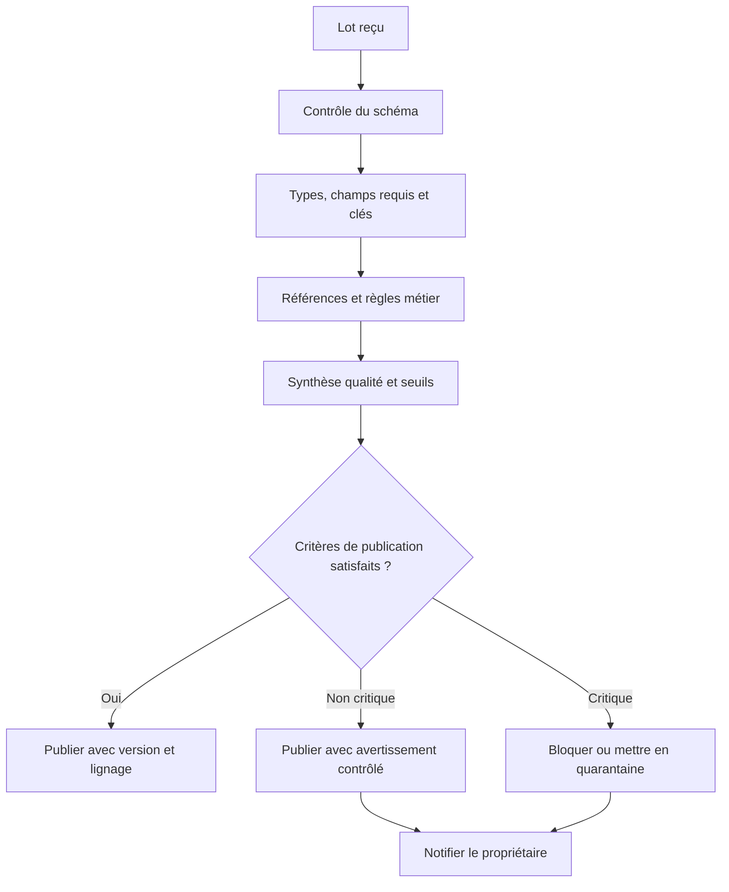

# Qualité, lignage et gouvernance — Expert

> **Mise en contexte.** Une organisation peut disposer de centaines de tables, de fichiers, d’API et de tableaux de bord sans posséder de données fiables. Les noms ne suffisent pas : il faut savoir qui est responsable, ce que signifie une colonne, à quel moment les données sont valides, comment elles ont été transformées et qui peut les utiliser. La gouvernance des données définit les décisions, responsabilités, règles et contrôles ; la qualité fournit des preuves de conformité au contrat ; le lignage explique l’origine et les transformations ; le catalogue rend les actifs découvrables et compréhensibles. Ce cours vise une pratique experte qui relie ces dimensions aux opérations réelles, plutôt qu’une gouvernance limitée à une documentation statique.

## Objectifs pédagogiques

À la fin du cours, vous saurez concevoir un modèle de responsabilités entre propriétaires et stewards, définir un catalogue utile, formaliser un contrat de données, mettre en place des règles de qualité et des seuils de blocage, construire un lignage de bout en bout, gérer les changements de schéma, classifier et protéger les données, organiser la rétention et la suppression, et traiter un incident de qualité avec preuves et actions correctives.

Le niveau expert exige de transformer des principes en mécanismes opérationnels. Une règle doit avoir un propriétaire, une définition non ambiguë, une méthode de mesure, une tolérance, un signal d’échec et une action décidée à l’avance. Un catalogue n’est pas utile si personne ne le met à jour ; un score de qualité n’a aucun sens si son dénominateur est inconnu ; un diagramme de lignage n’aide pas s’il ne correspond pas aux transformations qui tournent réellement.

## Prérequis et environnement

Il faut connaître les bases de données relationnelles, les flux d’ingestion, les transformations ETL/ELT, les droits et les notions de sécurité. Préparez un jeu de données fictif contenant clients, commandes, produits et événements, ainsi qu’un pipeline simple. Toute donnée personnelle réelle doit rester protégée selon les règles de l’organisation et du territoire applicable. Les exemples de gouvernance sont techniques et ne remplacent pas une validation juridique ou métier.

## 1. Gouvernance des données : décisions, responsabilités et contrôles

La gouvernance définit comment les données sont nommées, créées, validées, protégées, partagées, conservées et retirées. Elle indique qui a le droit de décider, qui exécute et comment la conformité est prouvée. Elle ne signifie pas qu’un comité doit approuver chaque requête SQL ; le but est d’établir les règles et les chemins d’escalade proportionnés au risque.

La gouvernance doit inclure :
- propriété métier et responsabilité technique ;
- définitions, schémas et conventions de nommage ;
- classification et contrôle d’accès ;
- règles de qualité et résolution d’anomalies ;
- lignage et gestion des changements ;
- rétention, archivage et suppression ;
- processus de partage, publication et certification ;
- indicateurs, audit et amélioration continue.

Les décisions de sens doivent appartenir au domaine métier. Le propriétaire de donnée valide la définition d’une « commande confirmée », d’un « client actif » ou du « chiffre d’affaires net ». L’ingénieur data choisit et implémente un mécanisme technique pour respecter la règle. Le steward veille à la cohérence des définitions et aide à résoudre les écarts. L’équipe sécurité définit et contrôle les protections. L’administrateur de plateforme opère les outils et les mécanismes. Ces rôles peuvent être réunis dans une petite équipe, mais leurs responsabilités doivent rester explicites.

## 2. Propriétaire, steward et producteur technique

Le propriétaire métier assume l’autorité sur le sens, la criticité, le partage et la qualité d’un actif. Il approuve les définitions, fixe les seuils qui reflètent les besoins du métier et décide du traitement des écarts. Le steward entretient les métadonnées, anime les règles de qualité et facilite la résolution de conflits. Le producteur technique fournit le schéma, les données, les garanties de fraîcheur et les informations d’exploitation. Le consommateur formule les besoins et signale les défauts observés.

Une responsabilité non attribuée devient un problème de maintenance. Quand une clé produit est inconnue, l’équipe doit savoir qui décide si la ligne est rejetée, mise en quarantaine ou associée à une valeur « inconnu ». Quand une définition de revenu change, il faut savoir qui approuve, quels rapports sont affectés et à quelle date la nouvelle définition entre en vigueur. Une gouvernance utile réduit ces ambiguïtés.

### Exemple de matrice RACI simplifiée

| Activité | Propriétaire métier | Steward | Équipe data | Sécurité / conformité |
|---|---|---|---|---|
| Définir le sens d’une mesure | A | R/C | C | I/C |
| Décrire le schéma et la source | C | R | R | C |
| Fixer des seuils de qualité métier | A | R | C | C |
| Implémenter les contrôles automatiques | C | C | A/R | C |
| Classifier les données sensibles | A/C | C | C | R |
| Approuver un partage externe | A | C | C | R |
| Résoudre une anomalie de pipeline | C | R | A/R | I/C |

R = réalise, A = approuve/assume la responsabilité finale, C = consulté, I = informé. La matrice doit être adaptée à l’organisation. L’objectif n’est pas de répliquer mécaniquement des rôles, mais de s’assurer que les décisions importantes ont un responsable identifiable.

## 3. Catalogue de données utile

Un catalogue permet de découvrir les actifs et de comprendre leur usage. Les métadonnées techniques peuvent inclure schéma, type, format, emplacement, taille, propriétaire technique, fréquence de mise à jour, dépendances, historique et accès. Les métadonnées métier comprennent définition, unité, population, règles de calcul, synonymes, limitations, propriétaire métier, classification et usages autorisés.

Un catalogue ne doit pas simplement recopier des noms de tables. Il doit répondre à des questions concrètes : peut-on utiliser cette table dans un rapport officiel ? Quelle est sa fraîcheur ? Où se trouve la source ? Qui peut approuver l’accès ? Comment est défini le statut « actif » ? Quelle version du schéma est courante ? Quels traitements modifient les données ? Quelles limites connues doivent être signalées ?

Automatisez la découverte du schéma et du lignage lorsque les outils le permettent. Les métadonnées générées automatiquement doivent être revues lorsqu’elles prétendent définir le sens métier. Un nom de colonne comme `status` n’explique pas la liste des valeurs, les transitions ou les cas historiques. Les champs critiques nécessitent une définition et des règles plus explicites que les colonnes techniques secondaires.

Un catalogue doit aussi posséder une politique de cycle de vie. Une table sans propriétaire, une table jamais consultée ou une définition obsolète doit être signalée pour revue. Ne supprimez pas automatiquement un dataset parce qu’il n’a pas été lu récemment : il peut servir à un contrôle saisonnier ou à une obligation d’audit. Les décisions de retrait doivent considérer la dépendance, la rétention et la récupération.

## 4. Contrat de données

Un contrat de données est un accord explicite entre producteur et consommateurs. Il décrit le schéma, le sens des champs, les invariants, la fraîcheur, la disponibilité, l’évolution compatible, la gestion des erreurs et les canaux de communication. Il peut être exprimé en documentation, schéma machine-readable, tests et politiques de pipeline. Le nom de fichier ou la description d’une API ne suffit pas s’il ne décrit pas le comportement attendu.

Un contrat robuste précise :
- identifiant et propriétaire de l’actif ;
- schéma et version ;
- grain, clés et sémantique des champs ;
- champs obligatoires, types, formats et nullabilité ;
- règles d’unicité et de référence ;
- fraîcheur maximale et fenêtre temporelle ;
- politique de corrections, suppressions et retards ;
- compatibilité et procédure de dépréciation ;
- classification, autorisations et rétention ;
- métriques de qualité et actions sur échec.

Un changement compatible peut ajouter un champ facultatif avec un sens clair, tandis qu’un changement de type, de clé ou de signification peut casser les consommateurs. Le contrat doit décrire les transitions et le délai pendant lequel les anciennes versions restent prises en charge. Des tests automatisés doivent faire échouer un déploiement lorsqu’une évolution incompatible passe sans approbation.

## 5. Qualité : dimensions et métriques

La qualité inclut complétude, validité, unicité, exactitude, cohérence, fraîcheur, intégrité référentielle et traçabilité. Une mesure de qualité doit définir l’univers analysé, le dénominateur, le seuil, les exceptions et le responsable. « 99 % de qualité » n’a pas de sens sans connaître la règle et les lignes concernées.

La complétude peut mesurer la proportion de champs requis non nuls. La validité peut vérifier un format ou une plage. L’unicité contrôle la clé qui identifie un fait. La cohérence compare plusieurs champs ou sources. La fraîcheur mesure le retard du dernier lot ou événement. L’intégrité référentielle vérifie qu’un identifiant renvoie vers une entité connue ou vers une valeur contrôlée. L’exactitude métier exige parfois une comparaison à un système de référence, un échantillon expert ou un rapprochement comptable.

Les métriques doivent éviter de favoriser artificiellement un score. Si une règle échoue, retirer les lignes non conformes du dénominateur peut faire croire que la qualité s’améliore alors que la population devient incomplète. Les exclusions doivent être explicites et comptées. Le tableau de bord doit afficher volume total, population exclue, rejets, évolution temporelle et seuil de tolérance.

## 6. Contrôles de qualité et seuils de blocage

Tous les contrôles n’ont pas le même impact. Un identifiant de paiement manquant peut rendre une ligne inutilisable ; une description facultative absente peut être tolérée. Définissez catégories de gravité, seuils, actions et règles de publication. Les contrôles critiques peuvent bloquer le lot ; les avertissements peuvent permettre une publication dégradée avec un statut explicite et un responsable de suivi.

Le contrôle doit être placé au plus près de la frontière où l’erreur peut être détectée. Une validation de type en ingestion réduit le coût d’investigation, tandis qu’un contrôle métier après agrégation peut détecter une incohérence de total. Les deux niveaux sont utiles. Les tests de schéma n’empêchent pas toutes les erreurs métier ; les tests métier ne remplacent pas les contrôles de types et d’identifiants.

Chaque contrôle doit être testé avec une entrée valide et une entrée invalide. Vérifiez que l’échec arrête ou marque la publication selon la politique. Un test qui lit seulement une fonction de validation sans vérifier l’effet sur le pipeline peut passer alors que le lot est quand même publié.

## 7. Lignage : remonter d’un indicateur à la source

Le lignage décrit la provenance et les transformations d’une donnée. Il peut être technique (fichiers, tables, colonnes, jobs et versions) ou métier (définitions, indicateurs et règles). Le lignage en amont indique d’où vient une donnée ; le lignage en aval identifie les actifs et rapports impactés par un changement.

Un lignage utile relie source, extraction, staging, transformation, tables de destination, couche sémantique et rapport. Il inclut version du code et du contrat pour pouvoir reproduire le résultat. Pour une mesure agrégée, il doit expliquer grain, filtres, règles de conversion et exclusions. Un diagramme dessiné à la main mais jamais mis à jour devient dangereux lorsqu’il diverge du pipeline.

L’automatisation peut extraire les références SQL, métadonnées d’ordonnanceur et dépendances de jobs. Mais les transformations opaques, fonctions personnalisées, traitements externes et règles métier peuvent exiger des annotations. Le système doit marquer les segments inconnus plutôt que de prétendre à une traçabilité complète. Une zone sans lignage doit être traitée comme une limite de preuve.

Le lignage aide aussi à la gestion de changement. Avant de supprimer une colonne ou modifier un type, découvrez les consommateurs directs et indirects, les rapports, exports et modèles ML qui dépendent de l’actif. Après le déploiement, comparez le lignage attendu et observé pour repérer les nouveaux consommateurs qui n’ont pas suivi le processus d’approbation.

## 8. Gestion des incidents de qualité

Un incident de qualité survient lorsque les données publiées enfreignent le contrat ou deviennent inappropriées pour l’usage prévu. Le processus doit établir l’intervalle concerné, les consommateurs affectés, les données fausses ou manquantes et les conséquences possibles. Évitez les corrections ad hoc sans trace qui rendent impossible de comprendre si les chiffres historiques ont changé.

Une démarche fiable :
1. identifier l’actif, la règle violée et le premier lot suspect ;
2. bloquer ou signaler la publication selon le niveau de gravité ;
3. préserver les lots et journaux utiles à l’investigation ;
4. déterminer si la cause vient de source, schéma, transformation, accès ou calendrier ;
5. construire une reproduction minimale qui met le défaut en évidence ;
6. corriger la cause et définir une stratégie de rechargement ;
7. comparer les résultats avant/après et valider avec le propriétaire ;
8. mettre à jour tests, contrat, lignage et documentation ;
9. communiquer impact, correction et risque résiduel.

Le rechargement d’un lot historique doit être idempotent ou avoir une stratégie de remplacement contrôlée. Les consommateurs doivent savoir quelle version est correcte et quelle fenêtre est affectée. Un rapport réémis peut nécessiter un historique d’audit afin d’expliquer les changements de chiffres.

## 9. Classification, minimisation et contrôle d’accès

La classification traduit la sensibilité en règles techniques. Les catégories peuvent être publiques, internes, confidentielles ou restreintes, mais les noms et obligations doivent correspondre à la politique de l’organisation. Les règles peuvent influer sur qui peut lire, exporter, masquer, conserver ou partager les données.

Le principe du moindre privilège s’applique à chaque couche : source, staging, data warehouse, catalogue, outil BI, notebooks, sauvegardes et logs. Le fait qu’un utilisateur soit autorisé à consulter un tableau de bord ne signifie pas qu’il doit lire le jeu brut complet. Les vues et agrégats peuvent réduire l’exposition, à condition que les contrôles empêchent les jointures ou filtres de réidentifier les personnes au-delà de l’autorisation.

La minimisation doit guider conception et stockage. Ne collectez pas un champ personnel « au cas où » ; définissez sa finalité, son propriétaire, durée et accès. Le masquage en environnement de test doit préserver les propriétés nécessaires aux essais sans conserver des identifiants directement reconnaissables. Les exports, caches et tableaux temporaires font partie du périmètre de protection.

Les exigences légales ou sectorielles doivent être interprétées et validées par les responsables compétents. L’équipe data met en œuvre les contrôles techniques et fournit des preuves ; elle ne remplace pas l’analyse juridique. La conformité doit être liée à des paramètres et procédures vérifiables plutôt qu’à une affirmation générale de conformité.

## 10. Rétention, archivage et suppression

Chaque donnée doit avoir une raison de conservation et une durée ou règle de réexamen. La rétention dépend de l’usage métier, des obligations, de la capacité de récupération et de la sensibilité. Conserver tout indéfiniment augmente coût et risque. Supprimer trop tôt peut casser les contrôles, les rapports historiques et les obligations d’audit.

La suppression doit inclure toutes les copies et dépendances : raw, curated, marts, extracts, caches, index de recherche, logs et sauvegardes selon les politiques applicables. Il faut distinguer suppression logique, suppression d’accès, expiration par rétention et effacement irréversible. Le système doit documenter ce qui est supprimé immédiatement et ce qui reste dans une sauvegarde jusqu’à échéance.

Une procédure de suppression fiable identifie l’entité, les jeux concernés, les répliques et copies, les exceptions légitimes, la preuve d’exécution et le contrôle après action. Pour un dataset distribué, la suppression peut nécessiter un job de réécriture ou une suppression par identifiant au niveau du format. Évitez d’exécuter un DELETE massif sans avoir évalué la capacité, les transactions et la possibilité de récupération.

## 11. Master Data Management et résolution d’identité

Le Master Data Management (MDM) cherche à maintenir des entités maîtresses cohérentes — client, produit, fournisseur ou site — entre plusieurs sources. Un identifiant client peut varier d’un système à un autre ; les noms peuvent différer par orthographe, les adresses changer et des doublons apparaître. Le rapprochement doit définir des règles de correspondance, un score, une validation humaine éventuelle et un identifiant maître.

Le MDM ne doit pas fusionner automatiquement toutes les lignes qui ressemblent. Deux personnes peuvent partager un nom ; une personne peut changer d’adresse ; un produit peut avoir des variantes légitimes. Les règles incluent champs fiables, priorités par source, preuve, seuils de rapprochement et procédure de dé-fusion. L’historique doit conserver l’origine des décisions.

Une clé maître sert de pivot analytique, mais les systèmes sources gardent leurs identifiants et leurs obligations. Le lignage des correspondances doit indiquer quelles lignes sources ont été reliées et quelle règle a été appliquée. Une erreur d’identité peut contaminer de nombreux rapports et doit avoir une procédure de correction et de recalcul d’impact.

## 12. Métadonnées de schéma et contrats machine-readable

Les règles peuvent être codées dans des schémas, tests et fichiers de contrat versionnés. Cela permet d’intégrer la gouvernance dans la CI : vérifier types, champs requis, valeurs permises, clés, formats et compatibilité avant la publication. Le contrat machine-readable doit être lisible par les équipes et correspondre au schéma qui existe réellement.

La CI peut comparer l’ancienne version et la nouvelle pour détecter suppressions, changements de types et modifications incompatibles. Les règles doivent distinguer une évolution compatible d’une migration qui exige une période de coexistence. Les tests doivent inclure la capacité d’un consommateur précédent à lire le nouveau format lorsqu’il est nécessaire de le supporter.

Les contrats ne sont pas statiques. Ils doivent évoluer avec approbation, version, date d’effet, plan de migration et communication. Quand le producteur change un champ sans mettre à jour le contrat, il crée une dette de gouvernance qui se manifeste sous forme de rapports incohérents. L’automatisation réduit ce risque, mais le sens des champs reste une responsabilité humaine.

## 13. Data products et indicateurs certifiés

Un produit de données est un actif publié pour un usage identifiable, avec un contrat, un propriétaire, des indicateurs de qualité, de fraîcheur, de sécurité et de support. Une table brute n’est pas automatiquement un produit prêt à la consommation. Un rapport certifié doit expliquer les définitions de ses métriques et les limites de sa population.

Une mesure comme « client actif » doit préciser les événements inclus, la fenêtre, les règles de désactivation, les fuseaux et les exclusions. Si deux équipes adoptent des définitions différentes, le résultat peut être techniquement valide mais non comparable. Une couche sémantique partagée peut centraliser les mesures et limiter la duplication, à condition qu’elle soit versionnée et contrôlée.

Le statut « certifié » doit avoir des critères : tests de qualité passés, lignage disponible, propriétaire nommé, fraîcheur respectée, accès contrôlé, documentation relue et incidents suivis. Le statut peut être retiré si les critères ne sont plus respectés. La certification n’est pas une promesse éternelle ; c’est un état opérationnel associé à des signaux surveillés.

## 14. Atelier pratique : gouverner un indicateur de ventes

### Scénario

Trois rapports calculent des ventes nettes différentes. Les sources comprennent des commandes, des retours et une table de produits. La tâche consiste à établir une définition unique, documenter le lignage, tester la qualité et définir ce qui se passe si une source manque.

### Étape A — Définir le sens

Le propriétaire métier définit le montant net : période, devise, taxes, remises, retours, annulations et heure de reconnaissance. Écrivez des exemples attendus, y compris une commande remboursée et une commande partiellement retournée. Établissez qui peut approuver une modification de règle.

### Étape B — Inventorier les sources

Pour chaque table, documentez source, propriétaire, fréquence, identifiant, rétention, classification, définition du champ et mécanisme d’accès. Identifiez le code qui transforme commande et retour et les rapports qui consomment la sortie. Notez les segments de lignage qui ne sont pas automatisés.

### Étape C — Définir des tests

Testez la clé unique, les commandes sans produit connu, les montants négatifs légitimes, les devises et le rapprochement des agrégats. Fixez seuils critiques et avertissements. Un lot incomplet ne doit pas être certifié simplement parce que la tâche SQL a réussi.

### Étape D — Publier le contrat

Créez un contrat avec schéma, grain, définition de mesure, fraîcheur, version, propriétaire, droits et politique de changement. Incluez un identifiant de lot et une version de transformation. Le catalogue doit pointer vers la définition et la procédure d’incident.

### Étape E — Simuler un échec

Supprimez un identifiant produit dans le jeu synthétique ou retardez le lot de retours. Vérifiez que le contrôle émet une anomalie, que l’actif est bloqué ou marqué dégradé selon la règle, que le responsable est notifié et que la correction est traçable. Ne corrigez pas simplement le rapport en ajustant un chiffre.

### Critères d’acceptation

L’atelier réussit si les trois rapports emploient la même définition, les sources sont traçables, les tests détectent les cas invalides, l’état du lot est explicite et une anomalie déclenche l’action attendue. Le compte-rendu doit comporter les preuves, propriétaires, seuils, limites et procédure de correction.

## 15. Étude de cas : un tableau de bord contredit la source

### Situation

Un indicateur de revenus a augmenté de 25 % après un déploiement, mais le système transactionnel ne montre pas de changement comparable. Aucun job n’est en erreur et les rapports s’actualisent à l’heure.

### Diagnostic

Vérifiez définition de la mesure, grain de la table de faits, duplication par jointure, réémission de lots, prise en compte des retours, clés de dimension et versions de transformation. Comparez le total par lot et par période. Remontez quelques identifiants source jusqu’au rapport. Un lignage uniquement au niveau des tables peut ne pas suffire pour expliquer une règle de calcul.

### Correction

Si un lot a été chargé deux fois, réparez la clé d’idempotence et retirez les doublons avec une méthode approuvée. Si le contrat de mesure est ambigu, faites valider une définition unique puis versionnez-la. Recalculez l’historique concerné, vérifiez les totaux et documentez les différences. Ne modifiez pas le rapport pour masquer un défaut de données.

### Prévention

Ajoutez des tests de grain et de rapprochement, capturez la version de transformation, surveillez des valeurs de référence et établissez une alerte sur les variations anormales. Tout nouveau rapport doit consommer l’actif certifié ou publier sa définition divergente. Le propriétaire métier valide les changements significatifs.

## 16. Exercices avec corrigés

### Exercice 1 — Que doit contenir un contrat de données au-delà du schéma ?

**Correction.** Propriétaire, grain, sémantique métier, clés, fraîcheur, règles de qualité, politique de retards et suppressions, versionnement, accès, rétention, compatibilité et action sur échec. Le schéma seul ne dit pas ce que signifie un montant ni quand il peut être consommé.

### Exercice 2 — Pourquoi un score qualité de 99 % peut-il être trompeur ?

**Correction.** La règle, population, dénominateur, exclusions et gravité peuvent être cachés. Un contrôle facultatif peut dominer le score alors qu’une seule valeur manquante sur un champ critique est inacceptable. Publiez les règles individuelles et les volumes, avec des actions selon la criticité.

### Exercice 3 — Comment utiliser le lignage lors d’un changement de schéma ?

**Correction.** Identifiez les consommateurs directs et indirects, les rapports, exports et modèles qui dépendent du champ. Organisez une transition compatible, testez et suivez les versions. Les consommateurs non connus signalent un manque de lignage à traiter.

### Exercice 4 — La source est fiable mais le rapport est faux. Quelle frontière vérifier ?

**Correction.** Suivez quelques identifiants de la source jusqu’au rapport et comparez à chaque étape. Contrôlez déduplication, jointures, grain, conversions, filtres, retours et définition de mesure. Un pipeline vert n’est pas preuve de résultat correct.

### Exercice 5 — Pourquoi le retrait d’un dataset doit-il être gouverné ?

**Correction.** Il peut être utilisé par des rapports peu fréquents, être nécessaire à une obligation ou contenir le seul historique disponible. Le lignage, les usages et la rétention doivent être vérifiés, puis les consommateurs avertis et la suppression prouvée.

### Exercice 6 — Qui décide si une valeur inconnue doit être rejetée ?

**Correction.** Le contrat métier et le propriétaire de la donnée fixent la règle, avec contribution des équipes data et sécurité selon l’impact. L’ingénieur implémente et observe le traitement. Il ne doit pas transformer silencieusement toute valeur inconnue en catégorie valide.

## 17. Défi final : établir une gouvernance pour un domaine de données

Une plateforme publie des données de clients, commandes et produits à plusieurs équipes. Des données sensibles existent dans le brut ; des indicateurs sont réutilisés par des rapports exécutifs et certains consommateurs travaillent avec des extractions historiques.

### Corrigé attendu

Inventoriez les actifs et attribuez un propriétaire métier et technique à chacun. Établissez classification, accès, rétention, contrat et lignage. Définissez les produits de données certifiés et leurs critères de publication. Les champs sensibles sont protégés à toutes les couches, les secrets sont séparés du code et les environnements de développement utilisent des données synthétiques ou correctement masquées.

Formalisez les règles de qualité qui protègent les identifiants, montants, références, fraîcheur et unicité. Pour chaque règle, précisez métrique, seuil, gravité, action, destinataire et test automatisé. Le registre de lots conserve les comptages, rejets, version de code et statut. Une erreur critique bloque la certification.

Le catalogue doit décrire schéma, sens, unité, source, date de validité, règles de calcul et limitation. Le lignage doit relier les champs critiques aux rapports consommateurs et être mis à jour après les changements. Les modifications incompatibles passent par une version de contrat, une transition, des tests et une date de retrait.

La procédure d’incident préserve les preuves, identifie la population affectée, corrige les données et communique l’impact. Le plan de suppression couvre les copies, exports, caches et sauvegardes selon les obligations. Les mesures de pilotage montrent fraîcheur, défauts, récurrence, actifs sans propriétaire et taux de consommation des produits certifiés.

Enfin, définissez une revue trimestrielle ou adaptée de la qualité, des accès, des coûts et des propriétaires. La gouvernance doit évoluer avec les usages et non rester un document livré puis abandonné. Toute règle doit être rattachée à une preuve d’exécution.

## 18. Checklist de gouvernance et qualité

- [ ] Chaque actif critique a un propriétaire métier et un propriétaire technique.
- [ ] Les définitions, unités et grains des métriques sont explicites.
- [ ] Les contrats sont versionnés et les changements incompatibles détectés.
- [ ] Le catalogue expose schéma, fraîcheur, classification, lignage et support.
- [ ] Les tests de qualité ont dénominateur, seuil, gravité et action.
- [ ] Les rejets sont visibles et les exclusions expliquées.
- [ ] Les actifs certifiés respectent des critères vérifiables.
- [ ] Les accès respectent le moindre privilège à toutes les couches.
- [ ] Les règles de rétention et de suppression couvrent les copies.
- [ ] Les incidents ont une procédure, un propriétaire et des preuves.
- [ ] Les indicateurs peuvent être remontés jusqu’aux sources et versions.
- [ ] Les actifs obsolètes sont retirés selon un processus approuvé.

## Conclusion

La gouvernance devient utile lorsqu’elle est incorporée aux contrats, pipelines, catalogues, accès et procédures d’incident. La qualité se mesure avec des règles explicites et des actions décidées ; le lignage permet d’expliquer et d’anticiper l’impact ; la classification, la rétention et les permissions protègent les données tout au long de leur cycle de vie. Une donnée certifiée est un produit avec un propriétaire, des preuves, des limites et une procédure de changement.

## Complément : mesurer la maturité et réduire la dette de gouvernance

### Construire une feuille de route par risque

Il est rarement utile de documenter toutes les tables avec le même niveau de profondeur dès le départ. Classez les actifs selon criticité, sensibilité, usage exécutif, obligation de conservation, fréquence de changement et dépendances. Commencez par les produits qui ont le plus d’impact en cas d’erreur. Pour chaque actif, identifiez l’écart entre état actuel et contrat cible, le propriétaire du correctif et une preuve d’achèvement.

La maturité peut être suivie sur plusieurs dimensions : propriété attribuée, qualité automatique, lignage, documentation métier, gestion des accès, rétention, test de récupération et communication de changement. Un score agrégé ne doit pas masquer un contrôle critique absent. Affichez le statut par dimension et définissez quels actifs peuvent être utilisés pour des décisions officielles.

### Réduire le nombre de définitions concurrentes

Des indicateurs équivalents sont parfois calculés dans plusieurs notebooks et rapports. Identifiez les définitions communes, les écarts de filtre et les sources. Convenez d’une métrique sémantique partagée lorsqu’elle correspond réellement au besoin, puis documentez exceptions et variantes. Ne fusionnez pas deux métriques sous un même nom si elles ont des définitions métier différentes.

Lors d’une migration, comparez les résultats sur une période qui inclut saisonnalité et cas limites. Les différences doivent être expliquées par des règles, pas seulement réduites statistiquement. Conservez la date d’effet de la nouvelle définition et fournissez une note aux consommateurs. Un ancien rapport qui ne peut pas être modifié immédiatement doit signaler la version de métrique utilisée.

### Automatiser sans masquer l’incertitude

Les outils peuvent inférer types, profils, dépendances SQL et statistiques. Cette inférence aide à découvrir le périmètre, mais ne prouve pas la signification métier. Les règles qui concernent le sens des champs, l’usage autorisé et la rétention doivent être confirmées par un responsable. Le système doit montrer la source et la confiance des métadonnées et permettre de corriger l’inférence.

Lorsque le lignage est partiel, notez explicitement les segments manquants. Un lignage incomplet est moins trompeur qu’une représentation faussement complète. Les transformations en code personnalisé, les appels externes et les calculs manuels doivent être annotés par les équipes responsables. Une revue du lignage est nécessaire après chaque changement majeur de pipeline.

### Prouver l’efficacité d’une correction

Après un incident, ne mesurez pas seulement le nombre de lignes corrigées. Vérifiez la règle initialement violée, les consommateurs affectés, la version de données et les tests nouvellement ajoutés. Si un problème peut réapparaître dans une autre source, développez un contrôle générique ou un test de contrat. Le rapport doit relier incident, cause, correction et preuve.

La dette de gouvernance diminue lorsque les règles sont actionnables et intégrées au quotidien. Un catalogue utilisé par les déploiements et les analystes, des alertes assignées, des tests de contrat et un processus de retrait sont plus utiles qu’un inventaire massif qui n’est jamais consulté.