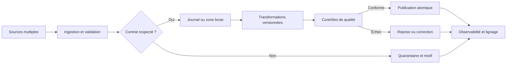

# Pipelines de données complexes — Expert

> **Mise en contexte.** Une entreprise collecte des événements depuis des applications mobiles, des bases transactionnelles, des API partenaires et des capteurs. Certaines sources envoient les données en continu, d'autres par fichiers ; les messages peuvent être dupliqués, retardés, désordonnés ou rejoués après une panne. Le pipeline doit maintenir la continuité, éviter les doubles effets, contrôler les schémas, détecter les anomalies et permettre une reprise vérifiable. À ce niveau, construire un pipeline ne signifie plus simplement déplacer des lignes : il faut orchestrer des états distribués et définir ce que le système garantit en cas d'échec.

## Objectifs et prérequis

À l'issue du cours, vous saurez concevoir une ingestion batch et streaming, comparer les stratégies de capture de changements, gérer les watermarks et les checkpoints, définir une idempotence durable, orchestrer les dépendances, traiter les erreurs partielles, concevoir le rejeu et le backfill, appliquer les contrôles de qualité et observer les performances. Vous saurez aussi choisir les frontières transactionnelles, éviter les traitements non reproductibles, gérer les versions de schémas et établir un plan de reprise qui ne double pas les effets métier.

Le cours suppose des connaissances en SQL, programmation, API, systèmes distribués, files de messages et exploitation. Les exemples de CLI et de SQL sont illustratifs ; les détails exacts changent selon le moteur, le connecteur et la version. Validez les options dans l'environnement cible et testez sur des données synthétiques avant d'automatiser une opération en production.

## 1. Qu'est-ce qu'un pipeline de données complexe ?

Un pipeline de données complexe combine plusieurs sources, transformations, contraintes temporelles et systèmes de destination. Il peut contenir une base transactionnelle, un flux d'événements, des fichiers déposés par des partenaires, un service de contrôle de schéma, une zone objet, un moteur de transformation et plusieurs produits analytiques. Une étape peut réussir tandis qu'une autre échoue. Le pipeline doit donc représenter l'état de chaque étape et la relation entre les données ingérées et les résultats publiés.

La complexité est souvent moins liée au volume brut qu'aux conditions de reprise. Un job de nuit peut traiter dix milliards de lignes et rester fiable s'il dispose de partitions indépendantes, d'un état durable et d'un chemin de validation. Un petit flux peut être plus difficile s'il déclenche une opération externe non idempotente, dépend d'une API instable ou nécessite un ordre strict. Il faut identifier les invariants métier avant de choisir les outils.

Un invariant est une propriété qui doit rester vraie malgré les pannes. Exemples : un événement ne provoque pas deux facturations ; le watermark n'avance qu'après publication du résultat ; chaque fichier accepté possède un manifeste ; la date source ne change pas durant le traitement ; un identifiant de commande demeure stable ; un lot rejeté n'est pas publié comme complet. Ces invariants orientent la conception, le test et l'observabilité.

Un pipeline exploitable doit répondre à quatre questions : quelle donnée a été reçue, quelle transformation lui a été appliquée, quel résultat a été publié et comment recommencer sans perdre ou dupliquer le travail ? La réponse nécessite une provenance, une version du code, des métadonnées d'exécution, des compteurs et un protocole de reprise. Une simple suite de scripts chaînés par des commandes shell ne fournit pas automatiquement ces garanties.



## 2. Batch, micro-batch et streaming

Le batch traite une plage de données selon un calendrier ou une demande. Il simplifie certains calculs, permet de traiter de grands volumes et facilite la répétition d'une plage entière. Sa faiblesse est que la fraîcheur est bornée par le calendrier et la durée d'exécution. Si un rapport se met à jour toutes les nuits et qu'un job dure cinq heures, une panne peut retarder la disponibilité jusqu'au cycle suivant.

Le micro-batch collecte de petites fenêtres et les traite à intervalles rapprochés. Il peut offrir une latence de quelques secondes à quelques minutes, tout en permettant une gestion de lots et des contrôles simples. Il doit toutefois gérer les chevauchements de fenêtres, les lots incomplets, les reprises et les événements qui arrivent après la clôture. La cadence doit correspondre à la capacité de calcul et au besoin métier : une exécution toutes les secondes sur une source qui ne change qu'une fois par heure ajoute du coût sans valeur.

Le streaming traite les événements continuellement, maintient un état et répond à de nouveaux événements sans attendre un lot complet. Il est utile pour les alertes, l'enrichissement rapide ou les agrégations quasi temps réel. En contrepartie, il nécessite une politique pour les événements tardifs, l'état durable, les offsets, les changements de partition et les reprises. Un traitement de flux doit être exploitable comme un service à longue durée de vie, avec des objectifs de latence, un budget de redémarrage et des procédures de déploiement.

Le choix n'est pas simplement « batch lent, streaming rapide ». Il doit considérer la finalité, la durée de retard acceptable, le coût, la disponibilité de la source, la difficulté de rejouer les données et la nécessité de corriger l'historique. Une architecture hybride utilise souvent un flux pour une visibilité immédiate et un batch pour la réconciliation. Les deux résultats doivent avoir une définition cohérente et un mécanisme de rapprochement.

## 3. Capture des changements dans une base

Le chargement complet copie l'ensemble d'une table à chaque exécution. Il est facile à comprendre mais peut être coûteux, produire une forte charge et rendre difficile l'observation de suppressions si l'état source change entre deux captures. Il peut rester adapté aux petites dimensions de référence ou aux tables pour lesquelles la durée et le volume sont maîtrisés. Le chargement complet doit avoir un point de lecture cohérent et un mécanisme pour publier le résultat seulement quand le contrôle est réussi.

Le chargement incrémental utilise généralement une clé temporelle, un identifiant croissant ou un marqueur de modification. Il charge les enregistrements apparus ou modifiés depuis une position précédente. Il faut savoir si la source autorise les retards, si plusieurs mises à jour peuvent partager la même valeur temporelle et comment détecter les suppressions. Un simple filtre sur la date de mise à jour est fragile si l'horloge est incorrecte, si un champ peut être nul ou si une transaction apparaît avec retard.

La capture de données modifiées, ou CDC, lit un journal transactionnel ou un mécanisme de changement fourni par la base. Elle peut transmettre insertions, mises à jour et suppressions avec une position de journal et des métadonnées. Cette méthode permet une ingestion plus proche de l'état réel, mais impose de gérer la rétention du journal, le snapshot initial, les ruptures de séquence, les changements de schéma et les redémarrages de connecteur. La configuration doit prévoir ce qui arrive si le consommateur reste arrêté plus longtemps que la rétention source.

La cohérence du snapshot initial est essentielle. Si le chargement complet lit une table pendant que le flux de changements avance, il faut coordonner le point de départ du snapshot avec la position du journal. Sans ce protocole, une ligne peut être absente, lue dans l'ancien état ou appliquée deux fois de manière incorrecte. Utilisez un connecteur qui documente cette coordination et testez les mises à jour concurrentes pendant l'initialisation.

## 4. Contrats, schémas et validation à l'entrée

Chaque source devrait disposer d'un contrat qui définit les champs, types, identifiants, unités, horodatages, valeurs admises et règles d'évolution. Les données entrantes doivent être validées avant d'être utilisées dans une transformation métier critique. Une validation légère peut contrôler la structure et les champs obligatoires ; des contrôles métier plus riches peuvent s'exécuter dans une étape distincte afin de ne pas bloquer toute la source pour une anomalie isolée.

Un changement de schéma peut être techniquement compatible et sémantiquement dangereux. Ajouter un champ optionnel peut être toléré par le désérialiseur, mais changer le sens d'une colonne de montant exige une migration. Un pipeline doit conserver la version du schéma appliquée et indiquer la version de transformation qui a produit le résultat. Les messages non conformes doivent être mis en quarantaine avec un code de rejet et une référence de source, sans copier inutilement des données sensibles dans les logs.

La validation doit différencier les erreurs permanentes des erreurs temporaires. Une valeur de date impossible ne deviendra pas valide par une nouvelle tentative immédiate. Une indisponibilité d'un service de référence peut justifier un retry borné. Une ambiguïté métier peut exiger une mise en attente et une validation humaine. Les erreurs doivent avoir un type stable, un nombre de tentatives maximal et une action définie à l'expiration.

Ne transformez pas silencieusement les valeurs impossibles en valeurs par défaut. Remplacer une devise inconnue par la devise locale, une date invalide par l'heure courante ou un identifiant manquant par une chaîne vide peut laisser le job vert tout en produisant une donnée fausse. Chaque normalisation doit être justifiée par le contrat, et les substitutions doivent être visibles dans les compteurs de qualité.

## 5. Idempotence, déduplication et effets externes

L'idempotence signifie que la répétition d'une opération avec la même identité ne produit pas un nouvel effet métier. Un pipeline qui consomme au moins une fois peut recevoir plusieurs fois le même événement après un timeout, un redémarrage ou une perte d'accusé de réception. La déduplication doit s'appuyer sur une clé stable qui identifie l'événement ou l'opération, plutôt que sur une comparaison approximative de toutes les colonnes.

La clé d'idempotence doit être choisie en fonction de la sémantique. Pour un paiement, un identifiant de transaction métier est souvent plus adapté qu'un offset de message, car le même paiement peut être republié dans une autre partition ou un autre topic. Pour un fichier partenaire, un identifiant de lot et une empreinte peuvent empêcher le retraitement accidentel d'une copie identique. Les règles de collision, d'expiration et de correction doivent être documentées.

La déduplication en mémoire est insuffisante si un redémarrage efface l'état. Une table de déduplication persistante avec une contrainte d'unicité permet de rendre la décision durable. L'insertion de l'identifiant d'événement et l'effet métier devraient être réalisés dans la même transaction lorsque c'est possible. Si l'effet cible est une API externe, utilisez la clé d'idempotence reconnue par cette API, une outbox ou un processus de rapprochement.

Le pattern outbox enregistre l'événement à publier dans la même transaction que le changement métier. Un worker lit ensuite cette table et publie l'événement ; il peut répéter une publication tant que la confirmation n'est pas durable. Les consommateurs traitent à leur tour de manière idempotente. Ce pattern ne garantit pas que chaque système externe accepte les doublons, mais il rend visible et récupérable l'état entre le commit métier et la publication.

Une stratégie exactly-once doit toujours préciser sa frontière. Un moteur peut assurer un commit coordonné entre offsets et fichiers de sortie, mais cette propriété ne s'étend pas automatiquement à un paiement, un courriel ou un service HTTP. Pour un effet irréversible, définissez un état durable, une clé stable, une vérification après timeout et une compensation si l'effet a déjà été réalisé.

## 6. Checkpoints, offsets et watermarks

Un checkpoint enregistre un état qui permet de reprendre un traitement après un arrêt. Il peut inclure les offsets consommés, les informations d'état des opérateurs et des références à une sortie cohérente. Le checkpoint doit être écrit dans un stockage durable et protégé contre les modifications accidentelles. Un dossier de checkpoint partagé entre deux applications indépendantes peut créer des conflits ; le nommage et l'isolation font partie de la configuration.

L'offset identifie la position de lecture dans un journal. Confirmer l'offset avant la publication peut perdre des événements du point de vue métier. Confirmer après la publication peut entraîner une nouvelle livraison si le processus tombe entre les deux opérations. La solution dépend des garanties du moteur et de la cible ; dans de nombreux systèmes, l'approche robuste combine une livraison au moins une fois avec une cible idempotente ou une transaction de commit coordonnée.

Le watermark représente une avancée de temps événementiel ou une borne de complétude supposée. Il permet de fermer une fenêtre lorsque les événements suffisamment anciens sont supposés arrivés. Un watermark agressif produit des résultats plus vite mais peut exclure des événements tardifs ; un watermark conservateur réduit les corrections mais retarde la publication. Choisissez la valeur à partir de la distribution réelle des retards et de l'impact métier, puis exposez le taux de données arrivées après le watermark.

L'état d'un pipeline doit distinguer la dernière position reçue, la dernière position validée, le dernier lot publié et la dernière plage contrôlée. Si le watermark avance avant la publication finale, une panne peut faire sauter une plage. S'il reste immobile après une publication réussie, la plage peut être traitée de nouveau. Un protocole explicite indique quelle action est atomique, comment l'état est restauré et comment les divergences sont détectées.

## 7. Orchestration des dépendances

Un orchestrateur décrit des tâches, leurs dépendances, leurs paramètres et leur état. Il doit représenter les étapes de validation, transformation, publication, notification et contrôle final. Une chaîne de commandes lancées à une heure fixe ne suffit pas à rendre visible le fait qu'une tâche dépend d'une autre qui n'a pas réussi. L'orchestrateur doit être configuré pour limiter les reprises, rendre les échecs observables et éviter qu'un job aval consomme un résultat partiel.

Les tâches devraient être idempotentes et autant que possible reproductibles. Une tâche qui ajoute chaque jour toutes les lignes à une table sans identifier la plage peut créer des doublons au redémarrage. Une tâche qui efface puis réécrit toute une table peut la rendre temporairement vide ou perdre une version valide si la publication échoue. Préférez des écritures temporaires, des vérifications et un échange atomique du résultat quand le moteur le permet.

Les dépendances ne sont pas toutes des tâches techniques. Un pipeline peut dépendre de l'arrivée d'un fichier, d'une date de clôture, de l'approbation d'une définition ou d'une disponibilité de référence. Ces préconditions doivent être représentées par un état explicite, avec délai d'expiration et règle d'escalade. Les attentes infinies créent des jobs qui semblent actifs mais ne produisent jamais de résultat.

Le rattrapage après incident doit éviter d'écraser le présent. Un job peut être relancé pour une période historique pendant que le traitement courant continue. Séparez les paramètres de plage, les identifiants d'exécution et les cibles temporaires. La publication historique doit être coordonnée avec le flux courant pour éviter qu'un résultat ancien remplace un résultat plus récent. Documentez le comportement en cas de recouvrement de plages.

## 8. Gestion des fichiers et manifests de lots

L'ingestion par fichiers nécessite une identité de lot, une convention de nommage, une empreinte ou une métadonnée de version et un manifeste contenant les fichiers attendus, les tailles ou les sommes de contrôle. Sans manifeste, le pipeline peut confondre un dépôt encore en cours avec un lot complet. Un partenaire peut envoyer le fichier sous un nom différent ou déposer deux fois le même export ; la procédure doit traiter ces cas de manière déterministe.

Un fichier doit être considéré comme prêt seulement lorsque le protocole source confirme sa complétude. Un marqueur de fin, une étape de renommage atomique lorsque le stockage la garantit, ou un manifeste signé peut servir de signal. La simple présence d'un objet ne prouve pas qu'il a fini d'être écrit. Pour un stockage objet, les sémantiques d'opérations et les garanties de visibilité dépendent du fournisseur ; il faut tester le mécanisme retenu.

Le traitement crée un identifiant d'exécution et associe chaque sortie aux entrées exactes. Si deux fichiers contiennent le même lot, la règle de déduplication se base sur l'identité du lot et l'empreinte, mais une empreinte identique ne devrait pas empêcher une réingestion volontaire après une correction approuvée. Il faut distinguer une répétition accidentelle et un rejeu intentionnel.

Un lot est publié après le contrôle du nombre de lignes, de la taille, de la couverture temporelle, des valeurs clés et des règles métier. Les lignes incorrectes peuvent être envoyées en quarantaine si le contrat autorise un traitement partiel ; sinon, le lot entier est rejeté. Le mode choisi doit être explicite. Un job qui élimine des lignes sans compter les rejets transforme un problème de qualité en perte silencieuse.

## 9. Gestion des erreurs et files de quarantaine

Toute erreur n'a pas la même sémantique. Une panne de réseau est généralement transitoire. Un schéma inconnu nécessite une évolution ou une correction. Un identifiant qui ne correspond à aucune référence peut être provisoire si les flux arrivent dans un ordre différent. Une règle de montant violée peut signaler un événement invalide ou une définition métier incomplète. La classification réduit le risque de retry inutile et aide à choisir le bon propriétaire.

Une quarantaine doit garder la référence source, la version de contrat, le code d'erreur, l'horodatage, l'étape et la possibilité de reproduire le rejet. Le payload peut être conservé uniquement si la finalité et la politique le permettent ; sinon, gardez une représentation minimisée ou une référence sécurisée. Les accès à la quarantaine doivent être limités puisque ses données peuvent contenir des valeurs inattendues ou sensibles.

Le rejeu de quarantaine doit être auditable. Il indique quelle correction ou version de code est appliquée, qui a autorisé l'opération et quel résultat a été obtenu. Un rejeu ne doit pas envoyer directement vers un système externe irréversible sans validation. Utilisez une cible d'essai ou un mode sans effet pour comparer les résultats. Une limite de débit protège la source et la destination lors d'une reprise massive.

Les erreurs permanentes ne devraient pas être réessayées rapidement jusqu'à épuisement de toutes les ressources. Les erreurs temporaires utilisent un backoff exponentiel avec jitter, un budget de tentatives et un circuit breaker si approprié. À l'expiration, l'opération passe dans un état visible et une alerte est envoyée au propriétaire. Les retries doivent être mesurés afin de repérer un système qui fonctionne uniquement grâce à des tentatives répétées.

## 10. Rejeu et backfill contrôlés

Le rejeu reconsomme des événements déjà reçus ; le backfill recalcule une période historique, parfois avec une nouvelle version de logique. Ils doivent être distingués d'une simple relance du job courant. Un rejeu peut réintroduire les mêmes effets, tandis qu'un backfill peut changer les résultats historiques. Les deux exigent une identité d'exécution, une plage claire, une version de code et une procédure de validation.

Avant un backfill, estimez le volume, la durée, le coût et l'impact sur les systèmes partagés. Identifiez les dépendances manquantes et les données qui ont expiré. Le job doit produire un résultat parallèle ou versionné, puis faire l'objet d'un rapprochement. Ne remplacez pas une table certifiée dès le premier résultat sans comparaison. Si des valeurs historiques sont modifiées intentionnellement, documentez la raison et communiquez l'impact aux consommateurs.

Une stratégie d'offset peut remonter la position de lecture pour un groupe dédié, mais l'effet exact dépend du moteur et du mode de commit. Ne manipulez pas le groupe de production pour tester. Un groupe de rejeu isolé ou un environnement de préproduction réduit le risque. Le rejeu doit pouvoir être arrêté et repris sans oublier quelle plage a été traitée ni répéter les effets externes.

Le backfill doit également tenir compte des corrections de source. Recalculer une période avec la source actuelle peut produire un résultat différent de celui qui existait au moment de la publication. Si la traçabilité le requiert, conservez les versions source ou les snapshots nécessaires. Un résultat publié devrait pouvoir être relié à l'état de source et à la version de transformation utilisés.

## 11. Ordonner et joindre des flux

Plusieurs sources peuvent arriver dans un ordre différent de leur ordre métier. Une commande peut apparaître avant sa référence client, un paiement peut précéder un événement de confirmation ou une correction historique peut arriver plusieurs heures après. Le pipeline doit définir une politique de mise en attente, de rapprochement et d'expiration. Une jointure naïve qui abandonne immédiatement les événements sans référence peut perdre des données parfaitement valides.

Les jointures temporelles doivent préciser la fenêtre, la tolérance et l'état conservé. Une fenêtre trop courte perd des correspondances retardées ; une fenêtre trop longue consomme davantage de mémoire ou de stockage et peut produire des résultats tardifs. Le coût du maintien d'état doit être mesuré. Les événements qui n'ont jamais de correspondance doivent être comptés et orientés vers une quarantaine ou une table de suivi.

L'ordre global est souvent impossible ou coûteux à garantir entre partitions. Si une règle exige l'ordre d'une commande, la clé de partitionnement doit conserver ses événements dans la même unité de traitement. Si l'ordre n'est nécessaire qu'à l'intérieur d'un compte, le compte peut être une clé. Cette décision limite le parallélisme et doit être rapprochée de la capacité requise. L'équipe doit préciser quel ordre est garanti et lequel est seulement probable.

Un événement tardif peut nécessiter une correction de résultat plutôt qu'un nouveau résultat additionnel. Les agrégations doivent être conçues pour être révisables ou pour publier des corrections. Pour les résultats financiers, le rapprochement périodique et la clôture peuvent être préférables à une promesse de résultat final immédiat. La sémantique du résultat doit indiquer s'il est provisoire, corrigible ou définitif.

## 12. Transformations reproductibles et versionnement

Une transformation reproductible produit le même résultat à partir des mêmes entrées, des mêmes paramètres et de la même version de code, dans les limites explicitement définies. Les fonctions qui consultent l'heure courante, un service externe variable ou un référentiel non versionné rendent le résultat difficile à reproduire. Si une valeur de change, une table de référence ou une règle de conversion influence le calcul, archivez la version utilisée ou rendez la source consultable dans l'historique.

Les fonctions déterministes facilitent le test, le cache, le rejeu et l'analyse d'incident. Les identifiants techniques générés aléatoirement, l'ordre non défini des lignes ou les dépendances cachées peuvent modifier le résultat. Les pipelines doivent fixer une stratégie de tri lorsque l'ordre a une signification, et utiliser des clés stables plutôt que des positions implicites. Les versions du runtime et des bibliothèques peuvent également affecter la sérialisation ou les résultats.

Un résultat devrait contenir ou référencer la version du code, la configuration, la période d'entrée, l'identifiant d'exécution, la version de contrat et les contrôles exécutés. La provenance sert à expliquer un résultat, à comparer deux versions et à restaurer un état. Elle évite de dépendre d'un historique de conversation ou d'une mémoire humaine pour comprendre ce qui s'est passé.

Un changement peut être déployé par double calcul. L'ancienne et la nouvelle version consomment les mêmes données, écrivent dans des cibles séparées et comparent des métriques de résultat. Les différences sont classées : changements attendus, régressions et variations dues à la source. Une fois les résultats validés par le propriétaire, la nouvelle version devient officielle. La méthode réduit le risque mais consomme des ressources supplémentaires, qui doivent être budgétées.

## 13. Orchestration en présence de pannes

Les défaillances partielles sont courantes. Une étape écrit une sortie puis perd sa connexion au moteur ; une API accepte une demande mais le client reçoit un timeout ; un catalogue est indisponible alors que les fichiers existent ; un worker tombe après avoir modifié une table mais avant d'émettre la notification. Dans chacun de ces cas, l'état réel doit être consulté avant de répéter l'opération.

Un protocole de reprise doit définir l'ordre des vérifications : identifier l'exécution, vérifier les entrées et le résultat, retrouver l'état de commit, déterminer si l'effet métier a eu lieu, puis décider de reprendre, compenser ou clore. Évitez les scripts qui supposent qu'un code de retour non nul signifie que rien n'a été écrit. Un timeout peut représenter un résultat incertain plutôt qu'un échec certain.

Les reprises doivent être bornées et espacées. Un système aval en panne peut être saturé par des tentatives synchrones répétées. Utilisez des files durables, du backoff, des limites de concurrence et des mécanismes de protection. La charge de rattrapage doit être séparée si possible de la charge interactive. Les métriques de retry, de queue et de temps de rattrapage doivent faire partie du tableau de bord opérationnel.

Les étapes critiques ont besoin d'un comportement de compensation. Si une notification n'est pas envoyée après publication, elle peut être rejouée à partir d'un outbox. Si une publication incorrecte a été rendue visible, une version corrigée peut être publiée et l'incident communiqué. Pour un effet financier, la compensation peut nécessiter une opération métier distincte plutôt qu'une suppression technique. Les compensations doivent être testées et tracées.

## 14. Sécurité et gouvernance du pipeline

Un pipeline transporte souvent des données plus larges que celles nécessaires au produit final. Les rôles doivent limiter l'accès par étape et par finalité. L'ingestion devrait écrire dans une zone dédiée, la transformation lire seulement les sources nécessaires et les consommateurs utiliser des produits contrôlés. Les secrets d'accès ne doivent pas être partagés entre jobs. Les données de test doivent être synthétiques ou minimisées.

Les journaux de pipeline doivent faciliter le diagnostic sans exposer les payloads complets. Enregistrez un identifiant d'événement, un code de résultat, la version du schéma, la phase et les compteurs. Les exemples de données invalides peuvent contenir des secrets ou des informations personnelles ; la quarantaine doit donc être protégée avec des règles de rétention. Le partage d'un extrait d'incident doit être soumis à une procédure qui évite la fuite secondaire.

Les demandes d'effacement peuvent traverser les pipelines. Une réexécution historique ne doit pas réintroduire des données qui ont déjà été supprimées. Il faut disposer d'un état de purge ou d'une liste de suppression applicable aux nouvelles sorties. Après une restauration ou un backfill, les demandes doivent être réappliquées et vérifiées avant de repasser le produit en état sain.

Les changements de contrat et les accès d'urgence doivent être auditables. Les comptes d'automatisation ne devraient pas avoir de permissions d'administration globales, et la rotation des secrets doit être testée sans indisponibilité inattendue. Une procédure d'incident couvre la fuite d'un jeton, la publication d'un mauvais dataset, un accès excessif et une modification non approuvée.

## 15. Dimensionnement et observabilité

Le débit d'ingestion, la taille moyenne des événements, la fréquence des pics, la durée de rétention, le nombre de partitions et le taux de transformation déterminent la capacité. Un pipeline doit aussi être dimensionné pour les reprises. Après une panne de trois heures, le débit de traitement devrait dépasser le débit entrant pendant une période suffisante pour réduire le backlog, sans saturer la cible. Le calcul doit être mesuré sur des données représentatives.

Les métriques clés comprennent débit en entrée et sortie, retard par source, âge du plus ancien événement non traité, taux d'échec, nombre de retries, taux de quarantaine, durée des étapes, coût par lot, octets lus et écrits, et temps de publication. Une moyenne peut masquer des événements très lents ; utilisez des percentiles et des distributions. Le résultat métier doit rester le centre de l'observabilité : combien de données attendues manquent et quel est l'impact sur le consommateur ?

Un SLO peut définir une fraîcheur maximale, un taux de publication réussie et un délai de rattrapage. Le calcul doit préciser l'instant de départ et celui de fin. Si la source n'émet aucun événement, la fraîcheur du produit doit-elle être considérée comme en panne ? Une règle métier peut exiger un heartbeat pour distinguer absence normale d'activité et arrêt de la source.

Les alertes doivent être actionnables. Elles indiquent la source ou le produit, la fenêtre affectée, le retard, l'étape qui bloque, le propriétaire et une procédure. Un pic de quarantaine peut nécessiter l'arrêt de la publication, tandis qu'un petit nombre d'événements tardifs peut être informatif. Les seuils sont révisés après les changements de charge et testés pendant les exercices de panne.

## 16. Atelier pratique : construire un pipeline idempotent

Le TP utilise une source de commandes simulée qui produit des événements avec un identifiant unique, un identifiant métier, une version de schéma, une date source et une charge utile. L'objectif est de charger les événements, de dédupliquer les répétitions, de valider les champs, de créer une sortie versionnée et de produire un rapport de qualité. Aucune API externe réelle ne doit être appelée pendant cet exercice.

```sql
-- Table d'arrivée minimale à adapter au moteur choisi.
CREATE TABLE IF NOT EXISTS pipeline_events (
    event_id TEXT PRIMARY KEY,
    entity_id TEXT NOT NULL,
    event_time TIMESTAMP NOT NULL,
    schema_version INTEGER NOT NULL,
    payload_json TEXT NOT NULL,
    received_at TIMESTAMP NOT NULL
);

-- Exemple d'une vue de suivi de l'arrivée.
SELECT schema_version,
       COUNT(*) AS event_count,
       MIN(received_at) AS first_received,
       MAX(received_at) AS last_received
FROM pipeline_events
GROUP BY schema_version;
```

Le champ d'identité unique permet de rejeter la répétition d'un événement au niveau de la base, à condition que la logique d'insertion traite la violation comme un doublon attendu et non comme une panne inattendue. La date d'arrivée reste distincte de la date métier. La version du schéma facilite le diagnostic si un producteur modifie son format.

Étape suivante : injectez volontairement un événement identique, un événement sans identifiant, un timestamp invalide et une version de schéma inconnue. Vérifiez que le doublon n'ajoute pas un second effet, que les erreurs permanentes sont mises en quarantaine et que les compteurs correspondent au nombre injecté. Ensuite, interrompez le job entre l'écriture temporaire et la publication finale. Au redémarrage, la sortie publiée doit rester cohérente.

Un manifeste de lot doit préciser l'identifiant d'exécution, la plage d'entrée, la version de code, le nombre d'événements reçus, le nombre de doublons, le nombre de rejets et le statut de publication. Le test final rejoue exactement la même plage et compare les résultats. Le pipeline est idempotent si le rejeu ne crée aucun effet métier supplémentaire et si les mêmes entrées et versions produisent la même sortie, dans les limites documentées.

## 17. Scénarios de diagnostic

### Scénario A — Le job annonce un succès mais la cible manque de lignes

Vérifiez le manifeste de source, les compteurs d'entrée, les règles de filtrage, la quarantaine et la transaction de publication. Le code de sortie seul ne prouve pas que toutes les lignes attendues ont été intégrées. Comparez la plage source et la sortie, cherchez les clés manquantes et vérifiez si un contrôle de qualité a été ignoré. Ajoutez un contrôle de couverture avant la publication.

### Scénario B — Des doublons apparaissent après chaque redémarrage

Cherchez où l'état de déduplication est stocké et si l'offset ou le watermark est confirmé avant la transaction métier. Une clé en mémoire disparaît lors du redémarrage. Une confirmation tardive peut livrer de nouveau un événement, ce qui est normal dans un modèle au moins une fois. Le correctif doit rendre la cible idempotente ou coordonner l'offset et la publication.

### Scénario C — Le connecteur CDC a dépassé la rétention du journal

La source peut avoir supprimé les positions nécessaires à la reprise. Il faut mesurer la dernière position appliquée, la première position encore disponible et l'écart. Selon le connecteur, une nouvelle capture cohérente ou un snapshot initial peut être nécessaire. Évitez de reprendre avec un watermark arbitraire, car cela peut sauter ou dupliquer des changements. Définissez un seuil d'alerte avant que le retard dépasse la rétention.

### Scénario D — Le rejeu envoie une seconde commande externe

L'opération externe a probablement été déclenchée avant que le pipeline ait durablement enregistré le résultat. Vérifiez si le système externe accepte une clé d'idempotence et si une table de suivi permet de retrouver l'état. Il peut être nécessaire de rapprocher les résultats et de compenser une opération déjà exécutée. Une reprise doit consulter l'état métier plutôt que supposer que le timeout signifie échec.

### Scénario E — Un fichier est traité alors qu'il est encore en cours de dépôt

Le signal de complétude est insuffisant. Utilisez un manifeste, un marqueur de fin ou une convention de dépôt que le système source peut garantir. Contrôlez la taille attendue et la somme de contrôle avant de considérer le lot comme prêt. Les fichiers incomplets doivent rester invisibles pour les consommateurs. Testez le comportement avec une connexion lente et un dépôt interrompu.

### Scénario F — Une correction historique écrase les données récentes

Le backfill a peut-être publié une table complète calculée sur une plage ancienne. Séparez les plages d'entrée et utilisez une publication qui protège la version courante. Comparez les clés et les dates de mise à jour, puis appliquez une règle de merge ou d'assemblage définie. Toute publication historique devrait avoir un identifiant, un contrôle d'impact et une validation des résultats.

### Scénario G — La quarantaine grossit sans alerte

Mesurez le volume et le motif de rejet par producteur et par version de contrat. Une erreur de schéma systémique exige de bloquer ou de corriger le producteur ; une erreur ponctuelle peut être traitée séparément. La quarantaine doit avoir un propriétaire, une politique de conservation, une limite de stockage et une procédure de rejeu. Le pipeline n'est pas sain si les erreurs disparaissent simplement de la sortie principale.

### Scénario H — Le watermark avance alors que la cible est incomplète

La mise à jour du watermark n'est pas coordonnée avec la publication. Il faut distinguer la position reçue et la position publiée, puis ne valider l'état d'avancement qu'après la sortie cohérente. Ajoutez un test qui simule une panne exactement entre ces opérations. Une vérification de couverture doit empêcher le pipeline de marquer comme traité un segment dont la publication n'est pas confirmée.

### Scénario I — La charge de rattrapage dégrade la base transactionnelle

Le débit de reprise est supérieur à la capacité libre de la cible. Réduisez la concurrence, appliquez une limite de débit et séparez le trafic historique du trafic interactif. Calculez le délai de rattrapage et identifiez les tables ou index qui deviennent le goulot. La capacité doit être testée à la charge combinée, et non uniquement sur un benchmark isolé.

### Scénario J — Un changement de schéma cause une erreur en aval

Comparez les versions reçues, le contrat de source, les désérialiseurs et les transformations. Déterminez si le changement est compatible et s'il touche les usages métier. Les événements inconnus doivent être isolés avec une erreur claire et une référence de contrat. Déployez une version capable de lire la nouvelle structure, puis migrez les producteurs selon un plan et des tests de compatibilité.

### Scénario K — Les résultats varient entre deux rejeux

Cherchez des sources non versionnées, des fonctions qui utilisent l'heure courante, un ordre non déterministe, des paramètres différents et une dépendance externe modifiée. Enregistrez les versions et paramètres pour rendre la transformation reproductible. Si l'écart provient d'une correction volontaire de la source, documentez-le et comparez les résultats. Un pipeline critique doit expliquer les différences plutôt que les ignorer.

### Scénario L — Une API externe reste indisponible

Ne laissez pas tous les workers répéter la requête en boucle. Utilisez une file durable, un backoff, une limite de concurrence et un état d'opération à reprendre. Les événements doivent rester récupérables et la charge doit être progressivement réintroduite lorsque l'API revient. Surveillez l'âge du plus ancien événement, le taux d'échec et le temps de rattrapage.

### Scénario M — Les données supprimées reviennent après un backfill

Le backfill relit une source historique qui n'a pas reçu la demande de suppression ou ne consulte pas le registre de purge. Intégrez la politique de suppression à la publication des données recalculées. Le test de restauration doit vérifier que les demandes déjà traitées sont réappliquées. La reprise fonctionnelle n'est pas complète tant que les règles de confidentialité ne sont pas respectées.

### Scénario N — L'ordre des événements est incorrect

Examinez la clé de partition, la sémantique de l'événement, les heures source et traitement, les retries et les événements tardifs. Si l'ordre est nécessaire par commande, la clé et la conception de l'état doivent préserver cette séquence. Une date d'arrivée ne doit pas être utilisée comme substitut à l'ordre métier sans preuve. Définissez comment une correction tardive modifie le résultat.

## 18. Exercices corrigés

### Exercice 1 — Position source

Un job a reçu les événements jusqu'à la position 900 mais n'a publié que jusqu'à 850. Quelle position doit servir de base au redémarrage ?

**Correction :** la reprise doit tenir compte de la dernière position durablement publiée ou d'un checkpoint cohérent. Reprendre après 900 peut perdre les événements 851 à 900 ; reprendre à 850 peut relire ces événements, ce qui est acceptable si la cible est idempotente. La position reçue ne doit pas être confondue avec la position publiée.

### Exercice 2 — Identité de déduplication

Deux messages possèdent le même contenu mais des identifiants événementiels différents. Doivent-ils être fusionnés ?

**Correction :** pas automatiquement. Ils peuvent représenter deux faits légitimes identiques. La règle dépend de l'identité métier et du contrat de source. Il faut définir si la déduplication porte sur l'identifiant d'événement, l'identifiant d'opération ou une clé métier avec version.

### Exercice 3 — Lot partiellement valide

Un partenaire envoie 100 000 lignes, dont 200 ont une devise inconnue. Quelle politique choisir ?

**Correction :** le propriétaire du produit doit décider si le contrat permet la publication partielle. Une solution peut mettre les 200 lignes en quarantaine et publier le reste avec un statut de qualité dégradée ; une autre peut rejeter le lot si une cohérence complète est exigée. Le nombre rejeté, le motif et l'impact doivent être visibles.

### Exercice 4 — Effet externe incertain

Une API a peut-être accepté une demande, mais le client a reçu un timeout. Faut-il répéter immédiatement l'appel ?

**Correction :** non sans consulter l'état métier ou employer une clé d'idempotence. Le timeout indique que la réponse n'a pas été reçue, pas nécessairement que l'opération a échoué. Le système doit pouvoir retrouver l'opération par son identifiant, puis reprendre ou compenser selon le résultat.

### Exercice 5 — Backfill

Une nouvelle formule modifie un indicateur des douze derniers mois. Comment publier la correction ?

**Correction :** exécuter une version parallèle sur une plage explicite, enregistrer le code et les entrées, comparer les résultats à l'ancienne version, faire approuver les écarts métier et publier un résultat versionné. Les consommateurs doivent être informés de la modification historique. Évitez de remplacer la table sans rapprochement.

### Exercice 6 — Source en retard

La source n'a livré aucun événement depuis une heure. Comment différencier un silence normal d'une panne ?

**Correction :** utiliser les attentes de cadence, un heartbeat ou une mesure d'activité et tenir compte des fenêtres où la source ne produit normalement rien. Le SLO doit définir la dernière arrivée attendue, les exclusions et l'alerte. Un nombre de lignes nul ne suffit pas à conclure à une panne.

### Exercice 7 — Rétention CDC

Le connecteur risque de dépasser la fenêtre de rétention du journal source. Quelle action anticiper ?

**Correction :** alerter à partir du retard restant, évaluer la capacité de rattrapage et préparer le protocole de resynchronisation si nécessaire. Une reprise complète peut demander un snapshot cohérent et une nouvelle position de journal. Un watermark arbitraire est dangereux car il peut provoquer une perte de changements.

### Exercice 8 — Reproductibilité

Pourquoi stocker la version de code et la plage d'entrée dans le manifeste d'exécution ?

**Correction :** pour relier le résultat à ses entrées et à la transformation exacte, reproduire un calcul, expliquer un écart et prouver quel résultat a été publié. Ces informations facilitent aussi l'audit, le rejeu et le retour arrière.

## 19. Défi final corrigé : un pipeline de commandes multi-sources

Une entreprise combine les commandes d'une base transactionnelle, les paiements d'un flux et les coûts de livraison d'un fichier quotidien. Elle veut publier une vue opérationnelle toutes les quinze minutes et un rapprochement financier chaque jour. Les sources peuvent être en retard et les événements répétés. Les paiements ne doivent jamais être comptés deux fois.

### Proposition de solution

Le connecteur CDC extrait les changements de commandes en gardant un point de départ et des positions durables. Le flux de paiement utilise un identifiant d'événement unique et une clé de commande. Le fichier de coûts est accepté uniquement après validation de son manifeste, de son empreinte et de la plage temporelle attendue. Chaque source possède un contrat versionné qui décrit les unités, dates, clés et règles d'évolution.

L'ingestion écrit dans une zone brute et enregistre la provenance. Les événements invalides sont mis en quarantaine avec un motif et un propriétaire. Les transformations sont versionnées et séparent la date métier de l'heure de réception. La déduplication s'appuie sur un identifiant stable et la cible conserve un registre durable des opérations déjà prises en compte.

La vue opérationnelle est recalculée dans des lots courts, avec un watermark qui reflète le retard observé et une politique explicite pour les événements tardifs. Elle expose la fraîcheur et les corrections possibles. Le rapprochement financier quotidien utilise la même sémantique métier, mais peut incorporer les corrections tardives et publier une version définitive. Les deux produits affichent leur version, leur dernière publication et leurs contrôles de qualité.

La publication passe par une cible temporaire ou une transaction adaptée, puis vérifie le nombre d'enregistrements, l'unicité des paiements, la cohérence des montants et la couverture des sources. Le watermark de publication n'avance qu'après cette étape. Une outbox ou un mécanisme idempotent gère les effets externes. Le rejeu analytique utilise un groupe et une cible isolés, sans déclencher de paiements ni de notifications opérationnelles.

Les tests d'acceptation simulent une répétition de paiement, une panne après écriture avant commit, un fichier incomplet, une rupture CDC, un événement tardif, une API indisponible et un backfill de plusieurs jours. Le système est validé lorsque les effets métier restent uniques, que chaque anomalie est retrouvable, que les résultats peuvent être reproduits et que le délai de rattrapage reste mesurable.

## À retenir

Un pipeline robuste repose sur des contrats explicites, un état durable, une identité idempotente, une publication cohérente, une quarantaine exploitable et un rejeu gouverné. Il distingue l'arrivée de la validation, le traitement du commit, le résultat provisoire du résultat publié, et l'échec certain d'un résultat incertain. Le débit nominal n'est qu'une partie de la qualité : les pannes, les données tardives et les reprises doivent être conçues dès le départ.
