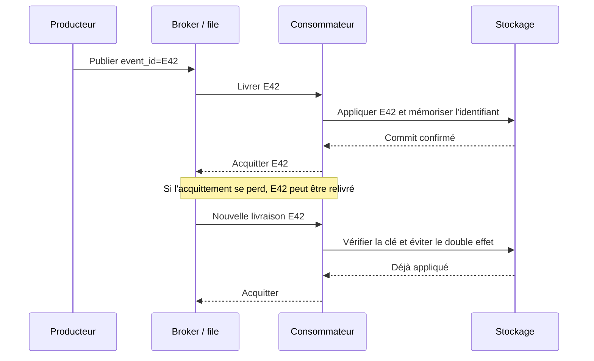

# Pipelines de données complexes — Expert

> **Mise en contexte.** L’ingestion relie des sources hétérogènes à une plateforme de données. Elle peut s’effectuer par fichiers, API, réplication, journaux de changements, files de messages ou flux continus. Le défi n’est pas uniquement de faire arriver des octets : il faut préserver l’identité des événements, gérer les retards et doublons, limiter la charge sur les sources, détecter les données invalides et garantir que les résultats publiés sont complets. Une architecture d’ingestion experte définit des contrats, des points de reprise, des limites de débit, des mécanismes de rejeu et des preuves d’exécution. Ce cours couvre les architectures batch et streaming à un niveau conceptuel, l’idempotence, les watermarks, le CDC, les schémas, l’orchestration et l’exploitation.

## Objectifs pédagogiques

À la fin du cours, vous pourrez comparer batch, micro-batch, streaming et CDC ; définir un contrat d’événement ; construire un système idempotent ; gérer offsets, watermarks et reprises ; dimensionner consommateurs et partitions ; mettre en place une dead-letter queue ; concevoir des tests de bout en bout ; contrôler coûts et effets de charge sur la source ; et diagnostiquer un pipeline qui est techniquement actif mais qui perd, duplique ou retarde des données.

Le niveau expert exige de clarifier le sens des garanties. « At least once », « at most once » et « exactly once » s’appliquent à des périmètres précis. Un broker peut livrer un événement plusieurs fois, une transaction locale peut s’engager pendant qu’une réponse réseau se perd, un sink peut ne pas partager de transaction avec le broker, et un retry peut produire un doublon. Il faut définir où l’idempotence est réalisée, quelle identité sert à la déduplication et comment la preuve est produite.

## Prérequis et environnement

Vous devez connaître JSON/CSV, HTTP, SQL, files et files de messages, clés métier, transactions, API et notions de réseau. Préparez une source synthétique, un producteur, un consommateur et un stockage de destination. Utilisez des environnements isolés, des volumes bornés et des données fictives. Vérifiez les versions des clients et serveurs ainsi que la documentation des connecteurs. Ne testez pas les limites de débit ou les pannes sur une source de production sans autorisation.

## 1. Choisir un modèle d’ingestion

Le batch collecte un ensemble de données sur une période puis le traite. Il est simple à contrôler et convient à des rapports où quelques heures de délai sont acceptables, mais il peut exiger de gros transferts et une stratégie de reprise au niveau du lot. Le micro-batch traite des petits lots fréquents ; il réduit le délai mais augmente le coût d’orchestration et de gestion de petits fichiers. Le streaming traite les événements à mesure qu’ils arrivent, avec des exigences plus fortes sur état, offsets, retard et reprise.

Le CDC (*Change Data Capture*) capte des insertions, mises à jour et suppressions à partir des journaux ou mécanismes de la source. Il réduit souvent le coût de relecture mais dépend du journal, du connecteur et de la rétention disponible. Une API périodique peut fournir un export incrémental, mais les garanties dépendent de ses curseurs et de son comportement lors des mises à jour tardives. La bonne stratégie est celle qui respecte fraîcheur, charge source, cohérence et compétence de l’équipe.

| Modèle | Point fort | Risque principal |
|---|---|---|
| Fichier batch | Reproductibilité et simplicité | Lots incomplets ou rejoués |
| API incrémentale | Intégration directe | Curseurs invalides, limites et changements tardifs |
| Micro-batch | Fraîcheur intermédiaire | Petits fichiers et surcharge d’orchestration |
| Streaming | Latence faible | État, backpressure et garanties de livraison |
| CDC | Capture de changements fins | Rétention des journaux et compatibilité du connecteur |

## 2. Contrat d’événement et identité

Un événement devrait contenir une identité stable, un type, un schéma ou une version, une date d’événement, une source et le contenu métier nécessaire. Le temps d’ingestion est différent du temps de l’événement : un événement peut être produit à 09 h 00 mais arriver à 09 h 20. Les deux doivent être conservés lorsque la latence et les corrections ont une importance.

Le choix de l’identifiant est crucial. Une clé créée à chaque tentative de livraison ne déduplique pas les répétitions du même événement. Une clé de commande peut identifier une entité mais pas chaque changement de cette commande. Selon le besoin, l’identité peut être un event_id, une combinaison de source et de version, ou un identifiant d’opération. La stratégie doit distinguer plusieurs événements légitimes portant la même valeur métier.

Définissez les règles de compatibilité du schéma : ajout de champ optionnel, champ obligatoire, type, format, enum, nullabilité et sens. Les consommateurs doivent pouvoir traiter les versions prévues. Un changement de type ou de sens nécessite une migration et une communication ; ignorer des champs inconnus n’est pas acceptable si l’ignorance change les résultats métier. Le registre ou catalogue de schémas peut automatiser certains contrôles, mais la sémantique reste à documenter.

Le contrat définit aussi l’ordre nécessaire. Certains flux exigent que les changements d’une même commande soient appliqués dans l’ordre, tandis que des événements indépendants peuvent être traités en parallèle. Un numéro de séquence ou une version source peut permettre de détecter un changement manquant ou reçu tardivement. L’ordre global entre plusieurs partitions n’existe pas nécessairement ; une application ne doit pas l’assumer sans garantie explicite du système source.

## 3. Batch fiable : lots, watermarks et reprise

Un batch doit indiquer son périmètre : période, curseur, identifiants et source. Un watermark représente le point de progression jusqu’auquel le pipeline estime avoir traité les données selon son contrat. Le watermark ne doit pas avancer simplement parce que l’extraction s’est terminée ; il doit se déplacer après les contrôles et la publication requise.

Une extraction incrémentale fondée sur updated_at peut manquer des changements si les timestamps sont incorrects, si leur précision est limitée ou si une modification tardive survient en dehors de la fenêtre relue. Une fenêtre de recouvrement aide mais ne constitue pas une garantie absolue. CDC peut mieux représenter les changements, mais son offset et son journal doivent rester disponibles jusqu’à la reprise.

Chaque lot possède un état : démarré, extrait, validé, chargé, publié ou échoué. Ces états doivent être persistés indépendamment des logs du processus. Lors d’un crash, l’orchestrateur lit le dernier état et sait si l’étape peut être rejouée. Un lot marqué publié doit avoir une preuve de complétude et de qualité. Un lot échoué doit conserver l’offset ou les métadonnées nécessaires pour reprendre sans sauter de données.

Une table de suivi de lots peut stocker identifiant, source, fenêtre, watermark initial/final, lignes reçues, acceptées, rejetées, version de schéma, empreinte, statut et motif d’échec. Son état doit être mis à jour dans un ordre cohérent avec la publication. Si l’écriture métier réussit mais que le statut est perdu, une reprise doit pouvoir reconnaître que l’effet a déjà eu lieu. Une identité de lot ne doit pas être simplement un identifiant de processus généré à chaque tentative.

## 4. Idempotence et livraison « exactement une fois »

Le mode *at-least-once* accepte des répétitions pour éviter certaines pertes ; *at-most-once* évite les reprises au prix d’un risque de perte ; le terme *exactly-once* doit être défini au niveau du système complet et de ses transactions. Un broker peut assurer une garantie dans son périmètre, mais la transaction avec une base externe ou une API tierce n’est pas nécessairement incluse. Ne décrivez pas le système complet comme exactly-once sans preuve.

L’idempotence permet de rendre les répétitions sans effet double. Elle peut reposer sur une clé unique, une table de déduplication, un upsert conditionné par une version ou un registre d’événements déjà appliqués. La clé doit rester stable pendant les retries et la durée de déduplication doit couvrir la fenêtre réelle de reprise. La déduplication doit être transactionnelle avec l’application du résultat si le cas exige qu’aucun état ne soit partiellement écrit.

L’exemple souligne pourquoi il faut mémoriser l’événement et appliquer son effet de manière cohérente. Si l’application du résultat réussit mais que la déduplication échoue, un retry peut créer un doublon. Si l’événement est mémorisé avant l’effet et que l’effet échoue, l’événement peut être ignoré à tort. Le mécanisme exact dépend de la transaction et du stockage.

Une stratégie réaliste peut combiner livraison au moins une fois, clé unique au niveau du sink et transaction locale qui écrit à la fois l’effet métier et la trace d’idempotence. Pour une API externe, utilisez son identifiant de requête idempotente si elle le fournit ; sinon, une réconciliation ou un état intermédiaire peut être nécessaire. La promesse exacte une fois n’est jamais universelle : précisez composant, défaillances couvertes, rétention de l’identité et conditions de concurrence.

## 5. CDC : journal, offsets et cohérence de capture

Le CDC lit les changements de données, souvent à partir du journal de transactions de la source. Les événements peuvent contenir opération, clé, valeurs avant/après, position dans le journal, heure et métadonnées de schéma selon le connecteur. Le pipeline doit interpréter correctement insert, update, delete, transaction et snapshot initial.

La capture a besoin d’un point de reprise stable. Si le consommateur s’arrête au-delà de la rétention du journal, l’offset peut devenir impossible à reprendre sans nouvelle snapshot ou réinitialisation. Surveillez retard et marge avant expiration. Un offset sauvegardé n’est pas utile si les données source nécessaires à la reconstruction ont disparu.

Un snapshot initial suivi du flux de changements doit éviter le trou entre la capture et le début du flux. La méthode dépend du connecteur : position de journal cohérente, barrières ou mécanisme intégré. Si un pipeline démarre le snapshot, puis active CDC après coup, il peut manquer les changements intervenus pendant l’extraction. Testez ce scénario avec des écritures concurrentes.

Les événements de suppression doivent être représentés jusqu’au sink. Si le consommateur ne voit que l’état actuel, une suppression source peut être perdue et la destination garder un enregistrement fantôme. Définissez les règles pour tombstones, rétention, historique et réutilisation d’identifiants. Les suppressions peuvent devoir rester dans le flux comme tombstones pendant une durée minimale pour que les consommateurs en retard les appliquent.

Les décalages entre source et sink doivent être mesurés. Une position CDC peut progresser alors que la publication aval échoue si les offsets sont acquittés trop tôt. Définissez à quel moment l’offset est considéré traité durablement et comment la reprise redéploie les événements non publiés. Les offsets constituent une preuve de progression technique, pas une preuve de qualité métier.

## 6. Streaming, état et watermarks

Le streaming traite une suite d’événements potentiellement retardés ou réordonnés. Une fenêtre temporelle permet de regrouper des événements par intervalle ; l’event time et le processing time répondent à des questions différentes. Le processing time reflète quand le système traite l’événement, tandis que l’event time reflète quand l’événement s’est produit selon la source.

Les watermarks bornent souvent la durée pendant laquelle le système attend des événements retardés avant de considérer certaines fenêtres comme suffisamment complètes. Un watermark n’est pas une preuve que tous les événements avant l’heure sont arrivés ; il définit un compromis entre latence, état conservé et retards acceptés. Les politiques de late data peuvent ignorer, mettre en correction, envoyer en side output ou déclencher une révision d’agrégat.

Les fenêtres doivent être définies selon le besoin métier : fenêtres fixes, glissantes ou sessions. Les frontières doivent préciser inclusion, fuseau, arrondi et traitement des événements exactement au bord. Une période quotidienne doit normalement utiliser une référence temporelle cohérente ; un fuseau local peut avoir des journées de durée différente lors de changements d’heure. Un événement retardé doit être rattaché selon une règle documentée.

Un agrégat sur fenêtre peut être provisoire avant la fin de la tolérance de retard, puis être corrigé par un événement arrivé plus tard. Le consommateur doit savoir si les résultats sont finaux, provisoires ou révisables. Lorsque le stockage reçoit des mises à jour d’agrégats, elles doivent avoir une identité de fenêtre et une version qui empêche de compter deux fois la correction. La politique « drop late events » est acceptable seulement si la perte est explicitement tolérée.

## 7. Backpressure et contrôle de débit

La backpressure signifie que le système aval ne peut plus absorber le débit entrant. Une file peut croître, les consommateurs prennent du retard, la mémoire ou le stockage se remplit et la latence augmente. Augmenter le parallélisme peut aider si le travail se répartit, mais ne corrige pas une API externe limitée, une partition chaude, un sink lent ou une requête SQL coûteuse.

Mesurez le débit producteur, débit consommateur, backlog, âge du plus ancien événement, latence de bout en bout, retries et erreurs de sink. Définissez une capacité maximale et une politique de protection. Les producteurs doivent parfois ralentir, rejeter temporairement ou écrire dans un stockage durable si la destination est indisponible. Les files non bornées peuvent transformer une panne courte en panne de capacité durable.

Les retries doivent avoir un nombre maximal ou une stratégie adaptée, un délai avec backoff et éventuellement jitter. Sans backoff, de nombreux clients retentent en même temps et aggravent le service déjà saturé. Les erreurs permanentes, comme schéma invalide ou donnée non autorisée, ne doivent pas être retentées indéfiniment.

Le dimensionnement doit prévoir une capacité de rattrapage. Si l’entrée dépasse la sortie pendant deux heures, le backlog devra être absorbé ensuite sans violer les quotas de la source ou du sink. Mesurez le débit soutenable au-delà de la moyenne, la durée de rattrapage et l’impact sur les consommateurs critiques. Un système qui fonctionne toujours à saturation n’a aucune marge pour les reprises après incident.

## 8. Dead-letter queue et traitement des messages invalides

Une dead-letter queue (DLQ) reçoit les messages qui ne peuvent pas être traités selon la politique. Elle doit préserver l’identifiant, la source, le motif, l’horodatage, le schéma et les informations nécessaires à la correction tout en minimisant les données sensibles. Une DLQ n’est pas une poubelle : elle doit posséder une rétention, un responsable, une métrique et une procédure de replay.

Distinguez erreur transitoire (timeout, indisponibilité) et erreur permanente (format invalide, champ requis absent, valeur interdite). Les erreurs transitoires peuvent être retentées de façon bornée. Les permanentes peuvent être mises en quarantaine et signalées au producteur. Une DLQ qui grossit sans limite indique un problème non résolu et consomme du stockage tout en cachant des données manquantes.

Le rejeu doit vérifier si la correction a été appliquée et si le message peut être rejoué sans effet double. Un message corrigé devrait garder une référence au message original et à la décision. Un rejeu de milliers d’événements dans une destination saturée doit avoir un débit limité pour ne pas interrompre les données courantes.

La DLQ doit préserver suffisamment de contexte pour investiguer, sans devenir un second stockage non protégé. Un payload complet peut contenir des informations sensibles ; parfois un identifiant source, un code d’erreur et une référence à une archive sécurisée suffisent. Définissez qui peut lire ou télécharger les messages, la durée de conservation, le masquage et les procédures d’export.

## 9. API, pagination et limites de source

L’ingestion par API doit respecter pagination, limites de débit, authentification, erreurs, curseurs et changements de schéma. Une API paginée peut fournir un curseur opaque à utiliser sans le modifier. Les limites de pagination ne garantissent pas une photographie cohérente si les données changent entre les pages ; il faut vérifier si l’API fournit un snapshot, un watermark, une version ou une méthode de réconciliation.

Les retries HTTP doivent distinguer codes temporaires, erreurs d’authentification, validation et limites. Un 429 peut demander un délai ou un en-tête de backoff ; un 401 demande de vérifier les credentials et ne doit pas être retenté indéfiniment. Le client doit utiliser timeouts et limites de concurrence. Une extraction à plusieurs workers peut dépasser les quotas ou changer l’ordre des pages si l’API ne le permet pas.

Les secrets de l’API ne doivent pas être dans le dépôt, l’URL ou les logs. Évitez de journaliser les en-têtes d’authentification et les corps contenant des données sensibles. Gérez la rotation des credentials et la révocation. Le contrat d’ingestion inclut le quota, la pagination, la fraîcheur, la stratégie de reprise et la preuve de couverture.

Une API peut changer la population entre deux pages : une insertion ou suppression déplace des éléments et crée une page sautée ou répétée. Quand elle ne fournit pas de snapshot cohérent, utilisez un recouvrement temporel, une déduplication et une réconciliation avec le dernier watermark validé. Cette approche réduit les pertes mais doit annoncer sa limite : un changement qui survient bien après la fenêtre de recouvrement peut exiger une vérification plus large.

## 10. Qualité et validation au point d’entrée

Les contrôles en ingestion détectent tôt les schémas inconnus, identifiants manquants, types invalides, dates impossibles et références absentes. Mais les contrôles d’entrée ne suffisent pas pour des invariants qui nécessitent de rapprocher plusieurs sources ou d’analyser le résultat final. La qualité doit être testée à plusieurs frontières.

Chaque rejet doit être compté et caractérisé. La politique peut bloquer tout un lot si le schéma est incompatible, tolérer quelques champs facultatifs manquants ou mettre en quarantaine certaines lignes. L’ensemble des exceptions acceptées doit être explicite et surveillé. Une ligne invalide ignorée peut produire un total incomplet qui paraît plausible.

Définissez des contrôles de complétude et de fraîcheur : nombres de messages attendus, source sans événement récent, watermark bloqué, taille de lot, volume rejeté et écart avec des totaux sources. Les valeurs limites doivent être adaptées à la saisonnalité. Un système de qualité ne doit pas simplement envoyer trop d’alertes ; chaque seuil doit être exploitable et avoir un propriétaire.

## 11. Orchestration, dépendances et publication

Un pipeline peut être constitué de tâches qui dépendent les unes des autres : extraction, validation, enrichissement, chargement, agrégation et publication. L’orchestrateur gère calendrier, retries, états et alertes, mais le pipeline doit aussi protéger l’état de données. Le statut « tâche terminée » ne signifie pas nécessairement que toutes les données sont accessibles aux consommateurs.

Utilisez des états de lot séparés de l’état de processus. Si une tâche charge les données puis échoue avant de publier, la reprise doit savoir si la destination contient des données temporaires. Utilisez staging, transactions, clés de lot et commits lorsque disponibles. Définissez le moment où un watermark avance et où le système annonce la fraîcheur.

Les dépendances externes doivent être prises en compte : disponibilité de source, catalogue, stockage, clés, réseau et quota. Une orchestration robuste inclut timeouts, annulations propres, backoff et limites. Les jobs ne doivent pas se chevaucher s’ils réécrivent les mêmes partitions sans protocole de concurrence défini.

Pour une publication par fichier, écrivez dans une zone de staging et ne rendez visible qu’un manifeste ou une version validée. Pour une table transactionnelle, utilisez le mécanisme de commit compatible. Les consommateurs doivent lire la version publiée et non parcourir des fichiers temporaires. Le flux complet doit définir ce qui se passe si le job plante entre l’écriture de la sortie et la mise à jour du statut.

## 12. Sécurité, confidentialité et audit

L’ingestion transporte souvent des données sensibles depuis une source. Assurez chiffrement en transit selon le besoin, secrets gérés, comptes de service limités, réseau et stockage contrôlés, journalisation et rotation des credentials. Limitez l’accès à la DLQ et aux copies brutes, qui peuvent conserver les données avant validation.

La trace d’un lot peut contenir identifiants source, timestamps, nombres de lignes et versions sans conserver le payload sensible complet. Si le payload doit être conservé pour diagnostic, contrôlez l’accès, chiffrez et définissez la rétention. Les logs ne doivent pas devenir une deuxième copie permanente et peu sécurisée des données personnelles.

L’audit doit répondre à qui a créé la connexion, quels lots ont été lus, quelle version de code les a transformés, qui a demandé un rejeu, quelles permissions ont été utilisées et quelle sortie a été publiée. Les événements d’audit eux-mêmes doivent avoir une source fiable, une horloge cohérente et une protection contre la modification.

## 13. Observabilité de bout en bout

Suivez les métriques à chaque frontière : événements produits, reçus, acceptés, rejetés, transformés, publiés et consommés. Reliez les étapes par un identifiant de lot ou de trace. Un débit élevé sans fraîcheur acceptable n’est pas un succès. Une file qui continue à recevoir des messages mais ne publie rien peut sembler active tout en étant bloquée.

Les indicateurs importants incluent latence de bout en bout, temps en file, backlog, plus ancien message, débit, retries, erreurs par type, DLQ, écart de comptage, taux de doublons, retard CDC et âge du dernier lot publié. Chaque métrique doit avoir une valeur de base, un seuil, une action et un propriétaire.

Les logs détaillés doivent pouvoir expliquer pourquoi un événement a été rejeté sans exposer toutes ses données. Les traces doivent relier source et sink si possible. Lors d’un incident, comparez un événement précis de bout en bout, puis cherchez si le défaut est systémique. Les agrégats seuls ne permettent pas toujours d’identifier la clé manquante ou le premier lot incomplet.

## 14. Atelier pratique : ingestion API avec reprise

### Scénario

Une API paginée expose des événements de commande. Le service limite le débit, certains événements sont modifiés après leur création et le client peut perdre sa connexion au milieu d’une page. Le pipeline doit charger en staging, éviter les doublons et publier seulement une fenêtre validée.

### Étape A — Définir contrat et curseur

Consignez l’API, format, champs obligatoires, ID d’événement, version, limite de page et règle de curseur. Vérifiez si un snapshot est offert. Définissez la fenêtre de recouvrement pour les modifications tardives ou le mécanisme de mise à jour si le serveur en fournit un.

### Étape B — Implémenter timeouts et retries

Utilisez un timeout raisonnable, un backoff pour les erreurs temporaires et un plafond de tentatives. Respectez les signaux de limitation de débit. Une erreur de schéma ou une authentification invalide doit interrompre et alerter plutôt que boucler. Les credentials sont injectés à l’exécution.

### Étape C — Enregistrer l’état du lot

Sauvegardez les métadonnées de chaque page ou de chaque fenêtre : curseur, nombre reçu, min/max timestamp, version de contrat et statut. Ne marquez pas la fenêtre complète avant d’avoir parcouru la pagination et exécuté les contrôles. Si le client tombe au milieu, reprenez à un point sûr.

### Étape D — Dédupliquer et valider

Utilisez la clé source stable et une règle de traitement des versions. Vérifiez types, identifiants, doublons, références et dates. Les messages invalides vont en quarantaine avec un motif. Le rejeu du même lot doit produire le même état publié.

### Étape E — Publier et rapprocher

Publiez la fenêtre après validation, avec une version de sortie. Comparez les comptages et totaux avec la source si un indicateur de contrôle est disponible. Si la source est modifiée plus tard, réouvrez une fenêtre selon la politique de recouvrement et documentez l’impact sur les sorties antérieures.

### Critères d’acceptation

Le laboratoire réussit si les curseurs et états sont conservés, les retries sont bornés, les doublons ne créent pas de doubles effets, les erreurs permanentes sont visibles et aucune fenêtre incomplète n’est déclarée publiée. Le rapport doit présenter métriques de fraîcheur, erreurs, DLQ, limites API et procédure de reprise.

## 15. Étude de cas : backlog qui croît malgré un cluster actif

### Symptômes

Les consommateurs sont en cours d’exécution, le CPU n’est pas saturé et le backlog augmente. L’âge du plus vieux message dépasse le SLA et le système semble recevoir plus que ce qu’il publie.

### Hypothèses

Le sink peut être limité en débit, une partition peut être chaude, les retries peuvent occuper les workers, un schéma invalide peut diriger trop d’événements vers la DLQ ou une API externe peut bloquer. Des consommateurs supplémentaires n’aideront pas si l’écriture aval est le goulot ou si les messages doivent être traités séquentiellement selon une clé.

### Diagnostic

Mesurez taux d’entrée et de sortie, latence du sink, durée des retries, erreurs par type, distribution de charge et backlog par partition. Suivez un message. Vérifiez les quotas, limites de connexions, index de destination et taille des lots. Identifiez si le ralentissement est global ou local à certaines clés.

### Correction

Selon la cause, optimisez le sink, réduisez les lectures inutiles, augmentez le parallélisme uniquement si la destination le supporte, corrigez la clé de partitionnement, limitez les retries et isolez les erreurs permanentes. Si une source doit être ralentie, appliquez le mécanisme de backpressure ou de pause validé. Ne supprimez pas le backlog pour rendre le graphique vert.

### Prévention

Ajoutez des seuils sur l’âge du plus vieux message, le ratio entrée/sortie, les retries et le DLQ. Dimensionnez selon les pics, pas seulement la moyenne. Testez les pertes de réseau, l’indisponibilité du sink et la reprise du consommateur. Documentez les effets attendus et la capacité maximale.

## 16. Exercices avec corrigés

### Exercice 1 — Le même événement peut être livré deux fois. Comment éviter un double effet ?

**Correction.** Utilisez une identité stable de source et rendez l’application du résultat idempotente. La déduplication doit être cohérente avec l’écriture finale ; mémoriser l’ID dans une transaction séparée peut créer perte ou duplication. La stratégie dépend du sink et de ses garanties.

### Exercice 2 — Pourquoi avancer le watermark après l’extraction seule est-il dangereux ?

**Correction.** L’extraction peut réussir alors que validation, chargement ou publication échoue. Si le watermark avance trop tôt, la reprise peut sauter ces événements. Avancez-le selon le contrat après l’étape qui prouve le traitement durable requis et gardez un état observable par lot.

### Exercice 3 — Que faire d’un message avec un schéma incompatible ?

**Correction.** Selon la politique, bloquer le lot ou placer le message en DLQ avec un motif contrôlé. Ne pas l’ignorer silencieusement. Alertez le producteur ou propriétaire de contrat, puis rejouez après correction si l’idempotence et le stockage permettent le traitement sûr.

### Exercice 4 — Un consommateur est actif mais la latence augmente. Quelle métrique est essentielle ?

**Correction.** L’âge du plus vieux message et la latence de bout en bout, combinés au débit entrant/sortant, montrent si le retard se creuse. Le nombre de consommateurs ou leur état « running » ne prouve pas qu’ils traitent assez vite.

### Exercice 5 — Pourquoi CDC peut-il perdre la possibilité de reprise ?

**Correction.** Si le consommateur est arrêté au-delà de la rétention du journal ou si l’offset devient invalide, les changements nécessaires peuvent ne plus être disponibles. Surveillez retard et marge de rétention et prévoyez réinitialisation/snapshot selon les garanties du connecteur.

### Exercice 6 — Pourquoi une API paginée ne garantit-elle pas une extraction cohérente ?

**Correction.** La population peut changer entre les pages et des mises à jour peuvent déplacer des éléments d’une page à l’autre. Il faut un snapshot ou curseur stable si disponible, ou une stratégie de recouvrement, déduplication et réconciliation. Les garanties de l’API sont une partie du contrat.

## 17. Défi final : plateforme d’ingestion multi-sources

Une organisation reçoit événements temps réel d’un broker, des fichiers nocturnes et des mises à jour de base via CDC. Elle exige des rapports frais, une reprise sans double comptage et un audit sur les changements.

### Corrigé attendu

Définissez des contrats distincts par source : identité, schéma, temps événement, latence, ordre, suppression, volume et limites. Standardisez les métadonnées communes sans effacer les différences de sémantique. Les producteurs doivent publier des versions de schéma et les consommateurs doivent détecter les évolutions incompatibles.

Pour les fichiers batch, enregistrez lot, contrôle d’intégrité, fenêtre et compte de lignes. Pour le broker, conservez offsets, identifiants et état de consumer group. Pour CDC, surveillez l’offset, la rétention et le retard du journal source. Chaque mode a une procédure de reprise spécifique, mais tous exposent un état de publication commun.

Rendez les sinks idempotents avec des clés adaptées, des transactions lorsque possible et une règle claire pour corrections. Les messages invalides sont en quarantaine avec une rétention et un propriétaire. La publication est bloquée ou signalée selon les seuils qualité, jamais déclarée complète sur la seule base d’un processus actif.

Les tableaux de bord suivent latence de bout en bout, backlog, erreurs par type, doublons détectés, DLQ, fraîcheur de la dernière sortie, retard CDC et coût par lot. La plateforme impose timeouts, retries bornés, backpressure et limites de concurrence. Le plan de reprise couvre perte de réseau, indisponibilité du sink, clé compromise, offset perdu et lot partiel.

La livraison finale inclut architecture, contrats, schéma d’événement, politique de retry, stratégie de déduplication, tests de charge, preuves de reprise, sécurité, propriétaires et seuils. Elle explique les limites réelles des garanties de livraison selon chaque source et sink. Une promesse exactly-once doit être liée à un mécanisme démontré et à un périmètre connu.

## 18. Checklist de mise en production

- [ ] Chaque source possède un contrat versionné et un propriétaire.
- [ ] Identité, temps événement et temps d’ingestion sont distingués.
- [ ] Le mode de livraison et ses garanties sont explicitement définis.
- [ ] La déduplication est idempotente au niveau de la destination.
- [ ] Watermarks et offsets n’avancent pas avant la preuve prévue.
- [ ] Les retries ont un plafond, du backoff et des catégories d’erreurs.
- [ ] Les messages invalides sont observables via une DLQ/quarantaine.
- [ ] Le backpressure et les limites de source/sink sont maîtrisés.
- [ ] La publication ne révèle pas de lot incomplet.
- [ ] La latence de bout en bout, le backlog et la fraîcheur sont alertés.
- [ ] Secrets, données brutes, logs et DLQ sont protégés.
- [ ] La reprise et le rejeu sont testés sur incidents reproductibles.

## Conclusion

Une ingestion robuste protège le sens des événements, pas seulement leur transport. Les contrats, identités, offsets, watermarks, retries et transactions définissent comment le pipeline se comporte lors d’une panne. L’observabilité doit relier l’entrée au résultat publié et exposer les retards, rejets et doublons. La qualité experte consiste à connaître le périmètre réel des garanties, rendre les erreurs visibles, et permettre une reprise reproductible sans perdre ni compter deux fois les données.

## Complément : tests de chaos, capacité et exploitation en continu

### Tester les pannes de façon sûre

La résilience se vérifie en interrompant un composant dans un environnement de test : arrêter le consommateur après lecture mais avant l’acquittement, couper l’accès au sink après un commit, faire expirer un curseur, retarder les messages ou envoyer une version de schéma non prise en charge. Chaque test doit avoir une limite de durée, un volume réduit et une procédure de remise à l’état initial. Ne lancez pas ces expériences sur une file partagée ou une source de production sans autorisation et plan d’arrêt.

Après chaque panne, vérifiez l’état de la source, les offsets, les tables de déduplication et la sortie publiée. Le test recherche les pertes comme les doublons. Une procédure qui ne regarde que le code retour peut manquer un commit déjà effectué ou un lot qui n’a jamais été publié. Conservez les traces, la version du code et la configuration du test afin de rendre le résultat reproductible.

### Calculer la capacité de rattrapage

Si le débit d’entrée dépasse le débit de sortie pendant un pic, le backlog augmente. Le système doit disposer d’une capacité de rattrapage après le pic : le débit consommateur doit ensuite dépasser l’entrée sans violer les quotas du sink. Estimez volume de backlog, débit soutenable, temps de rattrapage et ressources. Un cluster qui fonctionne à 100 % en permanence n’a pas de marge pour les reprises après incident.

Mesurez les événements les plus coûteux, pas seulement la moyenne. Un lot peut contenir de grandes pièces jointes, des clés chaudes ou des transformations complexes. Si le retard dépasse la rétention du CDC ou du broker, la reprise peut nécessiter une nouvelle capture complète. Cette option doit être mesurée et annoncée, car elle peut modifier le RTO.

### Traiter les corrections métier

Un événement reçu tardivement peut corriger une commande ancienne ou annuler une transaction. Le pipeline doit pouvoir mettre à jour la destination, recalculer les agrégats et informer les consommateurs si les résultats changent. La date de modification ne remplace pas l’identité de la version ; conservez numéro de séquence ou un ordre défini par la source.

Une correction peut nécessiter de recharger une partition ou de produire un événement compensatoire. Définissez si l’historique est réécrit ou conservé par événements. Si le contrat autorise une période de correction, documentez sa fenêtre et le moment où les données sont considérées stables. Les consommateurs doivent savoir si les périodes précédentes peuvent encore changer.

### Faire de la DLQ une file de travail gouvernée

Chaque type de rejet doit avoir un motif normalisé, une gravité, un propriétaire et une procédure. La DLQ fait l’objet de métriques sur volume et âge. Un outil de replay doit afficher combien d’événements seront réinjectés, quels filtres s’appliquent et quelle stratégie d’idempotence protège la destination. Les événements contenant des données sensibles doivent être masqués dans les écrans d’investigation.

La résolution est terminée lorsque la cause est corrigée dans le contrat ou le producteur, les messages ciblés sont traités ou clôturés et le nombre de rejets revient à une plage attendue. Purger la DLQ sans analyser le contenu réduit le graphique, mais supprime la preuve d’une perte potentielle.

### Gérer les changements de schéma et les déploiements

Un producteur et ses consommateurs ne sont pas forcément déployés en même temps. Définissez un protocole de compatibilité : ajout de champ facultatif, coexistence de versions, migration de consumers, puis retrait de l’ancien schéma. Un champ qui garde son nom mais change de signification est aussi dangereux qu’un changement de type. La version de contrat doit être attachée au lot ou à l’événement et consultable lors d’un diagnostic.

Avant un déploiement, testez des messages historiques et nouveaux, les champs absents, valeurs inconnues et erreurs de conversion. Une validation de schéma peut bloquer l’incompatibilité immédiatement ; un changement compatible peut être déployé de manière progressive. Lorsque le changement est incompatible, établissez une date d’effet et avertissez les consommateurs concernés.

### Éviter les tempêtes de retry

Si un service aval est en panne, des milliers de consommateurs peuvent retenter au même moment. Sans backoff, jitter et plafond, la reprise génère une seconde surcharge après le rétablissement. Définissez un budget de retry, une temporisation progressive, un circuit breaker éventuel et une alerte si les erreurs temporaires persistent. Ne retentez pas une erreur permanente comme un type invalide ou un refus d’autorisation.

Les retries peuvent également produire un effet non souhaité quand la première demande a réussi mais que sa réponse s’est perdue. Utilisez une identité idempotente, consultez le résultat de la première tentative lorsque c’est possible et documentez ce qui se passe en cas de résultat inconnu. Un timeout est une incertitude, pas une preuve d’annulation.

### Construire un rapport de reprise

Pour chaque incident ou exercice, consignez événement déclencheur, source et sink affectés, période de perte potentielle, backlog au début et à la fin, reprise tentée, nombre de doublons détectés, lignes rejetées et version publiée. Séparez métriques observées et estimations. Le rapport doit expliquer si le RPO, le RTO et l’objectif de fraîcheur ont été respectés.

Assignez des actions correctives avec responsable et critères de clôture. Une action comme « améliorer l’ingestion » est trop vague ; « alerter lorsque l’âge du plus ancien événement dépasse cinq minutes et documenter le retry du sink » est testable. Rejouez les tests après les changements. La résilience s’améliore à mesure que l’on réduit les inconnues et que l’on transforme les incidents passés en scénarios automatisés.

### Critères de maturité

Un pipeline mature sait indiquer la dernière sortie fiable, les événements acceptés et rejetés, le retard maximum, la version du contrat, la capacité de rattrapage et le point de reprise. Il expose une action lorsqu’une source reste silencieuse, un watermark bloque ou une DLQ augmente. Il sait repartir après un crash sans créer un résultat double et peut expliquer la portée de ses garanties de livraison.

La maturité ne signifie pas qu’il n’y aura jamais d’échec. Elle signifie que les conditions d’échec sont connues, les impacts délimités, les données récupérables selon le contrat et les opérateurs capables de suivre une procédure contrôlée. La documentation, le code et la supervision doivent être alignés sur le système réellement déployé.
