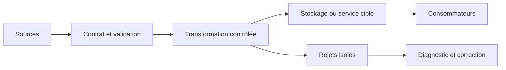
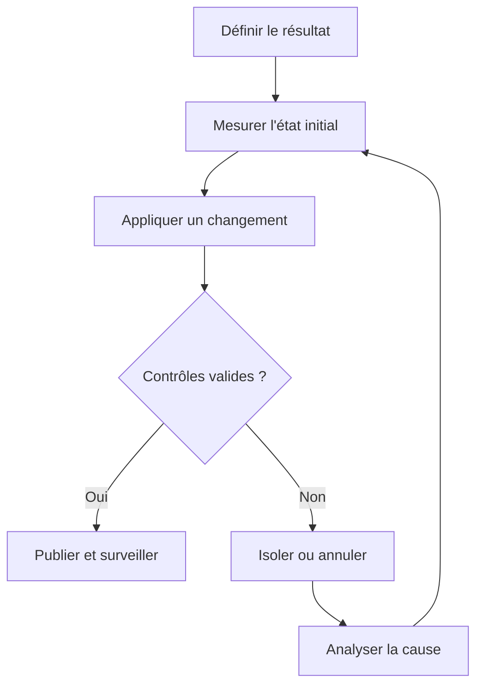
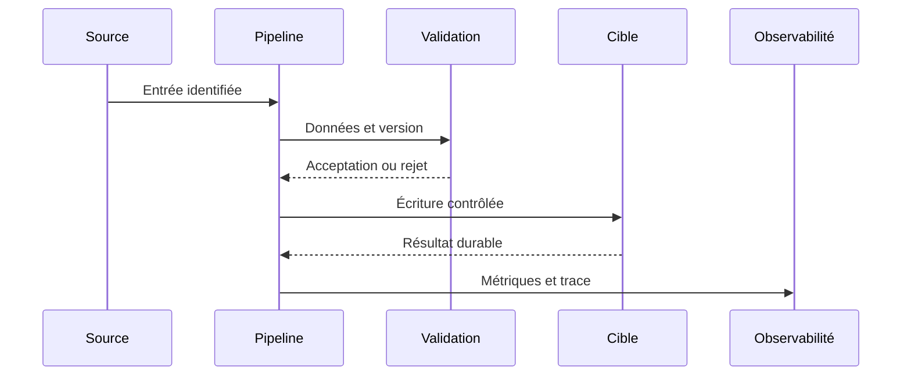
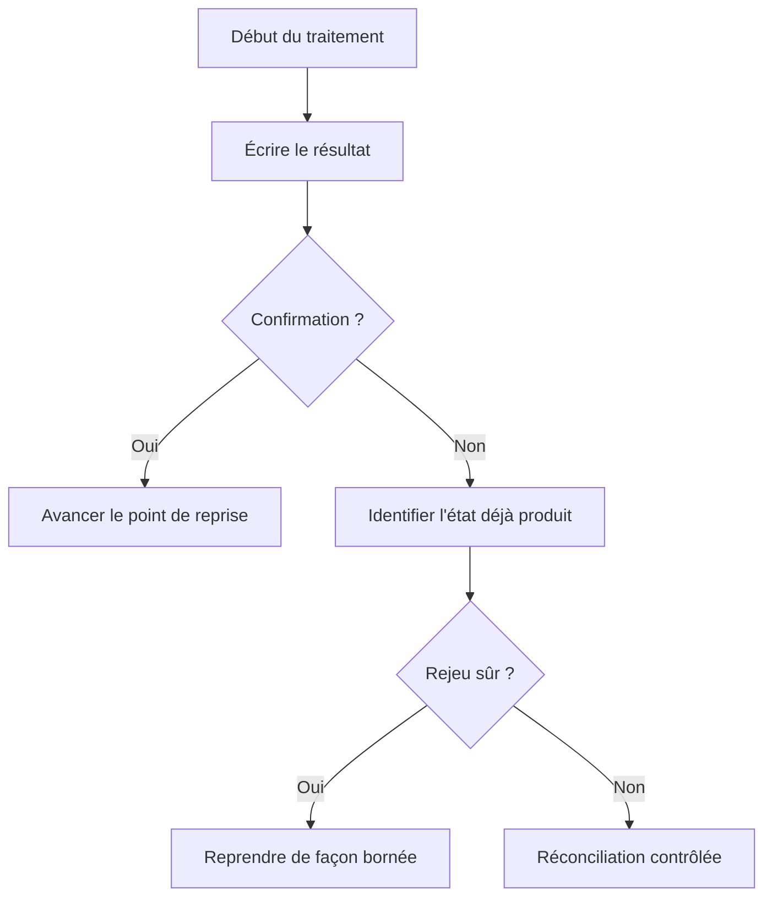
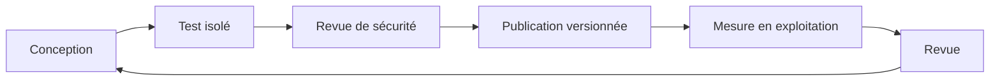

# Pipelines de données complexes — Expert

> **Mise en contexte.** Ce cours approfondit pipelines d’ingestion incrémentale, orchestration et rejeu. Il vise une décision technique justifiable, testable et exploitable. Les exemples doivent être adaptés à la version du moteur et au contexte réel. Utilisez des données synthétiques, notez versions et paramètres, et préparez la restauration ou le retour arrière avant une opération risquée. N’insérez jamais de secret ou de donnée personnelle dans les commandes partagées.

## Introduction et objectifs pédagogiques

La compétence recherchée ne consiste pas à exécuter une recette, mais à expliquer pourquoi une solution répond au besoin et quelles limites elle conserve. Un résultat plausible sur le cas nominal n’est pas une preuve suffisante : les erreurs, l’ordre des événements, les données absentes, la concurrence et les changements de version doivent faire partie du raisonnement.

À l’issue du cours, vous devez pouvoir définir un contrat, identifier la source de vérité, comparer plusieurs approches, construire un test reproductible, interpréter une trace et expliquer une procédure de reprise. Vous devez également pouvoir différencier une garantie fournie par le système d’un comportement qui dépend d’un paramètre ou d’un choix applicatif. La validation attendue relie intention, entrée, état final et preuve.

Objectifs opérationnels : écrire les invariants métier, cartographier les composants, établir une baseline, mesurer les risques et les coûts, traiter les échecs explicitement, protéger les données, automatiser les assertions prioritaires et documenter les limites. Le cours fournit des méthodes de validation réutilisables ; les valeurs de configuration et les garanties précises doivent être confirmées dans la documentation de la version effectivement déployée.

## Prérequis et environnement

Révisez les notions de schéma, identifiant stable, transactions, journaux, droits d’accès et tests automatisés. Consignez la version des outils, extensions, ressources, configuration et mode de déploiement. Une syntaxe qui ressemble à celle d’un autre produit ne garantit ni une sémantique ni un niveau de fiabilité identiques.

Préparez un environnement isolé, un jeu synthétique et une procédure de nettoyage. Conservez la sortie de référence et les paramètres exacts. Pour toute action destructive, préparez la restauration avant de l’exécuter. Le code retour n’est qu’un signal : il doit être complété par des contrôles sur les lignes, clés, montants, versions, messages ou métriques qui prouvent l’invariant.

## Concepts clés développés

### 1. Contrats et DAG

**Principe et choix.** Pipeline est un graphe de dépendances où chaque étape consomme un contrat et publie un résultat contrôlé. Avant d’implémenter, écrivez le contrat attendu en langage métier : quelles entités, quels consommateurs et quelle granularité sont concernés ? Distinguez une garantie nécessaire d’une simple préférence d’implémentation. Si plusieurs solutions sont disponibles, comparez-les sur les mêmes critères et mesurez ce qui change réellement. Une option technique est pertinente lorsqu’elle maintient le contrat et reste compréhensible pour l’équipe qui l’exploite.

**Risque et limite.** Job techniquement réussi peut sortir zéro ligne ; mélanger validation et publication expose un état partiel. Recherchez l’événement précis qui peut invalider le résultat : entrée inattendue, concurrence, changement de version, interruption entre deux étapes ou surcharge. Une conception fiable rend l’état visible et propose une action adaptée à chaque classe d’erreur. Il faut distinguer erreur temporaire, erreur permanente et résultat inconnu. Une reprise ne doit pas supposer que l’absence de réponse prouve que l’écriture n’a pas eu lieu.

**Preuve technique.** Vérifier que l’étape aval attend les contrôles amont et que sortie correspond à l’attendu. Établissez cette preuve avant l’essai. Utilisez des entrées connues, un résultat attendu et un contrôle de l’état réellement obtenu. Conservez version, paramètres, traces et métriques. Ajoutez un cas frontière et un cas qui doit être rejeté ; un test uniquement nominal laisse de côté les invariants les plus importants. Lorsque le résultat est quantitatif, définissez le dénominateur, la fenêtre et les unités pour que la mesure soit interprétable.

**Exemple contextualisé.** Table certifiée est publiée après validation de schéma, réconciliation et partitions attendues. Commencez par un cas réduit, puis augmentez un seul facteur à la fois : volume, cardinalité, concurrence, retard, version ou droits. Comparez à une référence indépendante quand c’est possible. Si le résultat contredit l’hypothèse, conservez l’écart comme une information de diagnostic et révisez l’explication, plutôt que de changer le critère après l’observation.

**Décision d’ingénierie.** Comparez une variante simple et une variante traitant une contrainte supplémentaire. Évaluez latence, coût de stockage, charge de maintenance, privilèges requis, retour arrière et compétences nécessaires. La variante complexe n’est justifiée que si un indicateur démontre le besoin. Écrivez le seuil qui déclencherait son adoption et le signal qui imposerait de la revoir. Ce seuil rend la décision vérifiable plutôt que dépendante du goût personnel.

**Revue opérationnelle.** Demandez à un collègue de refaire l’essai à partir du compte rendu. Il doit pouvoir identifier les entrées, l’état final, le propriétaire de l’invariant et la trace à inspecter. S’il ne peut pas, la documentation ou la conception est incomplète. Un résultat exploitable peut être expliqué, surveillé, corrigé et transmis sans dépendre uniquement de la mémoire de son auteur.

### 2. Idempotence et clés

**Principe et choix.** Opération idempotente répétée ne modifie pas davantage l’état logique ; elle exige identifiant stable et déduplication démontrée. Avant d’implémenter, écrivez le contrat attendu en langage métier : quelles entités, quels consommateurs et quelle granularité sont concernés ? Distinguez une garantie nécessaire d’une simple préférence d’implémentation. Si plusieurs solutions sont disponibles, comparez-les sur les mêmes critères et mesurez ce qui change réellement. Une option technique est pertinente lorsqu’elle maintient le contrat et reste compréhensible pour l’équipe qui l’exploite.

**Risque et limite.** Un nouvel identifiant à chaque retry empêche déduplication ; upsert mal conçu écrase une version plus récente. Recherchez l’événement précis qui peut invalider le résultat : entrée inattendue, concurrence, changement de version, interruption entre deux étapes ou surcharge. Une conception fiable rend l’état visible et propose une action adaptée à chaque classe d’erreur. Il faut distinguer erreur temporaire, erreur permanente et résultat inconnu. Une reprise ne doit pas supposer que l’absence de réponse prouve que l’écriture n’a pas eu lieu.

**Preuve technique.** Exécuter le même lot deux fois puis comparer clés, totaux et état final. Établissez cette preuve avant l’essai. Utilisez des entrées connues, un résultat attendu et un contrôle de l’état réellement obtenu. Conservez version, paramètres, traces et métriques. Ajoutez un cas frontière et un cas qui doit être rejeté ; un test uniquement nominal laisse de côté les invariants les plus importants. Lorsque le résultat est quantitatif, définissez le dénominateur, la fenêtre et les unités pour que la mesure soit interprétable.

**Exemple contextualisé.** Une ingestion de paiement conserve un event_id stable et une contrainte d’unicité. Commencez par un cas réduit, puis augmentez un seul facteur à la fois : volume, cardinalité, concurrence, retard, version ou droits. Comparez à une référence indépendante quand c’est possible. Si le résultat contredit l’hypothèse, conservez l’écart comme une information de diagnostic et révisez l’explication, plutôt que de changer le critère après l’observation.

**Décision d’ingénierie.** Comparez une variante simple et une variante traitant une contrainte supplémentaire. Évaluez latence, coût de stockage, charge de maintenance, privilèges requis, retour arrière et compétences nécessaires. La variante complexe n’est justifiée que si un indicateur démontre le besoin. Écrivez le seuil qui déclencherait son adoption et le signal qui imposerait de la revoir. Ce seuil rend la décision vérifiable plutôt que dépendante du goût personnel.

**Revue opérationnelle.** Demandez à un collègue de refaire l’essai à partir du compte rendu. Il doit pouvoir identifier les entrées, l’état final, le propriétaire de l’invariant et la trace à inspecter. S’il ne peut pas, la documentation ou la conception est incomplète. Un résultat exploitable peut être expliqué, surveillé, corrigé et transmis sans dépendre uniquement de la mémoire de son auteur.

### 3. Offsets et frontières

**Principe et choix.** Le point de reprise indique ce qui est considéré terminé et doit être aligné sur les effets durables publiés. Avant d’implémenter, écrivez le contrat attendu en langage métier : quelles entités, quels consommateurs et quelle granularité sont concernés ? Distinguez une garantie nécessaire d’une simple préférence d’implémentation. Si plusieurs solutions sont disponibles, comparez-les sur les mêmes critères et mesurez ce qui change réellement. Une option technique est pertinente lorsqu’elle maintient le contrat et reste compréhensible pour l’équipe qui l’exploite.

**Risque et limite.** Avancer l’offset avant écriture perd une donnée ; écrire puis ne pas dédupliquer crée des doublons. Recherchez l’événement précis qui peut invalider le résultat : entrée inattendue, concurrence, changement de version, interruption entre deux étapes ou surcharge. Une conception fiable rend l’état visible et propose une action adaptée à chaque classe d’erreur. Il faut distinguer erreur temporaire, erreur permanente et résultat inconnu. Une reprise ne doit pas supposer que l’absence de réponse prouve que l’écriture n’a pas eu lieu.

**Preuve technique.** Interrompre à chaque frontière et comparer position source et résultats. Établissez cette preuve avant l’essai. Utilisez des entrées connues, un résultat attendu et un contrôle de l’état réellement obtenu. Conservez version, paramètres, traces et métriques. Ajoutez un cas frontière et un cas qui doit être rejeté ; un test uniquement nominal laisse de côté les invariants les plus importants. Lorsque le résultat est quantitatif, définissez le dénominateur, la fenêtre et les unités pour que la mesure soit interprétable.

**Exemple contextualisé.** CDC n’avance pas la position avant confirmation durable de la cible. Commencez par un cas réduit, puis augmentez un seul facteur à la fois : volume, cardinalité, concurrence, retard, version ou droits. Comparez à une référence indépendante quand c’est possible. Si le résultat contredit l’hypothèse, conservez l’écart comme une information de diagnostic et révisez l’explication, plutôt que de changer le critère après l’observation.

**Décision d’ingénierie.** Comparez une variante simple et une variante traitant une contrainte supplémentaire. Évaluez latence, coût de stockage, charge de maintenance, privilèges requis, retour arrière et compétences nécessaires. La variante complexe n’est justifiée que si un indicateur démontre le besoin. Écrivez le seuil qui déclencherait son adoption et le signal qui imposerait de la revoir. Ce seuil rend la décision vérifiable plutôt que dépendante du goût personnel.

**Revue opérationnelle.** Demandez à un collègue de refaire l’essai à partir du compte rendu. Il doit pouvoir identifier les entrées, l’état final, le propriétaire de l’invariant et la trace à inspecter. S’il ne peut pas, la documentation ou la conception est incomplète. Un résultat exploitable peut être expliqué, surveillé, corrigé et transmis sans dépendre uniquement de la mémoire de son auteur.

### 4. Temps événementiel et retard

**Principe et choix.** Temps événementiel diffère du temps de traitement ; fenêtres et watermarks définissent les arrivées tardives et corrections. Avant d’implémenter, écrivez le contrat attendu en langage métier : quelles entités, quels consommateurs et quelle granularité sont concernés ? Distinguez une garantie nécessaire d’une simple préférence d’implémentation. Si plusieurs solutions sont disponibles, comparez-les sur les mêmes critères et mesurez ce qui change réellement. Une option technique est pertinente lorsqu’elle maintient le contrat et reste compréhensible pour l’équipe qui l’exploite.

**Risque et limite.** Fenêtre fermée trop tôt oublie événements ; attente trop longue retarde publication et augmente état. Recherchez l’événement précis qui peut invalider le résultat : entrée inattendue, concurrence, changement de version, interruption entre deux étapes ou surcharge. Une conception fiable rend l’état visible et propose une action adaptée à chaque classe d’erreur. Il faut distinguer erreur temporaire, erreur permanente et résultat inconnu. Une reprise ne doit pas supposer que l’absence de réponse prouve que l’écriture n’a pas eu lieu.

**Preuve technique.** Injecter événements tardifs, dupliqués et hors ordre puis comparer au calcul batch. Établissez cette preuve avant l’essai. Utilisez des entrées connues, un résultat attendu et un contrôle de l’état réellement obtenu. Conservez version, paramètres, traces et métriques. Ajoutez un cas frontière et un cas qui doit être rejeté ; un test uniquement nominal laisse de côté les invariants les plus importants. Lorsque le résultat est quantitatif, définissez le dénominateur, la fenêtre et les unités pour que la mesure soit interprétable.

**Exemple contextualisé.** Indicateur quotidien définit la fenêtre de correction et l’heure de finalisation. Commencez par un cas réduit, puis augmentez un seul facteur à la fois : volume, cardinalité, concurrence, retard, version ou droits. Comparez à une référence indépendante quand c’est possible. Si le résultat contredit l’hypothèse, conservez l’écart comme une information de diagnostic et révisez l’explication, plutôt que de changer le critère après l’observation.

**Décision d’ingénierie.** Comparez une variante simple et une variante traitant une contrainte supplémentaire. Évaluez latence, coût de stockage, charge de maintenance, privilèges requis, retour arrière et compétences nécessaires. La variante complexe n’est justifiée que si un indicateur démontre le besoin. Écrivez le seuil qui déclencherait son adoption et le signal qui imposerait de la revoir. Ce seuil rend la décision vérifiable plutôt que dépendante du goût personnel.

**Revue opérationnelle.** Demandez à un collègue de refaire l’essai à partir du compte rendu. Il doit pouvoir identifier les entrées, l’état final, le propriétaire de l’invariant et la trace à inspecter. S’il ne peut pas, la documentation ou la conception est incomplète. Un résultat exploitable peut être expliqué, surveillé, corrigé et transmis sans dépendre uniquement de la mémoire de son auteur.

### 5. Retries et DLQ

**Principe et choix.** Backoff et retry traitent erreurs transitoires ; erreurs de schéma ou métier demandent quarantaine, alerte et propriétaire. Avant d’implémenter, écrivez le contrat attendu en langage métier : quelles entités, quels consommateurs et quelle granularité sont concernés ? Distinguez une garantie nécessaire d’une simple préférence d’implémentation. Si plusieurs solutions sont disponibles, comparez-les sur les mêmes critères et mesurez ce qui change réellement. Une option technique est pertinente lorsqu’elle maintient le contrat et reste compréhensible pour l’équipe qui l’exploite.

**Risque et limite.** Réessayer une erreur permanente surcharge le système ; DLQ non surveillée transforme rejet en perte silencieuse. Recherchez l’événement précis qui peut invalider le résultat : entrée inattendue, concurrence, changement de version, interruption entre deux étapes ou surcharge. Une conception fiable rend l’état visible et propose une action adaptée à chaque classe d’erreur. Il faut distinguer erreur temporaire, erreur permanente et résultat inconnu. Une reprise ne doit pas supposer que l’absence de réponse prouve que l’écriture n’a pas eu lieu.

**Preuve technique.** Simuler panne temporaire et donnée invalide puis vérifier retry pour la première et quarantaine pour la seconde. Établissez cette preuve avant l’essai. Utilisez des entrées connues, un résultat attendu et un contrôle de l’état réellement obtenu. Conservez version, paramètres, traces et métriques. Ajoutez un cas frontière et un cas qui doit être rejeté ; un test uniquement nominal laisse de côté les invariants les plus importants. Lorsque le résultat est quantitatif, définissez le dénominateur, la fenêtre et les unités pour que la mesure soit interprétable.

**Exemple contextualisé.** Limitation de débit déclenche backoff ; montant invalide est mis en quarantaine. Commencez par un cas réduit, puis augmentez un seul facteur à la fois : volume, cardinalité, concurrence, retard, version ou droits. Comparez à une référence indépendante quand c’est possible. Si le résultat contredit l’hypothèse, conservez l’écart comme une information de diagnostic et révisez l’explication, plutôt que de changer le critère après l’observation.

**Décision d’ingénierie.** Comparez une variante simple et une variante traitant une contrainte supplémentaire. Évaluez latence, coût de stockage, charge de maintenance, privilèges requis, retour arrière et compétences nécessaires. La variante complexe n’est justifiée que si un indicateur démontre le besoin. Écrivez le seuil qui déclencherait son adoption et le signal qui imposerait de la revoir. Ce seuil rend la décision vérifiable plutôt que dépendante du goût personnel.

**Revue opérationnelle.** Demandez à un collègue de refaire l’essai à partir du compte rendu. Il doit pouvoir identifier les entrées, l’état final, le propriétaire de l’invariant et la trace à inspecter. S’il ne peut pas, la documentation ou la conception est incomplète. Un résultat exploitable peut être expliqué, surveillé, corrigé et transmis sans dépendre uniquement de la mémoire de son auteur.

### 6. Évolution de schéma

**Principe et choix.** Contrat versionné permet producteurs et lecteurs d’évoluer selon champs requis, types et compatibilité. Avant d’implémenter, écrivez le contrat attendu en langage métier : quelles entités, quels consommateurs et quelle granularité sont concernés ? Distinguez une garantie nécessaire d’une simple préférence d’implémentation. Si plusieurs solutions sont disponibles, comparez-les sur les mêmes critères et mesurez ce qui change réellement. Une option technique est pertinente lorsqu’elle maintient le contrat et reste compréhensible pour l’équipe qui l’exploite.

**Risque et limite.** Changer le sens d’un champ sans renommer produit une corruption silencieuse ; supprimer trop tôt casse lecteurs anciens. Recherchez l’événement précis qui peut invalider le résultat : entrée inattendue, concurrence, changement de version, interruption entre deux étapes ou surcharge. Une conception fiable rend l’état visible et propose une action adaptée à chaque classe d’erreur. Il faut distinguer erreur temporaire, erreur permanente et résultat inconnu. Une reprise ne doit pas supposer que l’absence de réponse prouve que l’écriture n’a pas eu lieu.

**Preuve technique.** Rejouer événements historiques avec code actuel et tester coexistence de versions. Établissez cette preuve avant l’essai. Utilisez des entrées connues, un résultat attendu et un contrôle de l’état réellement obtenu. Conservez version, paramètres, traces et métriques. Ajoutez un cas frontière et un cas qui doit être rejeté ; un test uniquement nominal laisse de côté les invariants les plus importants. Lorsque le résultat est quantitatif, définissez le dénominateur, la fenêtre et les unités pour que la mesure soit interprétable.

**Exemple contextualisé.** Champ currency optionnel exige un comportement par défaut défini. Commencez par un cas réduit, puis augmentez un seul facteur à la fois : volume, cardinalité, concurrence, retard, version ou droits. Comparez à une référence indépendante quand c’est possible. Si le résultat contredit l’hypothèse, conservez l’écart comme une information de diagnostic et révisez l’explication, plutôt que de changer le critère après l’observation.

**Décision d’ingénierie.** Comparez une variante simple et une variante traitant une contrainte supplémentaire. Évaluez latence, coût de stockage, charge de maintenance, privilèges requis, retour arrière et compétences nécessaires. La variante complexe n’est justifiée que si un indicateur démontre le besoin. Écrivez le seuil qui déclencherait son adoption et le signal qui imposerait de la revoir. Ce seuil rend la décision vérifiable plutôt que dépendante du goût personnel.

**Revue opérationnelle.** Demandez à un collègue de refaire l’essai à partir du compte rendu. Il doit pouvoir identifier les entrées, l’état final, le propriétaire de l’invariant et la trace à inspecter. S’il ne peut pas, la documentation ou la conception est incomplète. Un résultat exploitable peut être expliqué, surveillé, corrigé et transmis sans dépendre uniquement de la mémoire de son auteur.

### 7. Outbox et CDC

**Principe et choix.** Outbox conserve l’intention d’événement avec la transaction métier ; CDC suit les changements selon la source. Avant d’implémenter, écrivez le contrat attendu en langage métier : quelles entités, quels consommateurs et quelle granularité sont concernés ? Distinguez une garantie nécessaire d’une simple préférence d’implémentation. Si plusieurs solutions sont disponibles, comparez-les sur les mêmes critères et mesurez ce qui change réellement. Une option technique est pertinente lorsqu’elle maintient le contrat et reste compréhensible pour l’équipe qui l’exploite.

**Risque et limite.** Deux appels indépendants se désynchronisent ; un relais peut republier après timeout. Recherchez l’événement précis qui peut invalider le résultat : entrée inattendue, concurrence, changement de version, interruption entre deux étapes ou surcharge. Une conception fiable rend l’état visible et propose une action adaptée à chaque classe d’erreur. Il faut distinguer erreur temporaire, erreur permanente et résultat inconnu. Une reprise ne doit pas supposer que l’absence de réponse prouve que l’écriture n’a pas eu lieu.

**Preuve technique.** Interrompre avant/après publication et vérifier livraison sans double effet métier. Établissez cette preuve avant l’essai. Utilisez des entrées connues, un résultat attendu et un contrôle de l’état réellement obtenu. Conservez version, paramètres, traces et métriques. Ajoutez un cas frontière et un cas qui doit être rejeté ; un test uniquement nominal laisse de côté les invariants les plus importants. Lorsque le résultat est quantitatif, définissez le dénominateur, la fenêtre et les unités pour que la mesure soit interprétable.

**Exemple contextualisé.** Commande et outbox partagent une transaction puis un relais publie avec clé stable. Commencez par un cas réduit, puis augmentez un seul facteur à la fois : volume, cardinalité, concurrence, retard, version ou droits. Comparez à une référence indépendante quand c’est possible. Si le résultat contredit l’hypothèse, conservez l’écart comme une information de diagnostic et révisez l’explication, plutôt que de changer le critère après l’observation.

**Décision d’ingénierie.** Comparez une variante simple et une variante traitant une contrainte supplémentaire. Évaluez latence, coût de stockage, charge de maintenance, privilèges requis, retour arrière et compétences nécessaires. La variante complexe n’est justifiée que si un indicateur démontre le besoin. Écrivez le seuil qui déclencherait son adoption et le signal qui imposerait de la revoir. Ce seuil rend la décision vérifiable plutôt que dépendante du goût personnel.

**Revue opérationnelle.** Demandez à un collègue de refaire l’essai à partir du compte rendu. Il doit pouvoir identifier les entrées, l’état final, le propriétaire de l’invariant et la trace à inspecter. S’il ne peut pas, la documentation ou la conception est incomplète. Un résultat exploitable peut être expliqué, surveillé, corrigé et transmis sans dépendre uniquement de la mémoire de son auteur.

### 8. Observabilité et SLO

**Principe et choix.** Disponibilité du job ne signifie pas disponibilité des données ; suivre fraîcheur, complétude, retard, erreurs, coût et provenance. Avant d’implémenter, écrivez le contrat attendu en langage métier : quelles entités, quels consommateurs et quelle granularité sont concernés ? Distinguez une garantie nécessaire d’une simple préférence d’implémentation. Si plusieurs solutions sont disponibles, comparez-les sur les mêmes critères et mesurez ce qui change réellement. Une option technique est pertinente lorsqu’elle maintient le contrat et reste compréhensible pour l’équipe qui l’exploite.

**Risque et limite.** Pipeline verte peut avoir sortie vide ou partition manquante ; logs bruts peuvent exposer des données privées. Recherchez l’événement précis qui peut invalider le résultat : entrée inattendue, concurrence, changement de version, interruption entre deux étapes ou surcharge. Une conception fiable rend l’état visible et propose une action adaptée à chaque classe d’erreur. Il faut distinguer erreur temporaire, erreur permanente et résultat inconnu. Une reprise ne doit pas supposer que l’absence de réponse prouve que l’écriture n’a pas eu lieu.

**Preuve technique.** Injecter anomalie de volume, fraîcheur et schéma puis vérifier alerte et propriétaire. Établissez cette preuve avant l’essai. Utilisez des entrées connues, un résultat attendu et un contrôle de l’état réellement obtenu. Conservez version, paramètres, traces et métriques. Ajoutez un cas frontière et un cas qui doit être rejeté ; un test uniquement nominal laisse de côté les invariants les plus importants. Lorsque le résultat est quantitatif, définissez le dénominateur, la fenêtre et les unités pour que la mesure soit interprétable.

**Exemple contextualisé.** Produit expose période validée, rejets, fraîcheur et lot de la version publiée. Commencez par un cas réduit, puis augmentez un seul facteur à la fois : volume, cardinalité, concurrence, retard, version ou droits. Comparez à une référence indépendante quand c’est possible. Si le résultat contredit l’hypothèse, conservez l’écart comme une information de diagnostic et révisez l’explication, plutôt que de changer le critère après l’observation.

**Décision d’ingénierie.** Comparez une variante simple et une variante traitant une contrainte supplémentaire. Évaluez latence, coût de stockage, charge de maintenance, privilèges requis, retour arrière et compétences nécessaires. La variante complexe n’est justifiée que si un indicateur démontre le besoin. Écrivez le seuil qui déclencherait son adoption et le signal qui imposerait de la revoir. Ce seuil rend la décision vérifiable plutôt que dépendante du goût personnel.

**Revue opérationnelle.** Demandez à un collègue de refaire l’essai à partir du compte rendu. Il doit pouvoir identifier les entrées, l’état final, le propriétaire de l’invariant et la trace à inspecter. S’il ne peut pas, la documentation ou la conception est incomplète. Un résultat exploitable peut être expliqué, surveillé, corrigé et transmis sans dépendre uniquement de la mémoire de son auteur.

## Architecture et schémas de référence

Le premier schéma représente le passage de l’entrée à la publication. Attribuez à chaque bloc un propriétaire et un contrôle automatisable.



La boucle de contrôle distingue hypothèse, changement et preuve.



Le diagramme de séquence identifie la frontière où le résultat devient durable.



Le chemin d’erreur doit préciser comment reconnaître un effet déjà appliqué.



Le cycle complet relie conception et amélioration continue.



## Méthode d’ingénierie : du besoin à une opération sûre

### 1. Définir le contrat

Décrire effet attendu, préconditions, postconditions et invariant métier avant de choisir une option. Pour ce cours, consignez les hypothèses, les données, la version et les résultats. Si un paramètre est inconnu, expliquez comment le mesurer plutôt que d’inventer une valeur. Faits, hypothèses et décisions doivent rester distincts pour qu’un autre opérateur puisse refaire la validation.

### 2. Identifier la source de vérité

Lister systèmes faisant autorité, copies et transformations ; retracer le résultat jusqu’à son origine. Pour ce cours, consignez les hypothèses, les données, la version et les résultats. Si un paramètre est inconnu, expliquez comment le mesurer plutôt que d’inventer une valeur. Faits, hypothèses et décisions doivent rester distincts pour qu’un autre opérateur puisse refaire la validation.

### 3. Établir une baseline

Conserver version, paramètres, volume et sortie témoin pour comparer les mêmes conditions. Pour ce cours, consignez les hypothèses, les données, la version et les résultats. Si un paramètre est inconnu, expliquez comment le mesurer plutôt que d’inventer une valeur. Faits, hypothèses et décisions doivent rester distincts pour qu’un autre opérateur puisse refaire la validation.

### 4. Tester une hypothèse

Définir le signal qui confirmerait ou réfuterait la cause et isoler une variable. Pour ce cours, consignez les hypothèses, les données, la version et les résultats. Si un paramètre est inconnu, expliquez comment le mesurer plutôt que d’inventer une valeur. Faits, hypothèses et décisions doivent rester distincts pour qu’un autre opérateur puisse refaire la validation.

### 5. Traiter les cas négatifs

Inclure absence, doublons, limites, concurrence et interruption ; définir erreurs attendues. Pour ce cours, consignez les hypothèses, les données, la version et les résultats. Si un paramètre est inconnu, expliquez comment le mesurer plutôt que d’inventer une valeur. Faits, hypothèses et décisions doivent rester distincts pour qu’un autre opérateur puisse refaire la validation.

### 6. Planifier le rejeu

Décider comment reconnaître un effet déjà validé et réconcilier un état partiel. Pour ce cours, consignez les hypothèses, les données, la version et les résultats. Si un paramètre est inconnu, expliquez comment le mesurer plutôt que d’inventer une valeur. Faits, hypothèses et décisions doivent rester distincts pour qu’un autre opérateur puisse refaire la validation.

### 7. Sécuriser les traces

Conserver le contexte nécessaire sans secrets ou données personnelles inutiles. Pour ce cours, consignez les hypothèses, les données, la version et les résultats. Si un paramètre est inconnu, expliquez comment le mesurer plutôt que d’inventer une valeur. Faits, hypothèses et décisions doivent rester distincts pour qu’un autre opérateur puisse refaire la validation.

### 8. Automatiser l’assertion

Transformer les invariants en tests avec sortie lisible et propriétaire d’alerte. Pour ce cours, consignez les hypothèses, les données, la version et les résultats. Si un paramètre est inconnu, expliquez comment le mesurer plutôt que d’inventer une valeur. Faits, hypothèses et décisions doivent rester distincts pour qu’un autre opérateur puisse refaire la validation.

### 9. Mesurer le compromis

Quantifier latence, coût, volume, complexité, maintenance et effet sur les étapes voisines. Pour ce cours, consignez les hypothèses, les données, la version et les résultats. Si un paramètre est inconnu, expliquez comment le mesurer plutôt que d’inventer une valeur. Faits, hypothèses et décisions doivent rester distincts pour qu’un autre opérateur puisse refaire la validation.

### 10. Documenter la décision

Enregistrer alternatives, limites, version, retour arrière et seuils de révision. Pour ce cours, consignez les hypothèses, les données, la version et les résultats. Si un paramètre est inconnu, expliquez comment le mesurer plutôt que d’inventer une valeur. Faits, hypothèses et décisions doivent rester distincts pour qu’un autre opérateur puisse refaire la validation.

## Atelier pratique guidé

### But

Mettre en pratique construire un pipeline incrémental qui résiste aux pannes et se rejoue sans duplication dans une copie isolée. Le laboratoire ne modifie pas de données de production. La réussite est démontrée par les sorties et contrôles, pas seulement par l’exécution d’une commande.

### Commande ou point de départ

```
SELECT event_id, count(*) AS occurrences
FROM staging_events
GROUP BY event_id
HAVING count(*) > 1;
```

Adaptez la syntaxe aux versions et droits réellement disponibles. Vérifiez la cible avant toute commande d’écriture ; si l’environnement ne correspond pas aux hypothèses, arrêtez-vous et consignez l’écart au lieu de l’ignorer.

### Déroulement

1. Définir les contrats entrée/sortie, la clé idempotente et la politique de retard. Notez l’entrée, la version, le résultat observé et l’invariant vérifié. Si le résultat diffère, conservez la trace et stoppez les automatismes qui pourraient amplifier l’erreur. Comparez la sortie à la référence définie avant l’expérience.

2. Tracer offsets, lots, fenêtres et versions de schéma pour chaque publication. Notez l’entrée, la version, le résultat observé et l’invariant vérifié. Si le résultat diffère, conservez la trace et stoppez les automatismes qui pourraient amplifier l’erreur. Comparez la sortie à la référence définie avant l’expérience.

3. Construire staging, validation et publication avec isolement des rejets. Notez l’entrée, la version, le résultat observé et l’invariant vérifié. Si le résultat diffère, conservez la trace et stoppez les automatismes qui pourraient amplifier l’erreur. Comparez la sortie à la référence définie avant l’expérience.

4. Injecter panne après écriture mais avant accusé de réception, puis rejouer. Notez l’entrée, la version, le résultat observé et l’invariant vérifié. Si le résultat diffère, conservez la trace et stoppez les automatismes qui pourraient amplifier l’erreur. Comparez la sortie à la référence définie avant l’expérience.

5. Tester retries, backoff, DLQ, doublons et événements hors ordre. Notez l’entrée, la version, le résultat observé et l’invariant vérifié. Si le résultat diffère, conservez la trace et stoppez les automatismes qui pourraient amplifier l’erreur. Comparez la sortie à la référence définie avant l’expérience.

6. Valider réconciliation, fraîcheur, lineage et relecture avant ouverture aux consommateurs. Notez l’entrée, la version, le résultat observé et l’invariant vérifié. Si le résultat diffère, conservez la trace et stoppez les automatismes qui pourraient amplifier l’erreur. Comparez la sortie à la référence définie avant l’expérience.

### Critères d’acceptation

Le cas nominal doit être correct, le cas invalide doit être rejeté explicitement et une seconde exécution ne doit pas créer un nouvel effet métier non désiré. La procédure doit pouvoir être rejouée par un autre apprenant. Le rapport décrit les limites, risques résiduels et chemins de retour arrière. Un résultat simplement plausible mais non réconcilié ne suffit pas.

## Étude de cas détaillée

### Situation : Un pipeline rejoué après timeout publie deux fois des opérations et oublie les événements tardifs

La première réaction peut être de redémarrer, d’augmenter les ressources ou de corriger seulement les valeurs visibles. Ces gestes peuvent masquer le symptôme sans traiter la cause. L’analyse commence par une chronologie, une référence saine et une hypothèse qui peut être réfutée par un signal observable. Il faut établir le moment exact où l’état a divergé et identifier les changements intervenus dans cette fenêtre.

### Indices à examiner

- Job techniquement réussi peut sortir zéro ligne ; mélanger validation et publication expose un état partiel.
- Un nouvel identifiant à chaque retry empêche déduplication ; upsert mal conçu écrase une version plus récente.
- Avancer l’offset avant écriture perd une donnée ; écrire puis ne pas dédupliquer crée des doublons.
- Fenêtre fermée trop tôt oublie événements ; attente trop longue retarde publication et augmente état.

Corrélez les indices sur une même fenêtre temporelle. Relevez les identifiants, versions, paramètres, opérations actives et erreurs. Une hypothèse doit prévoir un signal ; si celui-ci n’apparaît pas, révisez le diagnostic. Distinguez causes de données, de code, de configuration, de droits, de charge et de capacité. Une correction qui agit sur la mauvaise couche peut réduire temporairement le symptôme tout en augmentant la difficulté d’un futur diagnostic.

### Correction de référence

La correction doit commencer par un diagnostic ciblé plutôt que par un changement global. Comparez au moins deux solutions et retenez celle dont les garanties couvrent le contrat, sans imposer une complexité superflue. Appliquez-la sur une copie, mesurez l’état avant et après, puis rejouez un scénario proche de l’incident. Si plusieurs systèmes sont impliqués, définissez l’ordre de changement, le propriétaire et la réponse à une interruption intermédiaire.

### Preuve d’efficacité

Rejouez le même scénario avec la même entrée, puis ajoutez une limite et une interruption contrôlée. Comparez les résultats à une référence indépendante et mesurez les indicateurs pertinents. La correction est acceptable si l’invariant est préservé, si les traces permettent d’expliquer le résultat et si une autre personne peut refaire les contrôles. Les limites restantes doivent être consignées, même lorsque le test est réussi.

## Pièges à éviter

### Piège 1 — Contrats et DAG

Job techniquement réussi peut sortir zéro ligne ; mélanger validation et publication expose un état partiel. Pour éviter le piège, écrivez l’attendu avant le changement, testez une entrée normale et une adversariale, puis examinez les traces. Une solution fragile ne fonctionne que lorsque volume et ordre sont favorables. Attribuez un propriétaire à la règle et prévoyez une réparation si l’écart est découvert après publication.

### Piège 2 — Idempotence et clés

Un nouvel identifiant à chaque retry empêche déduplication ; upsert mal conçu écrase une version plus récente. Pour éviter le piège, écrivez l’attendu avant le changement, testez une entrée normale et une adversariale, puis examinez les traces. Une solution fragile ne fonctionne que lorsque volume et ordre sont favorables. Attribuez un propriétaire à la règle et prévoyez une réparation si l’écart est découvert après publication.

### Piège 3 — Offsets et frontières

Avancer l’offset avant écriture perd une donnée ; écrire puis ne pas dédupliquer crée des doublons. Pour éviter le piège, écrivez l’attendu avant le changement, testez une entrée normale et une adversariale, puis examinez les traces. Une solution fragile ne fonctionne que lorsque volume et ordre sont favorables. Attribuez un propriétaire à la règle et prévoyez une réparation si l’écart est découvert après publication.

### Piège 4 — Temps événementiel et retard

Fenêtre fermée trop tôt oublie événements ; attente trop longue retarde publication et augmente état. Pour éviter le piège, écrivez l’attendu avant le changement, testez une entrée normale et une adversariale, puis examinez les traces. Une solution fragile ne fonctionne que lorsque volume et ordre sont favorables. Attribuez un propriétaire à la règle et prévoyez une réparation si l’écart est découvert après publication.

### Piège 5 — Retries et DLQ

Réessayer une erreur permanente surcharge le système ; DLQ non surveillée transforme rejet en perte silencieuse. Pour éviter le piège, écrivez l’attendu avant le changement, testez une entrée normale et une adversariale, puis examinez les traces. Une solution fragile ne fonctionne que lorsque volume et ordre sont favorables. Attribuez un propriétaire à la règle et prévoyez une réparation si l’écart est découvert après publication.

### Piège 6 — Évolution de schéma

Changer le sens d’un champ sans renommer produit une corruption silencieuse ; supprimer trop tôt casse lecteurs anciens. Pour éviter le piège, écrivez l’attendu avant le changement, testez une entrée normale et une adversariale, puis examinez les traces. Une solution fragile ne fonctionne que lorsque volume et ordre sont favorables. Attribuez un propriétaire à la règle et prévoyez une réparation si l’écart est découvert après publication.

### Piège 7 — Outbox et CDC

Deux appels indépendants se désynchronisent ; un relais peut republier après timeout. Pour éviter le piège, écrivez l’attendu avant le changement, testez une entrée normale et une adversariale, puis examinez les traces. Une solution fragile ne fonctionne que lorsque volume et ordre sont favorables. Attribuez un propriétaire à la règle et prévoyez une réparation si l’écart est découvert après publication.

### Piège 8 — Observabilité et SLO

Pipeline verte peut avoir sortie vide ou partition manquante ; logs bruts peuvent exposer des données privées. Pour éviter le piège, écrivez l’attendu avant le changement, testez une entrée normale et une adversariale, puis examinez les traces. Une solution fragile ne fonctionne que lorsque volume et ordre sont favorables. Attribuez un propriétaire à la règle et prévoyez une réparation si l’écart est découvert après publication.

## Diagnostic : fiches de vérification

### Diagnostic 1 — Contrats et DAG

**Symptôme.** Job techniquement réussi peut sortir zéro ligne ; mélanger validation et publication expose un état partiel.

**Vérifications.** Vérifier que l’étape aval attend les contrôles amont et que sortie correspond à l’attendu. Contrôlez aussi la version, les paramètres et la granularité du résultat. Un total global correct peut cacher un groupe incorrect, une ligne dupliquée ou une publication incomplète.

**Action prudente.** Pipeline est un graphe de dépendances où chaque étape consomme un contrat et publie un résultat contrôlé. Limitez la correction au périmètre démontré et conservez une procédure pour revenir à l’état précédent.

### Diagnostic 2 — Idempotence et clés

**Symptôme.** Un nouvel identifiant à chaque retry empêche déduplication ; upsert mal conçu écrase une version plus récente.

**Vérifications.** Exécuter le même lot deux fois puis comparer clés, totaux et état final. Contrôlez aussi la version, les paramètres et la granularité du résultat. Un total global correct peut cacher un groupe incorrect, une ligne dupliquée ou une publication incomplète.

**Action prudente.** Opération idempotente répétée ne modifie pas davantage l’état logique ; elle exige identifiant stable et déduplication démontrée. Limitez la correction au périmètre démontré et conservez une procédure pour revenir à l’état précédent.

### Diagnostic 3 — Offsets et frontières

**Symptôme.** Avancer l’offset avant écriture perd une donnée ; écrire puis ne pas dédupliquer crée des doublons.

**Vérifications.** Interrompre à chaque frontière et comparer position source et résultats. Contrôlez aussi la version, les paramètres et la granularité du résultat. Un total global correct peut cacher un groupe incorrect, une ligne dupliquée ou une publication incomplète.

**Action prudente.** Le point de reprise indique ce qui est considéré terminé et doit être aligné sur les effets durables publiés. Limitez la correction au périmètre démontré et conservez une procédure pour revenir à l’état précédent.

### Diagnostic 4 — Temps événementiel et retard

**Symptôme.** Fenêtre fermée trop tôt oublie événements ; attente trop longue retarde publication et augmente état.

**Vérifications.** Injecter événements tardifs, dupliqués et hors ordre puis comparer au calcul batch. Contrôlez aussi la version, les paramètres et la granularité du résultat. Un total global correct peut cacher un groupe incorrect, une ligne dupliquée ou une publication incomplète.

**Action prudente.** Temps événementiel diffère du temps de traitement ; fenêtres et watermarks définissent les arrivées tardives et corrections. Limitez la correction au périmètre démontré et conservez une procédure pour revenir à l’état précédent.

### Diagnostic 5 — Retries et DLQ

**Symptôme.** Réessayer une erreur permanente surcharge le système ; DLQ non surveillée transforme rejet en perte silencieuse.

**Vérifications.** Simuler panne temporaire et donnée invalide puis vérifier retry pour la première et quarantaine pour la seconde. Contrôlez aussi la version, les paramètres et la granularité du résultat. Un total global correct peut cacher un groupe incorrect, une ligne dupliquée ou une publication incomplète.

**Action prudente.** Backoff et retry traitent erreurs transitoires ; erreurs de schéma ou métier demandent quarantaine, alerte et propriétaire. Limitez la correction au périmètre démontré et conservez une procédure pour revenir à l’état précédent.

### Diagnostic 6 — Évolution de schéma

**Symptôme.** Changer le sens d’un champ sans renommer produit une corruption silencieuse ; supprimer trop tôt casse lecteurs anciens.

**Vérifications.** Rejouer événements historiques avec code actuel et tester coexistence de versions. Contrôlez aussi la version, les paramètres et la granularité du résultat. Un total global correct peut cacher un groupe incorrect, une ligne dupliquée ou une publication incomplète.

**Action prudente.** Contrat versionné permet producteurs et lecteurs d’évoluer selon champs requis, types et compatibilité. Limitez la correction au périmètre démontré et conservez une procédure pour revenir à l’état précédent.

### Diagnostic 7 — Outbox et CDC

**Symptôme.** Deux appels indépendants se désynchronisent ; un relais peut republier après timeout.

**Vérifications.** Interrompre avant/après publication et vérifier livraison sans double effet métier. Contrôlez aussi la version, les paramètres et la granularité du résultat. Un total global correct peut cacher un groupe incorrect, une ligne dupliquée ou une publication incomplète.

**Action prudente.** Outbox conserve l’intention d’événement avec la transaction métier ; CDC suit les changements selon la source. Limitez la correction au périmètre démontré et conservez une procédure pour revenir à l’état précédent.

### Diagnostic 8 — Observabilité et SLO

**Symptôme.** Pipeline verte peut avoir sortie vide ou partition manquante ; logs bruts peuvent exposer des données privées.

**Vérifications.** Injecter anomalie de volume, fraîcheur et schéma puis vérifier alerte et propriétaire. Contrôlez aussi la version, les paramètres et la granularité du résultat. Un total global correct peut cacher un groupe incorrect, une ligne dupliquée ou une publication incomplète.

**Action prudente.** Disponibilité du job ne signifie pas disponibilité des données ; suivre fraîcheur, complétude, retard, erreurs, coût et provenance. Limitez la correction au périmètre démontré et conservez une procédure pour revenir à l’état précédent.

## Exercices d’application avec corrigés

### Exercice 1 — Contrats et DAG

**Énoncé.** Construisez un cas minimal qui démontre l’invariant. Incluez un exemple valide, une limite et une erreur attendue. Précisez les entrées, métriques et traces nécessaires avant de lancer l’expérience.

**Corrigé détaillé.** Commencez par la démarche suivante : Pipeline est un graphe de dépendances où chaque étape consomme un contrat et publie un résultat contrôlé. Le risque à traiter est : Job techniquement réussi peut sortir zéro ligne ; mélanger validation et publication expose un état partiel. La preuve doit établir que Vérifier que l’étape aval attend les contrôles amont et que sortie correspond à l’attendu. Comparez le résultat à une référence indépendante, consignez versions et paramètres et ajoutez un test qui empêche la régression. Une variante différente est acceptable si elle démontre le même invariant et explique ses compromis de coût, sécurité et maintenance.

### Exercice 2 — Idempotence et clés

**Énoncé.** Construisez un cas minimal qui démontre l’invariant. Incluez un exemple valide, une limite et une erreur attendue. Précisez les entrées, métriques et traces nécessaires avant de lancer l’expérience.

**Corrigé détaillé.** Commencez par la démarche suivante : Opération idempotente répétée ne modifie pas davantage l’état logique ; elle exige identifiant stable et déduplication démontrée. Le risque à traiter est : Un nouvel identifiant à chaque retry empêche déduplication ; upsert mal conçu écrase une version plus récente. La preuve doit établir que Exécuter le même lot deux fois puis comparer clés, totaux et état final. Comparez le résultat à une référence indépendante, consignez versions et paramètres et ajoutez un test qui empêche la régression. Une variante différente est acceptable si elle démontre le même invariant et explique ses compromis de coût, sécurité et maintenance.

### Exercice 3 — Offsets et frontières

**Énoncé.** Construisez un cas minimal qui démontre l’invariant. Incluez un exemple valide, une limite et une erreur attendue. Précisez les entrées, métriques et traces nécessaires avant de lancer l’expérience.

**Corrigé détaillé.** Commencez par la démarche suivante : Le point de reprise indique ce qui est considéré terminé et doit être aligné sur les effets durables publiés. Le risque à traiter est : Avancer l’offset avant écriture perd une donnée ; écrire puis ne pas dédupliquer crée des doublons. La preuve doit établir que Interrompre à chaque frontière et comparer position source et résultats. Comparez le résultat à une référence indépendante, consignez versions et paramètres et ajoutez un test qui empêche la régression. Une variante différente est acceptable si elle démontre le même invariant et explique ses compromis de coût, sécurité et maintenance.

### Exercice 4 — Temps événementiel et retard

**Énoncé.** Construisez un cas minimal qui démontre l’invariant. Incluez un exemple valide, une limite et une erreur attendue. Précisez les entrées, métriques et traces nécessaires avant de lancer l’expérience.

**Corrigé détaillé.** Commencez par la démarche suivante : Temps événementiel diffère du temps de traitement ; fenêtres et watermarks définissent les arrivées tardives et corrections. Le risque à traiter est : Fenêtre fermée trop tôt oublie événements ; attente trop longue retarde publication et augmente état. La preuve doit établir que Injecter événements tardifs, dupliqués et hors ordre puis comparer au calcul batch. Comparez le résultat à une référence indépendante, consignez versions et paramètres et ajoutez un test qui empêche la régression. Une variante différente est acceptable si elle démontre le même invariant et explique ses compromis de coût, sécurité et maintenance.

### Exercice 5 — Retries et DLQ

**Énoncé.** Construisez un cas minimal qui démontre l’invariant. Incluez un exemple valide, une limite et une erreur attendue. Précisez les entrées, métriques et traces nécessaires avant de lancer l’expérience.

**Corrigé détaillé.** Commencez par la démarche suivante : Backoff et retry traitent erreurs transitoires ; erreurs de schéma ou métier demandent quarantaine, alerte et propriétaire. Le risque à traiter est : Réessayer une erreur permanente surcharge le système ; DLQ non surveillée transforme rejet en perte silencieuse. La preuve doit établir que Simuler panne temporaire et donnée invalide puis vérifier retry pour la première et quarantaine pour la seconde. Comparez le résultat à une référence indépendante, consignez versions et paramètres et ajoutez un test qui empêche la régression. Une variante différente est acceptable si elle démontre le même invariant et explique ses compromis de coût, sécurité et maintenance.

### Exercice 6 — Évolution de schéma

**Énoncé.** Construisez un cas minimal qui démontre l’invariant. Incluez un exemple valide, une limite et une erreur attendue. Précisez les entrées, métriques et traces nécessaires avant de lancer l’expérience.

**Corrigé détaillé.** Commencez par la démarche suivante : Contrat versionné permet producteurs et lecteurs d’évoluer selon champs requis, types et compatibilité. Le risque à traiter est : Changer le sens d’un champ sans renommer produit une corruption silencieuse ; supprimer trop tôt casse lecteurs anciens. La preuve doit établir que Rejouer événements historiques avec code actuel et tester coexistence de versions. Comparez le résultat à une référence indépendante, consignez versions et paramètres et ajoutez un test qui empêche la régression. Une variante différente est acceptable si elle démontre le même invariant et explique ses compromis de coût, sécurité et maintenance.

### Exercice 7 — Outbox et CDC

**Énoncé.** Construisez un cas minimal qui démontre l’invariant. Incluez un exemple valide, une limite et une erreur attendue. Précisez les entrées, métriques et traces nécessaires avant de lancer l’expérience.

**Corrigé détaillé.** Commencez par la démarche suivante : Outbox conserve l’intention d’événement avec la transaction métier ; CDC suit les changements selon la source. Le risque à traiter est : Deux appels indépendants se désynchronisent ; un relais peut republier après timeout. La preuve doit établir que Interrompre avant/après publication et vérifier livraison sans double effet métier. Comparez le résultat à une référence indépendante, consignez versions et paramètres et ajoutez un test qui empêche la régression. Une variante différente est acceptable si elle démontre le même invariant et explique ses compromis de coût, sécurité et maintenance.

### Exercice 8 — Observabilité et SLO

**Énoncé.** Construisez un cas minimal qui démontre l’invariant. Incluez un exemple valide, une limite et une erreur attendue. Précisez les entrées, métriques et traces nécessaires avant de lancer l’expérience.

**Corrigé détaillé.** Commencez par la démarche suivante : Disponibilité du job ne signifie pas disponibilité des données ; suivre fraîcheur, complétude, retard, erreurs, coût et provenance. Le risque à traiter est : Pipeline verte peut avoir sortie vide ou partition manquante ; logs bruts peuvent exposer des données privées. La preuve doit établir que Injecter anomalie de volume, fraîcheur et schéma puis vérifier alerte et propriétaire. Comparez le résultat à une référence indépendante, consignez versions et paramètres et ajoutez un test qui empêche la régression. Une variante différente est acceptable si elle démontre le même invariant et explique ses compromis de coût, sécurité et maintenance.

## Revue approfondie des limites opérationnelles

### Analyse de limite 1 — Contrats et DAG

Examinez ce qui arrive juste avant et après une panne. Décrivez l’état durable, l’identifiant de corrélation, les ressources retenues et le signal qui permet de savoir si l’opération a déjà eu lieu. Distinguez erreur définitive, erreur temporaire et résultat inconnu : ces états ne doivent pas partager aveuglément la même stratégie de reprise. Une procédure doit expliciter quand l’opération peut être rejouée et quand une réconciliation est nécessaire.

Analysez ensuite les effets d’échelle. Une solution correcte sur quelques lignes peut devenir inefficace lorsque volume, cardinalité, utilisateurs ou concurrence augmentent. Mesurez le facteur qui s’accumule et choisissez un seuil de capacité fondé sur un essai représentatif. Incluez écritures, stockage et maintenance ; un benchmark chaud sur petit volume ne décrit pas automatiquement la production. Conservez la distribution des mesures plutôt qu’une seule durée moyenne.

Enfin, transformez l’invariant en assertion automatisable et définissez un signal d’exploitation pour détecter une dérive lente. Le test doit échouer quand la règle est rompue et garder assez de contexte pour expliquer l’échec. L’alerte doit nommer son propriétaire et donner une procédure d’investigation qui n’expose pas de données sensibles. Consignez aussi les circonstances qui imposeraient de revoir l’architecture.

### Analyse de limite 2 — Idempotence et clés

Examinez ce qui arrive juste avant et après une panne. Décrivez l’état durable, l’identifiant de corrélation, les ressources retenues et le signal qui permet de savoir si l’opération a déjà eu lieu. Distinguez erreur définitive, erreur temporaire et résultat inconnu : ces états ne doivent pas partager aveuglément la même stratégie de reprise. Une procédure doit expliciter quand l’opération peut être rejouée et quand une réconciliation est nécessaire.

Analysez ensuite les effets d’échelle. Une solution correcte sur quelques lignes peut devenir inefficace lorsque volume, cardinalité, utilisateurs ou concurrence augmentent. Mesurez le facteur qui s’accumule et choisissez un seuil de capacité fondé sur un essai représentatif. Incluez écritures, stockage et maintenance ; un benchmark chaud sur petit volume ne décrit pas automatiquement la production. Conservez la distribution des mesures plutôt qu’une seule durée moyenne.

Enfin, transformez l’invariant en assertion automatisable et définissez un signal d’exploitation pour détecter une dérive lente. Le test doit échouer quand la règle est rompue et garder assez de contexte pour expliquer l’échec. L’alerte doit nommer son propriétaire et donner une procédure d’investigation qui n’expose pas de données sensibles. Consignez aussi les circonstances qui imposeraient de revoir l’architecture.

### Analyse de limite 3 — Offsets et frontières

Examinez ce qui arrive juste avant et après une panne. Décrivez l’état durable, l’identifiant de corrélation, les ressources retenues et le signal qui permet de savoir si l’opération a déjà eu lieu. Distinguez erreur définitive, erreur temporaire et résultat inconnu : ces états ne doivent pas partager aveuglément la même stratégie de reprise. Une procédure doit expliciter quand l’opération peut être rejouée et quand une réconciliation est nécessaire.

Analysez ensuite les effets d’échelle. Une solution correcte sur quelques lignes peut devenir inefficace lorsque volume, cardinalité, utilisateurs ou concurrence augmentent. Mesurez le facteur qui s’accumule et choisissez un seuil de capacité fondé sur un essai représentatif. Incluez écritures, stockage et maintenance ; un benchmark chaud sur petit volume ne décrit pas automatiquement la production. Conservez la distribution des mesures plutôt qu’une seule durée moyenne.

Enfin, transformez l’invariant en assertion automatisable et définissez un signal d’exploitation pour détecter une dérive lente. Le test doit échouer quand la règle est rompue et garder assez de contexte pour expliquer l’échec. L’alerte doit nommer son propriétaire et donner une procédure d’investigation qui n’expose pas de données sensibles. Consignez aussi les circonstances qui imposeraient de revoir l’architecture.

### Analyse de limite 4 — Temps événementiel et retard

Examinez ce qui arrive juste avant et après une panne. Décrivez l’état durable, l’identifiant de corrélation, les ressources retenues et le signal qui permet de savoir si l’opération a déjà eu lieu. Distinguez erreur définitive, erreur temporaire et résultat inconnu : ces états ne doivent pas partager aveuglément la même stratégie de reprise. Une procédure doit expliciter quand l’opération peut être rejouée et quand une réconciliation est nécessaire.

Analysez ensuite les effets d’échelle. Une solution correcte sur quelques lignes peut devenir inefficace lorsque volume, cardinalité, utilisateurs ou concurrence augmentent. Mesurez le facteur qui s’accumule et choisissez un seuil de capacité fondé sur un essai représentatif. Incluez écritures, stockage et maintenance ; un benchmark chaud sur petit volume ne décrit pas automatiquement la production. Conservez la distribution des mesures plutôt qu’une seule durée moyenne.

Enfin, transformez l’invariant en assertion automatisable et définissez un signal d’exploitation pour détecter une dérive lente. Le test doit échouer quand la règle est rompue et garder assez de contexte pour expliquer l’échec. L’alerte doit nommer son propriétaire et donner une procédure d’investigation qui n’expose pas de données sensibles. Consignez aussi les circonstances qui imposeraient de revoir l’architecture.

### Analyse de limite 5 — Retries et DLQ

Examinez ce qui arrive juste avant et après une panne. Décrivez l’état durable, l’identifiant de corrélation, les ressources retenues et le signal qui permet de savoir si l’opération a déjà eu lieu. Distinguez erreur définitive, erreur temporaire et résultat inconnu : ces états ne doivent pas partager aveuglément la même stratégie de reprise. Une procédure doit expliciter quand l’opération peut être rejouée et quand une réconciliation est nécessaire.

Analysez ensuite les effets d’échelle. Une solution correcte sur quelques lignes peut devenir inefficace lorsque volume, cardinalité, utilisateurs ou concurrence augmentent. Mesurez le facteur qui s’accumule et choisissez un seuil de capacité fondé sur un essai représentatif. Incluez écritures, stockage et maintenance ; un benchmark chaud sur petit volume ne décrit pas automatiquement la production. Conservez la distribution des mesures plutôt qu’une seule durée moyenne.

Enfin, transformez l’invariant en assertion automatisable et définissez un signal d’exploitation pour détecter une dérive lente. Le test doit échouer quand la règle est rompue et garder assez de contexte pour expliquer l’échec. L’alerte doit nommer son propriétaire et donner une procédure d’investigation qui n’expose pas de données sensibles. Consignez aussi les circonstances qui imposeraient de revoir l’architecture.

### Analyse de limite 6 — Évolution de schéma

Examinez ce qui arrive juste avant et après une panne. Décrivez l’état durable, l’identifiant de corrélation, les ressources retenues et le signal qui permet de savoir si l’opération a déjà eu lieu. Distinguez erreur définitive, erreur temporaire et résultat inconnu : ces états ne doivent pas partager aveuglément la même stratégie de reprise. Une procédure doit expliciter quand l’opération peut être rejouée et quand une réconciliation est nécessaire.

Analysez ensuite les effets d’échelle. Une solution correcte sur quelques lignes peut devenir inefficace lorsque volume, cardinalité, utilisateurs ou concurrence augmentent. Mesurez le facteur qui s’accumule et choisissez un seuil de capacité fondé sur un essai représentatif. Incluez écritures, stockage et maintenance ; un benchmark chaud sur petit volume ne décrit pas automatiquement la production. Conservez la distribution des mesures plutôt qu’une seule durée moyenne.

Enfin, transformez l’invariant en assertion automatisable et définissez un signal d’exploitation pour détecter une dérive lente. Le test doit échouer quand la règle est rompue et garder assez de contexte pour expliquer l’échec. L’alerte doit nommer son propriétaire et donner une procédure d’investigation qui n’expose pas de données sensibles. Consignez aussi les circonstances qui imposeraient de revoir l’architecture.

### Analyse de limite 7 — Outbox et CDC

Examinez ce qui arrive juste avant et après une panne. Décrivez l’état durable, l’identifiant de corrélation, les ressources retenues et le signal qui permet de savoir si l’opération a déjà eu lieu. Distinguez erreur définitive, erreur temporaire et résultat inconnu : ces états ne doivent pas partager aveuglément la même stratégie de reprise. Une procédure doit expliciter quand l’opération peut être rejouée et quand une réconciliation est nécessaire.

Analysez ensuite les effets d’échelle. Une solution correcte sur quelques lignes peut devenir inefficace lorsque volume, cardinalité, utilisateurs ou concurrence augmentent. Mesurez le facteur qui s’accumule et choisissez un seuil de capacité fondé sur un essai représentatif. Incluez écritures, stockage et maintenance ; un benchmark chaud sur petit volume ne décrit pas automatiquement la production. Conservez la distribution des mesures plutôt qu’une seule durée moyenne.

Enfin, transformez l’invariant en assertion automatisable et définissez un signal d’exploitation pour détecter une dérive lente. Le test doit échouer quand la règle est rompue et garder assez de contexte pour expliquer l’échec. L’alerte doit nommer son propriétaire et donner une procédure d’investigation qui n’expose pas de données sensibles. Consignez aussi les circonstances qui imposeraient de revoir l’architecture.

### Analyse de limite 8 — Observabilité et SLO

Examinez ce qui arrive juste avant et après une panne. Décrivez l’état durable, l’identifiant de corrélation, les ressources retenues et le signal qui permet de savoir si l’opération a déjà eu lieu. Distinguez erreur définitive, erreur temporaire et résultat inconnu : ces états ne doivent pas partager aveuglément la même stratégie de reprise. Une procédure doit expliciter quand l’opération peut être rejouée et quand une réconciliation est nécessaire.

Analysez ensuite les effets d’échelle. Une solution correcte sur quelques lignes peut devenir inefficace lorsque volume, cardinalité, utilisateurs ou concurrence augmentent. Mesurez le facteur qui s’accumule et choisissez un seuil de capacité fondé sur un essai représentatif. Incluez écritures, stockage et maintenance ; un benchmark chaud sur petit volume ne décrit pas automatiquement la production. Conservez la distribution des mesures plutôt qu’une seule durée moyenne.

Enfin, transformez l’invariant en assertion automatisable et définissez un signal d’exploitation pour détecter une dérive lente. Le test doit échouer quand la règle est rompue et garder assez de contexte pour expliquer l’échec. L’alerte doit nommer son propriétaire et donner une procédure d’investigation qui n’expose pas de données sensibles. Consignez aussi les circonstances qui imposeraient de revoir l’architecture.

## Défi final corrigé

### Scénario

Vous êtes responsable de pipelines d’ingestion incrémentale, orchestration et rejeu. Le système doit absorber une hausse de charge tout en préservant résultats, reprise et sécurité. Un changement récent a modifié le comportement ; les équipes disposent d’indices partiels, mais pas d’une preuve complète.

### Travail demandé

1. Définir les objectifs et critères mesurables.
2. Dessiner l’architecture et ses frontières de confiance.
3. Établir une baseline et choisir des mesures discriminantes.
4. Construire des tests normal, frontière, erreur, concurrence et reprise.
5. Comparer deux variantes et décrire leurs compromis.
6. Appliquer une correction minimale sur une copie puis rejouer le cas initial.
7. Vérifier invariants, résultat, accès, coût et comportement en panne.
8. Préparer publication, surveillance, retour arrière et communication.

### Correction de référence

Commencez par établir une chronologie et une sortie de référence. Formulez le contrat avant la correction et nommez l’invariant à préserver. Réduisez l’écart à un exemple minimal, puis ajoutez les volumes, événements tardifs ou conditions concurrentes susceptibles de modifier le comportement. Chaque hypothèse doit avoir un signal qui la confirme et une observation qui la réfute.

Comparez une variante simple à une variante qui fournit une garantie supplémentaire. La complexité n’est justifiée que par une contrainte mesurée, comme débit, fraîcheur, restauration, sécurité ou disponibilité. Le compromis inclut coût d’exploitation, maintenance, compétences et retour arrière ; le succès sur le cas nominal ne valide pas tout le système.

Exécutez les variantes sur la même entrée, comparez les résultats à une référence indépendante, répétez un cas invalide et simulez une interruption contrôlée. Vérifiez que la reprise ne double pas les effets, que les contrôles qualité sont mesurés et que les journaux sont suffisants sans exposer de données sensibles. Intégrez le contrôle le plus important dans la CI afin de prévenir la régression.

Enfin, nommez un propriétaire, définissez les seuils d’alerte et documentez la procédure d’exploitation. La publication est validée lorsque l’invariant est préservé, le coût reste dans les limites, la reprise est testée et une autre personne peut refaire l’exercice sans dépendre de la mémoire de l’auteur.

## Checklist de mise en œuvre

- [ ] Besoin, granularité et invariants sont écrits.
- [ ] Sources, versions et paramètres sont identifiables.
- [ ] Cas normal, limites et invalides sont testés.
- [ ] Erreurs et reprises ont un comportement défini.
- [ ] Sécurité et minimisation sont contrôlées.
- [ ] Résultat réconcilié avec une référence indépendante.
- [ ] Coûts mesurés dans des conditions représentatives.
- [ ] Retour arrière et réparation sont possibles.
- [ ] Métriques et propriétaires sont connus.
- [ ] Limites et décisions sont documentées.

## Synthèse — à retenir

La maîtrise de pipelines d’ingestion incrémentale, orchestration et rejeu combine compréhension des mécanismes, mesure, gestion des erreurs, sécurité et capacité d’évolution. Définissez le résultat avant le changement, testez les hypothèses, examinez la sortie réelle et distinguez les garanties des paramètres. Un succès ponctuel ne prouve pas la robustesse ; le système doit rester correct sous volume accru, entrée inattendue, concurrence ou reprise. En exploitation, chaque procédure possède un responsable, des signaux observables et des limites explicites.

## Références techniques

- https://spark.apache.org/docs/latest/structured-streaming-programming-guide.html
- https://kafka.apache.org/documentation/
- https://airflow.apache.org/docs/apache-airflow/stable/core-concepts/dags.html
- https://openlineage.io/docs/

Consultez la documentation officielle de la version déployée avant de généraliser une syntaxe, option ou garantie. Les comportements varient selon le moteur et les services gérés.
