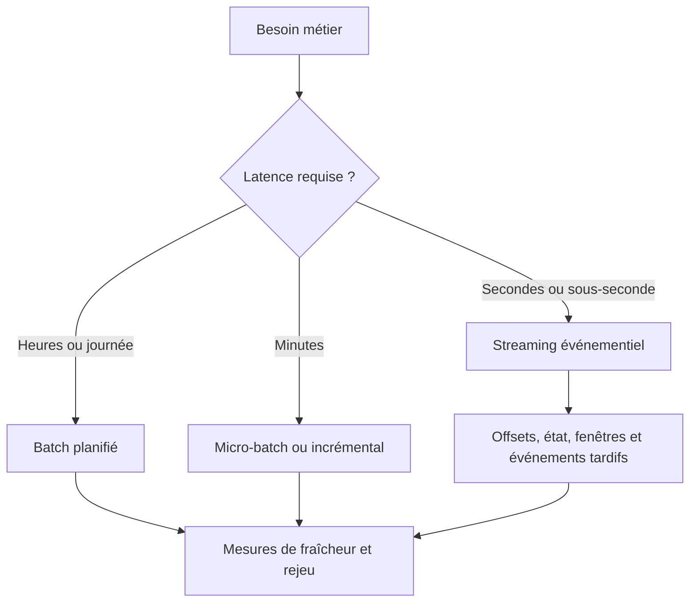
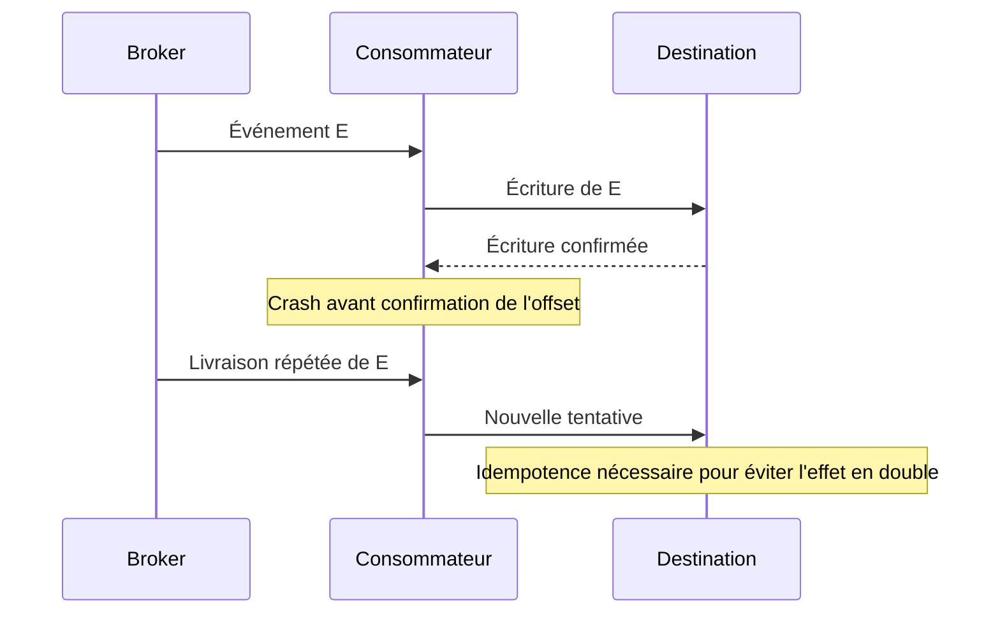
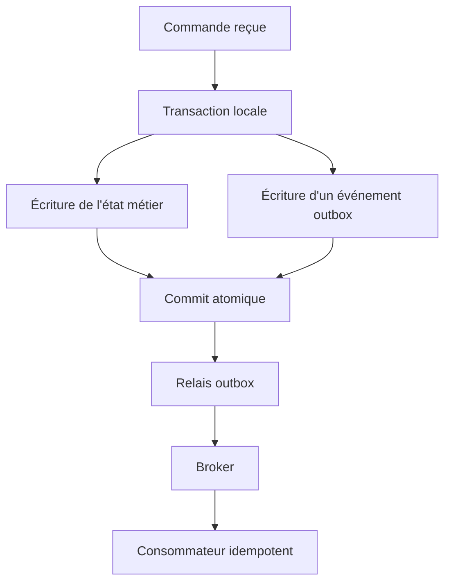
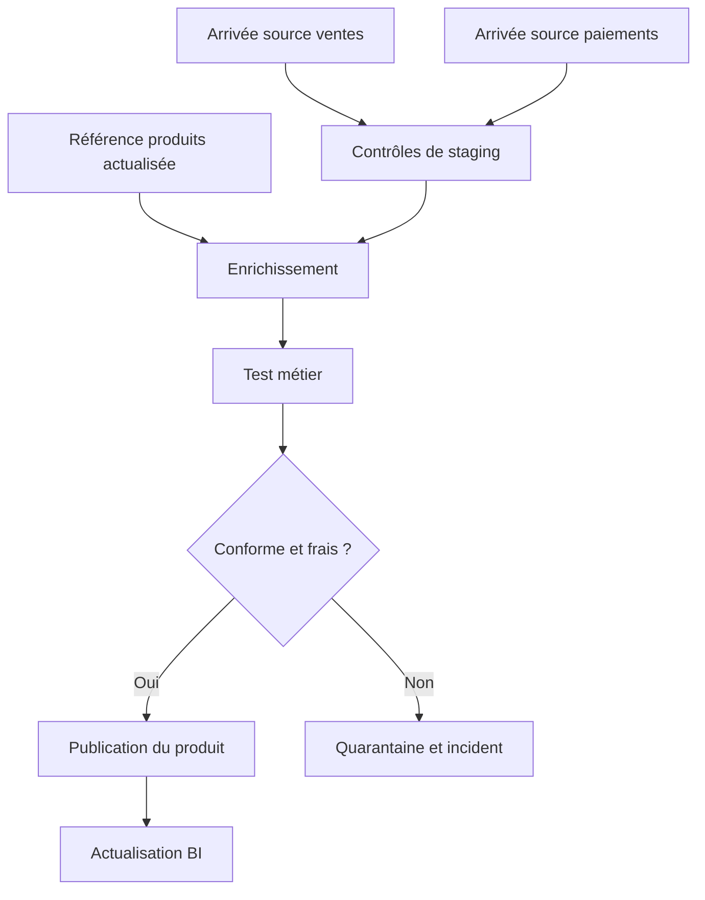

# Pipelines de données complexes — Expert

> **Mise en contexte.** Un pipeline de données fiable ne se résume pas à déplacer des lignes d’une base vers un entrepôt. Il doit préserver le sens des événements, résister aux interruptions, éviter les effets en double, absorber les retards, isoler les messages impossibles à traiter, permettre des reprises contrôlées et prouver ce qui a été ingéré, transformé et publié. Dans une architecture distribuée, les pannes partielles sont normales : un service peut valider une écriture alors que son client perd la réponse, un consommateur peut redémarrer avant de confirmer un offset, et un événement ancien peut arriver après une mise à jour plus récente.

Cette leçon s’adresse aux personnes qui conçoivent des flux d’ingestion avancés : chargements par lots, extraction incrémentale, Change Data Capture (CDC), événements, files de messages, traitement en streaming, orchestration et publication de données analytiques. Elle relie la fiabilité distribuée à la qualité, aux contrats, au lignage, à l’observabilité et à la gouvernance. Les exemples sont pédagogiques et doivent être adaptés au moteur, au broker, à l’orchestrateur et aux exigences de production.

L’objectif n’est pas de promettre un système qui ne tombe jamais. L’objectif est de spécifier ce qui se passe lorsqu’un composant tombe, lorsqu’un message est livré plusieurs fois, lorsque l’ordre est différent, lorsque le schéma change ou lorsque la destination refuse une écriture. Un système sérieux définit ses garanties, teste ses frontières et rend les situations ambiguës visibles.

## Objectifs pédagogiques

À la fin de cette leçon, vous serez capable de choisir entre batch, micro-batch et streaming selon la latence métier, de concevoir une ingestion incrémentale qui évite les trous de données, de définir des clés d’idempotence et des stratégies de déduplication, de gérer les offsets et checkpoints, de choisir des politiques de reprise avec backoff, d’utiliser une dead-letter queue, de traiter les événements tardifs, de gérer l’évolution des schémas, de protéger les écritures et effets secondaires, de définir un rejeu contrôlé, d’orchestrer les dépendances, de mesurer la qualité et la fraîcheur et de préparer un plan de reprise après incident.

Vous saurez différencier les garanties « au plus une fois », « au moins une fois » et « exactement une fois », expliquer pourquoi une livraison exactement une fois ne garantit pas automatiquement un effet métier exactement une fois, et concevoir des tests qui valident le comportement sous panne. La compétence avancée repose sur des frontières de cohérence clairement définies, des identifiants stables et des preuves vérifiables.

## 1. Concevoir une ingestion à partir du besoin

Avant de choisir un outil, définissez l’usage du produit de données. Un flux utilisé pour déclencher une décision antifraude en quelques secondes n’a pas les mêmes exigences qu’un rapport comptable recalculé chaque nuit. Une ingestion continue peut réduire la latence mais ajouter de la complexité d’exploitation, de la surveillance et des contraintes de rejeu. Un traitement par lot peut être plus simple, économique et reproductible si la fraîcheur demandée le permet.

Pour chaque flux, documentez la source, le volume moyen et maximal, la taille des messages, la fréquence, le débit de pointe, la latence cible, le retard accepté, les besoins d’ordre, les exigences de conservation, les consommateurs, la criticité, les données sensibles et le comportement attendu en cas d’échec. Définissez également les responsabilités du producteur, du broker, du consommateur et du propriétaire métier.

Il faut distinguer le débit moyen du pic. Un système peut absorber mille événements par seconde en moyenne mais recevoir cinquante mille événements par seconde lors d’une reprise. Il faut aussi distinguer l’heure de l’événement métier, l’heure de publication et l’heure d’ingestion. Les confondre rend les mesures de fraîcheur trompeuses.

### 1.1 Batch, micro-batch et streaming

Le batch rassemble des données sur une période et les traite en une exécution. Il convient aux clôtures périodiques, à l’historisation et aux grands recalculs. Le micro-batch traite de petits lots fréquents. Le streaming traite les événements au fil de leur arrivée et gère un état et une progression continue.



Aucune architecture n’est automatiquement meilleure. Le streaming implique la gestion des offsets, du débit, de la pression en amont, de l’ordre, des événements tardifs et des mises à jour d’état. Le batch requiert lui aussi des mécanismes de reprise, de déduplication et de validation. Le choix doit être justifié par une exigence mesurable, pas par l’effet de mode.

### 1.2 SLO de fraîcheur et disponibilité

Une cible de latence doit définir son point de départ et son point d’arrivée. « Temps réel » ne signifie rien sans mesure. Un objectif peut préciser que 99 % des événements doivent être visibles dans la table publiée en moins de deux minutes après l’événement source, ou que le lot quotidien doit être prêt avant 07 h dans le fuseau métier. Définissez le percentile, la période de mesure, les exclusions et le traitement des périodes sans activité.

L’objectif doit prendre en compte l’ensemble de la chaîne : source, transport, ingestion, transformation, stockage et consommation. Si la source est déjà en retard, une ingestion très rapide ne rend pas le produit frais. Mesurer plusieurs temps intermédiaires aide à localiser le retard. Le contrat doit définir les comportements en cas de dépassement : alerte, publication dégradée, blocage ou notification du consommateur.

## 2. Modéliser l’événement et son identité

Un événement robuste possède une sémantique claire. Il décrit quelque chose qui s’est produit, avec un identifiant stable, une version de schéma, un temps métier, une provenance et les attributs nécessaires au traitement. Une ligne d’état courant et un événement ne sont pas interchangeables : l’un décrit un état, l’autre un changement ou une occurrence.

### 2.1 Identifiant d’événement

L’identifiant doit rester stable lorsqu’un message est retransmis. Un nouvel identifiant généré à chaque tentative empêche la déduplication. Un identifiant peut provenir de la source, être déterminé par une clé métier ou être produit par le service qui enregistre l’événement. Une clé calculée à partir de plusieurs champs demande une réflexion sur l’unicité, les normalisations et les valeurs manquantes.

Un timestamp ne doit pas être utilisé seul comme identifiant unique sauf si le contrat garantit réellement cette propriété. Plusieurs événements légitimes peuvent se produire au même instant, l’horloge peut reculer et des producteurs différents peuvent avoir des précisions d’horodatage distinctes.

### 2.2 Enveloppe d’événement

Un format d’événement peut distinguer les métadonnées de transport des données métier. Exemple illustratif :

```json
{
  "event_id": "evt-demo-001",
  "event_type": "commande.confirmee",
  "schema_version": 2,
  "occurred_at": "2026-10-28T06:10:00Z",
  "produced_at": "2026-10-28T06:10:01Z",
  "producer": "service-commandes",
  "correlation_id": "workflow-demo-42",
  "payload": {
    "commande_id": "cmd-demo-009",
    "statut": "CONFIRMEE",
    "montant_net": 12500
  }
}
```

Ces valeurs sont fictives. L’horodatage de l’événement décrit l’action métier, celui de publication situe l’envoi, et l’heure d’ingestion est généralement attribuée par la plateforme. L’identifiant de corrélation relie des étapes d’un processus sans devenir nécessairement une clé de déduplication. La signification de chaque champ doit être stable et documentée.

### 2.3 Événements immuables et corrections

Dans un journal événementiel, on évite généralement de modifier silencieusement le message déjà publié. Une correction peut être représentée par un événement compensatoire ou une nouvelle version, selon le contrat métier. Les consommateurs peuvent ainsi expliquer pourquoi un solde ou un indicateur a changé après la publication initiale.

L’immutabilité ne veut pas dire conserver chaque donnée indéfiniment. Les politiques de rétention, confidentialité, suppression et archivage continuent de s’appliquer. Une conception événementielle doit prévoir comment traiter les données personnelles et les demandes d’effacement, y compris les copies dérivées et les historiques.

## 3. Sémantique de livraison

Les systèmes distribués ne peuvent pas se contenter d’un mot vague comme fiable. Il faut préciser les garanties réellement fournies par le broker, le consommateur, l’état local et la destination.

### 3.1 Au plus une fois

La livraison au plus une fois évite les duplications liées aux reprises en ne retentant pas certaines opérations. Mais un message peut être perdu lorsqu’une panne survient au mauvais moment. Cette stratégie peut convenir à une métrique non critique où une perte ponctuelle est acceptable et documentée. Elle convient mal à des écritures financières ou des actions qui ne peuvent être perdues.

### 3.2 Au moins une fois

La livraison au moins une fois retente l’opération jusqu’à obtenir une confirmation ou atteindre une condition d’échec contrôlée. Elle réduit le risque de perte mais autorise les doublons. Elle doit donc être associée à un identifiant d’événement stable et à un consommateur idempotent, ou à une stratégie de déduplication durable.

### 3.3 Exactement une fois : frontière et pièges

Le terme exactement une fois peut s’appliquer à un périmètre précis d’un moteur : par exemple, un message est traité une fois dans un état transactionnel et un offset associé est commité de manière cohérente. Il ne garantit pas que tous les effets externes sont uniques. Si le consommateur envoie un email ou appelle une API après avoir écrit l’état mais avant d’enregistrer sa progression, la reprise peut provoquer un nouvel appel.



Le bon raisonnement consiste à identifier les opérations atomiques et les frontières qui ne le sont pas. Là où une transaction distribuée complète n’est pas réaliste, l’idempotence, l’outbox transactionnelle, les clés d’opération, la déduplication et la réconciliation rendent le processus fiable.

## 4. Idempotence et déduplication

Une opération est idempotente si la répéter avec la même entrée conduit au même état final que l’exécuter une fois. C’est une propriété centrale des API de paiement, des ingestions, des migrations et des tâches de reprise.

La clé d’idempotence identifie l’opération logique, et non chacune de ses tentatives. Elle peut être l’identifiant d’événement, une clé de commande ou un identifiant stable produit par le système source. Il faut définir sa portée : destination, type d’opération, tenant, période ou clé métier globale. Une clé trop large peut faire disparaître des opérations légitimes ; une clé trop étroite laisse passer les doublons.

Une table d’idempotence peut conserver l’identifiant, une empreinte du contenu, la première réception et l’état du traitement. L’enregistrement de l’identifiant et la mutation métier doivent être atomiques lorsqu’ils partagent la même base. Si le système marque un message traité avant l’écriture métier, une panne peut conduire à une perte. S’il écrit d’abord puis tombe avant de marquer le message, il peut le traiter de nouveau.

Un même identifiant associé à un contenu différent n’est pas un doublon ordinaire. Il faut détecter le conflit, le conserver dans une trace et appliquer une politique explicite : rejet, quarantaine, correction de la source ou arbitrage métier. La durée de vie de la déduplication doit couvrir la fenêtre maximale de retard et de replay, sans croître indéfiniment sans politique de rétention.

### 4.1 Exemple conceptuel de table de contrôle

```sql
CREATE TABLE ingestion_events (
    event_id VARCHAR(200) PRIMARY KEY,
    payload_hash VARCHAR(128) NOT NULL,
    first_seen_at TIMESTAMP NOT NULL,
    status VARCHAR(30) NOT NULL
);
```

Cette table seule ne crée pas une garantie d’idempotence. Le code de traitement doit gérer les conflits, exécuter la mutation métier dans la même transaction si possible et définir comment l’offset ou l’acquittement suit la validation durable.

## 5. Outbox transactionnelle et effets externes

Un problème fréquent apparaît lorsqu’une application écrit dans sa base puis publie un événement. Si l’écriture en base réussit mais que la publication échoue, le flux aval ne connaît pas le changement. À l’inverse, si le message part puis que la transaction métier échoue, l’événement décrit une opération qui n’a jamais été validée.

Avec une outbox transactionnelle, l’application écrit la mutation métier et un enregistrement d’outbox dans une même transaction locale. Un relais publie ensuite l’événement vers le broker. Il peut publier un événement plus d’une fois, donc les consommateurs doivent rester idempotents.



L’outbox rend atomiques la mutation métier et l’intention de publier, pas la livraison unique à toutes les destinations. Le relais doit gérer les reprises, l’ordre si nécessaire, les erreurs permanentes, la purge des lignes publiées et la surveillance du backlog.

Pour une API externe, utilisez une clé d’idempotence si le fournisseur le permet. Conservez le résultat et l’identité de l’opération pour éviter de créer un nouveau paiement, une nouvelle facture ou un nouvel ordre lors d’une reprise. Si le fournisseur ne propose pas de garantie d’idempotence, concevez une réconciliation et une recherche d’état avant de retenter une opération ambiguë. Un timeout peut signifier que le client ignore si le serveur a déjà effectué l’action.

## 6. Chargement incrémental et CDC

Un chargement incrémental lit uniquement les données nouvelles ou modifiées depuis une position de progression. Il peut réduire les coûts et la latence par rapport à une extraction complète. La difficulté est de définir précisément ce que signifie nouveau et comment la progression se comporte face aux retards, modifications rétroactives et suppressions.

Le curseur peut être une clé croissante, un horodatage de modification, un offset, un token de page ou une position de journal transactionnel. Un timestamp seul peut poser des problèmes : plusieurs lignes ont la même valeur, les horloges peuvent différer, une modification peut être antérieure au watermark et certaines sources réécrivent des dates. Une fenêtre de recouvrement relit une période passée puis déduplique les événements par clé ; elle augmente les lectures mais peut rattraper des écritures tardives.

Le Change Data Capture capte les insertions, mises à jour et suppressions à partir d’un journal ou d’un mécanisme de changement. Il réduit les scans répétés mais exige une gestion des offsets, des snapshots initiaux, des schémas, des permissions de lecture du journal et des retards du consommateur. L’initialisation doit décrire la frontière de cohérence entre le snapshot et le journal. Sans point de cohérence, des modifications peuvent être manquées ou appliquées deux fois.

Les suppressions sont souvent invisibles dans une extraction qui ne lit que les lignes actuelles. Le CDC peut les représenter par un événement de suppression ; une ingestion par extraction doit disposer d’une autre stratégie, comme un journal de suppressions, un statut ou un rapprochement. Un tombstone doit porter un identifiant fiable et être appliqué par les consommateurs. Les événements anciens ne doivent pas ressusciter un état supprimé plus récemment sans règle explicite.

Le checkpoint enregistre jusqu’où le consommateur considère les événements traités. Un commit anticipé peut perdre une sortie après crash ; un commit tardif peut provoquer un replay. La destination doit donc être idempotente ou participer à une transaction compatible avec la source. Une procédure de reprise doit indiquer comment vérifier la progression, choisir un offset sûr et évaluer l’impact d’un rejeu.

## 7. Orchestration et dépendances

L’orchestration coordonne les tâches, dépendances, calendriers, tentatives, ressources et états d’exécution. Un rapport ne devrait pas démarrer uniquement parce qu’une heure est passée si sa table source n’est pas prête. Les tâches indépendantes peuvent être parallélisées, mais la concurrence doit respecter la capacité des sources et les contraintes de cohérence.



Le pipeline doit préciser ce qui arrive lorsqu’une branche échoue. Il peut attendre, publier un produit partiel avec statut dégradé ou bloquer la publication. Les comportements doivent être décidés avec les consommateurs. Les dépendances optionnelles ne doivent pas être implicitement traitées comme obligatoires.

Un retry aide face aux erreurs transitoires : timeout réseau, limitation de débit temporaire ou service momentanément indisponible. Il ne corrige pas une donnée invalide, une authentification rejetée ou un schéma incompatible. Les tentatives doivent être limitées, espacées avec un backoff exponentiel et éventuellement un jitter. Des retries illimités peuvent créer une tempête, épuiser les ressources et prolonger une panne.

Définissez des timeouts sur les appels externes et opérations longues. La concurrence maximale doit tenir compte des quotas de la source, de la capacité de destination et de la nature du traitement. Lors d’un rattrapage après panne, le volume en attente peut dépasser la capacité nominale. Il faut limiter les tâches simultanées, prioriser les flux critiques et mesurer le temps de backlog.

Un backfill recharge une période passée. Il doit avoir un périmètre, une estimation de volume, un plan de validation et une stratégie de reprise. Décidez si l’histoire est reconstruite avec les règles d’aujourd’hui ou celles qui étaient en vigueur. Le backfill doit être idempotent, isoler les partitions concernées et ne pas écraser silencieusement des données plus récentes.

## 8. Retry, dead-letter queue et relecture contrôlée

Un message qui échoue temporairement peut être réessayé. Un message qui échoue durablement — schéma invalide, champ obligatoire manquant, conflit d’identifiant ou donnée incohérente — doit être isolé sans bloquer éternellement le flux.

Classez les erreurs en catégories : transitoires, permanentes, de contrat, métier, de dépendance et inconnues. Chaque catégorie doit avoir une politique. Un timeout peut être réessayé. Un identifiant manquant peut exiger une correction de la source. Un échec d’autorisation peut signaler une configuration ou une compromission et ne doit pas être caché derrière des tentatives sans fin.

Une dead-letter queue (DLQ) permet d’isoler les messages impossibles à traiter après la politique de reprise. Elle protège le flux normal et fournit un espace de diagnostic. Elle ne doit pas devenir un stockage indéfini d’erreurs sans responsable. Un tableau de bord doit indiquer le volume, l’âge, la classe d’erreur et le propriétaire des messages en attente.

Le replay doit conserver l’identité originale de l’événement, ajouter un identifiant de tentative et enregistrer son résultat. Avant de rejouer un message, corrigez la cause ou choisissez une procédure qui peut traiter l’erreur. Les payloads sensibles doivent être minimisés et protégés. La personne qui inspecte la DLQ n’a pas nécessairement besoin de pouvoir rejouer les messages en production.

Le rejet peut convenir à un message mal formé qui ne peut pas être conservé en sécurité. La quarantaine est utile lorsqu’une correction ou un examen est possible. Les politiques doivent définir la différence, la durée de conservation et le comportement de la source. Pour un événement financier, abandonner un message sans trace est inacceptable. Pour une donnée sensible, conserver le payload complet dans une DLQ largement accessible peut être encore plus dangereux.

## 9. Évolution de schéma et contrats

Les systèmes distribués se déploient rarement tous au même instant. Un producteur peut commencer à publier un champ pendant qu’un ancien consommateur s’attend à un schéma strict. Le contrat doit définir la compatibilité, les versions supportées, les règles de dépréciation, le délai de migration et les tests obligatoires.

Ajouter un champ facultatif peut être compatible si les consommateurs tolèrent les champs inconnus. Ajouter un champ obligatoire peut nécessiter une migration coordonnée. Supprimer ou renommer un champ casse souvent les consommateurs. Changer le sens d’un champ sans modifier son type est une rupture sémantique. Testez les combinaisons réelles de versions et pas seulement le changement isolé.

Validez le message à l’ingestion, contrôlez les règles métier avant publication et vérifiez les contrats au déploiement. Un schéma valide n’est pas forcément un événement correct : les valeurs peuvent respecter les types mais enfreindre le domaine métier. Les tests doivent couvrir l’interface technique et la sémantique.

Pour un changement incompatible, publiez éventuellement une nouvelle version en maintenant temporairement l’ancienne, ou déployez d’abord des consommateurs capables de lire les deux formats. La migration se termine par une preuve : les consommateurs nécessaires ont basculé, les erreurs ne révèlent plus d’anciens usages, le format retiré n’est plus nécessaire et la documentation est à jour.

## 10. Temps d’événement, fenêtres et événements tardifs

En streaming, le temps d’événement et le temps de traitement peuvent diverger. Un message peut arriver tard à cause d’une interruption réseau, d’un appareil hors ligne ou d’un rattrapage. Une agrégation basée uniquement sur l’heure d’arrivée risque de classer une action dans la mauvaise période.

L’event time représente le moment métier où l’action a eu lieu. Le processing time représente le moment où le moteur traite l’événement. Le temps d’ingestion peut être distinct des deux. Les analyses temporelles doivent préciser quelle horloge guide les fenêtres et les décisions.

Les fenêtres regroupent les événements en intervalles fixes, glissants ou par session. Un watermark représente généralement une estimation de la progression du temps d’événement au-delà de laquelle la majorité des données attendues est considérée comme arrivée. Il ne garantit pas qu’aucun événement tardif ne surviendra.

Le moteur doit définir ce qu’il fait après la fermeture d’une fenêtre : ignorer les événements tardifs, les envoyer vers un flux de correction, réviser l’agrégat ou conserver un état qui permet une mise à jour. Une métrique temps réel peut privilégier la faible latence, tandis qu’un rapport financier peut nécessiter des rapprochements plus complets.

```mermaid
timeline
    title Exemple conceptuel de gestion du temps
    09:00 : Événement A se produit
    09:01 : Événement B se produit
    09:04 : A et B sont traités
    09:06 : Watermark avance
    09:08 : Événement C arrive en retard
    09:09 : Correction ou quarantaine selon le contrat
```

Utilisez un horodatage sans ambiguïté, généralement stocké en UTC avec un fuseau indiqué lors de la présentation métier. Gardez l’heure source et l’heure d’ingestion lorsqu’elles servent au diagnostic. Les fenêtres de fermeture, changements d’heure et jours fériés doivent être traités explicitement, car une journée métier n’est pas toujours une journée UTC.

## 11. Backpressure, capacité et stabilité

La backpressure apparaît quand le rythme d’arrivée dépasse la capacité de traitement ou quand la destination devient plus lente que la source. Le flux accumule un backlog, la latence augmente et la rétention du broker peut finir par être dépassée.

Surveillez le nombre de messages en attente, l’âge du plus ancien message, le débit entrant et sortant, les erreurs, le temps de traitement et la capacité de destination. Un backlog de dix mille événements peut être insignifiant si le débit sortant est élevé mais critique si les événements ont dépassé leur délai contractuel.

Le partitionnement distribue les données et parallélise les consommateurs. Une clé stable peut préserver l’ordre relatif d’une entité, mais une mauvaise clé crée une partition chaude. Augmenter le nombre de partitions peut modifier l’ordre et l’affectation des consommateurs ; analysez la distribution des clés, le volume par clé et les invariants métier.

Après une panne prolongée, le système doit traiter la production normale et le backlog. Si sa capacité disponible est égale au débit entrant, le backlog ne diminue pas. Le temps de rattrapage peut être estimé par le volume en attente divisé par la différence entre débit de traitement disponible et débit entrant, à condition que cette différence soit positive. Cette estimation simplifiée doit être vérifiée par des tests de charge et des mesures réelles.

## 12. Sécurité, confidentialité et gouvernance d’un pipeline

L’ingestion peut transporter des données personnelles, financières, d’accès ou d’exploitation. Les transports, files d’erreurs, logs et fichiers temporaires peuvent multiplier les copies. Chaque étape doit avoir une identité, une finalité, des permissions et une durée de conservation. Les connexions doivent être chiffrées et authentifiées selon le risque. Les secrets doivent être gérés hors du code, limités et rotatables.

Les métadonnées de classification doivent suivre le flux. Si un champ contient une donnée personnelle, une transformation ou une table dérivée ne doit pas perdre silencieusement l’information de sensibilité. Une donnée agrégée n’est pas automatiquement anonyme si de petits groupes ou des recoupements permettent une réidentification.

### 12.1 Accès à la DLQ

Une DLQ peut contenir des données plus sensibles que la sortie normale, car elle retient des payloads bruts, champs inattendus ou messages invalides. Limitez les lecteurs, masquez les secrets, définissez une durée maximale, journalisez les consultations et contrôlez le replay. La personne qui inspecte une erreur n’a pas nécessairement besoin de pouvoir relancer l’événement en production.

Le rejeu doit être une opération contrôlée et traçable. Définissez qui peut l’approuver, quelles clés ou périodes peuvent être rejouées, comment l’idempotence est vérifiée, et quelle preuve est conservée. Les messages devenus inutiles doivent être supprimés selon la politique de conservation, sans conserver le contenu complet au-delà du besoin de diagnostic.

### 12.2 Effacement dans les flux

Une suppression doit suivre les systèmes dérivés, caches, tables, index, exports et snapshots concernés. Un événement de suppression doit être idempotent et empêcher qu’un ancien événement recrée la donnée supprimée. Les consommateurs en retard et les redémarrages doivent être pris en compte.

Le processus doit enregistrer le périmètre traité et les exceptions. Les sauvegardes et archives nécessitent des règles explicites pour éviter la réapparition après restauration. Le lignage aide à identifier les dérivés, mais il ne découvre pas nécessairement les copies manuelles ; des règles d’export et de gestion des fichiers sont aussi nécessaires.

## 13. Observabilité et SLO d’ingestion

Un pipeline avancé requiert des métriques qui décrivent la progression et la valeur produite, pas uniquement le statut d’un processus. Surveillez le débit entrant et sortant, l’âge du backlog, les erreurs par catégorie, les retries, le nombre de messages en quarantaine, les conflits d’idempotence, le retard événementiel, le taux de succès des contrôles et la fraîcheur du produit publié.

### 13.1 Mesures minimales

Définissez chaque métrique avec une unité, un périmètre, une période et un propriétaire. Une mesure du retard doit préciser s’il s’agit de l’âge du message le plus ancien ou d’un percentile de bout en bout. Le taux de succès doit se rapporter à une population et une règle définies. Les changements de définition doivent être documentés.

Il est utile de distinguer la santé du service, la progression du flux, la qualité des données, le résultat métier et la gouvernance. La santé du service comprend disponibilité, erreurs et temps de réponse. La progression comprend offsets, checkpoints, lag et backlog. La qualité comprend schéma, validité, doublons et cohérence. Le résultat métier couvre données prêtes et périodes complètes. La gouvernance suit versions de contrat, classification, propriétaires, incidents et preuves.

### 13.2 Seuils, alertes et runbooks

Les seuils doivent être basés sur le contrat et l’usage. Une alerte utile indique le flux, l’ampleur de l’écart, le début du problème, la gravité, les consommateurs affectés, le propriétaire et le lien vers un runbook. Le runbook décrit les vérifications sûres, les décisions de confinement, les conditions de reprise et les points de contact.

Une alerte de backlog doit montrer si le retard augmente ou diminue. Une alerte de DLQ doit montrer l’âge et la catégorie des erreurs, sans exposer les données sensibles. Un échec de validation critique doit déclencher la politique de publication prévue, pas seulement envoyer un message qui sera ignoré.

### 13.3 Réconciliation

Une réconciliation compare source et destination pour détecter omissions, doublons ou divergences. Elle peut comparer les comptes par fenêtre, des sommes de contrôle, des clés ou des montants agrégés. Les contrôles doivent tenir compte des événements tardifs, des suppressions et des transformations intentionnelles.

Une différence de comptage n’est pas automatiquement une erreur. Un système peut filtrer des événements invalides ou exclure des transactions annulées par contrat. La réconciliation doit comparer des populations équivalentes et expliquer les écarts attendus. Les écarts inexpliqués font l’objet d’un incident et d’une recherche de cause racine.

## 14. Atelier pratique : pipeline incrémental idempotent

Nous allons imaginer un pipeline qui reçoit des événements de commande et les écrit dans une table analytique. Il doit tolérer une livraison répétée, préserver un checkpoint, placer en quarantaine les messages invalides et mesurer sa fraîcheur. Les exemples sont conceptuels et doivent être adaptés à la base et au broker choisis.

### Étape A — Définir le contrat

Le message comprend un identifiant, un type d’événement, une version de schéma, un temps métier, un producteur et un payload. Le contrat déclare les types et les champs obligatoires. L’identifiant reste stable en cas de retry. Les statuts admis sont versionnés. La date métier est distincte de l’heure d’ingestion.

Définissez les erreurs : schéma inconnu, identifiant absent, doublon identique, conflit avec contenu différent, valeur métier invalide, dépendance temporairement indisponible et violation de permission. Chaque catégorie reçoit une action et une gravité.

### Étape B — Préparer la destination

Créez une table d’événements traités avec une contrainte unique sur l’identifiant, une table de sortie et une table ou file de quarantaine. En production, la transaction doit garantir que l’identifiant et la mutation métier sont enregistrés de façon cohérente. Une contrainte unique protège contre certains doublons, mais ne définit pas à elle seule comment résoudre les payloads différents partageant la même clé.

### Étape C — Traiter un message

Pseudo-algorithme :

```text
pour chaque message reçu :
    valider l'enveloppe et la version de schéma
    si le message est invalide :
        enregistrer la cause en quarantaine
        acquitter uniquement lorsque cette mise en quarantaine est durable
        continuer

    ouvrir une transaction de destination
    rechercher ou réserver l'identifiant de l'événement
    si l'identifiant a déjà été traité :
        comparer le contenu et enregistrer le rejeu
        ne pas réappliquer l'effet métier
    sinon :
        appliquer la transformation et la mutation métier
        enregistrer l'identifiant et l'état de traitement
    valider la transaction
    confirmer l'offset selon la stratégie de cohérence
```

Le pseudo-algorithme doit être complété selon le modèle transactionnel. N’acquittez pas avant que le message soit durablement traité ou placé dans une quarantaine fiable. Si l’écriture de sortie et la confirmation de l’offset ne sont pas atomiques, il faut accepter et gérer le replay par idempotence.

### Étape D — Tester les pannes

Injectez des scénarios contrôlés : crash avant la transaction, crash après l’écriture mais avant la confirmation, message reçu en double, destination indisponible, payload invalide, checkpoint inaccessible et événement tardif. Pour chaque scénario, définissez l’état attendu, la preuve à examiner, le signal d’alerte et le processus de récupération.

Le but n’est pas simplement de vérifier que le service redémarre. Il faut vérifier qu’aucun événement n’est silencieusement perdu, qu’aucun effet métier n’est appliqué en double et que les messages impossibles à traiter restent retrouvables. La sortie doit être réconciliée après les tests.

### Étape E — Tester la DLQ et le rejeu

Injectez un événement avec une version de schéma inconnue. Vérifiez la mise en quarantaine, le compteur, l’alerte et la présence d’un identifiant de corrélation. Corrigez le contrat ou le message de test, puis rejouez l’événement via une procédure contrôlée. Vérifiez qu’il conserve son identité d’origine et que le rejeu ne crée pas de doublon.

### Étape F — Mesurer le SLO

Mesurez le temps depuis l’horodatage métier jusqu’à la disponibilité du produit, le lag du consommateur, le taux de messages en erreur et le volume en quarantaine. Pour simuler une panne, augmentez artificiellement la latence de destination dans un environnement isolé et vérifiez que les alertes se déclenchent avant le dépassement du délai contractuel.

## 15. Tests d’intégration et de non-régression

Les tests d’ingestion couvrent le contenu, la progression et les effets secondaires. Les tests unitaires valident la transformation d’un message isolé. Les tests de contrat valident le schéma et sa compatibilité. Les tests d’intégration incluent broker et destination. Les tests de résilience reproduisent des pannes et reprises. Les tests de charge vérifient le débit, le backlog et le comportement lors d’un rattrapage.

| Scénario | Comportement attendu | Preuve attendue |
|---|---|---|
| Message valide | Une sortie cohérente est publiée | Identifiant et résultat présents |
| Même message livré deux fois | Aucun effet métier supplémentaire | Une seule mutation, replay tracé |
| Même identifiant, contenu différent | Conflit détecté et isolé | Alerte et trace de conflit |
| Destination temporairement indisponible | Retry contrôlé puis reprise | Compteur de retries et absence de perte |
| Schéma invalide | Quarantaine ou rejet prévu | Cause, version et identifiant corrélés |
| Événement tardif | Application selon la politique de fenêtre | Résultat corrigé ou retard déclaré |
| Checkpoint indisponible | Pas de progression silencieuse | État d’erreur explicite et reprise sûre |
| Message en DLQ rejoué | Traitement contrôlé et idempotent | Historique de replay et résultat |
| Pic de volume | Backlog mesuré, ressources bornées | Lag, débit, durée de rattrapage |
| Suppression | Dérivés traités selon le contrat | Vérification des destinations concernées |

Au-delà d’exemples individuels, les tests de propriété peuvent générer différents ordres de livraison, doublons et séquences de reprise pour vérifier des invariants : une même clé ne produit pas deux effets métier, un événement plus ancien ne remplace pas une version plus récente sans règle explicite, et un événement invalide ne devient pas publiable à la suite d’une erreur de conversion silencieuse.

## 16. Reprise après incident et opérations de production

Une procédure de reprise décrit comment diagnostiquer, contenir, restaurer et vérifier un pipeline après incident. Elle doit distinguer l’indisponibilité de la source, la destination saturée, un schéma invalide, un checkpoint perdu, une clé expirée, un dépassement de quota et une erreur métier. Un redémarrage générique ne traite pas ces causes de la même manière.

### 16.1 Diagnostic initial

Commencez par vérifier la portée : quels flux sont touchés, depuis quand, quels consommateurs sont affectés, quel est l’âge du message le plus ancien et si les données de sortie sont complètes. Comparez les débits entrants et sortants. Examinez les changements récents de configuration, de schéma, de code ou de permission. Préservez les journaux et états nécessaires à l’analyse.

Ne relancez pas un backfill massif avant d’avoir vérifié la capacité de destination, la stratégie de déduplication et la disponibilité du checkpoint. Un replay mal préparé peut empirer l’incident, écraser des données corrigées ou saturer une dépendance.

### 16.2 Reprise d’un checkpoint

Si un checkpoint est perdu ou suspect, déterminez la dernière position durable confirmée et comparez-la à l’état de destination. Selon le système, la stratégie la plus sûre peut être de revenir à une position antérieure et de rejouer avec idempotence, ou de reconstruire un état depuis une source de vérité. Ne choisissez pas un offset arbitraire sur la seule base de la date du fichier le plus récent.

La récupération doit consigner la position avant incident, la position retenue, la raison, l’opérateur, les vérifications effectuées et les résultats de réconciliation. Une modification manuelle de checkpoint sans trace met en danger la capacité future à expliquer les pertes ou doublons.

### 16.3 Rattrapage de backlog

Estimez le volume à traiter, le débit disponible, l’arrivée de nouveaux messages et la limite de rétention de la source. Ajustez la concurrence de façon contrôlée et surveillez la destination. Il peut être nécessaire de prioriser les flux critiques ou de suspendre temporairement des traitements non essentiels.

La fin du rattrapage ne se détermine pas uniquement lorsque la file semble vide. Vérifiez que les consommateurs ont dépassé le point attendu, que les données publiées couvrent la période et que les contrôles de qualité et de réconciliation sont satisfaits. Informez les consommateurs lorsque le SLO est rétabli et lorsqu’une correction historique a modifié des valeurs déjà publiées.

### 16.4 Revue après incident

La revue après incident doit identifier la cause, l’impact, les moyens de détection qui ont fonctionné ou manqué, la qualité du runbook et les actions de prévention. Attribuez chaque action à une équipe, avec un critère de clôture testable. Un objectif vague tel que « surveiller davantage » ne doit pas être considéré comme une mesure corrective suffisante.

Les incidents répétitifs peuvent signaler une conception inadéquate : mauvais partitionnement, contrat incomplet, absence d’idempotence, dépendance à des secrets durables, rétention de broker trop courte ou charge de reprise non dimensionnée. Corriger la configuration seule sans revoir le mécanisme laisse le même risque dans le système.

## 17. Exercices corrigés

### Exercice 1 — Une exécution réussie suffit-elle ?

Un job se termine en succès mais ne reçoit aucune donnée depuis trois heures, alors qu’un flux est normalement continu. Quelle mesure manque ?

**Correction.** Il manque une mesure de fraîcheur ou de progression, fondée sur la dernière donnée métier, l’offset et le retard du consommateur. La réussite du processus ne garantit pas que la sortie réponde au besoin. Il faut une cible de fraîcheur, une alerte et un propriétaire capables d’investiguer la source et le transport.

### Exercice 2 — Retry après un timeout de paiement

Une API de paiement retourne un timeout juste après l’envoi d’une demande. Peut-on répéter immédiatement l’appel sans précaution ?

**Correction.** Non. Le client peut ignorer si le serveur a réalisé l’opération. Il faut utiliser une clé d’idempotence si elle est supportée, interroger l’état réel ou procéder à une réconciliation avant la répétition. Les erreurs doivent être classées selon que l’échec est confirmé ou que le résultat reste inconnu.

### Exercice 3 — Traitement exactement une fois

Un moteur promet un traitement exactement une fois, mais le consommateur envoie un email et tombe avant de sauvegarder son offset. L’email peut-il partir deux fois ?

**Correction.** Oui, selon la frontière de garantie du moteur et la façon dont l’effet externe est orchestré. La garantie exactement une fois dans un périmètre transactionnel ne couvre pas automatiquement une API externe. Il faut une clé d’idempotence côté service, une outbox ou un état transactionnel permettant de contrôler l’effet.

### Exercice 4 — Même identifiant, contenu différent

Deux messages présentent le même identifiant d’événement et des montants différents. Le consommateur ignore toujours le second comme doublon. Qu’est-ce qui manque ?

**Correction.** La déduplication doit distinguer un replay identique d’un conflit. Il faut comparer le contenu ou une empreinte stable, enregistrer le conflit, le mettre en quarantaine et définir une procédure d’arbitrage. Ignorer silencieusement le second peut masquer une réutilisation d’identifiant ou une corruption chez le producteur.

### Exercice 5 — CDC avec checkpoint perdu

Après une panne, l’équipe ne sait plus quel offset avait été traité. Peut-elle reprendre au dernier horodatage connu ?

**Correction.** Seulement si le contrat et le mécanisme source permettent de démontrer que ce point couvre toutes les modifications. Un timestamp peut être partagé, tardif ou modifié. Il faut comparer l’état de destination, le journal source et les checkpoints disponibles, choisir un point sûr et effectuer une réconciliation. Un replay idempotent est préférable à une progression hasardeuse.

### Exercice 6 — Dead-letter queue qui grossit

La DLQ compte des milliers de messages vieux de plusieurs semaines. Quel problème opérationnel cela révèle-t-il ?

**Correction.** Le système isole les erreurs mais ne possède pas un cycle de résolution efficace. Il faut catégoriser les erreurs, attribuer un propriétaire, mesurer l’âge, définir la rétention, décider du rejet ou du replay et produire des alertes. La DLQ ne doit pas devenir une file oubliée ou un stockage de données sensibles sans contrôle.

### Exercice 7 — Événement tardif

Un événement du lundi arrive le mercredi après la fermeture de sa fenêtre. Quelle décision doit être prévue ?

**Correction.** Le contrat doit préciser si l’événement tardif est ignoré, mis en quarantaine, envoyé vers un flux de correction ou utilisé pour recalculer l’agrégat. La décision dépend de la finalité et du coût d’une correction. Le système doit tracer la révision et permettre d’expliquer pourquoi le résultat a changé.

### Exercice 8 — Schéma de message modifié

Un producteur renomme un champ sans versionner le contrat. Comment réduire ce risque ?

**Correction.** Valider le schéma en CI, définir une politique de compatibilité, annoncer le changement, fournir une migration ou une période de double publication et tester les consommateurs supportés. Un changement de nom est généralement une rupture pour un consommateur qui dépend de l’ancien champ.

### Exercice 9 — Backlog après panne

Le débit entrant est de 2 000 messages par seconde, le débit de traitement disponible de 2 500, et le backlog est de 900 000 messages. Estimez le temps de rattrapage si les débits restent constants.

**Correction.** La capacité nette disponible est 2 500 moins 2 000, soit 500 messages par seconde. Le temps estimé est 900 000 divisé par 500, soit 1 800 secondes ou 30 minutes. Cette approximation néglige les variations, pauses et goulots. Si le traitement disponible n’était pas supérieur au débit entrant, le backlog ne diminuerait pas.

### Exercice 10 — Partition chaude

Un topic possède beaucoup de partitions, mais une seule est constamment en retard parce que toutes les commandes d’un grand client utilisent la même clé. Que faire ?

**Correction.** Examiner la distribution des clés et le besoin d’ordre. La clé actuelle crée une partition chaude. Une clé composite ou une répartition différente peut augmenter le parallélisme, mais il faut vérifier si l’ordre par client ou par commande est nécessaire. Le choix doit conserver les invariants métier tout en évitant le déséquilibre.

### Exercice 11 — Rejeu après correction

Un lot erroné est corrigé dans le code puis rejoué. Quelle preuve doit être vérifiée avant de republier le produit ?

**Correction.** Vérifier la version de code et du contrat, la période concernée, les volumes, la déduplication, les règles de qualité, la réconciliation entre source et destination et les consommateurs affectés. La reprise doit être traçable et reproductible. Il faut également expliquer aux consommateurs que des valeurs précédemment publiées ont été remplacées si cela affecte leurs décisions.

### Exercice 12 — Suppression dans un flux

Un événement de suppression est consommé par la table principale, mais un ancien message de mise à jour arrive plus tard et recrée la ligne. Quelle protection manque ?

**Correction.** Il faut une règle de résolution temporelle ou de version : une mise à jour plus ancienne ne doit pas réactiver la donnée après une suppression plus récente sans politique métier explicite. Les consommateurs doivent connaître l’ordre, les tombstones et la règle de rejeu, et tester ce scénario en présence de messages réordonnés.

## 18. Défi final : concevoir une chaîne d’ingestion résiliente

### Scénario

Une entreprise collecte des commandes via une API, reçoit des événements de paiement dans un broker, synchronise le CRM par CDC et publie un produit analytique quotidien. Une interruption de destination a provoqué un backlog. Après la reprise, plusieurs commandes sont comptées deux fois, certains événements arrivent en retard et des messages de schéma invalide s’accumulent dans la DLQ. Le tableau de bord n’indique pas clairement si les données publiées sont complètes.

### Travail demandé

1. Définissez l’identité et le contrat de chaque type d’événement.
2. Choisissez les stratégies de livraison et justifiez le besoin d’idempotence.
3. Concevez la frontière de cohérence entre l’écriture métier et le checkpoint.
4. Définissez les politiques de retry, backoff, DLQ, correction et replay.
5. Précisez la gestion des événements tardifs et les watermarks.
6. Décrivez l’initialisation et la reprise CDC, y compris la cohérence du snapshot et du journal.
7. Proposez des métriques, SLO et alertes qui rendent le backlog et la fraîcheur visibles.
8. Définissez les tests de résilience, de charge, de contrat et de non-régression.
9. Présentez le runbook de récupération, de rattrapage et de réconciliation.
10. Décrivez comment traiter les données sensibles, les logs, la DLQ et les demandes de suppression.

### Correction indicative

L’API de commande attribue une clé d’opération stable et utilise une clé d’idempotence pour les appels répétés lorsque le contrat le permet. Les événements de paiement sont identifiés par un identifiant source stable et versionnés. Le CDC enregistre un point de progression durable et suit la procédure de snapshot cohérent prescrite par le connecteur. Chaque flux décrit la source de vérité, la clé, l’ordre requis, le traitement des suppressions et la stratégie de rejeu.

La livraison au moins une fois, associée à un consommateur idempotent et à une contrainte de destination, peut être un compromis opérationnel robuste. L’écriture de la sortie et l’enregistrement de l’identité traitée doivent être atomiques dans la base lorsqu’ils partagent cette base. Si le checkpoint du broker n’est pas inclus dans la même transaction, le système accepte les rejeux et les neutralise. Pour les effets externes, une outbox ou une clé d’idempotence et une réconciliation sont nécessaires.

Les erreurs transitoires font l’objet de tentatives bornées, avec backoff et jitter. Les erreurs permanentes et de contrat sont classées et placées en quarantaine, avec propriétaire et durée de conservation. Le replay conserve l’identifiant original et ajoute une trace de tentative. Les événements tardifs sont traités selon une politique définie : mise à jour d’agrégat, flux de correction ou quarantaine. Le watermark est une frontière opérationnelle, pas une preuve qu’aucun événement tardif n’existera.

Les métriques incluent débit entrant et sortant, lag, âge du plus vieux message, volume et âge de DLQ, taux d’erreur par catégorie, conflits de déduplication, fraîcheur de bout en bout et résultat de réconciliation. Les alertes indiquent le flux, l’ampleur, le propriétaire et le runbook. Le rattrapage utilise une concurrence bornée pour ne pas saturer la destination et est déclaré terminé après vérification des offsets, de la période couverte, des contrôles de qualité et de la réconciliation.

La CI valide les contrats, les transformations et les politiques de compatibilité. Les tests d’intégration simulent des crashes aux frontières entre écriture et offset, des doublons, des messages invalides, des retards et une indisponibilité. Une revue post-incident examine pourquoi la déduplication n’a pas empêché le double comptage et ajoute des tests ciblés. Les payloads sensibles sont minimisés dans les logs et protégés dans la DLQ, avec permissions, rétention et processus d’effacement.

## 19. Checklist opérationnelle avant production

- [ ] Chaque flux possède un propriétaire, une finalité, un contrat et un niveau de criticité.
- [ ] Les identifiants d’événement sont stables pendant les retries et les rejeux.
- [ ] Les garanties de livraison et les frontières de cohérence sont documentées.
- [ ] Les consommateurs sont idempotents ou disposent d’une déduplication durable.
- [ ] Les effets externes utilisent une clé d’idempotence, une outbox ou une réconciliation.
- [ ] Les checkpoints et offsets sont persistés et la procédure de récupération est testée.
- [ ] Les extractions incrémentales traitent les retards, égalités d’horodatage et suppressions.
- [ ] Les changements de schéma et de sémantique passent les tests de contrat.
- [ ] Les retries sont bornés, différencient les erreurs transitoires et permanentes et utilisent un backoff adapté.
- [ ] La DLQ possède un propriétaire, des alertes, une rétention et une procédure de replay.
- [ ] Les événements tardifs sont traités selon une politique connue des consommateurs.
- [ ] Le backlog, la fraîcheur, la réconciliation et les erreurs sont mesurés.
- [ ] La capacité de rattrapage est estimée et testée sans saturer la destination.
- [ ] Les données sensibles et les secrets sont protégés dans les payloads, logs, snapshots et DLQ.
- [ ] Les suppressions et corrections se propagent aux destinations appropriées.
- [ ] Les runbooks, contacts et preuves post-incident sont maintenus.
- [ ] Les tests de résilience démontrent le comportement face aux pannes et rejeux.

## 20. Glossaire

**Batch :** traitement d’un ensemble de données regroupées dans une exécution.  
**Micro-batch :** traitement fréquent de petites fenêtres de données.  
**Streaming :** traitement continu d’événements à mesure qu’ils arrivent.  
**CDC :** capture des changements d’une source, souvent à partir d’un journal transactionnel.  
**Offset :** position d’un consommateur dans un flux ordonné ou partitionné.  
**Checkpoint :** état de progression ou d’exécution conservé pour reprendre après une interruption.  
**Watermark :** estimation de la progression du temps événementiel utilisée pour gérer les fenêtres et les retards.  
**Idempotence :** propriété selon laquelle répéter une opération ne produit pas d’effet supplémentaire indésirable.  
**Déduplication :** mécanisme qui reconnaît et neutralise des événements répétés selon une identité et une règle explicites.  
**At-most-once :** stratégie de livraison qui évite certains doublons au prix d’un risque de perte.  
**At-least-once :** stratégie de livraison qui retente et peut produire des doublons.  
**Exactly-once :** garantie de traitement dans un périmètre précis, dont la portée doit être explicitement documentée.  
**Outbox :** table ou mécanisme transactionnel qui enregistre l’intention de publier un événement avec la mutation métier.  
**DLQ :** dead-letter queue, espace d’isolation des messages qui échouent durablement.  
**Backpressure :** situation où le débit d’arrivée dépasse la capacité d’un ou plusieurs composants.  
**Backfill :** traitement rétroactif d’une période de données passée.  
**Réconciliation :** comparaison de la source et de la destination pour identifier omissions, doublons ou divergences.  
**Replay :** nouvelle lecture contrôlée d’événements déjà reçus ou archivés.  
**Clé de partition :** attribut utilisé pour répartir les messages entre partitions.  
**Contrat de données :** accord explicite sur schéma, sémantique, garanties et évolution d’un flux.  
**Event time :** heure à laquelle l’événement s’est produit dans le domaine métier.  
**Processing time :** heure à laquelle le moteur traite l’événement.

## 21. Références techniques officielles

- **Apache Kafka — Documentation.** Concepts des consommateurs, sémantique de livraison, transactions, partitions et configuration : https://kafka.apache.org/documentation/
- **Apache Flink — Documentation.** Traitement d’état, checkpoints, temps événementiel et gestion des retards : https://nightlies.apache.org/flink/flink-docs-stable/
- **Debezium — Documentation.** Connecteurs CDC, snapshots, offsets et événements de changement : https://debezium.io/documentation/
- **Apache Airflow — Documentation.** Orchestration, dépendances, retries, planification et exploitation des DAG : https://airflow.apache.org/docs/
- **OpenLineage.** Métadonnées ouvertes d’exécution et lignage : https://openlineage.io/
- **CloudEvents.** Spécification d’enveloppe d’événement interopérable : https://cloudevents.io/
- **OWASP — Secrets Management Cheat Sheet.** Gestion des secrets et réduction des risques liés aux identifiants : https://cheatsheetseries.owasp.org/cheatsheets/Secrets_Management_Cheat_Sheet.html
- **Documentation de la base de destination.** Vérifier les garanties transactionnelles, contraintes uniques, niveaux d’isolation et méthodes de reprise pour la version réellement utilisée.

Les garanties exactes varient selon les versions, configurations et limites des systèmes. Pour toute décision de production, vérifiez la documentation de la version déployée et testez le comportement aux frontières de panne.
