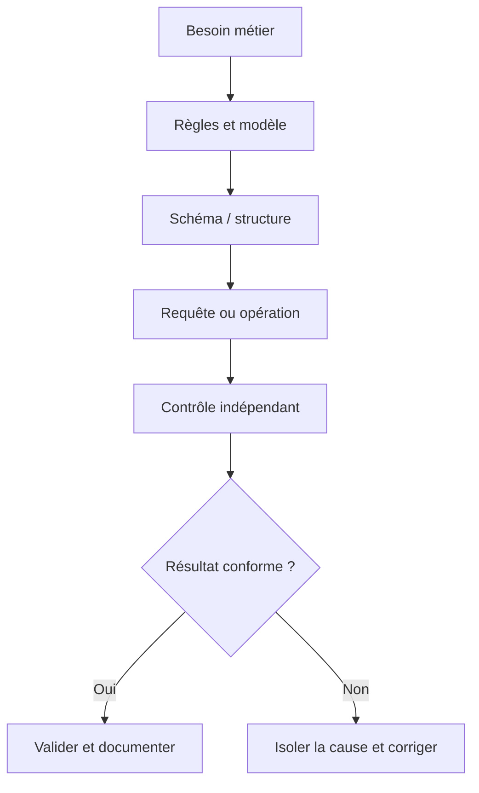
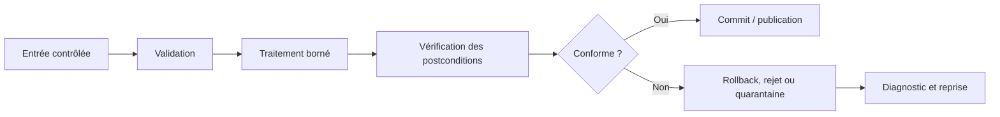
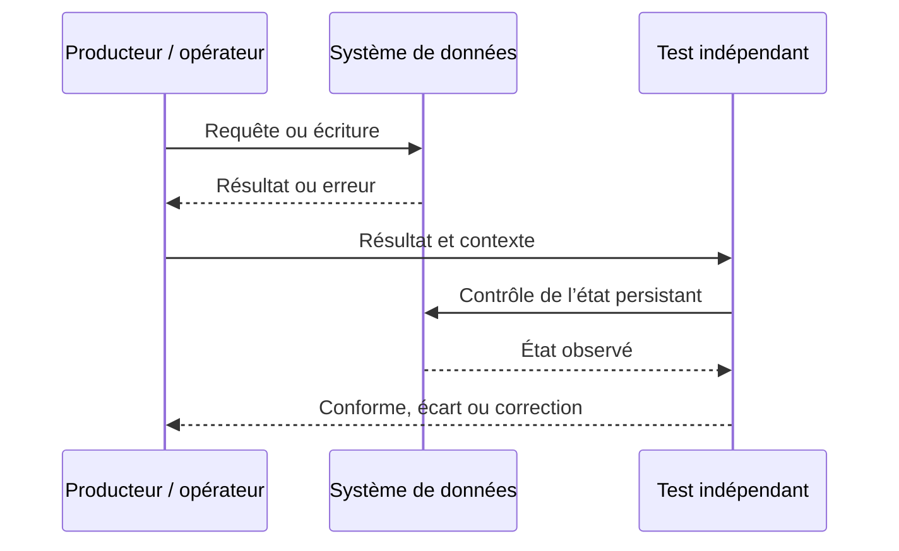
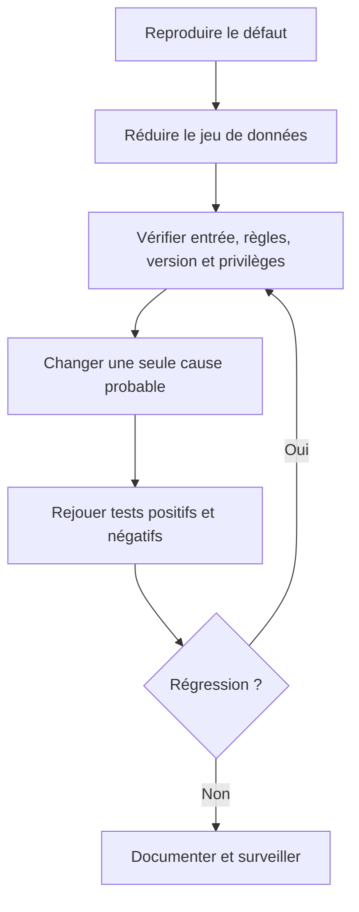

# Modélisation et diagrammes (MCD/MLD) — Débutant

> **Mise en contexte.** Traduire les règles métier en entités, associations, cardinalités et tables vérifiables. Le but n'est pas seulement d'obtenir une sortie plausible, mais de construire une solution dont le sens métier est clair, le comportement vérifiable et les limites connues. Les exemples sont pédagogiques ; adaptez-les au moteur, à sa version, aux exigences de sécurité et aux règles de l'organisation. Utilisez un environnement isolé et des données synthétiques pour les premières manipulations. Ne stockez jamais de secrets dans les scripts, journaux ou captures partagées.

## Introduction et objectifs pédagogiques

À l'issue du cours, vous devez pouvoir expliquer la notion étudiée, reconnaître ses limites, produire un résultat correct et démontrer pourquoi il l'est. Le niveau débutant ne signifie pas apprendre des commandes par cœur ; il signifie être capable d'expliquer une règle, de choisir un exemple discriminant, de vérifier le résultat et de rendre la procédure reproductible.

Objectifs opérationnels : acquérir un vocabulaire commun ; comprendre les composants impliqués ; appliquer une méthode étape par étape ; analyser les erreurs ; vérifier l'état au-delà du code de retour ; documenter les hypothèses et préserver intégrité, sécurité et récupération. La réussite se mesure à la justesse et à la reproductibilité, non au nombre de lignes écrites.

## Prérequis et environnement

Le prérequis du parcours est **data-sql-1-debutant**. Avant de commencer, notez la version du moteur, le compte utilisé, le périmètre des données et la manière de réinitialiser le laboratoire. Séparez privilèges d'administration et privilèges applicatifs ; vérifiez la cible avant une commande destructive. Les noms d'objets, formats, encodages et paramètres peuvent différer entre environnements et doivent être documentés.

## Concepts clés développés

### 1. Glossaire et règles métier

La modélisation commence avec les faits à conserver et les règles qui les relient. Les termes client, site, équipement ou intervention doivent être définis avant de devenir des entités. Les exigences s'écrivent dans les deux sens d'une relation.

**Mise en pratique.** Créer un glossaire, écrire phrases métier et contre-exemples puis faire valider les définitions. Pour appliquer cette notion de façon reproductible, formulez la règle avant de tester, choisissez un jeu court qui rend les différences visibles et consignez le résultat. N'ajustez pas la conclusion pour la faire correspondre aux données ; si le test échoue, documentez ce qu'il révèle et construisez un test plus discriminant.

**Risque à maîtriser.** Un diagramme issu uniquement d'écrans anciens reproduit leurs limites et oublis. Cette erreur peut rester cachée avec les données habituelles. Construisez un test négatif qui prouve que le garde-fou agit et un test de non-régression qui protège la correction.

**Revue technique.** 1. Quel contrat métier est représenté ? 2. Quelle couche fait autorité ? 3. Quelle valeur frontière invaliderait une hypothèse naïve ? 4. Comment corriger un écart sans masquer sa cause ? Une réponse solide inclut une preuve vérifiable, la version de l'environnement et les limites de la conclusion.

### 2. Entités et attributs

Une entité représente une catégorie d'objets ou faits ; les attributs décrivent ses propriétés avec domaine, unité, origine et règle d'absence. Des colonnes répétées pour téléphones signalent souvent une relation répétable à modéliser séparément.

**Mise en pratique.** Lister attributs et domaines puis tester si la valeur doit être recherchée ou contrôlée indépendamment. Pour appliquer cette notion de façon reproductible, formulez la règle avant de tester, choisissez un jeu court qui rend les différences visibles et consignez le résultat. N'ajustez pas la conclusion pour la faire correspondre aux données ; si le test échoue, documentez ce qu'il révèle et construisez un test plus discriminant.

**Risque à maîtriser.** Un nom ou une adresse n'est pas une clé sans garantie métier d'unicité. Cette erreur peut rester cachée avec les données habituelles. Construisez un test négatif qui prouve que le garde-fou agit et un test de non-régression qui protège la correction.

**Revue technique.** 1. Quel contrat métier est représenté ? 2. Quelle couche fait autorité ? 3. Quelle valeur frontière invaliderait une hypothèse naïve ? 4. Comment corriger un écart sans masquer sa cause ? Une réponse solide inclut une preuve vérifiable, la version de l'environnement et les limites de la conclusion.

### 3. Identifiants et clés candidates

Une clé candidate identifie une occurrence avec un ensemble minimal d'attributs. La clé primaire est choisie parmi les candidates, mais d'autres règles d'unicité peuvent rester essentielles. Un identifiant technique ne remplace pas l'unicité métier d'une référence d'équipement.

**Mise en pratique.** Comparer clé naturelle et technique selon stabilité, réutilisation et règle métier ; définir les contraintes nécessaires. Pour appliquer cette notion de façon reproductible, formulez la règle avant de tester, choisissez un jeu court qui rend les différences visibles et consignez le résultat. N'ajustez pas la conclusion pour la faire correspondre aux données ; si le test échoue, documentez ce qu'il révèle et construisez un test plus discriminant.

**Risque à maîtriser.** Un identifiant généré permet des doublons métier si rien ne les interdit. Cette erreur peut rester cachée avec les données habituelles. Construisez un test négatif qui prouve que le garde-fou agit et un test de non-régression qui protège la correction.

**Revue technique.** 1. Quel contrat métier est représenté ? 2. Quelle couche fait autorité ? 3. Quelle valeur frontière invaliderait une hypothèse naïve ? 4. Comment corriger un écart sans masquer sa cause ? Une réponse solide inclut une preuve vérifiable, la version de l'environnement et les limites de la conclusion.

### 4. Associations et cardinalités

Les cardinalités minimales et maximales expriment si une relation est facultative, obligatoire ou multiple. « Un site possède plusieurs équipements » ne signifie pas qu'il doit déjà en posséder un. Ces limites guident les clés étrangères et les tests.

**Mise en pratique.** Écrire la relation dans les deux sens et tester zéro, un et plusieurs correspondants. Pour appliquer cette notion de façon reproductible, formulez la règle avant de tester, choisissez un jeu court qui rend les différences visibles et consignez le résultat. N'ajustez pas la conclusion pour la faire correspondre aux données ; si le test échoue, documentez ce qu'il révèle et construisez un test plus discriminant.

**Risque à maîtriser.** Une cardinalité supposée peut interdire un cas légal ou accepter une relation incohérente. Cette erreur peut rester cachée avec les données habituelles. Construisez un test négatif qui prouve que le garde-fou agit et un test de non-régression qui protège la correction.

**Revue technique.** 1. Quel contrat métier est représenté ? 2. Quelle couche fait autorité ? 3. Quelle valeur frontière invaliderait une hypothèse naïve ? 4. Comment corriger un écart sans masquer sa cause ? Une réponse solide inclut une preuve vérifiable, la version de l'environnement et les limites de la conclusion.

### 5. Relations plusieurs-à-plusieurs

Une relation plusieurs-à-plusieurs devient une table associative avec les références des deux côtés et parfois des attributs comme date, quantité ou statut. Une clé composée convient si le couple est unique ; l'historique peut exiger une identité d'événement distincte.

**Mise en pratique.** Dessiner les couples autorisés et décider si le même couple peut réapparaître dans le temps. Pour appliquer cette notion de façon reproductible, formulez la règle avant de tester, choisissez un jeu court qui rend les différences visibles et consignez le résultat. N'ajustez pas la conclusion pour la faire correspondre aux données ; si le test échoue, documentez ce qu'il révèle et construisez un test plus discriminant.

**Risque à maîtriser.** Stocker plusieurs références en texte empêche l'intégrité référentielle. Cette erreur peut rester cachée avec les données habituelles. Construisez un test négatif qui prouve que le garde-fou agit et un test de non-régression qui protège la correction.

**Revue technique.** 1. Quel contrat métier est représenté ? 2. Quelle couche fait autorité ? 3. Quelle valeur frontière invaliderait une hypothèse naïve ? 4. Comment corriger un écart sans masquer sa cause ? Une réponse solide inclut une preuve vérifiable, la version de l'environnement et les limites de la conclusion.

### 6. Du MCD au MLD

Le modèle conceptuel décrit les concepts sans moteur ; le modèle logique traduit les entités en relations et les associations en clés. Les relations un-à-plusieurs placent généralement la clé étrangère côté multiple ; le plusieurs-à-plusieurs exige une relation associative.

**Mise en pratique.** Pour chaque entité, lister table, clés et attributs ; pour chaque association, définir la clé étrangère et le test associé. Pour appliquer cette notion de façon reproductible, formulez la règle avant de tester, choisissez un jeu court qui rend les différences visibles et consignez le résultat. N'ajustez pas la conclusion pour la faire correspondre aux données ; si le test échoue, documentez ce qu'il révèle et construisez un test plus discriminant.

**Risque à maîtriser.** Une traduction mécanique peut omettre un attribut de relation ou perdre une règle. Cette erreur peut rester cachée avec les données habituelles. Construisez un test négatif qui prouve que le garde-fou agit et un test de non-régression qui protège la correction.

**Revue technique.** 1. Quel contrat métier est représenté ? 2. Quelle couche fait autorité ? 3. Quelle valeur frontière invaliderait une hypothèse naïve ? 4. Comment corriger un écart sans masquer sa cause ? Une réponse solide inclut une preuve vérifiable, la version de l'environnement et les limites de la conclusion.

### 7. Historique et temporalité

Le modèle doit préciser s'il garde l'état courant ou les valeurs antérieures. Une date de dernière modification ne reconstitue pas l'ancienne valeur. L'historique peut exiger auteur, période, origine et correction rétroactive.

**Mise en pratique.** Identifier les besoins d'audit, choisir état courant, événements ou périodes et tester une correction historique. Pour appliquer cette notion de façon reproductible, formulez la règle avant de tester, choisissez un jeu court qui rend les différences visibles et consignez le résultat. N'ajustez pas la conclusion pour la faire correspondre aux données ; si le test échoue, documentez ce qu'il révèle et construisez un test plus discriminant.

**Risque à maîtriser.** L'absence de modèle temporel peut empêcher d'expliquer une décision passée. Cette erreur peut rester cachée avec les données habituelles. Construisez un test négatif qui prouve que le garde-fou agit et un test de non-régression qui protège la correction.

**Revue technique.** 1. Quel contrat métier est représenté ? 2. Quelle couche fait autorité ? 3. Quelle valeur frontière invaliderait une hypothèse naïve ? 4. Comment corriger un écart sans masquer sa cause ? Une réponse solide inclut une preuve vérifiable, la version de l'environnement et les limites de la conclusion.

### 8. Contraintes et tests du modèle

Le MLD doit devenir un schéma de règles vérifiables. NOT NULL, UNIQUE, CHECK et clés étrangères couvrent plusieurs invariants ; les règles complexes doivent avoir un mécanisme explicite. Aucune règle ne doit rester seulement dessinée.

**Mise en pratique.** Pour chaque règle, associer mécanisme, cas accepté et cas refusé. Pour appliquer cette notion de façon reproductible, formulez la règle avant de tester, choisissez un jeu court qui rend les différences visibles et consignez le résultat. N'ajustez pas la conclusion pour la faire correspondre aux données ; si le test échoue, documentez ce qu'il révèle et construisez un test plus discriminant.

**Risque à maîtriser.** Un beau diagramme ne protège rien si les contraintes ne sont pas implémentées. Cette erreur peut rester cachée avec les données habituelles. Construisez un test négatif qui prouve que le garde-fou agit et un test de non-régression qui protège la correction.

**Revue technique.** 1. Quel contrat métier est représenté ? 2. Quelle couche fait autorité ? 3. Quelle valeur frontière invaliderait une hypothèse naïve ? 4. Comment corriger un écart sans masquer sa cause ? Une réponse solide inclut une preuve vérifiable, la version de l'environnement et les limites de la conclusion.

## Architectures et schémas de référence

Les diagrammes décrivent une méthode logique et ne remplacent pas un schéma de production complet. Celui-ci doit aussi préciser versions, capacité, réseau, authentification, droits, observabilité, sauvegarde et responsabilités. Le premier diagramme relie besoin et preuve, le deuxième rend visible la gestion de l'erreur, le troisième distingue émission et vérification, et le dernier propose un diagnostic reproductible.

## Méthode d'ingénierie : du besoin à une opération sûre

### 1. Définir le contrat
Écrivez le résultat attendu en termes observables : population, règles, état initial, état final et exceptions. Remplacez « cela doit fonctionner » par un test. Une demande peut contenir plusieurs contrats — cohérence, latence, confidentialité et récupération — qui doivent être évalués séparément.

### 2. Identifier composants et source de vérité
Déterminez quel composant reçoit l'entrée, lequel transforme, où l'état est persisté et qui consomme le résultat. Pour chaque interface, notez propriétaire, format, erreurs, limites, version et permissions. Vérifiez les données dans le système faisant autorité plutôt que seulement dans un écran ou un cache.

### 3. Construire un test discriminant
Choisissez un jeu réduit comprenant cas normal, frontière, absence, doublon ou valeur invalide selon le sujet. Un bon test distingue deux hypothèses plausibles. Si le même résultat découle des deux, améliorez le test avant de conclure.

### 4. Isoler une variable
Reproduisez le défaut, conservez les indices et changez une variable à la fois. Examinez configuration, version, données, identité, permissions, ordre d'exécution et transaction avant d'accuser le moteur. Changer plusieurs composants simultanément empêche d'attribuer la cause.

### 5. Vérifier les postconditions
Vérifiez état persistant, nombre d'éléments touchés, contraintes et effets de bord. Une commande sans erreur ne garantit pas que la bonne ligne a été modifiée. Une requête qui renvoie des lignes ne garantit pas qu'elle répond à la question métier.

### 6. Gérer rejets et reprises
Distinguez erreur d'entrée, violation de règle, refus d'autorisation, panne transitoire, conflit concurrent et risque de corruption. Ne rejouez pas aveuglément si la première opération a pu être validée. Les reprises doivent être bornées, sûres si répétées et traçables ; les rejets doivent garder leur motif.

### 7. Rendre le travail reproductible
Versionnez schéma, requêtes, jeux de test et documentation. Définissez préconditions et ordre d'application. Une autre personne doit pouvoir recréer l'environnement ; les modifications manuelles non tracées créent des écarts entre dépôt et réalité.

### 8. Contrôler droits et données
Utilisez privilège minimal, comptes dédiés et secrets injectés hors du code. Les journaux ne doivent pas exposer mots de passe, jetons ou données personnelles inutiles. Les exigences de confidentialité et de rétention doivent être confirmées pour le contexte réel.

### 9. Mesurer qualité et performance
Définissez source, période, population et propriétaire de chaque mesure. Vérifiez qualité en même temps que latence, coût et volume. Un gain de vitesse qui dégrade exactitude, traçabilité ou récupération n'est pas une amélioration complète.

### 10. Transformer l'incident en apprentissage
Consignez symptôme, cause confirmée, correction, risque résiduel et test de prévention. Une note qui ne garde que la commande finale n'aide pas à savoir si un prochain cas est comparable ni à prévenir la récidive.

## Atelier pratique guidé

### But
**Modèle d'un atelier de maintenance.** Modéliser sites, équipements, techniciens, interventions et pièces. Une intervention peut couvrir plusieurs équipements et consommer plusieurs pièces, avec un historique consultable.

### Déroulement
1. Préparer l'environnement isolé et vérifier cible, compte et version.
2. Formuler les règles puis les traduire en assertions explicites.
3. Construire jeu nominal et jeu d'exceptions.
4. Exécuter de façon limitée et enregistrer l'état avant/après.
5. Déclencher une erreur et confirmer que le contrôle agit.
6. Rejouer sur un environnement propre ou un état initial différent.
7. Faire vérifier le résultat par une autre personne.
8. Documenter les limites et travaux nécessaires avant un usage réel.

### Critères d'acceptation
Le laboratoire réussit si le résultat est correct, les erreurs prévues sont détectées, les cas limites examinés et la procédure répétable. Si un test échoue, indiquez le fait observé, l'hypothèse, la correction et la preuve que l'état final respecte le contrat. La remise doit inclure données d'essai, commandes ou requêtes, postcondition et limites de la conclusion.

## Étude de cas détaillée

### Situation : Une liste stockée dans un champ casse les rapports
La première version place une liste d'équipements dans une colonne texte d'intervention. Les références ne sont pas contrôlables et les agrégations deviennent fragiles.

### Diagnostic
Déterminez si le défaut est reproductible et s'il concerne toutes les entrées ou une population. Examinez source, format, règles, chemin d'écriture, transaction, permissions et méthode d'observation. Séparez les faits établis, les causes probables et les inconnues. Une hypothèse utile doit préciser quel test pourrait la réfuter.

### Correction proposée
Introduire une relation associative avec clés étrangères et attributs pertinents. Décider comment conserver l'historique quand un équipement change de statut, puis valider les cas limites et requêtes de restitution.

### Preuve d'efficacité
Établissez une comparaison avant/après sur une population comparable. Ajoutez un test automatisable, vérifiez qu'il échoue avant correction et réussit après. Analysez les effets collatéraux et les données existantes, puis attribuez la surveillance à un responsable. Le correctif n'est accepté que s'il respecte les critères et que le risque résiduel a été évalué.

## Pièges à éviter

**1. Modélisation depuis les seuls écrans.** Le risque vient souvent d'un contrat implicite ou d'un test limité au cas nominal. Pour le prévenir, explicitez la règle, produisez un cas qui la met en difficulté et vérifiez la postcondition dans le système faisant autorité. Si le défaut apparaît, conservez l'indice, corrigez sa cause puis ajoutez un test de non-régression. Une correction manuelle sans trace ne protège pas la prochaine exécution.

**2. Confusion entre entité et attribut.** Le risque vient souvent d'un contrat implicite ou d'un test limité au cas nominal. Pour le prévenir, explicitez la règle, produisez un cas qui la met en difficulté et vérifiez la postcondition dans le système faisant autorité. Si le défaut apparaît, conservez l'indice, corrigez sa cause puis ajoutez un test de non-régression. Une correction manuelle sans trace ne protège pas la prochaine exécution.

**3. Cardinalité minimale absente.** Le risque vient souvent d'un contrat implicite ou d'un test limité au cas nominal. Pour le prévenir, explicitez la règle, produisez un cas qui la met en difficulté et vérifiez la postcondition dans le système faisant autorité. Si le défaut apparaît, conservez l'indice, corrigez sa cause puis ajoutez un test de non-régression. Une correction manuelle sans trace ne protège pas la prochaine exécution.

**4. Relation multiple stockée en texte.** Le risque vient souvent d'un contrat implicite ou d'un test limité au cas nominal. Pour le prévenir, explicitez la règle, produisez un cas qui la met en difficulté et vérifiez la postcondition dans le système faisant autorité. Si le défaut apparaît, conservez l'indice, corrigez sa cause puis ajoutez un test de non-régression. Une correction manuelle sans trace ne protège pas la prochaine exécution.

**5. Identifiant métier instable.** Le risque vient souvent d'un contrat implicite ou d'un test limité au cas nominal. Pour le prévenir, explicitez la règle, produisez un cas qui la met en difficulté et vérifiez la postcondition dans le système faisant autorité. Si le défaut apparaît, conservez l'indice, corrigez sa cause puis ajoutez un test de non-régression. Une correction manuelle sans trace ne protège pas la prochaine exécution.

**6. Historique ignoré.** Le risque vient souvent d'un contrat implicite ou d'un test limité au cas nominal. Pour le prévenir, explicitez la règle, produisez un cas qui la met en difficulté et vérifiez la postcondition dans le système faisant autorité. Si le défaut apparaît, conservez l'indice, corrigez sa cause puis ajoutez un test de non-régression. Une correction manuelle sans trace ne protège pas la prochaine exécution.

**7. MCD traduit sans tests.** Le risque vient souvent d'un contrat implicite ou d'un test limité au cas nominal. Pour le prévenir, explicitez la règle, produisez un cas qui la met en difficulté et vérifiez la postcondition dans le système faisant autorité. Si le défaut apparaît, conservez l'indice, corrigez sa cause puis ajoutez un test de non-régression. Une correction manuelle sans trace ne protège pas la prochaine exécution.

**8. Généralisation sans règle commune prouvée.** Le risque vient souvent d'un contrat implicite ou d'un test limité au cas nominal. Pour le prévenir, explicitez la règle, produisez un cas qui la met en difficulté et vérifiez la postcondition dans le système faisant autorité. Si le défaut apparaît, conservez l'indice, corrigez sa cause puis ajoutez un test de non-régression. Une correction manuelle sans trace ne protège pas la prochaine exécution.

## Diagnostic : fiches de vérification

### Diagnostic 1 — Glossaire et règles métier

**Question :** le résultat est-il cohérent avec la règle et les données disponibles ? **Preuve :** Créer un glossaire, écrire phrases métier et contre-exemples puis faire valider les définitions. **Correction :** réduisez le cas à quelques lignes, vérifiez l'hypothèse puis reproduisez le défaut avant de modifier le système. Après correction, contrôlez les contraintes, les données existantes et les opérations voisines. Distinguez erreur d'entrée, règle de modèle, autorisation, concurrence et observabilité.

### Diagnostic 2 — Entités et attributs

**Question :** le résultat est-il cohérent avec la règle et les données disponibles ? **Preuve :** Lister attributs et domaines puis tester si la valeur doit être recherchée ou contrôlée indépendamment. **Correction :** réduisez le cas à quelques lignes, vérifiez l'hypothèse puis reproduisez le défaut avant de modifier le système. Après correction, contrôlez les contraintes, les données existantes et les opérations voisines. Distinguez erreur d'entrée, règle de modèle, autorisation, concurrence et observabilité.

### Diagnostic 3 — Identifiants et clés candidates

**Question :** le résultat est-il cohérent avec la règle et les données disponibles ? **Preuve :** Comparer clé naturelle et technique selon stabilité, réutilisation et règle métier ; définir les contraintes nécessaires. **Correction :** réduisez le cas à quelques lignes, vérifiez l'hypothèse puis reproduisez le défaut avant de modifier le système. Après correction, contrôlez les contraintes, les données existantes et les opérations voisines. Distinguez erreur d'entrée, règle de modèle, autorisation, concurrence et observabilité.

### Diagnostic 4 — Associations et cardinalités

**Question :** le résultat est-il cohérent avec la règle et les données disponibles ? **Preuve :** Écrire la relation dans les deux sens et tester zéro, un et plusieurs correspondants. **Correction :** réduisez le cas à quelques lignes, vérifiez l'hypothèse puis reproduisez le défaut avant de modifier le système. Après correction, contrôlez les contraintes, les données existantes et les opérations voisines. Distinguez erreur d'entrée, règle de modèle, autorisation, concurrence et observabilité.

### Diagnostic 5 — Relations plusieurs-à-plusieurs

**Question :** le résultat est-il cohérent avec la règle et les données disponibles ? **Preuve :** Dessiner les couples autorisés et décider si le même couple peut réapparaître dans le temps. **Correction :** réduisez le cas à quelques lignes, vérifiez l'hypothèse puis reproduisez le défaut avant de modifier le système. Après correction, contrôlez les contraintes, les données existantes et les opérations voisines. Distinguez erreur d'entrée, règle de modèle, autorisation, concurrence et observabilité.

### Diagnostic 6 — Du MCD au MLD

**Question :** le résultat est-il cohérent avec la règle et les données disponibles ? **Preuve :** Pour chaque entité, lister table, clés et attributs ; pour chaque association, définir la clé étrangère et le test associé. **Correction :** réduisez le cas à quelques lignes, vérifiez l'hypothèse puis reproduisez le défaut avant de modifier le système. Après correction, contrôlez les contraintes, les données existantes et les opérations voisines. Distinguez erreur d'entrée, règle de modèle, autorisation, concurrence et observabilité.

### Diagnostic 7 — Historique et temporalité

**Question :** le résultat est-il cohérent avec la règle et les données disponibles ? **Preuve :** Identifier les besoins d'audit, choisir état courant, événements ou périodes et tester une correction historique. **Correction :** réduisez le cas à quelques lignes, vérifiez l'hypothèse puis reproduisez le défaut avant de modifier le système. Après correction, contrôlez les contraintes, les données existantes et les opérations voisines. Distinguez erreur d'entrée, règle de modèle, autorisation, concurrence et observabilité.

### Diagnostic 8 — Contraintes et tests du modèle

**Question :** le résultat est-il cohérent avec la règle et les données disponibles ? **Preuve :** Pour chaque règle, associer mécanisme, cas accepté et cas refusé. **Correction :** réduisez le cas à quelques lignes, vérifiez l'hypothèse puis reproduisez le défaut avant de modifier le système. Après correction, contrôlez les contraintes, les données existantes et les opérations voisines. Distinguez erreur d'entrée, règle de modèle, autorisation, concurrence et observabilité.

## Exercices d'application avec corrigés

### Exercice 1 — Glossaire et règles métier

**Énoncé.** Construisez un test qui révèle clairement cette propriété et proposez un cas où une approche simpliste échouerait. Expliquez quelle mesure ou assertion doit démontrer la correction.

**Corrigé détaillé.** Créer un glossaire, écrire phrases métier et contre-exemples puis faire valider les définitions. Une réponse acceptable énonce le contrat, utilise une entrée contrôlée, vérifie l'état obtenu et documente les limites. Elle traite le risque suivant : Un diagramme issu uniquement d'écrans anciens reproduit leurs limites et oublis. Validez avec un cas positif, un négatif et un test après évolution du schéma ou des données. Une commande sans contrôle de son résultat n'est pas une preuve suffisante.

### Exercice 2 — Entités et attributs

**Énoncé.** Construisez un test qui révèle clairement cette propriété et proposez un cas où une approche simpliste échouerait. Expliquez quelle mesure ou assertion doit démontrer la correction.

**Corrigé détaillé.** Lister attributs et domaines puis tester si la valeur doit être recherchée ou contrôlée indépendamment. Une réponse acceptable énonce le contrat, utilise une entrée contrôlée, vérifie l'état obtenu et documente les limites. Elle traite le risque suivant : Un nom ou une adresse n'est pas une clé sans garantie métier d'unicité. Validez avec un cas positif, un négatif et un test après évolution du schéma ou des données. Une commande sans contrôle de son résultat n'est pas une preuve suffisante.

### Exercice 3 — Identifiants et clés candidates

**Énoncé.** Construisez un test qui révèle clairement cette propriété et proposez un cas où une approche simpliste échouerait. Expliquez quelle mesure ou assertion doit démontrer la correction.

**Corrigé détaillé.** Comparer clé naturelle et technique selon stabilité, réutilisation et règle métier ; définir les contraintes nécessaires. Une réponse acceptable énonce le contrat, utilise une entrée contrôlée, vérifie l'état obtenu et documente les limites. Elle traite le risque suivant : Un identifiant généré permet des doublons métier si rien ne les interdit. Validez avec un cas positif, un négatif et un test après évolution du schéma ou des données. Une commande sans contrôle de son résultat n'est pas une preuve suffisante.

### Exercice 4 — Associations et cardinalités

**Énoncé.** Construisez un test qui révèle clairement cette propriété et proposez un cas où une approche simpliste échouerait. Expliquez quelle mesure ou assertion doit démontrer la correction.

**Corrigé détaillé.** Écrire la relation dans les deux sens et tester zéro, un et plusieurs correspondants. Une réponse acceptable énonce le contrat, utilise une entrée contrôlée, vérifie l'état obtenu et documente les limites. Elle traite le risque suivant : Une cardinalité supposée peut interdire un cas légal ou accepter une relation incohérente. Validez avec un cas positif, un négatif et un test après évolution du schéma ou des données. Une commande sans contrôle de son résultat n'est pas une preuve suffisante.

### Exercice 5 — Relations plusieurs-à-plusieurs

**Énoncé.** Construisez un test qui révèle clairement cette propriété et proposez un cas où une approche simpliste échouerait. Expliquez quelle mesure ou assertion doit démontrer la correction.

**Corrigé détaillé.** Dessiner les couples autorisés et décider si le même couple peut réapparaître dans le temps. Une réponse acceptable énonce le contrat, utilise une entrée contrôlée, vérifie l'état obtenu et documente les limites. Elle traite le risque suivant : Stocker plusieurs références en texte empêche l'intégrité référentielle. Validez avec un cas positif, un négatif et un test après évolution du schéma ou des données. Une commande sans contrôle de son résultat n'est pas une preuve suffisante.

### Exercice 6 — Du MCD au MLD

**Énoncé.** Construisez un test qui révèle clairement cette propriété et proposez un cas où une approche simpliste échouerait. Expliquez quelle mesure ou assertion doit démontrer la correction.

**Corrigé détaillé.** Pour chaque entité, lister table, clés et attributs ; pour chaque association, définir la clé étrangère et le test associé. Une réponse acceptable énonce le contrat, utilise une entrée contrôlée, vérifie l'état obtenu et documente les limites. Elle traite le risque suivant : Une traduction mécanique peut omettre un attribut de relation ou perdre une règle. Validez avec un cas positif, un négatif et un test après évolution du schéma ou des données. Une commande sans contrôle de son résultat n'est pas une preuve suffisante.

### Exercice 7 — Historique et temporalité

**Énoncé.** Construisez un test qui révèle clairement cette propriété et proposez un cas où une approche simpliste échouerait. Expliquez quelle mesure ou assertion doit démontrer la correction.

**Corrigé détaillé.** Identifier les besoins d'audit, choisir état courant, événements ou périodes et tester une correction historique. Une réponse acceptable énonce le contrat, utilise une entrée contrôlée, vérifie l'état obtenu et documente les limites. Elle traite le risque suivant : L'absence de modèle temporel peut empêcher d'expliquer une décision passée. Validez avec un cas positif, un négatif et un test après évolution du schéma ou des données. Une commande sans contrôle de son résultat n'est pas une preuve suffisante.

### Exercice 8 — Contraintes et tests du modèle

**Énoncé.** Construisez un test qui révèle clairement cette propriété et proposez un cas où une approche simpliste échouerait. Expliquez quelle mesure ou assertion doit démontrer la correction.

**Corrigé détaillé.** Pour chaque règle, associer mécanisme, cas accepté et cas refusé. Une réponse acceptable énonce le contrat, utilise une entrée contrôlée, vérifie l'état obtenu et documente les limites. Elle traite le risque suivant : Un beau diagramme ne protège rien si les contraintes ne sont pas implémentées. Validez avec un cas positif, un négatif et un test après évolution du schéma ou des données. Une commande sans contrôle de son résultat n'est pas une preuve suffisante.

## Checklist de mise en œuvre

- [ ] Le glossaire est validé par le métier.
- [ ] Chaque entité possède une identité justifiée.
- [ ] Les attributs ont domaine et règle d'absence.
- [ ] Les cardinalités sont définies dans les deux sens.
- [ ] Les relations multiples sont explicites.
- [ ] La temporalité est décidée.
- [ ] Le MLD correspond au DDL et contraintes.
- [ ] Les cas limites sont validés.

Ajoutez les règles locales de sécurité, confidentialité, rétention et gestion des changements. Si une exigence n'est pas applicable, documentez le motif. Pour une opération risquée, faites vérifier le plan par une personne habilitée et définissez le chemin de récupération avant une exécution réelle.

## Synthèse — à retenir

La maîtrise technique exige des règles explicites, des preuves reproductibles et une compréhension des cas hors nominal. Le modèle ou la requête doit traduire une question métier ; l'entrée doit être contrôlée ; le résultat doit être vérifié à la granularité correcte ; les erreurs doivent rester visibles et avoir un propriétaire. La production impose enfin de traiter privilèges, volume, concurrence, mises à jour et récupération. Les exemples sont un point de départ et l'organisation doit confirmer les règles applicables à son moteur et son contexte.

## Références techniques

- https://www.postgresql.org/docs/current/ddl-constraints.html
- https://dev.mysql.com/doc/refman/8.4/en/innodb-foreign-key-constraints.html

Consultez la documentation correspondant à la version réellement utilisée avant de généraliser une commande ou un comportement.