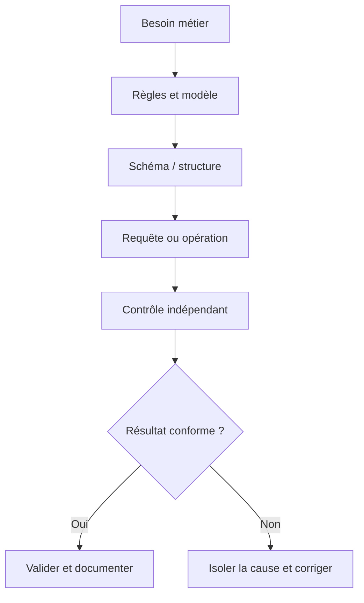
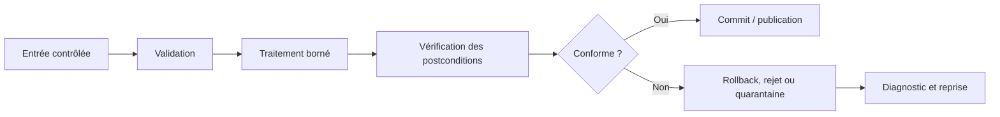
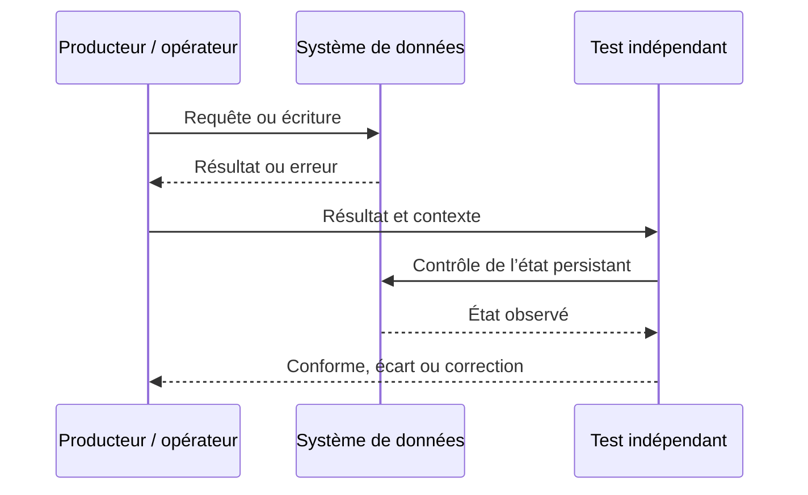
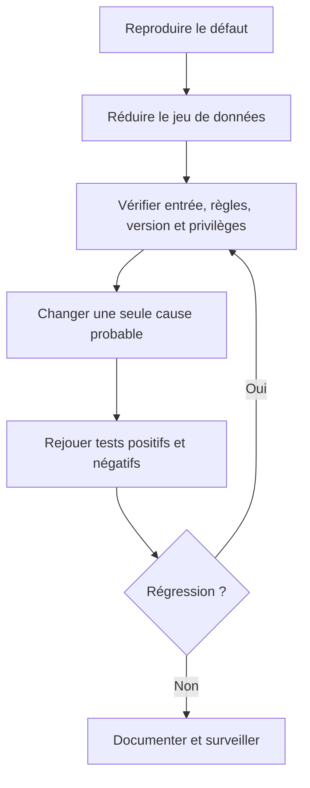

# Normalisation (1NF, 2NF, 3NF) — Débutant

> **Mise en contexte.** Réduire les anomalies relationnelles en raisonnant sur les clés candidates et dépendances fonctionnelles. Le but n'est pas seulement d'obtenir une sortie plausible, mais de construire une solution dont le sens métier est clair, le comportement vérifiable et les limites connues. Les exemples sont pédagogiques ; adaptez-les au moteur, à sa version, aux exigences de sécurité et aux règles de l'organisation. Utilisez un environnement isolé et des données synthétiques pour les premières manipulations. Ne stockez jamais de secrets dans les scripts, journaux ou captures partagées.

## Introduction et objectifs pédagogiques

À l'issue du cours, vous devez pouvoir expliquer la notion étudiée, reconnaître ses limites, produire un résultat correct et démontrer pourquoi il l'est. Le niveau débutant ne signifie pas apprendre des commandes par cœur ; il signifie être capable d'expliquer une règle, de choisir un exemple discriminant, de vérifier le résultat et de rendre la procédure reproductible.

Objectifs opérationnels : acquérir un vocabulaire commun ; comprendre les composants impliqués ; appliquer une méthode étape par étape ; analyser les erreurs ; vérifier l'état au-delà du code de retour ; documenter les hypothèses et préserver intégrité, sécurité et récupération. La réussite se mesure à la justesse et à la reproductibilité, non au nombre de lignes écrites.

## Prérequis et environnement

Le prérequis du parcours est **data-sql-2-debutant**. Avant de commencer, notez la version du moteur, le compte utilisé, le périmètre des données et la manière de réinitialiser le laboratoire. Séparez privilèges d'administration et privilèges applicatifs ; vérifiez la cible avant une commande destructive. Les noms d'objets, formats, encodages et paramètres peuvent différer entre environnements et doivent être documentés.

## Concepts clés développés

### 1. Dépendances fonctionnelles

X → Y signifie que, dans chaque état valide, X détermine Y. C'est une règle métier, pas un motif observé dans quelques lignes. Les dépendances révèlent clés candidates, redondances et anomalies.

**Mise en pratique.** Écrire exemples et contre-exemples puis préciser le domaine où la dépendance est valide. Pour appliquer cette notion de façon reproductible, formulez la règle avant de tester, choisissez un jeu court qui rend les différences visibles et consignez le résultat. N'ajustez pas la conclusion pour la faire correspondre aux données ; si le test échoue, documentez ce qu'il révèle et construisez un test plus discriminant.

**Risque à maîtriser.** Deux colonnes souvent égales dans un petit échantillon ne sont pas nécessairement liées. Cette erreur peut rester cachée avec les données habituelles. Construisez un test négatif qui prouve que le garde-fou agit et un test de non-régression qui protège la correction.

**Revue technique.** 1. Quel contrat métier est représenté ? 2. Quelle couche fait autorité ? 3. Quelle valeur frontière invaliderait une hypothèse naïve ? 4. Comment corriger un écart sans masquer sa cause ? Une réponse solide inclut une preuve vérifiable, la version de l'environnement et les limites de la conclusion.

### 2. Première forme normale

La 1NF évite groupes répétitifs et valeurs non atomiques au regard du modèle. Une liste de numéros dans une cellule empêche de contrôler chaque valeur et de la relier à son contexte. L'atomicité dépend du domaine et des opérations attendues.

**Mise en pratique.** Repérer listes encodées et colonnes répétées ; créer la relation enfant si ses éléments doivent être contrôlés séparément. Pour appliquer cette notion de façon reproductible, formulez la règle avant de tester, choisissez un jeu court qui rend les différences visibles et consignez le résultat. N'ajustez pas la conclusion pour la faire correspondre aux données ; si le test échoue, documentez ce qu'il révèle et construisez un test plus discriminant.

**Risque à maîtriser.** Découper toute chaîne sans besoin métier n'est pas une amélioration automatique. Cette erreur peut rester cachée avec les données habituelles. Construisez un test négatif qui prouve que le garde-fou agit et un test de non-régression qui protège la correction.

**Revue technique.** 1. Quel contrat métier est représenté ? 2. Quelle couche fait autorité ? 3. Quelle valeur frontière invaliderait une hypothèse naïve ? 4. Comment corriger un écart sans masquer sa cause ? Une réponse solide inclut une preuve vérifiable, la version de l'environnement et les limites de la conclusion.

### 3. Deuxième forme normale

La 2NF examine les dépendances partielles à une clé candidate composée. Les attributs non-clés doivent dépendre de toute la clé. Dans une ligne identifiée par commande et produit, le libellé dépend du produit et non du couple.

**Mise en pratique.** Énumérer les clés candidates et examiner chaque attribut par rapport à chaque partie de clé. Pour appliquer cette notion de façon reproductible, formulez la règle avant de tester, choisissez un jeu court qui rend les différences visibles et consignez le résultat. N'ajustez pas la conclusion pour la faire correspondre aux données ; si le test échoue, documentez ce qu'il révèle et construisez un test plus discriminant.

**Risque à maîtriser.** Une clé primaire simple ne dispense pas d'examiner les autres clés candidates. Cette erreur peut rester cachée avec les données habituelles. Construisez un test négatif qui prouve que le garde-fou agit et un test de non-régression qui protège la correction.

**Revue technique.** 1. Quel contrat métier est représenté ? 2. Quelle couche fait autorité ? 3. Quelle valeur frontière invaliderait une hypothèse naïve ? 4. Comment corriger un écart sans masquer sa cause ? Une réponse solide inclut une preuve vérifiable, la version de l'environnement et les limites de la conclusion.

### 4. Troisième forme normale

La 3NF évite des dépendances transitives inappropriées des attributs non-clés. Si un produit détermine son fabricant, recopier l'adresse du fabricant dans chaque vente multiplie les endroits à mettre à jour.

**Mise en pratique.** Tracer les déterminants, séparer les faits et tester la reconstruction par jointure. Pour appliquer cette notion de façon reproductible, formulez la règle avant de tester, choisissez un jeu court qui rend les différences visibles et consignez le résultat. N'ajustez pas la conclusion pour la faire correspondre aux données ; si le test échoue, documentez ce qu'il révèle et construisez un test plus discriminant.

**Risque à maîtriser.** Créer beaucoup de tables sans dépendances démontrées ne garantit pas un meilleur modèle. Cette erreur peut rester cachée avec les données habituelles. Construisez un test négatif qui prouve que le garde-fou agit et un test de non-régression qui protège la correction.

**Revue technique.** 1. Quel contrat métier est représenté ? 2. Quelle couche fait autorité ? 3. Quelle valeur frontière invaliderait une hypothèse naïve ? 4. Comment corriger un écart sans masquer sa cause ? Une réponse solide inclut une preuve vérifiable, la version de l'environnement et les limites de la conclusion.

### 5. Anomalies d'insertion, de mise à jour et de suppression

Une redondance peut obliger à créer une commande pour enregistrer un produit, laisser des adresses contradictoires ou effacer l'information produit avec la dernière commande. Ces anomalies rendent le défaut de conception concret.

**Mise en pratique.** Lister les opérations de cycle de vie et construire des exemples qui mettent la redondance en défaut. Pour appliquer cette notion de façon reproductible, formulez la règle avant de tester, choisissez un jeu court qui rend les différences visibles et consignez le résultat. N'ajustez pas la conclusion pour la faire correspondre aux données ; si le test échoue, documentez ce qu'il révèle et construisez un test plus discriminant.

**Risque à maîtriser.** Un petit jeu peut rester cohérent tant qu'aucune donnée n'est corrigée. Cette erreur peut rester cachée avec les données habituelles. Construisez un test négatif qui prouve que le garde-fou agit et un test de non-régression qui protège la correction.

**Revue technique.** 1. Quel contrat métier est représenté ? 2. Quelle couche fait autorité ? 3. Quelle valeur frontière invaliderait une hypothèse naïve ? 4. Comment corriger un écart sans masquer sa cause ? Une réponse solide inclut une preuve vérifiable, la version de l'environnement et les limites de la conclusion.

### 6. Décomposition sans perte

Une décomposition doit reconstruire les faits nécessaires sans perdre les tuples ni créer de combinaisons impossibles. La jointure sans perte est distincte de la préservation des dépendances ; joindre sur une colonne non unique peut multiplier les lignes.

**Mise en pratique.** Écrire la jointure de reconstruction et comparer les faits avant/après, y compris les valeurs répétées. Pour appliquer cette notion de façon reproductible, formulez la règle avant de tester, choisissez un jeu court qui rend les différences visibles et consignez le résultat. N'ajustez pas la conclusion pour la faire correspondre aux données ; si le test échoue, documentez ce qu'il révèle et construisez un test plus discriminant.

**Risque à maîtriser.** Une décomposition élégante peut perdre de l'information. Cette erreur peut rester cachée avec les données habituelles. Construisez un test négatif qui prouve que le garde-fou agit et un test de non-régression qui protège la correction.

**Revue technique.** 1. Quel contrat métier est représenté ? 2. Quelle couche fait autorité ? 3. Quelle valeur frontière invaliderait une hypothèse naïve ? 4. Comment corriger un écart sans masquer sa cause ? Une réponse solide inclut une preuve vérifiable, la version de l'environnement et les limites de la conclusion.

### 7. Préservation des dépendances

La préservation permet de vérifier les règles importantes sur les tables décomposées sans reconstruire toujours une jointure globale. Certaines contraintes exigent un mécanisme spécifique qui doit rester documenté et testé.

**Mise en pratique.** Associer chaque dépendance à une contrainte ou validation et à un test positif/négatif. Pour appliquer cette notion de façon reproductible, formulez la règle avant de tester, choisissez un jeu court qui rend les différences visibles et consignez le résultat. N'ajustez pas la conclusion pour la faire correspondre aux données ; si le test échoue, documentez ce qu'il révèle et construisez un test plus discriminant.

**Risque à maîtriser.** La forme normale indiquée dans le document ne prouve pas que les règles sont contrôlées. Cette erreur peut rester cachée avec les données habituelles. Construisez un test négatif qui prouve que le garde-fou agit et un test de non-régression qui protège la correction.

**Revue technique.** 1. Quel contrat métier est représenté ? 2. Quelle couche fait autorité ? 3. Quelle valeur frontière invaliderait une hypothèse naïve ? 4. Comment corriger un écart sans masquer sa cause ? Une réponse solide inclut une preuve vérifiable, la version de l'environnement et les limites de la conclusion.

### 8. Dénormalisation raisonnée

La dénormalisation introduit une redondance volontaire pour une charge mesurée, comme une projection de lecture. Elle exige une source faisant autorité, un délai de rafraîchissement, un mécanisme de détection de retard et une procédure de reconstruction.

**Mise en pratique.** Mesurer le besoin, attribuer la copie et définir une réconciliation. Pour appliquer cette notion de façon reproductible, formulez la règle avant de tester, choisissez un jeu court qui rend les différences visibles et consignez le résultat. N'ajustez pas la conclusion pour la faire correspondre aux données ; si le test échoue, documentez ce qu'il révèle et construisez un test plus discriminant.

**Risque à maîtriser.** Deux sources modifiables sans synchronisation finissent par diverger. Cette erreur peut rester cachée avec les données habituelles. Construisez un test négatif qui prouve que le garde-fou agit et un test de non-régression qui protège la correction.

**Revue technique.** 1. Quel contrat métier est représenté ? 2. Quelle couche fait autorité ? 3. Quelle valeur frontière invaliderait une hypothèse naïve ? 4. Comment corriger un écart sans masquer sa cause ? Une réponse solide inclut une preuve vérifiable, la version de l'environnement et les limites de la conclusion.

## Architectures et schémas de référence

Les diagrammes décrivent une méthode logique et ne remplacent pas un schéma de production complet. Celui-ci doit aussi préciser versions, capacité, réseau, authentification, droits, observabilité, sauvegarde et responsabilités. Le premier diagramme relie besoin et preuve, le deuxième rend visible la gestion de l'erreur, le troisième distingue émission et vérification, et le dernier propose un diagnostic reproductible.

## Méthode d'ingénierie : du besoin à une opération sûre

### 1. Définir le contrat
Écrivez le résultat attendu en termes observables : population, règles, état initial, état final et exceptions. Remplacez « cela doit fonctionner » par un test. Une demande peut contenir plusieurs contrats — cohérence, latence, confidentialité et récupération — qui doivent être évalués séparément.

### 2. Identifier composants et source de vérité
Déterminez quel composant reçoit l'entrée, lequel transforme, où l'état est persisté et qui consomme le résultat. Pour chaque interface, notez propriétaire, format, erreurs, limites, version et permissions. Vérifiez les données dans le système faisant autorité plutôt que seulement dans un écran ou un cache.

### 3. Construire un test discriminant
Choisissez un jeu réduit comprenant cas normal, frontière, absence, doublon ou valeur invalide selon le sujet. Un bon test distingue deux hypothèses plausibles. Si le même résultat découle des deux, améliorez le test avant de conclure.

### 4. Isoler une variable
Reproduisez le défaut, conservez les indices et changez une variable à la fois. Examinez configuration, version, données, identité, permissions, ordre d'exécution et transaction avant d'accuser le moteur. Changer plusieurs composants simultanément empêche d'attribuer la cause.

### 5. Vérifier les postconditions
Vérifiez état persistant, nombre d'éléments touchés, contraintes et effets de bord. Une commande sans erreur ne garantit pas que la bonne ligne a été modifiée. Une requête qui renvoie des lignes ne garantit pas qu'elle répond à la question métier.

### 6. Gérer rejets et reprises
Distinguez erreur d'entrée, violation de règle, refus d'autorisation, panne transitoire, conflit concurrent et risque de corruption. Ne rejouez pas aveuglément si la première opération a pu être validée. Les reprises doivent être bornées, sûres si répétées et traçables ; les rejets doivent garder leur motif.

### 7. Rendre le travail reproductible
Versionnez schéma, requêtes, jeux de test et documentation. Définissez préconditions et ordre d'application. Une autre personne doit pouvoir recréer l'environnement ; les modifications manuelles non tracées créent des écarts entre dépôt et réalité.

### 8. Contrôler droits et données
Utilisez privilège minimal, comptes dédiés et secrets injectés hors du code. Les journaux ne doivent pas exposer mots de passe, jetons ou données personnelles inutiles. Les exigences de confidentialité et de rétention doivent être confirmées pour le contexte réel.

### 9. Mesurer qualité et performance
Définissez source, période, population et propriétaire de chaque mesure. Vérifiez qualité en même temps que latence, coût et volume. Un gain de vitesse qui dégrade exactitude, traçabilité ou récupération n'est pas une amélioration complète.

### 10. Transformer l'incident en apprentissage
Consignez symptôme, cause confirmée, correction, risque résiduel et test de prévention. Une note qui ne garde que la commande finale n'aide pas à savoir si un prochain cas est comparable ni à prévenir la récidive.

## Atelier pratique guidé

### But
**Refactoriser une table de commandes redondante.** Séparer clients, commandes, produits, fabricants et lignes de commande à partir d'une table qui répète adresses et libellés.

### Déroulement
1. Préparer l'environnement isolé et vérifier cible, compte et version.
2. Formuler les règles puis les traduire en assertions explicites.
3. Construire jeu nominal et jeu d'exceptions.
4. Exécuter de façon limitée et enregistrer l'état avant/après.
5. Déclencher une erreur et confirmer que le contrôle agit.
6. Rejouer sur un environnement propre ou un état initial différent.
7. Faire vérifier le résultat par une autre personne.
8. Documenter les limites et travaux nécessaires avant un usage réel.

### Critères d'acceptation
Le laboratoire réussit si le résultat est correct, les erreurs prévues sont détectées, les cas limites examinés et la procédure répétable. Si un test échoue, indiquez le fait observé, l'hypothèse, la correction et la preuve que l'état final respecte le contrat. La remise doit inclure données d'essai, commandes ou requêtes, postcondition et limites de la conclusion.

## Étude de cas détaillée

### Situation : Une adresse de fournisseur devient contradictoire
Une adresse est recopiée dans des milliers de lignes ; une mise à jour partielle crée plusieurs valeurs prétendant être actuelles.

### Diagnostic
Déterminez si le défaut est reproductible et s'il concerne toutes les entrées ou une population. Examinez source, format, règles, chemin d'écriture, transaction, permissions et méthode d'observation. Séparez les faits établis, les causes probables et les inconnues. Une hypothèse utile doit préciser quel test pourrait la réfuter.

### Correction proposée
Séparer fournisseur et commande et préciser si les rapports historiques gardent l'adresse à la date de l'événement. Si oui, conserver version historique ou instantané explicite. Valider la décomposition sans perte et les opérations de cycle de vie.

### Preuve d'efficacité
Établissez une comparaison avant/après sur une population comparable. Ajoutez un test automatisable, vérifiez qu'il échoue avant correction et réussit après. Analysez les effets collatéraux et les données existantes, puis attribuez la surveillance à un responsable. Le correctif n'est accepté que s'il respecte les critères et que le risque résiduel a été évalué.

## Pièges à éviter

**1. Dépendances déduites d'un échantillon limité.** Le risque vient souvent d'un contrat implicite ou d'un test limité au cas nominal. Pour le prévenir, explicitez la règle, produisez un cas qui la met en difficulté et vérifiez la postcondition dans le système faisant autorité. Si le défaut apparaît, conservez l'indice, corrigez sa cause puis ajoutez un test de non-régression. Une correction manuelle sans trace ne protège pas la prochaine exécution.

**2. Atomicité interprétée comme découpage arbitraire.** Le risque vient souvent d'un contrat implicite ou d'un test limité au cas nominal. Pour le prévenir, explicitez la règle, produisez un cas qui la met en difficulté et vérifiez la postcondition dans le système faisant autorité. Si le défaut apparaît, conservez l'indice, corrigez sa cause puis ajoutez un test de non-régression. Une correction manuelle sans trace ne protège pas la prochaine exécution.

**3. Clés candidates ignorées.** Le risque vient souvent d'un contrat implicite ou d'un test limité au cas nominal. Pour le prévenir, explicitez la règle, produisez un cas qui la met en difficulté et vérifiez la postcondition dans le système faisant autorité. Si le défaut apparaît, conservez l'indice, corrigez sa cause puis ajoutez un test de non-régression. Une correction manuelle sans trace ne protège pas la prochaine exécution.

**4. Décomposition sans test de reconstruction.** Le risque vient souvent d'un contrat implicite ou d'un test limité au cas nominal. Pour le prévenir, explicitez la règle, produisez un cas qui la met en difficulté et vérifiez la postcondition dans le système faisant autorité. Si le défaut apparaît, conservez l'indice, corrigez sa cause puis ajoutez un test de non-régression. Une correction manuelle sans trace ne protège pas la prochaine exécution.

**5. Jointure fondée sur attribut non unique.** Le risque vient souvent d'un contrat implicite ou d'un test limité au cas nominal. Pour le prévenir, explicitez la règle, produisez un cas qui la met en difficulté et vérifiez la postcondition dans le système faisant autorité. Si le défaut apparaît, conservez l'indice, corrigez sa cause puis ajoutez un test de non-régression. Une correction manuelle sans trace ne protège pas la prochaine exécution.

**6. Normalisation confondue avec performance.** Le risque vient souvent d'un contrat implicite ou d'un test limité au cas nominal. Pour le prévenir, explicitez la règle, produisez un cas qui la met en difficulté et vérifiez la postcondition dans le système faisant autorité. Si le défaut apparaît, conservez l'indice, corrigez sa cause puis ajoutez un test de non-régression. Une correction manuelle sans trace ne protège pas la prochaine exécution.

**7. Redondance sans responsable de synchronisation.** Le risque vient souvent d'un contrat implicite ou d'un test limité au cas nominal. Pour le prévenir, explicitez la règle, produisez un cas qui la met en difficulté et vérifiez la postcondition dans le système faisant autorité. Si le défaut apparaît, conservez l'indice, corrigez sa cause puis ajoutez un test de non-régression. Une correction manuelle sans trace ne protège pas la prochaine exécution.

**8. Historique temporel oublié.** Le risque vient souvent d'un contrat implicite ou d'un test limité au cas nominal. Pour le prévenir, explicitez la règle, produisez un cas qui la met en difficulté et vérifiez la postcondition dans le système faisant autorité. Si le défaut apparaît, conservez l'indice, corrigez sa cause puis ajoutez un test de non-régression. Une correction manuelle sans trace ne protège pas la prochaine exécution.

## Diagnostic : fiches de vérification

### Diagnostic 1 — Dépendances fonctionnelles

**Question :** le résultat est-il cohérent avec la règle et les données disponibles ? **Preuve :** Écrire exemples et contre-exemples puis préciser le domaine où la dépendance est valide. **Correction :** réduisez le cas à quelques lignes, vérifiez l'hypothèse puis reproduisez le défaut avant de modifier le système. Après correction, contrôlez les contraintes, les données existantes et les opérations voisines. Distinguez erreur d'entrée, règle de modèle, autorisation, concurrence et observabilité.

### Diagnostic 2 — Première forme normale

**Question :** le résultat est-il cohérent avec la règle et les données disponibles ? **Preuve :** Repérer listes encodées et colonnes répétées ; créer la relation enfant si ses éléments doivent être contrôlés séparément. **Correction :** réduisez le cas à quelques lignes, vérifiez l'hypothèse puis reproduisez le défaut avant de modifier le système. Après correction, contrôlez les contraintes, les données existantes et les opérations voisines. Distinguez erreur d'entrée, règle de modèle, autorisation, concurrence et observabilité.

### Diagnostic 3 — Deuxième forme normale

**Question :** le résultat est-il cohérent avec la règle et les données disponibles ? **Preuve :** Énumérer les clés candidates et examiner chaque attribut par rapport à chaque partie de clé. **Correction :** réduisez le cas à quelques lignes, vérifiez l'hypothèse puis reproduisez le défaut avant de modifier le système. Après correction, contrôlez les contraintes, les données existantes et les opérations voisines. Distinguez erreur d'entrée, règle de modèle, autorisation, concurrence et observabilité.

### Diagnostic 4 — Troisième forme normale

**Question :** le résultat est-il cohérent avec la règle et les données disponibles ? **Preuve :** Tracer les déterminants, séparer les faits et tester la reconstruction par jointure. **Correction :** réduisez le cas à quelques lignes, vérifiez l'hypothèse puis reproduisez le défaut avant de modifier le système. Après correction, contrôlez les contraintes, les données existantes et les opérations voisines. Distinguez erreur d'entrée, règle de modèle, autorisation, concurrence et observabilité.

### Diagnostic 5 — Anomalies d'insertion, de mise à jour et de suppression

**Question :** le résultat est-il cohérent avec la règle et les données disponibles ? **Preuve :** Lister les opérations de cycle de vie et construire des exemples qui mettent la redondance en défaut. **Correction :** réduisez le cas à quelques lignes, vérifiez l'hypothèse puis reproduisez le défaut avant de modifier le système. Après correction, contrôlez les contraintes, les données existantes et les opérations voisines. Distinguez erreur d'entrée, règle de modèle, autorisation, concurrence et observabilité.

### Diagnostic 6 — Décomposition sans perte

**Question :** le résultat est-il cohérent avec la règle et les données disponibles ? **Preuve :** Écrire la jointure de reconstruction et comparer les faits avant/après, y compris les valeurs répétées. **Correction :** réduisez le cas à quelques lignes, vérifiez l'hypothèse puis reproduisez le défaut avant de modifier le système. Après correction, contrôlez les contraintes, les données existantes et les opérations voisines. Distinguez erreur d'entrée, règle de modèle, autorisation, concurrence et observabilité.

### Diagnostic 7 — Préservation des dépendances

**Question :** le résultat est-il cohérent avec la règle et les données disponibles ? **Preuve :** Associer chaque dépendance à une contrainte ou validation et à un test positif/négatif. **Correction :** réduisez le cas à quelques lignes, vérifiez l'hypothèse puis reproduisez le défaut avant de modifier le système. Après correction, contrôlez les contraintes, les données existantes et les opérations voisines. Distinguez erreur d'entrée, règle de modèle, autorisation, concurrence et observabilité.

### Diagnostic 8 — Dénormalisation raisonnée

**Question :** le résultat est-il cohérent avec la règle et les données disponibles ? **Preuve :** Mesurer le besoin, attribuer la copie et définir une réconciliation. **Correction :** réduisez le cas à quelques lignes, vérifiez l'hypothèse puis reproduisez le défaut avant de modifier le système. Après correction, contrôlez les contraintes, les données existantes et les opérations voisines. Distinguez erreur d'entrée, règle de modèle, autorisation, concurrence et observabilité.

## Exercices d'application avec corrigés

### Exercice 1 — Dépendances fonctionnelles

**Énoncé.** Construisez un test qui révèle clairement cette propriété et proposez un cas où une approche simpliste échouerait. Expliquez quelle mesure ou assertion doit démontrer la correction.

**Corrigé détaillé.** Écrire exemples et contre-exemples puis préciser le domaine où la dépendance est valide. Une réponse acceptable énonce le contrat, utilise une entrée contrôlée, vérifie l'état obtenu et documente les limites. Elle traite le risque suivant : Deux colonnes souvent égales dans un petit échantillon ne sont pas nécessairement liées. Validez avec un cas positif, un négatif et un test après évolution du schéma ou des données. Une commande sans contrôle de son résultat n'est pas une preuve suffisante.

### Exercice 2 — Première forme normale

**Énoncé.** Construisez un test qui révèle clairement cette propriété et proposez un cas où une approche simpliste échouerait. Expliquez quelle mesure ou assertion doit démontrer la correction.

**Corrigé détaillé.** Repérer listes encodées et colonnes répétées ; créer la relation enfant si ses éléments doivent être contrôlés séparément. Une réponse acceptable énonce le contrat, utilise une entrée contrôlée, vérifie l'état obtenu et documente les limites. Elle traite le risque suivant : Découper toute chaîne sans besoin métier n'est pas une amélioration automatique. Validez avec un cas positif, un négatif et un test après évolution du schéma ou des données. Une commande sans contrôle de son résultat n'est pas une preuve suffisante.

### Exercice 3 — Deuxième forme normale

**Énoncé.** Construisez un test qui révèle clairement cette propriété et proposez un cas où une approche simpliste échouerait. Expliquez quelle mesure ou assertion doit démontrer la correction.

**Corrigé détaillé.** Énumérer les clés candidates et examiner chaque attribut par rapport à chaque partie de clé. Une réponse acceptable énonce le contrat, utilise une entrée contrôlée, vérifie l'état obtenu et documente les limites. Elle traite le risque suivant : Une clé primaire simple ne dispense pas d'examiner les autres clés candidates. Validez avec un cas positif, un négatif et un test après évolution du schéma ou des données. Une commande sans contrôle de son résultat n'est pas une preuve suffisante.

### Exercice 4 — Troisième forme normale

**Énoncé.** Construisez un test qui révèle clairement cette propriété et proposez un cas où une approche simpliste échouerait. Expliquez quelle mesure ou assertion doit démontrer la correction.

**Corrigé détaillé.** Tracer les déterminants, séparer les faits et tester la reconstruction par jointure. Une réponse acceptable énonce le contrat, utilise une entrée contrôlée, vérifie l'état obtenu et documente les limites. Elle traite le risque suivant : Créer beaucoup de tables sans dépendances démontrées ne garantit pas un meilleur modèle. Validez avec un cas positif, un négatif et un test après évolution du schéma ou des données. Une commande sans contrôle de son résultat n'est pas une preuve suffisante.

### Exercice 5 — Anomalies d'insertion, de mise à jour et de suppression

**Énoncé.** Construisez un test qui révèle clairement cette propriété et proposez un cas où une approche simpliste échouerait. Expliquez quelle mesure ou assertion doit démontrer la correction.

**Corrigé détaillé.** Lister les opérations de cycle de vie et construire des exemples qui mettent la redondance en défaut. Une réponse acceptable énonce le contrat, utilise une entrée contrôlée, vérifie l'état obtenu et documente les limites. Elle traite le risque suivant : Un petit jeu peut rester cohérent tant qu'aucune donnée n'est corrigée. Validez avec un cas positif, un négatif et un test après évolution du schéma ou des données. Une commande sans contrôle de son résultat n'est pas une preuve suffisante.

### Exercice 6 — Décomposition sans perte

**Énoncé.** Construisez un test qui révèle clairement cette propriété et proposez un cas où une approche simpliste échouerait. Expliquez quelle mesure ou assertion doit démontrer la correction.

**Corrigé détaillé.** Écrire la jointure de reconstruction et comparer les faits avant/après, y compris les valeurs répétées. Une réponse acceptable énonce le contrat, utilise une entrée contrôlée, vérifie l'état obtenu et documente les limites. Elle traite le risque suivant : Une décomposition élégante peut perdre de l'information. Validez avec un cas positif, un négatif et un test après évolution du schéma ou des données. Une commande sans contrôle de son résultat n'est pas une preuve suffisante.

### Exercice 7 — Préservation des dépendances

**Énoncé.** Construisez un test qui révèle clairement cette propriété et proposez un cas où une approche simpliste échouerait. Expliquez quelle mesure ou assertion doit démontrer la correction.

**Corrigé détaillé.** Associer chaque dépendance à une contrainte ou validation et à un test positif/négatif. Une réponse acceptable énonce le contrat, utilise une entrée contrôlée, vérifie l'état obtenu et documente les limites. Elle traite le risque suivant : La forme normale indiquée dans le document ne prouve pas que les règles sont contrôlées. Validez avec un cas positif, un négatif et un test après évolution du schéma ou des données. Une commande sans contrôle de son résultat n'est pas une preuve suffisante.

### Exercice 8 — Dénormalisation raisonnée

**Énoncé.** Construisez un test qui révèle clairement cette propriété et proposez un cas où une approche simpliste échouerait. Expliquez quelle mesure ou assertion doit démontrer la correction.

**Corrigé détaillé.** Mesurer le besoin, attribuer la copie et définir une réconciliation. Une réponse acceptable énonce le contrat, utilise une entrée contrôlée, vérifie l'état obtenu et documente les limites. Elle traite le risque suivant : Deux sources modifiables sans synchronisation finissent par diverger. Validez avec un cas positif, un négatif et un test après évolution du schéma ou des données. Une commande sans contrôle de son résultat n'est pas une preuve suffisante.

## Checklist de mise en œuvre

- [ ] Les dépendances sont justifiées par le métier.
- [ ] Les anomalies sont démontrées avec des exemples.
- [ ] Les groupes répétitifs sont transformés si nécessaire.
- [ ] Clés candidates et dépendances partielles sont examinées.
- [ ] La décomposition conserve les faits attendus.
- [ ] Les contraintes sont préservées ou leur contrôle est explicite.
- [ ] Toute dénormalisation a une réconciliation.
- [ ] Le cycle de vie est testé.

Ajoutez les règles locales de sécurité, confidentialité, rétention et gestion des changements. Si une exigence n'est pas applicable, documentez le motif. Pour une opération risquée, faites vérifier le plan par une personne habilitée et définissez le chemin de récupération avant une exécution réelle.

## Synthèse — à retenir

La maîtrise technique exige des règles explicites, des preuves reproductibles et une compréhension des cas hors nominal. Le modèle ou la requête doit traduire une question métier ; l'entrée doit être contrôlée ; le résultat doit être vérifié à la granularité correcte ; les erreurs doivent rester visibles et avoir un propriétaire. La production impose enfin de traiter privilèges, volume, concurrence, mises à jour et récupération. Les exemples sont un point de départ et l'organisation doit confirmer les règles applicables à son moteur et son contexte.

## Références techniques

- https://www.postgresql.org/docs/current/ddl.html
- https://dev.mysql.com/doc/refman/8.4/en/innodb-foreign-key-constraints.html

Consultez la documentation correspondant à la version réellement utilisée avant de généraliser une commande ou un comportement.