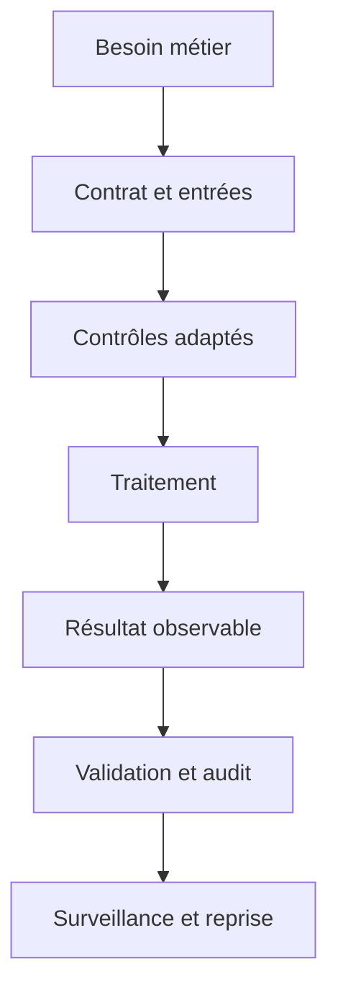
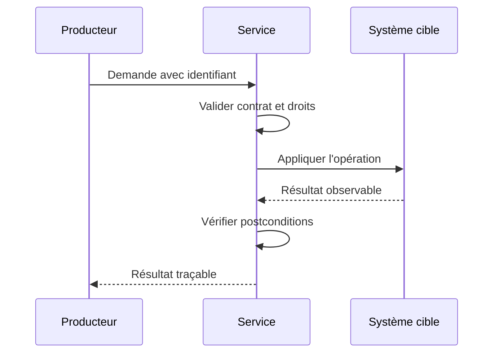
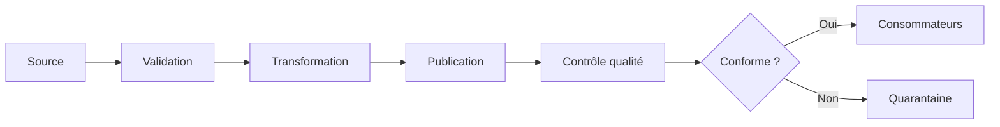
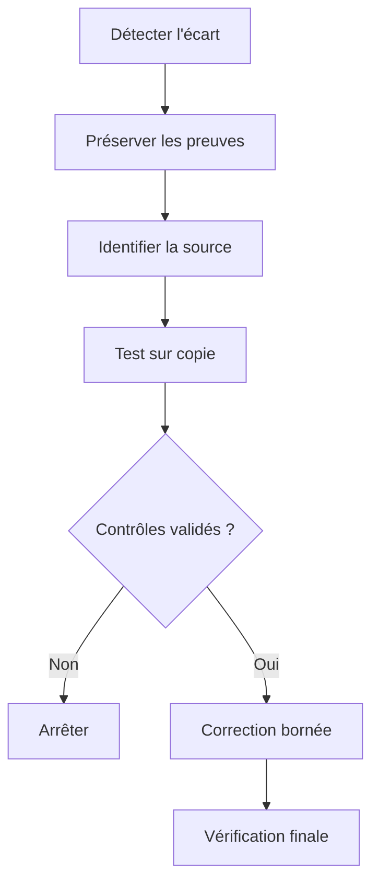
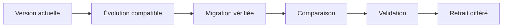

# Normalisation (1NF, 2NF, 3NF) — Intermédiaire

> **Mise en contexte.** Analyser les dépendances fonctionnelles et décomposer les relations sans perte. Le fil rouge est un schéma de commandes répétant clients, adresses, produits et tarifs. Travaillez sur des données synthétiques, des privilèges limités et un environnement réinitialisable. Vérifiez la version de l'outil dans la documentation officielle avant de transposer une commande ou une garantie.

## Introduction et objectifs

Ce cours relie normalisation (1nf, 2nf, 3nf) à un cas concret : un schéma de commandes répétant clients, adresses, produits et tarifs. Il faut comprendre le contrat, la source de vérité, les effets secondaires et la preuve qui démontre la correction. Ce niveau vise à traiter les cas limites, comparer des stratégies et mesurer l'effet. À la fin, vous saurez définir des invariants, choisir des contrôles, construire des tests normaux et adversariaux, vérifier le résultat réel, diagnostiquer un incident et documenter les limites. Une absence d'exception ou une capture d'écran ne suffit pas à démontrer l'état métier.

## Prérequis et environnement

Références initiales : https://www.postgresql.org/docs/current/ddl-constraints.html, https://dev.mysql.com/doc/refman/8.4/en/. Notez les versions, les paramètres, les privilèges et l'état initial. Préparez une procédure de remise à zéro. N'utilisez pas de secrets ou de données personnelles réelles. Les exemples doivent isoler les hypothèses pour que le résultat puisse être reproduit par une autre personne.

## 1. Architecture et contrat

Décrivez la source, les producteurs, les transformations, l'état persistant et les consommateurs. Dans « un schéma de commandes répétant clients, adresses, produits et tarifs », identifiez l'autorité qui fait foi et les représentations dérivées. Le contrat doit préciser entrées, valeurs admissibles, effets secondaires, erreurs, délais et postconditions. Cette étape distingue la réussite technique d'un résultat fiable pour le métier.

## 2. Concepts essentiels

### 1. Dépendance fonctionnelle

Le concept « Dépendance fonctionnelle » se comprend par la règle métier qu'il protège. Pour « un schéma de commandes répétant clients, adresses, produits et tarifs », identifiez l'acteur qui produit l'information, le composant qui la traite et la propriété attendue par le consommateur. Construisez un exemple valide et un contre-exemple. Un test uniquement nominal peut masquer une erreur de modèle, une dépendance implicite ou une protection insuffisante.

Pour vérifier dépendance fonctionnelle, notez la version, les paramètres et les préconditions, puis contrôlez la postcondition dans l'état réel. Si le test échoue, examinez séparément données, contrat, droits, configuration et ordre des opérations. Ne désactivez pas un contrôle pour forcer la réussite. Expliquez ce qui se passe avec valeur absente, doublon, interruption et reprise, puis indiquez quelles métriques ou quels journaux expurgés permettent le diagnostic.

### 2. Première forme normale

Le concept « Première forme normale » se comprend par la règle métier qu'il protège. Pour « un schéma de commandes répétant clients, adresses, produits et tarifs », identifiez l'acteur qui produit l'information, le composant qui la traite et la propriété attendue par le consommateur. Construisez un exemple valide et un contre-exemple. Un test uniquement nominal peut masquer une erreur de modèle, une dépendance implicite ou une protection insuffisante.

Pour vérifier première forme normale, notez la version, les paramètres et les préconditions, puis contrôlez la postcondition dans l'état réel. Si le test échoue, examinez séparément données, contrat, droits, configuration et ordre des opérations. Ne désactivez pas un contrôle pour forcer la réussite. Expliquez ce qui se passe avec valeur absente, doublon, interruption et reprise, puis indiquez quelles métriques ou quels journaux expurgés permettent le diagnostic.

### 3. Deuxième forme normale

Le concept « Deuxième forme normale » se comprend par la règle métier qu'il protège. Pour « un schéma de commandes répétant clients, adresses, produits et tarifs », identifiez l'acteur qui produit l'information, le composant qui la traite et la propriété attendue par le consommateur. Construisez un exemple valide et un contre-exemple. Un test uniquement nominal peut masquer une erreur de modèle, une dépendance implicite ou une protection insuffisante.

Pour vérifier deuxième forme normale, notez la version, les paramètres et les préconditions, puis contrôlez la postcondition dans l'état réel. Si le test échoue, examinez séparément données, contrat, droits, configuration et ordre des opérations. Ne désactivez pas un contrôle pour forcer la réussite. Expliquez ce qui se passe avec valeur absente, doublon, interruption et reprise, puis indiquez quelles métriques ou quels journaux expurgés permettent le diagnostic.

### 4. Troisième forme normale

Le concept « Troisième forme normale » se comprend par la règle métier qu'il protège. Pour « un schéma de commandes répétant clients, adresses, produits et tarifs », identifiez l'acteur qui produit l'information, le composant qui la traite et la propriété attendue par le consommateur. Construisez un exemple valide et un contre-exemple. Un test uniquement nominal peut masquer une erreur de modèle, une dépendance implicite ou une protection insuffisante.

Pour vérifier troisième forme normale, notez la version, les paramètres et les préconditions, puis contrôlez la postcondition dans l'état réel. Si le test échoue, examinez séparément données, contrat, droits, configuration et ordre des opérations. Ne désactivez pas un contrôle pour forcer la réussite. Expliquez ce qui se passe avec valeur absente, doublon, interruption et reprise, puis indiquez quelles métriques ou quels journaux expurgés permettent le diagnostic.

### 5. BCNF et clés candidates

Le concept « BCNF et clés candidates » se comprend par la règle métier qu'il protège. Pour « un schéma de commandes répétant clients, adresses, produits et tarifs », identifiez l'acteur qui produit l'information, le composant qui la traite et la propriété attendue par le consommateur. Construisez un exemple valide et un contre-exemple. Un test uniquement nominal peut masquer une erreur de modèle, une dépendance implicite ou une protection insuffisante.

Pour vérifier bcnf et clés candidates, notez la version, les paramètres et les préconditions, puis contrôlez la postcondition dans l'état réel. Si le test échoue, examinez séparément données, contrat, droits, configuration et ordre des opérations. Ne désactivez pas un contrôle pour forcer la réussite. Expliquez ce qui se passe avec valeur absente, doublon, interruption et reprise, puis indiquez quelles métriques ou quels journaux expurgés permettent le diagnostic.

### 6. Décomposition sans perte

Le concept « Décomposition sans perte » se comprend par la règle métier qu'il protège. Pour « un schéma de commandes répétant clients, adresses, produits et tarifs », identifiez l'acteur qui produit l'information, le composant qui la traite et la propriété attendue par le consommateur. Construisez un exemple valide et un contre-exemple. Un test uniquement nominal peut masquer une erreur de modèle, une dépendance implicite ou une protection insuffisante.

Pour vérifier décomposition sans perte, notez la version, les paramètres et les préconditions, puis contrôlez la postcondition dans l'état réel. Si le test échoue, examinez séparément données, contrat, droits, configuration et ordre des opérations. Ne désactivez pas un contrôle pour forcer la réussite. Expliquez ce qui se passe avec valeur absente, doublon, interruption et reprise, puis indiquez quelles métriques ou quels journaux expurgés permettent le diagnostic.

### 7. Préservation des dépendances

Le concept « Préservation des dépendances » se comprend par la règle métier qu'il protège. Pour « un schéma de commandes répétant clients, adresses, produits et tarifs », identifiez l'acteur qui produit l'information, le composant qui la traite et la propriété attendue par le consommateur. Construisez un exemple valide et un contre-exemple. Un test uniquement nominal peut masquer une erreur de modèle, une dépendance implicite ou une protection insuffisante.

Pour vérifier préservation des dépendances, notez la version, les paramètres et les préconditions, puis contrôlez la postcondition dans l'état réel. Si le test échoue, examinez séparément données, contrat, droits, configuration et ordre des opérations. Ne désactivez pas un contrôle pour forcer la réussite. Expliquez ce qui se passe avec valeur absente, doublon, interruption et reprise, puis indiquez quelles métriques ou quels journaux expurgés permettent le diagnostic.

### 8. Anomalies de modification

Le concept « Anomalies de modification » se comprend par la règle métier qu'il protège. Pour « un schéma de commandes répétant clients, adresses, produits et tarifs », identifiez l'acteur qui produit l'information, le composant qui la traite et la propriété attendue par le consommateur. Construisez un exemple valide et un contre-exemple. Un test uniquement nominal peut masquer une erreur de modèle, une dépendance implicite ou une protection insuffisante.

Pour vérifier anomalies de modification, notez la version, les paramètres et les préconditions, puis contrôlez la postcondition dans l'état réel. Si le test échoue, examinez séparément données, contrat, droits, configuration et ordre des opérations. Ne désactivez pas un contrôle pour forcer la réussite. Expliquez ce qui se passe avec valeur absente, doublon, interruption et reprise, puis indiquez quelles métriques ou quels journaux expurgés permettent le diagnostic.

### 9. Dénormalisation intentionnelle

Le concept « Dénormalisation intentionnelle » se comprend par la règle métier qu'il protège. Pour « un schéma de commandes répétant clients, adresses, produits et tarifs », identifiez l'acteur qui produit l'information, le composant qui la traite et la propriété attendue par le consommateur. Construisez un exemple valide et un contre-exemple. Un test uniquement nominal peut masquer une erreur de modèle, une dépendance implicite ou une protection insuffisante.

Pour vérifier dénormalisation intentionnelle, notez la version, les paramètres et les préconditions, puis contrôlez la postcondition dans l'état réel. Si le test échoue, examinez séparément données, contrat, droits, configuration et ordre des opérations. Ne désactivez pas un contrôle pour forcer la réussite. Expliquez ce qui se passe avec valeur absente, doublon, interruption et reprise, puis indiquez quelles métriques ou quels journaux expurgés permettent le diagnostic.

### 10. Tests de propriétés

Le concept « Tests de propriétés » se comprend par la règle métier qu'il protège. Pour « un schéma de commandes répétant clients, adresses, produits et tarifs », identifiez l'acteur qui produit l'information, le composant qui la traite et la propriété attendue par le consommateur. Construisez un exemple valide et un contre-exemple. Un test uniquement nominal peut masquer une erreur de modèle, une dépendance implicite ou une protection insuffisante.

Pour vérifier tests de propriétés, notez la version, les paramètres et les préconditions, puis contrôlez la postcondition dans l'état réel. Si le test échoue, examinez séparément données, contrat, droits, configuration et ordre des opérations. Ne désactivez pas un contrôle pour forcer la réussite. Expliquez ce qui se passe avec valeur absente, doublon, interruption et reprise, puis indiquez quelles métriques ou quels journaux expurgés permettent le diagnostic.

## 3. Méthode de conception et d'exploitation

### 1. Formaliser les invariants

Écrivez ce qui doit toujours rester vrai dans un schéma de commandes répétant clients, adresses, produits et tarifs : intégrité, unicité, ordre, confidentialité, fraîcheur ou état final. Chaque invariant doit pouvoir être testé et associé à une source de vérité. Donnez un exemple permis et un exemple refusé. Si le résultat attendu ne peut pas être contrôlé, précisez quelle valeur ou quel signal sera utilisé comme preuve. Au niveau intermédiaire, il faut traiter les cas limites, comparer des stratégies et mesurer l'effet. La conclusion doit distinguer les faits observés, les hypothèses et les risques résiduels. Un contrôle n'est acquis que si l'on peut répéter le test et comparer le résultat.

### 2. Préparer les entrées

Définissez types, unités, bornes, valeurs optionnelles, provenance et version. Préparez des cas adversariaux : doublon, valeur vide, schéma inconnu, taille inhabituelle ou référence absente. Des données synthétiques permettent de reproduire le cas sans exposer de personnes ou d'identifiants réels. Modifiez une hypothèse à la fois et consignez les résultats. Au niveau intermédiaire, il faut traiter les cas limites, comparer des stratégies et mesurer l'effet. La conclusion doit distinguer les faits observés, les hypothèses et les risques résiduels. Un contrôle n'est acquis que si l'on peut répéter le test et comparer le résultat.

### 3. Choisir le contrôle

Placez le contrôle là où il peut empêcher l'état invalide : contrainte persistante, validation de contrat, transaction, contrôle d'accès ou test d'intégration. Un contrôle tardif peut signaler l'erreur sans empêcher sa propagation. Séparez garanties, alertes et bonnes pratiques. Vérifiez les limites exactes du mécanisme dans la version réelle. Au niveau intermédiaire, il faut traiter les cas limites, comparer des stratégies et mesurer l'effet. La conclusion doit distinguer les faits observés, les hypothèses et les risques résiduels. Un contrôle n'est acquis que si l'on peut répéter le test et comparer le résultat.

### 4. Gérer les erreurs

Classez les erreurs en entrée invalide, incompatibilité, accès interdit, saturation, conflit concurrent et problème transitoire. Définissez une réponse par catégorie. Les erreurs permanentes doivent être rejetées ou mises en quarantaine avec une raison exploitable. Une reprise temporaire doit être bornée et ne jamais répéter aveuglément un effet non idempotent. Au niveau intermédiaire, il faut traiter les cas limites, comparer des stratégies et mesurer l'effet. La conclusion doit distinguer les faits observés, les hypothèses et les risques résiduels. Un contrôle n'est acquis que si l'on peut répéter le test et comparer le résultat.

### 5. Protéger les reprises

Un appel peut être répété après un timeout, un worker redémarré ou un lot rejoué. Définissez l'identifiant d'une action métier unique et vérifiez le résultat enregistré avant de produire un nouvel effet. Testez reprises séquentielles et concurrentes en contrôlant l'état final. Si le traitement déclenche un système externe, décrivez comment réconcilier les états en cas de panne entre deux composants. Au niveau intermédiaire, il faut traiter les cas limites, comparer des stratégies et mesurer l'effet. La conclusion doit distinguer les faits observés, les hypothèses et les risques résiduels. Un contrôle n'est acquis que si l'on peut répéter le test et comparer le résultat.

### 6. Mesurer avant optimisation

Établissez une référence : latence, débit, consommation, fraîcheur, taille ou taux d'erreur. Décrivez volume, distribution et concurrence. Changez un facteur à la fois et répétez la mesure. Une solution correcte sur quelques lignes peut échouer sur une grande table ou une charge déséquilibrée. L'optimisation doit préserver l'exactitude et les garanties de sécurité. Au niveau intermédiaire, il faut traiter les cas limites, comparer des stratégies et mesurer l'effet. La conclusion doit distinguer les faits observés, les hypothèses et les risques résiduels. Un contrôle n'est acquis que si l'on peut répéter le test et comparer le résultat.

### 7. Limiter les privilèges

Séparez les rôles runtime, migration, reporting et administration. Les secrets restent hors du dépôt et les entrées sont paramétrées ou validées selon leur type. Testez un accès autorisé et un accès interdit par le vrai chemin technique. Les journaux doivent donner le contexte utile sans copier des données sensibles. Au niveau intermédiaire, il faut traiter les cas limites, comparer des stratégies et mesurer l'effet. La conclusion doit distinguer les faits observés, les hypothèses et les risques résiduels. Un contrôle n'est acquis que si l'on peut répéter le test et comparer le résultat.

### 8. Faire évoluer sans rupture

Une évolution peut toucher consommateurs, jobs, rapports et scripts. Ajoutez une structure compatible, migrez les anciennes données, comparez les résultats et retirez l'ancien chemin après vérification. Le backfill doit être borné et déterministe. Testez la base vide et la base historique, et prévoyez un critère d'arrêt lorsque les écarts dépassent la tolérance. Au niveau intermédiaire, il faut traiter les cas limites, comparer des stratégies et mesurer l'effet. La conclusion doit distinguer les faits observés, les hypothèses et les risques résiduels. Un contrôle n'est acquis que si l'on peut répéter le test et comparer le résultat.

### 9. Rendre l'état observable

Suivez volume, durée, erreurs, fraîcheur, données rejetées, divergences et ressources consommées. Chaque alerte possède un seuil, un propriétaire et une action documentée. Utilisez des identifiants de corrélation, expurgez les valeurs privées et vérifiez que le signal est actionnable. Une journalisation trop abondante peut devenir un risque de confidentialité et une source de coût. Au niveau intermédiaire, il faut traiter les cas limites, comparer des stratégies et mesurer l'effet. La conclusion doit distinguer les faits observés, les hypothèses et les risques résiduels. Un contrôle n'est acquis que si l'on peut répéter le test et comparer le résultat.

### 10. Préparer la reprise

Décrivez le retour vers un état connu après incident. Comptez les éléments touchés avant réparation, testez sur une copie, définissez un critère d'arrêt et conservez la trace de l'action. Après reprise, vérifiez les invariants et réconciliez les consommateurs externes. Le simple redémarrage d'un service n'est pas une preuve que la donnée est cohérente. Au niveau intermédiaire, il faut traiter les cas limites, comparer des stratégies et mesurer l'effet. La conclusion doit distinguer les faits observés, les hypothèses et les risques résiduels. Un contrôle n'est acquis que si l'on peut répéter le test et comparer le résultat.

### 11. Comparer les options

Comparez les mécanismes selon intégrité, simplicité, disponibilité, coût, latence, sécurité et exploitabilité. Une solution plus sophistiquée n'est pas forcément plus robuste si l'équipe ne sait pas l'exploiter. Documentez les hypothèses, les options rejetées, les risques acceptés, les mesures et les conditions qui imposeraient une réévaluation. Au niveau intermédiaire, il faut traiter les cas limites, comparer des stratégies et mesurer l'effet. La conclusion doit distinguer les faits observés, les hypothèses et les risques résiduels. Un contrôle n'est acquis que si l'on peut répéter le test et comparer le résultat.

### 12. Automatiser les preuves

Les tests protègent les invariants importants. Incluez cas normal, valeur limite, entrée invalide, répétition, interruption et reprise. Un test doit échouer lorsque la règle n'est plus respectée et afficher le contexte nécessaire au diagnostic. Versionnez données synthétiques et scripts pour ne pas dépendre d'une intervention manuelle. Au niveau intermédiaire, il faut traiter les cas limites, comparer des stratégies et mesurer l'effet. La conclusion doit distinguer les faits observés, les hypothèses et les risques résiduels. Un contrôle n'est acquis que si l'on peut répéter le test et comparer le résultat.

## 4. Atelier pratique

### Étape 1 — Définir le contrat

Pour « un schéma de commandes répétant clients, adresses, produits et tarifs », écrivez ce qui sera vérifié, préparez des données synthétiques, notez les paramètres et observez l'état réel. Ajoutez un cas où la règle doit refuser l'opération. Simulez une interruption dans le laboratoire, vérifiez quels effets ont déjà été appliqués et décrivez comment revenir à un état connu. Enregistrez les résultats et les limites de version. Cette étape n'est terminée que lorsque quelqu'un d'autre peut la répéter sans étape cachée.

### Étape 2 — Créer un environnement isolé

Pour « un schéma de commandes répétant clients, adresses, produits et tarifs », écrivez ce qui sera vérifié, préparez des données synthétiques, notez les paramètres et observez l'état réel. Ajoutez un cas où la règle doit refuser l'opération. Simulez une interruption dans le laboratoire, vérifiez quels effets ont déjà été appliqués et décrivez comment revenir à un état connu. Enregistrez les résultats et les limites de version. Cette étape n'est terminée que lorsque quelqu'un d'autre peut la répéter sans étape cachée.

### Étape 3 — Capturer l'état initial

Pour « un schéma de commandes répétant clients, adresses, produits et tarifs », écrivez ce qui sera vérifié, préparez des données synthétiques, notez les paramètres et observez l'état réel. Ajoutez un cas où la règle doit refuser l'opération. Simulez une interruption dans le laboratoire, vérifiez quels effets ont déjà été appliqués et décrivez comment revenir à un état connu. Enregistrez les résultats et les limites de version. Cette étape n'est terminée que lorsque quelqu'un d'autre peut la répéter sans étape cachée.

### Étape 4 — Exécuter le cas nominal

Pour « un schéma de commandes répétant clients, adresses, produits et tarifs », écrivez ce qui sera vérifié, préparez des données synthétiques, notez les paramètres et observez l'état réel. Ajoutez un cas où la règle doit refuser l'opération. Simulez une interruption dans le laboratoire, vérifiez quels effets ont déjà été appliqués et décrivez comment revenir à un état connu. Enregistrez les résultats et les limites de version. Cette étape n'est terminée que lorsque quelqu'un d'autre peut la répéter sans étape cachée.

### Étape 5 — Ajouter un cas adverse

Pour « un schéma de commandes répétant clients, adresses, produits et tarifs », écrivez ce qui sera vérifié, préparez des données synthétiques, notez les paramètres et observez l'état réel. Ajoutez un cas où la règle doit refuser l'opération. Simulez une interruption dans le laboratoire, vérifiez quels effets ont déjà été appliqués et décrivez comment revenir à un état connu. Enregistrez les résultats et les limites de version. Cette étape n'est terminée que lorsque quelqu'un d'autre peut la répéter sans étape cachée.

### Étape 6 — Simuler un échec contrôlé

Pour « un schéma de commandes répétant clients, adresses, produits et tarifs », écrivez ce qui sera vérifié, préparez des données synthétiques, notez les paramètres et observez l'état réel. Ajoutez un cas où la règle doit refuser l'opération. Simulez une interruption dans le laboratoire, vérifiez quels effets ont déjà été appliqués et décrivez comment revenir à un état connu. Enregistrez les résultats et les limites de version. Cette étape n'est terminée que lorsque quelqu'un d'autre peut la répéter sans étape cachée.

### Étape 7 — Rejouer la demande

Pour « un schéma de commandes répétant clients, adresses, produits et tarifs », écrivez ce qui sera vérifié, préparez des données synthétiques, notez les paramètres et observez l'état réel. Ajoutez un cas où la règle doit refuser l'opération. Simulez une interruption dans le laboratoire, vérifiez quels effets ont déjà été appliqués et décrivez comment revenir à un état connu. Enregistrez les résultats et les limites de version. Cette étape n'est terminée que lorsque quelqu'un d'autre peut la répéter sans étape cachée.

### Étape 8 — Mesurer une variante

Pour « un schéma de commandes répétant clients, adresses, produits et tarifs », écrivez ce qui sera vérifié, préparez des données synthétiques, notez les paramètres et observez l'état réel. Ajoutez un cas où la règle doit refuser l'opération. Simulez une interruption dans le laboratoire, vérifiez quels effets ont déjà été appliqués et décrivez comment revenir à un état connu. Enregistrez les résultats et les limites de version. Cette étape n'est terminée que lorsque quelqu'un d'autre peut la répéter sans étape cachée.

### Étape 9 — Tester les autorisations

Pour « un schéma de commandes répétant clients, adresses, produits et tarifs », écrivez ce qui sera vérifié, préparez des données synthétiques, notez les paramètres et observez l'état réel. Ajoutez un cas où la règle doit refuser l'opération. Simulez une interruption dans le laboratoire, vérifiez quels effets ont déjà été appliqués et décrivez comment revenir à un état connu. Enregistrez les résultats et les limites de version. Cette étape n'est terminée que lorsque quelqu'un d'autre peut la répéter sans étape cachée.

### Étape 10 — Réinitialiser et documenter

Pour « un schéma de commandes répétant clients, adresses, produits et tarifs », écrivez ce qui sera vérifié, préparez des données synthétiques, notez les paramètres et observez l'état réel. Ajoutez un cas où la règle doit refuser l'opération. Simulez une interruption dans le laboratoire, vérifiez quels effets ont déjà été appliqués et décrivez comment revenir à un état connu. Enregistrez les résultats et les limites de version. Cette étape n'est terminée que lorsque quelqu'un d'autre peut la répéter sans étape cachée.

## 5. Diagnostics guidés

### Cas 1 — résultat incomplet

Dans « un schéma de commandes répétant clients, adresses, produits et tarifs », ce symptôme peut être lié à dépendance fonctionnelle. Fixez la période, les versions, les entrées et la postcondition, puis réduisez le cas jusqu'à obtenir une reproduction minimale. Séparez les hypothèses liées aux données, au contrat, aux privilèges, aux ressources et à l'ordre des opérations. Préservez les journaux utiles sans exposer de secrets. La correction doit préserver les données valides, traiter la cause et pouvoir être rejouée. Contrôlez ensuite le cas normal et ajoutez un test de non-régression.

### Cas 2 — doublon après relance

Dans « un schéma de commandes répétant clients, adresses, produits et tarifs », ce symptôme peut être lié à première forme normale. Fixez la période, les versions, les entrées et la postcondition, puis réduisez le cas jusqu'à obtenir une reproduction minimale. Séparez les hypothèses liées aux données, au contrat, aux privilèges, aux ressources et à l'ordre des opérations. Préservez les journaux utiles sans exposer de secrets. La correction doit préserver les données valides, traiter la cause et pouvoir être rejouée. Contrôlez ensuite le cas normal et ajoutez un test de non-régression.

### Cas 3 — latence anormalement élevée

Dans « un schéma de commandes répétant clients, adresses, produits et tarifs », ce symptôme peut être lié à deuxième forme normale. Fixez la période, les versions, les entrées et la postcondition, puis réduisez le cas jusqu'à obtenir une reproduction minimale. Séparez les hypothèses liées aux données, au contrat, aux privilèges, aux ressources et à l'ordre des opérations. Préservez les journaux utiles sans exposer de secrets. La correction doit préserver les données valides, traiter la cause et pouvoir être rejouée. Contrôlez ensuite le cas normal et ajoutez un test de non-régression.

### Cas 4 — valeur absente mal interprétée

Dans « un schéma de commandes répétant clients, adresses, produits et tarifs », ce symptôme peut être lié à troisième forme normale. Fixez la période, les versions, les entrées et la postcondition, puis réduisez le cas jusqu'à obtenir une reproduction minimale. Séparez les hypothèses liées aux données, au contrat, aux privilèges, aux ressources et à l'ordre des opérations. Préservez les journaux utiles sans exposer de secrets. La correction doit préserver les données valides, traiter la cause et pouvoir être rejouée. Contrôlez ensuite le cas normal et ajoutez un test de non-régression.

### Cas 5 — changement de version inattendu

Dans « un schéma de commandes répétant clients, adresses, produits et tarifs », ce symptôme peut être lié à bcnf et clés candidates. Fixez la période, les versions, les entrées et la postcondition, puis réduisez le cas jusqu'à obtenir une reproduction minimale. Séparez les hypothèses liées aux données, au contrat, aux privilèges, aux ressources et à l'ordre des opérations. Préservez les journaux utiles sans exposer de secrets. La correction doit préserver les données valides, traiter la cause et pouvoir être rejouée. Contrôlez ensuite le cas normal et ajoutez un test de non-régression.

### Cas 6 — accès non autorisé

Dans « un schéma de commandes répétant clients, adresses, produits et tarifs », ce symptôme peut être lié à décomposition sans perte. Fixez la période, les versions, les entrées et la postcondition, puis réduisez le cas jusqu'à obtenir une reproduction minimale. Séparez les hypothèses liées aux données, au contrat, aux privilèges, aux ressources et à l'ordre des opérations. Préservez les journaux utiles sans exposer de secrets. La correction doit préserver les données valides, traiter la cause et pouvoir être rejouée. Contrôlez ensuite le cas normal et ajoutez un test de non-régression.

### Cas 7 — opération partielle

Dans « un schéma de commandes répétant clients, adresses, produits et tarifs », ce symptôme peut être lié à préservation des dépendances. Fixez la période, les versions, les entrées et la postcondition, puis réduisez le cas jusqu'à obtenir une reproduction minimale. Séparez les hypothèses liées aux données, au contrat, aux privilèges, aux ressources et à l'ordre des opérations. Préservez les journaux utiles sans exposer de secrets. La correction doit préserver les données valides, traiter la cause et pouvoir être rejouée. Contrôlez ensuite le cas normal et ajoutez un test de non-régression.

### Cas 8 — écart entre source et sortie

Dans « un schéma de commandes répétant clients, adresses, produits et tarifs », ce symptôme peut être lié à anomalies de modification. Fixez la période, les versions, les entrées et la postcondition, puis réduisez le cas jusqu'à obtenir une reproduction minimale. Séparez les hypothèses liées aux données, au contrat, aux privilèges, aux ressources et à l'ordre des opérations. Préservez les journaux utiles sans exposer de secrets. La correction doit préserver les données valides, traiter la cause et pouvoir être rejouée. Contrôlez ensuite le cas normal et ajoutez un test de non-régression.

### Cas 9 — charge déséquilibrée

Dans « un schéma de commandes répétant clients, adresses, produits et tarifs », ce symptôme peut être lié à dénormalisation intentionnelle. Fixez la période, les versions, les entrées et la postcondition, puis réduisez le cas jusqu'à obtenir une reproduction minimale. Séparez les hypothèses liées aux données, au contrat, aux privilèges, aux ressources et à l'ordre des opérations. Préservez les journaux utiles sans exposer de secrets. La correction doit préserver les données valides, traiter la cause et pouvoir être rejouée. Contrôlez ensuite le cas normal et ajoutez un test de non-régression.

### Cas 10 — consommateur incompatible

Dans « un schéma de commandes répétant clients, adresses, produits et tarifs », ce symptôme peut être lié à tests de propriétés. Fixez la période, les versions, les entrées et la postcondition, puis réduisez le cas jusqu'à obtenir une reproduction minimale. Séparez les hypothèses liées aux données, au contrat, aux privilèges, aux ressources et à l'ordre des opérations. Préservez les journaux utiles sans exposer de secrets. La correction doit préserver les données valides, traiter la cause et pouvoir être rejouée. Contrôlez ensuite le cas normal et ajoutez un test de non-régression.

### Cas 11 — alerte non actionnable

Dans « un schéma de commandes répétant clients, adresses, produits et tarifs », ce symptôme peut être lié à dépendance fonctionnelle. Fixez la période, les versions, les entrées et la postcondition, puis réduisez le cas jusqu'à obtenir une reproduction minimale. Séparez les hypothèses liées aux données, au contrat, aux privilèges, aux ressources et à l'ordre des opérations. Préservez les journaux utiles sans exposer de secrets. La correction doit préserver les données valides, traiter la cause et pouvoir être rejouée. Contrôlez ensuite le cas normal et ajoutez un test de non-régression.

### Cas 12 — restauration non démontrée

Dans « un schéma de commandes répétant clients, adresses, produits et tarifs », ce symptôme peut être lié à première forme normale. Fixez la période, les versions, les entrées et la postcondition, puis réduisez le cas jusqu'à obtenir une reproduction minimale. Séparez les hypothèses liées aux données, au contrat, aux privilèges, aux ressources et à l'ordre des opérations. Préservez les journaux utiles sans exposer de secrets. La correction doit préserver les données valides, traiter la cause et pouvoir être rejouée. Contrôlez ensuite le cas normal et ajoutez un test de non-régression.

## 6. Exercices avec corrigés

### Exercice 1 — Formaliser une règle

**Énoncé.** Pour « un schéma de commandes répétant clients, adresses, produits et tarifs », expliquez comment vérifier dépendance fonctionnelle et prouver la conformité du résultat.

**Corrigé.** Définissez préconditions et postconditions, utilisez des données synthétiques et contrôlez l'état réellement obtenu. Ajoutez un test négatif qui distingue une solution robuste d'une sortie seulement plausible. Consignez les versions, les entrées, les erreurs et les objets touchés. Si une reprise est possible, rejouez le même identifiant et vérifiez qu'elle ne crée pas un second effet métier. Expliquez la règle retenue et la limite encore non couverte.

### Exercice 2 — Choisir un contrôle

**Énoncé.** Pour « un schéma de commandes répétant clients, adresses, produits et tarifs », expliquez comment vérifier troisième forme normale et prouver la conformité du résultat.

**Corrigé.** Définissez préconditions et postconditions, utilisez des données synthétiques et contrôlez l'état réellement obtenu. Ajoutez un test négatif qui distingue une solution robuste d'une sortie seulement plausible. Consignez les versions, les entrées, les erreurs et les objets touchés. Si une reprise est possible, rejouez le même identifiant et vérifiez qu'elle ne crée pas un second effet métier. Expliquez la règle retenue et la limite encore non couverte.

### Exercice 3 — Identifier la source de vérité

**Énoncé.** Pour « un schéma de commandes répétant clients, adresses, produits et tarifs », expliquez comment vérifier préservation des dépendances et prouver la conformité du résultat.

**Corrigé.** Définissez préconditions et postconditions, utilisez des données synthétiques et contrôlez l'état réellement obtenu. Ajoutez un test négatif qui distingue une solution robuste d'une sortie seulement plausible. Consignez les versions, les entrées, les erreurs et les objets touchés. Si une reprise est possible, rejouez le même identifiant et vérifiez qu'elle ne crée pas un second effet métier. Expliquez la règle retenue et la limite encore non couverte.

### Exercice 4 — Gérer une entrée invalide

**Énoncé.** Pour « un schéma de commandes répétant clients, adresses, produits et tarifs », expliquez comment vérifier tests de propriétés et prouver la conformité du résultat.

**Corrigé.** Définissez préconditions et postconditions, utilisez des données synthétiques et contrôlez l'état réellement obtenu. Ajoutez un test négatif qui distingue une solution robuste d'une sortie seulement plausible. Consignez les versions, les entrées, les erreurs et les objets touchés. Si une reprise est possible, rejouez le même identifiant et vérifiez qu'elle ne crée pas un second effet métier. Expliquez la règle retenue et la limite encore non couverte.

### Exercice 5 — Interpréter une mesure

**Énoncé.** Pour « un schéma de commandes répétant clients, adresses, produits et tarifs », expliquez comment vérifier deuxième forme normale et prouver la conformité du résultat.

**Corrigé.** Définissez préconditions et postconditions, utilisez des données synthétiques et contrôlez l'état réellement obtenu. Ajoutez un test négatif qui distingue une solution robuste d'une sortie seulement plausible. Consignez les versions, les entrées, les erreurs et les objets touchés. Si une reprise est possible, rejouez le même identifiant et vérifiez qu'elle ne crée pas un second effet métier. Expliquez la règle retenue et la limite encore non couverte.

### Exercice 6 — Protéger une reprise

**Énoncé.** Pour « un schéma de commandes répétant clients, adresses, produits et tarifs », expliquez comment vérifier décomposition sans perte et prouver la conformité du résultat.

**Corrigé.** Définissez préconditions et postconditions, utilisez des données synthétiques et contrôlez l'état réellement obtenu. Ajoutez un test négatif qui distingue une solution robuste d'une sortie seulement plausible. Consignez les versions, les entrées, les erreurs et les objets touchés. Si une reprise est possible, rejouez le même identifiant et vérifiez qu'elle ne crée pas un second effet métier. Expliquez la règle retenue et la limite encore non couverte.

### Exercice 7 — Planifier une évolution

**Énoncé.** Pour « un schéma de commandes répétant clients, adresses, produits et tarifs », expliquez comment vérifier dénormalisation intentionnelle et prouver la conformité du résultat.

**Corrigé.** Définissez préconditions et postconditions, utilisez des données synthétiques et contrôlez l'état réellement obtenu. Ajoutez un test négatif qui distingue une solution robuste d'une sortie seulement plausible. Consignez les versions, les entrées, les erreurs et les objets touchés. Si une reprise est possible, rejouez le même identifiant et vérifiez qu'elle ne crée pas un second effet métier. Expliquez la règle retenue et la limite encore non couverte.

### Exercice 8 — Séparer les privilèges

**Énoncé.** Pour « un schéma de commandes répétant clients, adresses, produits et tarifs », expliquez comment vérifier première forme normale et prouver la conformité du résultat.

**Corrigé.** Définissez préconditions et postconditions, utilisez des données synthétiques et contrôlez l'état réellement obtenu. Ajoutez un test négatif qui distingue une solution robuste d'une sortie seulement plausible. Consignez les versions, les entrées, les erreurs et les objets touchés. Si une reprise est possible, rejouez le même identifiant et vérifiez qu'elle ne crée pas un second effet métier. Expliquez la règle retenue et la limite encore non couverte.

### Exercice 9 — Détecter une dérive

**Énoncé.** Pour « un schéma de commandes répétant clients, adresses, produits et tarifs », expliquez comment vérifier bcnf et clés candidates et prouver la conformité du résultat.

**Corrigé.** Définissez préconditions et postconditions, utilisez des données synthétiques et contrôlez l'état réellement obtenu. Ajoutez un test négatif qui distingue une solution robuste d'une sortie seulement plausible. Consignez les versions, les entrées, les erreurs et les objets touchés. Si une reprise est possible, rejouez le même identifiant et vérifiez qu'elle ne crée pas un second effet métier. Expliquez la règle retenue et la limite encore non couverte.

### Exercice 10 — Prouver une restauration

**Énoncé.** Pour « un schéma de commandes répétant clients, adresses, produits et tarifs », expliquez comment vérifier anomalies de modification et prouver la conformité du résultat.

**Corrigé.** Définissez préconditions et postconditions, utilisez des données synthétiques et contrôlez l'état réellement obtenu. Ajoutez un test négatif qui distingue une solution robuste d'une sortie seulement plausible. Consignez les versions, les entrées, les erreurs et les objets touchés. Si une reprise est possible, rejouez le même identifiant et vérifiez qu'elle ne crée pas un second effet métier. Expliquez la règle retenue et la limite encore non couverte.

## 7. Études de cas supplémentaires

### Étude de cas 1 — Dépendance fonctionnelle

Le symptôme est : traitement incomplet sur données variées. Pour « un schéma de commandes répétant clients, adresses, produits et tarifs », collectez versions et paramètres, créez une reproduction réduite et distinguez les causes possibles. Inspectez dépendance fonctionnelle, vérifiez les effets déjà appliqués et comparez état attendu et état obtenu. La réparation doit avoir un périmètre borné, une procédure de retour à un état connu et un contrôle final. Conservez une preuve de correction ainsi qu'une alerte ou un test qui permettra de détecter le même défaut en exploitation. Documentez le compromis technique et son risque résiduel.

### Étude de cas 2 — Deuxième forme normale

Le symptôme est : deux clients envoient la même demande après un timeout. Pour « un schéma de commandes répétant clients, adresses, produits et tarifs », collectez versions et paramètres, créez une reproduction réduite et distinguez les causes possibles. Inspectez deuxième forme normale, vérifiez les effets déjà appliqués et comparez état attendu et état obtenu. La réparation doit avoir un périmètre borné, une procédure de retour à un état connu et un contrôle final. Conservez une preuve de correction ainsi qu'une alerte ou un test qui permettra de détecter le même défaut en exploitation. Documentez le compromis technique et son risque résiduel.

### Étude de cas 3 — BCNF et clés candidates

Le symptôme est : ancienne version active pendant le déploiement. Pour « un schéma de commandes répétant clients, adresses, produits et tarifs », collectez versions et paramètres, créez une reproduction réduite et distinguez les causes possibles. Inspectez bcnf et clés candidates, vérifiez les effets déjà appliqués et comparez état attendu et état obtenu. La réparation doit avoir un périmètre borné, une procédure de retour à un état connu et un contrôle final. Conservez une preuve de correction ainsi qu'une alerte ou un test qui permettra de détecter le même défaut en exploitation. Documentez le compromis technique et son risque résiduel.

### Étude de cas 4 — Préservation des dépendances

Le symptôme est : résultats différents entre environnements. Pour « un schéma de commandes répétant clients, adresses, produits et tarifs », collectez versions et paramètres, créez une reproduction réduite et distinguez les causes possibles. Inspectez préservation des dépendances, vérifiez les effets déjà appliqués et comparez état attendu et état obtenu. La réparation doit avoir un périmètre borné, une procédure de retour à un état connu et un contrôle final. Conservez une preuve de correction ainsi qu'une alerte ou un test qui permettra de détecter le même défaut en exploitation. Documentez le compromis technique et son risque résiduel.

### Étude de cas 5 — Dénormalisation intentionnelle

Le symptôme est : volume en croissance rapide. Pour « un schéma de commandes répétant clients, adresses, produits et tarifs », collectez versions et paramètres, créez une reproduction réduite et distinguez les causes possibles. Inspectez dénormalisation intentionnelle, vérifiez les effets déjà appliqués et comparez état attendu et état obtenu. La réparation doit avoir un périmètre borné, une procédure de retour à un état connu et un contrôle final. Conservez une preuve de correction ainsi qu'une alerte ou un test qui permettra de détecter le même défaut en exploitation. Documentez le compromis technique et son risque résiduel.

### Étude de cas 6 — Dépendance fonctionnelle

Le symptôme est : accès hors périmètre. Pour « un schéma de commandes répétant clients, adresses, produits et tarifs », collectez versions et paramètres, créez une reproduction réduite et distinguez les causes possibles. Inspectez dépendance fonctionnelle, vérifiez les effets déjà appliqués et comparez état attendu et état obtenu. La réparation doit avoir un périmètre borné, une procédure de retour à un état connu et un contrôle final. Conservez une preuve de correction ainsi qu'une alerte ou un test qui permettra de détecter le même défaut en exploitation. Documentez le compromis technique et son risque résiduel.

### Étude de cas 7 — Deuxième forme normale

Le symptôme est : job terminé sans preuve de qualité. Pour « un schéma de commandes répétant clients, adresses, produits et tarifs », collectez versions et paramètres, créez une reproduction réduite et distinguez les causes possibles. Inspectez deuxième forme normale, vérifiez les effets déjà appliqués et comparez état attendu et état obtenu. La réparation doit avoir un périmètre borné, une procédure de retour à un état connu et un contrôle final. Conservez une preuve de correction ainsi qu'une alerte ou un test qui permettra de détecter le même défaut en exploitation. Documentez le compromis technique et son risque résiduel.

### Étude de cas 8 — BCNF et clés candidates

Le symptôme est : réparation manuelle sans procédure. Pour « un schéma de commandes répétant clients, adresses, produits et tarifs », collectez versions et paramètres, créez une reproduction réduite et distinguez les causes possibles. Inspectez bcnf et clés candidates, vérifiez les effets déjà appliqués et comparez état attendu et état obtenu. La réparation doit avoir un périmètre borné, une procédure de retour à un état connu et un contrôle final. Conservez une preuve de correction ainsi qu'une alerte ou un test qui permettra de détecter le même défaut en exploitation. Documentez le compromis technique et son risque résiduel.

### Étude de cas 9 — Préservation des dépendances

Le symptôme est : optimisation rapide en lecture mais coûteuse en écriture. Pour « un schéma de commandes répétant clients, adresses, produits et tarifs », collectez versions et paramètres, créez une reproduction réduite et distinguez les causes possibles. Inspectez préservation des dépendances, vérifiez les effets déjà appliqués et comparez état attendu et état obtenu. La réparation doit avoir un périmètre borné, une procédure de retour à un état connu et un contrôle final. Conservez une preuve de correction ainsi qu'une alerte ou un test qui permettra de détecter le même défaut en exploitation. Documentez le compromis technique et son risque résiduel.

### Étude de cas 10 — Dénormalisation intentionnelle

Le symptôme est : restauration sans réconciliation. Pour « un schéma de commandes répétant clients, adresses, produits et tarifs », collectez versions et paramètres, créez une reproduction réduite et distinguez les causes possibles. Inspectez dénormalisation intentionnelle, vérifiez les effets déjà appliqués et comparez état attendu et état obtenu. La réparation doit avoir un périmètre borné, une procédure de retour à un état connu et un contrôle final. Conservez une preuve de correction ainsi qu'une alerte ou un test qui permettra de détecter le même défaut en exploitation. Documentez le compromis technique et son risque résiduel.

## 8. Défi final avec correction

### Énoncé

Concevez une solution pour « un schéma de commandes répétant clients, adresses, produits et tarifs » qui applique les principes de normalisation (1nf, 2nf, 3nf). Livrez le contrat d'entrée-sortie, le modèle ou l'architecture, les contrôles d'intégrité et de sécurité, les tests, les métriques et la procédure d'exploitation. La solution doit traiter une entrée invalide, une demande répétée, une interruption et une évolution de version. Expliquez les garanties que vous pouvez démontrer et celles qui dépendent de la technologie.

### Correction détaillée

Définissez la source de vérité et les invariants métier. Choisissez le contrôle capable de protéger chaque invariant : contrainte persistante, validation de contrat, transaction, autorisation ou test de pipeline. Préparez un environnement isolé avec un cas nominal, une limite et une entrée invalide. Enregistrez les versions et contrôlez l'état réel à chaque frontière ; un message de succès ne suffit pas.

Rendez la reprise bornée et répétable, distinguez les erreurs permanentes des erreurs transitoires et empêchez un rejeu de créer un doublon. Définissez des métriques utiles, des seuils, des propriétaires d'alerte et un runbook. Mesurez les optimisations à charge équivalente. Pour faire évoluer le contrat, maintenez la compatibilité, migrez par étapes, comparez les résultats et retirez l'ancien chemin seulement après validation.

En cas d'incident, préservez les preuves, comptez les éléments touchés et testez la réparation sur copie. Après reprise, vérifiez les invariants et réconciliez les consommateurs externes. Le livrable doit permettre à un autre apprenant de recréer l'environnement et de répéter les tests sans étape manuelle cachée.

## 9. Schémas de référence

## 10. Checklist de maîtrise

- Besoin et invariants formalisés.
- Versions, entrées et droits contrôlés.
- Cas normaux, limites, erreurs et répétitions testés.
- Reprises bornées et idempotentes.
- Mesures de qualité et de performance disponibles.
- Changements compatibles et vérifiés.
- Logs expurgés de données sensibles inutiles.
- Restauration ou reprise réellement testée.
- Scripts de test reproductibles.
- Hypothèses et risques résiduels documentés.

## 11. Références techniques

- https://www.postgresql.org/docs/current/ddl-constraints.html
- https://dev.mysql.com/doc/refman/8.4/en/

Vérifiez la documentation de la version utilisée avant toute commande en production. Les règles internes de sécurité, conformité et exploitation complètent ces références.
