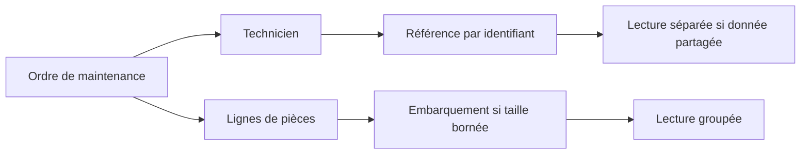
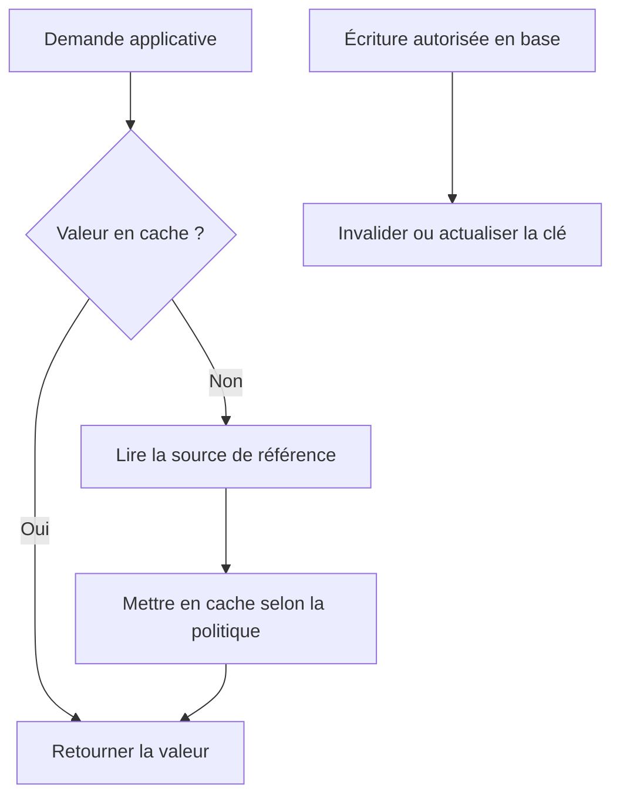

# Introduction à MongoDB et Redis — Intermédiaire

> **Mise en contexte** — Une équipe remplace une base relationnelle par une base documentaire parce que son schéma semble trop rigide, puis ajoute Redis pour accélérer une page. Quelques semaines plus tard, elle découvre des documents incohérents, des clés de cache jamais invalidées et une mémoire saturée. MongoDB et Redis sont des outils différents, aux modèles et compromis distincts. Les choisir exige de partir des accès métier, des exigences de cohérence, de la durabilité, du cycle de vie et du coût d'exploitation, et pas d'un slogan sur le NoSQL.

## Introduction et objectifs

Ce cours présente les familles NoSQL à travers MongoDB et Redis, le modèle de document, les clés-valeurs, les index, la modélisation orientée accès, la cohérence, les transactions et la stratégie de cache. Il ne suppose pas que NoSQL est un remplacement systématique du relationnel. Une application peut combiner plusieurs moteurs lorsque les rôles sont explicites et que l'équipe sait exploiter leurs interactions.

À la fin, l'apprenant pourra expliquer les différences entre document, clé-valeur et relationnel, concevoir des documents MongoDB cohérents avec les accès, utiliser les index et lire des plans, choisir les structures Redis adaptées à une fonction, comprendre les risques de cache stale et d'invalidation, définir la durabilité et la reprise, et concevoir un test de charge représentatif.

## 1. Pourquoi plusieurs modèles de données existent

### 1.1 Le modèle relationnel n'est pas obsolète

Les bases relationnelles sont adaptées à des données structurées, aux relations explicites, aux contraintes et aux transactions. Elles peuvent gérer de grands volumes et de fortes charges si le schéma, les requêtes et l'architecture sont adaptés. Le choix d'un autre moteur doit répondre à un besoin mesuré : flexibilité du document, distribution, accès par clé, débit d'événements, cache ou structure spécialisée.

NoSQL désigne un ensemble de modèles, pas un produit unique. Les bases documentaires, clé-valeur, colonnes larges et graphes ont des fonctionnalités et garanties différentes. MongoDB n'offre pas la même interface qu'une base clé-valeur. Redis propose des structures en mémoire et des options de persistance qui ne doivent pas être interprétées comme identiques à une base documentaire traditionnelle.

### 1.2 Choisir en fonction des accès

Décrire les questions que l'application doit poser avant de choisir le modèle :
- recherche par identifiant, filtre, intervalle ou texte ;
- modifications unitaires ou atomiques sur plusieurs entités ;
- besoin de relations et de contraintes ;
- fréquence et taille des lectures et écritures ;
- tolérance à la donnée temporairement ancienne ;
- volume, croissance et répartition de charge ;
- besoin de transactions, de sauvegarde et de restauration ;
- capacité de l'équipe à surveiller et exploiter chaque moteur ;
- portabilité, dépendance fournisseur et compétences disponibles.

Le choix doit être validé avec des données représentatives. Une technologie peut être adaptée à l'accès principal et médiocre à un autre accès ajouté plus tard. La modélisation et l'évolution du besoin doivent rester visibles.

### 1.3 Familles NoSQL

| Famille | Modèle principal | Exemple d'accès | Point de vigilance |
|---|---|---|---|
| Document | Objets JSON/BSON regroupant des champs et tableaux | Charger un dossier complet par identifiant | Documents volumineux, duplication, index |
| Clé-valeur | Une clé permet d'accéder à une valeur ou une structure | Compteurs, sessions, cache | Expiration, mémoire, absence de requête relationnelle générale |
| Colonnes larges | Lignes flexibles avec colonnes regroupées selon le produit | Accès par partition et clé de clustering | Modèle d'accès spécifique, distribution des partitions |
| Graphe | Nœuds et arêtes | Explorer les relations | Coût des parcours et modèle de requête |
| Recherche | Index de documents et analyse textuelle | Rechercher des mots et scores | Index secondaire, cohérence et coût de mise à jour |

Ne pas choisir une base parce qu'elle appartient à une catégorie à la mode. Le bon moteur est celui dont le modèle correspond aux accès et dont les garanties peuvent être exploitées par l'équipe.

## 2. MongoDB : documents et collections

### 2.1 Document, collection et identifiant

MongoDB stocke des documents BSON organisés en collections. Les documents peuvent comporter des objets imbriqués et des tableaux. Chaque document possède un identifiant unique, généralement représenté par le champ _id, qui sert de référence principale pour un accès direct.

Un document n'est pas une table libre de toute règle. Il faut définir la validité des champs, les types, la taille, les conventions de nommage et les règles d'évolution. Un schéma souple ne signifie pas que n'importe quelle forme de donnée est acceptable. Des documents incohérents compliquent les requêtes, les migrations et les interfaces.

Exemple conceptuel : un ordre de maintenance peut contenir numéro, état, site, technicien affecté, date de création et un petit historique des changements. Les pièces consommées peuvent être intégrées si elles sont consultées avec l'ordre et si leur quantité et leur taille restent raisonnables. Si les pièces doivent être partagées et mises à jour indépendamment, une référence peut être plus appropriée.

### 2.2 Embarquer ou référencer

L'embarquement regroupe des informations pour les lire en une seule opération. Il peut aussi dupliquer la donnée, augmenter la taille du document et compliquer les mises à jour lorsqu'une même information est partagée par de nombreuses entités. Une référence maintient la séparation mais demande une requête supplémentaire ou une opération d'agrégation lorsque le parcours a besoin des deux objets.

Le choix doit suivre la fréquence d'accès, les règles d'actualisation, les cardinalités et la taille maximale probable. Une relation un-à-un ou une petite liste stable se prête souvent à l'embarquement. Une relation un-à-plusieurs qui grandit sans limite, ou un objet partagé et modifié indépendamment, peut justifier une collection séparée.

### 2.3 Éviter les tableaux non bornés

Un tableau qui grossit à chaque événement peut rendre le document de plus en plus coûteux à lire et à modifier. Il peut finir par atteindre les limites de taille du document ou provoquer une forte contention si toute modification touche le même enregistrement. Garder dans le document parent un résumé ou les derniers événements et stocker l'historique complet séparément lorsque sa croissance est non bornée.

Définir ce qui est conservé, la durée, la pagination et la méthode d'archivage. Un champ d'historique ne doit pas devenir un journal éternel sans limites. Les traitements qui ajoutent des événements doivent gérer les répétitions et l'ordre si celui-ci est métier.

### 2.4 Schéma évolutif et validation

Une collection peut contenir des documents de formes différentes, surtout après plusieurs versions de l'application. Cela augmente la charge de compatibilité. Documenter les migrations, introduire les nouveaux champs progressivement, prévoir une lecture tolérante pendant la transition et supprimer les anciens champs seulement après avoir vérifié qu'aucun client ne les utilise.

Une validation au niveau base peut imposer des types et conditions utiles. La validation applicative reste nécessaire pour les règles métier et les permissions. Les deux couches sont complémentaires : le client peut être ancien, un script peut contourner l'API, ou un import peut insérer des données incorrectes.

## 3. Indexation dans MongoDB

Un index peut accélérer un filtre, un tri ou une recherche selon sa structure. Il consomme toutefois du stockage et peut augmenter les coûts d'écriture. L'indexation doit partir des requêtes réellement exécutées, et être vérifiée avec les outils de planification disponibles dans la version.

### 3.1 Index simple et composé

Un index simple couvre un champ. Un index composé ordonne plusieurs clés. L'ordre est important pour les préfixes et pour la combinaison de conditions. Concevoir l'index à partir du parcours concret, par exemple filtrer d'abord par site et état puis trier par date. Vérifier plusieurs valeurs courantes et rares, et pas seulement un exemple.

### 3.2 Index multikey, unique et TTL

Un index sur un champ de tableau peut avoir une sémantique multikey selon MongoDB. Un index unique empêche certaines duplications de clé selon les règles de nullité et de document du moteur. Un index TTL permet une suppression automatique de documents expirés dans les conditions prévues ; ce n'est pas un mécanisme de sauvegarde ou une horloge exacte à la seconde.

Les index doivent être compatibles avec les données existantes. La création d'un index unique peut échouer si des doublons existent. L'équipe doit prévoir le nettoyage, la validation avant migration et la surveillance de la création. Ne jamais supposer qu'une définition d'index passe en production sans examiner les données et l'impact de l'opération.

### 3.3 Examiner le plan

Utiliser les outils d'explication de MongoDB pour comprendre le plan, les documents examinés, les entrées d'index et les documents retournés. Le nom d'une étape n'est pas un verdict : un parcours de collection peut être adapté si une grande partie des documents est demandée. Le rapport doit comparer le nombre d'éléments examinés et retournés, l'ordre de tri, les documents de sortie et le temps observé.

La mesure doit refléter les paramètres réels, le volume et la concurrence. Une requête efficace sur une base de test très petite peut être médiocre lorsque la collection grandit. Tester également la conséquence de l'index sur les insertions et mises à jour.

## 4. Redis : structures en mémoire et usage ciblé

### 4.1 Redis n'est pas uniquement une chaîne de cache

Redis propose plusieurs structures de données, par exemple chaînes, hashes, listes, sets, sorted sets et streams selon la version et la configuration. Le choix de la structure influence les opérations atomiques disponibles, le coût mémoire et la complexité d'accès.

- Une chaîne peut représenter un token temporaire, un petit document sérialisé ou un compteur.
- Un hash peut représenter les champs d'un objet léger.
- Un set permet de suivre des membres uniques.
- Un sorted set peut ordonner des éléments selon un score.
- Une liste peut servir à certaines files simples, sous réserve du modèle de livraison et de reprise.
- Un stream permet d'enregistrer et lire des événements avec des identifiants, mais exige une politique de taille et de consommation.

Ces structures ne remplacent pas automatiquement une base relationnelle ou un broker d'événements conçu pour d'autres garanties. Choisir selon le volume, les types d'opérations, la durabilité, l'ordre, la récupération et le coût d'exploitation.

### 4.2 TTL et expiration

Une durée de vie (TTL) permet de limiter la durée de conservation de clés temporaires. Définir l'expiration selon le besoin métier et le risque : sessions, résultats calculés, verrous temporaires ou cache. Une expiration mal réglée peut provoquer une tempête de recalcul lorsque de nombreuses clés expirent simultanément.

Le TTL ne doit pas remplacer les règles d'autorisation. Une session expirée doit rester inutilisable même si une clé n'a pas encore été supprimée physiquement. Le serveur applicatif doit vérifier les états nécessaires et ne pas considérer la présence d'une valeur de cache comme une preuve suffisante d'identité ou d'autorisation.

### 4.3 Persistance et reprise Redis

Redis est souvent utilisé en mémoire, avec des options de persistance, de réplication et de reprise qui dépendent du déploiement et de la configuration. La présence d'une copie sur disque ne signifie pas que chaque dernière écriture survivra à toute panne. Le compromis entre durabilité, latence, consommation mémoire et procédure de reprise doit être explicitement choisi.

Vérifier les paramètres de persistance, les sauvegardes, la réplication, les conditions de redémarrage, les limites de mémoire et la méthode de restauration. Une configuration de cache jetable peut autoriser une reconstruction depuis la source ; un stockage temporaire de sessions ou d'états critiques peut demander une politique différente.

### 4.4 Atomicité et concurrence

Une opération atomique sur une clé ne rend pas atomique un processus constitué de multiples appels indépendants. Si l'application lit une valeur, effectue un calcul puis l'écrit dans un autre appel, deux clients concurrents peuvent perdre une mise à jour. Utiliser les commandes, scripts ou mécanismes transactionnels documentés qui correspondent à l'opération, puis tester les courses concurrentes.

Un verrou distribué exige une analyse des expirations, des pannes de client et de la durée de l'opération. Un simple verrou avec TTL peut expirer pendant que le détenteur travaille ; une autre instance peut alors prendre le verrou. Les tâches critiques peuvent nécessiter un jeton de fencing, une opération idempotente ou une protection sur le système d'autorité. Ne pas prétendre garantir une exclusion absolue sans analyser le scénario de panne.

## 5. Concevoir un cache cohérent

### 5.1 Cache-aside

Dans le modèle cache-aside, l'application cherche d'abord la valeur dans le cache. Si elle est absente, elle lit la source de référence, puis stocke le résultat pour une durée définie. Lors d'une modification, le cache doit être invalidé ou actualisé selon une stratégie cohérente.

L'ordre de l'écriture et de l'invalidation compte. Une invalidation effectuée avant le commit de la base peut être suivie par une lecture qui remet en cache l'ancienne valeur. Invalider après commit réduit ce risque, sans éliminer toutes les courses possibles. Définir le comportement souhaité, mesurer la fraîcheur et tester les scénarios de concurrence.

### 5.2 Cache stampede et valeurs obsolètes

Si une clé très demandée expire, de nombreuses requêtes peuvent interroger simultanément la base de référence. Des mécanismes comme une reconstruction coordonnée, un TTL avec variation, un rafraîchissement en arrière-plan ou une valeur ancienne temporairement servie peuvent réduire le pic. Le choix dépend de la criticité : une page de catalogue tolère parfois une légère ancienneté, une autorisation ne devrait pas.

Ne jamais utiliser un cache ancien sans définir combien de temps l'ancienneté est acceptable. Un cache qui améliore les performances mais renvoie des droits révoqués, un solde erroné ou un état d'intervention incorrect peut être plus dangereux qu'une requête lente.

### 5.3 Cache négatif et indisponibilité de la source

Un cache peut aussi retenir temporairement qu'une recherche n'a pas trouvé de valeur. Cela réduit les requêtes répétées sur des clés inexistantes, mais nécessite une expiration courte et une stratégie quand l'objet est créé ensuite. Un cache négatif trop long masque la création d'une ressource.

Définir ce qui se passe si la base de référence est indisponible : échouer proprement, retourner une valeur explicitement ancienne ou servir un mode dégradé limité. Ne pas traiter une panne de la source comme si une valeur cachée était toujours correcte. L'application doit afficher ou tracer l'état dégradé lorsque cela change le sens métier.

## 6. Transactions et cohérence multi-documents

MongoDB prend en charge des transactions multi-documents dans des environnements et conditions appropriés, mais leur coût et leurs contraintes dépendent de la topologie et de la version. La modélisation par document permet souvent de placer ensemble les données qui doivent changer atomiquement. Il faut néanmoins éviter d'embarquer de grandes structures uniquement pour contourner les transactions.

Une transaction longue augmente la pression sur les ressources et peut échouer en cas de conflit. Concevoir des transactions courtes, savoir gérer les erreurs et les nouvelles tentatives, et ne pas supposer qu'un appel répété du client signifie que le premier essai n'a rien validé. Les mécanismes d'idempotence restent importants.

Redis permet certaines opérations atomiques sur des clés et des mécanismes groupés, mais une garantie à l'intérieur du moteur ne garantit pas l'atomicité entre Redis et une base SQL. Si une opération modifie les deux systèmes, décider quelle source fait autorité et comment réconcilier une panne entre les deux étapes. Un outbox, une opération idempotente ou une compensation explicite peut être nécessaire.

### 6.1 Définir la source de vérité

Chaque donnée critique doit avoir un système maître. Si Redis sert de cache pour un statut stocké en SQL, SQL demeure la référence et Redis peut être reconstruit. Si une structure Redis porte temporairement l'état d'une file, il faut préciser quelles garanties de durabilité et de reprise sont attendues et si la source peut être reconstruite.

Ne pas écrire dans plusieurs moteurs sans protocole de cohérence. Si une modification SQL réussit mais que l'invalidation de cache échoue, la procédure doit savoir détecter et réparer l'état. Surveiller le taux d'échec d'invalidation, prévoir une expiration de secours et utiliser un événement fiable si les garanties l'exigent.

## 7. Exploitation, observabilité et capacité

### 7.1 MongoDB

Surveiller les opérations lentes, l'utilisation et l'efficacité des index, les connexions, la pression mémoire, les attentes disque, les retards de réplication, la croissance des collections et les résultats des sauvegardes. Les indicateurs et commandes de diagnostic dépendent de l'édition et de la version. Conserver les paramètres et le contexte lorsque l'on compare des périodes.

Une collection très volumineuse ou un document chaud mis à jour continuellement peut créer un goulot d'étranglement. Analyser le modèle d'accès, la distribution des clés et la fréquence des écritures. Une modification de schéma peut déplacer le problème plutôt que le corriger ; tester plusieurs parcours.

### 7.2 Redis

Suivre la mémoire utilisée, le taux d'éviction, les expirations, les connexions, la latence, les commandes fréquentes, les clés volumineuses et l'espace disponible. Une politique d'éviction fait partie de la sémantique du service : si le cache est jetable, une éviction est souvent normale ; si une application y conserve un état qu'elle ne sait pas reconstruire, l'éviction peut provoquer une perte fonctionnelle.

Dimensionner la mémoire avec une marge et observer l'évolution des structures. Des clés très nombreuses, des collections qui ne sont jamais bornées ou une politique d'expiration incohérente peuvent faire croître l'instance au-delà de la capacité. Prévoir une procédure de réduction de charge ou de reconstruction plutôt que laisser le système basculer de façon inattendue.

### 7.3 Alertes utiles

Une alerte doit être rattachée à l'impact et à une action. Par exemple, une mémoire proche de sa limite peut déclencher l'examen des clés volumineuses, des évictions et des TTL ; un retard de réplication peut déclencher une revue des exigences de cohérence avant une bascule. Les alertes doivent avoir un propriétaire, une urgence et une procédure d'escalade.

Ne pas créer une alerte par métrique sans rôle opérationnel. Les tableaux de bord servent à comparer, diagnostiquer et agir. Inclure la version, la configuration, le volume et les changements récents afin que le signal soit interprétable.

## 8. Sécurité et gestion des données

L'accès à MongoDB ou Redis doit être limité aux réseaux, services et identités autorisés. Utiliser des comptes dédiés, des permissions minimales, une gestion des secrets et les mécanismes de chiffrement appropriés à l'environnement. Un cache peut contenir autant d'informations sensibles que la base de référence ; sa durée de vie courte ne le rend pas automatiquement anodin.

Éviter d'exposer une instance Redis sans authentification et segmentation appropriées. Restreindre les commandes administratives, protéger les sauvegardes et journaliser les accès sensibles selon la politique de l'organisation. Dans MongoDB, les rôles doivent limiter les actions et les bases auxquelles un compte peut accéder. Les secrets ne doivent pas être intégrés au code ou reproduits dans les journaux de requêtes.

Le cache ne doit pas contourner l'autorisation. Si une réponse dépend du rôle ou de l'identité, la clé de cache doit intégrer les dimensions qui influencent la réponse ou la donnée doit être filtrée après récupération selon un mécanisme fiable. Une clé commune utilisée pour des réponses personnalisées peut exposer des données entre utilisateurs.

## 9. Étude de cas — Catalogue de pièces lent

Un portail affiche des pièces par site et catégorie. L'équipe ajoute Redis et cache la réponse pendant une heure. Les performances s'améliorent, mais une modification de prix apparaît encore dans l'interface après son changement, et certains utilisateurs reçoivent un catalogue qui ne correspond pas à leurs droits.

### Étape A — Identifier les classes de données

Les informations de catalogue public peuvent parfois tolérer une fraîcheur bornée. Les prix, les niveaux de stock ou les données accessibles selon des permissions peuvent exiger des règles différentes. Ne pas mettre toute la réponse dans une clé unique sans examiner la finalité de chaque champ.

### Étape B — Définir les clés

La clé doit refléter les paramètres qui modifient le résultat : site, catégorie, version du catalogue et, si la réponse est personnalisée, le périmètre d'autorisation. Ne pas inclure inutilement des identifiants personnels si une séparation par rôle ou groupe suffit ; mais ne jamais partager une réponse qui diffère selon les droits.

### Étape C — Choisir l'invalidation

Après modification confirmée dans le système maître, invalider les clés pertinentes ou publier un événement de changement. Tenir compte des processus multiples et des pannes entre commit et invalidation. Si un événement peut être perdu, prévoir une stratégie de réconciliation ou un TTL maximal aligné sur le niveau de fraîcheur acceptable.

### Étape D — Tester la concurrence

Simuler deux lectures au moment de l'expiration et une mise à jour concurrente. Vérifier que l'ancienne valeur ne peut pas rester en cache au-delà de la limite définie. Mesurer aussi le pic de lecture à l'expiration et la charge sur la source lorsqu'une clé populaire n'est plus présente.

### Étape E — Valider les permissions

Créer des cas de test avec deux rôles qui ne voient pas le même catalogue. Vérifier que les clés ne mélangent pas les périmètres et que la modification des permissions invalide ou sépare les valeurs appropriées. Tester la suppression d'un compte et la révocation d'un accès. La performance ne justifie pas une fuite de données.

### Résultat attendu

La décision inclut le type de données autorisé au cache, le système de référence, la durée maximale d'ancienneté, les clés, l'invalidation, la reprise en cas d'indisponibilité, les métriques et les tests de sécurité. Le cache est adopté seulement si les bénéfices observés justifient les coûts supplémentaires et si la cohérence est démontrée.

## 10. Pièges fréquents

- Remplacer une base relationnelle sans besoin fonctionnel démontré.
- Utiliser un document géant qui croît sans limite.
- Dupliquer une donnée partagée sans politique de mise à jour.
- Créer des index MongoDB sans examiner les requêtes réelles.
- Oublier le coût d'écriture des index et des documents volumineux.
- Considérer Redis comme persistant sans vérifier la configuration.
- Utiliser un TTL comme mécanisme de sécurité ou de révocation.
- Invalider un cache avant le commit puis réinsérer une ancienne valeur.
- Mettre en cache une réponse personnalisée avec une clé partagée.
- Stocker un état critique uniquement dans un cache jetable.
- Supposer qu'une transaction MongoDB ou Redis assure la cohérence entre les deux moteurs.
- Garder des clés et tableaux sans bornes.
- Ignorer les coûts d'éviction et de reconstruction du cache.
- Se fier à un test avec une faible concurrence.

## 11. Checklist de conception et de production

### Conception
- [ ] Les cas d'usage et accès dominants sont documentés.
- [ ] La source de vérité est désignée pour chaque donnée critique.
- [ ] Les choix embarquer/référencer sont fondés sur cardinalité et cycle de vie.
- [ ] Les documents et structures ont des limites de taille et de rétention.
- [ ] Les index correspondent à des requêtes mesurées.
- [ ] Le traitement de la concurrence et des répétitions est défini.
- [ ] Les dépendances entre SQL, MongoDB et Redis sont explicites.

### Mise en production
- [ ] Les accès, secrets et connexions sont limités et testés.
- [ ] La stratégie de sauvegarde ou de reconstruction est vérifiée.
- [ ] Les TTL et politiques d'éviction ont un sens métier.
- [ ] L'invalidation du cache et les pannes sont testées.
- [ ] Les métriques, seuils et runbooks sont prêts.
- [ ] Les volumes, latences et coûts sont mesurés sous charge représentative.
- [ ] Les scénarios de révocation d'accès et de données anciennes sont testés.

## 12. Exercices corrigés

### Exercice 1 — Tableau d'historique sans limite

Une collection ajoute à chaque modification un événement au document parent et le document devient très volumineux.

**Corrigé :** séparer l'historique dans une collection dédiée, conserver éventuellement un résumé ou les derniers événements dans le parent, et définir pagination, rétention et index d'accès. Vérifier la cardinalité et les besoins de transaction.

### Exercice 2 — Cache partagé entre rôles

Deux groupes d'utilisateurs reçoivent la même clé de cache mais n'ont pas les mêmes autorisations.

**Corrigé :** revoir la clé et la frontière d'autorisation. Inclure les dimensions de permission pertinentes ou mettre en cache une donnée non personnalisée puis appliquer les contrôles côté serveur. Tester les changements de droits et les révocations.

### Exercice 3 — Clé Redis évincée

Le service découvre qu'une clé importante a été évincée en raison de la mémoire limitée.

**Corrigé :** distinguer cache reconstructible et état qui ne l'est pas. Si la clé est un cache, reconstruire depuis la source et adapter la capacité ou la politique. Si elle porte un état critique, déplacer la source de vérité ou revoir la stratégie de persistance et de reprise.

### Exercice 4 — Donnée encore ancienne après invalidation

Une application invalide la clé avant le commit SQL. Une lecture intermédiaire recharge la valeur précédente.

**Corrigé :** analyser l'ordre des événements. Invalider après le commit réduit cette course, mais le système doit aussi gérer les échecs d'invalidation, les répétitions et les accès simultanés. Ajouter un test concurrent et un mécanisme de réconciliation.

### Exercice 5 — Index absent d'une requête fréquente

Une recherche MongoDB parcourt toute la collection et retourne peu de documents.

**Corrigé :** examiner le plan, les filtres, la sélectivité, le tri et les projections. Proposer un index aligné sur le parcours, le tester avec des valeurs représentatives, mesurer les lectures et le coût d'écriture puis surveiller après déploiement.

## 13. Défi final — Choisir et exploiter MongoDB et Redis

Un portail de maintenance possède un catalogue de pièces, des sessions utilisateur, un historique d'interventions et des compteurs d'activité. Proposer une architecture qui spécifie le moteur maître de chaque donnée, la modélisation des documents, les clés Redis, les TTL, l'invalidation, les index, les droits et la restauration. Identifier les données qui ne doivent pas être mises en cache, et expliquer comment traiter les échecs entre moteurs.

### Barème indicatif
- Choix des modèles et source de vérité : 20 points.
- Modélisation des documents et index : 15 points.
- Stratégie Redis, TTL et invalidation : 20 points.
- Cohérence, concurrence et idempotence : 15 points.
- Sécurité, observabilité et reprise : 20 points.
- Tests, coût et justification des compromis : 10 points.

## À retenir

MongoDB et Redis répondent à des modèles d'accès distincts. La flexibilité du document n'exonère pas de gouverner le schéma, et la vitesse du cache n'exonère pas de définir la fraîcheur, l'invalidation, les permissions et la récupération. Une architecture multi-moteur exige une source de vérité, des interfaces explicites, des tests de concurrence et des runbooks que l'équipe sait exécuter.

## Ressources et références

- [MongoDB Manual](https://www.mongodb.com/docs/manual/)
- [MongoDB — Indexes](https://www.mongodb.com/docs/manual/indexes/)
- [MongoDB — Transactions](https://www.mongodb.com/docs/manual/core/transactions/)
- [Redis Documentation](https://redis.io/docs/latest/)
- [Redis — Data types](https://redis.io/docs/latest/develop/data-types/)

Vérifier la documentation et les garanties exactes de la version et du mode de déploiement utilisés, particulièrement pour la persistance, la réplication, la transaction et la sécurité.

## 14. Exploitation évolutive et coût total

Une architecture multi-moteur doit être examinée comme un service global. Le coût ne se réduit pas aux instances : inclure les réplicas, le stockage, la sauvegarde, les transferts, la supervision, les licences éventuelles, les compétences et la charge d'astreinte. Un cache peut réduire des lectures sur le moteur maître mais créer un coût supplémentaire de mémoire et une nouvelle catégorie d'incidents. Le catalogue de services doit expliquer quand la donnée peut être reconstruite et qui est responsable si la reconstruction échoue.

### 14.1 Plan de capacité et limites

Définir des limites pour le nombre de documents, la taille des documents, la longueur des historiques, la mémoire, la quantité de clés et le volume de cache. Les limites doivent être surveillées et reliées à des actions. La meilleure protection contre une collection qui grossit sans borne consiste à définir le cycle de vie dès la conception : archivage, séparation des historiques, suppression autorisée ou agrégat périodique.

Redis peut avoir plusieurs comportements de gestion de mémoire et d'éviction selon les paramètres. Les valeurs par défaut ne doivent pas être supposées adaptées à toutes les charges. Tester une saturation de mémoire sur un environnement non critique et définir la réaction du service avant que la limite ne soit atteinte. MongoDB exige également de surveiller la capacité, les index, les journaux, les opérations longues et la croissance des documents.

### 14.2 Changement de modèle ou de moteur

Une migration de données demande plus que recopier des objets. Définir les correspondances de schéma, les identifiants, les valeurs manquantes, les règles de conversion, le contrôle des doublons, la vérification des comptes et la bascule des clients. Une migration progressive peut maintenir les anciens et nouveaux chemins pendant une période limitée, mais il faut définir la source maître et la manière de comparer les écritures.

Tester un retour arrière avant la bascule. Si le nouveau modèle a accepté une valeur que l'ancien ne sait pas représenter, le retour peut nécessiter une transformation ou une compensation. Préciser les opérations qui ne sont pas réversibles, le point où la bascule devient définitive et la personne qui autorise le changement.

### 14.3 Amélioration continue

Examiner périodiquement les requêtes, les index, les TTL, la qualité des données, les retards de réplication et les incidents de cache. Les access patterns évoluent avec les fonctionnalités ; un index adapté au lancement peut devenir inutile ou trop coûteux plus tard. Documenter les décisions et utiliser des mesures pour justifier les changements.

Le critère de maturité n'est pas la présence simultanée de plusieurs technologies. C'est la capacité d'expliquer pourquoi chacune existe, quel résultat elle sert, comment elle est sécurisée, ce qui se passe quand elle échoue et comment elle peut être remplacée ou retirée sans perte de contrôle.

## 14. Exploitation évolutive et coût total

Une architecture multi-moteur doit être examinée comme un service global. Le coût ne se réduit pas aux instances : inclure les réplicas, le stockage, la sauvegarde, les transferts, la supervision, les licences éventuelles, les compétences et la charge d'astreinte. Un cache peut réduire des lectures sur le moteur maître mais créer un coût supplémentaire de mémoire et une nouvelle catégorie d'incidents. Le catalogue de services doit expliquer quand la donnée peut être reconstruite et qui est responsable si la reconstruction échoue.

### 14.1 Plan de capacité et limites

Définir des limites pour le nombre de documents, la taille des documents, la longueur des historiques, la mémoire, la quantité de clés et le volume de cache. Les limites doivent être surveillées et reliées à des actions. La meilleure protection contre une collection qui grossit sans borne consiste à définir le cycle de vie dès la conception : archivage, séparation des historiques, suppression autorisée ou agrégat périodique.

Redis peut avoir plusieurs comportements de gestion de mémoire et d'éviction selon les paramètres. Les valeurs par défaut ne doivent pas être supposées adaptées à toutes les charges. Tester une saturation de mémoire sur un environnement non critique et définir la réaction du service avant que la limite ne soit atteinte. MongoDB exige également de surveiller la capacité, les index, les journaux, les opérations longues et la croissance des documents.

### 14.2 Changement de modèle ou de moteur

Une migration de données demande plus que recopier des objets. Définir les correspondances de schéma, les identifiants, les valeurs manquantes, les règles de conversion, le contrôle des doublons, la vérification des comptes et la bascule des clients. Une migration progressive peut maintenir les anciens et nouveaux chemins pendant une période limitée, mais il faut définir la source maître et la manière de comparer les écritures.

Tester un retour arrière avant la bascule. Si le nouveau modèle a accepté une valeur que l'ancien ne sait pas représenter, le retour peut nécessiter une transformation ou une compensation. Préciser les opérations qui ne sont pas réversibles, le point où la bascule devient définitive et la personne qui autorise le changement.

### 14.3 Amélioration continue

Examiner périodiquement les requêtes, les index, les TTL, la qualité des données, les retards de réplication et les incidents de cache. Les access patterns évoluent avec les fonctionnalités ; un index adapté au lancement peut devenir inutile ou trop coûteux plus tard. Documenter les décisions et utiliser des mesures pour justifier les changements.

Le critère de maturité n'est pas la présence simultanée de plusieurs technologies. C'est la capacité d'expliquer pourquoi chacune existe, quel résultat elle sert, comment elle est sécurisée, ce qui se passe quand elle échoue et comment elle peut être remplacée ou retirée sans perte de contrôle.
