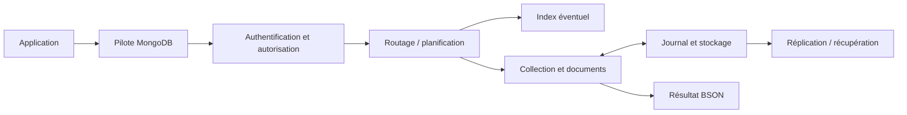
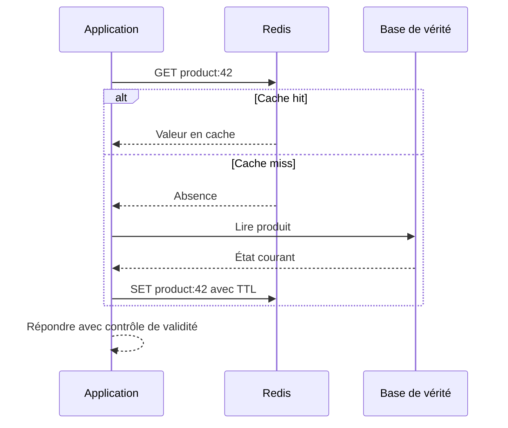

# Introduction à MongoDB et Redis — Intermédiaire

> **Mise en contexte.** Les systèmes NoSQL ne sont pas une catégorie uniforme et ne rendent pas les bases relationnelles obsolètes. Ils répondent à des besoins différents : documents semi-structurés, accès par clé, données à forte variation, cache, compteurs, files simples ou grands volumes distribués. MongoDB est principalement une base orientée documents ; Redis est un serveur de structures de données en mémoire souvent utilisé comme cache, registre d’état, compteur ou composant de coordination. Ils ne se remplacent pas automatiquement et peuvent coexister avec un SGBD relationnel. Ce cours apprend à choisir un modèle en fonction des accès, à maîtriser la cohérence, à concevoir les index et à sécuriser les données. Les exemples emploient des données synthétiques et doivent être exécutés sur un environnement de laboratoire.

## Objectifs pédagogiques

Au terme du cours, vous saurez comparer les modèles relationnel, document et clé-valeur, modéliser un document MongoDB, choisir entre intégration et référence, écrire des requêtes filtrées et des mises à jour atomiques, comprendre les index, employer Redis pour des usages adaptés, distinguer cache et source de vérité, définir une politique de durée de vie, et vérifier la persistance, les accès et la récupération.

Le niveau intermédiaire exige de justifier un choix avec les patterns d’accès et les contraintes de cohérence, pas seulement de connaître la syntaxe. Vous devez pouvoir expliquer pourquoi un document est incorporé ou référencé, quelles données ne doivent pas être mises en cache, ce qui se passe lorsque Redis est indisponible et comment une migration de modèle affecte les consommateurs.

## Prérequis et préparation

Vous devez connaître les concepts de clé, valeur, enregistrement, filtre, index, transaction et API. Familiarisez-vous avec JSON et avec le principe d’une application client-serveur. Installez les clients officiels correspondant à vos versions, ou utilisez un environnement local isolé. Les commandes de MongoDB Shell et Redis CLI ne sont pas interchangeables ; les commandes d’administration, les noms des paramètres et le comportement des versions doivent être vérifiés dans la documentation de la version installée.

Utilisez un jeu de données fictif : comptes de démonstration, paniers, produits, sessions temporaires et événements d’audit synthétiques. Ne réutilisez jamais les données personnelles de production dans le laboratoire. Gardez les secrets hors des scripts et des fichiers de configuration versionnés.

## 1. Comprendre les familles NoSQL

Le terme NoSQL recouvre plusieurs modèles. Une base clé-valeur associe une clé à une valeur, souvent pour un accès direct très rapide. Une base orientée documents stocke des structures comme JSON ou BSON, avec des champs imbriqués et parfois des champs qui varient d’un document à l’autre. Une base en colonnes larges organise les données selon des modèles d’accès distribués. Une base de graphes représente explicitement les entités et leurs relations. Les compromis sur les transactions, les requêtes, la distribution, la cohérence et l’indexation sont différents.

Les bases relationnelles excellent quand les relations, les contraintes et les jointures jouent un rôle central. MongoDB peut simplifier la persistance d’un agrégat métier dont les champs sont naturellement liés et souvent lus ensemble. Redis est très efficace pour des opérations de clé, compteur, ensemble, liste ou structure ordonnée en mémoire. Mais une structure facile à stocker n’est pas nécessairement adaptée à toutes les requêtes : si une application doit exécuter de nombreuses jointures transversales et imposer des contraintes complexes entre entités, le modèle choisi doit être réévalué.

Un choix d’architecture commence par des questions concrètes : quelles opérations sont les plus fréquentes ? Quelle taille peut atteindre un objet ? Quelles données changent ensemble ? Quel niveau de perte est acceptable ? Les valeurs doivent-elles survivre à un redémarrage ? La recherche est-elle simple par clé ou implique-t-elle plusieurs champs ? Combien de consommateurs écrivent simultanément ? Quelle latence et quel coût doivent être atteints ? Les réponses doivent venir de mesures ou d’exigences métier documentées.

| Besoin | Approche possible | Risque à considérer |
|---|---|---|
| Profil lu et mis à jour comme un agrégat | Document MongoDB | Taille, duplication et évolution du schéma |
| Session courte par identifiant | Redis avec TTL | Perte ou expiration de session |
| Source de vérité pour commandes et factures | SGBD transactionnel adapté | Garanties et contraintes métier |
| Classement temporaire ou compteur | Redis sorted set / counter | Atomicité, durée de vie et persistance |
| Analyse de relations très complexes | Base relationnelle ou graphe selon le pattern | Coût des traversées et de la modélisation |

## 2. Architecture et cycle d’une requête MongoDB

MongoDB stocke des documents BSON regroupés dans des collections. Un document possède une identité, généralement portée par le champ `_id`. Les champs peuvent contenir des scalaires, tableaux, objets imbriqués et parfois des structures de types variés. Cette flexibilité exige néanmoins une convention de données : sans contrat, les applications peuvent écrire simultanément `quantity`, `qty` et `quantite`, puis devoir gérer trois formes d’un même concept.

À l’arrivée d’une requête, le serveur la reçoit, vérifie l’identité et les droits, choisit une stratégie de lecture ou d’écriture, utilise éventuellement un index, exécute l’opération et renvoie un résultat. Les lectures et écritures sont influencées par les index, le cache, les verrous, le journal, la topologie et les paramètres de lecture ou d’écriture. En replica set, un primaire accepte normalement les écritures ; les secondaires répliquent les changements selon le mécanisme configuré. Dans un cluster shardé, les données sont réparties et la clé de shard influence le routage, l’équilibre de charge et le coût des requêtes.

Ne confondez pas *replica set*, sharding et sauvegarde. La réplication améliore la tolérance à certaines pannes et peut permettre une bascule. Le sharding répartit le stockage ou la charge. Une sauvegarde permet de revenir à un état antérieur. Une suppression erronée peut être répliquée et se propager aux réplicas ; le sharding ne remplace pas la récupération non plus.



## 3. Concevoir un document à partir des accès

La modélisation orientée documents commence par les requêtes et les agrégats métier, pas par la reproduction aveugle de chaque table relationnelle. Demandez quelles données doivent être lues ensemble, si elles partagent le même cycle de vie et quelle taille maximale elles peuvent atteindre. Incorporez un objet enfant si sa cardinalité est bornée et qu’il est habituellement lu avec son parent. Référencez-le s’il peut grossir sans limite, si de nombreux documents le partagent ou si son cycle de vie est distinct.

Exemple d’un profil et de préférences :

```javascript
{
  _id: "user-demo-42",
  displayName: "Samira Démo",
  locale: "fr-FR",
  preferences: {
    emailUpdates: false,
    theme: "dark"
  },
  addresses: [
    { kind: "delivery", city: "Douala", country: "CM" }
  ],
  schemaVersion: 2
}
```

Ce document illustre un objet synthétique, pas une convention universelle. Si l’historique de commandes se développe continuellement, le placer dans un tableau du profil finit par créer un agrégat volumineux et difficile à paginer. Il vaut mieux définir une collection de commandes séparée, avec un identifiant de propriétaire et des index adaptés. À l’inverse, séparer chaque préférence en une collection autonome sans raison peut imposer plusieurs allers-retours pour une lecture simple.

### Incorporer ou référencer ?

L’incorporation offre lecture atomique d’un même document et évite souvent un aller-retour. Elle introduit cependant de la duplication, des mises à jour plus larges et une limite de taille du document. La référence réduit la duplication et permet un cycle de vie indépendant, mais l’application doit gérer les lectures séparées, la suppression, l’intégrité et la cohérence entre documents. Une collection ne fournit pas automatiquement les contraintes d’une clé étrangère relationnelle.

La bonne question est : « quelles données doivent rester cohérentes dans la même opération ? » Si le stock, la commande et la facture doivent se mettre à jour ensemble, ne supposez pas qu’un modèle document rend automatiquement la transaction globale simple. Selon le moteur, une transaction multi-documents peut être disponible mais impose des coûts et des conditions. Parfois, un agrégat bien défini et une source de vérité transactionnelle sont plus sûrs.

### Contrat de schéma

Même si les documents sont flexibles, documentez champs requis, types, formats, champs interdits, valeurs par défaut et migrations. Un champ version de schéma permet de distinguer documents historiques et documents courants. Une validation côté serveur évite qu’une application ancienne ou un import écrive des données incohérentes. La validation devrait être déployée avant le changement de code qui l’exige, si une compatibilité transitoire est nécessaire.

## 4. Interroger MongoDB : filtres, projections et mises à jour

Une requête doit filtrer la population attendue et ne retourner que ce qui est utile. La projection réduit le transfert et évite de transporter des champs sensibles ou volumineux sans besoin. Les mises à jour doivent être atomiques au bon périmètre et les filtres doivent limiter les documents cibles.

```javascript
// Lire uniquement les champs nécessaires.
db.profiles.find(
  { locale: "fr-FR", "preferences.emailUpdates": true },
  { _id: 1, displayName: 1, locale: 1 }
);

// Modifier une préférence, sans remplacer tout le document.
db.profiles.updateOne(
  { _id: "user-demo-42" },
  { $set: { "preferences.theme": "light" } }
);

// Incrémenter atomiquement un compteur.
db.inventory.updateOne(
  { sku: "DEMO-001", available: { $gte: 1 } },
  { $inc: { available: -1 } }
);
```

La dernière mise à jour illustre un garde-fou : la condition contrôle que la valeur disponible est suffisante et l’incrément intervient dans une seule opération sur le document. L’application doit néanmoins vérifier `matchedCount` ou le résultat équivalent pour savoir si une ligne a effectivement été modifiée. Si aucun document ne correspond, cela peut signifier un stock insuffisant, un identifiant inconnu ou une autre condition métier ; ne transformez pas toutes ces situations en succès.

Attention aux mises à jour de remplacement. Une opération qui remplace l’intégralité du document peut effacer les champs ajoutés par une version plus récente du service. Une mise à jour partielle sur les seuls champs voulus réduit ce risque. Définissez un contrat de compatibilité pendant les déploiements progressifs.

## 5. Index MongoDB et plans d’exécution

Un index est une structure entretenue à chaque écriture et qui accélère certaines requêtes. Il peut éviter un scan de collection, soutenir un tri ou optimiser une recherche composée. Il ne garantit pas qu’une requête sera rapide : la sélectivité, l’ordre des champs, les statistiques, la distribution des valeurs et le volume retourné ont un impact important.

Un index composé suit un ordre de champs qui influence les requêtes pouvant l’utiliser efficacement. Les requêtes filtrant d’abord le champ initial de l’index peuvent bénéficier du préfixe correspondant ; une requête filtrant seulement le champ final n’obtient pas nécessairement le même avantage. Les contraintes d’ordre et la possibilité de parcourir les entrées à l’envers doivent être vérifiées pour le cas précis.

```javascript
db.orders.createIndex({ customerId: 1, createdAt: -1 });
db.orders.find({ customerId: "customer-demo-7" })
  .sort({ createdAt: -1 })
  .limit(20);

db.orders.find({ customerId: "customer-demo-7" })
  .sort({ createdAt: -1 })
  .limit(20)
  .explain("executionStats");
```

Regardez le plan choisi, les documents examinés, les clés d’index examinées et les documents retournés. Si un million de documents sont examinés pour en retourner vingt, investiguez le filtre et l’index. Si la requête retourne presque toute la collection, un scan peut être raisonnable. Un index peut aussi consommer mémoire et disque, ralentir les insertions et rendre l’import plus coûteux.

Ne créez pas de nombreux index « au cas où ». Commencez avec les requêtes réellement observées, mesurez avant et après, puis retirez les index inutiles avec un processus contrôlé. Dans un système en service, vérifiez les options de construction d’index et leur impact sur la version et la topologie. Une suppression d’index peut rendre une requête critique beaucoup plus lente ; il faut donc observer la charge et disposer d’un moyen de restauration.

## 6. Redis : structures de données plutôt que simple cache

Redis conserve des clés associées à des valeurs de types définis : chaîne, hash, liste, ensemble, ensemble ordonné, bitmap, stream et autres structures disponibles selon la version. Son intérêt vient du modèle d’accès : opérations directes en mémoire, commandes adaptées et traitement atomique de nombreuses opérations individuelles. La persistance, la réplication, les scripts, les fonctions ou les mécanismes de cluster influencent les garanties, mais aucun mode n’est automatiquement idéal pour toutes les applications.

Une chaîne peut contenir une valeur simple ou un compteur. Un hash convient souvent aux attributs d’un objet léger. Un set mémorise des membres uniques. Un sorted set associe un score à chaque membre, utile pour un classement ou une file prioritaire simple. Une liste supporte des opérations de queue mais son utilisation pour des traitements critiques exige de définir les garanties d’acquittement, de reprise et de livraison. Les streams offrent un modèle d’événements plus riche, mais nécessitent toujours une stratégie de consommateurs, de rétention et de gestion des erreurs.

```text
SET demo:session:abc "session-synthetique" EX 900
GET demo:session:abc
TTL demo:session:abc

HSET demo:profile:42 theme dark locale fr-FR
HGETALL demo:profile:42

INCR demo:counter:visits
ZADD demo:ranking 120 "player-demo-1"
ZREVRANGE demo:ranking 0 9 WITHSCORES
```

Ces commandes sont illustratives. Les noms de clés doivent inclure un domaine clair et une structure stable ; dans les environnements partagés, des préfixes réduisent les collisions. Ne placez pas d’identifiant personnel directement dans les clés si cela expose cette information dans des métriques ou des outils d’administration. Les clés ne doivent pas accumuler des identifiants à l’infini sans stratégie de nettoyage.

## 7. TTL, expiration et cohérence de cache

Une durée de vie (TTL) détermine combien de temps une clé temporaire doit rester valide. Une session, un code temporaire ou un résultat de cache peut expirer ; un état de commande, une facture ou une preuve d’audit ne doit pas être placé sous une expiration arbitraire. La définition du TTL vient du contrat métier, du risque et du comportement de l’application.

Un cache-aside suit souvent ce chemin : l’application demande la valeur au cache ; si elle manque, elle lit la source de vérité, place un résultat en cache et répond. Lors d’une modification, il faut invalider ou mettre à jour le cache. Une durée courte ne supprime pas tous les problèmes : un résultat peut être périmé pendant sa période de validité. Une expiration ne synchronise pas un cache avec la source, et le cache ne doit pas décider seul de l’autorisation.



Le cache peut être soumis à la « tempête de cache » si de nombreuses clés expirent simultanément. Un grand nombre de requêtes reviennent alors vers la base de vérité et peuvent la saturer. Des expirations légèrement réparties, une protection contre les appels simultanés, une limite de concurrence et une stratégie de dégradation peuvent réduire ce risque. Une cache stampede est particulièrement problématique pour des objets coûteux à recalculer.

Les échecs doivent être explicites. Si Redis ne répond plus, l’application peut parfois continuer directement vers la base pour un petit volume, mais pas sans limite. Définissez un timeout court, des tentatives bornées, une politique de circuit breaker et un comportement de secours. Une politique de repli sans limite peut déplacer une panne du cache vers la source de vérité et aggraver l’incident.

## 8. Persistance et durabilité Redis

La persistance n’est pas une propriété binaire « les données restent » ou « les données disparaissent ». Le mode RDB produit des instantanés à certains moments ; une panne peut faire perdre les modifications intervenues depuis le dernier instantané. AOF enregistre les opérations selon une politique de fsync et de réécriture ; la fenêtre de perte et le coût d’écriture dépendent des paramètres. Les noms, options et garanties exactes doivent être vérifiés pour la version installée.

Si Redis sert de cache, perdre les clés peut être acceptable si la source de vérité permet de les reconstruire et si la charge de reconstruction est maîtrisée. Pour des données qui représentent un état métier durable, la décision exige davantage de prudence : la persistance, la réplication, les sauvegardes et les tests de restauration doivent correspondre au risque. Redis peut participer à des systèmes plus durables, mais cela ne dispense pas d’examiner les garanties réelles.

La réplication Redis n’est pas synonyme de cohérence forte et de sauvegarde. Comprenez les fenêtres de perte, les comportements en cas de partition et la procédure de promotion d’un secondaire. Si une application exige qu’une opération validée reste disponible après perte complète du nœud, la configuration et le choix du système doivent être validés par des essais de panne.

## 9. Transactions, atomicité et scripts

MongoDB propose des opérations atomiques au niveau d’un document, et des transactions multi-documents dans des configurations compatibles. Redis exécute les commandes dans son modèle d’événements et fournit des mécanismes comme MULTI/EXEC, WATCH, scripts ou fonctions selon la version. Ces mécanismes ne sont pas équivalents aux transactions relationnelles multi-tables et leurs garanties doivent être comprises.

Pour un compteur, une commande atomique est préférable à lire, incrémenter côté application, puis réécrire : deux clients pourraient écraser l’un l’autre. Pour une réservation de stock, la condition et la décrémentation doivent agir ensemble, et l’application doit vérifier le résultat. Pour plusieurs systèmes, une transaction locale ne rend pas atomiques les mises à jour entre la base, Redis, un service de paiement et un message. Une orchestration robuste peut exiger une outbox, une saga ou des opérations compensatoires.

Les mécanismes de verrouillage distribués méritent une attention particulière. Un verrou basé sur une clé expirante peut être perdu ou mal libéré si son détenteur ne contrôle pas un jeton unique. Des délais réseau, des pauses de processus et des partitions compliquent les hypothèses. Il ne faut pas utiliser une simple clé Redis comme garantie de correction pour des opérations financières ou de ressources critiques sans analyser les garanties, les jetons de fencing, les fenêtres de validité et le système qui fait autorité.

## 10. Sécurité de MongoDB et Redis

Aucun des deux services ne doit être exposé librement sur Internet. Configurez l’authentification, des rôles limités, des réseaux privés, le chiffrement en transit lorsque nécessaire, les mises à jour de sécurité et les journaux d’accès. Fermez les interfaces d’administration, évitez les comptes globaux et stockez les secrets dans un gestionnaire ou des variables d’environnement contrôlées.

Pour MongoDB, donnez à un service le droit de lire ou modifier les collections qu’il utilise, pas les privilèges de cluster sans besoin. Pour Redis, configurez des ACL selon les utilisateurs et les commandes nécessaires et tenez compte des motifs de clés. Les permissions par commande et par clé varient selon la version. Un utilisateur de cache ne devrait pas pouvoir effacer arbitrairement tout l’espace partagé.

L’observabilité peut exposer des noms de clés, des filtres ou des documents. Ne journalisez pas de données sensibles sans nécessité. Définissez une politique de rotation des secrets, de révocation et de réponse à une fuite. Évaluez aussi la sécurité des sauvegardes, des snapshots et des copies de développement.

## 11. Observabilité et indicateurs utiles

Pour MongoDB, observez latence des commandes, opérations lentes, connexions, utilisation des index, documents examinés, réplication, retard des secondaires, taille des collections, taille des index, cache et stockage. Dans les environnements shardés, mesurez aussi la distribution, les opérations routées et l'équilibre. Le nombre de requêtes ne suffit pas : une requête très fréquente peut être saine, tandis qu'une requête rare peut être extrêmement coûteuse.

Pour Redis, surveillez mémoire utilisée, fragmentation, évictions, expirations, hits et misses du cache, connexions, latence des commandes, persistence, réplication et saturation réseau. Les politiques d’éviction déterminent ce qui se passe quand la mémoire atteint la limite : choisir une politique inadaptée peut perdre des clés que l’application croyait durables. Les métriques doivent être reliées à l’usage prévu.

Définissez des seuils et des actions. Une augmentation de misses peut venir d’un changement de trafic ou d’un TTL trop court ; une hausse de latence peut provenir de commandes coûteuses, de gros ensembles, du CPU ou du réseau. Corrélez les événements avec les déploiements et les changements de configuration avant de conclure.

## 12. Migration et compatibilité des données

La migration de modèle doit considérer les lecteurs et les écrivains simultanés. Si un document change de structure, tous les services doivent comprendre la transition ou une phase de transformation doit être organisée. Une migration « à chaud » peut utiliser un champ de version, une double lecture temporaire ou un remplissage progressif, mais elle doit définir la fin de cette période : les formats historiques ne doivent pas rester indéfiniment sans propriétaire.

Pour migrer des données de Redis vers une source durable, définissez une stratégie pour éviter de perdre les écritures pendant le transfert. Il faut déterminer quelle source fait autorité, comment identifier les changements postérieurs à l’instantané initial et comment contrôler les écarts. Une copie de clés ne garantit pas que la sémantique métier est préservée : TTL, scores, types, ordre et atomicité doivent être convertis explicitement.

Dans les systèmes mixtes, évitez de considérer Redis comme la base maîtresse simplement parce qu’il répond plus vite. L’application doit savoir où lire les données durables et comment reconstruire le cache. Une clé de cache expirée ne doit pas faire perdre le compte d’une commande ; une erreur temporaire du cache ne doit pas provoquer une création dupliquée dans le système de vente.

## 13. Atelier pratique guidé

### Scénario

Vous construisez un petit catalogue de produits. MongoDB conserve la source de données détaillée et Redis accélère la consultation des fiches populaires. Le laboratoire doit montrer que le cache est reconstruisible, que la mise à jour d’un produit invalide l’ancienne valeur et qu’une clé de session expire comme prévu.

### Étape A — Écrire des données MongoDB

```javascript
db.products.insertOne({
  _id: "product-demo-1",
  name: "Clavier de démonstration",
  category: "accessories",
  price: 12000,
  active: true,
  schemaVersion: 1
});

db.products.find(
  { active: true, category: "accessories" },
  { _id: 1, name: 1, price: 1 }
);
```

Créez ensuite un index selon le filtre et le tri réel dont l’application a besoin. Utilisez `explain("executionStats")` avant et après, et comparez documents examinés, clés examinées et résultats. Le nombre d’index n’est pas un objectif : l’objectif est un comportement mesuré et compatible avec la charge d’écriture.

### Étape B — Mettre la fiche dans Redis

```text
SET cache:product:product-demo-1 '{"name":"Clavier de démonstration","price":12000}' EX 120
GET cache:product:product-demo-1
TTL cache:product:product-demo-1
```

Le contenu est une représentation de cache synthétique. Une vraie application doit contrôler l’encodage JSON, la version de cache et les erreurs de décodage. Le TTL de 120 secondes n’est qu’un choix de laboratoire : il doit être validé pour l’usage réel. Vérifiez le résultat de `TTL`, y compris si la clé n’existe pas, pour comprendre les valeurs de retour de votre version.

### Étape C — Simuler une modification

Modifiez le prix côté MongoDB, puis supprimez la clé de cache correspondante ou écrivez une valeur actualisée. Dans une application, définissez l’ordre et la reprise en cas d’échec entre les deux systèmes. Si la mise à jour de MongoDB réussit mais que l’invalidation échoue, l’ancienne valeur peut rester visible jusqu’à expiration. Une stratégie de version de cache ou une invalidation fiable peut être nécessaire selon les conséquences métier.

### Étape D — Simuler un cache indisponible

Dans un environnement isolé, arrêtez temporairement Redis ou configurez un port inaccessible. Vérifiez que l’application échoue proprement, applique des délais et ne lance pas une quantité illimitée de requêtes vers MongoDB. Rétablissez ensuite le cache et vérifiez sa reconstruction. Ne provoquez pas cette panne sur un service partagé sans autorisation.

### Étape E — Vérifier la récupération

Prenez une sauvegarde selon le mécanisme de votre installation, restaurez-la dans un espace isolé, vérifiez documents, index et droits. Pour Redis, consignez le mode de persistance choisi et la fenêtre potentielle de perte ; pour MongoDB, vérifiez la cohérence de l’instantané et la procédure de récupération qui correspond à la topologie. Une copie de cache ne remplace pas la sauvegarde de la source de vérité.

### Critères d’acceptation

Le laboratoire est réussi si les données MongoDB sont correctes, les requêtes utilisent un plan compris, la clé Redis possède la durée de vie attendue, une mise à jour ne laisse pas un cache incohérent au-delà de la stratégie prévue et une panne du cache n’efface pas la source de vérité. Le rapport doit indiquer les versions, commandes, résultats, erreurs et limites.

## 14. Étude de cas : un cache contient un prix obsolète

### Symptôme

Le tableau de bord d’un commerce affiche un prix différent de celui enregistré dans la base principale. La valeur dans MongoDB est exacte, mais Redis contient encore l’ancien document.

### Analyse

Commencez par fixer le produit, l’heure du changement, l’heure de consultation et le TTL de la clé. Vérifiez quel service a modifié la source de vérité, si l’invalidation a été exécutée et si le cache a été recréé après l’expiration. Examinez les journaux sans exposer les données privées. Distinguez une invalidation qui n’a jamais été demandée, un échec Redis, une course entre deux mises à jour et une lecture à partir d’une réplique en retard.

### Correction

Définissez un contrat : après une modification de prix, quelle valeur peut être servie pendant combien de temps ? Pour un prix utilisé au moment d’un paiement, relisez la source faisant autorité au moment de l’opération ; ne laissez pas un cache de présentation fixer seul le prix débité. Pour des informations moins critiques, une invalidation et un TTL peuvent suffire. Si l’invalidation fait partie du contrat, elle doit être observée et reprise en cas d’échec.

### Prévention

Ajoutez un test qui modifie le prix, vérifie l’invalidation et confirme la valeur suivante. Ajoutez des métriques sur les erreurs d’invalidation et un mécanisme de reconstruction. Documentez la cohérence éventuelle et les fonctions qui exigent une lecture fraîche. Ne prétendez pas que la cohérence est forte si l’architecture autorise une période d’obsolescence.

## 15. Pièges fréquents

**Utiliser MongoDB comme si c’était une base relationnelle sans contraintes.** Les relations entre documents doivent être conçues et surveillées. Si une règle d’intégrité est importante, définissez où elle est imposée et comment elle est testée. Les références seules ne créent pas une clé étrangère.

**Stocker toute l’historique dans un tableau imbriqué.** La croissance sans limite rend le document lourd à lire et à mettre à jour. Fixez une cardinalité maximale ou séparez l’historique dans une collection dédiée, avec pagination et index.

**Créer des index sur chaque champ.** Un index augmente l’espace et le coût d’écriture. Mesurez les requêtes cibles et retirez les index inutiles après une validation contrôlée.

**Considérer Redis comme durable parce que ses données sont encore présentes après un redémarrage de test.** La persistance dépend des paramètres, du type de panne et du dernier point de sauvegarde. Documentez une fenêtre de perte et testez une vraie récupération.

**Mettre toute donnée temporaire sans limite.** Les clés sans TTL ou mécanisme de nettoyage peuvent épuiser la mémoire. Mais mettre un TTL sur une donnée métier durable peut provoquer une perte fonctionnelle. La décision doit venir du contrat de donnée.

**Faire du cache une autorité d’autorisation.** Un cache peut accélérer une lecture mais une révocation de droits ou une suppression doit être reflétée dans un délai maîtrisé. Pour les opérations sensibles, vérifiez les autorisations au moment requis.

**Réessayer infiniment une connexion échouée.** Une boucle sans limite ajoute de la charge pendant l’incident. Les tentatives doivent être bornées, temporisées et accompagnées d’une stratégie de dégradation.

**Déployer un nouveau schéma sans compatibilité.** Les anciennes instances peuvent continuer à écrire dans l’ancien format. Introduisez la transition par phases et définissez quand l’ancien format peut être supprimé.

## 16. Exercices avec corrigés

### Exercice 1 — Le profil contient une liste de dix millions d’événements. Faut-il l’incorporer dans le document utilisateur ?

**Correction.** Non, pas sans preuve très particulière. Un tableau à croissance illimitée rend le document volumineux, peut dépasser la limite autorisée et pénalise les lectures ou mises à jour. Stockez les événements dans une collection dédiée avec une clé de propriétaire, un temps et un index adaptés ; définissez rétention et pagination.

### Exercice 2 — Redis perd les clés de session. Quelles questions poser avant de modifier la persistance ?

**Correction.** Déterminez si les sessions peuvent être recréées, quelle interruption est acceptable, quel mode de persistance est configuré, quelle fenêtre de perte est attendue et si une sauvegarde est requise. Mesurez également mémoire, fréquence de réécriture et conséquences d’un redémarrage. Ne choisissez pas AOF ou RDB sans relier le choix au besoin.

### Exercice 3 — La requête MongoDB utilise un index mais reste lente. Est-ce impossible ?

**Correction.** Non. L’index peut être peu sélectif, la requête peut lire beaucoup de documents, le tri peut exiger un travail supplémentaire, ou le système peut être bloqué sur une ressource. Analysez le plan avec statistiques d’exécution, documents examinés, volume retourné, concurrence et latence. Vérifiez aussi le modèle et les données.

### Exercice 4 — Une invalidation Redis échoue après une mise à jour MongoDB. Peut-on déclarer l’opération entièrement réussie ?

**Correction.** La donnée principale peut être enregistrée, mais la cohérence du cache n’a pas été assurée. Il faut appliquer le contrat métier : retry borné, suppression différée fiable, versionnement du cache ou stratégie de lecture fraîche. Le résultat de l’opération doit rendre explicite l’échec partiel si les utilisateurs peuvent voir une valeur obsolète.

### Exercice 5 — Peut-on exposer Redis à Internet si un mot de passe est défini ?

**Correction.** Non, pas sur cette seule base. Il faut une conception de réseau, des ACL, le chiffrement requis, des mises à jour, des limites d’accès et une supervision. Réduire l’exposition réseau demeure une défense importante ; les secrets peuvent être volés et les services peuvent comporter des vulnérabilités.

### Exercice 6 — Pourquoi créer un index composé `{ customerId: 1, createdAt: -1 }` pour l’historique des commandes d’un client ?

**Correction.** Il peut soutenir le filtre par client et le tri récent, à condition que le pattern de requête corresponde à cet ordre et que le plan choisi le confirme. Le résultat dépend de la sélectivité et de la distribution des données. Il faut mesurer l’exécution avant/après et prendre en compte le coût d’écriture.

## 17. Défi final : concevoir un système hybride fiable

Une application fictive conserve des profils, des commandes et des préférences. Les profils sont fréquemment lus, les commandes sont des enregistrements durables, et les préférences peuvent être mises en cache. Proposez une architecture qui répartit ces données, définit les clés, gère l’invalidation et résiste à une perte temporaire de Redis.

### Corrigé attendu

Commencez par identifier les sources de vérité. Les commandes et leur état de paiement doivent être stockés dans un système transactionnel avec les garanties adaptées au besoin. MongoDB peut convenir aux profils et agrégats documentaires si leurs patterns d’accès et de cohérence correspondent au besoin. Redis peut contenir une version temporaire de préférences et des sessions à durée limitée. Cette répartition n’est pas une obligation technologique : elle doit être confirmée par les exigences, les compétences de l’équipe et les opérations mesurées.

Définissez les clés Redis avec un préfixe par domaine, un identifiant opaque et une version éventuelle. Ne stockez pas de secret, de jeton d’autorisation durable ou d’état critique uniquement en cache. Lors d’une modification, décidez si la clé est invalidée, mise à jour ou versionnée ; surveillez l’échec de cette opération. Pour les données critiques, relisez la source faisant autorité.

Définissez les scénarios de panne : Redis indisponible, MongoDB secondaire en retard, index manquant, espace disque insuffisant et secret révoqué. Prévoyez des délais, tentatives bornées, alertes et critères de rétablissement. Testez la perte et la reconstruction du cache. Décrivez la procédure de sauvegarde et de restauration MongoDB et les garanties de persistance Redis retenues. Ne confondez pas une réplication et un point de récupération.

Enfin, documentez latence p95, taux d’erreur, hit ratio, retard de réplication, mémoire et croissance des collections. Les seuils doivent déclencher une action compréhensible. Ajoutez des tests sur l’invalidation, la concurrence, les champs historiques et les autorisations. Une bonne conception indique ses limites et les conditions dans lesquelles il faut changer de modèle.

## 18. Checklist de revue avant déploiement

- [ ] Le choix de MongoDB et Redis répond à des patterns d’accès réels, pas à une tendance.
- [ ] Les sources de vérité sont identifiées pour chaque donnée.
- [ ] Le modèle documentaire limite croissance, duplication et ambiguïté.
- [ ] Les champs ont des types, formats et règles d’évolution documentés.
- [ ] Les requêtes ont été mesurées avec des données représentatives.
- [ ] Les index ont été choisis et validés par le plan d’exécution.
- [ ] Les TTL correspondent à une règle métier explicite.
- [ ] Le cache peut être reconstruit et la panne est bornée.
- [ ] La persistance et la fenêtre de perte Redis sont connues.
- [ ] Les sauvegardes MongoDB et les procédures de récupération ont été testées.
- [ ] Les ACL, rôles, secrets et réseaux respectent le moindre privilège.
- [ ] La migration reste compatible avec les instances anciennes pendant la transition.
- [ ] Les métriques, alertes et propriétaires de résolution sont définis.
- [ ] Les cas de panne et les exercices de reprise ont des preuves reproductibles.

## Conclusion

MongoDB et Redis apportent des modèles différents. MongoDB organise des documents autour de patterns d’accès et permet des opérations atomiques au niveau approprié ; Redis fournit des structures de données à faible latence, souvent pour accélération et état temporaire. La qualité d’une solution dépend moins du choix d’un produit que de la clarté sur la source de vérité, la cohérence, la taille des données, les index, la persistance, la sécurité et la récupération. Un système fiable rend ces hypothèses explicites et les vérifie par des tests reproductibles.
