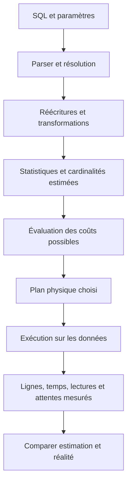
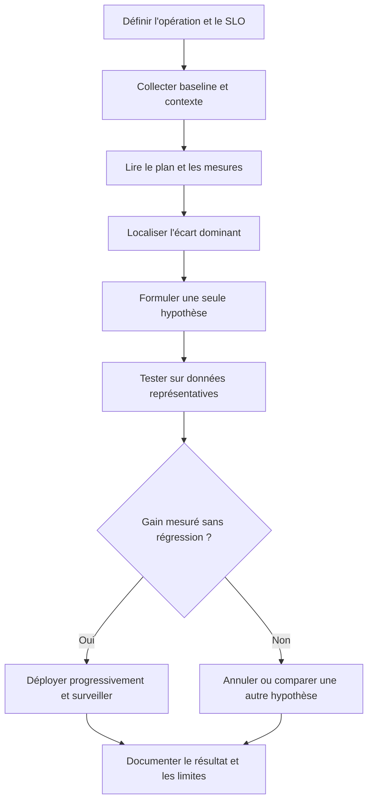

# Indexation et plans d'exécution — Intermédiaire

> **Mise en contexte** — Une requête est lente, l'équipe ajoute un index et le temps de réponse baisse sur un exemple. Pourtant, la production continue de saturer quelques jours plus tard : l'index ne correspond pas à tous les filtres, la distribution des données a changé, l'écriture est devenue plus coûteuse ou l'optimiseur estime mal les cardinalités. L'optimisation des bases n'est pas l'accumulation d'index ou de paramètres. C'est une méthode qui définit un objectif, observe une charge réelle, interprète le plan, formule une hypothèse, mesure le changement et vérifie qu'il n'a pas dégradé les autres opérations.

## Introduction et objectifs

Ce cours explique les structures d'index, l'utilisation des plans d'exécution, les statistiques de l'optimiseur, les jointures, les tris, la sélectivité et les méthodes de test. Les exemples sont destinés à PostgreSQL et MySQL, mais les détails diffèrent selon la version et les moteurs de stockage. Il faut utiliser la documentation officielle de la version installée avant de transformer un exemple pédagogique en procédure de production.

À la fin, l'apprenant pourra décrire le parcours d'une requête, comprendre les estimations de lignes, différencier parcours séquentiel et recherche indexée, choisir l'ordre des colonnes d'un index composé, détecter des tris ou tables temporaires coûteux, interpréter une divergence entre lignes estimées et réelles, et documenter un test avant/après reproductible.

## 1. Définir le problème de performance

### 1.1 Ce que signifie « lent »

La lenteur doit se relier à une opération métier précise. Une page peut sembler lente parce que le SQL est long, parce qu'une requête attend un verrou, parce que l'application ouvre trop de connexions, parce qu'elle reçoit un volume excessif, ou parce qu'elle sérialise ses appels. Il faut mesurer le délai de bout en bout et isoler le temps côté base.

Définir la population touchée, la période, le nombre de requêtes, la latence médiane et les percentiles élevés, le taux d'erreur, le volume de données, la concurrence, les changements récents et la fréquence d'exécution. Une moyenne de toutes les requêtes peut masquer quelques opérations critiques extrêmement lentes. Une moyenne stable peut également masquer une hausse de la variance qui rend le service imprévisible.

### 1.2 Les mesures doivent servir une décision

Un indicateur n'est utile que s'il répond à une question : faut-il optimiser cette requête, augmenter la capacité, corriger une contention, réduire le volume renvoyé ou revoir le parcours applicatif ? Associer chaque mesure à son propriétaire et à son seuil de réaction.

| Observation | Hypothèse possible | Vérification attendue |
|---|---|---|
| Beaucoup de lectures de pages | Accès large, faible sélectivité ou cache insuffisant | Plan, lignes lues, pages et filtres |
| Temps total élevé malgré peu de lignes renvoyées | Scan coûteux, mauvais plan ou forte attente | Estimations/réalité, buffers, verrous |
| Temps de tri élevé | Tri volumineux, ordre non couvert ou mémoire insuffisante | Plan, volume et éventuel spill vers disque |
| Temps d'attente avant exécution | Pool de connexions, verrou, file serveur ou réseau | Métriques de connexion et attente |
| Écriture ralentie après ajout d'index | Entretien de plusieurs structures | Temps d'écriture, I/O et nombre d'index |
| Plan modifié après chargement massif | Statistiques ou distribution changées | Actualisation et comparaison des plans |

Ne pas commencer par modifier les paramètres globaux. Un changement de mémoire, de cache ou de parallélisme peut affecter toute la base et masquer la cause initiale. Isoler d'abord l'opération la plus représentative et construire une hypothèse réfutable.

### 1.3 Construire une baseline reproductible

Une baseline inclut le moteur et sa version, le schéma, le volume et la distribution des données, les statistiques, la requête exacte, les paramètres liés, le plan, les ressources, le nombre de répétitions et la concurrence. Préciser si le cache est chaud ou froid ; ne pas comparer une première exécution après démarrage à une exécution répétée en mémoire sans expliquer la différence.

Ne jamais prendre un jeu de données artificiellement petit comme unique preuve. Les distributions, la fréquence des valeurs, les valeurs NULL, les dates extrêmes et les corrélations entre colonnes influencent les plans. Les tests doivent comporter des cas fréquents et rares et reproduire la forme réelle des requêtes.

## 2. Comment l'optimiseur choisit un plan

### 2.1 Plan logique et plan physique

Le moteur cherche une manière de produire le résultat demandé. Le plan logique décrit des opérations relationnelles, comme filtrer, joindre, agréger ou trier. Le plan physique choisit les mécanismes : parcours séquentiel, index, nested loop, hash join, merge join, tri en mémoire ou autre opération selon le moteur.

Le plan n'est pas une garantie que le temps sera constant. Il représente le choix fait au moment de la préparation, selon les statistiques, les paramètres et la version. Les données et la charge peuvent évoluer. Une requête peut aussi être lente alors que son plan paraît raisonnable si elle attend un verrou, un stockage saturé ou une ressource partagée.

### 2.2 Cardinalité et sélectivité

La cardinalité estimée représente le nombre de lignes qu'une étape du plan devrait produire. La sélectivité mesure la part des lignes qui satisfait un prédicat, selon une définition et un contexte donnés. Si une table contient un million d'interventions et que le statut recherché concerne 2 % des lignes, l'estimation de ce filtre influence le choix d'accès.

Si le statut « fermé » représente 95 % des lignes, un index sur statut peut être peu utile pour récupérer toutes ces lignes, car le moteur doit ensuite accéder à de nombreuses pages. Le scan séquentiel peut alors coûter moins cher. Pour une valeur rare, une recherche indexée peut être plus efficace. Le résultat dépend du stockage, de la taille des lignes et des coûts estimés.

### 2.3 Estimation fausse, plan inefficace

Un écart entre lignes estimées et réelles peut indiquer des statistiques incomplètes, une forte corrélation entre colonnes, des valeurs très asymétriques, un paramètre inhabituel ou un effet de transformation de requête. Les estimateurs n'ont pas une connaissance parfaite de la distribution. Ils font des approximations qui peuvent échouer sur des données atypiques.

Comparer les estimations sur plusieurs étapes : table d'entrée, filtre, jointure, agrégation et résultat final. La première divergence significative aide à localiser l'origine. Une estimation déjà fausse tôt dans le plan peut conduire à un choix de jointure et de mémoire inadapté en aval.

### 2.4 Coût estimé et durée réelle

Le coût du plan est une unité interne destinée à comparer des alternatives ; ce n'est pas directement des millisecondes ni un prix financier. Une durée réelle dépend aussi de l'état du cache, des ressources, des autres requêtes, du stockage, du réseau et des verrous. Comparer les coûts entre plans reste utile dans le même contexte, mais ne remplace pas la mesure.

Une opération qui lit des millions de lignes peut sembler rapide en cache chaud et devenir très lente quand la mémoire disponible diminue. L'analyse doit regarder le nombre de lignes manipulées, les appels répétés, les lectures physiques et les attentes, et pas seulement la valeur de coût affichée.

## 3. Lire un plan d'exécution en pratique

### 3.1 EXPLAIN avant de changer quoi que ce soit

EXPLAIN affiche la stratégie estimée par l'optimiseur ; dans certains moteurs et formats, des options comme EXPLAIN ANALYZE exécutent réellement la requête et ajoutent des mesures observées. Il faut savoir quelle variante on utilise : lancer une requête d'écriture dans un mode qui l'exécute peut modifier des données. Même une requête de lecture peut consommer des ressources importantes.

Sur PostgreSQL, on peut examiner les nœuds, les estimations de lignes, les temps, les boucles et les accès aux buffers selon les options choisies. MySQL propose également des formats de plan et, sur les versions qui le prennent en charge, des mesures d'exécution par itérateur. Les formats et les champs diffèrent : apprendre à lire la documentation du moteur plutôt que supposer l'équivalence des sorties.

### 3.2 Reconnaître les opérations courantes

- **Seq Scan / table scan** : lit des lignes de la table selon le moteur. Cela peut être approprié pour une grande partie de la table.
- **Index Scan / index lookup** : utilise un index pour localiser des valeurs, puis peut accéder aux lignes.
- **Index Only Scan** : peut satisfaire une requête à partir des données de l'index lorsque toutes les conditions sont réunies, selon le moteur.
- **Nested Loop** : recherche des correspondances pour chaque ligne extérieure ; efficace quand l'entrée externe est petite et l'accès interne sélectif.
- **Hash Join** : construit une structure de hachage pour joindre des ensembles ; consomme mémoire et peut déborder selon la charge.
- **Merge Join** : joint des entrées ordonnées selon des clés compatibles ; peut nécessiter un tri préalable.
- **Sort / Aggregate** : ordonne ou regroupe des lignes ; peut coûter cher pour un volume important.
- **Bitmap ou structures équivalentes** : combine des accès à des ensembles de lignes lorsque le moteur le juge opportun.

Le nom d'un nœud ne suffit pas pour déclarer le plan mauvais. Une nested loop sur cinquante lignes peut être excellente. Un scan séquentiel peut être le choix le moins coûteux. Examiner les lignes réelles, les boucles, les temps et le volume de données impliqué.

### 3.3 Ordre de lecture du plan

Commencer par repérer l'opération qui domine le temps ou les lectures, puis examiner ses entrées. Dans un arbre de plan, le résultat d'un nœud alimente son parent. Il faut donc comprendre la chaîne : combien de lignes sont entrées, combien ont été produites, et combien de fois le nœud a été exécuté.

Une étape qui retourne peu de lignes peut avoir lu une quantité énorme de données. Une opération interne rapide répétée des centaines de milliers de fois peut être coûteuse au total. Les temps affichés par certains moteurs incluent les enfants ou sont calculés différemment ; vérifier la sémantique du format de plan utilisé avant d'additionner des chiffres.

### 3.4 Exemple conceptuel

Une requête recherche les interventions d'un technicien depuis le début du mois, puis les trie par date de création. Le plan estimé prédit 100 lignes, mais l'exécution en produit 80 000. Un index semble peu efficace, le tri devient volumineux et le nombre de lignes traitées est très supérieur à l'attente.

L'hypothèse n'est pas automatiquement « il faut un autre index ». Vérifier si la valeur du technicien est très fréquente, si la date limite est trop large, si les statistiques sont périmées, si les paramètres provoquent des distributions différentes et si la requête retourne trop de colonnes. Le bon correctif peut être une actualisation des statistiques, un index composé, une pagination, une limite de période ou une modification du parcours.

## 4. Les index : mécanisme, bénéfices et coûts

### 4.1 Pourquoi un index accélère certaines recherches

Un index organise des clés afin d'éviter que le moteur examine toutes les lignes pour trouver celles qui correspondent au prédicat. Un index B-tree est courant pour les égalités, les plages et l'ordre sur des colonnes compatibles. D'autres structures existent pour des usages particuliers, selon le moteur.

Un index ne garantit pas un accès rapide à n'importe quelle requête. Si la colonne ne figure pas dans un filtre compatible, si l'expression empêche son utilisation ou si la requête doit lire presque toutes les lignes, l'avantage peut être faible. Le moteur arbitre selon les coûts et statistiques.

### 4.2 Les coûts de l'index

Chaque index utilise de l'espace et consomme des ressources lors des INSERT, UPDATE et DELETE. Une mise à jour d'une colonne indexée peut entraîner la mise à jour de la structure. Des index redondants augmentent le coût d'écriture, la taille des sauvegardes, l'entretien et la complexité des migrations.

Créer un index sur toutes les colonnes mentionnées dans les requêtes est rarement une stratégie saine. Il faut trouver un équilibre entre sélectivité, fréquence des lectures, coûts d'écriture, mémoire, stockage et durée de maintenance. Chaque index important doit avoir un cas d'usage, un indicateur de bénéfice et un propriétaire.

### 4.3 Index sur une ou plusieurs colonnes

Un index composé ordonne des entrées selon plusieurs clés. L'ordre de ses colonnes a de l'importance. Un index sur (site_id, statut, date_creation) peut être utile pour filtrer par site et statut, puis sur une plage de dates. Il ne remplace pas nécessairement un index sur date_creation seul si les requêtes ne filtrent pas le site.

La règle du préfixe gauche est un repère utile pour les B-tree composés dans beaucoup de contextes, mais il faut consulter le moteur et la requête exacte. Les prédicats, l'ordre, les plages, les égalités et l'ordre de tri influencent l'utilisation. Un index dont la première colonne n'est jamais contrainte peut être moins utile que prévu pour les recherches ciblées.

### 4.4 Concevoir à partir des requêtes réelles

Pour chaque requête critique, relever :
- les colonnes utilisées dans les filtres ;
- les clés de jointure ;
- les colonnes de tri et de regroupement ;
- les colonnes retournées ;
- la fréquence et le volume de lignes ;
- la proportion des valeurs communes ou rares ;
- les écritures et modifications qui touchent ces colonnes.

Construire ensuite une hypothèse d'index, puis comparer le plan et le coût. Un index couvrant peut éviter un accès à la table si les colonnes nécessaires y figurent et si le moteur le permet, mais il est plus large et coûte plus cher à entretenir. Ne pas ajouter des dizaines de colonnes à un index par peur de manquer quelque chose.

### 4.5 Prédicats qui empêchent un accès indexé efficace

Une expression appliquée à la colonne, une conversion de type implicite, une collation, un motif de recherche ou une fonction peut empêcher certaines utilisations d'index. Par exemple, comparer un champ de date à une expression transformée de chaque ligne peut rendre moins accessible un index sur la colonne brute. Une plage de dates bornée peut parfois exprimer la même intention plus efficacement.

Éviter toutefois les recettes universelles. La réécriture change parfois la sémantique, notamment avec les fuseaux horaires, les NULL ou les valeurs arrondies. Avant de transformer le prédicat, démontrer que l'équivalence est exacte pour toutes les données permises puis comparer les plans sur le moteur cible.

## 5. Sélectivité, distribution et statistiques

### 5.1 Pourquoi les statistiques comptent

Les statistiques décrivent certains aspects de la distribution : nombre estimé de valeurs distinctes, fréquence, histogrammes, nullité et autres éléments selon le moteur. L'optimiseur utilise ces informations pour estimer le nombre de lignes et comparer des plans. Après un chargement massif, une suppression importante ou une distribution transformée, elles peuvent ne plus refléter l'état actuel.

Actualiser les statistiques n'est pas la même chose que reconstruire tous les index. Les opérations et effets diffèrent selon le moteur. Planifier les mises à jour selon la politique documentée, les mécanismes automatiques et les changements de volume. Une analyse statistique peut consommer des ressources ; mesurer et planifier les opérations lourdes en production.

### 5.2 Corrélation entre colonnes

Supposons que chaque site ait une catégorie d'équipement dominante. Les colonnes site_id et categorie_equipement sont corrélées. Un estimateur qui traite les filtres comme indépendants peut prédire beaucoup trop ou beaucoup trop peu de lignes. Le plan peut alors choisir le mauvais ordre de jointure ou la mauvaise méthode d'accès.

Certains moteurs proposent des statistiques étendues ou des mécanismes supplémentaires ; d'autres ont des capacités et des syntaxes différentes. Avant de s'en servir, vérifier la version et les limites. Une correction statistique doit être justifiée par un écart observé, pas ajoutée automatiquement à chaque table.

### 5.3 Paramètres très différents

Une requête préparée avec un paramètre très sélectif peut préférer un index, alors que le même SQL avec un paramètre très fréquent peut préférer un scan. Le moteur peut utiliser différentes stratégies de préparation et de planification selon son modèle. Une mesure faite avec une valeur rare ne valide pas l'exécution d'une valeur courante.

Tester plusieurs distributions de paramètres, en particulier les valeurs extrêmes qui se produisent réellement. Documenter les différences du plan et de la durée. Il n'est pas toujours correct de forcer un index ou un ordre de jointure pour améliorer un seul cas au détriment des autres.

## 6. Jointures et agrégations : les principaux multiplicateurs

### 6.1 Choisir l'accès et l'ordre de jointure

Une jointure peut coûter cher si les entrées sont beaucoup plus grandes qu'attendu ou si le moteur ne peut pas exploiter un filtre tôt. L'optimiseur peut réordonner des jointures selon leurs propriétés et les informations disponibles. Une requête qui joint d'abord des tables volumineuses puis filtre tard peut être réécrite, mais il faut examiner le plan et vérifier si les prédicats ont une sémantique équivalente.

Le type de jointure dépend de la cardinalité et de l'accès. Une boucle imbriquée est performante si l'entrée externe est petite et qu'un index permet de trouver rapidement les correspondances. Une hash join peut être appropriée pour de grandes relations si la mémoire est suffisante. Une merge join profite de l'ordre des deux entrées. Aucun choix n'est universel.

### 6.2 Réduire les lignes et colonnes inutiles

Un SELECT qui demande toutes les colonnes augmente les données lues, copiées, transmises et parfois mises en mémoire. Il peut empêcher un index couvrant. Retourner des millions de lignes à un client est coûteux même si la base calcule le filtre rapidement. Sélectionner les colonnes nécessaires et appliquer des limites de période ou de page lorsque c'est conforme au besoin métier.

Un filtre doit être placé aussi tôt que possible lorsque cela préserve la sémantique. Mais il faut vérifier les outer joins, agrégations, fenêtres et calculs dont la logique pourrait changer si le filtre se déplace. Une réécriture performante mais incorrecte n'est pas une optimisation.

### 6.3 Tris, agrégats et tables temporaires

Les opérations de tri et de regroupement peuvent consommer beaucoup de mémoire. Si le jeu est trop volumineux, le moteur peut créer des fichiers temporaires ou multiplier les passes de tri. Une agrégation peut être faite avec une structure de hachage ou un ordre, selon le plan. Les limites dépendent du moteur, des paramètres et de la concurrence.

Identifier les opérations qui débordent, le nombre de lignes intermédiaires, le volume de tri et le coût de transfert. Parfois un index compatible aide à fournir l'ordre demandé, mais il peut ne pas être utilisé si l'optimiseur estime qu'un autre plan est meilleur. D'autres fois, une préagrégation ou un résumé peut être plus pertinent, au prix d'une fraîcheur et d'une maintenance supplémentaires.

## 7. Écritures, concurrence et impact des index

Les index optimisent souvent certains accès en lecture mais doivent être maintenus à chaque changement pertinent. Une table avec de nombreuses insertions, mises à jour et suppressions peut ralentir si elle contient trop d'index. Il faut mesurer les opérations de lecture et d'écriture comme un tout.

Les index et contraintes peuvent aussi affecter les verrous et l'espace utilisé pendant une migration. Les méthodes d'ajout d'index en ligne ou concurrentes ont des préconditions, des échecs possibles et des effets propres au moteur. Un changement doit être testé avec une version et un volume représentatifs, planifié avec l'espace nécessaire et accompagné de critères d'arrêt.

Ne pas supprimer un index uniquement parce que son compteur d'utilisation est nul sur un échantillon court. Il peut soutenir une tâche mensuelle, une contrainte ou une opération rare mais critique. Examiner un horizon représentatif, la charge réelle, les dépendances et les effets de la suppression. Lorsqu'un moteur propose un index invisible ou un outil de simulation, en vérifier les garanties et la disponibilité avant de l'utiliser.

## 8. Méthode d'optimisation étape par étape

### Étape 1 — Sélectionner une requête prioritaire

Choisir selon l'impact utilisateur, la fréquence, la durée totale consommée, le coût des ressources et la gravité des retards. Une requête de deux secondes exécutée une fois par jour peut être moins prioritaire qu'une requête de 40 millisecondes exécutée plusieurs milliers de fois par minute.

### Étape 2 — Vérifier la sémantique

Confirmer le résultat, la population et la règle de métier. Recueillir un exemple avec le résultat attendu et des cas limites. Une requête incorrecte peut paraître rapide parce qu'elle oublie des lignes. Ne pas mesurer le gain avant d'avoir défini l'équivalence fonctionnelle.

### Étape 3 — Lire le plan et les ressources

Repérer les écarts de cardinalité, les scans coûteux, les appels répétés, les tris, la mémoire, le nombre de lignes lues, le volume de résultat et les attentes. Différencier le temps passé dans le moteur du temps d'obtention de connexion ou du réseau lorsque l'instrumentation le permet.

### Étape 4 — Formuler une hypothèse ciblée

Exemple : « Le filtre par site est sélectif et se répète fréquemment ; un index composé sur site_id et date_creation peut réduire les pages lues pour les recherches bornées par site et période. » L'hypothèse décrit le mécanisme attendu, pas seulement une commande à exécuter.

### Étape 5 — Tester avec plusieurs scénarios

Comparer le plan, le temps, les I/O et la qualité du résultat avant et après. Inclure des valeurs courantes et atypiques. Vérifier le coût des écritures, les autres requêtes et les besoins d'espace. Si l'index améliore une requête mais ralentit une famille d'écritures critique, la décision globale doit prendre en compte cet effet.

### Étape 6 — Déployer et observer

Effectuer le changement via la procédure de migration, prévoir un point de retour, surveiller les métriques définies et vérifier que le gain survit à la charge réelle. Si l'impact diverge des tests, corriger ou annuler selon la procédure approuvée. Documenter la différence entre gain mesuré en test et gain constaté en service.

## 9. Étude de cas — Recherche d'interventions très lente

Une application affiche les interventions d'un site sur les trente derniers jours, avec filtres par statut, tri par date de création et pagination. La table contient plusieurs millions de lignes. Le premier écran est lent, mais la page suivante est parfois rapide.

### Diagnostic initial

Définir la requête exacte, les paramètres, le volume renvoyé et le coût d'acquisition de connexion. Vérifier si la pagination est déterministe et si la première page demande un comptage complet de toutes les lignes correspondantes. Un COUNT distinct ou un tri large peut coûter davantage que l'affichage de 25 dossiers.

### Hypothèses

1. Le filtre combine site, statut et date sans index compatible.
2. Les statistiques sous-estiment la quantité d'interventions d'un site très actif.
3. Le tri nécessite une opération volumineuse.
4. La pagination utilise un OFFSET très grand dans certains parcours.
5. Le nombre total de résultats est recalculé à chaque interaction.
6. Le goulot se situe dans le réseau ou le rendu plutôt que dans la requête.

### Expérience

Comparer le plan des cas courants et rares, la quantité de lignes estimée et réelle, l'ordre des jointures, le tri et les lectures. Tester une requête qui retourne les colonnes minimales, puis comparer un index composé adapté au filtre et à l'ordre. Tester une pagination par curseur avec une clé stable seulement si elle correspond au besoin produit ; elle ne remplace pas automatiquement une pagination par numéro.

### Décision

Adopter la modification uniquement si le résultat reste exact, le gain est représentatif et le coût d'écriture acceptable. Documenter le comportement des sites très volumineux, la durée du test et les statistiques. Vérifier le nombre total, les doublons ou omissions entre pages et le tri lors de nouvelles insertions.

## 10. Pièges fréquents à éviter

- Ajouter des index avant de consulter le plan.
- Interpréter un scan séquentiel comme une erreur systématique.
- Comparer des mesures faites avec des caches ou paramètres différents.
- Utiliser un index composé sans examiner l'ordre de ses colonnes.
- Oublier que les index ralentissent certaines écritures et consomment de l'espace.
- Forcer un plan à partir d'un seul paramètre atypique.
- Actualiser ou reconstruire toutes les structures en production sans plan de charge.
- Ajouter toutes les colonnes de résultat dans un index couvrant trop large.
- Utiliser EXPLAIN ANALYZE sur une requête de modification sans comprendre son effet.
- Optimiser la latence moyenne en ignorant les pires percentiles.
- Supprimer un index après observation trop courte.
- Déclarer un gain sans vérifier la correction du résultat.
- Confondre temps de base de données, attente de pool, latence réseau et rendu utilisateur.
- Ne pas conserver la requête, les paramètres et le plan de référence.

## 11. Checklist avant et après optimisation

### Avant le changement
- [ ] L'opération métier et son objectif de performance sont définis.
- [ ] La baseline est reproductible et les paramètres sont consignés.
- [ ] La correction fonctionnelle est vérifiée sur les cas limites.
- [ ] Le plan estimé et les mesures réelles sont conservés.
- [ ] Les estimations de lignes sont comparées aux lignes réelles.
- [ ] Le coût d'écriture, le stockage et la maintenance sont évalués.
- [ ] Les autres requêtes et les valeurs atypiques sont testées.
- [ ] La procédure de déploiement et de retour est connue.

### Après le changement
- [ ] Le gain est mesuré dans le même contexte ou la différence est expliquée.
- [ ] Le résultat SQL demeure identique pour le périmètre convenu.
- [ ] Le débit d'écriture et les ressources n'ont pas été dégradés au-delà des limites approuvées.
- [ ] Les métriques de production sont observées sur une période représentative.
- [ ] Le propriétaire et la raison de l'index sont documentés.
- [ ] Le plan de retrait ou de réévaluation est défini si l'usage disparaît.

## 12. Exercices corrigés

### Exercice 1 — Le scan séquentiel est-il forcément mauvais ?

Une requête lit 70 % des lignes et utilise un scan séquentiel.

**Corrigé :** pas nécessairement. Pour récupérer la majorité des lignes, les accès indirects par index peuvent coûter davantage qu'un parcours séquentiel. Vérifier le plan, les lignes lues et le coût sur un volume représentatif.

### Exercice 2 — Index ajouté, écritures ralenties

Une page de recherche gagne 40 %, mais les insertions deviennent plus lentes.

**Corrigé :** évaluer le bénéfice global, la fréquence de lecture et d'écriture, le nombre d'index et le coût du nouvel index. Un index peut être justifié si le gain répond à un besoin critique, mais il faut mesurer le compromis et enlever les structures redondantes seulement après analyse.

### Exercice 3 — Estimation très éloignée

Le plan estime 100 lignes et en produit 50 000.

**Corrigé :** localiser la première divergence, vérifier la fraîcheur des statistiques, les distributions asymétriques, les corrélations et les paramètres. Choisir un test qui confirme l'hypothèse puis comparer le plan après correction.

### Exercice 4 — Deux plans pour deux paramètres

Un technicien possède 100 interventions, un autre en possède 200 000. Le même SQL varie beaucoup en temps.

**Corrigé :** le volume et la sélectivité diffèrent. Mesurer les deux plans, vérifier les statistiques et la stratégie de préparation. Ne pas forcer un plan qui améliore l'un en dégradant systématiquement l'autre sans arbitrage explicite.

### Exercice 5 — Résultat plus rapide mais incomplet

Après réécriture, une requête est deux fois plus rapide mais omet les sites sans intervention.

**Corrigé :** l'optimisation est invalide car le résultat métier a changé. Rétablir la sémantique attendue, examiner le type de jointure et les filtres, ajouter un test de non-régression, puis recommencer la mesure.

## 13. Défi final — Optimiser un parcours de recherche

Choisir une recherche applicative à forte fréquence. Remettre la requête, son résultat attendu, le plan avant changement, les estimations et les mesures réelles, deux hypothèses de correction, le plan après changement et les conséquences sur les écritures. Tester au minimum un cas très sélectif, un cas fréquent, un jeu volumineux et une situation concurrente.

### Barème indicatif
- Baseline et objectif métier : 15 points.
- Lecture des plans et estimations : 20 points.
- Choix raisonné des index et prédicats : 20 points.
- Validation fonctionnelle et cas limites : 15 points.
- Mesures avant/après et analyse du compromis : 20 points.
- Retour arrière et documentation : 10 points.

## 14. Mettre en place un programme de performance durable

Une optimisation ponctuelle n'est pas une stratégie de performance. À mesure que l'application évolue, les requêtes changent, les données grossissent, les schémas se modifient et les profils de charge se déplacent. L'équipe doit donc construire une boucle d'amélioration où les requêtes critiques sont identifiées, les mesures conservées et les régressions détectées assez tôt.

Établir un inventaire des parcours SQL essentiels : authentification, recherches fréquentes, création de transactions, rapports, tâches planifiées et traitements de clôture. Pour chaque parcours, conserver une définition métier, un owner, un indicateur de latence, les seuils, les volumes représentatifs et une manière reproductible de lancer un test. Ne pas conserver uniquement des captures d'écran d'un plan ; les requêtes, paramètres et métadonnées doivent être versionnés dans un espace autorisé et sans secrets.

### 14.1 Détecter les régressions

Un nouveau déploiement peut changer les paramètres, le nombre de requêtes, l'ordre des jointures ou la quantité de données traitée. Les tests de performance peuvent comparer les latences et les plans sous des conditions contrôlées. Leur seuil doit distinguer une variation normale d'une régression qui affecte le service. Les résultats doivent être analysés avec le débit et les erreurs, pas uniquement le temps d'une requête isolée.

Les tests de charge sont particulièrement utiles lorsque la concurrence influe sur les verrous, les pools ou le stockage. Un test à utilisateur unique n'exerce pas les mêmes chemins. Simuler un profil réaliste, respecter les limites de l'environnement de test et éviter les essais agressifs sur la production sans autorisation formelle. Si une mesure échoue, enregistrer les conditions et reproduire avant de conclure.

### 14.2 Revue des index

Prévoir une revue périodique des index selon un horizon représentatif. Identifier les index redondants, rarement utilisés, coûteux ou associés à des requêtes qui ont disparu. Avant suppression, vérifier les contraintes, les requêtes peu fréquentes, les tâches planifiées et les variations saisonnières. La décision tient compte du stockage libéré, du coût d'écriture, des possibilités de rollback et de l'incidence sur les plans.

Chaque changement d'index doit être relié à la requête cible, au bénéfice attendu, au test de compatibilité, au risque de migration et à un résultat observable. L'indexation évolue avec les usages ; elle ne doit pas devenir une collection que personne n'ose remettre en cause.

### 14.3 Communiquer les résultats sans surpromettre

Un compte rendu de performance indique ce qui a été mesuré, sur quelle population, avec quelle version, pendant quelle durée et avec quelles limites. Distinguer le gain observé en laboratoire, le résultat de production et l'estimation d'un gain financier. Une baisse de durée SQL ne se convertit pas mécaniquement en économie : il faut connaître la fréquence, la capacité libérée et le mécanisme qui transforme ce temps en résultat.

Un bon rapport inclut la décision : déployer, poursuivre un test, accepter un compromis, revenir à l'état précédent ou améliorer l'observabilité. Il identifie également les inconnues et les risques résiduels. La discipline consiste à expliquer ce qui est prouvé et ce qui reste une hypothèse.

## À retenir

L'optimisation repose sur la mesure et le raisonnement. Les index, statistiques, plans d'exécution et stratégies de jointure sont des outils, pas des recettes universelles. Une correction doit améliorer le parcours sans modifier le résultat ni dégrader les autres opérations. La baseline, les tests reproductibles, l'observation après déploiement et la documentation transforment une intuition en amélioration vérifiable.

## Ressources et références

- [PostgreSQL — EXPLAIN](https://www.postgresql.org/docs/current/using-explain.html)
- [PostgreSQL — ANALYZE](https://www.postgresql.org/docs/current/sql-analyze.html)
- [MySQL 8.4 — Optimisation et index](https://dev.mysql.com/doc/refman/8.4/en/optimization-indexes.html)
- [MySQL 8.4 — EXPLAIN](https://dev.mysql.com/doc/refman/8.4/en/using-explain.html)
- [MySQL 8.4 — Optimisation et statistiques](https://dev.mysql.com/doc/refman/8.4/en/optimizer-statistics.html)

Les formats de plan et les possibilités d'analyse évoluent. Vérifier la documentation de la version installée, surtout avant d'utiliser une option qui exécute réellement une requête en production.
