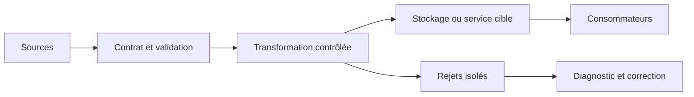
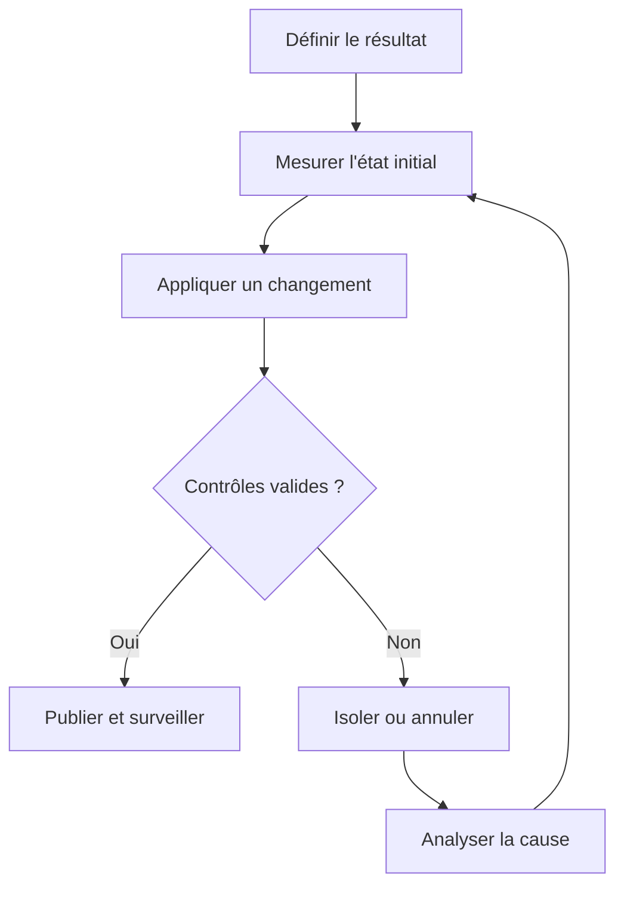
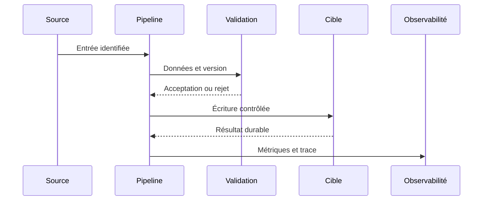
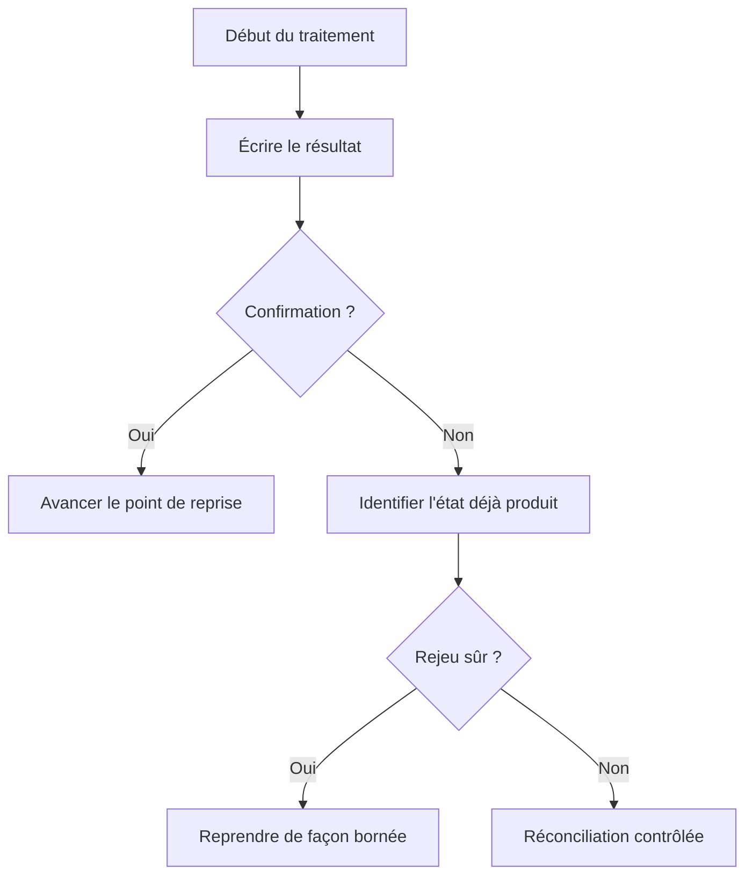
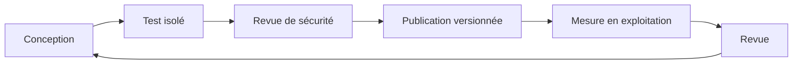

# Indexation et plans d'exécution — Intermédiaire

> **Mise en contexte.** Ce cours approfondit indexation, statistiques et plans d’exécution SQL. Il vise une décision technique justifiable, testable et exploitable. Les exemples doivent être adaptés à la version du moteur et au contexte réel. Utilisez des données synthétiques, notez versions et paramètres, et préparez la restauration ou le retour arrière avant une opération risquée. N’insérez jamais de secret ou de donnée personnelle dans les commandes partagées.

## Introduction et objectifs pédagogiques

La compétence recherchée ne consiste pas à exécuter une recette, mais à expliquer pourquoi une solution répond au besoin et quelles limites elle conserve. Un résultat plausible sur le cas nominal n’est pas une preuve suffisante : les erreurs, l’ordre des événements, les données absentes, la concurrence et les changements de version doivent faire partie du raisonnement.

À l’issue du cours, vous devez pouvoir définir un contrat, identifier la source de vérité, comparer plusieurs approches, construire un test reproductible, interpréter une trace et expliquer une procédure de reprise. Vous devez également pouvoir différencier une garantie fournie par le système d’un comportement qui dépend d’un paramètre ou d’un choix applicatif. La validation attendue relie intention, entrée, état final et preuve.

Objectifs opérationnels : écrire les invariants métier, cartographier les composants, établir une baseline, mesurer les risques et les coûts, traiter les échecs explicitement, protéger les données, automatiser les assertions prioritaires et documenter les limites. Le cours fournit des méthodes de validation réutilisables ; les valeurs de configuration et les garanties précises doivent être confirmées dans la documentation de la version effectivement déployée.

## Prérequis et environnement

Révisez les notions de schéma, identifiant stable, transactions, journaux, droits d’accès et tests automatisés. Consignez la version des outils, extensions, ressources, configuration et mode de déploiement. Une syntaxe qui ressemble à celle d’un autre produit ne garantit ni une sémantique ni un niveau de fiabilité identiques.

Préparez un environnement isolé, un jeu synthétique et une procédure de nettoyage. Conservez la sortie de référence et les paramètres exacts. Pour toute action destructive, préparez la restauration avant de l’exécuter. Le code retour n’est qu’un signal : il doit être complété par des contrôles sur les lignes, clés, montants, versions, messages ou métriques qui prouvent l’invariant.

## Concepts clés développés

### 1. Lecture d’EXPLAIN

**Principe et choix.** Le plan présente scans, jointures, tris et coûts estimés ; EXPLAIN ANALYZE observe l’exécution réelle selon les capacités du moteur. Avant d’implémenter, écrivez le contrat attendu en langage métier : quelles entités, quels consommateurs et quelle granularité sont concernés ? Distinguez une garantie nécessaire d’une simple préférence d’implémentation. Si plusieurs solutions sont disponibles, comparez-les sur les mêmes critères et mesurez ce qui change réellement. Une option technique est pertinente lorsqu’elle maintient le contrat et reste compréhensible pour l’équipe qui l’exploite.

**Risque et limite.** Le premier nœud affiché n’est pas forcément la cause ; ANALYZE exécute réellement la requête. Recherchez l’événement précis qui peut invalider le résultat : entrée inattendue, concurrence, changement de version, interruption entre deux étapes ou surcharge. Une conception fiable rend l’état visible et propose une action adaptée à chaque classe d’erreur. Il faut distinguer erreur temporaire, erreur permanente et résultat inconnu. Une reprise ne doit pas supposer que l’absence de réponse prouve que l’écriture n’a pas eu lieu.

**Preuve technique.** Comparer estimations, lignes réelles, boucles, buffers et lectures temporaires. Établissez cette preuve avant l’essai. Utilisez des entrées connues, un résultat attendu et un contrôle de l’état réellement obtenu. Conservez version, paramètres, traces et métriques. Ajoutez un cas frontière et un cas qui doit être rejeté ; un test uniquement nominal laisse de côté les invariants les plus importants. Lorsque le résultat est quantitatif, définissez le dénominateur, la fenêtre et les unités pour que la mesure soit interprétable.

**Exemple contextualisé.** Nested loop peut être efficace pour quelques lignes indexées mais mauvais sur des millions de lignes externes. Commencez par un cas réduit, puis augmentez un seul facteur à la fois : volume, cardinalité, concurrence, retard, version ou droits. Comparez à une référence indépendante quand c’est possible. Si le résultat contredit l’hypothèse, conservez l’écart comme une information de diagnostic et révisez l’explication, plutôt que de changer le critère après l’observation.

**Décision d’ingénierie.** Comparez une variante simple et une variante traitant une contrainte supplémentaire. Évaluez latence, coût de stockage, charge de maintenance, privilèges requis, retour arrière et compétences nécessaires. La variante complexe n’est justifiée que si un indicateur démontre le besoin. Écrivez le seuil qui déclencherait son adoption et le signal qui imposerait de la revoir. Ce seuil rend la décision vérifiable plutôt que dépendante du goût personnel.

**Revue opérationnelle.** Demandez à un collègue de refaire l’essai à partir du compte rendu. Il doit pouvoir identifier les entrées, l’état final, le propriétaire de l’invariant et la trace à inspecter. S’il ne peut pas, la documentation ou la conception est incomplète. Un résultat exploitable peut être expliqué, surveillé, corrigé et transmis sans dépendre uniquement de la mémoire de son auteur.

### 2. Sélectivité et statistiques

**Principe et choix.** Les statistiques guident l’estimation du nombre de lignes filtrées ; distributions asymétriques et corrélations peuvent conduire à un mauvais plan. Avant d’implémenter, écrivez le contrat attendu en langage métier : quelles entités, quels consommateurs et quelle granularité sont concernés ? Distinguez une garantie nécessaire d’une simple préférence d’implémentation. Si plusieurs solutions sont disponibles, comparez-les sur les mêmes critères et mesurez ce qui change réellement. Une option technique est pertinente lorsqu’elle maintient le contrat et reste compréhensible pour l’équipe qui l’exploite.

**Risque et limite.** Un plan adapté à une valeur rare peut être lent pour la valeur la plus fréquente. Recherchez l’événement précis qui peut invalider le résultat : entrée inattendue, concurrence, changement de version, interruption entre deux étapes ou surcharge. Une conception fiable rend l’état visible et propose une action adaptée à chaque classe d’erreur. Il faut distinguer erreur temporaire, erreur permanente et résultat inconnu. Une reprise ne doit pas supposer que l’absence de réponse prouve que l’écriture n’a pas eu lieu.

**Preuve technique.** Tester valeurs fréquentes, rares et médianes ; contrôler la fraîcheur des statistiques. Établissez cette preuve avant l’essai. Utilisez des entrées connues, un résultat attendu et un contrôle de l’état réellement obtenu. Conservez version, paramètres, traces et métriques. Ajoutez un cas frontière et un cas qui doit être rejeté ; un test uniquement nominal laisse de côté les invariants les plus importants. Lorsque le résultat est quantitatif, définissez le dénominateur, la fenêtre et les unités pour que la mesure soit interprétable.

**Exemple contextualisé.** Un statut présent sur 98 % des lignes n’a pas la même sélectivité qu’un statut exceptionnel. Commencez par un cas réduit, puis augmentez un seul facteur à la fois : volume, cardinalité, concurrence, retard, version ou droits. Comparez à une référence indépendante quand c’est possible. Si le résultat contredit l’hypothèse, conservez l’écart comme une information de diagnostic et révisez l’explication, plutôt que de changer le critère après l’observation.

**Décision d’ingénierie.** Comparez une variante simple et une variante traitant une contrainte supplémentaire. Évaluez latence, coût de stockage, charge de maintenance, privilèges requis, retour arrière et compétences nécessaires. La variante complexe n’est justifiée que si un indicateur démontre le besoin. Écrivez le seuil qui déclencherait son adoption et le signal qui imposerait de la revoir. Ce seuil rend la décision vérifiable plutôt que dépendante du goût personnel.

**Revue opérationnelle.** Demandez à un collègue de refaire l’essai à partir du compte rendu. Il doit pouvoir identifier les entrées, l’état final, le propriétaire de l’invariant et la trace à inspecter. S’il ne peut pas, la documentation ou la conception est incomplète. Un résultat exploitable peut être expliqué, surveillé, corrigé et transmis sans dépendre uniquement de la mémoire de son auteur.

### 3. B-tree et index composites

**Principe et choix.** Le choix d’un index dépend de prédicats, ordre, cardinalité et fréquence de mise à jour ; l’ordre des clés composites détermine les préfixes exploitables. Avant d’implémenter, écrivez le contrat attendu en langage métier : quelles entités, quels consommateurs et quelle granularité sont concernés ? Distinguez une garantie nécessaire d’une simple préférence d’implémentation. Si plusieurs solutions sont disponibles, comparez-les sur les mêmes critères et mesurez ce qui change réellement. Une option technique est pertinente lorsqu’elle maintient le contrat et reste compréhensible pour l’équipe qui l’exploite.

**Risque et limite.** Des index redondants consomment espace et temps d’écriture ; un index inadéquat peut rester inutilisé. Recherchez l’événement précis qui peut invalider le résultat : entrée inattendue, concurrence, changement de version, interruption entre deux étapes ou surcharge. Une conception fiable rend l’état visible et propose une action adaptée à chaque classe d’erreur. Il faut distinguer erreur temporaire, erreur permanente et résultat inconnu. Une reprise ne doit pas supposer que l’absence de réponse prouve que l’écriture n’a pas eu lieu.

**Preuve technique.** Comparer plan, lignes lues, buffers, lecture et coût d’écriture avant/après. Établissez cette preuve avant l’essai. Utilisez des entrées connues, un résultat attendu et un contrôle de l’état réellement obtenu. Conservez version, paramètres, traces et métriques. Ajoutez un cas frontière et un cas qui doit être rejeté ; un test uniquement nominal laisse de côté les invariants les plus importants. Lorsque le résultat est quantitatif, définissez le dénominateur, la fenêtre et les unités pour que la mesure soit interprétable.

**Exemple contextualisé.** Filtrer statut puis trier date peut favoriser un index composite plutôt que des index séparés. Commencez par un cas réduit, puis augmentez un seul facteur à la fois : volume, cardinalité, concurrence, retard, version ou droits. Comparez à une référence indépendante quand c’est possible. Si le résultat contredit l’hypothèse, conservez l’écart comme une information de diagnostic et révisez l’explication, plutôt que de changer le critère après l’observation.

**Décision d’ingénierie.** Comparez une variante simple et une variante traitant une contrainte supplémentaire. Évaluez latence, coût de stockage, charge de maintenance, privilèges requis, retour arrière et compétences nécessaires. La variante complexe n’est justifiée que si un indicateur démontre le besoin. Écrivez le seuil qui déclencherait son adoption et le signal qui imposerait de la revoir. Ce seuil rend la décision vérifiable plutôt que dépendante du goût personnel.

**Revue opérationnelle.** Demandez à un collègue de refaire l’essai à partir du compte rendu. Il doit pouvoir identifier les entrées, l’état final, le propriétaire de l’invariant et la trace à inspecter. S’il ne peut pas, la documentation ou la conception est incomplète. Un résultat exploitable peut être expliqué, surveillé, corrigé et transmis sans dépendre uniquement de la mémoire de son auteur.

### 4. Index partiels et couvrants

**Principe et choix.** Certains moteurs permettent un index limité à un prédicat ; un index couvrant peut éviter un accès supplémentaire selon le plan. Avant d’implémenter, écrivez le contrat attendu en langage métier : quelles entités, quels consommateurs et quelle granularité sont concernés ? Distinguez une garantie nécessaire d’une simple préférence d’implémentation. Si plusieurs solutions sont disponibles, comparez-les sur les mêmes critères et mesurez ce qui change réellement. Une option technique est pertinente lorsqu’elle maintient le contrat et reste compréhensible pour l’équipe qui l’exploite.

**Risque et limite.** Un index partiel trop spécialisé ne répond qu’à quelques usages ; un index large coûte en stockage et maintenance. Recherchez l’événement précis qui peut invalider le résultat : entrée inattendue, concurrence, changement de version, interruption entre deux étapes ou surcharge. Une conception fiable rend l’état visible et propose une action adaptée à chaque classe d’erreur. Il faut distinguer erreur temporaire, erreur permanente et résultat inconnu. Une reprise ne doit pas supposer que l’absence de réponse prouve que l’écriture n’a pas eu lieu.

**Preuve technique.** Tester cas inclus et hors prédicat et confirmer le choix réel du planificateur. Établissez cette preuve avant l’essai. Utilisez des entrées connues, un résultat attendu et un contrôle de l’état réellement obtenu. Conservez version, paramètres, traces et métriques. Ajoutez un cas frontière et un cas qui doit être rejeté ; un test uniquement nominal laisse de côté les invariants les plus importants. Lorsque le résultat est quantitatif, définissez le dénominateur, la fenêtre et les unités pour que la mesure soit interprétable.

**Exemple contextualisé.** Une file de travail limitée aux tâches en attente peut profiter d’un index partiel supporté. Commencez par un cas réduit, puis augmentez un seul facteur à la fois : volume, cardinalité, concurrence, retard, version ou droits. Comparez à une référence indépendante quand c’est possible. Si le résultat contredit l’hypothèse, conservez l’écart comme une information de diagnostic et révisez l’explication, plutôt que de changer le critère après l’observation.

**Décision d’ingénierie.** Comparez une variante simple et une variante traitant une contrainte supplémentaire. Évaluez latence, coût de stockage, charge de maintenance, privilèges requis, retour arrière et compétences nécessaires. La variante complexe n’est justifiée que si un indicateur démontre le besoin. Écrivez le seuil qui déclencherait son adoption et le signal qui imposerait de la revoir. Ce seuil rend la décision vérifiable plutôt que dépendante du goût personnel.

**Revue opérationnelle.** Demandez à un collègue de refaire l’essai à partir du compte rendu. Il doit pouvoir identifier les entrées, l’état final, le propriétaire de l’invariant et la trace à inspecter. S’il ne peut pas, la documentation ou la conception est incomplète. Un résultat exploitable peut être expliqué, surveillé, corrigé et transmis sans dépendre uniquement de la mémoire de son auteur.

### 5. Jointures et mémoire

**Principe et choix.** Nested loop, hash et merge ont des profils différents selon cardinalités, ordre et index ; leur coût dépend aussi de la mémoire et de l’I/O. Avant d’implémenter, écrivez le contrat attendu en langage métier : quelles entités, quels consommateurs et quelle granularité sont concernés ? Distinguez une garantie nécessaire d’une simple préférence d’implémentation. Si plusieurs solutions sont disponibles, comparez-les sur les mêmes critères et mesurez ce qui change réellement. Une option technique est pertinente lorsqu’elle maintient le contrat et reste compréhensible pour l’équipe qui l’exploite.

**Risque et limite.** Forcer une stratégie peut améliorer un cas mais dégrader les autres ; augmenter la mémoire globale amplifie la concurrence. Recherchez l’événement précis qui peut invalider le résultat : entrée inattendue, concurrence, changement de version, interruption entre deux étapes ou surcharge. Une conception fiable rend l’état visible et propose une action adaptée à chaque classe d’erreur. Il faut distinguer erreur temporaire, erreur permanente et résultat inconnu. Une reprise ne doit pas supposer que l’absence de réponse prouve que l’écriture n’a pas eu lieu.

**Preuve technique.** Tester tailles différentes et examiner spills, parallélisme, lectures et temps sous charge. Établissez cette preuve avant l’essai. Utilisez des entrées connues, un résultat attendu et un contrôle de l’état réellement obtenu. Conservez version, paramètres, traces et métriques. Ajoutez un cas frontière et un cas qui doit être rejeté ; un test uniquement nominal laisse de côté les invariants les plus importants. Lorsque le résultat est quantitatif, définissez le dénominateur, la fenêtre et les unités pour que la mesure soit interprétable.

**Exemple contextualisé.** Un hash join sur deux grandes relations peut être approprié, tandis qu’un petit ensemble favorise l’accès indexé. Commencez par un cas réduit, puis augmentez un seul facteur à la fois : volume, cardinalité, concurrence, retard, version ou droits. Comparez à une référence indépendante quand c’est possible. Si le résultat contredit l’hypothèse, conservez l’écart comme une information de diagnostic et révisez l’explication, plutôt que de changer le critère après l’observation.

**Décision d’ingénierie.** Comparez une variante simple et une variante traitant une contrainte supplémentaire. Évaluez latence, coût de stockage, charge de maintenance, privilèges requis, retour arrière et compétences nécessaires. La variante complexe n’est justifiée que si un indicateur démontre le besoin. Écrivez le seuil qui déclencherait son adoption et le signal qui imposerait de la revoir. Ce seuil rend la décision vérifiable plutôt que dépendante du goût personnel.

**Revue opérationnelle.** Demandez à un collègue de refaire l’essai à partir du compte rendu. Il doit pouvoir identifier les entrées, l’état final, le propriétaire de l’invariant et la trace à inspecter. S’il ne peut pas, la documentation ou la conception est incomplète. Un résultat exploitable peut être expliqué, surveillé, corrigé et transmis sans dépendre uniquement de la mémoire de son auteur.

### 6. Pagination et top N

**Principe et choix.** Un ordre total avec clé de départage rend la pagination déterministe ; un gros OFFSET peut faire parcourir les lignes ignorées. Avant d’implémenter, écrivez le contrat attendu en langage métier : quelles entités, quels consommateurs et quelle granularité sont concernés ? Distinguez une garantie nécessaire d’une simple préférence d’implémentation. Si plusieurs solutions sont disponibles, comparez-les sur les mêmes critères et mesurez ce qui change réellement. Une option technique est pertinente lorsqu’elle maintient le contrat et reste compréhensible pour l’équipe qui l’exploite.

**Risque et limite.** Sans ordre unique, des lignes peuvent être sautées ou répétées ; un curseur doit gérer NULL et direction du tri. Recherchez l’événement précis qui peut invalider le résultat : entrée inattendue, concurrence, changement de version, interruption entre deux étapes ou surcharge. Une conception fiable rend l’état visible et propose une action adaptée à chaque classe d’erreur. Il faut distinguer erreur temporaire, erreur permanente et résultat inconnu. Une reprise ne doit pas supposer que l’absence de réponse prouve que l’écriture n’a pas eu lieu.

**Preuve technique.** Tester plusieurs pages, dates identiques et insertions concurrentes. Établissez cette preuve avant l’essai. Utilisez des entrées connues, un résultat attendu et un contrôle de l’état réellement obtenu. Conservez version, paramètres, traces et métriques. Ajoutez un cas frontière et un cas qui doit être rejeté ; un test uniquement nominal laisse de côté les invariants les plus importants. Lorsque le résultat est quantitatif, définissez le dénominateur, la fenêtre et les unités pour que la mesure soit interprétable.

**Exemple contextualisé.** Trier date puis ID donne un ordre stable si le curseur reprend ce même ordre. Commencez par un cas réduit, puis augmentez un seul facteur à la fois : volume, cardinalité, concurrence, retard, version ou droits. Comparez à une référence indépendante quand c’est possible. Si le résultat contredit l’hypothèse, conservez l’écart comme une information de diagnostic et révisez l’explication, plutôt que de changer le critère après l’observation.

**Décision d’ingénierie.** Comparez une variante simple et une variante traitant une contrainte supplémentaire. Évaluez latence, coût de stockage, charge de maintenance, privilèges requis, retour arrière et compétences nécessaires. La variante complexe n’est justifiée que si un indicateur démontre le besoin. Écrivez le seuil qui déclencherait son adoption et le signal qui imposerait de la revoir. Ce seuil rend la décision vérifiable plutôt que dépendante du goût personnel.

**Revue opérationnelle.** Demandez à un collègue de refaire l’essai à partir du compte rendu. Il doit pouvoir identifier les entrées, l’état final, le propriétaire de l’invariant et la trace à inspecter. S’il ne peut pas, la documentation ou la conception est incomplète. Un résultat exploitable peut être expliqué, surveillé, corrigé et transmis sans dépendre uniquement de la mémoire de son auteur.

### 7. Cache, I/O et parallélisme

**Principe et choix.** La latence dépend de cache, lectures séquentielles ou aléatoires, CPU, écritures temporaires et contention. Avant d’implémenter, écrivez le contrat attendu en langage métier : quelles entités, quels consommateurs et quelle granularité sont concernés ? Distinguez une garantie nécessaire d’une simple préférence d’implémentation. Si plusieurs solutions sont disponibles, comparez-les sur les mêmes critères et mesurez ce qui change réellement. Une option technique est pertinente lorsqu’elle maintient le contrat et reste compréhensible pour l’équipe qui l’exploite.

**Risque et limite.** Plus de parallélisme ou de mémoire peut déplacer le goulot et ralentir d’autres requêtes. Recherchez l’événement précis qui peut invalider le résultat : entrée inattendue, concurrence, changement de version, interruption entre deux étapes ou surcharge. Une conception fiable rend l’état visible et propose une action adaptée à chaque classe d’erreur. Il faut distinguer erreur temporaire, erreur permanente et résultat inconnu. Une reprise ne doit pas supposer que l’absence de réponse prouve que l’écriture n’a pas eu lieu.

**Preuve technique.** Répéter mesures à froid/chaud et conserver percentiles, charge et coût global. Établissez cette preuve avant l’essai. Utilisez des entrées connues, un résultat attendu et un contrôle de l’état réellement obtenu. Conservez version, paramètres, traces et métriques. Ajoutez un cas frontière et un cas qui doit être rejeté ; un test uniquement nominal laisse de côté les invariants les plus importants. Lorsque le résultat est quantitatif, définissez le dénominateur, la fenêtre et les unités pour que la mesure soit interprétable.

**Exemple contextualisé.** Lecture séquentielle peut dépasser des milliers de lectures aléatoires par index. Commencez par un cas réduit, puis augmentez un seul facteur à la fois : volume, cardinalité, concurrence, retard, version ou droits. Comparez à une référence indépendante quand c’est possible. Si le résultat contredit l’hypothèse, conservez l’écart comme une information de diagnostic et révisez l’explication, plutôt que de changer le critère après l’observation.

**Décision d’ingénierie.** Comparez une variante simple et une variante traitant une contrainte supplémentaire. Évaluez latence, coût de stockage, charge de maintenance, privilèges requis, retour arrière et compétences nécessaires. La variante complexe n’est justifiée que si un indicateur démontre le besoin. Écrivez le seuil qui déclencherait son adoption et le signal qui imposerait de la revoir. Ce seuil rend la décision vérifiable plutôt que dépendante du goût personnel.

**Revue opérationnelle.** Demandez à un collègue de refaire l’essai à partir du compte rendu. Il doit pouvoir identifier les entrées, l’état final, le propriétaire de l’invariant et la trace à inspecter. S’il ne peut pas, la documentation ou la conception est incomplète. Un résultat exploitable peut être expliqué, surveillé, corrigé et transmis sans dépendre uniquement de la mémoire de son auteur.

### 8. Cycle de vie d’index

**Principe et choix.** L’optimisation globale doit mesurer lectures, écritures, espace et maintenance ; une faible utilisation sur courte fenêtre ne prouve pas l’inutilité. Avant d’implémenter, écrivez le contrat attendu en langage métier : quelles entités, quels consommateurs et quelle granularité sont concernés ? Distinguez une garantie nécessaire d’une simple préférence d’implémentation. Si plusieurs solutions sont disponibles, comparez-les sur les mêmes critères et mesurez ce qui change réellement. Une option technique est pertinente lorsqu’elle maintient le contrat et reste compréhensible pour l’équipe qui l’exploite.

**Risque et limite.** Garder tous les index pénalise les écritures ; supprimer un index rare peut casser un traitement saisonnier. Recherchez l’événement précis qui peut invalider le résultat : entrée inattendue, concurrence, changement de version, interruption entre deux étapes ou surcharge. Une conception fiable rend l’état visible et propose une action adaptée à chaque classe d’erreur. Il faut distinguer erreur temporaire, erreur permanente et résultat inconnu. Une reprise ne doit pas supposer que l’absence de réponse prouve que l’écriture n’a pas eu lieu.

**Preuve technique.** Observer suffisamment longtemps, tester charges de lecture/écriture et planifier restauration. Établissez cette preuve avant l’essai. Utilisez des entrées connues, un résultat attendu et un contrôle de l’état réellement obtenu. Conservez version, paramètres, traces et métriques. Ajoutez un cas frontière et un cas qui doit être rejeté ; un test uniquement nominal laisse de côté les invariants les plus importants. Lorsque le résultat est quantitatif, définissez le dénominateur, la fenêtre et les unités pour que la mesure soit interprétable.

**Exemple contextualisé.** La requête témoin mesure p95 et le scénario d’insertion révèle le coût de l’index. Commencez par un cas réduit, puis augmentez un seul facteur à la fois : volume, cardinalité, concurrence, retard, version ou droits. Comparez à une référence indépendante quand c’est possible. Si le résultat contredit l’hypothèse, conservez l’écart comme une information de diagnostic et révisez l’explication, plutôt que de changer le critère après l’observation.

**Décision d’ingénierie.** Comparez une variante simple et une variante traitant une contrainte supplémentaire. Évaluez latence, coût de stockage, charge de maintenance, privilèges requis, retour arrière et compétences nécessaires. La variante complexe n’est justifiée que si un indicateur démontre le besoin. Écrivez le seuil qui déclencherait son adoption et le signal qui imposerait de la revoir. Ce seuil rend la décision vérifiable plutôt que dépendante du goût personnel.

**Revue opérationnelle.** Demandez à un collègue de refaire l’essai à partir du compte rendu. Il doit pouvoir identifier les entrées, l’état final, le propriétaire de l’invariant et la trace à inspecter. S’il ne peut pas, la documentation ou la conception est incomplète. Un résultat exploitable peut être expliqué, surveillé, corrigé et transmis sans dépendre uniquement de la mémoire de son auteur.

## Architecture et schémas de référence

Le premier schéma représente le passage de l’entrée à la publication. Attribuez à chaque bloc un propriétaire et un contrôle automatisable.



La boucle de contrôle distingue hypothèse, changement et preuve.



Le diagramme de séquence identifie la frontière où le résultat devient durable.



Le chemin d’erreur doit préciser comment reconnaître un effet déjà appliqué.



Le cycle complet relie conception et amélioration continue.



## Méthode d’ingénierie : du besoin à une opération sûre

### 1. Définir le contrat

Décrire effet attendu, préconditions, postconditions et invariant métier avant de choisir une option. Pour ce cours, consignez les hypothèses, les données, la version et les résultats. Si un paramètre est inconnu, expliquez comment le mesurer plutôt que d’inventer une valeur. Faits, hypothèses et décisions doivent rester distincts pour qu’un autre opérateur puisse refaire la validation.

### 2. Identifier la source de vérité

Lister systèmes faisant autorité, copies et transformations ; retracer le résultat jusqu’à son origine. Pour ce cours, consignez les hypothèses, les données, la version et les résultats. Si un paramètre est inconnu, expliquez comment le mesurer plutôt que d’inventer une valeur. Faits, hypothèses et décisions doivent rester distincts pour qu’un autre opérateur puisse refaire la validation.

### 3. Établir une baseline

Conserver version, paramètres, volume et sortie témoin pour comparer les mêmes conditions. Pour ce cours, consignez les hypothèses, les données, la version et les résultats. Si un paramètre est inconnu, expliquez comment le mesurer plutôt que d’inventer une valeur. Faits, hypothèses et décisions doivent rester distincts pour qu’un autre opérateur puisse refaire la validation.

### 4. Tester une hypothèse

Définir le signal qui confirmerait ou réfuterait la cause et isoler une variable. Pour ce cours, consignez les hypothèses, les données, la version et les résultats. Si un paramètre est inconnu, expliquez comment le mesurer plutôt que d’inventer une valeur. Faits, hypothèses et décisions doivent rester distincts pour qu’un autre opérateur puisse refaire la validation.

### 5. Traiter les cas négatifs

Inclure absence, doublons, limites, concurrence et interruption ; définir erreurs attendues. Pour ce cours, consignez les hypothèses, les données, la version et les résultats. Si un paramètre est inconnu, expliquez comment le mesurer plutôt que d’inventer une valeur. Faits, hypothèses et décisions doivent rester distincts pour qu’un autre opérateur puisse refaire la validation.

### 6. Planifier le rejeu

Décider comment reconnaître un effet déjà validé et réconcilier un état partiel. Pour ce cours, consignez les hypothèses, les données, la version et les résultats. Si un paramètre est inconnu, expliquez comment le mesurer plutôt que d’inventer une valeur. Faits, hypothèses et décisions doivent rester distincts pour qu’un autre opérateur puisse refaire la validation.

### 7. Sécuriser les traces

Conserver le contexte nécessaire sans secrets ou données personnelles inutiles. Pour ce cours, consignez les hypothèses, les données, la version et les résultats. Si un paramètre est inconnu, expliquez comment le mesurer plutôt que d’inventer une valeur. Faits, hypothèses et décisions doivent rester distincts pour qu’un autre opérateur puisse refaire la validation.

### 8. Automatiser l’assertion

Transformer les invariants en tests avec sortie lisible et propriétaire d’alerte. Pour ce cours, consignez les hypothèses, les données, la version et les résultats. Si un paramètre est inconnu, expliquez comment le mesurer plutôt que d’inventer une valeur. Faits, hypothèses et décisions doivent rester distincts pour qu’un autre opérateur puisse refaire la validation.

### 9. Mesurer le compromis

Quantifier latence, coût, volume, complexité, maintenance et effet sur les étapes voisines. Pour ce cours, consignez les hypothèses, les données, la version et les résultats. Si un paramètre est inconnu, expliquez comment le mesurer plutôt que d’inventer une valeur. Faits, hypothèses et décisions doivent rester distincts pour qu’un autre opérateur puisse refaire la validation.

### 10. Documenter la décision

Enregistrer alternatives, limites, version, retour arrière et seuils de révision. Pour ce cours, consignez les hypothèses, les données, la version et les résultats. Si un paramètre est inconnu, expliquez comment le mesurer plutôt que d’inventer une valeur. Faits, hypothèses et décisions doivent rester distincts pour qu’un autre opérateur puisse refaire la validation.

## Atelier pratique guidé

### But

Mettre en pratique optimiser une requête à partir de preuves plutôt que d’ajouter des index au hasard dans une copie isolée. Le laboratoire ne modifie pas de données de production. La réussite est démontrée par les sorties et contrôles, pas seulement par l’exécution d’une commande.

### Commande ou point de départ

```
EXPLAIN (ANALYZE, BUFFERS, VERBOSE)
SELECT customer_id, created_at, amount
FROM orders
WHERE status = 'paid' AND created_at >= TIMESTAMP '2026-01-01'
ORDER BY created_at DESC LIMIT 100;
```

Adaptez la syntaxe aux versions et droits réellement disponibles. Vérifiez la cible avant toute commande d’écriture ; si l’environnement ne correspond pas aux hypothèses, arrêtez-vous et consignez l’écart au lieu de l’ignorer.

### Déroulement

1. Enregistrer requête, paramètres, version et baseline. Notez l’entrée, la version, le résultat observé et l’invariant vérifié. Si le résultat diffère, conservez la trace et stoppez les automatismes qui pourraient amplifier l’erreur. Comparez la sortie à la référence définie avant l’expérience.

2. Lire les écarts entre lignes estimées et lignes réelles. Notez l’entrée, la version, le résultat observé et l’invariant vérifié. Si le résultat diffère, conservez la trace et stoppez les automatismes qui pourraient amplifier l’erreur. Comparez la sortie à la référence définie avant l’expérience.

3. Examiner filtres, ordre de jointure, tris, lectures et index existants. Notez l’entrée, la version, le résultat observé et l’invariant vérifié. Si le résultat diffère, conservez la trace et stoppez les automatismes qui pourraient amplifier l’erreur. Comparez la sortie à la référence définie avant l’expérience.

4. Tester une modification à la fois et mesurer lectures comme écritures. Notez l’entrée, la version, le résultat observé et l’invariant vérifié. Si le résultat diffère, conservez la trace et stoppez les automatismes qui pourraient amplifier l’erreur. Comparez la sortie à la référence définie avant l’expérience.

5. Comparer plusieurs valeurs de filtre et tailles de données. Notez l’entrée, la version, le résultat observé et l’invariant vérifié. Si le résultat diffère, conservez la trace et stoppez les automatismes qui pourraient amplifier l’erreur. Comparez la sortie à la référence définie avant l’expérience.

6. Conserver un test de résultat et un seuil de performance reproductible. Notez l’entrée, la version, le résultat observé et l’invariant vérifié. Si le résultat diffère, conservez la trace et stoppez les automatismes qui pourraient amplifier l’erreur. Comparez la sortie à la référence définie avant l’expérience.

### Critères d’acceptation

Le cas nominal doit être correct, le cas invalide doit être rejeté explicitement et une seconde exécution ne doit pas créer un nouvel effet métier non désiré. La procédure doit pouvoir être rejouée par un autre apprenant. Le rapport décrit les limites, risques résiduels et chemins de retour arrière. Un résultat simplement plausible mais non réconcilié ne suffit pas.

## Étude de cas détaillée

### Situation : Une recherche rapide sur petit volume devient lente après la croissance de la table

La première réaction peut être de redémarrer, d’augmenter les ressources ou de corriger seulement les valeurs visibles. Ces gestes peuvent masquer le symptôme sans traiter la cause. L’analyse commence par une chronologie, une référence saine et une hypothèse qui peut être réfutée par un signal observable. Il faut établir le moment exact où l’état a divergé et identifier les changements intervenus dans cette fenêtre.

### Indices à examiner

- Le premier nœud affiché n’est pas forcément la cause ; ANALYZE exécute réellement la requête.
- Un plan adapté à une valeur rare peut être lent pour la valeur la plus fréquente.
- Des index redondants consomment espace et temps d’écriture ; un index inadéquat peut rester inutilisé.
- Un index partiel trop spécialisé ne répond qu’à quelques usages ; un index large coûte en stockage et maintenance.

Corrélez les indices sur une même fenêtre temporelle. Relevez les identifiants, versions, paramètres, opérations actives et erreurs. Une hypothèse doit prévoir un signal ; si celui-ci n’apparaît pas, révisez le diagnostic. Distinguez causes de données, de code, de configuration, de droits, de charge et de capacité. Une correction qui agit sur la mauvaise couche peut réduire temporairement le symptôme tout en augmentant la difficulté d’un futur diagnostic.

### Correction de référence

La correction doit commencer par un diagnostic ciblé plutôt que par un changement global. Comparez au moins deux solutions et retenez celle dont les garanties couvrent le contrat, sans imposer une complexité superflue. Appliquez-la sur une copie, mesurez l’état avant et après, puis rejouez un scénario proche de l’incident. Si plusieurs systèmes sont impliqués, définissez l’ordre de changement, le propriétaire et la réponse à une interruption intermédiaire.

### Preuve d’efficacité

Rejouez le même scénario avec la même entrée, puis ajoutez une limite et une interruption contrôlée. Comparez les résultats à une référence indépendante et mesurez les indicateurs pertinents. La correction est acceptable si l’invariant est préservé, si les traces permettent d’expliquer le résultat et si une autre personne peut refaire les contrôles. Les limites restantes doivent être consignées, même lorsque le test est réussi.

## Pièges à éviter

### Piège 1 — Lecture d’EXPLAIN

Le premier nœud affiché n’est pas forcément la cause ; ANALYZE exécute réellement la requête. Pour éviter le piège, écrivez l’attendu avant le changement, testez une entrée normale et une adversariale, puis examinez les traces. Une solution fragile ne fonctionne que lorsque volume et ordre sont favorables. Attribuez un propriétaire à la règle et prévoyez une réparation si l’écart est découvert après publication.

### Piège 2 — Sélectivité et statistiques

Un plan adapté à une valeur rare peut être lent pour la valeur la plus fréquente. Pour éviter le piège, écrivez l’attendu avant le changement, testez une entrée normale et une adversariale, puis examinez les traces. Une solution fragile ne fonctionne que lorsque volume et ordre sont favorables. Attribuez un propriétaire à la règle et prévoyez une réparation si l’écart est découvert après publication.

### Piège 3 — B-tree et index composites

Des index redondants consomment espace et temps d’écriture ; un index inadéquat peut rester inutilisé. Pour éviter le piège, écrivez l’attendu avant le changement, testez une entrée normale et une adversariale, puis examinez les traces. Une solution fragile ne fonctionne que lorsque volume et ordre sont favorables. Attribuez un propriétaire à la règle et prévoyez une réparation si l’écart est découvert après publication.

### Piège 4 — Index partiels et couvrants

Un index partiel trop spécialisé ne répond qu’à quelques usages ; un index large coûte en stockage et maintenance. Pour éviter le piège, écrivez l’attendu avant le changement, testez une entrée normale et une adversariale, puis examinez les traces. Une solution fragile ne fonctionne que lorsque volume et ordre sont favorables. Attribuez un propriétaire à la règle et prévoyez une réparation si l’écart est découvert après publication.

### Piège 5 — Jointures et mémoire

Forcer une stratégie peut améliorer un cas mais dégrader les autres ; augmenter la mémoire globale amplifie la concurrence. Pour éviter le piège, écrivez l’attendu avant le changement, testez une entrée normale et une adversariale, puis examinez les traces. Une solution fragile ne fonctionne que lorsque volume et ordre sont favorables. Attribuez un propriétaire à la règle et prévoyez une réparation si l’écart est découvert après publication.

### Piège 6 — Pagination et top N

Sans ordre unique, des lignes peuvent être sautées ou répétées ; un curseur doit gérer NULL et direction du tri. Pour éviter le piège, écrivez l’attendu avant le changement, testez une entrée normale et une adversariale, puis examinez les traces. Une solution fragile ne fonctionne que lorsque volume et ordre sont favorables. Attribuez un propriétaire à la règle et prévoyez une réparation si l’écart est découvert après publication.

### Piège 7 — Cache, I/O et parallélisme

Plus de parallélisme ou de mémoire peut déplacer le goulot et ralentir d’autres requêtes. Pour éviter le piège, écrivez l’attendu avant le changement, testez une entrée normale et une adversariale, puis examinez les traces. Une solution fragile ne fonctionne que lorsque volume et ordre sont favorables. Attribuez un propriétaire à la règle et prévoyez une réparation si l’écart est découvert après publication.

### Piège 8 — Cycle de vie d’index

Garder tous les index pénalise les écritures ; supprimer un index rare peut casser un traitement saisonnier. Pour éviter le piège, écrivez l’attendu avant le changement, testez une entrée normale et une adversariale, puis examinez les traces. Une solution fragile ne fonctionne que lorsque volume et ordre sont favorables. Attribuez un propriétaire à la règle et prévoyez une réparation si l’écart est découvert après publication.

## Diagnostic : fiches de vérification

### Diagnostic 1 — Lecture d’EXPLAIN

**Symptôme.** Le premier nœud affiché n’est pas forcément la cause ; ANALYZE exécute réellement la requête.

**Vérifications.** Comparer estimations, lignes réelles, boucles, buffers et lectures temporaires. Contrôlez aussi la version, les paramètres et la granularité du résultat. Un total global correct peut cacher un groupe incorrect, une ligne dupliquée ou une publication incomplète.

**Action prudente.** Le plan présente scans, jointures, tris et coûts estimés ; EXPLAIN ANALYZE observe l’exécution réelle selon les capacités du moteur. Limitez la correction au périmètre démontré et conservez une procédure pour revenir à l’état précédent.

### Diagnostic 2 — Sélectivité et statistiques

**Symptôme.** Un plan adapté à une valeur rare peut être lent pour la valeur la plus fréquente.

**Vérifications.** Tester valeurs fréquentes, rares et médianes ; contrôler la fraîcheur des statistiques. Contrôlez aussi la version, les paramètres et la granularité du résultat. Un total global correct peut cacher un groupe incorrect, une ligne dupliquée ou une publication incomplète.

**Action prudente.** Les statistiques guident l’estimation du nombre de lignes filtrées ; distributions asymétriques et corrélations peuvent conduire à un mauvais plan. Limitez la correction au périmètre démontré et conservez une procédure pour revenir à l’état précédent.

### Diagnostic 3 — B-tree et index composites

**Symptôme.** Des index redondants consomment espace et temps d’écriture ; un index inadéquat peut rester inutilisé.

**Vérifications.** Comparer plan, lignes lues, buffers, lecture et coût d’écriture avant/après. Contrôlez aussi la version, les paramètres et la granularité du résultat. Un total global correct peut cacher un groupe incorrect, une ligne dupliquée ou une publication incomplète.

**Action prudente.** Le choix d’un index dépend de prédicats, ordre, cardinalité et fréquence de mise à jour ; l’ordre des clés composites détermine les préfixes exploitables. Limitez la correction au périmètre démontré et conservez une procédure pour revenir à l’état précédent.

### Diagnostic 4 — Index partiels et couvrants

**Symptôme.** Un index partiel trop spécialisé ne répond qu’à quelques usages ; un index large coûte en stockage et maintenance.

**Vérifications.** Tester cas inclus et hors prédicat et confirmer le choix réel du planificateur. Contrôlez aussi la version, les paramètres et la granularité du résultat. Un total global correct peut cacher un groupe incorrect, une ligne dupliquée ou une publication incomplète.

**Action prudente.** Certains moteurs permettent un index limité à un prédicat ; un index couvrant peut éviter un accès supplémentaire selon le plan. Limitez la correction au périmètre démontré et conservez une procédure pour revenir à l’état précédent.

### Diagnostic 5 — Jointures et mémoire

**Symptôme.** Forcer une stratégie peut améliorer un cas mais dégrader les autres ; augmenter la mémoire globale amplifie la concurrence.

**Vérifications.** Tester tailles différentes et examiner spills, parallélisme, lectures et temps sous charge. Contrôlez aussi la version, les paramètres et la granularité du résultat. Un total global correct peut cacher un groupe incorrect, une ligne dupliquée ou une publication incomplète.

**Action prudente.** Nested loop, hash et merge ont des profils différents selon cardinalités, ordre et index ; leur coût dépend aussi de la mémoire et de l’I/O. Limitez la correction au périmètre démontré et conservez une procédure pour revenir à l’état précédent.

### Diagnostic 6 — Pagination et top N

**Symptôme.** Sans ordre unique, des lignes peuvent être sautées ou répétées ; un curseur doit gérer NULL et direction du tri.

**Vérifications.** Tester plusieurs pages, dates identiques et insertions concurrentes. Contrôlez aussi la version, les paramètres et la granularité du résultat. Un total global correct peut cacher un groupe incorrect, une ligne dupliquée ou une publication incomplète.

**Action prudente.** Un ordre total avec clé de départage rend la pagination déterministe ; un gros OFFSET peut faire parcourir les lignes ignorées. Limitez la correction au périmètre démontré et conservez une procédure pour revenir à l’état précédent.

### Diagnostic 7 — Cache, I/O et parallélisme

**Symptôme.** Plus de parallélisme ou de mémoire peut déplacer le goulot et ralentir d’autres requêtes.

**Vérifications.** Répéter mesures à froid/chaud et conserver percentiles, charge et coût global. Contrôlez aussi la version, les paramètres et la granularité du résultat. Un total global correct peut cacher un groupe incorrect, une ligne dupliquée ou une publication incomplète.

**Action prudente.** La latence dépend de cache, lectures séquentielles ou aléatoires, CPU, écritures temporaires et contention. Limitez la correction au périmètre démontré et conservez une procédure pour revenir à l’état précédent.

### Diagnostic 8 — Cycle de vie d’index

**Symptôme.** Garder tous les index pénalise les écritures ; supprimer un index rare peut casser un traitement saisonnier.

**Vérifications.** Observer suffisamment longtemps, tester charges de lecture/écriture et planifier restauration. Contrôlez aussi la version, les paramètres et la granularité du résultat. Un total global correct peut cacher un groupe incorrect, une ligne dupliquée ou une publication incomplète.

**Action prudente.** L’optimisation globale doit mesurer lectures, écritures, espace et maintenance ; une faible utilisation sur courte fenêtre ne prouve pas l’inutilité. Limitez la correction au périmètre démontré et conservez une procédure pour revenir à l’état précédent.

## Exercices d’application avec corrigés

### Exercice 1 — Lecture d’EXPLAIN

**Énoncé.** Construisez un cas minimal qui démontre l’invariant. Incluez un exemple valide, une limite et une erreur attendue. Précisez les entrées, métriques et traces nécessaires avant de lancer l’expérience.

**Corrigé détaillé.** Commencez par la démarche suivante : Le plan présente scans, jointures, tris et coûts estimés ; EXPLAIN ANALYZE observe l’exécution réelle selon les capacités du moteur. Le risque à traiter est : Le premier nœud affiché n’est pas forcément la cause ; ANALYZE exécute réellement la requête. La preuve doit établir que Comparer estimations, lignes réelles, boucles, buffers et lectures temporaires. Comparez le résultat à une référence indépendante, consignez versions et paramètres et ajoutez un test qui empêche la régression. Une variante différente est acceptable si elle démontre le même invariant et explique ses compromis de coût, sécurité et maintenance.

### Exercice 2 — Sélectivité et statistiques

**Énoncé.** Construisez un cas minimal qui démontre l’invariant. Incluez un exemple valide, une limite et une erreur attendue. Précisez les entrées, métriques et traces nécessaires avant de lancer l’expérience.

**Corrigé détaillé.** Commencez par la démarche suivante : Les statistiques guident l’estimation du nombre de lignes filtrées ; distributions asymétriques et corrélations peuvent conduire à un mauvais plan. Le risque à traiter est : Un plan adapté à une valeur rare peut être lent pour la valeur la plus fréquente. La preuve doit établir que Tester valeurs fréquentes, rares et médianes ; contrôler la fraîcheur des statistiques. Comparez le résultat à une référence indépendante, consignez versions et paramètres et ajoutez un test qui empêche la régression. Une variante différente est acceptable si elle démontre le même invariant et explique ses compromis de coût, sécurité et maintenance.

### Exercice 3 — B-tree et index composites

**Énoncé.** Construisez un cas minimal qui démontre l’invariant. Incluez un exemple valide, une limite et une erreur attendue. Précisez les entrées, métriques et traces nécessaires avant de lancer l’expérience.

**Corrigé détaillé.** Commencez par la démarche suivante : Le choix d’un index dépend de prédicats, ordre, cardinalité et fréquence de mise à jour ; l’ordre des clés composites détermine les préfixes exploitables. Le risque à traiter est : Des index redondants consomment espace et temps d’écriture ; un index inadéquat peut rester inutilisé. La preuve doit établir que Comparer plan, lignes lues, buffers, lecture et coût d’écriture avant/après. Comparez le résultat à une référence indépendante, consignez versions et paramètres et ajoutez un test qui empêche la régression. Une variante différente est acceptable si elle démontre le même invariant et explique ses compromis de coût, sécurité et maintenance.

### Exercice 4 — Index partiels et couvrants

**Énoncé.** Construisez un cas minimal qui démontre l’invariant. Incluez un exemple valide, une limite et une erreur attendue. Précisez les entrées, métriques et traces nécessaires avant de lancer l’expérience.

**Corrigé détaillé.** Commencez par la démarche suivante : Certains moteurs permettent un index limité à un prédicat ; un index couvrant peut éviter un accès supplémentaire selon le plan. Le risque à traiter est : Un index partiel trop spécialisé ne répond qu’à quelques usages ; un index large coûte en stockage et maintenance. La preuve doit établir que Tester cas inclus et hors prédicat et confirmer le choix réel du planificateur. Comparez le résultat à une référence indépendante, consignez versions et paramètres et ajoutez un test qui empêche la régression. Une variante différente est acceptable si elle démontre le même invariant et explique ses compromis de coût, sécurité et maintenance.

### Exercice 5 — Jointures et mémoire

**Énoncé.** Construisez un cas minimal qui démontre l’invariant. Incluez un exemple valide, une limite et une erreur attendue. Précisez les entrées, métriques et traces nécessaires avant de lancer l’expérience.

**Corrigé détaillé.** Commencez par la démarche suivante : Nested loop, hash et merge ont des profils différents selon cardinalités, ordre et index ; leur coût dépend aussi de la mémoire et de l’I/O. Le risque à traiter est : Forcer une stratégie peut améliorer un cas mais dégrader les autres ; augmenter la mémoire globale amplifie la concurrence. La preuve doit établir que Tester tailles différentes et examiner spills, parallélisme, lectures et temps sous charge. Comparez le résultat à une référence indépendante, consignez versions et paramètres et ajoutez un test qui empêche la régression. Une variante différente est acceptable si elle démontre le même invariant et explique ses compromis de coût, sécurité et maintenance.

### Exercice 6 — Pagination et top N

**Énoncé.** Construisez un cas minimal qui démontre l’invariant. Incluez un exemple valide, une limite et une erreur attendue. Précisez les entrées, métriques et traces nécessaires avant de lancer l’expérience.

**Corrigé détaillé.** Commencez par la démarche suivante : Un ordre total avec clé de départage rend la pagination déterministe ; un gros OFFSET peut faire parcourir les lignes ignorées. Le risque à traiter est : Sans ordre unique, des lignes peuvent être sautées ou répétées ; un curseur doit gérer NULL et direction du tri. La preuve doit établir que Tester plusieurs pages, dates identiques et insertions concurrentes. Comparez le résultat à une référence indépendante, consignez versions et paramètres et ajoutez un test qui empêche la régression. Une variante différente est acceptable si elle démontre le même invariant et explique ses compromis de coût, sécurité et maintenance.

### Exercice 7 — Cache, I/O et parallélisme

**Énoncé.** Construisez un cas minimal qui démontre l’invariant. Incluez un exemple valide, une limite et une erreur attendue. Précisez les entrées, métriques et traces nécessaires avant de lancer l’expérience.

**Corrigé détaillé.** Commencez par la démarche suivante : La latence dépend de cache, lectures séquentielles ou aléatoires, CPU, écritures temporaires et contention. Le risque à traiter est : Plus de parallélisme ou de mémoire peut déplacer le goulot et ralentir d’autres requêtes. La preuve doit établir que Répéter mesures à froid/chaud et conserver percentiles, charge et coût global. Comparez le résultat à une référence indépendante, consignez versions et paramètres et ajoutez un test qui empêche la régression. Une variante différente est acceptable si elle démontre le même invariant et explique ses compromis de coût, sécurité et maintenance.

### Exercice 8 — Cycle de vie d’index

**Énoncé.** Construisez un cas minimal qui démontre l’invariant. Incluez un exemple valide, une limite et une erreur attendue. Précisez les entrées, métriques et traces nécessaires avant de lancer l’expérience.

**Corrigé détaillé.** Commencez par la démarche suivante : L’optimisation globale doit mesurer lectures, écritures, espace et maintenance ; une faible utilisation sur courte fenêtre ne prouve pas l’inutilité. Le risque à traiter est : Garder tous les index pénalise les écritures ; supprimer un index rare peut casser un traitement saisonnier. La preuve doit établir que Observer suffisamment longtemps, tester charges de lecture/écriture et planifier restauration. Comparez le résultat à une référence indépendante, consignez versions et paramètres et ajoutez un test qui empêche la régression. Une variante différente est acceptable si elle démontre le même invariant et explique ses compromis de coût, sécurité et maintenance.

## Revue approfondie des limites opérationnelles

### Analyse de limite 1 — Lecture d’EXPLAIN

Examinez ce qui arrive juste avant et après une panne. Décrivez l’état durable, l’identifiant de corrélation, les ressources retenues et le signal qui permet de savoir si l’opération a déjà eu lieu. Distinguez erreur définitive, erreur temporaire et résultat inconnu : ces états ne doivent pas partager aveuglément la même stratégie de reprise. Une procédure doit expliciter quand l’opération peut être rejouée et quand une réconciliation est nécessaire.

Analysez ensuite les effets d’échelle. Une solution correcte sur quelques lignes peut devenir inefficace lorsque volume, cardinalité, utilisateurs ou concurrence augmentent. Mesurez le facteur qui s’accumule et choisissez un seuil de capacité fondé sur un essai représentatif. Incluez écritures, stockage et maintenance ; un benchmark chaud sur petit volume ne décrit pas automatiquement la production. Conservez la distribution des mesures plutôt qu’une seule durée moyenne.

Enfin, transformez l’invariant en assertion automatisable et définissez un signal d’exploitation pour détecter une dérive lente. Le test doit échouer quand la règle est rompue et garder assez de contexte pour expliquer l’échec. L’alerte doit nommer son propriétaire et donner une procédure d’investigation qui n’expose pas de données sensibles. Consignez aussi les circonstances qui imposeraient de revoir l’architecture.

### Analyse de limite 2 — Sélectivité et statistiques

Examinez ce qui arrive juste avant et après une panne. Décrivez l’état durable, l’identifiant de corrélation, les ressources retenues et le signal qui permet de savoir si l’opération a déjà eu lieu. Distinguez erreur définitive, erreur temporaire et résultat inconnu : ces états ne doivent pas partager aveuglément la même stratégie de reprise. Une procédure doit expliciter quand l’opération peut être rejouée et quand une réconciliation est nécessaire.

Analysez ensuite les effets d’échelle. Une solution correcte sur quelques lignes peut devenir inefficace lorsque volume, cardinalité, utilisateurs ou concurrence augmentent. Mesurez le facteur qui s’accumule et choisissez un seuil de capacité fondé sur un essai représentatif. Incluez écritures, stockage et maintenance ; un benchmark chaud sur petit volume ne décrit pas automatiquement la production. Conservez la distribution des mesures plutôt qu’une seule durée moyenne.

Enfin, transformez l’invariant en assertion automatisable et définissez un signal d’exploitation pour détecter une dérive lente. Le test doit échouer quand la règle est rompue et garder assez de contexte pour expliquer l’échec. L’alerte doit nommer son propriétaire et donner une procédure d’investigation qui n’expose pas de données sensibles. Consignez aussi les circonstances qui imposeraient de revoir l’architecture.

### Analyse de limite 3 — B-tree et index composites

Examinez ce qui arrive juste avant et après une panne. Décrivez l’état durable, l’identifiant de corrélation, les ressources retenues et le signal qui permet de savoir si l’opération a déjà eu lieu. Distinguez erreur définitive, erreur temporaire et résultat inconnu : ces états ne doivent pas partager aveuglément la même stratégie de reprise. Une procédure doit expliciter quand l’opération peut être rejouée et quand une réconciliation est nécessaire.

Analysez ensuite les effets d’échelle. Une solution correcte sur quelques lignes peut devenir inefficace lorsque volume, cardinalité, utilisateurs ou concurrence augmentent. Mesurez le facteur qui s’accumule et choisissez un seuil de capacité fondé sur un essai représentatif. Incluez écritures, stockage et maintenance ; un benchmark chaud sur petit volume ne décrit pas automatiquement la production. Conservez la distribution des mesures plutôt qu’une seule durée moyenne.

Enfin, transformez l’invariant en assertion automatisable et définissez un signal d’exploitation pour détecter une dérive lente. Le test doit échouer quand la règle est rompue et garder assez de contexte pour expliquer l’échec. L’alerte doit nommer son propriétaire et donner une procédure d’investigation qui n’expose pas de données sensibles. Consignez aussi les circonstances qui imposeraient de revoir l’architecture.

### Analyse de limite 4 — Index partiels et couvrants

Examinez ce qui arrive juste avant et après une panne. Décrivez l’état durable, l’identifiant de corrélation, les ressources retenues et le signal qui permet de savoir si l’opération a déjà eu lieu. Distinguez erreur définitive, erreur temporaire et résultat inconnu : ces états ne doivent pas partager aveuglément la même stratégie de reprise. Une procédure doit expliciter quand l’opération peut être rejouée et quand une réconciliation est nécessaire.

Analysez ensuite les effets d’échelle. Une solution correcte sur quelques lignes peut devenir inefficace lorsque volume, cardinalité, utilisateurs ou concurrence augmentent. Mesurez le facteur qui s’accumule et choisissez un seuil de capacité fondé sur un essai représentatif. Incluez écritures, stockage et maintenance ; un benchmark chaud sur petit volume ne décrit pas automatiquement la production. Conservez la distribution des mesures plutôt qu’une seule durée moyenne.

Enfin, transformez l’invariant en assertion automatisable et définissez un signal d’exploitation pour détecter une dérive lente. Le test doit échouer quand la règle est rompue et garder assez de contexte pour expliquer l’échec. L’alerte doit nommer son propriétaire et donner une procédure d’investigation qui n’expose pas de données sensibles. Consignez aussi les circonstances qui imposeraient de revoir l’architecture.

### Analyse de limite 5 — Jointures et mémoire

Examinez ce qui arrive juste avant et après une panne. Décrivez l’état durable, l’identifiant de corrélation, les ressources retenues et le signal qui permet de savoir si l’opération a déjà eu lieu. Distinguez erreur définitive, erreur temporaire et résultat inconnu : ces états ne doivent pas partager aveuglément la même stratégie de reprise. Une procédure doit expliciter quand l’opération peut être rejouée et quand une réconciliation est nécessaire.

Analysez ensuite les effets d’échelle. Une solution correcte sur quelques lignes peut devenir inefficace lorsque volume, cardinalité, utilisateurs ou concurrence augmentent. Mesurez le facteur qui s’accumule et choisissez un seuil de capacité fondé sur un essai représentatif. Incluez écritures, stockage et maintenance ; un benchmark chaud sur petit volume ne décrit pas automatiquement la production. Conservez la distribution des mesures plutôt qu’une seule durée moyenne.

Enfin, transformez l’invariant en assertion automatisable et définissez un signal d’exploitation pour détecter une dérive lente. Le test doit échouer quand la règle est rompue et garder assez de contexte pour expliquer l’échec. L’alerte doit nommer son propriétaire et donner une procédure d’investigation qui n’expose pas de données sensibles. Consignez aussi les circonstances qui imposeraient de revoir l’architecture.

### Analyse de limite 6 — Pagination et top N

Examinez ce qui arrive juste avant et après une panne. Décrivez l’état durable, l’identifiant de corrélation, les ressources retenues et le signal qui permet de savoir si l’opération a déjà eu lieu. Distinguez erreur définitive, erreur temporaire et résultat inconnu : ces états ne doivent pas partager aveuglément la même stratégie de reprise. Une procédure doit expliciter quand l’opération peut être rejouée et quand une réconciliation est nécessaire.

Analysez ensuite les effets d’échelle. Une solution correcte sur quelques lignes peut devenir inefficace lorsque volume, cardinalité, utilisateurs ou concurrence augmentent. Mesurez le facteur qui s’accumule et choisissez un seuil de capacité fondé sur un essai représentatif. Incluez écritures, stockage et maintenance ; un benchmark chaud sur petit volume ne décrit pas automatiquement la production. Conservez la distribution des mesures plutôt qu’une seule durée moyenne.

Enfin, transformez l’invariant en assertion automatisable et définissez un signal d’exploitation pour détecter une dérive lente. Le test doit échouer quand la règle est rompue et garder assez de contexte pour expliquer l’échec. L’alerte doit nommer son propriétaire et donner une procédure d’investigation qui n’expose pas de données sensibles. Consignez aussi les circonstances qui imposeraient de revoir l’architecture.

### Analyse de limite 7 — Cache, I/O et parallélisme

Examinez ce qui arrive juste avant et après une panne. Décrivez l’état durable, l’identifiant de corrélation, les ressources retenues et le signal qui permet de savoir si l’opération a déjà eu lieu. Distinguez erreur définitive, erreur temporaire et résultat inconnu : ces états ne doivent pas partager aveuglément la même stratégie de reprise. Une procédure doit expliciter quand l’opération peut être rejouée et quand une réconciliation est nécessaire.

Analysez ensuite les effets d’échelle. Une solution correcte sur quelques lignes peut devenir inefficace lorsque volume, cardinalité, utilisateurs ou concurrence augmentent. Mesurez le facteur qui s’accumule et choisissez un seuil de capacité fondé sur un essai représentatif. Incluez écritures, stockage et maintenance ; un benchmark chaud sur petit volume ne décrit pas automatiquement la production. Conservez la distribution des mesures plutôt qu’une seule durée moyenne.

Enfin, transformez l’invariant en assertion automatisable et définissez un signal d’exploitation pour détecter une dérive lente. Le test doit échouer quand la règle est rompue et garder assez de contexte pour expliquer l’échec. L’alerte doit nommer son propriétaire et donner une procédure d’investigation qui n’expose pas de données sensibles. Consignez aussi les circonstances qui imposeraient de revoir l’architecture.

### Analyse de limite 8 — Cycle de vie d’index

Examinez ce qui arrive juste avant et après une panne. Décrivez l’état durable, l’identifiant de corrélation, les ressources retenues et le signal qui permet de savoir si l’opération a déjà eu lieu. Distinguez erreur définitive, erreur temporaire et résultat inconnu : ces états ne doivent pas partager aveuglément la même stratégie de reprise. Une procédure doit expliciter quand l’opération peut être rejouée et quand une réconciliation est nécessaire.

Analysez ensuite les effets d’échelle. Une solution correcte sur quelques lignes peut devenir inefficace lorsque volume, cardinalité, utilisateurs ou concurrence augmentent. Mesurez le facteur qui s’accumule et choisissez un seuil de capacité fondé sur un essai représentatif. Incluez écritures, stockage et maintenance ; un benchmark chaud sur petit volume ne décrit pas automatiquement la production. Conservez la distribution des mesures plutôt qu’une seule durée moyenne.

Enfin, transformez l’invariant en assertion automatisable et définissez un signal d’exploitation pour détecter une dérive lente. Le test doit échouer quand la règle est rompue et garder assez de contexte pour expliquer l’échec. L’alerte doit nommer son propriétaire et donner une procédure d’investigation qui n’expose pas de données sensibles. Consignez aussi les circonstances qui imposeraient de revoir l’architecture.

## Défi final corrigé

### Scénario

Vous êtes responsable de indexation, statistiques et plans d’exécution SQL. Le système doit absorber une hausse de charge tout en préservant résultats, reprise et sécurité. Un changement récent a modifié le comportement ; les équipes disposent d’indices partiels, mais pas d’une preuve complète.

### Travail demandé

1. Définir les objectifs et critères mesurables.
2. Dessiner l’architecture et ses frontières de confiance.
3. Établir une baseline et choisir des mesures discriminantes.
4. Construire des tests normal, frontière, erreur, concurrence et reprise.
5. Comparer deux variantes et décrire leurs compromis.
6. Appliquer une correction minimale sur une copie puis rejouer le cas initial.
7. Vérifier invariants, résultat, accès, coût et comportement en panne.
8. Préparer publication, surveillance, retour arrière et communication.

### Correction de référence

Commencez par établir une chronologie et une sortie de référence. Formulez le contrat avant la correction et nommez l’invariant à préserver. Réduisez l’écart à un exemple minimal, puis ajoutez les volumes, événements tardifs ou conditions concurrentes susceptibles de modifier le comportement. Chaque hypothèse doit avoir un signal qui la confirme et une observation qui la réfute.

Comparez une variante simple à une variante qui fournit une garantie supplémentaire. La complexité n’est justifiée que par une contrainte mesurée, comme débit, fraîcheur, restauration, sécurité ou disponibilité. Le compromis inclut coût d’exploitation, maintenance, compétences et retour arrière ; le succès sur le cas nominal ne valide pas tout le système.

Exécutez les variantes sur la même entrée, comparez les résultats à une référence indépendante, répétez un cas invalide et simulez une interruption contrôlée. Vérifiez que la reprise ne double pas les effets, que les contrôles qualité sont mesurés et que les journaux sont suffisants sans exposer de données sensibles. Intégrez le contrôle le plus important dans la CI afin de prévenir la régression.

Enfin, nommez un propriétaire, définissez les seuils d’alerte et documentez la procédure d’exploitation. La publication est validée lorsque l’invariant est préservé, le coût reste dans les limites, la reprise est testée et une autre personne peut refaire l’exercice sans dépendre de la mémoire de l’auteur.

## Checklist de mise en œuvre

- [ ] Besoin, granularité et invariants sont écrits.
- [ ] Sources, versions et paramètres sont identifiables.
- [ ] Cas normal, limites et invalides sont testés.
- [ ] Erreurs et reprises ont un comportement défini.
- [ ] Sécurité et minimisation sont contrôlées.
- [ ] Résultat réconcilié avec une référence indépendante.
- [ ] Coûts mesurés dans des conditions représentatives.
- [ ] Retour arrière et réparation sont possibles.
- [ ] Métriques et propriétaires sont connus.
- [ ] Limites et décisions sont documentées.

## Synthèse — à retenir

La maîtrise de indexation, statistiques et plans d’exécution SQL combine compréhension des mécanismes, mesure, gestion des erreurs, sécurité et capacité d’évolution. Définissez le résultat avant le changement, testez les hypothèses, examinez la sortie réelle et distinguez les garanties des paramètres. Un succès ponctuel ne prouve pas la robustesse ; le système doit rester correct sous volume accru, entrée inattendue, concurrence ou reprise. En exploitation, chaque procédure possède un responsable, des signaux observables et des limites explicites.

## Références techniques

- https://www.postgresql.org/docs/current/using-explain.html
- https://www.postgresql.org/docs/current/indexes.html
- https://dev.mysql.com/doc/refman/8.4/en/explain.html

Consultez la documentation officielle de la version déployée avant de généraliser une syntaxe, option ou garantie. Les comportements varient selon le moteur et les services gérés.
