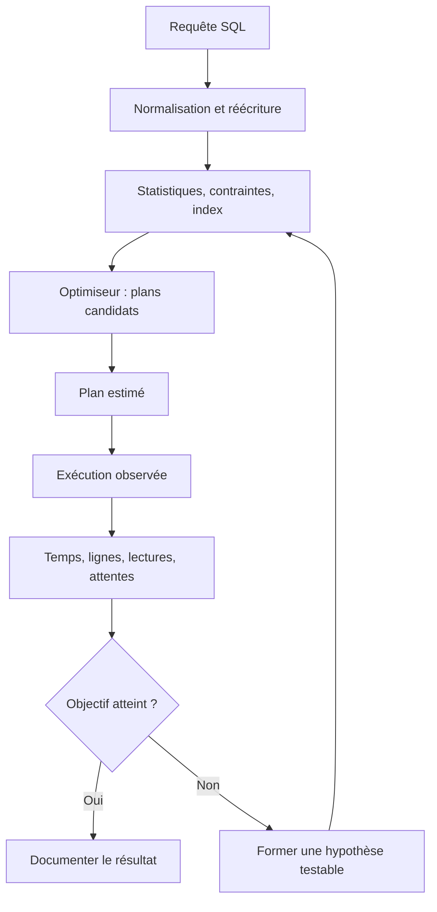

# Indexation et plans d'exécution — Intermédiaire

> **Mise en contexte.** Une requête lente n’est pas automatiquement un problème de matériel, et un index supplémentaire n’est pas automatiquement une solution. Le moteur choisit un plan à partir de la requête, des statistiques, des index disponibles, des contraintes et d’estimations de coût. Une amélioration sérieuse commence par une mesure reproductible, une hypothèse vérifiable et une comparaison avant/après sur une charge représentative. Ce cours apprend à lire un plan d’exécution, concevoir les index, reconnaître les erreurs de cardinalité, réduire le travail inutile et éviter les optimisations qui accélèrent un test minuscule tout en dégradant la production. Les exemples sont génériques ; la syntaxe des outils varie selon PostgreSQL, MySQL, SQL Server, Oracle et SQLite.

## Objectifs pédagogiques

À l’issue du cours, vous pourrez expliquer le rôle de l’optimiseur, distinguer coût estimé et durée observée, analyser les accès séquentiels et indexés, concevoir un index simple ou composé à partir d’un pattern de requête, interpréter les écarts entre lignes estimées et réelles, limiter les colonnes et résultats inutiles, optimiser jointures et pagination, mesurer l’effet des modifications et documenter les risques.

Un bon diagnostic sait répondre à cinq questions : quelle opération consomme le temps ? Combien de lignes sont examinées et retournées ? Les estimations du moteur sont-elles crédibles ? Quelle hypothèse explique le coût ? Quel test montrera que la modification améliore la situation sans régression ? L’objectif n’est pas de « faire apparaître un index » dans le plan, mais de satisfaire une exigence de latence et de débit dans des conditions clairement définies.

## Prérequis et précautions

Il faut connaître SELECT, WHERE, JOIN, ORDER BY, GROUP BY, les clés, les contraintes et le principe de transaction. Utilisez une base de laboratoire avec des données synthétiques suffisamment variées pour illustrer les cardinalités. Une table de dix lignes ne permet généralement pas de tirer de conclusion pertinente sur un index de production de plusieurs millions de lignes.

Précisez le SGBD, sa version, les paramètres, la distribution des données, la concurrence et l’état du cache. Ne lancez pas un test de charge sans autorisation. Certains outils d’analyse exécutent réellement la requête et peuvent produire des écritures, consommer beaucoup de ressources ou verrouiller des objets. Vérifiez les options de la commande et utilisez un environnement représentatif mais isolé pour les plans exécutés.

## 1. Comment le moteur choisit un plan

Le moteur transforme une requête en opérations qui peuvent être combinées : scan de table, recherche indexée, jointure par boucles imbriquées, jointure par hachage, jointure par tri-fusion, agrégation, tri ou matérialisation. Les noms précis et leur disponibilité varient selon le moteur. Le plan représente une stratégie : l’ordre des opérations, les méthodes d’accès et les estimations sur lesquelles le choix repose.

L’optimiseur cherche un plan dont le coût estimé est acceptable. Il évalue notamment lectures, CPU, opérations de tri, lignes attendues, sélectivité des filtres et mémoire disponible. Le coût affiché n’est pas directement une durée en millisecondes et ne se compare pas nécessairement entre moteurs ou configurations. Pour comprendre un problème, associez plan, durée réelle, nombre de lignes, lectures physiques et logiques, attente de verrou et consommation de ressources.

Une bonne requête peut être lente parce que le plan est mauvais, mais aussi parce qu’elle doit légitimement traiter énormément de données, attend une ressource, reçoit un volume réseau important, effectue des conversions coûteuses ou partage l’instance avec d’autres opérations. Ne réduisez pas le diagnostic à une seule représentation du plan.



## 2. Mesurer avant de modifier

Établissez une base de référence avant toute optimisation. Elle doit préciser requête exacte, paramètres, volume de lignes, version, cache, concurrence et métriques. Utilisez plusieurs répétitions : la première exécution peut inclure un chargement de pages ou la compilation du plan ; les suivantes peuvent bénéficier du cache. Ne comparez pas une première exécution à une série chaude sans le préciser.

Observez distribution des latences, pas seulement moyenne. Une moyenne de 40 ms peut cacher un p99 de plusieurs secondes. Si l’exigence applicative est « 95 % des requêtes en moins de 200 ms », un percentile approprié est plus directement lié au besoin qu’un temps moyen isolé. Mesurez aussi taux d’erreur, débit et impact sur les autres requêtes. Une seule requête peut être accélérée en consommant beaucoup plus de mémoire ou en ralentissant les écritures.

Un protocole simple contient :
1. la requête, ses paramètres et l’objectif métier ;
2. un jeu de données identifiable et une version de l’environnement ;
3. le plan estimé et, si cela est sûr, les statistiques réelles d’exécution ;
4. les durées sur plusieurs essais, la distribution et les ressources ;
5. une modification unique ;
6. les mêmes mesures après modification ;
7. une vérification de résultat et de non-régression.

Si la charge varie, réalisez un test contrôlé ou collectez des mesures sur une période comparable. Une baisse de latence pendant une période calme n’est pas nécessairement due à un index nouvellement ajouté.

## 3. Scans séquentiels et accès indexés

Un scan séquentiel examine les pages de la table ou d’un ensemble de données. Il peut être optimal lorsque la requête doit lire une grande partie des lignes, lorsque la table est petite ou lorsque les pages sont plus efficaces à parcourir que de nombreux accès ponctuels. Voir un scan séquentiel dans un plan ne signifie donc pas automatiquement qu’il y a un défaut.

Un index permet au moteur de localiser des lignes sans parcourir intégralement la table, mais le résultat peut nécessiter un accès à la table pour obtenir les autres colonnes. Si une requête retourne une grande proportion de lignes, l’index peut ajouter des accès aléatoires et coûter davantage qu’un scan. L’optimiseur choisit selon ses estimations ; il peut faire un choix inadapté si les statistiques ne reflètent pas les données ou si les coûts sont mal calibrés.

Les index B-tree sont courants pour égalité, plages et tris compatibles avec leur ordre. Les index spécialisés — hash, GIN, GiST, spatial, full-text, columnstore ou autres — dépendent fortement du produit et de la nature des données. Ne supposez pas qu’un index destiné à un type de recherche accélérera les autres.

Un index a un coût :
- stockage et mémoire de cache supplémentaires ;
- travail pour chaque insertion, modification ou suppression concernée ;
- maintenance, sauvegarde et reconstruction ;
- contention éventuelle et durée de migration ;
- risque de sélection d’un index qui devient moins adapté après un changement de distribution.

L’index doit être traité comme une décision d’exploitation, pas comme une décoration de schéma.

## 4. Sélectivité, cardinalité et statistiques

La sélectivité décrit la fraction des lignes qu’un filtre conserve. Un filtre sur une valeur très rare peut être très sélectif ; un filtre sur une valeur présente partout ne l’est pas. La cardinalité représente le nombre de lignes estimées ou observées pour un opérateur. Ces concepts expliquent pourquoi deux requêtes avec la même syntaxe peuvent avoir des plans très différents.

Le moteur s’appuie sur les statistiques pour estimer les valeurs, la distribution, les valeurs distinctes et parfois les corrélations entre colonnes. Si les données évoluent beaucoup mais que les statistiques restent anciennes, les estimations peuvent devenir fausses. Une requête planifiée pour renvoyer dix lignes peut être catastrophique si elle en renvoie en réalité deux millions. L’écart entre lignes estimées et observées est un indice essentiel pour localiser un mauvais choix.

Les colonnes corrélées posent un défi. Le moteur peut supposer une indépendance statistique alors que certaines combinaisons sont fréquentes ou impossibles. Les statistiques étendues et mécanismes similaires, lorsqu’ils sont disponibles, peuvent améliorer les estimations. Sinon, réécrivez ou segmentez la requête uniquement après avoir prouvé que le plan souffre de cette estimation.

La maintenance des statistiques doit suivre les habitudes d’écriture, le moteur et le volume. Une collecte manuelle peut coûter des ressources et certaines commandes ont un impact de production. Testez la fréquence et l’approche sur l’environnement concerné ; ne lancez pas aveuglément une maintenance lourde pendant un pic de trafic.

## 5. Concevoir un index simple

Partons d’une requête de catalogue :

```sql
SELECT product_id, name, price
FROM product
WHERE sku = ?;
```

Si `sku` identifie une valeur unique et est souvent recherchée, une contrainte UNIQUE peut à la fois protéger l’intégrité et fournir un index adapté dans de nombreux moteurs. Cela n’est pas une raison de créer un index identique en double. Vérifiez les index existants, les contraintes et le plan. L’index ne rend pas la valeur unique à lui seul à moins que la contrainte d’unicité soit effectivement définie.

Un index simple convient lorsque le pattern de requête dépend principalement d’un champ. Il peut aussi aider les filtres de plage, mais l’ordre des comparaisons, les types et les expressions influencent l’utilisation. Une conversion implicite, une fonction sur la colonne ou un type de paramètre incompatible peut empêcher certains accès indexés ou conduire à un plan inattendu.

Un index sur un champ très peu sélectif n’est pas nécessairement inutile. Si un champ à deux valeurs est corrélé avec une partie des données, si des index filtrés/partiels sont disponibles ou si la requête ne lit qu’un petit nombre de colonnes, il peut avoir un intérêt. La décision doit venir du plan, de la distribution et des mesures.

## 6. Index composés et ordre des champs

Un index composé organise plusieurs champs dans un ordre donné. Pour une requête telle que :

```sql
SELECT order_id, created_at, total
FROM orders
WHERE customer_id = ?
ORDER BY created_at DESC
LIMIT 20;
```

un index composé `(customer_id, created_at)` peut soutenir le filtre par client puis la lecture ordonnée des commandes récentes. L’orientation exacte, le tri et les règles d’utilisation varient selon le moteur ; dans certains cas, un B-tree peut être parcouru à l’envers et rendre une direction explicite inutile. La réponse finale vient du plan testé.

Une heuristique fréquente consiste à placer les champs d’égalité avant les champs de plage ou de tri, mais ce n’est pas une loi universelle. Plusieurs requêtes peuvent partager un index, et l’ordre optimal dépend des patterns réels, des valeurs distinctes, du coût de l’index et des contraintes d’ordre. Si le premier champ ne figure pas dans la requête, le moteur n’a pas forcément le même bénéfice qu’avec le préfixe gauche de l’index.

Ne créez pas un index avec toutes les colonnes parce qu’il « couvrirait tout ». Un index très large prend de la place, augmente le coût des mises à jour et peut éroder le cache. Le compromis doit être mesuré sur les requêtes les plus importantes, pas sur chaque requête imaginable.

## 7. Index partiels, filtrés et couvrants

Un index partiel ou filtré ne contient qu’une partie des lignes selon une condition définie. Il peut être très efficace quand une requête interroge constamment cette population, par exemple les commandes encore ouvertes. Mais le moteur ne peut l’utiliser que si le filtre de la requête correspond aux conditions de l’index de façon qu’il puisse prouver que les lignes requises sont couvertes.

Un index couvrant contient les colonnes nécessaires à une requête, ou peut les fournir sans lire les lignes de la table selon le moteur et le type d’index. Cette stratégie peut réduire les accès à la table et améliorer la latence. Mais l’ajout de colonnes augmente la taille et la maintenance. Dans certains moteurs, les colonnes incluses ne participent pas à l’ordre de navigation ; la syntaxe précise varie.

Avant d’utiliser un index partiel, démontrez que le filtrage correspond au besoin et que les requêtes anciennes et nouvelles vont continuer à le prendre en compte. Un index filtré mal conçu peut donner un plan moins bon pour les cas non couverts. Après l’ajout, contrôlez aussi la taille et le coût des insertions.

## 8. Éviter les prédicats difficiles à indexer

Une fonction appliquée à la colonne filtrée peut empêcher l’usage direct d’un index ordinaire, selon le moteur. Par exemple :

```sql
-- Forme susceptible de limiter un index ordinaire sur created_at
SELECT order_id
FROM orders
WHERE DATE(created_at) = ?;
```

Une alternative peut être une plage semi-ouverte correspondant à une journée :

```sql
SELECT order_id
FROM orders
WHERE created_at >= ?
  AND created_at < ?;
```

Cette seconde forme suppose que l’application calcule correctement les deux bornes dans le fuseau métier retenu. Les horodatages exigent une règle explicite pour UTC, fuseau local, changement d’heure et précision. Ne remplacez pas la condition par une approximation qui change le sens de la requête.

Autres problèmes : conversion de type sur la colonne, joker initial dans une recherche LIKE, comparaison avec une fonction non indexée, opérateur incompatible avec l’index, collation inattendue ou expressions qui empêchent la preuve du filtre. Certaines bases permettent des index d’expression ou des indexes spécialisés. Choisissez d’abord la bonne sémantique et inspectez le plan ; ne réécrivez pas une requête en sacrifiant l’exactitude pour obtenir un index.

Les paramètres préparés protègent contre l’injection et réduisent la duplication du code. Dans certains moteurs, le plan générique et le plan spécifique à la valeur n’ont pas le même coût, particulièrement quand la distribution est très asymétrique. Mesurez les requêtes avec des valeurs courantes et rares avant de conclure qu’un plan unique convient à toutes les valeurs.

## 9. Jointures : ordre, cardinalité et algorithmes

Une jointure relie les lignes qui satisfont une condition. Une boucle imbriquée peut être efficace lorsque la première population est petite et que la seconde est accessible par un index. Une jointure par hachage peut convenir à de grandes populations lorsque le moteur peut construire une table de hachage adaptée en mémoire. Une jointure par tri-fusion peut être efficace si les deux côtés sont déjà ordonnés ou si le coût du tri est acceptable.

Aucun algorithme n’est systématiquement meilleur. Les estimations de lignes influencent le choix ; une population mal estimée peut rendre une stratégie très coûteuse. Un plan avec une boucle imbriquée n’est pas mauvais par définition. Il devient suspect si la boucle s’exécute des centaines de milliers de fois et déclenche un accès coûteux à chaque itération.

Vérifiez l’unicité et la cardinalité des clés de jointure. Si une clé attendue unique contient des doublons, les résultats peuvent exploser en nombre de lignes et devenir faux. La contrainte doit exprimer l’invariant. Un filtre appliqué trop tard peut augmenter le travail inutile ; le moteur réécrit parfois la requête automatiquement, mais le plan réel doit être examiné.

Évitez les sous-requêtes corrélées exécutées de manière répétitive lorsque la même information peut être obtenue par une jointure ou une agrégation. Cependant, ne réécrivez pas mécaniquement : les optimisateurs modernes transforment de nombreuses expressions. Mesurez avant/après, puis vérifiez l’équivalence sémantique sur valeurs NULL, doublons et cas limites.

## 10. Réduire le volume : projections, agrégats et LIMIT

Le plus rapide travail est souvent celui qu’on ne demande pas. Évitez `SELECT *` quand seuls trois champs sont nécessaires. Limitez la population au niveau SQL, plutôt que de ramener cent mille lignes dans l’application pour les filtrer en mémoire. Les données inutiles augmentent le coût de lecture, le transfert réseau, la mémoire applicative et le temps de sérialisation.

Un `LIMIT` sans ordre déterministe ne garantit pas que les mêmes lignes seront renvoyées entre deux exécutions. Ajoutez un tri avec une clé de départage unique quand le résultat doit être stable. Pour une pagination, l’offset devient plus coûteux quand sa valeur est très grande, parce que le moteur peut devoir parcourir les lignes sautées. Une pagination par curseur ou clé (par exemple date et identifiant) peut mieux évoluer, mais doit définir l’ordre et le comportement face aux écritures concurrentes.

Les agrégats peuvent être calculés à la demande, précalculés ou matérialisés selon la fraîcheur requise et le coût. Une vue matérialisée ou une table de synthèse peut réduire le travail d’un rapport mais ajoute une stratégie de rafraîchissement et un risque de données périmées. Il faut définir qui la met à jour, à quelle fréquence, comment une mise à jour interrompue est reprise et quelle fraîcheur l’application peut accepter.

## 11. Tri, agrégation et mémoire temporaire

Les opérations de tri et d’agrégation ont un coût lié au nombre de lignes et à la mémoire disponible. Un tri peut rester en mémoire ou déborder vers un espace temporaire ; les paramètres et seuils diffèrent selon le moteur. Un rapport qui trie toute une table puis ne retourne que vingt lignes peut nécessiter une stratégie d’index ou une réécriture selon la requête. Le plan doit révéler la taille de population concernée.

L’agrégation peut être exécutée par hash ou par ordre de tri. Une table de regroupement très grande peut demander de la mémoire importante. Plusieurs rapports lancés simultanément peuvent faire déborder les opérations sur disque et saturer l’espace temporaire. Surveillez capacité, temps de tri, espace temporaire et concurrence plutôt que d’augmenter systématiquement tous les seuils globaux.

Réduire la population avant l’agrégation est souvent utile, mais l’optimiseur peut déjà pousser certains filtres. Assurez-vous de préserver le résultat exact : déplacer un filtre de HAVING vers WHERE n’est pas équivalent dans tous les cas, et pré-filtrer une population peut modifier les groupes inclus. L’équivalence doit être prouvée, pas supposée.

## 12. Pagination et requêtes interactives

Une interface qui affiche vingt résultats ne devrait pas charger toute la population. Le tri doit être défini de manière stable et l’index doit correspondre au filtre et à l’ordre. Pour une pagination offset-limit, la page 10 000 peut devenir coûteuse même si chaque page renvoie seulement vingt lignes. Le moteur peut devoir parcourir une grande partie des entrées avant de sauter l’offset.

La pagination par clé utilise la dernière clé reçue pour demander les éléments suivants. Par exemple, avec un ordre par `created_at` puis `order_id`, l’application garde les deux valeurs et demande les lignes postérieures à ce couple selon l’ordre défini. Le traitement exact des égalités, NULL et direction descendante doit être écrit explicitement. Une pagination par clé exige aussi que l’index et le prédicat soutiennent cet ordre.

La concurrence peut insérer des lignes pendant qu’un utilisateur navigue. Avec des pages offset, les insertions ou suppressions peuvent décaler le contenu entre les pages ; avec un curseur, le résultat dépend de la clé et de la transaction/consistance choisie. Définissez si l’interface accepte un résultat légèrement mouvant ou exige un instantané cohérent.

## 13. Verrous, concurrence et lenteur

Une requête peut être lente sans consommer beaucoup de CPU si elle attend un verrou, une connexion ou une ressource réseau. L’analyse du plan doit être corrélée aux attentes et à la durée des transactions. Les transactions longues peuvent empêcher d’autres sessions de modifier ou d’effacer des lignes. Un index peut réduire l’ensemble des lignes touchées, mais il peut aussi ajouter du travail d’écriture et ne supprime pas toutes les formes de contention.

Identifiez la requête bloquante, la requête bloquée, l’objet ou la ressource concernée et l’heure de début. Vérifiez si une session attend une entrée utilisateur dans une transaction ouverte. Évitez d’arrêter des sessions sans comprendre les conséquences. Le rollback peut prendre du temps et produire une autre hausse de charge. Toute intervention doit respecter le processus d’incident et les critères d’arrêt.

Les index participent aussi au coût de maintenance des écritures. Une transaction qui modifie plusieurs colonnes indexées doit maintenir chaque structure concernée ; des index redondants peuvent ralentir les imports et augmenter les risques de contention. Une optimisation d’une requête de lecture doit être évaluée sur le débit complet, pas uniquement sur l’exécution isolée.

## 14. Outils d’analyse selon le moteur

Le principe commun est de comparer plan prévu, plan observé et résultat. Les commandes ne sont pas identiques :
- PostgreSQL propose EXPLAIN et, avec précautions, EXPLAIN ANALYZE qui exécute la requête ;
- MySQL propose EXPLAIN et des variantes d’analyse selon la version ;
- SQL Server expose des plans estimés et réels et des statistiques d’exécution ;
- Oracle offre plusieurs outils de plan et de diagnostic ;
- SQLite permet EXPLAIN QUERY PLAN, dont la sortie est simplifiée et spécifique à la version.

N’exécutez pas une commande uniquement parce qu’elle fonctionne dans un tutoriel d’un autre moteur. L’option d’analyse réelle peut exécuter des opérations coûteuses ou modifier les données si la requête écrit. En production, privilégiez les méthodes d’observation autorisées, les replicas de diagnostic ou les reproductions représentatives. Un plan anonymisé doit conserver la distribution pertinente des valeurs sans exposer de données personnelles.

Dans le rapport, nommez le moteur, la version, les paramètres et le type d’analyse. Si un outil ne donne pas de durée réelle, ne présentez pas la valeur estimée comme une mesure. Les plans se comparent dans un contexte donné ; une ligne de coût n’est pas une unité universelle.

## 15. Atelier pratique guidé : catalogue de commandes

### Objectif

Vous disposez d’une table de commandes contenant un identifiant, un client, un horodatage, un statut et un montant. Une interface affiche les vingt dernières commandes d’un client. Le laboratoire doit démontrer une amélioration mesurée tout en conservant exactement les mêmes résultats.

### Étape A — Construire un jeu représentatif

Créez plusieurs centaines de milliers de lignes synthétiques, avec des clients inégalement répartis : certains ont peu de commandes, d’autres beaucoup. Variez les statuts et les dates. Un jeu uniformément distribué ne révèle pas toujours les problèmes liés aux valeurs très fréquentes. Notez le seed ou la méthode de génération pour réutiliser exactement le même jeu.

### Étape B — Mesurer une requête de base

```sql
SELECT order_id, created_at, status, total
FROM orders
WHERE customer_id = ?
ORDER BY created_at DESC, order_id DESC
LIMIT 20;
```

Mesurez la durée sur plusieurs essais et consultez le plan avec les outils de votre moteur. Notez les lignes estimées, les lignes réelles lorsqu’elles sont disponibles, les accès et les opérations de tri. Vérifiez d’abord que la requête renvoie le bon client et un ordre stable.

### Étape C — Formuler l’hypothèse

Supposez que la requête examine trop de lignes ou effectue un tri inutile. Vérifiez si l’index disponible commence par `customer_id` et peut fournir l’ordre requis. Créez uniquement l’index justifié après avoir vérifié les index et contraintes existants. Une structure possible est `(customer_id, created_at, order_id)`, avec des orientations adaptées au moteur. Ne copiez pas aveuglément ce choix sur toutes les bases.

### Étape D — Mesurer après changement

Relancez les mêmes paramètres et le même protocole. Comparez p50/p95, lignes examinées, durée, ressources et coût des écritures. Vérifiez aussi les clients ayant peu et beaucoup de commandes, les valeurs NULL si elles existent, les égalités d’horodatage et les résultats page par page. Si la latence s’améliore seulement pour les clients rares mais se dégrade pour les plus grands, cherchez l’explication dans les distributions ou les plans.

### Étape E — Vérifier la régression

Réalisez un petit test d’écriture et mesurez l’évolution du stockage. L’index doit être pris en compte lors des inserts et mises à jour. Si le gain est faible ou le coût d’écriture trop grand, retirez-le par le processus habituel. En production, une suppression d’index doit être revue, observée et réversible.

### Critères d’acceptation

L’atelier réussit si la sortie reste équivalente, si l’hypothèse explique les mesures, si la comparaison utilise les mêmes conditions et si les effets sur les écritures sont documentés. Une simple capture de plan ne suffit pas ; le rapport inclut version, jeu, requête, paramètres, mesures, résultat et limite de validité.

## 16. Étude de cas : une requête passe de 80 ms à 9 secondes

### Situation

Après plusieurs mois de croissance, une recherche de commandes devient lente. Le code SQL n’a pas changé, mais le nombre de lignes a fortement augmenté et certains clients ont beaucoup plus de commandes que d’autres.

### Diagnostic

Commencez par comparer les paramètres typiques et les paramètres lents. Inspectez plan, cardinalité estimée, cardinalité réelle, statistiques et index. Vérifiez le tri, les accès répétés, les attentes et la charge concurrente. Une distribution devenue asymétrique peut rendre un plan acceptable pour la plupart des clients mauvais pour les gros clients. Un index autrefois sélectif peut ne plus l’être.

### Hypothèses et tests

- Les statistiques sont anciennes : les mettre à jour sur un environnement représentatif puis comparer les plans.
- L’index ne correspond pas au tri : tester un index composé adapté et mesurer l’écriture.
- La pagination saute un grand offset : tester une pagination par clé avec ordre stable.
- Le problème vient de contention : corréler les heures lentes avec verrous et transactions longues.
- Le client demande trop de colonnes : réduire projection et transfert si le contrat le permet.

Ne changez pas quatre éléments en une seule fois. Chaque hypothèse doit produire une prédiction que les mesures peuvent confirmer ou réfuter. Le choix final peut combiner plusieurs modifications, mais la valeur de chacune doit être comprise.

### Vérification

Comparez la distribution de latence et l’impact sur le débit général. Vérifiez des cas limites, les résultats exacts, l’usage mémoire et la durée des écritures. Documentez la raison du changement, la commande d’application, la fenêtre, le retour arrière et les indicateurs de surveillance post-déploiement.

## 17. Exercices avec corrigés

### Exercice 1 — Le plan montre un scan séquentiel. Faut-il créer un index ?

**Correction.** Pas sans analyser le volume retourné et le coût. Un scan est souvent efficace pour une petite table ou une requête qui lit une large fraction des lignes. Vérifiez le plan complet, sélectivité, durée et ressource. Créez un index seulement si un pattern récurrent et une mesure justifient son coût.

### Exercice 2 — Le moteur estime 10 lignes mais en renvoie 300 000. Pourquoi est-ce important ?

**Correction.** Le choix du plan repose sur l’estimation. Une cardinalité sous-estimée peut favoriser un algorithme de jointure ou une mémoire qui n’est pas adaptée à la population réelle. Inspectez statistiques, distribution, corrélations et paramètres. Corrigez la cause de l’erreur puis mesurez le nouveau plan.

### Exercice 3 — Une requête par client trie les commandes récentes. Quel ordre d’index examiner ?

**Correction.** Un index commençant par le filtre d’égalité du client et suivi des colonnes d’ordre peut convenir, mais il faut vérifier les index existants, la direction, l’unicité du tri et le plan. Mesurez avec clients petits et gros. N’oubliez pas le coût d’écriture.

### Exercice 4 — Ajouter un index divise la latence par quatre, mais les imports deviennent deux fois plus longs. Est-ce une réussite ?

**Correction.** Pas automatiquement. Il faut évaluer le service global, la fréquence des lectures et imports, les fenêtres de traitement, le coût de stockage et les objectifs. Envisagez une optimisation de requête, un index partiel ou la suppression d’un index redondant. La décision doit reposer sur des charges réalistes et des objectifs explicites.

### Exercice 5 — Pourquoi mesurer plusieurs répétitions ?

**Correction.** Le cache, la compilation, l’ordonnanceur, les autres requêtes et les fluctuations d’infrastructure peuvent changer le temps observé. Plusieurs répétitions permettent de comprendre la distribution. Il faut tout de même contrôler les conditions et ne pas mélanger cache froid et chaud sans les différencier.

### Exercice 6 — Pourquoi un ORDER BY avec LIMIT doit-il être déterministe ?

**Correction.** Si plusieurs lignes ont la même valeur de tri et aucune clé de départage n’est ajoutée, l’ordre des lignes à la frontière de page peut changer. Une pagination stable doit inclure une clé supplémentaire unique et utiliser le même ordre dans le prédicat et l’index correspondant.

## 18. Défi final : résoudre une latence p95 élevée

Une API liste les commandes d’un client. La p50 est de 40 ms, la p95 de 1,2 s et quelques clients ont des centaines de milliers de lignes. Les écritures doivent rester rapides et la réponse doit contenir exactement les vingt commandes les plus récentes.

### Corrigé attendu

Définissez d’abord la requête et les mesures par profil de client. Inspectez plan estimé et réel, lignes examinées, tri, index et attentes. Vérifiez que le filtre et le tri sont déterministes, avec un identifiant comme départage. Évaluez un index composé adapté ; mesurez son coût sur insert/update. Si l’application utilise un très grand offset, testez une pagination par clé. Si les statistiques sont erronées, traitez-les avant de conclure que le matériel est insuffisant.

Le résultat doit être comparé avec le même jeu, même distribution, mêmes paramètres et nombre suffisant de répétitions. La p95 doit être examinée dans l’ensemble et par classe de clients ; la p50 seule pourrait masquer le problème des grands clients. Vérifiez aussi le débit global, les écritures et la consommation mémoire. Si le plan devient meilleur mais le temps ne change pas, cherchez une attente externe ou une mesure mal ciblée.

La correction finale comporte la requête, les index retenus et ceux laissés de côté, les plans anonymisés, les chiffres avant/après, les tests d’équivalence, les limites et la procédure de retour arrière. Elle attribue les alertes et surveillances à une personne. Une optimisation qui ne peut pas être reproduite ou dont l’impact sur les autres opérations est inconnu ne doit pas être déclarée terminée.

## 19. Erreurs à éviter et checklist

**Optimiser sur un petit dataset.** Les plans changent avec les distributions et les volumes. Utilisez des données proches du profil de production et des valeurs rares/fréquentes.

**Confondre plan estimé et plan exécuté.** Un plan estimé est une hypothèse du moteur. Une analyse réelle fournit des informations additionnelles mais peut exécuter la requête et doit être utilisée en sécurité.

**Créer un index en doublon.** Inspectez les contraintes et les index similaires ; les duplications coûtent stockage et écriture.

**Évaluer uniquement la lecture.** Une stratégie de lecture doit être mesurée avec son impact sur insertions, modifications, maintenance et sauvegardes.

**Réécrire sans vérifier l’équivalence.** Les valeurs NULL, doublons, fuseaux horaires, collations et arrondis peuvent changer le résultat.

**Forcer un plan trop tôt.** Des hints ou paramètres forcés peuvent aider dans des cas prouvés mais se dégrader après une évolution de données. Préférez corriger statistiques, modèle et requête avant le contournement.

**Ignorer les attentes.** Une requête qui attend un verrou peut sembler lente sans avoir besoin d’un index. Corrélez plan et métriques de concurrence.

Checklist de déploiement :
- [ ] Objectif de latence et de débit validé.
- [ ] Requête et paramètres reproduits.
- [ ] Version moteur et distributions documentées.
- [ ] Plan et cardinalités examinés.
- [ ] Index existants et contraintes inventoriés.
- [ ] Une hypothèse a été testée à la fois.
- [ ] Résultat métier identique après réécriture.
- [ ] Lecture, écriture, stockage et concurrence mesurés.
- [ ] Procédure de retour arrière disponible.
- [ ] Surveillance après déploiement et propriétaire désignés.

## Conclusion

L’optimisation repose sur une boucle de mesure, d’hypothèse, de changement limité et de vérification. Les index sont de puissants outils mais ont un coût. Les plans montrent comment le moteur prévoit d’exécuter une requête ; les mesures réelles révèlent si cette stratégie atteint les objectifs. Un bon résultat préserve les données et le sens métier, réduit le travail nécessaire, documente ses hypothèses et reste observable après le déploiement.
