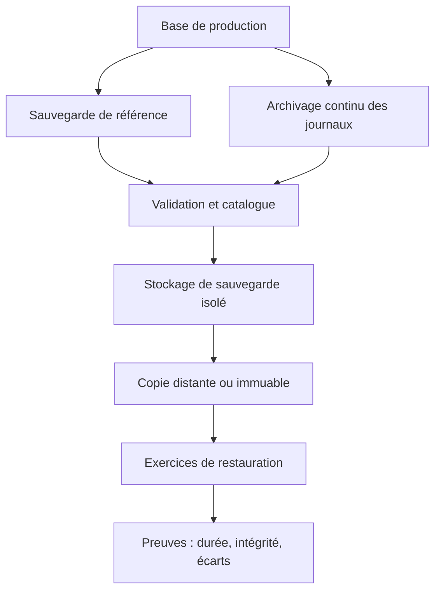
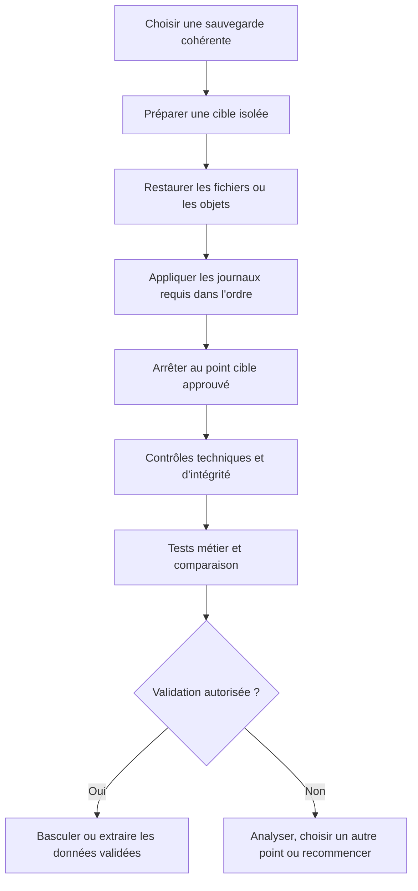
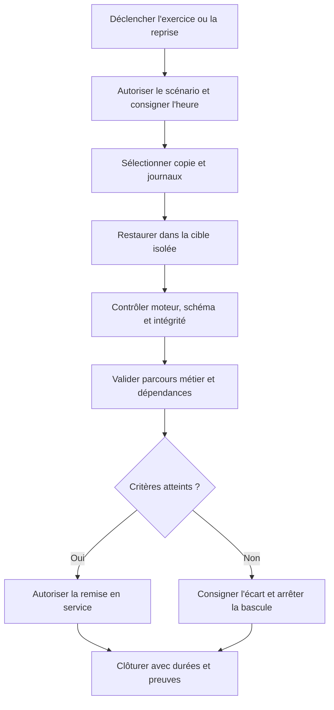

# Backup, PITR et restauration — Intermédiaire

> **Mise en contexte** — Une sauvegarde programmée au vert ne prouve pas qu'une organisation saura reprendre après une suppression accidentelle, une corruption logique, un rançongiciel ou la perte du serveur. La véritable capacité de reprise se démontre en restaurant des données cohérentes, en récupérant les journaux requis, en rétablissant les accès et les dépendances, puis en validant le service métier dans un délai convenu. Le DBA doit concevoir la sauvegarde autour du besoin de reprise, tester régulièrement la chaîne complète et garder des preuves compréhensibles par une autre personne.

## Introduction et objectifs

Ce cours porte sur les sauvegardes physiques et logiques, les copies complètes et incrémentales, la rétention, les journaux, la restauration à un instant donné (PITR), les objectifs RPO/RTO, l'isolement des copies et les exercices de reprise. Les mécanismes varient entre PostgreSQL, MySQL et les plateformes managées. Les procédures doivent suivre la version et l'architecture réellement utilisées.

À la fin, l'apprenant saura traduire les besoins métier en objectifs de récupération, choisir une stratégie cohérente avec le moteur, décrire la chaîne de sauvegarde et de journaux, préparer un point de restauration, restaurer dans un environnement isolé, vérifier l'intégrité, mesurer le temps réel de reprise, diagnostiquer une sauvegarde inutilisable et produire un runbook testable.

## 1. Définir l'objectif avant le type de sauvegarde

### 1.1 Quelles pannes faut-il couvrir ?

Une stratégie doit considérer différents scénarios : suppression accidentelle, commande erronée qui modifie beaucoup de lignes, corruption logique, défaillance de stockage, perte de serveur, perte de site, erreur de configuration, compromission des identifiants d'administration et attaque qui tente de supprimer les sauvegardes. Ces événements ne se traitent pas tous de la même façon.

- Une suppression accidentelle requiert souvent un état antérieur ou une récupération temporelle.
- Une panne matérielle requiert une copie utilisable sur une infrastructure disponible.
- Une corruption peut nécessiter l'identification du dernier état sain avant la corruption.
- Une perte de site peut exiger une copie distante et des dépendances capables de fonctionner dans un autre emplacement.
- Une compromission exige des copies protégées des mêmes identités et voies d'administration que celles que l'attaquant pourrait utiliser.
- Un problème de schéma ou une erreur applicative peut être répliqué immédiatement vers une réplique, donc nécessiter une véritable sauvegarde ou un retour temporel.

La réplication améliore potentiellement la disponibilité ; elle n'est pas en soi une protection historique. Un journal d'audit peut aider à comprendre ce qui s'est passé, mais ne remplace pas le mécanisme capable de restaurer les données.

### 1.2 RPO et RTO

Le Recovery Point Objective (RPO) exprime la perte de données temporelle que l'organisation peut accepter dans un scénario convenu. Le Recovery Time Objective (RTO) exprime la durée cible pour remettre le service en état. Les objectifs sont approuvés par les propriétaires métier ; le DBA les traduit en architecture et vérifie les résultats par un exercice.

Un RPO de quinze minutes ne signifie pas uniquement effectuer une sauvegarde toutes les quinze minutes. Il faut examiner la fréquence des sauvegardes, la collecte des journaux, leur transfert, la rétention, la cohérence de la copie et la capacité à les rejouer. Un RTO de deux heures ne se mesure pas uniquement jusqu'à la fin de l'extraction des fichiers : le temps comprend la détection, la décision, l'approvisionnement, la récupération, le contrôle fonctionnel et la remise en service.

### 1.3 Définir le périmètre de restauration

Une base isolée n'est pas toujours le périmètre à restaurer. L'application peut dépendre d'un schéma de référence, d'un service d'identité, d'une file d'événements, d'un catalogue de pièces ou d'un fichier de configuration. Une restauration de données sans cohérence avec les dépendances peut provoquer un état impossible : un ticket existe mais son historique associé manque, ou un message a déjà déclenché une action dans un autre système.

Pour chaque service, identifier les données, les objets de base, les extensions, les configurations, les clés de chiffrement, les identifiants, les secrets, les versions applicatives, les files et les dépendances. Définir le point de cohérence à viser, les opérations externes à réconcilier et les responsables qui valident le rétablissement.

## 2. Familles de sauvegardes et compromis

### 2.1 Sauvegarde logique

Une sauvegarde logique exporte la représentation des objets ou des données, par exemple des instructions de création et d'insertion ou un format structuré. Elle peut faciliter une migration entre versions ou moteurs dans certaines limites et permettre une restauration sélective. En contrepartie, elle peut être longue à produire ou à restaurer sur de gros volumes, et elle dépend de la compatibilité de la syntaxe, des types et des extensions.

La cohérence du dump dépend de la méthode, du moteur et du mode utilisé. Il faut vérifier si la commande produit un instant cohérent pendant que les écritures continuent, quelles tables sont incluses, si les rôles et permissions sont exportés séparément et si la restauration nécessite une préparation supplémentaire. Une sauvegarde logique ne doit pas être supposée complète sans contrôler les objets concernés.

### 2.2 Sauvegarde physique

Une sauvegarde physique copie les fichiers ou les blocs du système de stockage dans un format que le moteur peut restaurer. Elle peut être efficace pour de gros volumes et préserver des détails internes nécessaires à une reprise. Elle dépend toutefois de règles propres au moteur, de la compatibilité des versions, de la cohérence de la copie et des fichiers ou journaux nécessaires.

Copier un répertoire actif avec un outil de fichiers ordinaire sans méthode cohérente peut produire un ensemble inutilisable. Utiliser les mécanismes documentés de sauvegarde à chaud, de snapshot cohérent ou de mise à l'arrêt contrôlée. Comprendre les préconditions de restauration avant de sélectionner une méthode.

### 2.3 Sauvegarde complète, incrémentale et différentielle

Une sauvegarde complète capture une base de référence selon le mécanisme utilisé. Une sauvegarde incrémentale capture les changements depuis un point ou un incrément précédent, tandis qu'une différentielle représente généralement les changements depuis une sauvegarde complète de référence. Les définitions précises varient selon les outils.

Les incréments peuvent réduire le transfert et le stockage, mais augmenter la dépendance à la chaîne et la complexité de restauration. Si un maillon requis est corrompu ou absent, la reprise peut échouer. Il faut surveiller chaque composant, vérifier les dépendances, tester la restauration de la chaîne et conserver une documentation expliquant l'ordre de réapplication.

### 2.4 Copies et journaux continus

Les journaux de transactions peuvent servir à récupérer les opérations confirmées après une sauvegarde de base, jusqu'à un point voulu, si le moteur et la configuration le permettent. Ils doivent être collectés, transférés, archivés et protégés sans lacune. Le nom et le format diffèrent : WAL et archivage WAL dans PostgreSQL, binary log et journaux associés dans MySQL/InnoDB selon la stratégie.

La capacité de reprise temporelle est déterminée par la sauvegarde de référence, la continuité des journaux et la procédure de restauration. Il faut démontrer que la chaîne est continue et correspond à l'instance visée. Des fichiers journaux présents sans métadonnées, ordre ou preuve d'intégrité ne suffisent pas.

## 3. Architecture de protection des sauvegardes

### 3.1 Schéma de référence

Le stockage des sauvegardes doit être protégé contre la perte, la corruption, l'altération involontaire et les identifiants de production compromis. Selon le contexte, envisager séparation des comptes, accès avec élévation contrôlée, rétention verrouillée, copie indépendante, chiffrement, inventaire, détection d'effacement et journalisation des actions. Vérifier les capacités réellement proposées par le fournisseur et le niveau de service.

### 3.2 Séparation et résistance aux attaques

Si le même compte peut modifier la base et supprimer toutes les sauvegardes, l'organisation n'a pas une séparation suffisante des risques. Les identités de sauvegarde doivent disposer de droits limités à leur tâche, et la suppression de copies protégées devrait nécessiter une autorisation distincte lorsque le risque le justifie. Les secrets ne doivent pas être accessibles depuis le seul serveur de production compromis.

Une sauvegarde immuable ou protégée contre la suppression apporte une défense supplémentaire, mais ne garantit ni la qualité du contenu ni une restauration réussie. Une copie peut être immuable et déjà corrompue au moment de sa création. L'intégrité, la fraîcheur, la couverture et la capacité de restauration doivent être testées séparément.

### 3.3 Chiffrement et clés

Le chiffrement protège les copies contre certaines formes d'accès non autorisé, mais rend la gestion des clés indispensable. Une sauvegarde chiffrée dont la clé est perdue ne peut pas être restaurée. À l'inverse, une clé stockée sans séparation avec les données peut ne pas protéger contre la compromission complète de l'environnement.

Définir la propriété des clés, les permissions de déchiffrement, les sauvegardes de clés selon la politique, la rotation, les procédures d'urgence et les tests de récupération des clés. Les personnes qui peuvent restaurer les données n'ont pas nécessairement besoin d'une permission générale sur toutes les clés ou tous les environnements. Adapter la séparation aux capacités réelles de l'outillage.

### 3.4 Catalogue de sauvegarde

Le catalogue doit identifier la base, l'environnement, la version du moteur, la date et l'instant couverts, la méthode, les objets inclus, l'emplacement, le chiffrement, la rétention, les fichiers journaux requis, le contrôle d'intégrité et le dernier exercice de restauration. Ajouter le propriétaire, le niveau de criticité et le lien vers le runbook.

La notification « sauvegarde réussie » n'est qu'un signal de production. Il faut distinguer la réussite de la commande, la présence des fichiers, la validation de l'intégrité, la continuité des journaux et la restauration réelle. Chaque état correspond à une preuve différente.

## 4. Restauration et PITR

### 4.1 Le principe de récupération à un instant donné

La restauration à un instant donné (Point-in-Time Recovery, PITR) permet, sous réserve des mécanismes du moteur et de la continuité des journaux, de rétablir un état correspondant à une heure ou à une position logique choisie. Elle est utile lorsqu'une erreur logique est découverte après un délai : l'équipe cherche un état sain immédiatement antérieur à la modification dommageable.

Il faut définir ce que signifie l'instant : heure locale ou UTC, horodatage de transaction, position de journal, ou repère fourni par l'outil. Les transactions concurrentes et les écritures externes peuvent rendre l'interprétation plus complexe. Consigner la source temporelle et la règle de sélection, plutôt que de saisir une heure approximative à la main.

### 4.2 Chaîne de récupération

Les étapes techniques exactes diffèrent. Ne pas utiliser une commande générale copiée d'un autre moteur. Vérifier le scénario dans un environnement de répétition et lire la documentation du moteur pour le démarrage en mode de récupération, les paramètres de cible, l'arrêt du rejeu et la promotion éventuelle d'une réplique.

### 4.3 Restaurer dans un environnement isolé

Une cible de restauration doit être isolée des systèmes de production tant que l'état n'a pas été validé. Elle ne doit pas envoyer automatiquement les notifications, déclencher les files, réémettre des paiements ou lancer des tâches planifiées. Les identifiants et secrets de production doivent être limités ou remplacés pour éviter des effets externes.

Prévoir capacité, espace temporaire, réseau, versions compatibles et permissions. L'isolement permet de comparer les données, d'analyser une corruption et de faire des contrôles sans affecter le service actuel. Il est aussi nécessaire pour les restaurations d'enquête ou les extractions sélectives.

### 4.4 Restauration complète, partielle et extraction

Selon le moteur, il peut être possible de restaurer la base entière, certaines tables, certains objets ou des données sélectionnées. Une restauration complète est souvent plus facile à interpréter lorsque les relations et les transactions doivent être cohérentes. Une extraction partielle peut être utile pour corriger un petit périmètre, mais doit examiner les clés étrangères, les séquences, les identifiants et les relations avec les autres tables.

Ne pas remplacer directement une table de production par une ancienne version sans analyser les modifications légitimes survenues depuis le point restauré. Le retour temporel peut aussi annuler des opérations valides. La méthode de réparation doit distinguer les enregistrements à récupérer et ceux à préserver, et elle doit être relue par une personne compétente.

### 4.5 Vérifier la restauration

Les contrôles peuvent comprendre :
- démarrage du moteur et absence d'erreur de récupération ;
- présence des schémas, rôles et extensions attendus ;
- contrôle des contraintes et d'un échantillon d'intégrité ;
- vérification de comptes métier, totaux ou relations critiques ;
- ouverture de l'application avec des identités de test ;
- test des parcours de lecture et d'écriture autorisés ;
- contrôle des journaux, tâches et intégrations après reprise ;
- réconciliation des actions externes ;
- mesure de la durée complète jusqu'au service utilisable.

Les sommes de contrôle et les contrôles structurels aident à détecter certains problèmes, mais ne prouvent pas à eux seuls l'exactitude métier. Un jeu restauré peut être cohérent pour le moteur et incohérent pour l'organisation si des données externes ne sont pas restaurées au même instant.

## 5. PostgreSQL et MySQL : principes à vérifier

### 5.1 PostgreSQL

PostgreSQL documente des méthodes distinctes de sauvegarde logique et physique ainsi que des mécanismes de récupération à partir d'une sauvegarde de base et d'archives WAL. Le choix dépend du volume, de la disponibilité souhaitée, de la méthode de déploiement et des exigences de retour dans le temps. Les options et exigences de configuration doivent être vérifiées dans la documentation de la version utilisée.

Une sauvegarde de base ne suffit pas nécessairement à une restauration temporelle. La chaîne de journaux, son archivage, les fichiers de configuration nécessaires et le paramètre de cible doivent être préparés. Tester le début de la récupération, la poursuite du rejeu et le moment où la cible est atteinte. Les sauvegardes logiques peuvent aider à extraire un sous-ensemble ou à déplacer des objets, mais ne remplacent pas automatiquement une stratégie physique pour de grands volumes.

### 5.2 MySQL et InnoDB

MySQL offre des méthodes logiques et physiques selon les outils et éditions. La récupération temporelle peut impliquer une sauvegarde cohérente et le rejeu sélectif du binary log à partir d'une position ou d'un instant. La compatibilité des versions, le moteur de stockage, les transactions et la méthode de sauvegarde déterminent les conditions de restauration.

Avant un exercice, enregistrer le point de départ, la position du journal, la version et les options de sauvegarde. Le rejeu doit être dirigé vers une instance isolée, et les opérations qui ont produit des effets externes doivent être gérées séparément. Ne pas supposer que des fichiers copiés au hasard constituent une sauvegarde physique cohérente d'InnoDB.

### 5.3 Environnement managé

Un service managé peut proposer des snapshots, une restauration temporelle et des options de sauvegarde. Les périodes disponibles, la précision du point de récupération, les limites de rétention, les zones de panne et les étapes de remise en service diffèrent selon le fournisseur et le service.

Lire les limites et effectuer l'exercice dans le compte autorisé. Une restauration peut créer une nouvelle instance plutôt que remplacer celle existante ; les points de terminaison, secrets, rôles et intégrations doivent alors être préparés. Vérifier le coût de stockage, de transfert et d'instance pendant l'exercice, ainsi que la procédure de suppression de la cible de test.

## 6. Rétention, calendrier et coûts

La politique de rétention doit équilibrer le risque, les besoins d'enquête, les obligations applicables, le coût du stockage et le temps de restauration. Une règle du type « garder toutes les sauvegardes pendant trente jours » peut être inadaptée à un système dont les erreurs sont découvertes tardivement ou qui possède des exigences de conservation spécifiques.

Définir la durée des copies quotidiennes, hebdomadaires et mensuelles si elles sont nécessaires, la couverture des journaux, les copies distantes, les exceptions, l'accès et les règles de suppression. La fréquence et la rétention des journaux doivent permettre de restaurer à un point compatible avec les objectifs. Les calendriers et les volumes doivent être calculés à partir de la taille, de la compression, des modifications quotidiennes et des marges.

Ne pas supprimer automatiquement une sauvegarde de référence si des chaînes incrémentales en dépendent encore. Le catalogue doit connaître les relations entre sauvegardes et journaux. Une purge n'est sûre que lorsque la politique confirme qu'aucune restauration requise ne dépend des fichiers concernés. Les suppressions doivent aussi être observables et, lorsque le risque l'exige, protégées contre un utilisateur unique.

### 6.1 Estimation simple de stockage

Pour approcher le stockage, considérer la taille de la base, le taux de changement, la compression réelle, le nombre de points conservés, le volume des journaux, les copies redondantes et l'espace temporaire d'une restauration. Ne pas multiplier simplement la taille courante par le nombre de sauvegardes si les copies incrémentales sont différentes ou si la compression varie.

Exemple pédagogique : une base occupe 400 Go, la sauvegarde compressée complète fait 180 Go, et les journaux archivés représentent environ 12 Go par jour. Avec 14 jours d'archives de journaux et deux copies de sauvegarde complète conservées, l'estimation minimale est 360 Go + 168 Go = 528 Go, avant marges, incréments, versions supplémentaires, métadonnées et espace de restauration. Les valeurs mesurées doivent remplacer ces hypothèses pour la planification réelle.

## 7. Contrôles de sécurité autour des copies

### 7.1 Accès minimaux

Le compte de sauvegarde doit pouvoir lire ou exporter ce qui est nécessaire, déposer les copies dans le stockage approuvé et publier le statut. Il ne devrait pas nécessairement pouvoir modifier les données applicatives ou supprimer toutes les archives. Les droits de restauration, de suppression et de modification des politiques peuvent être séparés si le dispositif le permet.

Examiner les identités humaines et techniques, la rotation des secrets, les autorisations d'export et le journal d'audit. Les sauvegardes contiennent souvent l'intégralité des données, y compris les informations non visibles par un utilisateur applicatif normal. Le droit de récupérer une sauvegarde équivaut donc souvent à un niveau d'accès très élevé aux données.

### 7.2 Intégrité et chaîne de conservation

Pour les copies critiques, conserver des métadonnées de vérification et, lorsque l'outil le permet, des sommes de contrôle ou validations d'intégrité. Une copie téléchargée ou transférée doit pouvoir être reliée au travail de sauvegarde, à son instant et à sa source. Documenter les erreurs, nouvelles tentatives, fichiers manquants et changements de rétention.

L'intégrité technique ne prouve pas que les données correspondent à un point métier sain. Une sauvegarde créée après l'introduction d'une corruption logique peut être parfaitement valide au niveau fichier et déjà inadéquate pour la restauration recherchée. Il faut combiner vérification d'intégrité, analyse du point de restauration et validation métier.

### 7.3 Confidentialité et environnement de test

Ne pas déplacer des copies de production vers un ordinateur personnel ou un environnement de test non approuvé. Les restaurations contiennent souvent des coordonnées, identifiants, informations contractuelles et données d'exploitation. Restreindre l'accès, appliquer le chiffrement et la rétention, anonymiser lorsque cela convient, et supprimer les copies de test selon une procédure vérifiable.

Un environnement restauré doit être traité comme une copie potentiellement sensible. Les journaux de test ne doivent pas reproduire des valeurs personnelles inutiles. Éviter de réactiver des comptes, des clés ou des intégrations de production sans une raison autorisée.

## 8. Préparer et conduire un exercice de reprise

### 8.1 Scénario et responsabilités

Un exercice commence avec un scénario défini : perte d'instance, suppression logique, indisponibilité du site ou perte de journaux. Définir le périmètre, les systèmes concernés, les responsables, les observateurs, les critères d'arrêt, les communications, les données d'essai et la manière de mesurer le temps. Éviter les expériences dangereuses sur une production en service.

Le responsable métier confirme l'objectif de reprise et les tests fonctionnels ; le DBA conduit la restauration ; l'exploitation prépare l'infrastructure et les accès ; la sécurité valide l'isolement et les données ; l'application vérifie ses parcours. Les rôles doivent être convenus avant l'exercice pour que l'équipe puisse prendre des décisions sans improviser.

### 8.2 Runbook de restauration

Un runbook précis liste les commandes adaptées à la version, les variables à fournir, les fichiers attendus, les messages d'erreur courants, les limites de temps et les critères qui imposent une escalade. Il peut contenir des références vers les procédures internes d'accès, mais ne doit pas inclure les secrets en clair.

### 8.3 Mesurer le RTO réel

Chronométrer les étapes : détection et décision, préparation, restauration, rejeu, contrôle technique, tests métier, changement de routage, vérification après bascule et communication. Consigner chaque temps séparément. Cette décomposition permet de comprendre où le RTO peut être amélioré.

Une restauration de fichiers très rapide suivie d'une longue reconfiguration applicative peut encore manquer l'objectif. L'amélioration peut demander une infrastructure préprovisionnée, des procédures automatisées, des secrets accessibles de façon sûre, des tests plus ciblés ou une meilleure documentation, pas seulement un serveur plus puissant.

### 8.4 Rapport post-exercice

Le rapport contient le scénario, l'instant cible, la copie utilisée, la version, les journaux, les étapes, les temps réels, les erreurs, les contrôles d'intégrité, les résultats métier, les décisions et les écarts. Les actions correctives ont un responsable et une date cible. Le prochain test vérifie que ces actions ont réellement changé le résultat.

Si l'exercice échoue, ne pas supprimer les traces pour présenter un succès. Le test a fourni une information de risque. Il faut décider si le RPO/RTO doit être revu, si l'architecture doit être améliorée ou si le périmètre de service doit changer.

## 9. Étude de cas — Suppression accidentelle de données

Un administrateur exécute une opération de nettoyage qui supprime des interventions plus récentes que prévu. L'erreur est détectée vingt minutes après. Des utilisateurs ont néanmoins continué à créer des interventions et à modifier des dossiers.

### Étape A — Limiter les dégâts

Conserver la chronologie, suspendre ou contrôler les opérations qui risquent de compliquer la récupération selon la procédure approuvée et éviter de réexécuter un script supposé correct sans examen. Identifier le périmètre exact supprimé, le point de dernière opération connue comme saine, les données légitimes créées après l'erreur et les systèmes externes déjà notifiés.

### Étape B — Choisir un point temporel

Le point cible se situe avant la suppression dommageable, mais le retour temporel complet annulerait aussi des modifications légitimes des vingt dernières minutes. Restaurer dans un environnement isolé permet d'extraire et comparer les enregistrements supprimés sans écraser immédiatement l'état actuel.

### Étape C — Réconcilier

Comparer les identifiants, les horodatages, les relations et l'état des dossiers. Vérifier que des identifiants réutilisés, des séquences ou des références externes ne créent pas de conflit. Une extraction partielle peut exiger de restaurer d'abord des dépendances ou de reconstituer l'ordre des événements. Faire relire la procédure par une deuxième personne.

### Étape D — Valider l'application

Tester les dossiers restaurés, les relations, les historiques et les rapports. Rechercher les références manquantes dans les systèmes connexes. Confirmer que les utilisateurs peuvent accéder à leurs données et que la correction ne réintroduit pas la suppression ou une corruption connue.

### Étape E — Prévenir la récidive

Documenter le facteur contributif : portée du script, absence de prévisualisation, privilèges, test insuffisant ou procédure de contrôle. Ajouter les validations appropriées, tester les sauvegardes et faire exercer l'équipe sur ce scénario. Ne pas limiter le retour d'expérience à la phrase « l'administrateur doit faire plus attention ».

## 10. Pièges fréquents

- Confondre une tâche de sauvegarde réussie avec une restauration démontrée.
- Considérer qu'une réplique remplace une copie historique indépendante.
- Oublier les journaux requis pour le point temporel ciblé.
- Choisir une cible sans documenter le fuseau horaire ou la position de journal.
- Restaurer directement en production avant d'avoir validé l'état récupéré.
- Réactiver les intégrations externes sur une cible de test.
- Ignorer les rôles, clés, extensions et configurations nécessaires.
- Mesurer le RTO uniquement jusqu'à la fin de la commande de restauration.
- Garder une seule copie accessible avec les identifiants de production.
- Purger une sauvegarde de référence encore nécessaire à une chaîne incrémentale.
- Supposer que l'intégrité des fichiers garantit l'état métier.
- Ne jamais tester la restauration faute de temps ou de fenêtre.
- Ne pas documenter les durées et les écarts d'un exercice.
- Confondre les objectifs métier et les capacités techniques que l'architecture prouve réellement.

## 11. Checklist de sauvegarde et de restauration

### Sauvegarde
- [ ] Périmètre, propriétaire, criticité et version du moteur sont connus.
- [ ] Méthode et cohérence de la copie sont documentées.
- [ ] Les journaux requis sont collectés sans lacune.
- [ ] La destination est isolée et protégée contre la suppression non autorisée.
- [ ] Les clés nécessaires peuvent être récupérées par la procédure autorisée.
- [ ] Le catalogue enregistre l'instant, la méthode, la rétention et l'état.
- [ ] Les échecs, retards et espaces insuffisants génèrent des alertes utiles.
- [ ] Les dépendances des sauvegardes incrémentales sont tracées.

### Restauration
- [ ] Le scénario et l'instant cible sont approuvés.
- [ ] La cible est isolée des effets externes de production.
- [ ] La sauvegarde et les journaux sont accessibles et identifiés.
- [ ] Le runbook correspond à la version réelle du moteur.
- [ ] L'intégrité technique est vérifiée.
- [ ] Les contrôles métier et les dépendances sont testés.
- [ ] La durée complète est mesurée par étape.
- [ ] La remise en service est autorisée et la réconciliation documentée.
- [ ] Les écarts entraînent des actions et un nouveau test.

## 12. Exercices corrigés

### Exercice 1 — Sauvegarde verte, restauration échouée

Une sauvegarde nocturne s'exécute sans erreur, mais le fichier restauré ne peut pas démarrer.

**Corrigé :** le statut de la commande n'attestait pas l'intégrité récupérable ni la présence de tous les éléments nécessaires. Contrôler les fichiers, la version, la méthode cohérente, les dépendances de journaux et l'erreur exacte. Corriger la procédure puis exécuter un test complet.

### Exercice 2 — RPO annoncé sans journaux

L'équipe promet un RPO de dix minutes mais ne conserve qu'une sauvegarde complète quotidienne.

**Corrigé :** cette architecture ne démontre pas l'objectif. Il faut une stratégie qui préserve les changements intermédiaires et les mécanismes permettant leur application, puis un exercice chronométré qui mesure la perte réelle possible.

### Exercice 3 — Réplication et suppression

Une table est supprimée accidentellement et disparaît sur deux répliques.

**Corrigé :** la réplication a propagé la commande. Restaurer un état indépendant ou utiliser une récupération temporelle validée, de préférence d'abord sur une cible isolée. Examiner les effets sur les écritures légitimes postérieures à l'erreur.

### Exercice 4 — Clé de chiffrement perdue

Une archive semble intacte mais la clé nécessaire au déchiffrement n'est plus disponible.

**Corrigé :** la récupérabilité échoue malgré l'intégrité du fichier. Tester la procédure de gestion et de récupération des clés, limiter les accès et préserver une procédure d'urgence approuvée. Ne pas conserver la seule clé à côté de la sauvegarde qu'elle doit protéger.

### Exercice 5 — Restauration dans le délai, application en panne

La base redémarre dans l'objectif RTO, mais les utilisateurs ne peuvent pas se connecter.

**Corrigé :** le RTO doit couvrir la reprise utile convenue. Vérifier secrets, certificats, permissions, endpoint, version du schéma, dépendances et tests métier. Refaire l'exercice complet après correction.

## 13. Défi final — Démontrer la capacité de reprise

Construire un plan de sauvegarde et restauration pour une base qui traite des interventions de maintenance. Définir des objectifs de reprise approuvés, la stratégie de copie et de journaux, la protection des sauvegardes, la rétention, le catalogue, les rôles, le runbook, la méthode d'exercice et les contrôles fonctionnels. Exécuter ou simuler un exercice autorisé sur une cible de test.

### Barème indicatif
- Besoins métier, RPO/RTO et scénarios : 15 points.
- Choix des sauvegardes et continuité des journaux : 20 points.
- Sécurité, séparation et gestion des clés : 15 points.
- Procédure PITR et tests d'intégrité : 20 points.
- Validation métier et mesure du RTO : 20 points.
- Documentation, écarts et actions correctives : 10 points.

## À retenir

Une stratégie de sauvegarde est crédible seulement si la récupération a été démontrée. Le RPO et le RTO sont des objectifs à valider, pas des promesses déduites d'un calendrier ou d'un écran de statut. Sauvegardes, journaux, clés, permissions, dépendances et procédures doivent être traités comme une chaîne. La restauration s'achève lorsque le service métier est utilisable et que les effets postérieurs ont été réconciliés.

## Ressources et références

- [PostgreSQL — Backup and Restore](https://www.postgresql.org/docs/current/backup.html)
- [PostgreSQL — Continuous Archiving and Point-in-Time Recovery](https://www.postgresql.org/docs/current/continuous-archiving.html)
- [MySQL 8.4 — Backup and Recovery](https://dev.mysql.com/doc/refman/8.4/en/backup-and-recovery.html)
- [MySQL 8.4 — Point-in-Time Recovery Using Binary Log](https://dev.mysql.com/doc/refman/8.4/en/point-in-time-recovery-binlog.html)

Les commandes exactes, les limites et les possibilités de récupération dépendent du moteur, de la version et de la configuration. Utiliser la documentation adaptée et tester chaque procédure avant de la considérer comme opérationnelle.

## 14. Gouverner la restauration dans un contexte réel

Une procédure de reprise doit intégrer les décisions organisationnelles autant que les commandes techniques. Les équipes doivent savoir qui déclare l'incident, qui peut arrêter les écritures, qui décide du point de restauration, qui valide les pertes potentielles et qui communique aux utilisateurs. Dans un scénario de suppression logique, le point techniquement restaurable peut ne pas être le point métier acceptable : le responsable doit mettre en balance les écritures récentes, la continuité du service, le risque de perte de données et les possibilités de réconciliation.

Conserver une trace de la décision prise, des alternatives étudiées et des personnes autorisées qui l'approuvent. Les actions à haut impact peuvent exiger une double vérification ; cette séparation réduit les erreurs d'exécution et protège l'organisation contre une restauration précipitée au mauvais instant. Le runbook doit prévoir comment déclarer qu'un objectif RPO ou RTO sera manqué, quelles options de service dégradé existent, et quelles parties prenantes doivent être informées.

### 14.1 Préserver les preuves pendant la reprise

Une intervention de reprise peut modifier les fichiers, les journaux, les configurations et les états de réplication. Avant une action destructive, lorsque la situation le permet, conserver les éléments requis pour le diagnostic : horaires, alertes, identifiants de sauvegarde, positions de journal, messages d'erreur, opérations connues et décision d'intervention. En cas de suspicion d'attaque, suivre les procédures de réponse à incident pour préserver les preuves et empêcher une nouvelle compromission des copies.

Cette précaution ne doit pas retarder une action nécessaire pour limiter un danger immédiat, mais la décision de privilégier le confinement ou la collecte doit être connue et documentée. Éviter d'exécuter des commandes d'administration depuis un poste qui pourrait être compromis et utiliser les chemins d'accès approuvés.

### 14.2 Coexistence, réconciliation et retour au service

Quand une base restaurée coexiste avec le service actuel, décrire quelles instances reçoivent les écritures, laquelle fait autorité et comment éviter que deux versions concurrentes deviennent maîtres. Une restauration parallèle est utile pour l'analyse et l'extraction, mais elle ne doit pas se transformer par accident en système de production concurrent. Avant la bascule, arrêter ou contrôler les producteurs d'événements, préparer les connexions et confirmer l'état des données à transférer.

Après la remise en service, vérifier les traitements asynchrones et les files. Un événement externe déjà traité avant l'incident ne doit pas être déclenché une seconde fois sans contrôle ; un événement non traité doit rester récupérable. Définir les clés d'idempotence, les identifiants de corrélation et la réconciliation des opérations externes avec les propriétaires applicatifs.

### 14.3 Planifier la répétition annuelle ou périodique

La fréquence des exercices dépend de la criticité, de la vitesse d'évolution, du risque et des capacités. Il est utile de tester après des changements d'architecture, de stratégie de journaux, de chiffrement, de comptes ou d'outil de sauvegarde, et pas uniquement à date fixe. Les changements qui modifient la procédure de récupération doivent déclencher une vérification ciblée.

Le registre des exercices conserve la date, le scénario, le point cible, les versions, la durée et le résultat, mais aussi la qualité de l'expérience : interruptions manuelles, accès manquants, ambiguïtés du runbook, étapes qui dépendent d'une personne et contrôles non automatisés. Une série de tests rapides ne suffit pas si elle ne couvre jamais la perte réelle d'une dépendance ou le point temporel attendu.

### 14.4 Décider de l'amélioration

Après un exercice, classer les écarts par impact, probabilité et urgence ; séparer les lacunes obligatoires des améliorations souhaitables. Un problème de clé perdue ou de chaîne de journaux interrompue bloque l'objectif de reprise et exige une correction prioritaire. Une étape manuelle lente peut justifier l'automatisation si elle menace le RTO. Toute action doit avoir un responsable, un délai, une méthode de vérification et un test de confirmation.

Un programme de continuité devient crédible lorsque les résultats des exercices changent réellement le dispositif. Le rapport ne sert pas uniquement à démontrer que l'équipe a effectué un test : il permet de décider où investir, quelle exposition reste non maîtrisée et quelles hypothèses doivent être révisées.
