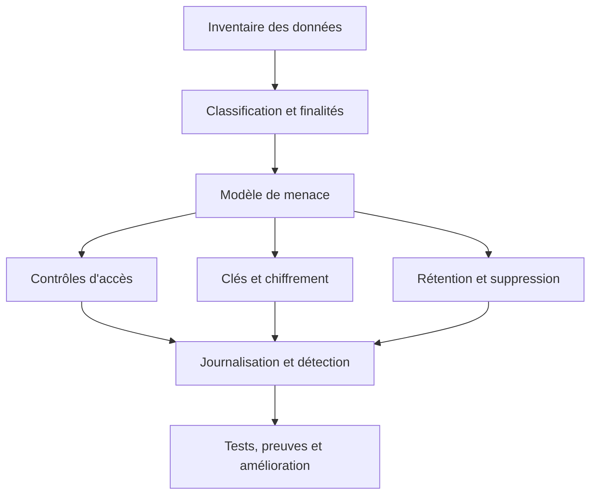

# Chiffrement, RGPD et contrôle d'accès — Expert

> **Mise en contexte.** Une plateforme analytique peut respecter toutes les exigences de disponibilité et pourtant exposer des données personnelles par un export, une table de test, un journal technique ou un compte de service trop permissif. La sécurité des données ne se limite pas à chiffrer un disque ou à activer TLS : elle nécessite de comprendre les usages, de minimiser la collecte, de séparer les responsabilités, de gérer les clés, de contrôler chaque copie et de démontrer que les accès et les suppressions sont réellement appliqués. Ce cours propose une démarche technique et opérationnelle pour concevoir une plateforme de données protégée dès sa conception.

## Objectifs et prérequis

À la fin de ce cours, vous saurez construire un modèle de menace pour une plateforme de données, distinguer chiffrement au repos et en transit, sélectionner une stratégie de gestion de clés, définir les rôles et permissions, limiter l'exposition des données personnelles, concevoir la pseudonymisation, traiter les sauvegardes et les exports, mettre en œuvre une politique de rétention, vérifier les journaux d'accès et préparer un contrôle de conformité.

Vous devriez connaître les bases des bases de données relationnelles, des systèmes distribués, des identités de service et du cycle de vie des données. Le RGPD est un cadre juridique dont l'application dépend du contexte, du territoire et des traitements concrets. Le contenu ci-dessous est une formation technique générale, et non un avis juridique. Une organisation doit faire valider les décisions sensibles par ses responsables de conformité, son délégué à la protection des données et son conseil compétent.

## 1. Partir des données et des menaces

Avant de sélectionner un mécanisme de chiffrement, inventorie les données, les finalités, les personnes concernées, les sources, les destinataires, les lieux de stockage et les durées de conservation. Une colonne qui paraît anodine peut devenir identifiante lorsqu'elle est croisée avec d'autres informations. Une date précise, un code postal, un identifiant d'appareil ou un historique de localisation peuvent révéler des habitudes. La classification doit donc considérer le contexte et les possibilités de rapprochement, pas seulement le nom d'une colonne.

Un modèle de menace décrit ce que l'on cherche à protéger, les adversaires ou erreurs possibles, les chemins d'attaque et les conséquences. Les menaces incluent l'accès abusif d'un utilisateur interne, le vol d'un jeton, une fuite dans les journaux, un bucket public par erreur, une sauvegarde non chiffrée, un prestataire compromis, une requête BI exportée ou un environnement de développement contenant de vraies données. Les erreurs d'exploitation sont aussi importantes que les attaques externes : une permission accordée temporairement peut rester en place des mois si elle n'a pas de date d'expiration.

La sécurité est une chaîne. Le chiffrement protège la confidentialité des données sous certaines conditions, mais il ne bloque pas une requête autorisée abusivement ni un export effectué par un compte légitime compromis. Un contrôle de ligne peut limiter les résultats visibles mais ne garantit pas qu'une copie en cache est purgée. Une suppression dans la table ne supprime pas automatiquement les fichiers d'un snapshot, les objets exportés ou les données d'un environnement de test. Chaque menace doit être associée à un contrôle, un responsable, une preuve et un scénario de test.



## 2. Les principes de protection des données

La minimisation consiste à ne collecter que les données nécessaires à la finalité déclarée et à ne pas conserver indéfiniment des champs « au cas où ». Elle commence à la source : exclure un champ inutile avant de le transporter est préférable à le propager partout puis chercher à l'effacer dans chaque copie. Si l'analyse n'a besoin que de l'âge par tranche, la date de naissance exacte n'a peut-être pas à entrer dans l'environnement analytique. Toute réduction doit toutefois préserver les besoins métier légitimes et être documentée.

La limitation de finalité exige que l'usage prévu soit défini, et que les réutilisations soient évaluées. Des données collectées pour traiter un service ne sont pas automatiquement appropriées pour profiler les personnes ou entraîner un modèle. Les équipes techniques ne devraient pas rendre toutes les colonnes accessibles simplement parce que la plateforme les centralise. Une demande de nouvel usage doit déclencher une évaluation de nécessité, de base juridique, de compatibilité et de risque.

L'exactitude signifie que les données utilisées doivent être pertinentes et corrigibles. Une donnée erronée peut avoir une conséquence même si elle est bien chiffrée. Les systèmes doivent distinguer l'absence de valeur, l'inconnu, l'effacement demandé et la donnée invalide. Des flux de correction et de propagation sont nécessaires pour éviter que la rectification d'une source n'ait aucun effet sur les produits dérivés.

La limitation de conservation impose une durée justifiée. La durée peut être différente entre la source opérationnelle, la zone brute, le produit agrégé, les journaux d'audit et les sauvegardes. Les règles doivent tenir compte des besoins de preuve et de reprise, sans servir de prétexte à une conservation illimitée. L'organisation doit définir comment une donnée devient expirée, quand la purge est déclenchée, comment les erreurs sont traitées et quelle preuve permet de vérifier l'exécution.

La protection dès la conception se traduit par des choix techniques par défaut : buckets privés, rôles à privilèges minimaux, données de test synthétiques, clés gérées séparément du code, expiration des accès temporaires, chiffrement activé, traces d'accès et contrôles automatisés. La responsabilité démontrable demande de conserver les preuves appropriées : évaluations, décisions, résultats de test, journaux, contrats de sous-traitance et procédures. L'objectif est de démontrer des contrôles effectifs, pas de produire uniquement une politique écrite.

## 3. Identifier les données personnelles et les risques de réidentification

Une donnée personnelle est une information se rapportant à une personne identifiée ou identifiable. La possibilité d'identification peut venir d'une information directe, comme un nom, ou d'un rapprochement entre plusieurs attributs. Des identifiants pseudonymisés restent liés à une personne lorsqu'une table ou un secret permet de retrouver le lien. Leur protection doit être proportionnée au risque de réidentification et à la sensibilité des usages.

La pseudonymisation remplace un identifiant direct par un identifiant alternatif. Une table de correspondance peut être isolée dans un coffre logique avec des droits plus stricts. La pseudonymisation réduit l'exposition lors des analyses courantes, mais elle n'est pas une anonymisation irréversible. Un attaquant peut parfois retrouver une personne grâce aux dates, à la rareté d'un comportement, à des données publiques ou à des valeurs stables dans plusieurs jeux.

L'anonymisation cherche à rendre la réidentification suffisamment improbable au regard des moyens raisonnablement susceptibles d'être utilisés. Elle doit être évaluée sur l'ensemble du jeu et des sources auxiliaires disponibles. Supprimer le nom et garder une date exacte, un lieu précis et une séquence rare peut laisser un risque élevé. Le niveau de protection attendu dépend du contexte et doit faire l'objet d'une analyse documentée et de tests réguliers.

L'agrégation réduit souvent le risque lorsqu'elle évite d'exposer des lignes individuelles, mais un groupe de taille très faible peut révéler un fait. Les attaques par différence comparent deux requêtes presque identiques pour isoler une personne. Les contrôles peuvent inclure des seuils de taille minimale, la limitation des requêtes successives, l'agrégation par intervalle, le contrôle des filtres et, pour certains usages statistiques, des méthodes formelles comme la confidentialité différentielle. Ces mécanismes ont des compromis sur la précision et doivent être adaptés à la finalité.

## 4. Concevoir un modèle d'accès

Le modèle d'accès doit répondre à plusieurs questions : qui demande l'accès, pour quelle finalité, à quel jeu de données, avec quelles opérations, pour quelle durée et avec quelle approbation ? Un rôle « analyste » universel est souvent trop large. Il peut être remplacé par des rôles métier liés aux produits de données, plus des rôles d'exploitation limités pour le diagnostic. Les accès sensibles peuvent nécessiter une approbation supplémentaire, une durée courte et un journal d'activité renforcé.

Le contrôle basé sur les rôles associe des permissions à des rôles. Il est simple à administrer si les responsabilités sont stables. Le contrôle basé sur les attributs évalue également les attributs du sujet, de la ressource, de l'action et du contexte. Il peut intégrer la sensibilité du jeu, l'appartenance à une équipe, l'environnement, le lieu d'exécution ou l'heure. Ces modèles peuvent être combinés, à condition que les règles restent auditées et compréhensibles.

Le moindre privilège signifie que l'identité ne reçoit que les permissions nécessaires. Un job qui écrit une table Silver n'a pas besoin de modifier les politiques du bucket ni de lire l'ensemble des tables Finance. Le compte de développement ne doit pas réutiliser les identifiants de production. Les comptes humains ne devraient pas partager un mot de passe collectif, car cela empêche l'attribution des actions et complique la révocation.

Les permissions doivent distinguer lecture, écriture, suppression, administration du schéma, export et gestion des métadonnées. L'accès à une table ne doit pas donner implicitement le droit de télécharger des extraits complets si le moteur propose des contrôles distincts. Les chemins directs vers le stockage doivent appliquer des politiques cohérentes avec celles du moteur SQL. Une personne qui n'a pas accès à une table ne devrait pas pouvoir lire ses fichiers en contournant le catalogue.

## 5. Accès aux colonnes et aux lignes

Le masquage de colonnes peut afficher une valeur réduite ou une représentation partielle à certains rôles. Il doit empêcher la récupération par des vues indirectes, des exports ou des fonctions auxiliaires. Le masquage n'est pas une preuve d'anonymisation : une partie visible d'un numéro ou un identifiant tronqué peut toujours être corrélé avec des données externes. La politique doit décrire quels rôles voient la valeur, la forme masquée et les usages autorisés.

Le contrôle d'accès au niveau des lignes applique un prédicat pour limiter les enregistrements retournés. Il peut être adapté à l'isolation de filiales ou à la séparation régionale. La règle doit aussi s'appliquer aux vues, aux requêtes préparées et aux chemins alternatifs d'accès. Si un cache réutilise un résultat calculé pour une personne et le sert à une autre, une bonne politique de table ne suffit pas : les clés de cache doivent intégrer les dimensions d'autorisation.

Les vues de sécurité peuvent exposer une projection contrôlée de la table. Elles sont utiles pour publier un produit de données stable, mais elles doivent être protégées contre les opérations d'écriture indirectes et les changements de définition. La chaîne de vues et les dépendances sont à documenter. Un modèle BI peut ajouter ses propres permissions ; il faut tester la combinaison des droits du BI, du moteur SQL et du stockage.

Un contrôle négatif est aussi important qu'un test de réussite. Vérifiez qu'un rôle non autorisé ne peut ni lire, ni exporter, ni découvrir les colonnes sensibles, ni accéder par un lien direct. Testez les utilisateurs désactivés, les rôles expirés, les jobs exécutés depuis un autre environnement et les comptes qui ont quitté une équipe. Les tests doivent être automatisés pour les cas critiques, tout en évitant de mettre des données personnelles réelles dans les assertions et les traces.

## 6. Chiffrement en transit et au repos

TLS protège le transport entre un client et un service contre l'écoute et la modification, sous réserve d'une validation correcte des certificats et des identités. Désactiver la vérification du certificat pour contourner un incident détruit une protection essentielle. Les clients doivent vérifier la chaîne de confiance et le nom du serveur, maintenir des versions de protocole adaptées et gérer les certificats avant leur expiration.

Le chiffrement au repos protège les données stockées sur les supports ou dans le service de stockage. Selon le fournisseur, le chiffrement peut être transparent et gérer les clés côté service, ou s'appuyer sur une clé contrôlée par le client. Il faut clarifier ce qui est chiffré : objets, volumes, sauvegardes, journaux, réplicas, fichiers temporaires et exports. Le chiffrement du bucket n'implique pas nécessairement que tous les fichiers téléchargés ou écrits localement soient protégés.

Le chiffrement côté service simplifie généralement l'exploitation, mais délègue une partie de la gestion technique au fournisseur. Une clé contrôlée par l'organisation facilite certains contrôles de révocation, de séparation des responsabilités et d'audit, mais accroît le risque opérationnel si la clé ou le service de gestion est mal configuré. Le chiffrement côté client peut limiter l'exposition aux services intermédiaires, mais pose des difficultés pour les traitements analytiques et l'indexation. Le choix dépend du modèle de menace et des capacités fonctionnelles requises.

Le chiffrement n'empêche pas un utilisateur autorisé de lire des données et ne garantit pas l'intégrité métier. Une base peut chiffrer ses fichiers alors qu'un compte SQL compromis peut extraire toutes les lignes. Il faut combiner le chiffrement avec le contrôle d'accès, la gestion des clés, l'audit, la segmentation des environnements, la minimisation et les procédures de réponse aux incidents.

## 7. Gestion du cycle de vie des clés

Une clé cryptographique est un actif sensible. Son cycle de vie inclut création, génération sécurisée, stockage, utilisation, rotation, révocation, sauvegarde éventuelle et destruction. Les clés maîtresses ne doivent pas être stockées avec les données chiffrées sous une forme accessible au même rôle. Les services de gestion de clés ou modules matériels peuvent limiter l'accès aux opérations cryptographiques et fournir des journaux d'utilisation, mais leur configuration doit rester testée.

La séparation des fonctions empêche une seule identité de créer une clé, modifier sa politique, l'utiliser pour lire les données et supprimer les journaux. Les administrateurs de clé et les utilisateurs des clés peuvent être des rôles distincts. Les accès de déchiffrement devraient être aussi restrictifs que les accès aux données. Les processus automatisés ont besoin d'identités de service dédiées, sans secret permanent inscrit dans le dépôt ou une image de conteneur.

La rotation réduit la durée d'usage d'une clé, mais ne signifie pas toujours que tous les anciens objets sont rechiffrés instantanément. Certains systèmes utilisent une clé maîtresse pour protéger des clés de données ; la rotation de la maîtresse peut se faire sans rechiffrer tout le volume. D'autres scénarios imposent une réécriture réelle. La procédure doit distinguer la rotation de clé d'enveloppe, la rotation de clé de données et la migration de chiffrement.

La révocation peut être destructive : si le service ne peut plus accéder à la clé, les données peuvent devenir illisibles même si les fichiers sont présents. Avant la destruction, vérifiez les dépendances, les sauvegardes et la procédure de restauration. La destruction doit être contrôlée et approuvée. Pour une demande d'effacement, la cryptodestruction ne constitue une solution valable que si toutes les copies pertinentes utilisent réellement cette clé et si aucune autre copie déchiffrée ne subsiste.

## 8. Pseudonymisation et tokenisation

La tokenisation remplace une valeur sensible par un jeton qui n'a pas de signification directe et qui peut être relié à la valeur initiale par un service dédié. Ce service doit appliquer l'authentification, limiter la fréquence, journaliser les conversions et isoler la table de correspondance. Si un pipeline analytique n'a besoin que de relier plusieurs événements d'une même personne, un identifiant stable pseudonyme peut être suffisant sans transmettre le nom ni le numéro de compte.

Le hachage n'est pas toujours approprié. Une valeur à faible entropie, comme un code postal, une date ou un identifiant séquentiel, peut être retrouvée par dictionnaire même si le hash est cryptographiquement sûr. Un sel commun n'empêche pas nécessairement les rapprochements si le domaine est petit. Un HMAC utilisant une clé secrète offre une meilleure résistance aux attaques hors ligne dans certains cas, mais introduit une dépendance de clé et ne rend pas automatiquement les données anonymes.

Les règles de tokenisation doivent être adaptées à l'usage. Un jeton différent à chaque source empêche certains rapprochements mais renforce la confidentialité. Un jeton stable facilite l'analyse longitudinale mais augmente le risque de corrélation. Le choix doit être documenté, et les équipes consommatrices ne doivent pas accéder au service de réidentification sans besoin explicite.

Les exports doivent être évalués séparément. Une table pseudonymisée peut devenir identifiable après croisement avec une liste publique. Pour une livraison externe, réduisez les attributs, supprimez les colonnes inutiles, évaluez la taille des groupes et faites approuver les critères de diffusion. Une fois une copie envoyée hors de la plateforme, il peut être impossible d'en assurer la suppression immédiate ; les contrats et les canaux de transfert sont donc essentiels.

## 9. Secrets, identités de service et rotation

Les secrets incluent mots de passe, jetons API, clés privées, certificats, clés de chiffrement et chaînes de connexion. Ils ne doivent pas être dans le code, les logs, les fichiers d'exemple réalistes ou les artefacts de build. Utilisez un gestionnaire de secrets, des variables d'environnement injectées par une plateforme sécurisée ou des identités de charge de travail lorsque disponibles. Les secrets doivent être séparés par environnement et par service.

Une identité de service doit être bornée à une finalité. Le service d'ingestion utilise une identité pour écrire Bronze ; le processus de transformation lit Bronze et écrit Silver ; le produit BI lit uniquement Gold. Les secrets ne doivent pas être réutilisés entre tous les composants, sinon la compromission d'un job donne accès à toute la plateforme. Les permissions doivent être testées en dehors du compte administrateur.

La rotation doit éviter une coupure non planifiée. Une approche courante consiste à créer le nouveau secret, permettre une période de coexistence contrôlée, déployer les consommateurs, vérifier les nouvelles connexions puis révoquer l'ancien. Le plan de rotation doit savoir identifier les usages encore actifs. La date d'expiration doit être surveillée à l'avance ; un certificat qui expire pendant une pointe peut provoquer une cascade de retries.

Après une fuite présumée, révoquez d'abord le secret concerné et évaluez ses permissions, puis examinez les journaux, les traces et les données potentiellement consultées. Changer seulement la valeur sans vérifier la portée des accès peut laisser la menace active via un autre jeton. Les journaux ne doivent pas contenir la valeur du secret, même si l'application a échoué à la valider.

## 10. Rétention, suppression et copies dérivées

La suppression logique d'une ligne n'est pas équivalente à l'effacement de toutes les copies. Les données peuvent être présentes dans une zone brute, une table nettoyée, des snapshots, un entrepôt, un cache, un index de recherche, un notebook, un fichier exporté, une DLQ, une sauvegarde ou un jeu de test. L'inventaire doit donc comprendre le lignage et les copies, pas seulement la base source.

Une procédure d'effacement doit identifier la personne ou l'objet métier de manière suffisamment fiable, déterminer les tables affectées, appliquer les suppressions ou transformations autorisées, invalider les résultats dérivés et enregistrer l'état d'exécution. Dans une table analytique immuable, une demande peut nécessiter l'ajout d'un tombstone, une réécriture ou un mécanisme de suppression du format de table. Le protocole dépend du moteur et doit être testé en tenant compte du time travel et des snapshots.

Les sauvegardes posent une tension entre effacement et récupération. Une politique peut prévoir le retrait à l'expiration des sauvegardes, la suppression logique avant restauration et une réapplication des demandes d'effacement après restauration. Il faut éviter qu'une restauration complète réintroduise silencieusement des données déjà supprimées. Les règles doivent être validées par les responsables de conformité et documentées dans le plan de reprise.

Les logs ont une durée de conservation propre. Ils doivent fournir suffisamment de preuves pour les enquêtes et les audits, mais ne devraient pas copier des payloads complets contenant des informations personnelles. Préférez des identifiants de corrélation, un type d'opération, le rôle, l'objet consulté et la décision d'accès. Une donnée de log doit être considérée comme une donnée à part entière, avec contrôle d'accès et rétention.

## 11. Mesures organisationnelles et sous-traitants

La sécurité n'est pas uniquement une configuration du cloud. Elle comprend les responsabilités, la formation, l'approbation des accès, la revue des fournisseurs, la gestion des incidents et la documentation. Les sous-traitants peuvent héberger, transformer, observer ou sauvegarder les données ; leurs rôles, lieux de traitement, mesures de sécurité et engagements contractuels doivent être évalués. Une architecture multicloud multiplie les frontières de responsabilité et les flux à cartographier.

Une analyse d'impact relative à la protection des données peut être requise lorsque le traitement est susceptible d'engendrer un risque élevé. Les équipes techniques doivent fournir les informations nécessaires : catégories de données, finalités, volumes, accès, conservation, transferts, mécanismes de minimisation et scénarios de risque. Les évaluations devraient être revisitées lorsque le traitement, la population, le fournisseur ou la finalité change de manière importante.

Le registre des traitements et le catalogue technique ont des objectifs complémentaires. Le registre décrit les traitements et leurs responsabilités au niveau organisationnel ; le catalogue relie les objets concrets, les colonnes, les sources, les consommateurs et les règles de sécurité. Il faut maintenir un lien entre eux, sans supposer qu'un outil unique remplace toutes les obligations documentaires.

Les demandes des personnes doivent avoir un circuit clair : réception, vérification, recherche des systèmes concernés, traitement, réponse et conservation de la preuve appropriée. Le service technique ne devrait pas répondre en se basant sur une recherche manuelle non reproductible. L'automatisation doit éviter la divulgation à une mauvaise personne, inclure les systèmes dérivés et rendre visibles les traitements qui échouent.

## 12. Journalisation, détection et réponse aux incidents

Un journal d'accès pertinent enregistre l'identité, l'action, la ressource, l'horodatage, le résultat et la provenance technique. Les accès sensibles peuvent nécessiter une justification métier et une référence de ticket. Les logs doivent être protégés contre la modification par les acteurs dont on audite l'activité. Leur rétention et leurs accès doivent être séparés des administrateurs ordinaires de la plateforme.

Une détection utile recherche les accès inhabituels, les exports volumineux, les connexions depuis un nouvel environnement, les tentatives répétées refusées, les changements de permissions et les usages de clé inattendus. Les règles doivent tenir compte des jobs habituels et des périodes de maintenance pour éviter l'inondation d'alertes. Un événement inhabituel n'est pas automatiquement une fuite, mais il doit pouvoir être trié, attribué et rapproché des changements récents.

Le plan de réponse aux incidents doit préciser comment limiter les accès, révoquer une clé ou un jeton, préserver les preuves, identifier les données touchées, évaluer l'impact et coordonner les responsables. La réponse technique doit garder une trace des changements d'urgence. Si l'équipe coupe tous les comptes d'ingestion sans plan de reprise, elle peut aggraver l'indisponibilité ; si elle conserve les accès compromis pour observer plus longtemps sans contrôle, elle augmente le risque. La décision doit être guidée par les scénarios préparés.

La capacité d'enquête dépend de tests réguliers. Simulez une fuite de jeton, un export non prévu, un objet public par erreur et un accès à une colonne sensible. Vérifiez si l'alerte est déclenchée, qui la reçoit, quelles preuves sont disponibles et si le processus de révocation fonctionne. Un contrôle sans test ne permet pas de connaître le temps réel de détection et de confinement.

## 13. Atelier pratique : classifier et protéger un jeu de données

On considère un jeu de commandes contenant un identifiant de commande, le nom du client, l'adresse électronique, le code postal, la date de création, le montant, la devise et le statut. Les analystes doivent mesurer les délais de livraison et les montants par région. Ils n'ont pas besoin du nom ni de l'adresse électronique. Un contrat d'accès peut publier une table Gold comprenant une clé pseudonyme, une région suffisamment large, la date au niveau nécessaire, le montant et la devise.

Le premier contrôle est la minimisation au moment de l'ingestion : les champs inutiles ne sont pas copiés dans le produit analytique. La pseudonymisation est réalisée par un service dont la clé est protégée, et l'identité de service de transformation ne reçoit aucun droit de réidentification. L'accès à la zone brute est limité aux rôles qui en ont besoin pour corriger la source. Les requêtes d'analytique utilisent des données agrégées lorsque l'objectif n'exige pas une ligne par commande.

```sql
-- Exemple conceptuel : publier des agrégats utiles plutôt que des identifiants directs.
SELECT region_bucket,
       DATE_TRUNC('day', created_at) AS order_day,
       currency,
       COUNT(*) AS order_count,
       SUM(amount) AS total_amount
FROM gold_orders_minimized
GROUP BY region_bucket, DATE_TRUNC('day', created_at), currency;

-- Contrôle d'accès : ce test doit être exécuté sous le rôle analyste,
-- pas avec un compte administrateur.
SELECT customer_name, email
FROM raw_orders
LIMIT 1;
```

La seconde requête devrait échouer pour le rôle analyste si les permissions sont correctement définies. Il ne faut pas simplement vérifier que la première requête fonctionne. L'audit inclut également un test de téléchargement direct des fichiers, une tentative d'accès depuis un environnement de développement et une vérification des exports. Le résultat attendu et l'identité testée doivent être consignés sans journaliser de données personnelles.

Pour une purge, créez une demande de test avec une identité synthétique. Recherchez le jeton dans Bronze, Silver, Gold, les snapshots, les tables de correspondance et les environnements secondaires. Appliquez le processus prévu puis vérifiez les résultats avec des requêtes et le catalogue. Enfin, restaurez un snapshot dans un environnement isolé pour vérifier que la procédure de réapplication des demandes d'effacement est effective. N'utilisez pas de données réelles pour ce TP.

## 14. Scénarios de diagnostic

### Scénario A — Une clé est stockée dans un fichier de configuration

Le dépôt contient un fichier d'exemple qui ressemble à une chaîne de connexion réelle. Traitez-le comme une fuite potentielle jusqu'à preuve du contraire : identifiez la clé, révoquez-la si elle a pu être utilisée, examinez ses permissions et les journaux, puis retirez la valeur de l'historique selon la procédure d'incident. Une suppression du dernier commit ne rend pas le secret inutilisable. Remplacez-le par un mécanisme d'injection sécurisé et ajoutez une détection de secrets au pipeline de livraison.

### Scénario B — Un bucket est accessible publiquement

Désactivez l'accès public par le mécanisme de contrôle prévu, vérifiez les politiques d'accès et les journaux disponibles, puis identifiez les données et la période concernées. Ne présumez pas qu'aucun téléchargement n'a eu lieu simplement parce que le lien était peu connu. Contrôlez les copies et les identités associées, puis ajoutez une règle empêchant la réapparition de la configuration. La validation doit inclure un test depuis un contexte non authentifié.

### Scénario C — Un analyste peut lire la table brute

Vérifiez les rôles, héritages, groupes, vues, droits de catalogue et accès directs au stockage. L'accès peut provenir d'une permission héritée d'un groupe historique, et non de la table elle-même. Réduisez les droits, testez avec l'identité de l'analyste et recherchez les exports ou notebooks qui ont copié des données. Documentez qui est propriétaire du rôle et ajoutez une revue périodique.

### Scénario D — Une demande de suppression n'atteint pas Gold

Le lignage peut être incomplet ou un job de backfill peut republier les données à partir d'une source encore non purgée. Suivez l'identifiant à travers les tables et les snapshots. Définissez une règle pour empêcher l'ingestion future de réintroduire la donnée. Les contrôles de purge doivent s'exécuter après un recalcul ou une restauration, et les échecs doivent être signalés au propriétaire du traitement.

### Scénario E — Les données pseudonymisées sont réidentifiées

Examinez les attributs de quasi-identification et les croisements possibles. Une clé pseudonyme stable peut faciliter les corrélations ; les dates précises et les petites catégories peuvent révéler l'identité. Réduisez la granularité, restreignez les exports ou adoptez une stratégie de jeton propre au contexte. Refaites l'évaluation sur les jeux accessibles aux destinataires, pas uniquement dans la table source.

### Scénario F — Une rotation de clé interrompt les jobs

Vérifiez si tous les clients utilisent la nouvelle version, si les anciennes clés restent disponibles pendant la migration et si les permissions de déchiffrement sont cohérentes. La procédure doit permettre une période de coexistence contrôlée et un retour arrière limité dans le temps. N'effacez pas une ancienne clé avant de savoir quelles sauvegardes ou quels objets en dépendent. Après la résolution, automatisez le contrôle d'expiration.

### Scénario G — Les journaux contiennent des payloads sensibles

Réduisez immédiatement la génération de ces logs, restreignez l'accès au stockage des journaux et évaluez les copies déjà produites. Supprimer le champ dans le code ne supprime pas les enregistrements historiques. Définissez la purge adaptée, mettez en place une couche de masquage et ajoutez un test qui vérifie l'absence de valeurs sensibles dans les traces. Les journaux peuvent devoir être traités comme un jeu de données à part entière.

### Scénario H — Une restauration réintroduit les données effacées

Le processus de restauration doit rejouer les demandes d'effacement après la réinstallation d'un snapshot ou d'une sauvegarde. Vérifiez le registre des demandes, la correspondance des identifiants et le lignage des tables dérivées. Ajoutez une étape bloquante de validation avant de rouvrir l'accès aux consommateurs. La récupération technique d'une table n'est terminée que lorsque les contrôles de confidentialité sont de nouveau satisfaits.

### Scénario I — Un compte de service est partagé

Identifiez les consommateurs, créez des identités distinctes avec des permissions minimales, migrez progressivement et révoquez le compte partagé. Si le compte est compromis, il ne devrait pas donner accès à des domaines qui n'ont aucune relation avec le service. Testez les permissions de chaque nouvelle identité et vérifiez que les logs attribuent les actions au bon service. Documentez la rotation et la suppression des anciennes variables.

### Scénario J — Une extraction anormalement volumineuse est détectée

Déterminez si l'action correspond à un job attendu, à une demande approuvée ou à un comportement suspect. Examinez l'identité, le produit de données, le volume, le contexte et les changements d'accès récents. Si le risque est crédible, limitez l'accès et préservez les preuves avant de conclure. Ajoutez une alerte contextuelle sur les exports et une procédure d'approbation pour les extractions exceptionnelles.

### Scénario K — Une colonne semble chiffrée mais le risque demeure

Le système peut employer un chiffrement déterministe, une valeur masquée réversible ou un identifiant pseudonyme corrélable. Clarifiez le mécanisme et la menace visée. Vérifiez où la clé ou la table de correspondance est conservée, qui peut la consulter et si l'application expose une fonction de conversion. Le mot « chiffré » ne remplace pas la description d'une propriété de sécurité et de sa limite.

### Scénario L — Une permission temporaire reste active

Recherchez les accès sans propriétaire, sans justification ou sans date d'expiration. Automatisez l'expiration des droits temporaires, fournissez une revue régulière et envoyez une alerte avant la date de retrait. Une procédure manuelle peut être nécessaire pour des accès urgents, mais elle doit être limitée et traçable. Mesurez le nombre d'exceptions encore actives et le délai moyen de révocation.

## 15. Exercices corrigés

### Exercice 1 — Chiffrement et autorisation

Un fichier est chiffré au repos, mais tous les analystes peuvent le télécharger. Le risque est-il résolu ?

**Correction :** non. Le chiffrement au repos protège les supports selon le modèle de clé, mais un rôle autorisé à déchiffrer ou à télécharger peut extraire les lignes. Il faut minimiser les champs, réduire les permissions, contrôler les exports et auditer les usages sensibles.

### Exercice 2 — Hachage d'une adresse électronique

L'équipe calcule un hash simple de chaque email puis considère les valeurs anonymes. Quelle limite doit-elle examiner ?

**Correction :** les adresses sont souvent devinables à partir de dictionnaires et de listes connues ; les mêmes valeurs produisent des hashes corrélables. Un secret HMAC ou une tokenisation peut être plus approprié, mais les valeurs restent pseudonymisées si un lien ou une méthode de réidentification subsiste.

### Exercice 3 — Suppression d'un snapshot

Une demande d'effacement est réalisée dans la table active. Peut-on affirmer que toutes les copies ont disparu ?

**Correction :** non. Il faut vérifier les snapshots, exports, caches, tables dérivées, sauvegardes, environnements de test et journaux. Le processus doit établir une portée de purge, une durée et une preuve d'exécution adaptées aux règles de conservation.

### Exercice 4 — Accès temporaire

Un ingénieur a besoin de déboguer un incident pendant une heure. Quelle conception privilégier ?

**Correction :** un rôle temporaire limité à la ressource et aux opérations nécessaires, avec justification, date d'expiration, approbation adaptée et journaux d'activité. L'accès doit être automatiquement révoqué et le test de révocation doit être vérifiable.

### Exercice 5 — Fuite de jeton

Un jeton apparaît dans un journal d'erreur. Quelles sont les premières actions ?

**Correction :** révoquer ou renouveler le jeton, déterminer les permissions et usages potentiels, préserver les preuves, rechercher les autres copies du secret, limiter l'exposition du journal et ajouter un contrôle de masquage. Supprimer la ligne de log sans révoquer le secret ne suffit pas.

### Exercice 6 — Chiffrement des sauvegardes

La production utilise un stockage chiffré mais les exports nocturnes sont écrits dans un espace de travail non chiffré. Quel est le problème ?

**Correction :** la protection n'est pas cohérente sur tout le cycle de vie. Les exports sont une copie de données et doivent avoir des contrôles de stockage, accès, rétention et suppression équivalents au risque associé. Préférez éviter un export intermédiaire inutile ou utilisez un emplacement sécurisé.

### Exercice 7 — Agrégation et confidentialité

Une requête retourne un groupe composé d'une seule personne. Pourquoi le seuil d'agrégation est-il important ?

**Correction :** une agrégation ne masque pas nécessairement le fait individuel lorsque le groupe est très petit. Il faut définir des seuils, limiter les combinaisons de filtres, surveiller les requêtes différentielles et choisir la granularité en fonction du risque de réidentification.

### Exercice 8 — Clé avant destruction

Pourquoi ne faut-il pas détruire immédiatement une clé utilisée par un ancien jeu de sauvegarde ?

**Correction :** la destruction peut rendre les sauvegardes irrécupérables et empêcher un plan de reprise. Il faut identifier les dépendances, valider les obligations de conservation, migrer ou supprimer les copies de manière contrôlée, puis approuver et tracer la destruction.

## 16. Défi final corrigé : construire un produit analytique protecteur

Une société veut fournir aux analystes un historique de commandes et de livraison, avec des mesures de qualité et une possibilité d'analyse longitudinale. Les sources comportent des identifiants directs, des contacts, des montants, des dates et des informations de livraison. Les analystes ne doivent pas pouvoir retrouver les coordonnées des clients. L'équipe doit pouvoir honorer les demandes de suppression et contrôler les accès.

### Proposition de solution

Le propriétaire du traitement détermine les finalités et les champs strictement nécessaires. Les identifiants directs sont conservés uniquement dans la zone opérationnelle avec accès restreint. L'ingestion vers la zone analytique applique la minimisation et demande à un service de tokenisation une clé stable adaptée à l'analyse. La table de correspondance n'est accessible qu'à un rôle distinct avec une approbation explicite. Les jeux de test sont synthétiques et les exports sont limités.

Les données en transit utilisent TLS et les objets, tables, journaux pertinents et sauvegardes sont chiffrés selon le modèle de menace. Les clés sont gérées par un service dédié, avec rôles séparés, rotation testée et procédure de restauration. Les identités de service ont des permissions différentes pour Bronze, Silver et Gold. Le catalogue affiche la classification, le propriétaire, les règles d'accès, la rétention et le lignage.

La zone analytique expose les données pseudonymisées et les produits agrégés nécessaires aux cas d'usage. Les rôles ne voient pas les colonnes directes, et les contrôles de lignes sont testés avec des identités normales. Les journaux enregistrent l'action et la ressource sans copier les payloads. Les exports volumineux font l'objet d'une alerte contextuelle.

Un registre de demandes d'effacement alimente un processus idempotent. Celui-ci recherche les identifiants dans les zones, les tables dérivées, les snapshots et les copies, applique les opérations prévues puis vérifie les résultats. Après une restauration, les demandes déjà traitées sont rejouées avant de rouvrir les produits aux consommateurs. Les preuves de traitement sont limitées et conservées conformément à la politique approuvée.

Les tests d'acceptation incluent un analyste non autorisé, un accès direct au stockage, une fuite simulée de jeton, une rotation de clé, un export important, une purge complète et une restauration. La solution est validée lorsque les accès interdits échouent, les accès autorisés restent traçables, la purge couvre les dépendances et les équipes savent expliquer les limites de pseudonymisation et de chiffrement.

## À retenir

Une plateforme conforme et sécurisée doit protéger les données de la collecte à l'effacement. TLS et le chiffrement au repos sont nécessaires dans de nombreux contextes, mais ne remplacent ni le moindre privilège, ni la minimisation, ni le contrôle des exports, ni la gestion des clés et des copies dérivées. La pseudonymisation réduit le risque sans garantir l'anonymat. Une règle est fiable lorsqu'elle est testée, mesurée, attribuée à un responsable et accompagnée d'une procédure de réponse.
